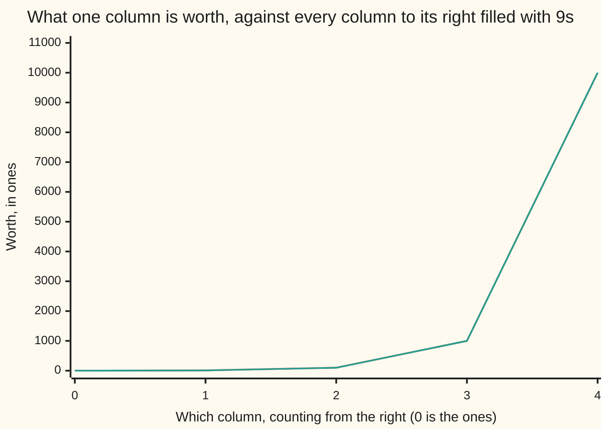

# Place value: why 523 means five hundreds, two tens and three ones

[Syllabus](../../../SYLLABUS.md) → [Foundations](../README.md) → [Everyday Arithmetic](../README.md#s01) → Place value

---

## General Overview

You buy twelve apples at 75 cents each. You hand over a $10 bill and get $1.00 back. Four of you split the cost, so each owes $2.25. The board on the stall says it has sold **523** apples this week.

None of that was hard. But you read the 1 in $10 as ten dollars and the 1 in $1.00 as one dollar — same mark, two different jobs, no hesitation.

The job is decided by **where the mark sits**. That is why ten marks — 0 1 2 3 4 5 6 7 8 9 — are enough to write any number there has ever been. It is called **place value**.

**A digit's worth is the digit itself times the worth of the column it sits in, and each column is worth ten times the column on its right.**

**What kind of fact this is:** a convention, the agreed rule for writing numbers down. Why it works shows why the rule never gives one numeral two meanings.

### The picture: what a column is worth



Columns are counted from the right. The climbing line is what one column is worth; the lower line is the most everything to its right can hold, all 9s. It never catches up: 9999 still loses to 10000. So the leftmost digit tells you most of what you want to know.

---

## The formula

There is nothing to memorise. The numeral (the number as written, in digits) **is** the formula:

**523 = 5 × 100 + 2 × 10 + 3 × 1**

**Read it aloud:** five hundred and twenty-three is five hundreds, plus two tens, plus three ones.

Each digit, times the worth of its column, added up. An empty column is still written, with a 0:

**900 = 9 × 100 + 0 × 10 + 0 × 1**

| Piece | Plain meaning | In 523 |
| --- | --- | --- |
| a digit | one of the ten marks, 0 to 9 | 5, 2, 3 |
| a column's worth | 1 at the right, then 10, then 100 | 100, 10, 1 |
| the number | each digit times its column's worth | 500 + 20 + 3 |

### When it holds

- **Each column holds one digit, 0 to 9.** A tenth one has to be carried into the column on the left, or the columns no longer line up.
- **Every column is written, even an empty one.** Leave out the zeros and 900 reads as 90.
- **The biggest column comes first.** Read 523 from the right and it comes out as 325.
- **Each column is worth ten times the one on its right.** Make every column worth 1 and 523 reads as 10.

---

## Why it works

### Bundle by tens

Tip 523 apples onto a table. Bag them ten at a time: 52 bags, 3 loose. Crate the bags, ten to a crate: 5 crates, 2 bags over.

You are holding **5 crates, 2 bags, 3 loose**. Write that biggest bundle first and you have written `523`. The numeral is not a name for the pile; it is a stock list of it.

A column is worth ten times the one on its right because that is the size of the bundle: a crate is ten bags, a bag is ten apples. That is also why a column stops at 9: the tenth one gets bundled and moves left. That is carrying.

### An empty column still gets written

Twelve apples at 75 cents is 900 cents: 9 hundreds, no tens, no ones. Leave both zeros out and you have `9`; leave one out and you have `90`. The zeros report an empty column, and they hold the 9 out in the hundreds where it belongs.

### Writing a quantity down, and checking it

Bundling backwards is dividing by ten, keeping the remainder.

- 523 ÷ 10 = 52, remainder **3** — the loose apples
- 52 ÷ 10 = 5, remainder **2** — the bags over
- 5 ÷ 10 = 0, remainder **5** — the crates

Read the remainders bottom to top: 5, 2, 3. The first one is the *last* digit you write, which is what people get backwards. Check it the other way: 5 × 100 + 2 × 10 + 3 × 1 is 523 again.

<details>
<summary>If you did not have ten fingers</summary>

Swap the bundle size and it still runs. Bundle by twos and the marks are just 0 and 1, which is how a computer counts: a wire is on or off.

</details>

---

## Worked numbers, by hand

The apple stall, in cents throughout.

| Step | Arithmetic | Value |
| --- | --- | --- |
| twelve apples | 12 × 75 | 900 |
| that total, as columns | 9 × 100 + 0 × 10 + 0 × 1 | 900 |
| the $10 bill, in cents | 10 × 100 | 1000 |
| change | 1000 − 900 | 100 |
| each friend's share | 900 ÷ 4 | 225 |
| the check, four shares back | 225 × 4 | 900 |
| that share, as columns | 2 × 100 + 2 × 10 + 5 × 1 | **225** |
| the stall's week | 5 × 100 + 2 × 10 + 3 × 1 | **523** |

Each friend owes 225 cents — $2.25.

### What breaks if you drop a piece

| Mistake | Comes out at | What went wrong |
| --- | --- | --- |
| Writing 900 with one zero, as `90` | 90 | Ninety cents for twelve apples |
| Reading 523 right to left, as `325` | 325 | Numerals run biggest first |
| Adding the digits, ignoring the columns | 10 | 5 + 2 + 3 is not the number |

The code below prints all three, and every other number here.

---

## Code, from first principles, and it actually runs

Nothing is imported. The apple story is worked the obvious way, then checked backwards by putting the four shares together again. Then three numerals, a column at a time.

### Python

```python
# Place value -- the check behind the card.  Nothing is imported.  The apple
# stall in cents: twelve apples at 75 cents, a $10 bill, four friends.  Then
# three numerals, each one read a column at a time.
PLACES = [100, 10, 1]

def worth(digits):              # [5, 2, 3] -> 5 x 100 + 2 x 10 + 3 x 1 -> 523
    return sum(d * p for d, p in zip(digits, PLACES))

def row(name, value):
    print(f"{name:<32}{value:>6}")

apples, price, bill, friends = 12, 75, 1000, 4
total = apples * price
change = bill - total
share = total // friends
row("twelve apples at 75 cents each", total)
row("paid with a $10 bill", bill)
row("change, a $1.00 note", change)
row("each of four friends pays $2.25", share)
row("four shares back together", share * friends)     # the check, going backwards
for digits in ([5, 2, 3], [9, 0, 0], [2, 2, 5]):
    row(" + ".join(f"{d} x {p}" for d, p in zip(digits, PLACES)), worth(digits))
print(f"{'what one column is worth':<26}" + "".join(f"{v:>7}" for v in [1, 10, 100, 1000, 10000]))
print(f"{'all 9s to its right':<26}" + "".join(f"{v:>7}" for v in [0, 9, 99, 999, 9999]))
print(f"the three mistakes come out at {worth([0, 9, 0])}, {worth([3, 2, 5])} and {5 + 2 + 3}")

assert total == 900 and change == 100 and total + change == bill
assert share == 225 and share * friends == total
assert worth([5, 2, 3]) == 523 and worth([9, 0, 0]) == total
print("ALL CHECKS PASS")
```

**Ran 2026-09-06 on macOS, Python 3.14.6, standard library only. All checks passed. Output, pasted from the run:**

```
twelve apples at 75 cents each     900
paid with a $10 bill              1000
change, a $1.00 note               100
each of four friends pays $2.25    225
four shares back together          900
5 x 100 + 2 x 10 + 3 x 1           523
9 x 100 + 0 x 10 + 0 x 1           900
2 x 100 + 2 x 10 + 5 x 1           225
what one column is worth        1     10    100   1000  10000
all 9s to its right             0      9     99    999   9999
the three mistakes come out at 90, 325 and 10
ALL CHECKS PASS
```

### Rust

Same numbers, same labels, built with `rustc --edition 2021 -O`.

```rust
// Place value -- the same check as place_value_check.py, in Rust.  No crates.
// The apple stall in cents: twelve apples at 75 cents, a $10 bill, four
// friends.  Then three numerals, each one read a column at a time.
const PLACES: [i64; 3] = [100, 10, 1];

fn worth(digits: [i64; 3]) -> i64 {   // [5, 2, 3] -> 5 x 100 + 2 x 10 + 3 x 1 -> 523
    (0..3).map(|i| digits[i] * PLACES[i]).sum()
}

fn row(name: &str, value: i64) { println!("{:<32}{:>6}", name, value); }

fn main() {
    let (apples, price, bill, friends) = (12i64, 75i64, 1000i64, 4i64);
    let total = apples * price;
    let change = bill - total;
    let share = total / friends;
    row("twelve apples at 75 cents each", total);
    row("paid with a $10 bill", bill);
    row("change, a $1.00 note", change);
    row("each of four friends pays $2.25", share);
    row("four shares back together", share * friends);   // the check, going backwards
    for digits in [[5, 2, 3], [9, 0, 0], [2, 2, 5]] {
        let mut parts: Vec<String> = Vec::new();
        for i in 0..3 { parts.push(format!("{} x {}", digits[i], PLACES[i])); }
        row(&parts.join(" + "), worth(digits));
    }
    let mut worths = format!("{:<26}", "what one column is worth");
    for v in [1, 10, 100, 1000, 10000] { worths.push_str(&format!("{:>7}", v)); }
    println!("{}", worths);
    let mut nines = format!("{:<26}", "all 9s to its right");
    for v in [0, 9, 99, 999, 9999] { nines.push_str(&format!("{:>7}", v)); }
    println!("{}", nines);
    println!("the three mistakes come out at {}, {} and {}",
             worth([0, 9, 0]), worth([3, 2, 5]), 5 + 2 + 3);
    assert!(total == 900 && change == 100 && total + change == bill);
    assert!(share == 225 && share * friends == total);
    assert!(worth([5, 2, 3]) == 523 && worth([9, 0, 0]) == total);
    println!("ALL CHECKS PASS");
}
```

**Ran 2026-09-06 on macOS, rustc 1.98.1, no crates. All checks passed. Output, pasted from the run:**

```
twelve apples at 75 cents each     900
paid with a $10 bill              1000
change, a $1.00 note               100
each of four friends pays $2.25    225
four shares back together          900
5 x 100 + 2 x 10 + 3 x 1           523
9 x 100 + 0 x 10 + 0 x 1           900
2 x 100 + 2 x 10 + 5 x 1           225
what one column is worth        1     10    100   1000  10000
all 9s to its right             0      9     99    999   9999
the three mistakes come out at 90, 325 and 10
ALL CHECKS PASS
```

The two outputs match line for line: whole cents throughout, nothing to round.

### Lean

Lean proves the column rule for every whole number and any number of columns, not just 523 and 900.

- Any number that fits in the columns has exactly one numeral, so no numeral has two meanings.
- A column is always worth more than all 9s to its right: 9999 still loses to 10000.
- Divide by ten over and over: each remainder times its column's worth adds back up to the number.

Printing the apple stall's numbers and the column table is left to the Python and Rust checks.

<details>
<summary>The Lean proof, 121 lines</summary>

```lean
-- Place value: every whole number that fits in a given number of columns has exactly one way to be written with one digit 0 to 9 per column, biggest column first, each column worth ten times the one on its right, and the digits are the remainders from dividing by ten over and over.
import Mathlib.Algebra.BigOperators.Fin
import Mathlib.Data.Fin.VecNotation
import Mathlib.Data.Nat.Digits.Lemmas
import Mathlib.Tactic.NormNum

open Finset

/-- Helper: split off the last column (the ones). -/
theorem pv_sum_succ (k : ℕ) (d : Fin (k + 1) → Fin 10) :
    ∑ i : Fin (k + 1), (d i : ℕ) * 10 ^ (k + 1 - 1 - (i : ℕ)) =
      10 * ∑ i : Fin k, (d i.castSucc : ℕ) * 10 ^ (k - 1 - (i : ℕ)) + (d (Fin.last k) : ℕ) := by
  rw [Fin.sum_univ_castSucc, Finset.mul_sum]
  congr 1
  · refine Finset.sum_congr rfl fun i _ => ?_
    have hi := i.isLt
    have : k + 1 - 1 - (i : ℕ) = (k - 1 - (i : ℕ)) + 1 := by omega
    simp only [Fin.val_castSucc, this, pow_succ]
    ring
  · simp

#print axioms pv_sum_succ

/-- Place value, as the card states it: write a number in `k` columns, every column written
(an empty one gets a 0), one digit 0 to 9 in each, the biggest column first, and each column
worth ten times the one on its right (so the column in position `i` from the left is worth
`10 ^ (k - 1 - i)`). Then a digit's worth is the digit times its column's worth, and every
whole number that fits in those `k` columns has exactly one such numeral: the rule never gives
one number two numerals, or one numeral two meanings. -/
theorem place_value_numeral_exists_unique (k n : ℕ) (hn : n < 10 ^ k) :
    ∃! d : Fin k → Fin 10, ∑ i : Fin k, (d i : ℕ) * 10 ^ (k - 1 - (i : ℕ)) = n := by
  induction k generalizing n with
  | zero =>
    have hn0 : n = 0 := by simpa using hn
    subst hn0
    refine ⟨Fin.elim0, by simp, fun d _ => ?_⟩
    funext i; exact i.elim0
  | succ k ih =>
    have hn' : n / 10 < 10 ^ k := by
      rw [pow_succ] at hn; omega
    obtain ⟨d', hd', huniq⟩ := ih (n / 10) hn'
    refine ⟨Fin.snoc d' ⟨n % 10, by omega⟩, ?_, ?_⟩
    · beta_reduce
      rw [pv_sum_succ]
      simp only [Fin.snoc_castSucc, Fin.snoc_last]
      rw [hd']
      omega
    · intro e he
      rw [pv_sum_succ] at he
      have hlt := (e (Fin.last k)).isLt
      have hlast : (e (Fin.last k) : ℕ) = n % 10 := by omega
      have hrest : ∑ i : Fin k, (e i.castSucc : ℕ) * 10 ^ (k - 1 - (i : ℕ)) = n / 10 := by omega
      have := huniq (fun i => e i.castSucc) hrest
      funext i
      refine Fin.lastCases ?_ (fun j => ?_) i
      · simp only [Fin.snoc_last]; exact Fin.ext hlast
      · simp only [Fin.snoc_castSucc]; exact congrFun this j

/-- The picture: a column is always worth more than everything to its right can hold, even
with every column there filled with 9s. All 9s in the `k` columns right of a column add up to
exactly one less than that column's worth, `10 ^ k` (9999 still loses to 10000). -/
theorem column_beats_all_nines_to_its_right (k : ℕ) :
    ∑ i ∈ range k, 9 * 10 ^ i + 1 = 10 ^ k := by
  induction k with
  | zero => simp
  | succ k ih => rw [Finset.sum_range_succ, pow_succ]; omega

/-- Writing a quantity down: divide by ten over and over, keeping the remainder. The remainder
after `j` divisions, `n / 10 ^ j % 10`, is the digit in column `j` counting from the right
(0 is the ones), and putting each remainder back times its column's worth gives the number
again, for every number that fits in `k` columns. -/
theorem remainders_from_dividing_by_ten_rebuild_the_number (k n : ℕ) (hn : n < 10 ^ k) :
    ∑ j ∈ range k, (n / 10 ^ j % 10) * 10 ^ j = n := by
  induction k generalizing n with
  | zero => simp at hn; simp [hn]
  | succ k ih =>
    rw [Finset.sum_range_succ']
    have hn' : n / 10 < 10 ^ k := by rw [pow_succ] at hn; omega
    have h := ih (n / 10) hn'
    have e : ∀ j, n / 10 ^ (j + 1) % 10 * 10 ^ (j + 1) = 10 * (n / 10 / 10 ^ j % 10 * 10 ^ j) := by
      intro j
      rw [Nat.div_div_eq_div_mul, pow_succ, mul_comm (10 ^ j) 10]
      ring
    rw [Finset.sum_congr rfl (fun j _ => e j), ← Finset.mul_sum, h]
    simp only [pow_zero, Nat.div_one, mul_one]
    omega

-- The formula: 523 is five hundreds, two tens and three ones.
example : 5 * 100 + 2 * 10 + 3 * 1 = 523 := by norm_num
-- The same, as the main theorem reads a three-column numeral.
example : ∑ i : Fin 3, ((![5, 2, 3] : Fin 3 → Fin 10) i : ℕ) * 10 ^ (3 - 1 - (i : ℕ)) = 523 := by
  decide
-- An empty column is still written with a 0: 900.
example : 9 * 100 + 0 * 10 + 0 * 1 = 900 := by norm_num
example : ∑ i : Fin 3, ((![9, 0, 0] : Fin 3 → Fin 10) i : ℕ) * 10 ^ (3 - 1 - (i : ℕ)) = 900 := by
  decide
-- The apple stall, in cents.
example : 12 * 75 = 900 := by norm_num
example : 10 * 100 = 1000 := by norm_num
example : 1000 - 900 = 100 := by norm_num
example : 900 / 4 = 225 ∧ 900 % 4 = 0 := by norm_num
example : 225 * 4 = 900 := by norm_num
example : 2 * 100 + 2 * 10 + 5 * 1 = 225 := by norm_num
-- What one column is worth, against all 9s to its right.
example : (10 ^ 4 : ℕ) = 10000 ∧ ∑ i ∈ range 4, 9 * 10 ^ i = 9999 := by decide
-- Bundling backwards: 523 ÷ 10 = 52 r 3, 52 ÷ 10 = 5 r 2, 5 ÷ 10 = 0 r 5.
example : 523 / 10 = 52 ∧ 523 % 10 = 3 := by norm_num
example : 52 / 10 = 5 ∧ 52 % 10 = 2 := by norm_num
example : 5 / 10 = 0 ∧ 5 % 10 = 5 := by norm_num
-- Mathlib's own digit list (ones first) reads the remainders 3, 2, 5, and reads back as 523.
example : Nat.digits 10 523 = [3, 2, 5] := by norm_num
example : Nat.ofDigits 10 [3, 2, 5] = 523 := by norm_num [Nat.ofDigits]
-- What breaks: one zero dropped from 900 gives 90; read right to left 523 gives 325;
-- adding the digits gives 10.
example : 9 * 10 + 0 * 1 = 90 := by norm_num
example : 3 * 100 + 2 * 10 + 5 * 1 = 325 := by norm_num
example : 5 + 2 + 3 = 10 := by norm_num

#print axioms place_value_numeral_exists_unique
#print axioms column_beats_all_nines_to_its_right
#print axioms remainders_from_dividing_by_ten_rebuild_the_number
```

</details>

**Checked 2026-11-11 on macOS, Lean 4.36.0-rc2, Mathlib v4.36.0-rc2. Every proof is complete and uses only Lean's standard axioms. Output, pasted from the run:**

```
'pv_sum_succ' depends on axioms: [propext, Classical.choice, Quot.sound]
'place_value_numeral_exists_unique' depends on axioms: [propext, Classical.choice, Quot.sound]
'column_beats_all_nines_to_its_right' depends on axioms: [propext, Classical.choice, Quot.sound]
'remainders_from_dividing_by_ten_rebuild_the_number' depends on axioms: [propext, Classical.choice, Quot.sound]
```

> [!TIP]
> **Try changing**
> Guess first, then run it. The asserts are pinned to the house numbers, so expect one to fire.
> - **Swap two digits.** Read `[5, 3, 2]`, not `[5, 2, 3]`: the week comes out at 532, up 9, not up 1.
> - **Flatten the columns.** Set `PLACES` to `[1, 1, 1]`. Every column is worth 1, so 523 reads as 10 and the last assert fires.

---

## The usual mistake

> [!warning]
> **Reading the digits instead of the columns.** `523` is not "a five, a two and a three". It is five hundreds, two tens and three ones. Everyone knows this and stops believing it once the numbers get long or the columns get quiet — exactly when it matters.
>
> The version that costs money is treating 0 as nothing to write: drop a zero from 900 and you have 90.

---

## Where you meet it in real life

- **Money.** Every till, every price tag. Cents are two more columns right of the ones: [Decimals](08-decimals.md).
- **Carrying.** A column fills at ten and rolls into its neighbour: [Adding and subtracting](02-adding-and-subtracting.md).
- **Odometers.** Place value in gears: the right wheel turns ten times to move its neighbour a notch.

> **Say it back**
> Ten marks, and that is all. Each column is worth ten times the one on its right, so `523` means five hundreds, two tens and three ones. A zero is not nothing: it says a column is empty and holds the other digits in place. To read a numeral, add up each digit times its column's worth. To write a quantity, divide by ten over and over and read the remainders bottom to top.

---

## What this builds on

Nothing yet: this is the first card in the Foundations wing. It assumes only that you can count and know the marks 0 to 9 by sight.

## Where this goes next

- [Adding and subtracting](02-adding-and-subtracting.md): when a column fills past 9 and rolls over, or runs out and has to borrow.
- [Decimals](08-decimals.md): the same columns continued right of a dot — a tenth, a hundredth — where these cents become dollars.

This card reads and writes one number at a time. It leaves open what happens to the columns when two numbers are added and one column fills past 9.

---

## Sources

Verified 2026-11-11: every link below resolves to the publisher's page.

- Knuth, Donald E. *The Art of Computer Programming, Volume 2*, 3rd ed. Addison-Wesley, 1997. [Publisher page](https://www.informit.com/store/art-of-computer-programming-volume-2-seminumerical-9780201896848). Section 4.1, the careful version of this card.
- Sigler, Laurence E., trans. *Fibonacci's Liber Abaci*. Springer, 2002. [doi:10.1007/978-1-4613-0079-3](https://doi.org/10.1007/978-1-4613-0079-3). The 1202 book that argued the ten marks into Europe.
- Plofker, Kim. *Mathematics in India*. Princeton University Press, 2009. [Publisher page](https://press.princeton.edu/books/hardcover/9780691120676/mathematics-in-india). Where it started.
