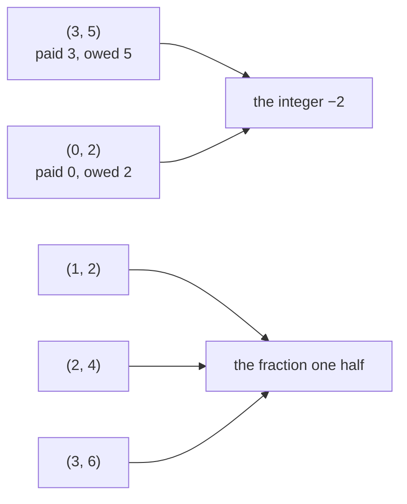

# Building the integers and fractions: a debt as a pair of counts, a fraction as a pair with a sameness rule

[Syllabus](../../../SYLLABUS.md) → [Foundations](../README.md) → [The Number Line](../README.md#s02) → Building the integers and fractions

---

## General Overview

A market stall's tab keeps two counts: dollars paid in and dollars owed. One customer paid $3 of a $5 bill. Another paid $0 of a $2 bill. Each is $2 short.

Counting numbers (0, 1, 2, 3, …) cannot write "$2 short": 3 take away 5 has no answer among them. A pair can.

Write each tab as (paid in, owed): (3, 5) and (0, 2). They are the same integer, −2, because 3 + 2 = 0 + 5. That is 3 − 5 = 0 − 2 with 5 + 2 added to both sides. The test uses addition only.

Fractions repeat the move. A pair of integers (top, bottom) names a fraction. (1, 2), (2, 4) and (3, 6) are all one half, because 1 × 4 = 2 × 2 and 2 × 6 = 4 × 3. The test uses multiplication only.

The key check: (1, 2) + (1, 3) gives (5, 6). (2, 4) + (2, 6) gives (20, 24), the same fraction, since 20 × 6 = 120 = 24 × 5.

**An integer is a family of pairs of counting numbers, and a fraction is a family of pairs of integers. The arithmetic works because each rule gives the same answer whichever pair is picked.**

**What kind of fact this is:** definitions (the pairs and the rules) and a theorem (the rules do not depend on the pick), proved in Why it works.

### The picture: many pairs, one number



---

## The formula

Integers: (a, b) means a paid in, b owed, with counting numbers; ac is short for a × c.

```math
(a, b) \sim (c, d) \text{ when } a + d = c + b; \quad (a, b) + (c, d) = (a + c,\ b + d); \quad (a, b) \times (c, d) = (ac + bd,\ ad + bc)
```

Fractions: (a, b) means a over b, with integers and no bottom 0.

```math
(a, b) \sim (c, d) \text{ when } a \times d = b \times c; \quad (a, b) + (c, d) = (ad + bc,\ bd); \quad (a, b) \times (c, d) = (ac,\ bd)
```

**Read it aloud:** pairs match by cross sums (integers) or cross products (fractions), and add and multiply as a − b and a ÷ b would.

A rule is **well defined** when its answer does not depend on which pair is picked.

| Symbol | Plain meaning | In our example | Push it up and the answer… |
| --- | --- | --- | --- |
| (a, b), an integer | a paid in, b owed; worth a − b | (3, 5), worth −2 | raise a: up by one |
| (c, d), (e, f), (a′, b′) | further pairs, read the same way | (0, 2) | — |
| $`\sim`$ | is the same number as | (3, 5) $`\sim`$ (0, 2) | — |
| a + d = c + b | integer test, addition only | 3 + 2 = 0 + 5 | — |
| (a, b), a fraction | top a, bottom b; worth a ÷ b | (1, 2), one half | raise a positive b: toward 0 |
| a × d = b × c | fraction test, multiplication only | 1 × 4 = 2 × 2 | — |

### When it holds

- **The test is a sameness rule**: every pair matches itself, a match works both ways, and two matches in a chain give a third (transitive). Otherwise families overlap.
- **Every rule is well defined.** Adding tops to tops and bottoms to bottoms fails this: one sum gets two answers.
- **No bottom is 0.** (0, 0) passes the test with every pair.

---

## Why it works

### Step 0: name the missing answer with a pair

Counting numbers cannot take 5 from 3, so write the question as the pair (3, 5). Every pair that passes the test with it joins one family, and that family is the number.

### Step 1: each test is a sameness rule

Itself and both ways are immediate. Transitive is a cancellation (in the fold). For fractions it cancels the middle bottom, so a bottom of 0 is banned.

### Step 2: the rules do not depend on the pick

From 3 + 2 = 0 + 5, add the other tab's two counts to both sides. That is the test for the two sums. The other rules go the same way, in the fold.

### Step 3: the rules are the familiar ones

(a − b) × (c − d) expands to ac + bd − (ad + bc): the pair (ac + bd, ad + bc). Debt times debt is credit: (0, 2) × (0, 2) = (4, 0), worth 4.

The fraction rules are the [Fractions](../01-Everyday%20Arithmetic/07-fractions.md) rules. A count sits inside the integers as (count, 0), so 4 is (4, 0); an integer sits inside the fractions as (integer, 1).

<details>
<summary>Detailed proof: transitive, and well defined for all four rules</summary>

Write (a′, b′) for a second pick, the same as (a, b). Each part swaps the first pair; swapping the second goes the same way.

**Integers, transitive.** Add a + d = c + b and c + f = e + d, then cancel c + d: a + f = e + b.

**Integers, adding.** Add c + d to both sides of a + b′ = a′ + b. That is the test for the two sums.

**Integers, multiplying.** Multiply a + b′ = a′ + b by c, and b + a′ = b′ + a by d, then add:

$`\displaystyle (ac + bd) + (a'd + b'c) = (a'c + b'd) + (ad + bc)`$

**Fractions, transitive.** From ad = bc and cf = de, multiply: adcf = bcde. If c is 0, then a and e are 0. Otherwise cancel cd: af = be.

**Fractions, adding.** From ab′ = a′b:

$`\displaystyle (ad + bc)\, b'd = ab'dd + bb'cd = a'bdd + bb'cd = (a'd + b'c)\, bd`$

**Fractions, multiplying.** Multiply ab′ = a′b by cd.

</details>

---

## Worked numbers, by hand

| Step | Arithmetic | Value |
| --- | --- | --- |
| same integer? | 3 + 2 against 0 + 5 | 5 = 5, yes: both −2 |
| −2 + −2, one pick | (3, 5) + (0, 2) = (3 + 0, 5 + 2) | (3, 7), worth −4 |
| −2 + −2, another pick | (0, 2) + (0, 2) | (0, 4), worth −4 |
| −2 × −2 | (3 × 0 + 5 × 2, 3 × 2 + 5 × 0) | (10, 6), worth 4 |
| same fraction? | 1 × 4 against 2 × 2 | 4 = 4, yes |
| half + third, one pick | (1 × 3 + 2 × 1, 2 × 3) | (5, 6) |
| half + third, another pick | (2 × 6 + 4 × 2, 4 × 6) | (20, 24) |
| same answer? | 20 × 6 against 24 × 5 | **120 = 120: the same fraction, 5/6** |

Any pick of one half plus any pick of one third gives five sixths.

### What breaks if you drop a piece

| Mistake | Comes out at | What went wrong |
| --- | --- | --- |
| Adding tops to tops, bottoms to bottoms | (2, 5) or (3, 8) | 2 × 8 = 16, not 15: depends on the pick |
| Multiplying integer pairs entry by entry | (0, 4), worth −4 | The cross terms carry the sign |
| Allowing a bottom of 0 | (1, 2) $`\sim`$ (0, 0) $`\sim`$ (3, 4) | Transitive fails |

---

## Code, from first principles, and it actually runs

Every rule meets every choice of same pairs: counts 0 to 5, tops −3 to 3, bottoms 1 to 4. Road one: the pair test on the two answers. Road two: signed numbers, or decimals. The broken rules fail.

### Python

```python
# Building the integers and fractions -- the check behind the card.  Nothing is imported.  An integer is a pair
# (paid in, owed), a fraction a pair (top, bottom).  Every rule is tried on every choice of same pairs.
zsame, qsame = (lambda p, q: p[0] + q[1] == q[0] + p[1]), (lambda p, q: p[0] * q[1] == p[1] * q[0])  # plus only; times only
zadd, zmul = (lambda p, q: (p[0] + q[0], p[1] + q[1])), (lambda p, q: (p[0] * q[0] + p[1] * q[1], p[0] * q[1] + p[1] * q[0]))
qadd, qmul = (lambda p, q: (p[0] * q[1] + p[1] * q[0], p[1] * q[1])), (lambda p, q: (p[0] * q[0], p[1] * q[1]))
zval, qval, add, mul = (lambda p: p[0] - p[1]), (lambda p: p[0] / p[1]), (lambda x, y: x + y), (lambda x, y: x * y)  # road 2
gcd = lambda a, b: gcd(b, a % b) if b else abs(a); low = lambda p: (p[0] // gcd(*p), p[1] // gcd(*p)); yn = lambda t: "yes" if t else "no"
def test(same, rule, pairs, val, op):            # choices tried, answers that depend on the pick, answers off road 2
    t = [(rule(p, q), rule(p2, q2), val(p), val(q)) for p in pairs for p2 in pairs if same(p, p2) for q in pairs for q2 in pairs if same(q, q2)]
    return len(t), sum(not same(r, r2) for r, r2, _, _ in t), sum(abs(val(r) - op(u, v)) > 1e-9 for r, _, u, v in t)
Z, Q = [(a, b) for a in range(6) for b in range(6)], [(a, b) for a in range(-3, 4) for b in range(1, 5)]
rows = [("integer +", zsame, zadd, Z, zval, add), ("integer x", zsame, zmul, Z, zval, mul), ("fraction +", qsame, qadd, Q, qval, add),
        ("fraction x", qsame, qmul, Q, qval, mul), ("broken fraction +", qsame, zadd, Q, qval, add), ("broken integer x", zsame, qmul, Z, zval, mul)]
res = [test(*r[1:]) for r in rows]                # the broken rules swap the families' rules: each is the other's
A, B, H, H2, H3, T, T2, O, F, V = (3, 5), (0, 2), (1, 2), (2, 4), (3, 6), (1, 3), (2, 6), (0, 0), (3, 4), (33, 100)
print(f"{A} ~ {B}: {yn(zsame(A, B))}, as {A[0]} + {B[1]} = {A[0] + B[1]} = {B[0]} + {A[1]}; road 2 gives {zval(A)} and {zval(B)}")
print(f"{A} + {B} = {zadd(A, B)} and {B} + {B} = {zadd(B, B)}, worth {zval(zadd(A, B))} and {zval(zadd(B, B))}")
print(f"{A} x {B} = {zmul(A, B)} and {B} x {B} = {zmul(B, B)}, worth {zval(zmul(A, B))} and {zval(zmul(B, B))}")
print(f"{H} ~ {H2} ~ {H3}: {yn(qsame(H, H2) and qsame(H2, H3))}, as {H[0]} x {H2[1]} = {H[0] * H2[1]} = {H[1]} x {H2[0]} and {H2[0]} x {H3[1]} = {H2[0] * H3[1]} = {H2[1]} x {H3[0]}")
print(f"{H} + {T} = {qadd(H, T)} and {H2} + {T2} = {qadd(H2, T2)}: {qadd(H2, T2)[0]} x {qadd(H, T)[1]} = {qadd(H2, T2)[0] * qadd(H, T)[1]} = {qadd(H2, T2)[1]} x {qadd(H, T)[0]}")
print(f"{H} x {T} = {qmul(H, T)} and {H2} x {T2} = {qmul(H2, T2)}; lowest terms {low(qadd(H2, T2))} and {low(qmul(H2, T2))}")
for i in (0, 2, 4):
    (a, n, d, o), (b, m, e, f) = (rows[i][0],) + res[i], (rows[i + 1][0],) + res[i + 1]
    print(f"{a} and {b}: {n} and {m} choices of same pairs; {d} and {e} answers depend on the pick; {o} and {f} miss road 2")
print(f"broken fraction +: {H} + {T} = {zadd(H, T)} but {H} + {T2} = {zadd(H, T2)}, and {zadd(H, T)[0]} x {zadd(H, T2)[1]} = {zadd(H, T)[0] * zadd(H, T2)[1]}, not {zadd(H, T)[1] * zadd(H, T2)[0]}; to two places {T} and {V} give {qval(T):.2f} and {qval(V):.2f}, but {T} ~ {V}: {yn(qsame(T, V))}")
print(f"broken integer x: {B} x {B} = {qmul(B, B)}, worth {zval(qmul(B, B))}; bottom zero: {H} ~ {O} ~ {F}: {yn(qsame(H, O) and qsame(O, F))}, but {H} ~ {F}: {yn(qsame(H, F))}")
assert zval(zadd(A, B)) == -4 == zval(zadd(B, B)) and zval(zmul(A, B)) == 4 == zval(A) * zval(B) and zsame(A, B) and not zsame(A, (5, 3))
assert low(qadd(H2, T2)) == (5, 6) == low(qadd(H, T)) and low(qmul(H2, T2)) == (1, 6) and qsame(qadd(H, T), qadd(H2, T2)) and not qsame(H, F) and not qsame(T, V)
assert [r[1:] for r in res[:4]] == [(0, 0)] * 4 and res[4][1] > 0 and res[5][1] > 0 and qsame(H, O) and qsame(O, F) and zval(qmul(B, B)) == -4
print("ALL CHECKS PASS")
```

**Ran 2026-11-23 on macOS, Python 3.14.10, standard library only. All checks passed. Output, pasted from the run:**

```
(3, 5) ~ (0, 2): yes, as 3 + 2 = 5 = 0 + 5; road 2 gives -2 and -2
(3, 5) + (0, 2) = (3, 7) and (0, 2) + (0, 2) = (0, 4), worth -4 and -4
(3, 5) x (0, 2) = (10, 6) and (0, 2) x (0, 2) = (4, 0), worth 4 and 4
(1, 2) ~ (2, 4) ~ (3, 6): yes, as 1 x 4 = 4 = 2 x 2 and 2 x 6 = 12 = 4 x 3
(1, 2) + (1, 3) = (5, 6) and (2, 4) + (2, 6) = (20, 24): 20 x 6 = 120 = 24 x 5
(1, 2) x (1, 3) = (1, 6) and (2, 4) x (2, 6) = (4, 24); lowest terms (5, 6) and (1, 6)
integer + and integer x: 21316 and 21316 choices of same pairs; 0 and 0 answers depend on the pick; 0 and 0 miss road 2
fraction + and fraction x: 3136 and 3136 choices of same pairs; 0 and 0 answers depend on the pick; 0 and 0 miss road 2
broken fraction + and broken integer x: 3136 and 21316 choices of same pairs; 1864 and 17272 answers depend on the pick; 2796 and 17983 miss road 2
broken fraction +: (1, 2) + (1, 3) = (2, 5) but (1, 2) + (2, 6) = (3, 8), and 2 x 8 = 16, not 15; to two places (1, 3) and (33, 100) give 0.33 and 0.33, but (1, 3) ~ (33, 100): no
broken integer x: (0, 2) x (0, 2) = (0, 4), worth -4; bottom zero: (1, 2) ~ (0, 0) ~ (3, 4): yes, but (1, 2) ~ (3, 4): no
ALL CHECKS PASS
```

### Rust

Built with `rustc --edition 2021 -O`.

```rust
// Building the integers and fractions -- the same check as the Python, in Rust.  No crates.  An integer is a pair
// (paid in, owed), a fraction a pair (top, bottom).  Every rule is tried on every choice of same pairs.
type P = (i64, i64); type Same = fn(P, P) -> bool; type Rule = fn(P, P) -> P; type Op = fn(f64, f64) -> f64;
fn zsame(p: P, q: P) -> bool { p.0 + q.1 == q.0 + p.1 }  fn qsame(p: P, q: P) -> bool { p.0 * q.1 == p.1 * q.0 }  // plus only; times only
fn zadd(p: P, q: P) -> P { (p.0 + q.0, p.1 + q.1) }  fn zmul(p: P, q: P) -> P { (p.0 * q.0 + p.1 * q.1, p.0 * q.1 + p.1 * q.0) }
fn qadd(p: P, q: P) -> P { (p.0 * q.1 + p.1 * q.0, p.1 * q.1) }  fn qmul(p: P, q: P) -> P { (p.0 * q.0, p.1 * q.1) }
fn zval(p: P) -> f64 { (p.0 - p.1) as f64 }  fn qval(p: P) -> f64 { p.0 as f64 / p.1 as f64 }  // road 2: signed numbers, decimals
fn add(x: f64, y: f64) -> f64 { x + y }  fn mul(x: f64, y: f64) -> f64 { x * y }  fn yn(t: bool) -> &'static str { if t { "yes" } else { "no" } }
fn gcd(a: i64, b: i64) -> i64 { if b != 0 { gcd(b, a % b) } else { a.abs() } }  fn low(p: P) -> P { let g = gcd(p.0, p.1); (p.0 / g, p.1 / g) }
fn test(same: Same, rule: Rule, pairs: &[P], val: fn(P) -> f64, op: Op) -> (usize, usize, usize) {
    let (mut n, mut dep, mut off) = (0, 0, 0);       // choices tried, answers that depend on the pick, answers off road 2
    for &p in pairs { for &p2 in pairs.iter().filter(|&&x| same(p, x)) { for &q in pairs { for &q2 in pairs.iter().filter(|&&x| same(q, x)) {
        let (r, r2) = (rule(p, q), rule(p2, q2));
        n += 1; dep += !same(r, r2) as usize; off += ((val(r) - op(val(p), val(q))).abs() > 1e-9) as usize; } } } }
    (n, dep, off)
}
fn main() {
    let z: Vec<P> = (0..6).flat_map(|a| (0..6).map(move |b| (a, b))).collect();
    let q: Vec<P> = (-3..4).flat_map(|a| (1..5).map(move |b| (a, b))).collect();
    let rows: [(&str, Same, Rule, &[P], fn(P) -> f64, Op); 6] = [("integer +", zsame, zadd, &z, zval, add), ("integer x", zsame, zmul, &z, zval, mul), ("fraction +", qsame, qadd, &q, qval, add),
        ("fraction x", qsame, qmul, &q, qval, mul), ("broken fraction +", qsame, zadd, &q, qval, add), ("broken integer x", zsame, qmul, &z, zval, mul)];
    let res: Vec<(usize, usize, usize)> = rows.iter().map(|r| test(r.1, r.2, r.3, r.4, r.5)).collect();
    let (a, b, h, h2, h3, t, t2, o, f, v) = ((3, 5), (0, 2), (1, 2), (2, 4), (3, 6), (1, 3), (2, 6), (0, 0), (3, 4), (33, 100));
    println!("{:?} ~ {:?}: {}, as {} + {} = {} = {} + {}; road 2 gives {} and {}", a, b, yn(zsame(a, b)), a.0, b.1, a.0 + b.1, b.0, a.1, zval(a), zval(b));
    println!("{:?} + {:?} = {:?} and {:?} + {:?} = {:?}, worth {} and {}", a, b, zadd(a, b), b, b, zadd(b, b), zval(zadd(a, b)), zval(zadd(b, b)));
    println!("{:?} x {:?} = {:?} and {:?} x {:?} = {:?}, worth {} and {}", a, b, zmul(a, b), b, b, zmul(b, b), zval(zmul(a, b)), zval(zmul(b, b)));
    println!("{:?} ~ {:?} ~ {:?}: {}, as {} x {} = {} = {} x {} and {} x {} = {} = {} x {}", h, h2, h3, yn(qsame(h, h2) && qsame(h2, h3)), h.0, h2.1, h.0 * h2.1, h.1, h2.0, h2.0, h3.1, h2.0 * h3.1, h2.1, h3.0);
    let (s, u) = (qadd(h2, t2), qadd(h, t));
    println!("{:?} + {:?} = {:?} and {:?} + {:?} = {:?}: {} x {} = {} = {} x {}", h, t, u, h2, t2, s, s.0, u.1, s.0 * u.1, s.1, u.0);
    println!("{:?} x {:?} = {:?} and {:?} x {:?} = {:?}; lowest terms {:?} and {:?}", h, t, qmul(h, t), h2, t2, qmul(h2, t2), low(s), low(qmul(h2, t2)));
    for i in [0, 2, 4] { let (x, y) = (res[i], res[i + 1]);
        println!("{} and {}: {} and {} choices of same pairs; {} and {} answers depend on the pick; {} and {} miss road 2", rows[i].0, rows[i + 1].0, x.0, y.0, x.1, y.1, x.2, y.2); }
    let (w, w2) = (zadd(h, t), zadd(h, t2));
    println!("broken fraction +: {:?} + {:?} = {:?} but {:?} + {:?} = {:?}, and {} x {} = {}, not {}; to two places {:?} and {:?} give {:.2} and {:.2}, but {:?} ~ {:?}: {}", h, t, w, h, t2, w2, w.0, w2.1, w.0 * w2.1, w.1 * w2.0, t, v, qval(t), qval(v), t, v, yn(qsame(t, v)));
    println!("broken integer x: {:?} x {:?} = {:?}, worth {}; bottom zero: {:?} ~ {:?} ~ {:?}: {}, but {:?} ~ {:?}: {}", b, b, qmul(b, b), zval(qmul(b, b)), h, o, f, yn(qsame(h, o) && qsame(o, f)), h, f, yn(qsame(h, f)));
    assert!(zval(zadd(a, b)) == -4.0 && zval(zadd(b, b)) == -4.0 && zval(zmul(a, b)) == 4.0 && zval(a) * zval(b) == 4.0 && zsame(a, b) && !zsame(a, (5, 3)));
    assert!(low(s) == (5, 6) && low(u) == (5, 6) && low(qmul(h2, t2)) == (1, 6) && qsame(u, s) && !qsame(h, f) && !qsame(t, v));
    assert!(res[..4].iter().all(|r| r.1 == 0 && r.2 == 0) && res[4].1 > 0 && res[5].1 > 0 && qsame(h, o) && qsame(o, f) && zval(qmul(b, b)) == -4.0);
    println!("ALL CHECKS PASS");
}
```

**Ran 2026-11-23 on macOS, rustc 1.98.1, no crates. All checks passed. Output, pasted from the run:**

```
(3, 5) ~ (0, 2): yes, as 3 + 2 = 5 = 0 + 5; road 2 gives -2 and -2
(3, 5) + (0, 2) = (3, 7) and (0, 2) + (0, 2) = (0, 4), worth -4 and -4
(3, 5) x (0, 2) = (10, 6) and (0, 2) x (0, 2) = (4, 0), worth 4 and 4
(1, 2) ~ (2, 4) ~ (3, 6): yes, as 1 x 4 = 4 = 2 x 2 and 2 x 6 = 12 = 4 x 3
(1, 2) + (1, 3) = (5, 6) and (2, 4) + (2, 6) = (20, 24): 20 x 6 = 120 = 24 x 5
(1, 2) x (1, 3) = (1, 6) and (2, 4) x (2, 6) = (4, 24); lowest terms (5, 6) and (1, 6)
integer + and integer x: 21316 and 21316 choices of same pairs; 0 and 0 answers depend on the pick; 0 and 0 miss road 2
fraction + and fraction x: 3136 and 3136 choices of same pairs; 0 and 0 answers depend on the pick; 0 and 0 miss road 2
broken fraction + and broken integer x: 3136 and 21316 choices of same pairs; 1864 and 17272 answers depend on the pick; 2796 and 17983 miss road 2
broken fraction +: (1, 2) + (1, 3) = (2, 5) but (1, 2) + (2, 6) = (3, 8), and 2 x 8 = 16, not 15; to two places (1, 3) and (33, 100) give 0.33 and 0.33, but (1, 3) ~ (33, 100): no
broken integer x: (0, 2) x (0, 2) = (0, 4), worth -4; bottom zero: (1, 2) ~ (0, 0) ~ (3, 4): yes, but (1, 2) ~ (3, 4): no
ALL CHECKS PASS
```

### Lean

Lean proves the card's three steps for every pair, not just the worked numbers, and checks the worked numbers exactly.

- Each test is a sameness rule: every pair matches itself, a match works both ways, and two matches chain. For fractions, this needs no bottom 0.
- Every rule is well defined. Swap either pair for a same pair, and the new answer passes the test with the old one.
- Take two fraction pairs with no bottom 0. Then their sum and their product have no bottom 0 either.
- Read an integer pair (a, b) as a − b. Then two pairs pass the test exactly when their worths are equal.
- The integer sum and product rules give the sum and product of the worths. Every integer is some pair's worth.
- Read a fraction pair (a, b), with no bottom 0, as a ÷ b. Then the same three facts hold for fractions.
- Every number in the worked numbers and the "What breaks" table comes out as the card says.

Counting the choices of same pairs, and running the decimal road on a real computer, are left to the Python and Rust checks.

```lean
-- Building the integers and fractions: integers built as pairs of counting numbers and fractions as pairs of integers with no bottom 0, the two sameness tests are sameness rules, adding and multiplying give the same answer whichever pairs are picked, and the pairs behave exactly like a − b and a ÷ b.
import Mathlib.Data.Rat.Cast.Lemmas
import Mathlib.Order.Basic
import Mathlib.Tactic.NormNum
import Mathlib.Tactic.LinearCombination
import Mathlib.Tactic.Zify
import Mathlib.Tactic.Ring
import Mathlib.Tactic.FieldSimp
import Mathlib.Tactic.Linarith

namespace ConstructingIntegersAndFractions

/-! An integer is a pair `(a, b)` of counting numbers: `a` paid in, `b` owed, worth `a − b`.
A fraction is a pair `(a, b)` of integers: top `a`, bottom `b`, worth `a ÷ b`.
These are the card's tests and rules, word for word. -/

/-- Integer test: `(a, b) ~ (c, d)` when `a + d = c + b` (addition only). -/
abbrev intSame (p q : ℕ × ℕ) : Prop := p.1 + q.2 = q.1 + p.2

/-- Integer adding: `(a, b) + (c, d) = (a + c, b + d)`. -/
def intAdd (p q : ℕ × ℕ) : ℕ × ℕ := (p.1 + q.1, p.2 + q.2)

/-- Integer multiplying: `(a, b) × (c, d) = (ac + bd, ad + bc)`. -/
def intMul (p q : ℕ × ℕ) : ℕ × ℕ := (p.1 * q.1 + p.2 * q.2, p.1 * q.2 + p.2 * q.1)

/-- Fraction test: `(a, b) ~ (c, d)` when `a × d = b × c` (multiplication only). -/
abbrev fracSame (p q : ℤ × ℤ) : Prop := p.1 * q.2 = p.2 * q.1

/-- Fraction adding: `(a, b) + (c, d) = (ad + bc, bd)`. -/
def fracAdd (p q : ℤ × ℤ) : ℤ × ℤ := (p.1 * q.2 + p.2 * q.1, p.2 * q.2)

/-- Fraction multiplying: `(a, b) × (c, d) = (ac, bd)`. -/
def fracMul (p q : ℤ × ℤ) : ℤ × ℤ := (p.1 * q.1, p.2 * q.2)

/-- **The rules do not depend on the pick (well defined).** For integer pairs: if `p ~ p'` and
`q ~ q'`, then `p + q ~ p' + q'` and `p × q ~ p' × q'`. For fraction pairs with no bottom 0: if
`p ~ p'` and `q ~ q'`, then `p + q ~ p' + q'` and `p × q ~ p' × q'`, and the sum and the product
again have no bottom 0. -/
theorem rules_do_not_depend_on_the_pick :
    (∀ p p' q q' : ℕ × ℕ, intSame p p' → intSame q q' →
        intSame (intAdd p q) (intAdd p' q') ∧ intSame (intMul p q) (intMul p' q')) ∧
    (∀ p p' q q' : ℤ × ℤ, p.2 ≠ 0 → p'.2 ≠ 0 → q.2 ≠ 0 → q'.2 ≠ 0 →
        fracSame p p' → fracSame q q' →
        fracSame (fracAdd p q) (fracAdd p' q') ∧ fracSame (fracMul p q) (fracMul p' q') ∧
        (fracAdd p q).2 ≠ 0 ∧ (fracMul p q).2 ≠ 0) := by
  refine ⟨fun p p' q q' h1 h2 => ⟨?_, ?_⟩, fun p p' q q' hp hp' hq hq' h1 h2 => ⟨?_, ?_, ?_, ?_⟩⟩
  · simp only [intSame, intAdd] at *; omega
  · simp only [intSame, intMul] at *
    zify at h1 h2 ⊢
    linear_combination ((q.1 : ℤ) - q.2) * h1 + ((p'.1 : ℤ) - p'.2) * h2
  · simp only [fracSame, fracAdd] at *
    linear_combination q.2 * q'.2 * h1 + p.2 * p'.2 * h2
  · simp only [fracSame, fracMul] at *
    linear_combination q.1 * q'.2 * h1 + p.2 * p'.1 * h2
  · simp only [fracAdd]; exact mul_ne_zero hp hq
  · simp only [fracMul]; exact mul_ne_zero hp hq

/-- **Each test is a sameness rule.** The integer test, and the fraction test on pairs with no
bottom 0, each match every pair with itself, work both ways, and chain (transitive). -/
theorem tests_are_sameness_rules :
    Equivalence intSame ∧
    Equivalence (fun p q : {p : ℤ × ℤ // p.2 ≠ 0} => fracSame p.1 q.1) := by
  refine ⟨⟨fun _ => rfl, fun h => by simp only [intSame] at *; omega,
    fun h1 h2 => by simp only [intSame] at *; omega⟩,
    ⟨fun p => mul_comm _ _, fun h => by simp only [fracSame] at *; linear_combination -h, ?_⟩⟩
  intro x y z h1 h2
  simp only [fracSame] at *
  apply mul_left_cancel₀ y.2
  linear_combination z.1.2 * h1 + x.1.2 * h2

/-- **The rules are the familiar ones.** Reading an integer pair `(a, b)` as `a − b`: two pairs
pass the test exactly when they are worth the same, the sum and product rules give the sum and
product of the worths, and every integer is some pair's worth. Reading a fraction pair `(a, b)`
with no bottom 0 as `a ÷ b`: the same three facts hold for the fractions. -/
theorem rules_are_the_familiar_ones :
    (∀ p q : ℕ × ℕ, intSame p q ↔ (p.1 : ℤ) - p.2 = (q.1 : ℤ) - q.2) ∧
    (∀ p q : ℕ × ℕ, ((intAdd p q).1 : ℤ) - (intAdd p q).2 = ((p.1 : ℤ) - p.2) + ((q.1 : ℤ) - q.2)) ∧
    (∀ p q : ℕ × ℕ, ((intMul p q).1 : ℤ) - (intMul p q).2 = ((p.1 : ℤ) - p.2) * ((q.1 : ℤ) - q.2)) ∧
    (∀ z : ℤ, ∃ p : ℕ × ℕ, (p.1 : ℤ) - p.2 = z) ∧
    (∀ p q : ℤ × ℤ, p.2 ≠ 0 → q.2 ≠ 0 →
        (fracSame p q ↔ (p.1 : ℚ) / p.2 = (q.1 : ℚ) / q.2)) ∧
    (∀ p q : ℤ × ℤ, p.2 ≠ 0 → q.2 ≠ 0 →
        ((fracAdd p q).1 : ℚ) / (fracAdd p q).2 = (p.1 : ℚ) / p.2 + (q.1 : ℚ) / q.2) ∧
    (∀ p q : ℤ × ℤ, p.2 ≠ 0 → q.2 ≠ 0 →
        ((fracMul p q).1 : ℚ) / (fracMul p q).2 = (p.1 : ℚ) / p.2 * ((q.1 : ℚ) / q.2)) ∧
    (∀ x : ℚ, ∃ p : ℤ × ℤ, p.2 ≠ 0 ∧ (p.1 : ℚ) / p.2 = x) := by
  refine ⟨fun p q => ?_, fun p q => ?_, fun p q => ?_, fun z => ?_, fun p q hp hq => ?_,
    fun p q hp hq => ?_, fun p q hp hq => ?_, fun x => ?_⟩
  · simp only [intSame]; omega
  · simp only [intAdd]; push_cast; ring
  · simp only [intMul]; push_cast; ring
  · refine ⟨(z.toNat, (-z).toNat), ?_⟩
    simp only
    omega
  · simp only [fracSame]
    have hp' : (p.2 : ℚ) ≠ 0 := by exact_mod_cast hp
    have hq' : (q.2 : ℚ) ≠ 0 := by exact_mod_cast hq
    rw [div_eq_div_iff hp' hq']
    constructor
    · intro h
      have : ((p.1 * q.2 : ℤ) : ℚ) = ((p.2 * q.1 : ℤ) : ℚ) := by rw [h]
      push_cast at this
      linarith
    · intro h
      have : ((p.1 * q.2 : ℤ) : ℚ) = ((p.2 * q.1 : ℤ) : ℚ) := by push_cast; linarith
      exact_mod_cast this
  · have hp' : (p.2 : ℚ) ≠ 0 := by exact_mod_cast hp
    have hq' : (q.2 : ℚ) ≠ 0 := by exact_mod_cast hq
    simp only [fracAdd]
    push_cast
    field_simp
  · have hp' : (p.2 : ℚ) ≠ 0 := by exact_mod_cast hp
    have hq' : (q.2 : ℚ) ≠ 0 := by exact_mod_cast hq
    simp only [fracMul]
    push_cast
    field_simp
  · refine ⟨(x.num, (x.den : ℤ)), ?_, ?_⟩
    · simp only; exact_mod_cast x.den_ne_zero
    · simp only; push_cast; exact Rat.num_div_den x

/-! The card's worked numbers. -/

-- (3, 5) and (0, 2) are the same integer, −2: 3 + 2 = 0 + 5; (5, 3) is not.
example : intSame (3, 5) (0, 2) ∧ ¬ intSame (3, 5) (5, 3) := by decide
example : ((3 : ℕ) : ℤ) - 5 = -2 ∧ ((0 : ℕ) : ℤ) - 2 = -2 := by norm_num

-- −2 + −2 two ways: (3, 7) and (0, 4), both worth −4.
example : intAdd (3, 5) (0, 2) = (3, 7) ∧ intAdd (0, 2) (0, 2) = (0, 4) ∧ intSame (3, 7) (0, 4) := by
  decide

-- −2 × −2 two ways: (10, 6) and (4, 0), both worth 4; debt times debt is credit.
example : intMul (3, 5) (0, 2) = (10, 6) ∧ intMul (0, 2) (0, 2) = (4, 0) ∧ intSame (10, 6) (4, 0) := by
  decide

-- (1, 2), (2, 4) and (3, 6) are the same fraction: 1 × 4 = 2 × 2 and 2 × 6 = 4 × 3.
example : fracSame (1, 2) (2, 4) ∧ fracSame (2, 4) (3, 6) := by decide

-- Half plus a third two ways: (5, 6) and (20, 24), the same since 20 × 6 = 120 = 24 × 5.
example : fracAdd (1, 2) (1, 3) = (5, 6) ∧ fracAdd (2, 4) (2, 6) = (20, 24) ∧
    fracSame (20, 24) (5, 6) := by decide

-- Half times a third two ways: (1, 6) and (4, 24), the same fraction.
example : fracMul (1, 2) (1, 3) = (1, 6) ∧ fracMul (2, 4) (2, 6) = (4, 24) ∧
    fracSame (1, 6) (4, 24) := by decide

-- Broken sum (tops plus tops): (2, 5) and (3, 8) are not the same, as 2 × 8 = 16, not 15.
example : (((1 : ℤ) + 1, (2 : ℤ) + 3) : ℤ × ℤ) = (2, 5) ∧
    (((1 : ℤ) + 2, (2 : ℤ) + 6) : ℤ × ℤ) = (3, 8) ∧ ¬ fracSame (2, 5) (3, 8) := by decide

-- Rounded division misleads: (1, 3) and (33, 100) are not the same fraction.
example : ¬ fracSame (1, 3) (33, 100) := by decide

-- Broken integer product (entry by entry): (0, 2) × (0, 2) gives (0, 4), worth −4.
example : ((0 : ℕ) * 0, (2 : ℕ) * 2) = (0, 4) ∧ ¬ intSame (0, 4) (4, 0) := by decide

-- A bottom of 0 breaks the chain: (1, 2) ~ (0, 0) ~ (3, 4), but (1, 2) is not (3, 4).
example : fracSame (1, 2) (0, 0) ∧ fracSame (0, 0) (3, 4) ∧ ¬ fracSame (1, 2) (3, 4) := by decide

#print axioms rules_do_not_depend_on_the_pick
#print axioms tests_are_sameness_rules
#print axioms rules_are_the_familiar_ones

end ConstructingIntegersAndFractions
```

**Checked 2026-11-23 on macOS, Lean 4.36.0-rc2, Mathlib v4.36.0-rc2. Every proof is complete and uses only Lean's standard axioms. Output, pasted from the run:**

```
'ConstructingIntegersAndFractions.rules_do_not_depend_on_the_pick' depends on axioms: [propext, Classical.choice, Quot.sound]
'ConstructingIntegersAndFractions.tests_are_sameness_rules' depends on axioms: [propext, Classical.choice, Quot.sound]
'ConstructingIntegersAndFractions.rules_are_the_familiar_ones' depends on axioms: [propext, Classical.choice, Quot.sound]
```

> [!TIP]
> **Try changing**
> An assert is a line that stops the program when a number is wrong.
> - **Widen the integers.** Guess first, then set both ranges in `Z` to `range(9)`: 239121 choices, none disagree.
> - **Swap in the broken sum.** Guess first, then give "fraction +" the rule `zadd` in `rows`: 1864 choices disagree and the last assert stops it.
> - **Allow a bottom of 0.** Guess first, then change `range(1, 5)` in `Q` to `range(0, 5)`: the decimal road divides by zero.

---

## The usual mistake

> [!warning]
> **Defining a rule on pairs without checking that it is well defined.** "Tops plus tops, bottoms plus bottoms" looks natural, but (1, 2) + (1, 3) gives (2, 5) while (1, 2) + (2, 6) gives (3, 8).
>
> - Testing integer sameness as a − b = c − d: 3 − 5 has no counting-number answer.
> - Testing fraction sameness by rounded division: (1, 3) and (33, 100) both give 0.33.
> - Multiplying integer pairs entry by entry: (0, 2) × (0, 2) comes out at (0, 4), worth −4.

---

## Where you meet it in real life

- **Double-entry bookkeeping.** Debits and credits sit in two columns; equal gaps mean equal balances.
- **Exact fractions in software.** A program stores a fraction as two whole numbers and tests equality by cross-multiplying, so no rounding enters.

> **Say it back**
> An integer is a pair (paid in, owed): (3, 5) equals (0, 2) because 3 + 2 = 0 + 5. A fraction is a pair (top, bottom): (1, 2) equals (2, 4) because 1 × 4 = 2 × 2. Each number is a family of same pairs. Adding and multiplying give one answer whichever pair is picked. A rule that fails this defines nothing.

---

## What this builds on

- [The number families](01-number-families.md): why each family was needed.
- [Negative numbers](../01-Everyday%20Arithmetic/06-negative-numbers.md): the sign rules the multiply rule reproduces.
- [Fractions](../01-Everyday%20Arithmetic/07-fractions.md): the everyday rules the fraction pairs reproduce.

## Where this goes next

- [Dedekind cuts](07-dedekind-cuts.md): the next build, the reals, from splitting the fractions in two.
- [Equivalence relations and partitions](../08-Relations%20and%20Functions/06-equivalence-relations-and-partitions.md): any sameness rule cuts a set into families; this card did it twice.
- [Peano's three rules](../06-Proof/07-peano-and-one-plus-one.md): builds the counting numbers these pairs are made of.

Left open: pairs fill the gaps subtraction and division leave, but what fills the gap at root 2?

---

## Sources

Verified 2026-11-23: every link below resolves to the publisher's page.

- Enderton, Herbert B. *Elements of Set Theory*. Academic Press, 1977. [Publisher page](https://shop.elsevier.com/books/elements-of-set-theory/enderton/978-0-12-238440-0). Chapter 5 builds the integers and the rationals from pairs, with the well-defined checks.
- Tao, Terence. *Analysis I*, 4th ed. Springer, 2022. [doi:10.1007/978-981-19-7261-4](https://doi.org/10.1007/978-981-19-7261-4). Chapter 4, "Integers and Rationals", makes the same construction with formal differences and quotients.
