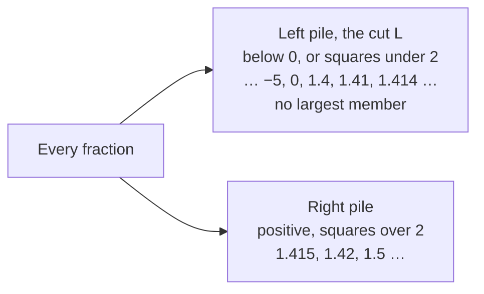

# Dedekind cuts: build the real numbers from fractions, and the no-gaps rule becomes a theorem

[Syllabus](../../../SYLLABUS.md) → [Foundations](../README.md) → [The Number Line](../README.md#s02) → Dedekind cuts

---

## General Overview

A square tile, one metre a side, has a diagonal of root 2 metres: the length that squares to 2. [Irrational numbers](03-irrational-numbers.md) proved no fraction is that length.

Sort every fraction into two piles: short of the diagonal, or past it. 1.4 goes left (1.4 × 1.4 = 1.96, under 2), as does 1.41 (1.9881). 1.42 goes right (2.0164, over 2).

Dedekind's idea, from 1872: the split itself is the number. The left pile is a **cut**. Every fraction has one (all fractions below it), and so does root 2, though no fraction stands at its edge.

**A real number is a left pile of some, but not all, fractions with no largest member. If a nonempty collection of piles all fit inside one pile, their union is the smallest pile that holds them all: their least upper bound. So the no-gaps rule is a theorem.**

**What kind of fact this is:** a definition (a real number is a cut) and a theorem, proved below. [The real numbers have no gaps](04-real-numbers-no-gaps.md) had to assume it.

### The picture: one split of the fractions



---

## The formula

```math
L = \{\, q \text{ a fraction} : q < 0 \text{ or } q \times q < 2 \,\}
```

**Read it aloud:** L is every fraction q that is below zero or squares to under 2.

A set of fractions is a **cut** when it passes three tests:

1. It holds some fractions, but not all.
2. It is closed downward: with any fraction, it holds every smaller one.
3. It has no largest member.

A cut M is at most a cut N when M sits inside N, and M + N is every sum of one member of each.

| Symbol | Plain meaning | In our example | Push it up and the answer… |
| --- | --- | --- | --- |
| $`q`$, $`a`$, $`r`$, $`t`$ | fractions | 1.4, 1.41, 1.42 | likelier to fall right |
| $`L`$ | the cut for the diagonal | root 2 | — |
| $`M`$, $`N`$, $`B`$, $`U`$ | any cuts: left piles of fractions | the cut at 1.4 | — |
| $`\{\, q : \ldots \}`$ | every q such that … | q below 0 or squaring under 2 | — |
| $`M + N`$, $`M \times N`$ | sums of members; for positive cuts, products of positive members plus all fractions 0 or below | L + L, L × L | reaches further |

### When it holds

- **Closed downward.** Drop "below 0" from L and −5 falls out while 1.4 stays: a pile with a hole is not a cut.
- **No largest member.** Allow one and 1.4 gets two piles, with and without itself.
- **Nonempty and bounded.** An empty collection has an empty union (not a cut), and the cuts at 1, 2, 3, … have every fraction as their union (also not a cut).

---

## Why it works

### Step 0: a point is known by the fractions to its left

Two different points have a fraction between them, so the left pile pins down the point.

### Step 1: L is a cut, with no largest member

L holds 1.4 and misses 1.42. A smaller fraction is below 0 or squares to less, so L is closed downward. 0 is above every negative member. For a member q of 0 or more, this fraction is bigger and still in L:

```math
(2 \times q + 2) \div (q + 2)
```

From 1.4: 24/17, 41/29, 140/99, squaring to 1.99308, 1.99881, 1.99980.

<details>
<summary>Why it is bigger and still squares under 2</summary>

It beats q by (2 − q × q) ÷ (q + 2), which is positive. Its square minus 2 is 2 × (q × q − 2) ÷ ((q + 2) × (q + 2)). That is negative, and at most half of q × q − 2 in size.

</details>

### Step 2: cuts line up

Suppose M holds a fraction a that N lacks. Every member of N is below a, or closing downward would put a in N. So M holds them all: of two cuts, one always holds the other.

### Step 3: adding and multiplying cuts

Half a sum of two members is at most the larger, so in L. So 2.829 is not in L + L: its half, 1.4145, squares to 2.00081025.

To multiply positive cuts (those holding a positive fraction), take every product of positive members, plus every fraction 0 or below. L × L is the cut at 2:

- **No product reaches 2.** Each is at most the larger member times itself, which is under 2.
- **Every t between 0 and 2 is reached.** Step 1's chain at least halves the gap to 2, so some member r of L squares above t. Then t is r × (t ÷ r), and t ÷ r is below r, so it is in L.

### Step 4: the union is the least upper bound

Take one or more cuts inside one cut B; let U be their union (every fraction in any of them).

- **U is a cut.** It misses what B misses; each piece is closed downward. A largest member would lie in one cut, which has a bigger one.
- **U is an upper bound.** Every cut in the collection sits inside it.
- **U is the least.** Any upper bound holds every cut, so it holds U.

### Step 5: root 2 arrives as a theorem

The cuts at 1.4, 1.41, 1.414, … each sit inside the next and inside the cut at 1.5. Their union is L. Each member q of L sits below another member r (Step 1). Once the decimal places are finer than the gap r − q, the decimal cut reaches past q.

L is no fraction's cut. Were it the cut at t, t is not in L, so t is 0 or more and t × t is at least 2. Not exactly 2 ([Irrational numbers](03-irrational-numbers.md)). Over 2, the Step 1 formula gives a smaller fraction still squaring over 2: in the cut at t, not in L. So L is a new number: root 2.

---

## Worked numbers, by hand

| Step | Arithmetic | Value |
| --- | --- | --- |
| 1.4 in L? | 1.4 × 1.4 | 1.96, yes |
| 1.41 in L? | 1.41 × 1.41 | 1.9881, yes |
| 1.42 in L? | 1.42 × 1.42 | 2.0164, no |
| bigger member than 1.4 | (2 × 1.4 + 2) ÷ (1.4 + 2) | 24/17 |
| L + L, largest thousandth | 1.414 + 1.414 | 2.828 |
| L × L, from 1.414 | 1.414 × 1.414 | 1.999396 |
| union of the cuts at 1.4, 1.41, … | Step 5 | **L, the cut for root 2** |

### What breaks if you drop a piece

| Mistake | Comes out at | What went wrong |
| --- | --- | --- |
| Dropping "below 0" from L | −5 squares to 25, so it is left out | A hole below 1.4 |
| Taking the intersection | the cut at 1.4 | A floor, not a ceiling |
| Stopping at eight places | 1.41421356 squares to 1.9999999932878736 | A fraction's cut, missing 1.414213562 |

---

## Code, from first principles, and it actually runs

Exact fractions throughout. Three roads: the bigger-member rule; decimal cuts against the squares-under-2 test on 6001 other fractions; brute-force half-sums and products of member pairs.

### Python

```python
# Dedekind cuts -- the check behind the card.  Exact fractions, nothing rounds.  L is
# the cut for the tile's diagonal: every fraction q with q < 0 or q x q < 2.
from fractions import Fraction as F
def in_L(q): return q < 0 or q * q < 2
def below(t, q): return q < t                      # q is in the cut at the fraction t
def dec(n, k): s = str(n).rjust(k + 1, "0"); return s[:-k] + "." + s[-k:]
print("in L?", ", ".join(f"{dec(n, 2)} squares to {dec(n * n, 4)}: {'yes' if in_L(F(n, 100)) else 'no'}" for n in (140, 141, 142)))
chain = [F(7, 5)]                                  # road 1: (2q + 2)/(q + 2) is a bigger member
for _ in range(3): q = chain[-1]; chain.append((2 * q + 2) / (q + 2))
assert all(in_L(b) and b > a for a, b in zip(chain, chain[1:]))
print("no largest member:", " -> ".join(map(str, chain)), "square to", ", ".join(f"{float(q * q):.5f}" for q in chain))
tops, n = [], 1                                    # road 2: the cuts at 1.4, 1.41, ..., digit by digit
for k in range(1, 9):
    n *= 10
    while in_L(F(n + 1, 10 ** k)): n += 1
    tops.append(F(n, 10 ** k))
grid = [F(k, 997) for k in range(-3000, 3001)]     # test fractions that are not decimals
nested = all(below(b, q) for a, b in zip(tops, tops[1:]) for q in grid if below(a, q))
union = [q for q in grid if any(below(t, q) for t in tops)]
assert nested and union == [q for q in grid if in_L(q)] and all(below(F(3, 2), q) for q in union)
print("cuts at", ", ".join(str(float(t)) for t in tops[:4]), "...", float(tops[-1]), "each inside the next")
print(f"of {len(grid)} test fractions, the cuts catch exactly the {len(union)} in L, all below 1.5")
mem = union[-300:]                                 # road 3: every pair from the 300 largest test members of L
assert all(in_L((a + b) / 2) and a * b < 2 for a in mem for b in mem) and in_L(F(2828, 2000)) and not in_L(F(2829, 2000)) and tops[4] ** 2 > F(1999, 1000)
print(f"L + L: for all {len(mem) ** 2} pairs of the {len(mem)} largest test members, half the sum is in L; 2.828 is in, 2.829 is out (1.4145 squares to {dec(14145 ** 2, 8)})")
print(f"L x L: all {len(mem) ** 2} products are under 2; {float(tops[2])} x {float(tops[2])} = {dec(int(tops[2] ** 2 * 10 ** 6), 6)} and {float(tops[4])} x {float(tops[4])} = {dec(int(tops[4] ** 2 * 10 ** 10), 10)}")
inter = [q for q in grid if all(below(t, q) for t in tops)]  # 1.414213562 is in L, past all eight cuts
assert inter == [q for q in grid if below(F(7, 5), q)] and in_L(F(1414213562, 10 ** 9)) and not below(tops[-1], F(1414213562, 10 ** 9)) and not below(tops[0], F(7, 5))
print(f"mistakes: -5 squares to {(-5) ** 2}; the intersection is the cut at {float(tops[0])}; {float(tops[-1])} squares to {dec(int(tops[-1] ** 2 * 10 ** 16), 16)}, missing {dec(1414213562, 9)}")
print("ALL CHECKS PASS")
```

**Ran 2026-11-23 on macOS, Python 3.14.10, standard library only. All checks passed. Output, pasted from the run:**

```
in L? 1.40 squares to 1.9600: yes, 1.41 squares to 1.9881: yes, 1.42 squares to 2.0164: no
no largest member: 7/5 -> 24/17 -> 41/29 -> 140/99 square to 1.96000, 1.99308, 1.99881, 1.99980
cuts at 1.4, 1.41, 1.414, 1.4142 ... 1.41421356 each inside the next
of 6001 test fractions, the cuts catch exactly the 4410 in L, all below 1.5
L + L: for all 90000 pairs of the 300 largest test members, half the sum is in L; 2.828 is in, 2.829 is out (1.4145 squares to 2.00081025)
L x L: all 90000 products are under 2; 1.414 x 1.414 = 1.999396 and 1.41421 x 1.41421 = 1.9999899241
mistakes: -5 squares to 25; the intersection is the cut at 1.4; 1.41421356 squares to 1.9999999932878736, missing 1.414213562
ALL CHECKS PASS
```

### Rust

Built with `rustc --edition 2021 -O`.

```rust
// Dedekind cuts -- the same check as the Python file, in Rust.  No crates.  A fraction
// is a pair (top, bottom) of whole numbers, bottom above 0, so nothing rounds.  L is the
// cut for the tile's diagonal: every fraction q with q < 0 or q x q < 2.
type Q = (i128, i128);
fn in_l(q: Q) -> bool { q.0 < 0 || q.0 * q.0 < 2 * q.1 * q.1 }
fn below(t: Q, q: Q) -> bool { q.0 * t.1 < t.0 * q.1 }   // q is in the cut at the fraction t
fn dec(n: i128, k: usize) -> String { let s = format!("{:0>w$}", n, w = k + 1); format!("{}.{}", &s[..s.len() - k], &s[s.len() - k..]) }
fn gcd(a: i128, b: i128) -> i128 { if b == 0 { a } else { gcd(b, a % b) } }
fn f(q: Q) -> f64 { q.0 as f64 / q.1 as f64 }
fn main() {
    let w: Vec<String> = [140i128, 141, 142].iter().map(|&n| format!("{} squares to {}: {}", dec(n, 2), dec(n * n, 4), if in_l((n, 100)) { "yes" } else { "no" })).collect();
    println!("in L? {}", w.join(", "));
    let mut chain: Vec<Q> = vec![(7, 5)];                // road 1: (2q + 2)/(q + 2) is a bigger member
    for _ in 0..3 { let (n, d) = chain[chain.len() - 1]; let (a, b) = (2 * n + 2 * d, n + 2 * d); let g = gcd(a, b); chain.push((a / g, b / g)); }
    assert!(chain.windows(2).all(|p| in_l(p[1]) && below(p[1], p[0])));
    let names: Vec<String> = chain.iter().map(|q| format!("{}/{}", q.0, q.1)).collect();
    let sq: Vec<String> = chain.iter().map(|q| format!("{:.5}", (q.0 * q.0) as f64 / (q.1 * q.1) as f64)).collect();
    println!("no largest member: {} square to {}", names.join(" -> "), sq.join(", "));
    let (mut tops, mut n): (Vec<Q>, i128) = (vec![], 1); // road 2: the cuts at 1.4, 1.41, ..., digit by digit
    for k in 1..9u32 { n *= 10; while in_l((n + 1, 10i128.pow(k))) { n += 1; } tops.push((n, 10i128.pow(k))); }
    let grid: Vec<Q> = (-3000..3001).map(|k| (k, 997)).collect();   // test fractions that are not decimals
    let nested = tops.windows(2).all(|p| grid.iter().all(|&q| !below(p[0], q) || below(p[1], q)));
    let union: Vec<Q> = grid.iter().cloned().filter(|&q| tops.iter().any(|&t| below(t, q))).collect();
    let in_lg: Vec<Q> = grid.iter().cloned().filter(|&q| in_l(q)).collect();
    assert!(nested && union == in_lg && union.iter().all(|&q| below((3, 2), q)));
    let t4: Vec<String> = tops[..4].iter().map(|&t| f(t).to_string()).collect();
    println!("cuts at {} ... {} each inside the next", t4.join(", "), f(tops[7]));
    println!("of {} test fractions, the cuts catch exactly the {} in L, all below 1.5", grid.len(), union.len());
    let mem = &union[union.len() - 300..];               // road 3: every pair from the 300 largest test members of L
    assert!(mem.iter().all(|&a| mem.iter().all(|&b| in_l((a.0 * b.1 + b.0 * a.1, 2 * a.1 * b.1)) && a.0 * b.0 < 2 * a.1 * b.1)));
    assert!(in_l((2828, 2000)) && !in_l((2829, 2000)) && 1000 * tops[4].0 * tops[4].0 > 1999 * tops[4].1 * tops[4].1);
    println!("L + L: for all {} pairs of the {} largest test members, half the sum is in L; 2.828 is in, 2.829 is out (1.4145 squares to {})", mem.len() * mem.len(), mem.len(), dec(14145 * 14145, 8));
    println!("L x L: all {} products are under 2; {} x {} = {} and {} x {} = {}", mem.len() * mem.len(), f(tops[2]), f(tops[2]), dec(tops[2].0 * tops[2].0, 6), f(tops[4]), f(tops[4]), dec(tops[4].0 * tops[4].0, 10));
    let inter: Vec<Q> = grid.iter().cloned().filter(|&q| tops.iter().all(|&t| below(t, q))).collect();  // 1.414213562 is in L, past all eight cuts
    let cut14: Vec<Q> = grid.iter().cloned().filter(|&q| below((7, 5), q)).collect();
    assert!(inter == cut14 && in_l((1414213562, 1000000000)) && !below(tops[7], (1414213562, 1000000000)) && !below(tops[0], (7, 5)));
    println!("mistakes: -5 squares to {}; the intersection is the cut at {}; {} squares to {}, missing {}", (-5i128) * (-5), f(tops[0]), f(tops[7]), dec(tops[7].0 * tops[7].0, 16), dec(1414213562, 9));
    println!("ALL CHECKS PASS");
}
```

**Ran 2026-11-23 on macOS, rustc 1.98.1, no crates. All checks passed. Output, pasted from the run:**

```
in L? 1.40 squares to 1.9600: yes, 1.41 squares to 1.9881: yes, 1.42 squares to 2.0164: no
no largest member: 7/5 -> 24/17 -> 41/29 -> 140/99 square to 1.96000, 1.99308, 1.99881, 1.99980
cuts at 1.4, 1.41, 1.414, 1.4142 ... 1.41421356 each inside the next
of 6001 test fractions, the cuts catch exactly the 4410 in L, all below 1.5
L + L: for all 90000 pairs of the 300 largest test members, half the sum is in L; 2.828 is in, 2.829 is out (1.4145 squares to 2.00081025)
L x L: all 90000 products are under 2; 1.414 x 1.414 = 1.999396 and 1.41421 x 1.41421 = 1.9999899241
mistakes: -5 squares to 25; the intersection is the cut at 1.4; 1.41421356 squares to 1.9999999932878736, missing 1.414213562
ALL CHECKS PASS
```

### Lean

Lean proves the card's three theorems for every cut, and checks the worked numbers as exact fractions.

- Take one or more cuts, all inside one cut B. Then their union is a cut, and it is their least upper bound.
- Of two cuts, one always sits inside the other.
- L is a cut: it passes all three tests.
- L is not the cut at any fraction t, so root 2 is a new number.
- 1.4 and 1.41 are in L, and 1.42 is not. The chain 7/5, 24/17, 41/29, 140/99 climbs and stays in L.
- The numbers for L + L, L × L and the mistakes table come out exactly as shown.

Adding and multiplying cuts, and the decimal cuts having L as their union, are left to the Python and Rust checks.

```lean
-- Dedekind cuts: a bounded collection of cuts of the fractions has their union as least upper bound, any two cuts are nested, and the cut for root 2 is a cut that no fraction gives.
import Mathlib.Algebra.Order.Field.Rat
import Mathlib.Order.Bounds.Basic
import Mathlib.Order.SetNotation
import Mathlib.Tactic.NormNum
import Mathlib.Tactic.NormNum.IsSquare
import Mathlib.Tactic.Linarith
import Mathlib.Tactic.Positivity

namespace DedekindCuts

/-- A set of fractions is a **cut** when it passes three tests: it holds some fractions but not
all, it is closed downward (with any fraction it holds every smaller one), and it has no largest
member. -/
def IsCut (S : Set ℚ) : Prop :=
  S.Nonempty ∧ S ≠ Set.univ ∧ IsLowerSet S ∧ ∀ a ∈ S, ∃ b ∈ S, a < b

/-- The cut for the diagonal of the one-metre tile: every fraction `q` with `q < 0` or
`q × q < 2`. -/
def rootTwoCut : Set ℚ := {q | q < 0 ∨ q * q < 2}

/-- 2 is not the square of any fraction. -/
theorem two_not_square_rat : ¬ IsSquare (2 : ℚ) := by norm_num

/-- The step `q ↦ (2q + 2)/(q + 2)` moves a nonnegative fraction squaring under 2 up, and keeps
its square under 2. -/
theorem step_up (a : ℚ) (ha : 0 ≤ a) (h : a * a < 2) :
    a < (2 * a + 2) / (a + 2) ∧ (2 * a + 2) / (a + 2) * ((2 * a + 2) / (a + 2)) < 2 := by
  have hp : 0 < a + 2 := by linarith
  constructor
  · rw [lt_div_iff₀ hp]; nlinarith
  · rw [div_mul_div_comm, div_lt_iff₀ (by positivity)]; nlinarith

/-- The same step moves a nonnegative fraction squaring over 2 down, keeping it nonnegative
with square over 2. -/
theorem step_down (t : ℚ) (ht : 0 ≤ t) (h : 2 < t * t) :
    (2 * t + 2) / (t + 2) < t ∧ 2 < (2 * t + 2) / (t + 2) * ((2 * t + 2) / (t + 2)) ∧
      0 ≤ (2 * t + 2) / (t + 2) := by
  have hp : 0 < t + 2 := by linarith
  refine ⟨?_, ?_, by positivity⟩
  · rw [div_lt_iff₀ hp]; nlinarith
  · rw [div_mul_div_comm, lt_div_iff₀ (by positivity)]; nlinarith

/-- **The union is the least upper bound.** Take one or more cuts, all inside one cut `B`. Their
union `U` (every fraction in any of them) is a cut, every cut in the collection sits inside `U`,
and any set holding every cut in the collection holds `U`. Cuts are ordered by sitting inside
each other, so `U` is their least upper bound. -/
theorem union_of_bounded_cuts_is_least_upper_bound (C : Set (Set ℚ))
    (hcuts : ∀ M ∈ C, IsCut M) (hne : C.Nonempty)
    (B : Set ℚ) (hB : IsCut B) (hbound : ∀ M ∈ C, M ⊆ B) :
    IsCut (⋃₀ C) ∧ IsLUB C (⋃₀ C) := by
  obtain ⟨M0, hM0⟩ := hne
  refine ⟨⟨?_, ?_, ?_, ?_⟩, ?_, ?_⟩
  · obtain ⟨x, hx⟩ := (hcuts M0 hM0).1
    exact ⟨x, M0, hM0, hx⟩
  · intro hU
    apply hB.2.1
    apply Set.eq_univ_of_forall
    intro x
    have hx : x ∈ ⋃₀ C := hU ▸ Set.mem_univ x
    obtain ⟨M, hM, hxM⟩ := hx
    exact hbound M hM hxM
  · intro a b hba ha
    obtain ⟨M, hM, haM⟩ := ha
    exact ⟨M, hM, (hcuts M hM).2.2.1 hba haM⟩
  · intro a ha
    obtain ⟨M, hM, haM⟩ := ha
    obtain ⟨b, hbM, hab⟩ := (hcuts M hM).2.2.2 a haM
    exact ⟨b, ⟨M, hM, hbM⟩, hab⟩
  · intro M hM
    exact Set.subset_sUnion_of_mem hM
  · intro X hX
    exact Set.sUnion_subset hX

/-- **Cuts line up.** Of two cuts, one always sits inside the other. -/
theorem cuts_are_nested (M N : Set ℚ) (hM : IsCut M) (hN : IsCut N) :
    M ⊆ N ∨ N ⊆ M := by
  by_contra hcon
  rw [not_or] at hcon
  obtain ⟨hMN, hNM⟩ := hcon
  obtain ⟨a, haM, haN⟩ := Set.not_subset.mp hMN
  obtain ⟨b, hbN, hbM⟩ := Set.not_subset.mp hNM
  rcases le_total a b with hab | hba
  · exact haN (hN.2.2.1 hab hbN)
  · exact hbM (hM.2.2.1 hba haM)

/-- **Root 2 arrives as a theorem.** The set of fractions below 0 or squaring under 2 is a cut,
and it is not the cut at any fraction `t` (the fractions below `t`). -/
theorem root_two_cut_is_a_cut_no_fraction_gives :
    IsCut rootTwoCut ∧ ∀ t : ℚ, rootTwoCut ≠ Set.Iio t := by
  have hcut : IsCut rootTwoCut := by
    refine ⟨⟨0, Or.inr (by norm_num)⟩, ?_, ?_, ?_⟩
    · intro h
      have h2 : (2 : ℚ) ∈ rootTwoCut := h ▸ Set.mem_univ _
      rcases h2 with h2 | h2 <;> norm_num at h2
    · intro b a hab hb
      rcases le_or_gt 0 a with ha | ha
      · rcases hb with hb | hb
        · exact absurd (lt_of_le_of_lt hab hb) (not_lt.mpr ha)
        · exact Or.inr (lt_of_le_of_lt (mul_le_mul hab hab ha (le_trans ha hab)) hb)
      · exact Or.inl ha
    · intro a ha
      rcases le_or_gt 0 a with h0 | h0
      · have ha2 : a * a < 2 := by
          rcases ha with ha | ha
          · exact absurd ha (not_lt.mpr h0)
          · exact ha
        obtain ⟨h1, h2⟩ := step_up a h0 ha2
        exact ⟨_, Or.inr h2, h1⟩
      · exact ⟨0, Or.inr (by norm_num), h0⟩
  refine ⟨hcut, ?_⟩
  intro t ht
  have htnot : t ∉ rootTwoCut := by
    rw [ht]; exact lt_irrefl t
  have ht0 : 0 ≤ t := by
    by_contra h; exact htnot (Or.inl (not_le.mp h))
  have ht2 : 2 ≤ t * t := by
    by_contra h; exact htnot (Or.inr (not_le.mp h))
  have ht2' : 2 < t * t := by
    rcases lt_or_eq_of_le ht2 with h | h
    · exact h
    · exact absurd ⟨t, h⟩ two_not_square_rat
  obtain ⟨h1, h2, h3⟩ := step_down t ht0 ht2'
  have hq : (2 * t + 2) / (t + 2) ∈ rootTwoCut := by
    rw [ht]; exact h1
  rcases hq with hq | hq
  · exact absurd hq (not_lt.mpr h3)
  · exact absurd (lt_trans hq h2) (lt_irrefl _)

/-! ### The card's worked numbers, as exact fractions -/

/-- 1.4 and 1.41 are in L (1.96 and 1.9881 are under 2); 1.42 is not (2.0164). -/
example : (140 / 100 : ℚ) ∈ rootTwoCut ∧ (141 / 100 : ℚ) ∈ rootTwoCut ∧
    (142 / 100 : ℚ) ∉ rootTwoCut := by
  norm_num [rootTwoCut]

/-- The squares behind those answers: 140² = 19600, 141² = 19881, 142² = 20164. -/
example : 140 * 140 = 19600 ∧ 141 * 141 = 19881 ∧ 142 * 142 = 20164 := by
  norm_num [rootTwoCut]

/-- No largest member: (2q + 2) ÷ (q + 2) takes 7/5 to 24/17, then 41/29, then 140/99. -/
example : (2 * (7 / 5) + 2) / (7 / 5 + 2 : ℚ) = 24 / 17 ∧
    (2 * (24 / 17) + 2) / (24 / 17 + 2 : ℚ) = 41 / 29 ∧
    (2 * (41 / 29) + 2) / (41 / 29 + 2 : ℚ) = 140 / 99 := by
  norm_num [rootTwoCut]

/-- Each step of that chain is bigger and still in L. -/
example : (7 / 5 : ℚ) < 24 / 17 ∧ (24 / 17 : ℚ) < 41 / 29 ∧ (41 / 29 : ℚ) < 140 / 99 ∧
    (24 / 17 : ℚ) ∈ rootTwoCut ∧ (41 / 29 : ℚ) ∈ rootTwoCut ∧ (140 / 99 : ℚ) ∈ rootTwoCut := by
  norm_num [rootTwoCut]

/-- L + L: 2.828 is a sum of members (1.414 + 1.414), but 2.829 is not, since its half, 1.4145,
squares to 2.00081025. -/
example : (1414 / 1000 : ℚ) ∈ rootTwoCut ∧ (1414 / 1000 + 1414 / 1000 : ℚ) = 2828 / 1000 ∧
    (2829 / 1000 / 2 : ℚ) = 14145 / 10000 ∧ (14145 / 10000 : ℚ) ∉ rootTwoCut ∧
    14145 * 14145 = 200081025 := by
  norm_num [rootTwoCut]

/-- L × L from 1.414: 1.414 × 1.414 = 1.999396; and 1.41421 × 1.41421 = 1.9999899241. -/
example : (1414 / 1000 : ℚ) * (1414 / 1000) = 1999396 / 1000000 ∧
    (141421 / 100000 : ℚ) * (141421 / 100000) = 19999899241 / 10000000000 := by
  norm_num [rootTwoCut]

/-- What breaks: −5 squares to 25, yet it is in L because it is below 0; and the cut at
1.41421356 misses 1.414213562, which is in L (1.41421356 squares to 1.9999999932878736). -/
example : (-5 : ℚ) * (-5) = 25 ∧ (-5 : ℚ) ∈ rootTwoCut ∧
    (141421356 : ℕ) * 141421356 = 19999999932878736 ∧
    (1414213562 / 1000000000 : ℚ) ∈ rootTwoCut ∧
    (1414213562 / 1000000000 : ℚ) ∉ Set.Iio (141421356 / 100000000 : ℚ) := by
  norm_num [rootTwoCut]

#print axioms two_not_square_rat
#print axioms step_up
#print axioms step_down
#print axioms union_of_bounded_cuts_is_least_upper_bound
#print axioms cuts_are_nested
#print axioms root_two_cut_is_a_cut_no_fraction_gives

end DedekindCuts
```

**Checked 2026-11-23 on macOS, Lean 4.36.0-rc2, Mathlib v4.36.0-rc2. Every proof is complete and uses only Lean's standard axioms. Output, pasted from the run:**

```
'DedekindCuts.two_not_square_rat' depends on axioms: [propext, Classical.choice, Quot.sound]
'DedekindCuts.step_up' depends on axioms: [propext, Classical.choice, Quot.sound]
'DedekindCuts.step_down' depends on axioms: [propext, Classical.choice, Quot.sound]
'DedekindCuts.union_of_bounded_cuts_is_least_upper_bound' depends on axioms: [propext, Classical.choice, Quot.sound]
'DedekindCuts.cuts_are_nested' depends on axioms: [propext, Classical.choice, Quot.sound]
'DedekindCuts.root_two_cut_is_a_cut_no_fraction_gives' depends on axioms: [propext, Classical.choice, Quot.sound]
```

> [!TIP]
> **Try changing**
> - **Start the chain at 1.** Change `F(7, 5)` to `F(1)`. Guess first: does 1.4 turn up? Yes: 1, 4/3, 7/5, 24/17.
> - **Build root 3.** In `in_L`, change `2` to `3`. Guess first: which assert fires? The one keeping members below 1.5: root 3 is about 1.73.
> - **Drop "below 0".** Delete `q < 0 or`. Guess first: which assert fires? The union check: the decimal cuts hold negatives the test now rejects.

---

## The usual mistake

> [!warning]
> **Thinking the cut needs root 2 to exist first.** The test "below 0, or squares under 2" uses only fractions. The cut *is* root 2.

---

## Where you meet it in real life

- **Proof checkers.** Proof software builds the reals from fractions, sometimes as cuts.
- **Bisection.** Halving a bracket around an answer tracks fractions either side of one cut.

> **Say it back**
> A cut is a left pile of some, but not all, fractions with no largest member. Root 2 is the pile below 0 or squaring under 2. Cuts are ordered by sitting inside each other and added member by member. A nonempty bounded collection of cuts has its union as least upper bound. So no-gaps is proved, not assumed.

---

## What this builds on

- [Building the integers and fractions](06-constructing-integers-and-fractions.md): the fractions cuts are made from.
- [The real numbers have no gaps](04-real-numbers-no-gaps.md): the no-gaps rule as an assumption.
- [Irrational numbers](03-irrational-numbers.md): no fraction squares to 2.

## Where this goes next

- [No gaps](../../06-Calculus%20and%20analysis/01-Limits%20and%20Continuity/02-supremum-and-completeness.md): least upper bounds, called suprema, in symbols, and used to prove the counting numbers have no ceiling.
- [Complete space](../../17-Topology/01-Metric%20Spaces/05-completeness-and-completion.md): the other route to the reals, through fraction sequences that close in.

This is the last card on The Number Line shelf. The next shelf opens with [Exponents](../03-Powers%2C%20Roots%20and%20Logarithms/01-exponents-and-powers.md): repeated multiplication, and why zero and negative powers make sense. The two links above point further ahead, to where cuts get used.

Left open, for those later wings: why must the two routes give the same real numbers?

---

## Sources

Verified 2026-11-23: every link below resolves to the cited work.

- Dedekind, Richard. *Essays on the Theory of Numbers*, trans. W. W. Beman. Open Court, 1901. [Project Gutenberg](https://www.gutenberg.org/ebooks/21016). The 1872 essay where cuts first appear.
- Enderton, Herbert B. *Elements of Set Theory*, chapter 5. Academic Press, 1977. [doi:10.1016/B978-0-08-057042-6.50010-7](https://doi.org/10.1016/B978-0-08-057042-6.50010-7). Cuts ordered and added; the least upper bound as a union.
- Abbott, Stephen. *Understanding Analysis*, 2nd ed. Springer, 2015. [doi:10.1007/978-1-4939-2712-8](https://doi.org/10.1007/978-1-4939-2712-8). Chapter 8 builds the reals from cuts.
