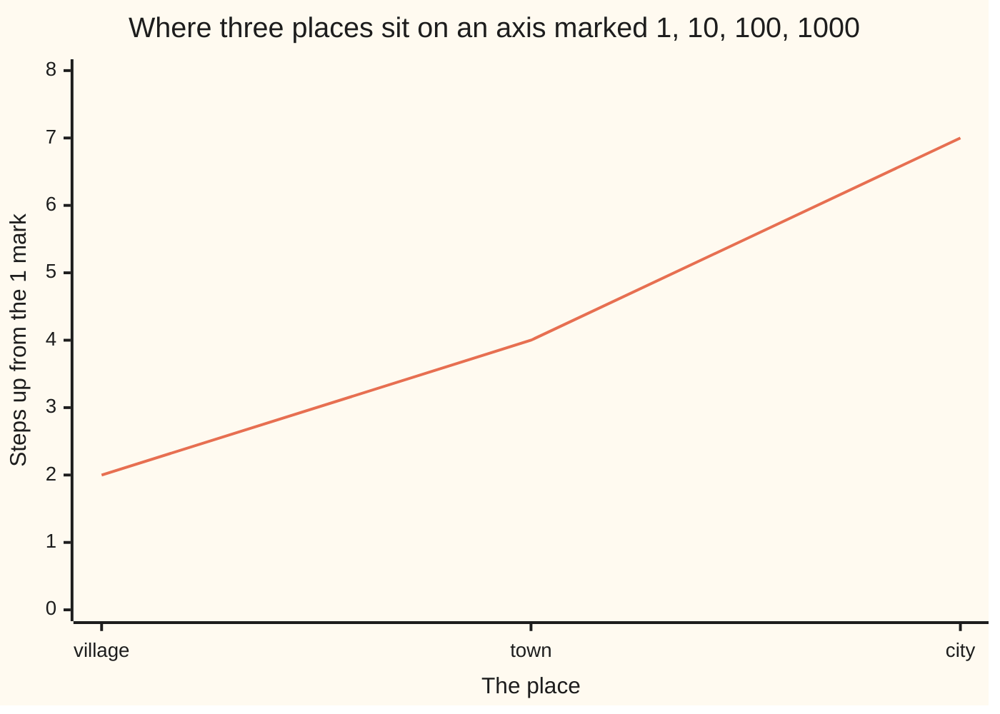

# Log laws and log scales: multiplication becomes addition, and how a 1-10-100 axis reads

[Syllabus](../../../SYLLABUS.md) → [Foundations](../README.md) → [Powers, Roots and Logarithms](../README.md#s03) → Log laws and log scales

---

## General Overview

Three places on one chart. A village of 100 people, a town of 10,000, a city of 10,000,000.

On an ordinary axis — every centimetre worth the same number of people — the city eats the page and the other two flatten onto the floor, reading as zero.

So mark it differently: 1 at the bottom, then 10, 100, 1,000, each mark ten times the one below. That is a **log scale** — an axis where a fixed distance means a fixed multiply, not a fixed amount. Steps up from the 1: village two, town four, city seven — the logarithms from [Logarithms](05-logarithms.md), turned into distances.

**On a log scale, position from 1 is a count of tens — so multiplying two positive numbers only adds their positions.**

**What kind of fact this is:** a theorem, proved on this card in Why it works for whole counts of tens.

### The picture: where each place lands



The line is the step count: village to town two steps, town to city three. On an ordinary axis the first gap would vanish.

---

## The formula

**log10(x)** is the count: how many tens multiplied make x. The log law, for multiplying — say, 100 towns of 10,000 people:

**log10(100 × 10,000) = log10(100) + log10(10,000)**, that is **2 + 4 = 6**

The plain way agrees: 100 × 10,000 = 1,000,000 people, six tens.

**Read it aloud:** the count of a product is the sum of the counts.

Dividing subtracts: **log10(10,000,000 ÷ 100) = 7 − 2 = 5**, and 10,000,000 ÷ 100 = 100,000. A number times itself repeats the addition. 10,000 such towns hold 100,000,000 people: **log10(10,000 × 10,000) = 4 + 4 = 8**. Cube 10,000: 3 × 4 = 12. That is the power law.

Change of base, for counting in bigger steps. **log100(x)** counts steps of 100 instead of steps of ten:

**log100(1,000,000) = log10(1,000,000) ÷ log10(100) = 6 ÷ 2 = 3**

Said aloud: divide by how many tens one step is worth.

| Piece | Plain meaning | In our chart | Push it up and the answer… |
| --- | --- | --- | --- |
| the base | the number multiplied over and over | 10, one mark to the next | for numbers above 1, fewer steps and smaller counts |
| the count, or log | how many of the base reach a number | 2, 4 and 7 | one more is ten times the people |
| a mark on the axis | one step, a multiply by ten | 1, 10, 100, 1,000 | — spacing only, the multiply stays ten |

### When it holds

- **Both numbers are positive.** No run of tens multiplies out to zero or to a negative number, so neither has a count.
- **The numbers are multiplied, not added.** A sum such as 100 + 10,000 = 10,100 does not split.
- **Every count uses the same base, bigger than 1.** Tens and steps of 100 do not add. Convert first: 6 tens are 3 steps of 100.
- **Each mark is one fixed multiply above the last.** Mark it by fixed amounts and halfway from 100 to 10,000 moves to 5,050.

---

## Why it works

### Step 0: a count of tens is a length

The village is 10 × 10, the town 10 × 10 × 10 × 10. Every mark on this axis is a run of tens, and its position is the length of that run.

### Step 1: multiplying joins two runs end to end

100 towns of 10,000: (10 × 10) × (10 × 10 × 10 × 10). Six tens in a row, so 1,000,000, count 6. Counts 2 and 4, end to end, make 6.

### Step 2: dividing takes a run back out

City over village strikes two tens off a run of seven. Five are left: 100,000, so 7 − 2 = 5.

### Step 3: changing the base is changing the ruler

Count in steps of 100. Each is two tens, so a count in tens halves. That 1,000,000 was 6 tens; in steps of 100, 6 ÷ 2 = 3, and 100 × 100 × 100 = 1,000,000.

### Step 4: the count need not be whole

The city is 7 tens, so in steps of 100 it is 7 ÷ 2 = 3.5 — a real position, halfway between two marks. That counts steps of 100, not villages: the city is 100,000 villages' worth.

What sits halfway between the 100 and 10,000 marks? Counts 2 and 4, middle count 3: the **1,000** mark, not 5,050. Other numbers read the same way: 3,000, count about 3.5, sits almost halfway from the 1,000 mark to the 10,000.

<details>
<summary>Why anyone printed tables of these</summary>

Henry Briggs printed the count for tens of thousands of numbers: look up two, add them, look the answer back up. A slide rule is that table on sticks.

</details>

---

## Worked numbers, by hand

| Step | Arithmetic | Value |
| --- | --- | --- |
| the village's count | tens in 100 | 2 |
| the town's count | tens in 10,000 | 4 |
| the city's count | tens in 10,000,000 | 7 |
| 100 towns of 10,000 | 100 × 10,000 = 1,000,000, counted | 6 |
| the same by adding | 2 + 4 | **6** |
| city over village | 10,000,000 ÷ 100 = 100,000, counted | 5 |
| the same by subtracting | 7 − 2 | **5** |
| 10,000 towns of 10,000 | 10,000 × 10,000, counted, or 4 + 4 | **8** |
| that million, in steps of 100 | 6 ÷ 2 | **3** |
| the city, in steps of 100 | 7 ÷ 2 | **3.5** |
| halfway from 100 to 10,000 | count (2 + 4) ÷ 2 | **1,000** |

A million people found by landing 6 steps along the axis, and nothing bigger than a single ten got multiplied.

### What breaks if you drop a piece

| Mistake | Comes out at | What went wrong |
| --- | --- | --- |
| Adding 100 and 10,000, not their counts | 10,100 | the law adds counts, not sizes |
| Reading the axis middle as an average | 5,050 | halfway is the 1,000 mark |
| Multiplying the counts, not adding | 8 | eight tens, not six — that is 10,000 towns, not 100 |

---

## Code, from first principles, and it actually runs

Nothing is imported. Road one multiplies the numbers and counts the tens. Road two only adds and subtracts counts. Four asserts hold them together.

### Python

```python
# Log laws and log scales -- the check behind the card.  Nothing is imported.  A
# village of 100, a town of 10,000, a city of 10,000,000, on a 1-10-100 axis.
VILLAGE, TOWN, CITY = 100, 10000, 10000000; REGION, COUNTRY = 100, 10000   # towns in a region, a country
def count_of_tens(x):                 # divide by ten until 1, counting the steps
    steps = 0
    while x > 1:
        assert x % 10 == 0, "not a whole power of ten"; x //= 10; steps += 1
    return steps
def tens_back(steps):                 # the road back: that many tens multiplied
    out = 1
    for _ in range(steps): out *= 10
    return out
for name, size in (("village", VILLAGE), ("town", TOWN), ("city", CITY)):
    print(f"{name:<9}{size:>9}   its count {count_of_tens(size)}")
v, t, c, r = count_of_tens(VILLAGE), count_of_tens(TOWN), count_of_tens(CITY), count_of_tens(REGION)
product, quotient, square = REGION * TOWN, CITY // VILLAGE, COUNTRY * TOWN   # the plain way
half = count_of_tens(product) // v                        # 6 / 2, the count in steps of 100
mid, rem = divmod(v + t, 2); assert rem == 0, "halfway is not a whole count"  # the halfway mark
print(f"100 towns          {REGION} x {TOWN} = {product:<9}count {count_of_tens(product)}")
print(f"the counts added instead     {r} + {t} = {r + t}")
print(f"city / village     {CITY} / {VILLAGE} = {quotient:<7}count {count_of_tens(quotient)}")
print(f"the counts subtracted        {c} - {v} = {c - v}")
print(f"10000 towns        {COUNTRY} x {TOWN} = {square:<10}count {count_of_tens(square)} = {t} + {t}")
print(f"in steps of 100   the product {count_of_tens(product)} / {v} = {half}, the city {c} / {v} = {c / v}")
print(f"halfway from {VILLAGE} to {TOWN}    count {mid}, the {tens_back(mid)} mark")
print(f"the three mistakes come out at {REGION + TOWN}, {(VILLAGE + TOWN) // 2} and {r * t}")
assert product == 1000000 and count_of_tens(product) == r + t and count_of_tens(square) == 2 * t
assert quotient == 100000 and count_of_tens(quotient) == c - v and square == 100000000
assert half == 3 and VILLAGE * VILLAGE * VILLAGE == product and tens_back(mid) == 1000
print("ALL CHECKS PASS")
```

**Ran 2026-11-25 on macOS, Python 3.14.10, standard library only. All checks passed. Output, pasted from the run:**

```
village        100   its count 2
town         10000   its count 4
city      10000000   its count 7
100 towns          100 x 10000 = 1000000  count 6
the counts added instead     2 + 4 = 6
city / village     10000000 / 100 = 100000 count 5
the counts subtracted        7 - 2 = 5
10000 towns        10000 x 10000 = 100000000 count 8 = 4 + 4
in steps of 100   the product 6 / 2 = 3, the city 7 / 2 = 3.5
halfway from 100 to 10000    count 3, the 1000 mark
the three mistakes come out at 10100, 5050 and 8
ALL CHECKS PASS
```

### Rust

Same numbers, built with `rustc --edition 2021 -O`.

```rust
// Log laws and log scales -- the same check as the Python one, in Rust.  No crates.
// A village of 100, a town of 10,000, a city of 10,000,000, on a 1-10-100 axis.
const VILLAGE: i64 = 100;
const TOWN: i64 = 10000;
const CITY: i64 = 10000000;
const REGION: i64 = 100;      // towns in a region
const COUNTRY: i64 = 10000;   // towns in a large country
fn count_of_tens(x: i64) -> i64 {          // divide by ten until 1, counting the steps
    let (mut x, mut steps) = (x, 0i64);
    while x > 1 {
        assert!(x % 10 == 0, "not a whole power of ten"); x /= 10; steps += 1;
    }
    steps
}
fn tens_back(steps: i64) -> i64 {          // the road back: that many tens multiplied
    let mut out = 1i64;
    for _ in 0..steps { out *= 10; }
    out
}
fn main() {
    for (name, size) in [("village", VILLAGE), ("town", TOWN), ("city", CITY)] {
        println!("{:<9}{:>9}   its count {}", name, size, count_of_tens(size));
    }
    let (v, t, c, r) = (count_of_tens(VILLAGE), count_of_tens(TOWN), count_of_tens(CITY), count_of_tens(REGION));
    let (product, quotient, square) = (REGION * TOWN, CITY / VILLAGE, COUNTRY * TOWN); // the plain way
    let half = count_of_tens(product) / v;                       // 6 / 2, the count in steps of 100
    let (mid, rem) = ((v + t) / 2, (v + t) % 2); assert!(rem == 0, "halfway is not a whole count");
    println!("100 towns          {} x {} = {:<9}count {}", REGION, TOWN, product, count_of_tens(product));
    println!("the counts added instead     {} + {} = {}", r, t, r + t);
    println!("city / village     {} / {} = {:<7}count {}", CITY, VILLAGE, quotient, count_of_tens(quotient));
    println!("the counts subtracted        {} - {} = {}", c, v, c - v);
    println!("10000 towns        {} x {} = {:<10}count {} = {} + {}", COUNTRY, TOWN, square, count_of_tens(square), t, t);
    println!("in steps of 100   the product {} / {} = {}, the city {} / {} = {}", count_of_tens(product), v, half, c, v, c as f64 / v as f64);
    println!("halfway from {} to {}    count {}, the {} mark", VILLAGE, TOWN, mid, tens_back(mid));
    println!("the three mistakes come out at {}, {} and {}", REGION + TOWN, (VILLAGE + TOWN) / 2, r * t);
    assert!(product == 1000000 && count_of_tens(product) == r + t && count_of_tens(square) == 2 * t);
    assert!(quotient == 100000 && count_of_tens(quotient) == c - v && square == 100000000);
    assert!(half == 3 && VILLAGE * VILLAGE * VILLAGE == product && tens_back(mid) == 1000);
    println!("ALL CHECKS PASS");
}
```

**Ran 2026-11-25 on macOS, rustc 1.98.1, no crates. All checks passed. Output, pasted from the run:**

```
village        100   its count 2
town         10000   its count 4
city      10000000   its count 7
100 towns          100 x 10000 = 1000000  count 6
the counts added instead     2 + 4 = 6
city / village     10000000 / 100 = 100000 count 5
the counts subtracted        7 - 2 = 5
10000 towns        10000 x 10000 = 100000000 count 8 = 4 + 4
in steps of 100   the product 6 / 2 = 3, the city 7 / 2 = 3.5
halfway from 100 to 10000    count 3, the 1000 mark
the three mistakes come out at 10100, 5050 and 8
ALL CHECKS PASS
```

The two outputs match line for line; the fraction 3.5 is exact.

### Lean

Lean proves the log laws for any two positive numbers, not only whole runs of tens.

- The count of a product is the sum of the counts: log10(x × y) = log10(x) + log10(y).
- Dividing subtracts: log10(x ÷ y) = log10(x) − log10(y).
- Powers multiply: log10(x^n) = n × log10(x), for any positive x and any whole n.
- Change of base: log100(x) = log10(x) ÷ log10(100), for any positive x.
- The chart's numbers: counts 2, 4 and 7, the region's 6, the quotient's 5, the country's 8 and 12, and the 1,000 mark halfway.

The city's 3.5 steps of 100 and the counting routine's own asserts are left to the Python and Rust checks.

```lean
-- Log laws and log scales: for positive numbers the base-10 log of a product is the sum of the logs, the log of a quotient is the difference, a power of a number has that many times its log, and a count in steps of 100 is the count in tens divided by the log of 100.
import Mathlib.Analysis.SpecialFunctions.Log.Base
import Mathlib.Tactic.NormNum.NatLog

open Real

/-- The count of a product is the sum of the counts: for any two positive numbers `x` and `y`,
the base-10 log of `x * y` equals the base-10 log of `x` plus the base-10 log of `y`. On a log
scale, multiplying two numbers adds their distances from the 1 mark. -/
theorem log10_of_product_is_sum_of_logs (x y : ℝ) (hx : 0 < x) (hy : 0 < y) :
    logb 10 (x * y) = logb 10 x + logb 10 y := by
  rw [logb, logb, logb, Real.log_mul hx.ne' hy.ne', add_div]

/-- Dividing subtracts: for any two positive numbers `x` and `y`, the base-10 log of `x / y`
equals the base-10 log of `x` minus the base-10 log of `y`. -/
theorem log10_of_quotient_is_difference_of_logs (x y : ℝ) (hx : 0 < x) (hy : 0 < y) :
    logb 10 (x / y) = logb 10 x - logb 10 y := by
  rw [logb, logb, logb, Real.log_div hx.ne' hy.ne', sub_div]

/-- Change of base: counting a positive number `x` in steps of 100 gives its count in tens
divided by how many tens one step of 100 is worth, `log10 (100)`. -/
theorem log100_is_log10_divided_by_log10_of_100 (x : ℝ) (hx : 0 < x) :
    logb 100 x = logb 10 x / logb 10 100 := by
  rw [logb, logb, logb]
  rw [div_div_div_cancel_right₀]
  exact (Real.log_pos (by norm_num : (1:ℝ) < 10)).ne'

/-- The power law: a number multiplied by itself `n` times has `n` times its count. For any real
`x` and whole `n`, the base-10 log of `x ^ n` is `n` times the base-10 log of `x`. -/
theorem log10_of_power_is_multiple_of_log (x : ℝ) (n : ℕ) :
    logb 10 (x ^ n) = n * logb 10 x := by
  rw [logb, logb, Real.log_pow, mul_div_assoc]

-- The counts of the village, the town and the city: 2, 4 and 7 tens.
example : Nat.log 10 100 = 2 ∧ Nat.log 10 10000 = 4 ∧ Nat.log 10 10000000 = 7 := by norm_num
-- A region of 100 towns of 10,000 people: 100 x 10,000 = 1,000,000, count 6 = 2 + 4.
example : 100 * 10000 = 1000000 ∧ Nat.log 10 1000000 = 6 ∧ 10 ^ 2 * 10 ^ 4 = 10 ^ (2 + 4) := by
  norm_num
-- City over village: 10,000,000 / 100 = 100,000, count 5 = 7 - 2.
example : 10000000 / 100 = 100000 ∧ Nat.log 10 100000 = 5 ∧ 10 ^ 7 / 10 ^ 2 = 10 ^ (7 - 2) := by
  norm_num
-- A country of 10,000 towns of 10,000 people: 10,000 x 10,000 = 100,000,000, count 8 = 4 + 4.
example : 10000 * 10000 = 100000000 ∧ Nat.log 10 100000000 = 8 := by norm_num
-- Three copies of 10,000 multiplied: count 3 x 4 = 12.
example : 10000 ^ 3 = 1000000000000 ∧ Nat.log 10 1000000000000 = 12 ∧ 3 * 4 = 12 := by norm_num
-- In steps of 100: 1,000,000 is three steps of 100, and 6 / 2 = 3.
example : 100 * 100 * 100 = 1000000 ∧ Nat.log 100 1000000 = 3 ∧ 6 / 2 = 3 := by norm_num
-- Halfway from the 100 mark to the 10,000 mark is count (2 + 4) / 2 = 3, the 1,000 mark.
example : (2 + 4) / 2 = 3 ∧ 10 ^ ((2 + 4) / 2) = 1000 := by norm_num
-- The three mistakes: 100 + 10,000 = 10,100, its half 5,050, and 2 x 4 = 8.
example : 100 + 10000 = 10100 ∧ (100 + 10000) / 2 = 5050 ∧ 2 * 4 = 8 := by norm_num

#print axioms log10_of_product_is_sum_of_logs
#print axioms log10_of_quotient_is_difference_of_logs
#print axioms log100_is_log10_divided_by_log10_of_100
#print axioms log10_of_power_is_multiple_of_log
```

**Checked 2026-11-25 on macOS, Lean 4.36.0-rc2, Mathlib v4.36.0-rc2. Every proof is complete and uses only Lean's standard axioms. Output, pasted from the run:**

```
'log10_of_product_is_sum_of_logs' depends on axioms: [propext, Classical.choice, Quot.sound]
'log10_of_quotient_is_difference_of_logs' depends on axioms: [propext, Classical.choice, Quot.sound]
'log100_is_log10_divided_by_log10_of_100' depends on axioms: [propext, Classical.choice, Quot.sound]
'log10_of_power_is_multiple_of_log' depends on axioms: [propext, Classical.choice, Quot.sound]
```

> [!TIP]
> **Try changing**
> Guess first, then run it.
> - **Grow the town tenfold, to 100000.** Its count prints as 5, then the run stops: 2 and 5 make 7, and half of 7 is no mark on the axis.
> - **Give the village 500 people.** Not a whole run of tens, so the counting routine trips its own assert.

---

## The usual mistake

> [!warning]
> **Reading a log axis as if the gaps were amounts.** Village to town is two marks, and 1 to 100 is the same two marks — but one gap is 9,900 people and the other 99. Equal distances mean equal multiplies.
>
> - Averaging the ends: the middle of the 100 and 10,000 marks is 1,000, not 5,050.
> - Splitting the log of a sum. The law covers products only, and 100 + 10,000 is 10,100.
> - Missing that a chart is on a log axis. A straight rising line there is a steady multiply, not a fixed amount added each step.

---

## Where you meet it in real life

- **Any chart with 1, 10, 100, 1,000 up the side.** Case counts, incomes, file sizes: the data spans several multiplies.
- **Slide rules and log tables.** Two lengths added is two numbers multiplied; they built bridges until the 1970s.
- **Scales you already read this way.** Earthquake magnitude, decibels and pH, met in [Logarithms](05-logarithms.md) — each a count of multiplies in plain clothes.

> **Say it back**
> Village (100), town (10,000) and city (10,000,000) have counts of 2, 4 and 7 tens. Multiply positive numbers and their counts add: 2 + 4 = 6, matching 1,000,000. Divide and they subtract: 7 − 2 = 5. Square and the count doubles: 4 + 4 = 8. To count in steps of 100, divide by 2: 1,000,000 is 3 steps. Equal distances on the axis are equal multiplies, so halfway from 100 to 10,000 is 1,000, not 5,050.

---

## What this builds on

- [Logarithms](05-logarithms.md): the count itself — how many of the base, multiplied together, reach a number. Here two numbers are multiplied and their counts add.

## Where this goes next

- [Growth factors](../04-Compound%20Growth%20and%20Discounting/01-growth-factors.md): the next shelf's first card — a percent rise as one multiplier.
- [Natural log and doubling time](../04-Compound%20Growth%20and%20Discounting/05-natural-log-and-doubling-time.md): the base growth picks for itself, and the log law turned into a time.
- [Geometric programs](../../15-Optimization/06-Conic%2C%20Quadratic%20and%20Stochastic%20Programs/11-geometric-programming-and-the-exponential-cone.md): far ahead: logs turn products of positive numbers into sums that optimisation tools can solve.

This card leaves one question open: when something grows a little each year, not tenfold, how many years make one step? The next shelf answers it, ending at Natural log and doubling time.

---

## Sources

Verified 2026-11-11: every link below resolves to the publisher's page.

- Briggs, Henry. *Arithmetica Logarithmica*. London, 1624. [Internet Archive](https://archive.org/details/arithmeticalogar00brig). The base-10 tables that turned multiplying into adding.
- Dehaene, Stanislas, Véronique Izard, Elizabeth Spelke, and Pierre Pica. "Log or Linear?" *Science* 320 (2008): 1217–1220. [doi:10.1126/science.1156540](https://doi.org/10.1126/science.1156540). Spacing by multiplies is the older instinct.
- Tufte, Edward R. *The Visual Display of Quantitative Information*. 2nd ed. Graphics Press, 2001. [Publisher page](https://www.edwardtufte.com/book/the-visual-display-of-quantitative-information/). What an axis promises its reader.
