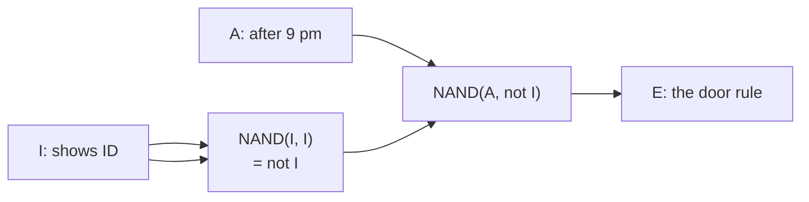

# Normal forms: every truth table is an 'or' of 'and's, and NAND alone can build them all

[Syllabus](../../../SYLLABUS.md) → [Foundations](../README.md) → [Logic](../README.md#s05) → Normal forms

---

## General Overview

The sign on the club door says: **"After 9 pm, everyone must show ID."** **A** is "it is after 9 pm". **I** is "this person shows ID".

The sign is an if-then, so its rule **E** is: not after 9 pm, or shows ID ([If-then](02-if-then.md)). Its truth table has one false row: after 9 pm, no ID.

This card reads two standard formulas off that table, then rebuilds the rule from one **gate** (a tiny chip circuit for one connective): **NAND**, "not both".

**Any truth table can be written as an "or" of "and"s, one per true row, or as an "and" of "or"s, one per false row; and since NAND builds "not", "and" and "or", NAND alone builds every table.**

**What kind of fact this is:** a theorem, proved in Why it works and checked on every table with two or three inputs.

### The picture: the door rule from NAND gates only



The first gate turns "shows ID" into "no ID". The second gives "not both after 9 pm and no ID": the sign.

---

## The formula

Three ways to write the same rule:

```math
E \;=\; (\text{not }A \text{ and not }I) \text{ or } (\text{not }A \text{ and } I) \text{ or } (A \text{ and } I) \;=\; (\text{not }A \text{ or } I) \;=\; \mathrm{NAND}(A,\ \mathrm{NAND}(I, I))
```

**Read it aloud:** three "and"s joined by "or", one "or", and a NAND inside a NAND: each is false only after 9 pm with no ID.

| Symbol | Plain meaning | In our example | Push it up and the answer… |
| --- | --- | --- | --- |
| A | the statement "it is after 9 pm" | true after 9 pm | E now needs I |
| I | the statement "this person shows ID" | true for someone with ID | E is true whatever A is |
| E | the door rule: not A, or I | false on one row of four | — |
| DNF | disjunctive normal form: an "or" of "and"s, one per true row | 3 terms | more true rows, more terms |
| CNF | conjunctive normal form: an "and" of "or"s (**clauses**), one per false row | 1 clause | more false rows, more clauses |
| NAND, NOR | "not both" (false only when both inputs are true) and "neither" | `NAND(I, I)` is "not I" | — |

### When it holds

- **Each input is plainly true or false.** A "maybe" adds rows the forms do not cover.
- **The rule depends on the inputs alone.** A rule that also depends on the doorman's mood has no fixed table.
- **The table has a true row and a false row.** If not, one form is empty: use "A and not A" (always false) or "A or not A" (always true).

---

## Why it works

### Step 0: a table is a finite list

Any formula that agrees with the rule on all four rows **is** the rule ([Logical equivalence and De Morgan](03-logical-equivalence-and-de-morgan.md)). So the job is to say yes on the right rows.

### Step 1: one "and" picks out one row

"Not A and not I" is true on the row "before 9 pm, no ID" and on no other. Every row has such a term: put "not" on each input that is false there.

### Step 2: "or" the true rows together: the DNF

Join one term per true row with "or". An "or" is true when at least one term is, so the DNF is true on exactly the true rows.

### Step 3: one clause shuts out one row: the CNF

To shut out one row, put "not" on each input that is **true** there and join them with "or": the false row gives "not A or I". This is Step 1 reversed: De Morgan's laws turn "not (A and not I)" into "not A or I". Join one clause per false row with "and"; the result is false on exactly the false rows.

### Step 4: NAND builds "not", "and" and "or"

Steps 1 to 3 build every table from "not", "and" and "or". So any gates that build those three build every table: such a set is **complete**. For inputs X and Y:

- **Not:** `NAND(X, X)` is "not both X and X", which is "not X".
- **And:** "X and Y" is "not NAND(X, Y)", so `NAND(NAND(X, Y), NAND(X, Y))`.
- **Or:** "X or Y" is "not both (not X) and (not Y)", by De Morgan, so `NAND(NAND(X, X), NAND(Y, Y))`.

NOR ("neither") works the same way, mirrored: "not A" is NOR(A, A), and E is "not" of NOR(not A, I). "And" with "or" alone is not complete: with every input true their formulas are all true, so none is "not A".

---

## Worked numbers, by hand

Write 1 for true and 0 for false. NAND is 1 minus the product of the inputs.

| Step | Arithmetic | Value |
| --- | --- | --- |
| A = 1, I = 1 | E = 1 | term: A and I |
| A = 1, I = 0 | E = 0 | clause: not A or I |
| A = 0, I = 1 | E = 1 | term: not A and I |
| A = 0, I = 0 | E = 1 | term: not A and not I |
| NAND(I, I), row by row | 1 − I × I | 0, 1, 0, 1 |
| NAND(A, NAND(I, I)), row by row | 1 − A × NAND(I, I) | **1, 0, 1, 1** |

The NAND circuit gives the rule's column.

### What breaks if you drop a piece

| Mistake | Comes out at | What went wrong |
| --- | --- | --- |
| Building the clauses from the true rows | agrees on 0 of 4 rows | It shuts out the passing rows |
| Leaving "A and I" out of the DNF | agrees on 3 of 4 rows | ID holders after 9 pm are turned away |
| Writing `NAND(A, I)` with no inner gate | agrees on 2 of 4 rows | After 9 pm it refuses ID and admits no ID |

---

## Code, from first principles, and it actually runs

The door rule is worked from the sign, then four more ways: DNF, CNF, NAND and NOR. Then every table with two or three inputs is rebuilt as a DNF, a CNF and from NAND alone.

### Python

```python
# Normal forms -- the check behind the card.  Nothing is imported.  The club door: E = not A or I
# (A: after 9 pm, I: shows ID), rebuilt as a DNF, a CNF, NAND alone and NOR alone; then every table.
def rows(n): return [tuple(k >> (n - 1 - j) & 1 for j in range(n)) for k in range(2 ** n - 1, -1, -1)]
nand = lambda x, y: 1 - x * y; nor = lambda x, y: 1 - max(x, y)   # NAND: false only on 1, 1
def dnf(x, trues): return int(any(all(v == r for v, r in zip(x, row)) for row in trues))
def cnf(x, falses): return int(all(any(v != r for v, r in zip(x, row)) for row in falses))
def nand_only(x, trues):                                  # the DNF, wired from NAND gates only
    one = nand(x[0], nand(x[0], x[0])); acc = nand(one, one)   # wires that are always 1 and 0
    for row in trues:
        term = one
        for v, r in zip(x, row): t = nand(term, v if r else nand(v, v)); term = nand(t, t)  # and
        acc = nand(nand(acc, acc), nand(term, term))     # or
    return acc
def split(R, t): return [r for r, b in zip(R, t) if b], [r for r, b in zip(R, t) if not b]
def rebuilt(n, t):                                        # 1 if all three roads give table t
    R = rows(n); tr, fa = split(R, t)
    return int(all(dnf(x, tr) == b == cnf(x, fa) == nand_only(x, tr) for x, b in zip(R, t)))
R = rows(2); E = [int((not a) or i) for a, i in R]; trues, falses = split(R, E)   # road 1: the sign
cols = [[dnf(x, trues), cnf(x, falses), nand(x[0], nand(x[1], x[1])), nor(nor(nor(x[0], x[0]), x[1]), nor(nor(x[0], x[0]), x[1]))] for x in R]
print("A I  NAND(I,I)  rule  DNF  CNF  NAND  NOR")
for (a, i), e, c in zip(R, E, cols): print(f"{a} {i}  {nand(i, i):>9}{e:>6}{c[0]:>5}{c[1]:>5}{c[2]:>6}{c[3]:>5}")
print(f"DNF terms (one per true row): {len(trues)}; CNF clauses (one per false row): {len(falses)}")
ok = {n: sum(rebuilt(n, [c >> k & 1 for k in range(2 ** n)]) for c in range(2 ** 2 ** n)) for n in (2, 3)}
for n in (2, 3): print(f"{n}-input tables rebuilt by DNF, CNF and NAND alone: {ok[n]} of {2 ** 2 ** n}")
bad = [sum(m == e for m, e in zip(b, E)) for b in ([cnf(x, trues) for x in R], [dnf(x, trues[1:]) for x in R], [nand(*x) for x in R], [int(all(any(v == r for v, r in zip(x, row)) for row in falses)) for x in R])]
print(f"the four mistakes agree with the rule on {bad[0]}, {bad[1]}, {bad[2]} and {bad[3]} of 4 rows")
assert E == [1, 0, 1, 1] and all(c == [e] * 4 for c, e in zip(cols, E))   # four roads, one table
assert ok == {2: 16, 3: 256}                              # every table has a DNF, a CNF and a NAND form
assert bad == [0, 3, 2, 2]                                # the mistakes, counted by hand
print("ALL CHECKS PASS")
```

**Ran 2026-11-23 on macOS, Python 3.14.10, standard library only. All checks passed. Output, pasted from the run:**

```
A I  NAND(I,I)  rule  DNF  CNF  NAND  NOR
1 1          0     1    1    1     1    1
1 0          1     0    0    0     0    0
0 1          0     1    1    1     1    1
0 0          1     1    1    1     1    1
DNF terms (one per true row): 3; CNF clauses (one per false row): 1
2-input tables rebuilt by DNF, CNF and NAND alone: 16 of 16
3-input tables rebuilt by DNF, CNF and NAND alone: 256 of 256
the four mistakes agree with the rule on 0, 3, 2 and 2 of 4 rows
ALL CHECKS PASS
```

### Rust

Same labels, built with `rustc --edition 2021 -O`.

```rust
// Normal forms -- the same check as the Python, in Rust.  No crates.  The club door: E = not A or I
// (A: after 9 pm, I: shows ID), rebuilt as a DNF, a CNF, NAND alone and NOR alone; then every table.
fn rows(n: u32) -> Vec<Vec<u8>> { (0..1u32 << n).rev().map(|k| (0..n).map(|j| (k >> (n - 1 - j) & 1) as u8).collect()).collect() }
fn nand(x: u8, y: u8) -> u8 { 1 - x * y }   fn nor(x: u8, y: u8) -> u8 { 1 - x.max(y) }   // NAND: false only on 1, 1
fn dnf(x: &[u8], trues: &[Vec<u8>]) -> u8 { trues.iter().any(|row| x.iter().zip(row).all(|(v, r)| v == r)) as u8 }
fn cnf(x: &[u8], falses: &[Vec<u8>]) -> u8 { falses.iter().all(|row| x.iter().zip(row).any(|(v, r)| v != r)) as u8 }
fn nand_only(x: &[u8], trues: &[Vec<u8>]) -> u8 {          // the DNF, wired from NAND gates only
    let one = nand(x[0], nand(x[0], x[0])); let mut acc = nand(one, one);   // wires always 1 and 0
    for row in trues {
        let mut term = one;
        for (&v, &r) in x.iter().zip(row) { let t = nand(term, if r == 1 { v } else { nand(v, v) }); term = nand(t, t); }
        acc = nand(nand(acc, acc), nand(term, term));     // or
    }
    acc
}
fn split(r: &[Vec<u8>], t: &[u8]) -> (Vec<Vec<u8>>, Vec<Vec<u8>>) {
    (r.iter().zip(t).filter(|p| *p.1 == 1).map(|p| p.0.clone()).collect(), r.iter().zip(t).filter(|p| *p.1 == 0).map(|p| p.0.clone()).collect())
}
fn rebuilt(n: u32, t: &[u8]) -> u32 {                       // 1 if all three roads give table t
    let r = rows(n); let (tr, fa) = split(&r, t);
    r.iter().zip(t).all(|(x, &b)| dnf(x, &tr) == b && cnf(x, &fa) == b && nand_only(x, &tr) == b) as u32
}
fn main() {
    let r = rows(2); let e: Vec<u8> = r.iter().map(|x| (x[0] == 0 || x[1] == 1) as u8).collect(); let (trues, falses) = split(&r, &e);   // road 1: the sign
    let cols: Vec<[u8; 4]> = r.iter().map(|x| [dnf(x, &trues), cnf(x, &falses), nand(x[0], nand(x[1], x[1])),
        nor(nor(nor(x[0], x[0]), x[1]), nor(nor(x[0], x[0]), x[1]))]).collect();
    println!("A I  NAND(I,I)  rule  DNF  CNF  NAND  NOR");
    for k in 0..4 { let c = cols[k]; println!("{} {}  {:>9}{:>6}{:>5}{:>5}{:>6}{:>5}", r[k][0], r[k][1], nand(r[k][1], r[k][1]), e[k], c[0], c[1], c[2], c[3]); }
    println!("DNF terms (one per true row): {}; CNF clauses (one per false row): {}", trues.len(), falses.len());
    let ok: Vec<u32> = [2u32, 3].iter().map(|&n| (0..1u32 << (1 << n)).map(|c| rebuilt(n, &(0..1 << n).map(|k| (c >> k & 1) as u8).collect::<Vec<u8>>())).sum()).collect();
    for (i, n) in [2u32, 3].iter().enumerate() { println!("{}-input tables rebuilt by DNF, CNF and NAND alone: {} of {}", n, ok[i], 1u32 << (1 << n)); }
    let agree = |m: Vec<u8>| m.iter().zip(&e).filter(|(a, b)| a == b).count();
    let bad = [agree(r.iter().map(|x| cnf(x, &trues)).collect()), agree(r.iter().map(|x| dnf(x, &trues[1..])).collect()), agree(r.iter().map(|x| nand(x[0], x[1])).collect()),
        agree(r.iter().map(|x| falses.iter().all(|row| x.iter().zip(row).any(|(v, w)| v == w)) as u8).collect())];
    println!("the four mistakes agree with the rule on {}, {}, {} and {} of 4 rows", bad[0], bad[1], bad[2], bad[3]);
    assert!(e == vec![1, 0, 1, 1] && cols.iter().zip(&e).all(|(c, &v)| c.iter().all(|&w| w == v)));   // four roads, one table
    assert!(ok == vec![16, 256]);                           // every table has a DNF, a CNF and a NAND form
    assert!(bad == [0, 3, 2, 2]);                           // the mistakes, counted by hand
    println!("ALL CHECKS PASS");
}
```

**Ran 2026-11-23 on macOS, rustc 1.98.1, no crates. All checks passed. Output, pasted from the run:**

```
A I  NAND(I,I)  rule  DNF  CNF  NAND  NOR
1 1          0     1    1    1     1    1
1 0          1     0    0    0     0    0
0 1          0     1    1    1     1    1
0 0          1     1    1    1     1    1
DNF terms (one per true row): 3; CNF clauses (one per false row): 1
2-input tables rebuilt by DNF, CNF and NAND alone: 16 of 16
3-input tables rebuilt by DNF, CNF and NAND alone: 256 of 256
the four mistakes agree with the rule on 0, 3, 2 and 2 of 4 rows
ALL CHECKS PASS
```

### Lean

Lean proves three facts for rules on any number of inputs, and checks the club door row by row.

- Suppose a rule's table has a true row and a false row. Then its DNF and its CNF are each true on exactly the rule's true rows.
- NAND alone builds every table on one or more inputs.
- "And" with "or" alone never builds "not A".
- NAND builds "not", "and" and "or", as in Step 4.
- The door rule reads 1, 0, 1, 1, and its DNF, the NAND circuit and the NOR circuit read the same.
- The four mistakes agree with the rule on 0, 3, 2 and 2 of 4 rows.

Printing the table, counting the rebuilt tables, and the Try changing edits are left to the Python and Rust checks.

```lean
-- Normal forms: every true-or-false table on n inputs equals the "or" of one "and" per true row (DNF) and the "and" of one clause per false row (CNF), NAND alone builds every table, and "and" with "or" alone cannot build "not".
import Mathlib.Data.Fintype.Pi

theorem ite_bool_eq_true_iff_eq (a b : Bool) : ((if a then b else !b) = true) ↔ a = b := by
  cases a <;> cases b <;> decide

theorem ite_not_bool_eq_true_iff_ne (a b : Bool) : ((if a then !b else b) = true) ↔ a ≠ b := by
  cases a <;> cases b <;> decide

#print axioms ite_bool_eq_true_iff_eq
#print axioms ite_not_bool_eq_true_iff_ne

/-- Every truth table is an "or" of "and"s and an "and" of "or"s. A rule `f` on `n` true-or-false
inputs is fixed by its table. Suppose the table has a true row and a false row. Then on every
input `x`, the rule is true exactly when
* (DNF) some true row `r` has its "and" term true at `x`: the term puts "not" on each input
  that is false in `r`, so it is true only on the row `r`; and exactly when
* (CNF) every false row `r` has its clause true at `x`: the clause puts "not" on each input
  that is true in `r` and joins them with "or", so it is false only on the row `r`. -/
theorem truth_table_eq_dnf_and_cnf {n : ℕ} (f : (Fin n → Bool) → Bool)
    (htrue : ∃ r, f r = true) (hfalse : ∃ r, f r = false) (x : Fin n → Bool) :
    (f x = true ↔
      ∃ r ∈ Finset.univ.filter (fun r => f r = true),
        ∀ i, (if r i then x i else !x i) = true) ∧
    (f x = true ↔
      ∀ r ∈ Finset.univ.filter (fun r => f r = false),
        ∃ i, (if r i then !x i else x i) = true) := by
  simp only [ite_bool_eq_true_iff_eq, ite_not_bool_eq_true_iff_ne, Finset.mem_filter,
    Finset.mem_univ, true_and]
  constructor
  · constructor
    · intro hx
      exact ⟨x, hx, fun i => rfl⟩
    · rintro ⟨r, hr, h⟩
      have : r = x := funext h
      subst this
      exact hr
  · constructor
    · intro hx r hr
      by_contra hc
      simp only [not_exists, not_not] at hc
      have : r = x := funext hc
      subst this
      rw [hx] at hr
      exact Bool.noConfusion hr
    · intro h
      by_contra hx
      simp only [Bool.not_eq_true] at hx
      obtain ⟨i, hi⟩ := h x hx
      exact hi rfl

/-- NAND alone builds every table. Take any collection of rules on `n ≥ 1` inputs that holds
each single input and holds `NAND(g, h)` ("not both") whenever it holds `g` and `h`. Then it
holds every rule on those inputs. -/
theorem nand_builds_every_table {n : ℕ} (hn : 0 < n) (S : Set ((Fin n → Bool) → Bool))
    (hvar : ∀ i, (fun x => x i) ∈ S)
    (hnand : ∀ g ∈ S, ∀ h ∈ S, (fun x => !(g x && h x)) ∈ S)
    (f : (Fin n → Bool) → Bool) : f ∈ S := by
  have h0 : (fun x : Fin n → Bool => x ⟨0, hn⟩) ∈ S := hvar _
  have hnot : ∀ g ∈ S, (fun x => !g x) ∈ S := by
    intro g hg
    convert hnand g hg g hg using 1
    funext x
    simp
  have hand : ∀ g ∈ S, ∀ h ∈ S, (fun x => g x && h x) ∈ S := by
    intro g hg h hh
    convert hnot _ (hnand g hg h hh) using 1
    funext x
    simp
  have hor : ∀ g ∈ S, ∀ h ∈ S, (fun x => g x || h x) ∈ S := by
    intro g hg h hh
    convert hnand _ (hnot g hg) _ (hnot h hh) using 1
    funext x
    cases g x <;> cases h x <;> rfl
  have htrue : (fun _ : Fin n → Bool => true) ∈ S := by
    convert hor _ h0 _ (hnot _ h0) using 1
    funext x
    cases x ⟨0, hn⟩ <;> rfl
  have hfalse : (fun _ : Fin n → Bool => false) ∈ S := by
    convert hnot _ htrue using 1
    funext x
    rfl
  have hlit : ∀ (a : Fin n → Bool) (i : Fin n),
      (fun x : Fin n → Bool => decide (x i = a i)) ∈ S := by
    intro a i
    cases ha : a i
    · convert hnot _ (hvar i) using 1
      funext x
      cases x i <;> rfl
    · convert hvar i using 1
      funext x
      cases x i <;> rfl
  have hpt : ∀ (a : Fin n → Bool) (U : Finset (Fin n)),
      (fun x : Fin n → Bool => decide (∀ i ∈ U, x i = a i)) ∈ S := by
    intro a U
    induction U using Finset.induction_on with
    | empty =>
      convert htrue using 1
      funext x
      simp
    | insert j U hj ih =>
      convert hand _ (hlit a j) _ ih using 1
      funext x
      simp
  have hset : ∀ T : Finset (Fin n → Bool), (fun x => decide (x ∈ T)) ∈ S := by
    intro T
    induction T using Finset.induction_on with
    | empty =>
      convert hfalse using 1
      funext x
      simp
    | insert a T ha ih =>
      convert hor _ (hpt a Finset.univ) _ ih using 1
      funext x
      simp [funext_iff]
  convert hset (Finset.univ.filter (fun r => f r = true)) using 1
  funext x
  cases hfx : f x <;> simp [hfx]

/-- "And" with "or" alone is not complete: on `n ≥ 1` inputs, building from the single inputs
with "and" and "or" never gives "not A" (the first input negated). -/
theorem and_or_cannot_build_not {n : ℕ} (hn : 0 < n) :
    ¬ ∀ S : Set ((Fin n → Bool) → Bool),
        (∀ i, (fun x => x i) ∈ S) →
        (∀ g ∈ S, ∀ h ∈ S, (fun x => g x && h x) ∈ S) →
        (∀ g ∈ S, ∀ h ∈ S, (fun x => g x || h x) ∈ S) →
        (fun x => !x ⟨0, hn⟩) ∈ S := by
  intro h
  have := h {g | g (fun _ => true) = true} (fun i => rfl)
    (fun g hg k hk => by change g _ = true at hg; change k _ = true at hk; show (g _ && k _) = true; rw [hg, hk]; rfl)
    (fun g hg k hk => by change g _ = true at hg; change k _ = true at hk; show (g _ || k _) = true; rw [hg, hk]; rfl)
  exact Bool.noConfusion this

-- Step 4: NAND builds "not", "and" and "or" (NAND(X, Y) is `!(X && Y)`).
example : ∀ x : Bool, !(x && x) = !x := by decide
example : ∀ x y : Bool, !(!(x && y) && !(x && y)) = (x && y) := by decide
example : ∀ x y : Bool, !(!(x && x) && !(y && y)) = (x || y) := by decide

-- The club door, E = not A or I. Its table, rows (A, I) = 11, 10, 01, 00, is 1, 0, 1, 1.
example : [(true, true), (true, false), (false, true), (false, false)].map
    (fun p : Bool × Bool => !p.1 || p.2) = [true, false, true, true] := by decide
-- DNF from the three true rows; CNF is the single clause from the one false row.
example : ∀ a i : Bool, ((!a && !i) || (!a && i) || (a && i)) = (!a || i) := by decide
-- NAND(I, I) is 0, 1, 0, 1 down the rows, and NAND(A, NAND(I, I)) gives the rule's column.
example : [true, false, true, false].map (fun i => !(i && i)) = [false, true, false, true] := by
  decide
example : ∀ a i : Bool, !(a && !(i && i)) = (!a || i) := by decide
-- NOR: E is "not" of NOR(not A, I), with not A = NOR(A, A).
example : ∀ a i : Bool,
    let nor := fun x y : Bool => !(x || y)
    nor (nor (nor a a) i) (nor (nor a a) i) = (!a || i) := by decide
-- The four mistakes agree with the rule on 0, 3, 2 and 2 of the 4 rows.
example :
    let rows := [(true, true), (true, false), (false, true), (false, false)]
    let agree := fun m : Bool → Bool → Bool =>
      rows.countP (fun p : Bool × Bool => m p.1 p.2 == (!p.1 || p.2))
    agree (fun a i => (!a || !i) && (a || !i) && (a || i)) = 0 ∧
    agree (fun a i => (!a && !i) || (!a && i)) = 3 ∧
    agree (fun a i => !(a && i)) = 2 ∧
    agree (fun a i => a || !i) = 2 := by decide

#print axioms truth_table_eq_dnf_and_cnf
#print axioms nand_builds_every_table
#print axioms and_or_cannot_build_not
```

**Checked 2026-11-23 on macOS, Lean 4.36.0-rc2, Mathlib v4.36.0-rc2. Every proof is complete and uses only Lean's standard axioms. Output, pasted from the run:**

```
'ite_bool_eq_true_iff_eq' does not depend on any axioms
'ite_not_bool_eq_true_iff_ne' does not depend on any axioms
'truth_table_eq_dnf_and_cnf' depends on axioms: [propext, Classical.choice, Quot.sound]
'nand_builds_every_table' depends on axioms: [propext, Classical.choice, Quot.sound]
'and_or_cannot_build_not' does not depend on any axioms
```

> [!TIP]
> **Try changing**
> Guess first, then run it: each change fires an assert.
> - **Make the sign stricter.** Replace `(not a) or i` with `a and i`. Now 1 DNF term, 3 CNF clauses, and the hand-wired NAND column no longer matches.
> - **Add a fourth input.** Change both `(2, 3)` to `(2, 3, 4)`. All 65536 tables are rebuilt; the pinned second assert fires.
> - **Put NOR in NAND's place.** Set `nand` to `1 - max(x, y)`. Only 4 of 16 tables come out right: NOR needs its own wiring.

---

## The usual mistake

> [!warning]
> **Reading the CNF off the true rows.** Each clause shuts out its own row, so clauses from the true rows give the exact opposite of the sign: it agrees on 0 of 4 rows.
>
> - Putting "not" on the false inputs, as for a term: the false row gives "A or not I", agreeing on 2 of 4 rows.
> - Missing a true row in the DNF. Drop "A and I" and it agrees on 3 of 4 rows.
> - Expecting a short form. The DNF has 3 terms where one clause does the job.

---

## Where you meet it in real life

- **Chips.** In most chips, an "and" gate is a NAND gate followed by a "not" gate.
- **SAT solvers**, used in scheduling and chip checking, search for inputs that make a formula true. They take a CNF: clauses that must all hold.
- **Rules in software.** A permissions rule's DNF lists every case that passes.

> **Say it back**
> A rule on true-or-false inputs is fixed by its truth table. One "and" per true row, joined by "or", gives the DNF. One clause per false row, with "not" on the inputs true there, joined by "and", gives the CNF: for the door, "not A or I". NAND makes "not", "and" and "or", so NAND alone builds every table.

---

## What this builds on

- [Statements and connectives](01-statements-and-connectives.md): the truth table, and the rules for "and", "or" and "not".
- [If-then](02-if-then.md): why the sign means "not after 9 pm, or shows ID".
- [Logical equivalence and De Morgan](03-logical-equivalence-and-de-morgan.md): same answer on every row, same rule; De Morgan moves "not" inside.

## Where this goes next

- [Boolean algebra](../../03-Algebra/10-For%20the%20Curious/05-boolean-algebra-and-lattices.md): the laws these forms obey.
- [SAT solvers](../../24-Computability%20and%20complexity/03-Time%20Complexity/07-sat-solvers-and-hard-problems-in-practice.md): how solvers search a CNF fast in practice.
- [Cook-Levin](../../24-Computability%20and%20complexity/03-Time%20Complexity/04-cook-levin-theorem.md): why telling whether a CNF can be true is as hard as any problem whose answers are quick to check.
- [Formal proofs and soundness](../../24-Computability%20and%20complexity/02-Computability%20and%20Logic/11-formal-deduction-and-soundness.md): rules a machine can check, and why they never prove a falsehood.
- [Proof complexity](../../24-Computability%20and%20complexity/04-Beyond%20Worst%20Case/09-proof-complexity-and-resolution.md): how long must a refutation be, and why that is NP versus coNP in disguise.

Left open: the read-off forms can be long; what is the shortest formula for a given table?

---

## Sources

Verified 2026-11-23: every link below resolves to the publisher's page.

- Huth, Michael, and Mark Ryan. *Logic in Computer Science*, 2nd ed. Cambridge University Press, 2004. [doi:10.1017/CBO9780511810275](https://doi.org/10.1017/CBO9780511810275). Normal forms and conversion to CNF.
- Enderton, Herbert B. "Sentential Logic." In *A Mathematical Introduction to Logic*, 2nd ed. Academic Press, 2001. [doi:10.1016/B978-0-08-049646-7.50007-2](https://doi.org/10.1016/B978-0-08-049646-7.50007-2). Complete sets of connectives, proved from the true rows.
- Sheffer, Henry M. "A Set of Five Independent Postulates for Boolean Algebras, with Application to Logical Constants." *Transactions of the American Mathematical Society* 14, no. 4 (1913). [doi:10.1090/S0002-9947-1913-1500960-1](https://doi.org/10.1090/S0002-9947-1913-1500960-1). One operation, "rejection" (neither-nor: NOR), builds all of Boolean algebra.
