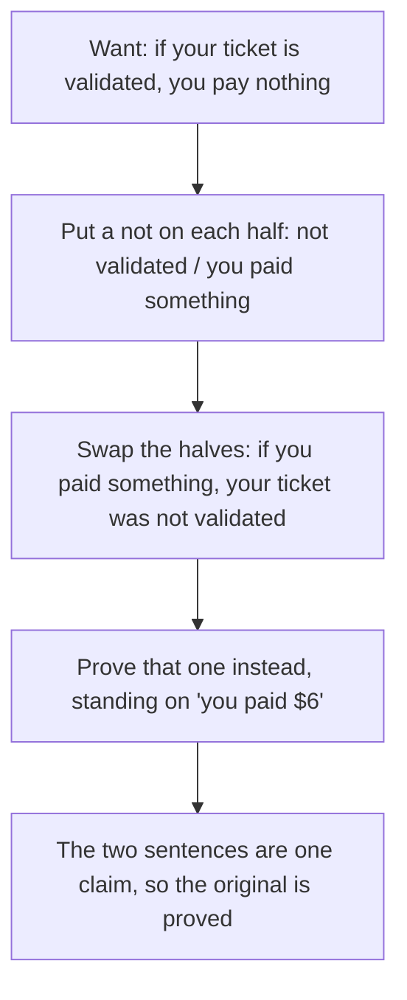

# Proof by contrapositive: prove the flipped version

[Syllabus](../../../SYLLABUS.md) → [Foundations](../README.md) → [Proof](../README.md#s06) → Proof by contrapositive

---

## General Overview

The sign at the car park barrier: **"If your ticket is validated, you pay nothing."**

You feed the machine your ticket. It takes $6.

You saw no stamp and asked no one, yet you know: your ticket was not validated. Had it been, the machine would have taken nothing.

A second sentence falls out of the sign: **"If you paid something, your ticket was not validated."** Both halves got a *not*, then swapped places. That is the **contrapositive**.

It *is* the sign, respelled.

**To prove "if A then B" — A the if part, B the then part — prove "if not B then not A" instead. Same claim, easier place to stand.**

**What kind of fact this is:** a theorem of logic, proved in Why it works: an if-then and its contrapositive break in the same case, so they are one claim.

### The picture: the move



---

## The formula

**"If your ticket is validated, you pay nothing" and "if you paid something, it was not validated" are one claim. Prove either; you have both.**

**Read it aloud:** put a *not* on both halves, swap them, prove that one.

| Piece | Plain meaning | In our car park |
| --- | --- | --- |
| the if part | what you may assume | your ticket is validated |
| the then part | what has to follow | you pay nothing |
| the contrapositive | both flipped, then swapped | if you paid, it was not validated |
| the converse | swapped, no flips | if you pay nothing, you were validated |
| the move | prove the contrapositive, get the original free | assume you paid, show no stamp |

### When it holds

- **The claim is an if-then.** A claim with no if part has nothing to flip.
- **Both halves get a *not*, and they swap.** Swap without the *nots* and you get the converse, which disagrees with the sign on 2 drivers.
- **Each half is either true or false.** A ticket is validated or it is not; you paid nothing or you paid something. If a half could be neither, "not B" would miss a case, and the two sentences could come apart.

---

## Why it works

### They break in the same case, so they are one claim

An if-then is false in one situation only: the if part happened, the then part did not.

The sign is false for a driver validated and charged anyway. The contrapositive is false for a driver who paid and *was* validated. Same driver. Nothing tells them apart: one claim, two spellings ([Logical equivalence and De Morgan](../05-Logic/03-logical-equivalence-and-de-morgan.md) tables it).

Then why flip? A proof needs somewhere to stand. "Validated" gives you a stamp and nothing to compute. "You paid $6" gives you a number.

### The twin claim, proved by the flip

**Claim: if a number times itself is odd, the number is odd.** Whole numbers. **Even** means two times a whole number: 6 is 2 × 3. **Odd** means not even.

Write n for the number. The if part is an awkward place to start: n is buried inside a multiplication.

Flip both halves and swap: **if the number is even, the number times itself is even.** "n is even" hands you something to write down.

Proof. n is even, so n = 2 × k for a whole number k. Then

**n × n = (2 × k) × n = 2 × (k × n)**

k × n is a whole number, so n × n is two times a whole number. Even. Done.

Only the claim was flipped. The proving was an ordinary straight-line proof, the kind on [Direct proof](01-direct-proof.md). The flipped claim is the original, so the original is proved.

Proving it straight, from "n × n is odd", means prying n back out — which needs a fact about factors nobody gave you. Direct, flipped, and a third move: [Proof by contradiction](03-proof-by-contradiction.md).

---

## Worked numbers, by hand

Four drivers, paid in dollars. Value is the verdict: 1 means the sign survives that driver, 0 means it breaks. A driver the sign says nothing about cannot break it.

| Step | Reason | Value |
| --- | --- | --- |
| Vic: validated, paid 0 | promise kept | 1 |
| Wes: validated, paid 6 | validated, charged anyway | **0** |
| Yaz: not validated, paid 0 | not spoken about | 1 |
| Zed: not validated, paid 6 | not spoken about | 1 |
| the sign, top to bottom | four verdicts | **1, 0, 1, 1** |
| the contrapositive | flipped and swapped | 1, 0, 1, 1 |
| they disagree on | nobody | **0** |
| the converse | swapped, not flipped | 1, 1, 0, 1 |
| the converse disagrees on | Wes and Yaz | **2** |
| the twin claim at n = 6 | 6 × 6 = 2 × (3 × 6) = 2 × 18 | **36** |
| 1 to 20 with n × n odd | all of them odd | **10** |

Wes is the only driver who could tell the two sentences apart. He cannot: he breaks both.

The last row searches twenty numbers; a search is not a proof. The proof above covers every number.

### What breaks if you drop a piece

| Mistake | Comes out at | What went wrong |
| --- | --- | --- |
| Proving the converse | 2 rows disagree | Swapping without flipping is a different claim |
| Checking 7 × 7 and stopping | 49 | One example, not every number |

---

## Code, from first principles, and it actually runs

Nothing is imported. The four drivers are read three times — by the sign, by the contrapositive (the flip column), by the converse — so the columns compare. Then the twin claim and the numbers to 20.

### Python

```python
# Proof by contrapositive -- the check behind the card.  Nothing is imported.
# The car park sign: "if your ticket is validated, you pay nothing."  Four
# drivers, read by the sign, by its flip, and by its converse.  Then the twin
# claim: if a number times itself is odd, the number is odd.
DRIVERS = [("Vic", 1, 0), ("Wes", 1, 6), ("Yaz", 0, 0), ("Zed", 0, 6)]

def kept(if_part, then_part):   # an if-then breaks only when the if part holds and the then part fails
    return 0 if if_part == 1 and then_part == 0 else 1

print(f"{'name':<5}{'validated':>11}{'paid':>6}{'the sign':>10}{'the flip':>10}{'the converse':>14}")
sign, flip, converse = [], [], []
for name, val, paid in DRIVERS:
    sign.append(kept(val, 1 if paid == 0 else 0))            # validated -> pays nothing
    flip.append(kept(1 if paid > 0 else 0, 1 - val))         # paid something -> not validated
    converse.append(kept(1 if paid == 0 else 0, val))        # pays nothing -> validated
    print(f"{name:<5}{val:>11}{paid:>6}{sign[-1]:>10}{flip[-1]:>10}{converse[-1]:>14}")
print(f"the flip disagrees with the sign on rows {sum(1 for a, b in zip(sign, flip) if a != b)}")
print(f"the converse disagrees with the sign on rows {sum(1 for a, b in zip(sign, converse) if a != b)}")
n, k = 6, 3
print(f"{n} = 2 x {k}, so {n} x {n} = 2 x ({k} x {n}) = 2 x {k * n} = {n * n}, even")
print(f"7 x 7 = {7 * 7}, odd")
odd_ones = [m for m in range(1, 21) if (m * m) % 2 == 1]
print(f"whole numbers 1 to 20 with n x n odd {len(odd_ones)}, every one of them odd")
assert sign == [1, 0, 1, 1] and flip == sign and converse == [1, 1, 0, 1]
assert n * n == 2 * (k * n) and (n * n) % 2 == 0 and (7 * 7) % 2 == 1
assert odd_ones == list(range(1, 21, 2)) and len(odd_ones) == 10
print("ALL CHECKS PASS")
```

**Ran 2026-09-06 on macOS, Python 3.14.6, standard library only. All checks passed. Output, pasted from the run:**

```
name   validated  paid  the sign  the flip  the converse
Vic            1     0         1         1             1
Wes            1     6         0         0             1
Yaz            0     0         1         1             0
Zed            0     6         1         1             1
the flip disagrees with the sign on rows 0
the converse disagrees with the sign on rows 2
6 = 2 x 3, so 6 x 6 = 2 x (3 x 6) = 2 x 18 = 36, even
7 x 7 = 49, odd
whole numbers 1 to 20 with n x n odd 10, every one of them odd
ALL CHECKS PASS
```

### Rust

Same numbers, same labels, built with `rustc --edition 2021 -O`.

```rust
// Proof by contrapositive -- the same check as the Python one, in Rust.  No
// crates.  The car park sign: "if your ticket is validated, you pay nothing."
// Four drivers, read by the sign, by its flip, and by its converse.  Then the
// twin claim: if a number times itself is odd, the number is odd.
const DRIVERS: [(&str, i64, i64); 4] =
    [("Vic", 1, 0), ("Wes", 1, 6), ("Yaz", 0, 0), ("Zed", 0, 6)];

fn kept(if_part: i64, then_part: i64) -> i64 {   // breaks only when the if part holds and the then part fails
    if if_part == 1 && then_part == 0 { 0 } else { 1 }
}

fn main() {
    println!("{:<5}{:>11}{:>6}{:>10}{:>10}{:>14}",
             "name", "validated", "paid", "the sign", "the flip", "the converse");
    let (mut sign, mut flip, mut converse) = (Vec::new(), Vec::new(), Vec::new());
    for (name, val, paid) in DRIVERS {
        sign.push(kept(val, if paid == 0 { 1 } else { 0 }));        // validated -> pays nothing
        flip.push(kept(if paid > 0 { 1 } else { 0 }, 1 - val));     // paid something -> not validated
        converse.push(kept(if paid == 0 { 1 } else { 0 }, val));    // pays nothing -> validated
        println!("{:<5}{:>11}{:>6}{:>10}{:>10}{:>14}", name, val, paid,
                 sign[sign.len() - 1], flip[flip.len() - 1], converse[converse.len() - 1]);
    }
    println!("the flip disagrees with the sign on rows {}",
             (0..4).filter(|&i| sign[i] != flip[i]).count());
    println!("the converse disagrees with the sign on rows {}",
             (0..4).filter(|&i| sign[i] != converse[i]).count());
    let (n, k) = (6i64, 3i64);
    println!("{} = 2 x {}, so {} x {} = 2 x ({} x {}) = 2 x {} = {}, even",
             n, k, n, n, k, n, k * n, n * n);
    println!("7 x 7 = {}, odd", 7 * 7);
    let odd_ones: Vec<i64> = (1..=20i64).filter(|m| (m * m) % 2 == 1).collect();
    println!("whole numbers 1 to 20 with n x n odd {}, every one of them odd", odd_ones.len());
    assert!(sign == vec![1, 0, 1, 1] && flip == sign && converse == vec![1, 1, 0, 1]);
    assert!(n * n == 2 * (k * n) && (n * n) % 2 == 0 && (7 * 7) % 2 == 1);
    assert!(odd_ones == (1..=19i64).step_by(2).collect::<Vec<i64>>() && odd_ones.len() == 10);
    println!("ALL CHECKS PASS");
}
```

**Ran 2026-09-06 on macOS, rustc 1.98.1, no crates. All checks passed. Output, pasted from the run:**

```
name   validated  paid  the sign  the flip  the converse
Vic            1     0         1         1             1
Wes            1     6         0         0             1
Yaz            0     0         1         1             0
Zed            0     6         1         1             1
the flip disagrees with the sign on rows 0
the converse disagrees with the sign on rows 2
6 = 2 x 3, so 6 x 6 = 2 x (3 x 6) = 2 x 18 = 36, even
7 x 7 = 49, odd
whole numbers 1 to 20 with n x n odd 10, every one of them odd
ALL CHECKS PASS
```

The two outputs match line for line.

### Lean

Lean proves three claims, the first for every if-then and the other two for every whole number.

- When each half is either true or false, an if-then and its contrapositive are one claim.
- The twin claim: if a number times itself is odd, the number is odd.
- The flipped version: if a number is even, the number times itself is even.

Lean also checks the drivers' verdicts and the count to 20, so only the printed table is left to the Python and Rust checks.

```lean
-- Proof by contrapositive: an if-then and its contrapositive are the same claim, so if a whole number times itself is odd, the number is odd.
import Mathlib.Algebra.Ring.Parity
import Mathlib.Order.Interval.Finset.Nat
import Mathlib.Data.Finset.Card

/-- An if-then and its contrapositive are one claim: when each half is either true or false,
"if A then B" holds exactly when "if not B then not A" holds. -/
theorem imp_iff_contrapositive (A B : Prop) (hA : A ∨ ¬A) (hB : B ∨ ¬B) :
    (A → B) ↔ (¬B → ¬A) := by
  constructor
  · intro h hnB ha
    exact hnB (h ha)
  · intro h ha
    rcases hB with hb | hnb
    · exact hb
    · exact absurd ha (h hnb)

/-- The twin claim: for every whole number n, if n × n is odd, then n is odd. -/
theorem odd_of_odd_mul_self (n : ℕ) (h : Odd (n * n)) : Odd n := by
  by_contra hn
  rw [Nat.not_odd_iff_even] at hn
  exact (Nat.not_even_iff_odd.mpr h) (hn.mul_right n)

/-- The flipped version the card actually proves: for every whole number n,
if n is even, then n × n is even. -/
theorem even_mul_self_of_even (n : ℕ) (h : Even n) : Even (n * n) := by
  exact h.mul_right n

-- The four drivers as (validated, paid nothing). An if-then is kept unless the if part holds
-- and the then part fails. The sign reads 1, 0, 1, 1.
example : [(true, true), (true, false), (false, true), (false, false)].map
    (fun p : Bool × Bool => !p.1 || p.2) = [true, false, true, true] := by decide

-- The contrapositive (paid something, so not validated) reads 1, 0, 1, 1: it disagrees on nobody.
example : [(true, true), (true, false), (false, true), (false, false)].map
    (fun p : Bool × Bool => !(!p.2) || !p.1) = [true, false, true, true] := by decide

-- The converse (paid nothing, so validated) reads 1, 1, 0, 1: it disagrees on Wes and Yaz, 2 rows.
example : [(true, true), (true, false), (false, true), (false, false)].map
    (fun p : Bool × Bool => !p.2 || p.1) = [true, true, false, true] := by decide
example : (([(true, true), (true, false), (false, true), (false, false)].map
    (fun p : Bool × Bool => ((!p.1 || p.2) != (!p.2 || p.1)))).filter id).length = 2 := by decide

-- The twin claim at n = 6: 6 = 2 × 3, so 6 × 6 = 2 × (3 × 6) = 2 × 18 = 36, even.
example : (6 : ℕ) = 2 * 3 ∧ 6 * 6 = 2 * (3 * 6) ∧ 2 * (3 * 6) = 2 * 18 ∧ 2 * 18 = (36 : ℕ) := by
  decide
example : Even (6 * 6 : ℕ) := by decide

-- 7 × 7 = 49, odd: it agrees with the claim and proves nothing.
example : (7 : ℕ) * 7 = 49 ∧ Odd (7 * 7 : ℕ) := by decide

-- Of the whole numbers 1 to 20, exactly 10 have n × n odd, and they are exactly the odd ones.
example : ((Finset.Icc 1 20).filter (fun n : ℕ => (n * n) % 2 = 1)).card = 10 := by decide
example : (Finset.Icc 1 20).filter (fun n : ℕ => (n * n) % 2 = 1)
    = (Finset.Icc 1 20).filter (fun n : ℕ => n % 2 = 1) := by decide

#print axioms imp_iff_contrapositive
#print axioms odd_of_odd_mul_self
#print axioms even_mul_self_of_even
```

**Checked 2026-11-11 on macOS, Lean 4.36.0-rc2, Mathlib v4.36.0-rc2. Every proof is complete and uses only Lean's standard axioms. Output, pasted from the run:**

```
'imp_iff_contrapositive' does not depend on any axioms
'odd_of_odd_mul_self' depends on axioms: [propext, Classical.choice, Quot.sound]
'even_mul_self_of_even' depends on axioms: [propext]
```

> [!TIP]
> **Try changing**
> Guess first, then run it.
> - **Validate Wes's ticket.** Set his row to `("Wes", 1, 0)`. The sign loses its only 0; so does the flip, same row. The first assert fires — it pins the original rows — but the columns still match, line for line.
> - **Flip one half only.** Use `val` where the flip line says `1 - val`. Wes and Zed swap verdicts; the first assert fires.

---

## The usual mistake

> [!warning]
> **Flipping without swapping, or swapping without flipping.** Only both give the contrapositive. Swapping alone gives the **converse** — "if you pay nothing, your ticket was validated" — which Yaz breaks while the sign stands: 2 rows disagree. Flipping alone gives the **inverse** — "if you were not validated, you paid something" — the converse in other words, and Yaz breaks it too.
>
> - **Nothing here is assumed false.** You prove a plain if-then, the ordinary way. The move that assumes the opposite is [Proof by contradiction](03-proof-by-contradiction.md).
> - **Assumed the if part too, and never used it?** Then you did this card, not contradiction. Drop it.
> - The flipped proof must land on *not the if part*. Land elsewhere and you proved something else.
> - Only if-then sentences flip; a claim with no if part has nothing to flip.
> - 7 × 7 = 49 agrees with the claim and proves nothing.

---

## Where you meet it in real life

- **Car parks, cloakrooms, doors.** "No ticket, no entry" and "if you are inside, you have a ticket" are one rule, read from either end. Chaining rules: [Valid arguments](../05-Logic/06-valid-arguments.md).
- **Anything you diagnose backwards.** "If the deploy (the release of new software) worked, the new version is live." The old version is live, so the deploy did not work. Contrapositive, without thinking.
- **Proof itself.** Claims about even, odd and factors flip well: "not even" is a fact you can write down. Which move fits which claim: [Choosing a proof strategy](06-choosing-a-proof-strategy.md).

> **Say it back**
> An if-then and its contrapositive — both halves flipped, then swapped — are one claim in two spellings, breaking in the same case. Prove whichever gives the better place to stand; the other comes free. "If n × n is odd, n is odd" becomes "if n is even, so is n × n": 6 × 6 = 2 × 18 = 36. Swapping without flipping is the converse, a different claim.

---

## What this builds on

- [Direct proof](01-direct-proof.md): what a proof is, and the straight-line kind used here.
- [If-then](../05-Logic/02-if-then.md): the one case that breaks an if-then, and where both names came from.

## Where this goes next

- [Proof by contradiction](03-proof-by-contradiction.md): assume the claim is false and wait for it to break — the move confused with this one.

This card leaves one question open: what if neither end of the claim gives you anything to write down?

---

## Sources

Verified 2026-11-11: every link below resolves to the publisher's page.

- Hammack, Richard. *Book of Proof*, 3rd ed. [Book home](https://richardhammack.github.io/BookOfProof/) · [free PDF](https://richardhammack.github.io/BookOfProof/Main.pdf). Chapter 5, free.
- Sundstrom, Ted. *Mathematical Reasoning: Writing and Proof*, v3. Grand Valley State University, 2020. [Book page](https://scholarworks.gvsu.edu/books/24/). Section 3.2, free.
- Velleman, Daniel J. *How to Prove It*, 3rd ed. Cambridge University Press, 2019. [doi:10.1017/9781108539890](https://doi.org/10.1017/9781108539890). The flip beside contradiction (paid).
