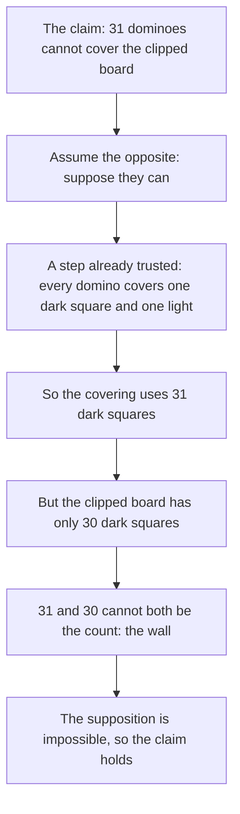

# Proof by contradiction: assume the opposite and watch it break

[Syllabus](../../../SYLLABUS.md) → [Foundations](../README.md) → [Proof](../README.md#s06) → Proof by contradiction

---

## General Overview

An 8-by-8 chessboard: 64 squares, striped dark and light, 32 of each. A box of dominoes, each covering two squares that share an edge. Lay 32 and the board is covered.

Now saw off two opposite corners — row 1 column 1, and row 8 column 8. That leaves 62 squares, and 31 dominoes cover 62 squares, so the count fits.

It never works. Not "it is fiddly" — never, in any arrangement. Running out of patience proves nothing. So suppose it does work, and follow that using only facts you already trust.

**To prove a claim, assume the opposite, take only steps you already trust, and keep going until you hit something impossible; the opposite is then dead, and the claim stands.**

**What kind of fact this is:** a method of proof. The clipped-board claim is a theorem, proved with it on this card in Why it works.

### The picture: the shape of the move



---

## The formula

**Suppose 31 dominoes cover the clipped board. Then they cover 31 dark squares and 31 light. But the board holds 30 dark and 32 light. 31 is not 30, so no such covering exists.**

**Read it aloud:** if the opposite forces two counts that disagree, it cannot happen, so the claim is true.

| Piece | Plain meaning | In our example |
| --- | --- | --- |
| the claim | what you want to be true | 31 dominoes cannot cover the clipped board |
| the opposite | the claim with "not" in front | suppose they do cover it |
| a trusted step | a definition, or something already proved | a domino covers one dark, one light |
| the wall | two results that cannot both hold | 31 dark covered, 30 present |

### When it holds

- **The opposite is stated exactly.** It is "some arrangement covers the board", not "every arrangement does". Knock down the wrong opposite and the claim is still open.
- **Every step is already trusted.** Each one is a definition or something already proved. Lean on the claim itself and the proof walks in a circle.
- **The wall is truly impossible.** "31 dark needed, 30 present" cannot both hold. Cut one dark corner and one light, and the board has 31 dark and 31 light: nothing breaks, and nothing is proved.

---

## Why it works

### Step 0: there is no third box

A claim is either true or false. If assuming it false leads somewhere impossible, the false box is empty and the claim sits in the true one. That two-box rule backs the move ([Valid arguments](../05-Logic/06-valid-arguments.md)).

### Step 1: state the opposite exactly

The claim: no arrangement of 31 dominoes covers the clipped board. Its opposite: some arrangement does — one, not all. Flip it wrong and the proof is about the wrong thing ([Negating a quantifier](../05-Logic/05-negating-quantifiers-and-counterexamples.md)).

### Step 2: the fact that carries the proof

Colour by a rule, not by eye: a square is dark when its row number plus its column number is even. Row 1, column 1 gives 2 — dark; row 8, column 8 gives 16 — dark again.

Sharing an edge changes one of those numbers by 1 and leaves the other, so the total flips between even and odd. **Every domino covers one dark square and one light square.** The code below lists all 112 places a domino can sit on the full board: one of each in every one.

### Step 3: count both sides, and hit the wall

31 dominoes, one dark square each, need 31. The board started with 32 dark and both cut corners were dark, so 30 are left. A count cannot be 31 and 30, so no arrangement covers the clipped board.

Nobody laid a domino.

### The same move, one shelf over

Root 2 is the number whose square is 2. Suppose a fraction, a top number p over a bottom number q in lowest terms — common factors divided out — squares to 2. Then p × p = 2 × q × q, which forces p even (an odd number times itself is odd, and 2 × q × q is even), and then q even too. Both even means a factor of 2 was still in there. Wall. Fractions get close and stay wrong: 99 × 99 is 9801; 2 × 70 × 70, 9800. [Irrational numbers](../02-The%20Number%20Line/03-irrational-numbers.md) runs it properly.

---

## Worked numbers, by hand

The clipped board, in squares.

| Step | Arithmetic | Value |
| --- | --- | --- |
| squares on the whole board | 8 × 8 | 64 |
| dark squares on it | half of 64 | 32 |
| squares left after the two cuts | 64 − 2 | 62 |
| dark squares left, both cuts dark | 32 − 2 | **30** |
| squares 31 dominoes cover | 31 × 2 | 62 |
| dark squares 31 dominoes need | 31 × 1 | **31** |

The supposition asks a board with 30 dark squares for 31.

### What breaks if you drop a piece

| Mistake | Comes out at | What went wrong |
| --- | --- | --- |
| Cutting one dark corner and one light | 31 dark, 31 light | The colours balance and the argument says nothing |
| Counting squares and stopping | 62 = 31 × 2 | The square count fits; it cannot see colour |
| Trying layouts until you give up | nothing settled | Finding nothing is not a proof of nothing |

The code prints the first two. For the balanced cut a covering does exist: four dominoes across each of rows 2 to 8 makes 28, and columns 2 to 7 of row 1 take three more.

---

## Code, from first principles, and it actually runs

Nothing is imported. The board is built, the corners cut, the colours counted by the row-plus-column rule. The second road ignores that count: it lists every place a domino can sit and checks its two colours. The balanced cut is the control: a cut that should not break, so you can watch the check tell the two apart.

### Python

```python
# Proof by contradiction -- the check behind the card.  Nothing is imported.
# An 8-by-8 chessboard with the corners (1,1) and (8,8) cut off, and a box of
# 31 dominoes.  Road 1 colours every square by the row-plus-column rule and
# counts.  Road 2 lists every place a domino can sit and checks what it covers.
BOARD = [(r, c) for r in range(1, 9) for c in range(1, 9)]
def dark(s):                     # (1,1) and (8,8) are dark: row + column is even
    return (s[0] + s[1]) % 2 == 0
def tally(name, squares):
    d = sum(1 for s in squares if dark(s))
    print(f"{name:<32}{len(squares):>8}{d:>6}{len(squares) - d:>7}")
    return (len(squares), d, len(squares) - d)
PLACES = [(a, b) for a in BOARD for b in BOARD
          if a < b and abs(a[0] - b[0]) + abs(a[1] - b[1]) == 1]
SPLIT = sum(1 for a, b in PLACES if dark(a) != dark(b))   # road 2: one of each?
CUT = [s for s in BOARD if s not in ((1, 1), (8, 8))]
MIX = [s for s in BOARD if s not in ((1, 1), (1, 8))]
print(f"{'board':<32}{'squares':>8}{'dark':>6}{'light':>7}")
full = tally("the whole chessboard", BOARD)
cut = tally("two corners cut, both dark", CUT)
mix = tally("two corners cut, one of each", MIX)
print(f"places a domino can sit {len(PLACES)}, of those covering one dark and one light {SPLIT}")
print(f"31 dominoes cover 31 dark and 31 light; the cut board has {cut[1]} dark and {cut[2]} light")
print(f"root 2: 99 x 99 = {99 * 99}, 2 x 70 x 70 = {2 * 70 * 70}, apart by {99 * 99 - 2 * 70 * 70}")
assert full == (64, 32, 32) and cut == (62, 30, 32) and mix == (62, 31, 31)
assert len(PLACES) == 112 and SPLIT == 112
assert 31 * 2 == len(CUT) and 31 != cut[1] and 31 == mix[1]
print("ALL CHECKS PASS")
```

**Ran 2026-09-06 on macOS, Python 3.14.6, standard library only. All checks passed. Output, pasted from the run:**

```
board                            squares  dark  light
the whole chessboard                  64    32     32
two corners cut, both dark            62    30     32
two corners cut, one of each          62    31     31
places a domino can sit 112, of those covering one dark and one light 112
31 dominoes cover 31 dark and 31 light; the cut board has 30 dark and 32 light
root 2: 99 x 99 = 9801, 2 x 70 x 70 = 9800, apart by 1
ALL CHECKS PASS
```

### Rust

Same labels, built with `rustc --edition 2021 -O`.

```rust
// Proof by contradiction -- the same check as the Python one, in Rust.  No crates.
// An 8-by-8 chessboard with the corners (1,1) and (8,8) cut off, and a box of
// 31 dominoes.  Road 1 colours every square by the row-plus-column rule and
// counts.  Road 2 lists every place a domino can sit and checks what it covers.
fn dark(s: (i32, i32)) -> bool { (s.0 + s.1) % 2 == 0 }   // dark: row + column is even
fn tally(name: &str, squares: &[(i32, i32)]) -> (usize, usize, usize) {
    let d = squares.iter().filter(|&&s| dark(s)).count();
    println!("{:<32}{:>8}{:>6}{:>7}", name, squares.len(), d, squares.len() - d);
    (squares.len(), d, squares.len() - d)
}
fn main() {
    let board: Vec<(i32, i32)> = (1..9).flat_map(|r| (1..9).map(move |c| (r, c))).collect();
    let mut places: Vec<((i32, i32), (i32, i32))> = Vec::new();
    for &a in &board {
        for &b in &board {
            if a < b && (a.0 - b.0).abs() + (a.1 - b.1).abs() == 1 { places.push((a, b)); }
        }
    }
    let split = places.iter().filter(|&&(a, b)| dark(a) != dark(b)).count();  // road 2
    let cut_sq: Vec<(i32, i32)> = board.iter().cloned()
        .filter(|&s| s != (1, 1) && s != (8, 8)).collect();
    let mix_sq: Vec<(i32, i32)> = board.iter().cloned()
        .filter(|&s| s != (1, 1) && s != (1, 8)).collect();
    println!("{:<32}{:>8}{:>6}{:>7}", "board", "squares", "dark", "light");
    let full = tally("the whole chessboard", &board);
    let cut = tally("two corners cut, both dark", &cut_sq);
    let mix = tally("two corners cut, one of each", &mix_sq);
    println!("places a domino can sit {}, of those covering one dark and one light {}",
             places.len(), split);
    println!("31 dominoes cover 31 dark and 31 light; the cut board has {} dark and {} light",
             cut.1, cut.2);
    println!("root 2: 99 x 99 = {}, 2 x 70 x 70 = {}, apart by {}",
             99 * 99, 2 * 70 * 70, 99 * 99 - 2 * 70 * 70);
    assert!(full == (64, 32, 32) && cut == (62, 30, 32) && mix == (62, 31, 31));
    assert!(places.len() == 112 && split == 112);
    assert!(31 * 2 == cut_sq.len() && 31 != cut.1 && 31 == mix.1);
    println!("ALL CHECKS PASS");
}
```

**Ran 2026-09-06 on macOS, rustc 1.98.1, no crates. All checks passed. Output, pasted from the run:**

```
board                            squares  dark  light
the whole chessboard                  64    32     32
two corners cut, both dark            62    30     32
two corners cut, one of each          62    31     31
places a domino can sit 112, of those covering one dark and one light 112
31 dominoes cover 31 dark and 31 light; the cut board has 30 dark and 32 light
root 2: 99 x 99 = 9801, 2 x 70 x 70 = 9800, apart by 1
ALL CHECKS PASS
```

### Lean

Lean proves this card's three claims in every case: any 31 dominoes, any domino, and any fraction.

- No 31 dominoes cover the board with row 1 column 1 and row 8 column 8 cut off.
- Every domino covers one dark square and one light square.
- No fraction p over q squares to 2, in lowest terms or not.

Lean also confirms the counts on this card; the Python and Rust checks print them and let you change the board.

```lean
-- Proof by contradiction: 31 dominoes cannot cover a chessboard with two opposite corners cut off, because every domino covers one dark square and one light, and no fraction squares to 2.
import Mathlib.Data.Finset.Prod
import Mathlib.Data.Finset.Card
import Mathlib.Order.Interval.Finset.Nat
import Mathlib.Algebra.Ring.Int.Defs
import Mathlib.Algebra.BigOperators.Group.Finset.Basic
import Mathlib.Algebra.Group.Int.Even
import Mathlib.Tactic

/-- The squares of the chessboard: row r and column c, each from 1 to 8. -/
def board : Finset (ℕ × ℕ) := Finset.Icc 1 8 ×ˢ Finset.Icc 1 8

/-- The clipped board: the chessboard with the corners row 1 column 1 and row 8 column 8 cut off. -/
def clippedBoard : Finset (ℕ × ℕ) := (board.erase (1, 1)).erase (8, 8)

/-- A square is dark when its row number plus its column number is even. -/
abbrev IsDark (s : ℕ × ℕ) : Prop := (s.1 + s.2) % 2 = 0

/-- Two squares share an edge: same row and neighbouring columns, or same column and
neighbouring rows. -/
abbrev Adjacent (a b : ℕ × ℕ) : Prop :=
  (a.1 = b.1 ∧ (a.2 + 1 = b.2 ∨ b.2 + 1 = a.2)) ∨ (a.2 = b.2 ∧ (a.1 + 1 = b.1 ∨ b.1 + 1 = a.1))

/-- A domino is the set of two squares that share an edge. -/
def IsDomino (d : Finset (ℕ × ℕ)) : Prop := ∃ a b, Adjacent a b ∧ d = {a, b}

/-- The clipped board claim: no 31 dominoes cover the chessboard with two opposite corners
cut off. Whatever 31 dominoes you take, the squares they cover are never exactly the
clipped board. -/
theorem clipped_board_has_no_domino_cover (D : Finset (Finset (ℕ × ℕ)))
    (hcard : D.card = 31) (hD : ∀ d ∈ D, IsDomino d) :
    D.biUnion id ≠ clippedBoard := by
  intro hU
  have hone : ∀ d ∈ D, (d.filter (fun s => ¬ IsDark s)).card = 1 := by
    intro d hd
    obtain ⟨a, b, hab, rfl⟩ := hD d hd
    have hne : a ≠ b := by
      intro h
      subst h
      unfold Adjacent at hab
      omega
    have hdark : (IsDark a ↔ ¬ IsDark b) := by
      unfold Adjacent IsDark at *
      omega
    rw [Finset.card_eq_one]
    by_cases ha : IsDark a
    · refine ⟨b, ?_⟩
      have hb : ¬ IsDark b := hdark.mp ha
      ext x
      simp only [Finset.mem_filter, Finset.mem_insert, Finset.mem_singleton]
      constructor
      · rintro ⟨rfl | rfl, hx⟩
        · exact absurd ha hx
        · rfl
      · rintro rfl
        exact ⟨Or.inr rfl, hb⟩
    · refine ⟨a, ?_⟩
      have hb : IsDark b := by
        by_contra hb
        exact ha (hdark.mpr hb)
      ext x
      simp only [Finset.mem_filter, Finset.mem_insert, Finset.mem_singleton]
      constructor
      · rintro ⟨rfl | rfl, hx⟩
        · rfl
        · exact absurd hb hx
      · rintro rfl
        exact ⟨Or.inl rfl, ha⟩
  have hle : ((D.biUnion id).filter (fun s => ¬ IsDark s)).card ≤ 31 := by
    rw [Finset.filter_biUnion]
    calc (D.biUnion fun d => (id d).filter (fun s => ¬ IsDark s)).card
        ≤ ∑ d ∈ D, ((id d).filter (fun s => ¬ IsDark s)).card := Finset.card_biUnion_le
      _ = ∑ d ∈ D, 1 := Finset.sum_congr rfl (fun d hd => hone d hd)
      _ = 31 := by simp [hcard]
  rw [hU] at hle
  have h32 : (clippedBoard.filter (fun s => ¬ IsDark s)).card = 32 := by decide
  omega

/-- The trusted step: every domino covers one dark square and one light square. If two squares
share an edge, exactly one of them is dark. -/
theorem domino_covers_one_dark_one_light (a b : ℕ × ℕ) (h : Adjacent a b) :
    (IsDark a ↔ ¬ IsDark b) := by
  unfold Adjacent IsDark at *
  omega

/-- The same move one shelf over: no fraction p over q squares to 2, that is,
p × p is never 2 × q × q when q is not zero. -/
theorem no_fraction_squares_to_two (p q : ℤ) (hq : q ≠ 0) : p * p ≠ 2 * (q * q) := by
  have key : ∀ n : ℕ, ∀ p q : ℤ, q.natAbs = n → q ≠ 0 → p * p ≠ 2 * (q * q) := by
    intro n
    induction n using Nat.strong_induction_on with
    | _ n ih =>
      intro p q hn hq h
      have hp2 : Even p := by
        have : Even (p * p) := ⟨q * q, by rw [h]; ring⟩
        rcases Int.even_mul.mp this with h' | h' <;> exact h'
      obtain ⟨k, rfl⟩ := hp2
      have h2 : q * q = 2 * (k * k) := by nlinarith
      have hq2 : Even q := by
        have : Even (q * q) := ⟨k * k, by rw [h2]; ring⟩
        rcases Int.even_mul.mp this with h' | h' <;> exact h'
      obtain ⟨m, rfl⟩ := hq2
      have hm : m ≠ 0 := by
        rintro rfl
        simp at hq
      have h3 : k * k = 2 * (m * m) := by nlinarith
      have hlt : m.natAbs < n := by
        rw [← hn]
        have : 0 < m.natAbs := Int.natAbs_pos.mpr hm
        omega
      exact ih _ hlt k m rfl hm h3
  exact key _ p q rfl hq

-- The whole board: 64 squares, 32 dark and 32 light.
example : board.card = 64 := by decide
example : (board.filter IsDark).card = 32 ∧ (board.filter (fun s => ¬ IsDark s)).card = 32 := by
  decide

-- Both cut corners are dark: 1 + 1 = 2 and 8 + 8 = 16 are even.
example : IsDark (1, 1) ∧ IsDark (8, 8) := by decide

-- The clipped board: 62 squares, 30 dark and 32 light.
example : clippedBoard.card = 62 := by decide
example : (clippedBoard.filter IsDark).card = 30 ∧
    (clippedBoard.filter (fun s => ¬ IsDark s)).card = 32 := by decide

-- 31 dominoes cover 62 squares, and need 31 dark squares, but only 30 are left.
example : 31 * 2 = (62 : ℕ) ∧ 31 * 1 = (31 : ℕ) ∧ (32 : ℕ) - 2 = 30 ∧ (31 : ℕ) ≠ 30 := by decide

-- The control: cut one dark corner and one light, and the board has 31 dark and 31 light.
example : (((board.erase (1, 1)).erase (1, 8)).filter IsDark).card = 31 ∧
    (((board.erase (1, 1)).erase (1, 8)).filter (fun s => ¬ IsDark s)).card = 31 := by decide

-- The 112 places a domino can sit on the whole board (each counted once, from the end with
-- the smaller row plus column), and every one covers one dark square and one light.
set_option maxRecDepth 20000 in
example : ((board ×ˢ board).filter
    (fun p => p.1.1 + p.1.2 < p.2.1 + p.2.2 ∧ Adjacent p.1 p.2)).card = 112 := by
  decide
set_option maxRecDepth 20000 in
example : ∀ p ∈ (board ×ˢ board).filter
    (fun p => p.1.1 + p.1.2 < p.2.1 + p.2.2 ∧ Adjacent p.1 p.2),
    (IsDark p.1 ↔ ¬ IsDark p.2) := by
  decide

-- For the balanced cut a covering exists: four dominoes across each of rows 2 to 8, and
-- three more on columns 2 to 7 of row 1. That is 31 dominoes covering exactly that board.
set_option maxRecDepth 20000 in
example :
    let rows := (Finset.Icc 2 8 ×ˢ ({1, 3, 5, 7} : Finset ℕ)).image
      (fun x : ℕ × ℕ => ((x.1, x.2), (x.1, x.2 + 1)))
    let top := ({2, 4, 6} : Finset ℕ).image (fun c : ℕ => ((1, c), (1, c + 1)))
    let P := rows ∪ top
    P.card = 31 ∧ (∀ p ∈ P, Adjacent p.1 p.2) ∧
      P.biUnion (fun p => {p.1, p.2}) = (board.erase (1, 1)).erase (1, 8) := by
  decide

-- Fractions get close and stay wrong: 99 × 99 = 9801 and 2 × 70 × 70 = 9800, one apart.
example : (99 : ℤ) * 99 = 9801 ∧ (2 : ℤ) * (70 * 70) = 9800 ∧ (9801 : ℤ) - 9800 = 1 := by decide

#print axioms clipped_board_has_no_domino_cover
#print axioms domino_covers_one_dark_one_light
#print axioms no_fraction_squares_to_two
```

**Checked 2026-11-11 on macOS, Lean 4.36.0-rc2, Mathlib v4.36.0-rc2. Every proof is complete and uses only Lean's standard axioms. Output, pasted from the run:**

```
'clipped_board_has_no_domino_cover' depends on axioms: [propext, Classical.choice, Quot.sound]
'domino_covers_one_dark_one_light' depends on axioms: [propext, Classical.choice, Quot.sound]
'no_fraction_squares_to_two' depends on axioms: [propext, Classical.choice, Quot.sound]
```

> [!TIP]
> **Try changing**
> Guess first, then run it. The asserts are pinned to the board, so one will fire.
> - **Cut the other corner.** Swap `(8, 8)` for `(1, 8)` in the cut list. That corner is light, the counts land at 31 and 31, and the wall is gone.
> - **Let a piece reach further.** Change the neighbour test from `== 1` to `<= 2`. The place count jumps from 112 to 306 while the one-of-each count stays at 112: 194 new pieces cover two squares of one colour, and the proof loses its engine.

---

## The usual mistake

> [!warning]
> **Calling a surprise a wall.** What you hit must be impossible, not merely odd. "31 dark squares needed, 30 present" is impossible. "This layout looks awkward" is not.
>
> - Using the claim itself as a step. If the argument leans on "no covering exists", it walked in a circle.
> - Dropping the condition that makes the wall a wall. Forget "in lowest terms" and "both even" is allowed, so nothing broke.
> - Treating a failed search as a proof. A million failed layouts leave the next one open; the colour count closes all at once.

---

## Where you meet it in real life

- **Impossibility claims.** "That cannot be scheduled, packed or wired" is often a colour count in disguise: find what every move preserves, then show the target has the wrong amount.
- **Claims that no such thing exists.** No fraction squares to 2 ([Irrational numbers](../02-The%20Number%20Line/03-irrational-numbers.md)); no list holds every decimal ([Cantor's diagonal](../09-Sizes%20of%20Infinity/03-cantors-diagonal-argument.md)); no set holds the sets that leave themselves out ([Russell's paradox](../07-Sets/06-russells-paradox.md)).
- **Crowded counting.** More items than boxes means some box holds two ([Pigeonhole](../08-Relations%20and%20Functions/08-pigeonhole-principle.md)).

> **Say it back**
> Assume the opposite. Take only steps you already trust. If that lands on something impossible, the opposite cannot hold, so your claim does. Every domino covers one dark and one light, so 31 dominoes need 31 dark; the clipped board has 30. No amount of trying would have settled it.

---

## What this builds on

- [Proof by contrapositive](02-proof-by-contrapositive.md): the other indirect move — prove the flipped statement. Try it first.
- [Irrational numbers](../02-The%20Number%20Line/03-irrational-numbers.md): root 2 and the fractions it escapes, this argument's classic home.

## Where this goes next

- [Choosing a proof strategy](06-choosing-a-proof-strategy.md): which move fits a claim, from its shape.
- [Russell's paradox](../07-Sets/06-russells-paradox.md): a collection whose own definition walks into a wall.
- [Pigeonhole](../08-Relations%20and%20Functions/08-pigeonhole-principle.md): suppose the crowding away, watch the total fail.
- [Cantor's diagonal](../09-Sizes%20of%20Infinity/03-cantors-diagonal-argument.md): assume every decimal is listed, build one that is not.

The question this card leaves open: when no colouring is in sight, how do you find the impossible thing to aim for?

---

## Sources

Verified 2026-11-11: every link below resolves to the publisher's page.

- Hammack, Richard. *Book of Proof*, 3rd ed., 2018. [Book page](https://richardhammack.github.io/BookOfProof/). Chapter 6, root 2 worked.
- Golomb, Solomon W. *Polyominoes*, 2nd ed. Princeton University Press, 1994. [Publisher page](https://press.princeton.edu/books/paperback/9780691024448/polyominoes). The colouring argument for clipped boards.
- Velleman, Daniel J. *How to Prove It*, 3rd ed. Cambridge University Press, 2019. [doi:10.1017/9781108539890](https://doi.org/10.1017/9781108539890). Chapter 3 (paid).
