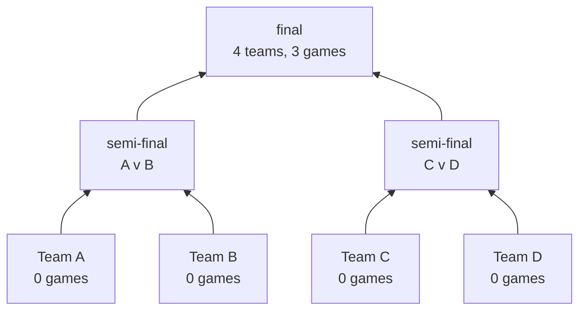

# Structural induction: prove a fact about every tree or formula by checking each way it can be built

[Syllabus](../../../SYLLABUS.md) → [Foundations](../README.md) → [Proof](../README.md#s06) → Structural induction

---

## General Overview

A knockout cup draws 16 teams. Every game sends one team home, and the cup ends when one team is left. It takes 15 games. A 64-team draw takes 63.

A bowling stepladder final has 5 bowlers: the fifth seed plays the fourth, the winner plays the third, and so on up. That takes 4 games. One team out per game proves "games = teams − 1" for any shape; the method below needs no such trick.

A draw is a **tree**: a shape built by two rules. A single team is a bracket with 0 games. Join two brackets with one final, and you have a bigger bracket.

So check the claim once for each rule. That is **structural induction**. Its partner is **recursion**: working out the answer for the whole from the answers for its parts, sure to stop because every part is smaller.

**To prove a fact about everything built by rules, check that the starting pieces have it and that every rule passes it from parts to whole.**

**What kind of fact this is:** a method of proof. The game and parenthesis counts are theorems, proved with it in Why it works.

### The picture: a 4-team bracket, built by the two rules



Each bottom box is the first rule, each meeting point the second.

---

## The formula

The two rules define the game count:

```math
\mathrm{games}(\text{a lone team}) = 0, \qquad \mathrm{games}(L \text{ joined to } R) = \mathrm{games}(L) + \mathrm{games}(R) + 1
```

**Read it aloud:** a lone team has played no games; a joined bracket has each half's games plus the final that joins them.

The claim:

```math
\mathrm{games}(T) = \mathrm{teams}(T) - 1 \quad \text{for every bracket } T
```

| Symbol | Plain meaning | In our example | Push it up and the answer… |
| --- | --- | --- | --- |
| T | a bracket | the 16-team draw | — |
| L, R (a, b teams) | the two smaller brackets a final joins | two 8-team halves | games add up |
| teams(T) | the teams in bracket T | 16 | games rise by the same amount |
| games(T) | the games played in T | 15 | — |
| + 1 | the final played at each join | 1 game | more games at every join |
| height(T) | the most games a team can play in T | 4 | proof needs more steps, same answer |

### When it holds

- **Every bracket is built by the two rules.** A league, everyone playing everyone, is not.
- **Each join adds exactly one game.** A third-place play-off adds two.
- **The base case covers every starting piece.** Skip q, and formulas built from q (Step 5) are unproved.
- **Each recursive call is on a smaller piece.** Otherwise nothing guarantees it stops.
- **Each object has one build.** Without parentheses, "not p and q" reads two ways, so a recursion can give two answers.

---

## Why it works

### Step 0: everything is built in finitely many steps

Every bracket is a lone team, or a join of two brackets built first. So a fact can pass up the build, part to whole, like a falling domino ([Induction](04-proof-by-induction.md)).

### Step 1: the base case

A lone team plays 0 games. The claim says 1 − 1 = 0. It holds.

### Step 2: the step, for the join rule

Suppose bracket L has a teams and a − 1 games, and bracket R has b teams and b − 1 games. That assumption is the **induction hypothesis**, made for both parts at once.

Join them with one final. The new bracket has a + b teams and (a − 1) + (b − 1) + 1 = a + b − 1 games: the claim for the whole. Nothing used the shape, so every shape is covered.

### Step 3: this is strong induction on height

Give every bracket a **height**: 0 for a lone team, and for a join, 1 more than the taller half. The 16-team draw and the 5-bowler stepladder both have height 4.

Both halves of a join are lower than the whole, so "true for every lower bracket" hands the claim up. That is [Strong induction and the least element](05-strong-induction-and-well-ordering.md), run on heights. Heights are counting numbers, so the method rests on [Peano's three rules](07-peano-and-one-plus-one.md).

### Step 4: recursion that is sure to stop

The games rule calls itself on L and R, each with fewer teams than the whole. Team counts cannot fall forever, so the calls end at lone teams.

The general form is **well-founded recursion**: each call is on something smaller, by a measure that cannot fall forever. [Euclid's algorithm](../../02-Number%20theory/02-Greatest%20Common%20Divisor%20and%20Euclid%27s%20Algorithm/03-euclidean-algorithm.md) is one. It finds the largest number dividing both of two numbers. Each call swaps the pair for the second number and the remainder of the first ÷ the second, until the second is 0. Remainders are smaller than the number divided by, so the second number falls: (63, 15) → (15, 3) → (3, 0). The answer is 3.

### Step 5: the same proof for formulas

Formulas grow from p and q, two plain statements such as "it rains" ([Statements and connectives](../05-Logic/01-statements-and-connectives.md)), by two rules: from any formula A make not A; from formulas A and B make (A and B). Claim: each has as many "(" as ")".

- **Base:** p and q have 0 of each.
- **The not rule:** adds no parentheses, so the counts stay equal.
- **The and rule:** adds one of each to equal counts.

So (not (p and q) and p) has 2 of each.

---

## Worked numbers, by hand

The 16-team draw, built by doubling:

| Step | Arithmetic | Value |
| --- | --- | --- |
| 1 team | the base case | 0 games |
| 2 teams | 0 + 0 + 1 | 1 game |
| 4 teams | 1 + 1 + 1 | 3 games |
| 8 teams | 3 + 3 + 1 | 7 games |
| 16 teams | 7 + 7 + 1 | **15 games** |
| the claim at 16 teams | 16 − 1 | **15** |

15 games: one for each team sent home.

### What breaks if you drop a piece

| Mistake | Comes out at | What went wrong |
| --- | --- | --- |
| Dropping the + 1 for the final | 0 | No join adds a game |
| Adding a third-place play-off | 16 | The top join adds 2, so the step fails |
| Counting a league as a bracket | 120 | Not built by the two rules |

---

## Code, from first principles, and it actually runs

A bracket is a nested pair. Three roads reach the game count: the recursion, a to-do-list walk that never calls itself, and teams − 1. They are compared on all 626 bracket shapes of 1 to 8 teams, mirror images counted separately. Parentheses are counted in all 5552 formulas built in 3 rounds of the rules.

### Python

```python
# Structural induction -- the check behind the card.  Nothing is imported.  A bracket is one
# team, or two brackets joined by a final.  Roads: the recursion, a walk, every shape to 8 teams.
def games(t, final=1): return 0 if isinstance(t, str) else games(t[0], final) + games(t[1], final) + final
def teams(t): return 1 if isinstance(t, str) else teams(t[0]) + teams(t[1])
def height(t): return 0 if isinstance(t, str) else 1 + max(height(t[0]), height(t[1]))
def even(n, k=0): return f"T{k}" if n == 1 else (even(n // 2, k), even(n // 2, k + n // 2))
def walk(t):                            # second road: a to-do list, no recursion
    finals, todo = 0, [t]
    while todo:
        x = todo.pop(); finals += not isinstance(x, str); todo += [] if isinstance(x, str) else list(x)
    return finals
def shapes(n): return ["T"] if n == 1 else [(a, b) for k in range(1, n) for a in shapes(k) for b in shapes(n - k)]
def formulas(d):                        # every formula built in at most d rounds of the rules
    f = ["p", "q"] if d == 0 else formulas(d - 1)
    return f if d == 0 else sorted(set(f + ["not " + a for a in f] + [f"({a} and {b})" for a in f for b in f]))
def euclid(a, b, seen): seen.append(b); return a if b == 0 else euclid(b, a % b, seen)
ladder = (((("B5", "B4"), "B3"), "B2"), "B1")   # a stepladder: 5th seed v 4th, winner v 3rd, ...
print(f"{'bracket':<22}{'teams':>6}{'height':>7}{'games':>6}{'walked':>7}{'teams - 1':>10}")
for name, t in [("even, 16 teams", even(16)), ("even, 64 teams", even(64)), ("stepladder, 5 bowlers", ladder)]:
    print(f"{name:<22}{teams(t):>6}{height(t):>7}{games(t):>6}{walk(t):>7}{teams(t) - 1:>10}")
print("doubling 1, 2, 4, 8, 16 teams gives", ", ".join(str(games(even(n))) for n in (1, 2, 4, 8, 16)), "games")
every, F, seen, ex = [t for n in range(1, 9) for t in shapes(n)], formulas(3), [], "(not (p and q) and p)"
print(f"every shape of 1 to 8 teams: {len(every)} brackets; every formula in 3 rounds: {len(F)}")
print(f"{ex}: {ex.count('(')} '(' and {ex.count(')')} ')'; Euclid on 63 and 15 -> {euclid(63, 15, seen)}, second numbers {seen}")
rr, nofinal = sum(1 for a in range(16) for b in range(a + 1, 16)), games(even(16), final=0)
print(f"the three mistakes come out at {nofinal}, {games(even(16)) + 1} and {rr}")
assert all(games(t) == walk(t) == teams(t) - 1 for t in every) and len(every) == 1 + 1 + 2 + 5 + 14 + 42 + 132 + 429
assert all(f.count("(") == f.count(")") == f.count(" and ") for f in F) and ex in F
assert games(even(64)) == 63 and height(even(64)) == 6 and height(ladder) == 4 and seen == [15, 3, 0] and euclid(63, 15, []) == 3 and rr == 120
print("ALL CHECKS PASS")
```

**Ran 2026-11-23 on macOS, Python 3.14.10, standard library only. All checks passed. Output, pasted from the run:**

```
bracket                teams height games walked teams - 1
even, 16 teams            16      4    15     15        15
even, 64 teams            64      6    63     63        63
stepladder, 5 bowlers      5      4     4      4         4
doubling 1, 2, 4, 8, 16 teams gives 0, 1, 3, 7, 15 games
every shape of 1 to 8 teams: 626 brackets; every formula in 3 rounds: 5552
(not (p and q) and p): 2 '(' and 2 ')'; Euclid on 63 and 15 -> 3, second numbers [15, 3, 0]
the three mistakes come out at 0, 16 and 120
ALL CHECKS PASS
```

### Rust

Same output, built with `rustc --edition 2021 -O`.

```rust
// Structural induction -- the same check as the Python, in Rust.  No crates.  A bracket is one
// team, or two brackets joined by a final.  Roads: the recursion, a walk, every shape to 8 teams.
#[derive(Clone)] enum T { Team, Join(Box<T>, Box<T>) }  // a lone team, or two brackets and a final
use T::*;
fn join(a: &T, b: &T) -> T { Join(Box::new(a.clone()), Box::new(b.clone())) }
fn games(t: &T, fin: u64) -> u64 { match t { Team => 0, Join(a, b) => games(a, fin) + games(b, fin) + fin } }
fn teams(t: &T) -> u64 { match t { Team => 1, Join(a, b) => teams(a) + teams(b) } }
fn height(t: &T) -> u64 { match t { Team => 0, Join(a, b) => 1 + height(a).max(height(b)) } }
fn even(n: u64) -> T { if n == 1 { Team } else { join(&even(n / 2), &even(n / 2)) } }
fn walk(t: &T) -> u64 {                        // second road: a to-do list, no recursion
    let (mut finals, mut todo) = (0, vec![t]); while let Some(x) = todo.pop() { if let Join(a, b) = x { finals += 1; todo.extend([&**a, &**b]); } }
    finals }
fn shapes(n: u64) -> Vec<T> {                  // every bracket shape with n teams
    if n == 1 { return vec![Team]; }
    (1..n).flat_map(|k| shapes(k).into_iter().flat_map(move |a| shapes(n - k).into_iter().map(move |b| join(&a, &b)))).collect()
}
fn formulas(d: u32) -> Vec<String> {           // every formula built in at most d rounds of the rules
    if d == 0 { return vec!["p".into(), "q".into()]; }
    let (f, mut s) = (formulas(d - 1), std::collections::BTreeSet::new()); s.extend(f.iter().cloned());
    for a in &f { s.insert(format!("not {}", a)); for b in &f { s.insert(format!("({} and {})", a, b)); } }
    s.into_iter().collect() }
fn euclid(a: u64, b: u64, seen: &mut Vec<u64>) -> u64 { seen.push(b); if b == 0 { a } else { euclid(b, a % b, seen) } }
fn main() {
    let ladder = join(&join(&join(&join(&Team, &Team), &Team), &Team), &Team);  // a stepladder
    println!("{:<22}{:>6}{:>7}{:>6}{:>7}{:>10}", "bracket", "teams", "height", "games", "walked", "teams - 1");
    for (name, t) in [("even, 16 teams", even(16)), ("even, 64 teams", even(64)), ("stepladder, 5 bowlers", ladder.clone())] {
        println!("{:<22}{:>6}{:>7}{:>6}{:>7}{:>10}", name, teams(&t), height(&t), games(&t, 1), walk(&t), teams(&t) - 1);
    }
    let d: Vec<String> = [1, 2, 4, 8, 16].iter().map(|&n| games(&even(n), 1).to_string()).collect();
    println!("doubling 1, 2, 4, 8, 16 teams gives {} games", d.join(", "));
    let (every, f, ex, mut seen): (Vec<T>, _, _, Vec<u64>) = ((1..9).flat_map(shapes).collect(), formulas(3), "(not (p and q) and p)", vec![]);
    println!("every shape of 1 to 8 teams: {} brackets; every formula in 3 rounds: {}", every.len(), f.len());
    let (n, g, rr) = (|s: &str, c: &str| s.matches(c).count(), euclid(63, 15, &mut seen), (0..16u64).map(|a| 15 - a).sum::<u64>());
    println!("{}: {} '(' and {} ')'; Euclid on 63 and 15 -> {}, second numbers {:?}", ex, n(ex, "("), n(ex, ")"), g, seen);
    println!("the three mistakes come out at {}, {} and {}", games(&even(16), 0), games(&even(16), 1) + 1, rr);
    assert!(every.iter().all(|t| games(t, 1) == walk(t) && walk(t) == teams(t) - 1) && every.len() == 1 + 1 + 2 + 5 + 14 + 42 + 132 + 429);
    assert!(f.iter().all(|s| n(s, "(") == n(s, ")") && n(s, ")") == n(s, " and ")) && f.iter().any(|s| s == ex));
    assert!(games(&even(64), 1) == 63 && height(&even(64)) == 6 && height(&ladder) == 4 && seen == vec![15, 3, 0] && g == 3 && rr == 120);
    println!("ALL CHECKS PASS");
}
```

**Ran 2026-11-23 on macOS, rustc 1.98.1, no crates. All checks passed. Output, pasted from the run:**

```
bracket                teams height games walked teams - 1
even, 16 teams            16      4    15     15        15
even, 64 teams            64      6    63     63        63
stepladder, 5 bowlers      5      4     4      4         4
doubling 1, 2, 4, 8, 16 teams gives 0, 1, 3, 7, 15 games
every shape of 1 to 8 teams: 626 brackets; every formula in 3 rounds: 5552
(not (p and q) and p): 2 '(' and 2 ')'; Euclid on 63 and 15 -> 3, second numbers [15, 3, 0]
the three mistakes come out at 0, 16 and 120
ALL CHECKS PASS
```

### Lean

Lean proves three claims: two for every bracket or formula, and one for every recursion that shrinks a counting number.

- Every bracket built by the two rules plays one game fewer than it has teams.
- Every formula built from p and q by the not rule and the and rule has as many "(" as ")".
- Take a recursion where each call is on a piece with a smaller counting number, such as fewer teams. Then it stops with exactly one answer at every input.

Lean also checks the worked numbers, so the to-do-list walk and the three mistakes are left to the Python and Rust checks.

```lean
-- Structural induction: every knockout bracket built by the two rules plays one game fewer than it has teams, every formula built from p, q, not and (bracketed) and has as many "(" as ")", and a recursion whose every call shrinks a counting-number measure has exactly one answer.
import Mathlib.Data.Tree.Basic
import Mathlib.Data.List.Count
import Mathlib.Data.Nat.GCD.Basic
import Mathlib.Order.WellFounded
import Mathlib.Tactic.NormNum

open BinaryTree

/-! A bracket is a `BinaryTree Unit`: `nil` is a lone team, and `L △ R` joins two brackets with
one final. Mathlib's `numLeaves` counts the teams, `numNodes` counts the finals (the games),
and `height` is the most games a team can play. -/

/-- Every knockout bracket, built from lone teams by joining two brackets with one final, plays
exactly one game fewer than it has teams: games(T) = teams(T) − 1. -/
theorem games_eq_teams_sub_one (T : BinaryTree Unit) :
    T.numNodes = T.numLeaves - 1 := by
  rw [numLeaves_eq_numNodes_succ]
  rfl

/-- Formulas built from the two plain statements p and q by two rules: from A make not A, and
from A and B make (A and B). Each formula has one build. -/
inductive Formula : Type
  | p : Formula
  | q : Formula
  | neg : Formula → Formula
  | conj : Formula → Formula → Formula
  deriving DecidableEq

/-- How a formula is written out, character by character: "not A" and "(A and B)". -/
def Formula.write : Formula → List Char
  | .p => ['p']
  | .q => ['q']
  | .neg a => "not ".toList ++ a.write
  | .conj a b => ['('] ++ a.write ++ " and ".toList ++ b.write ++ [')']

/-- Every formula built from p and q by the not rule and the bracketed and rule has as many
"(" as ")" when written out. -/
theorem formula_open_count_eq_close_count (f : Formula) :
    f.write.count '(' = f.write.count ')' := by
  induction f with
  | p => decide
  | q => decide
  | neg a ih =>
    simp only [Formula.write, List.count_append, ih]
    rfl
  | conj a b iha ihb =>
    have h1 : List.count '(' " and ".toList = 0 := by decide
    have h2 : List.count ')' " and ".toList = 0 := by decide
    have h3 : List.count '(' ['('] = 1 := by decide
    have h4 : List.count ')' ['('] = 0 := by decide
    have h5 : List.count '(' [')'] = 0 := by decide
    have h6 : List.count ')' [')'] = 1 := by decide
    simp only [Formula.write, List.count_append, iha, ihb, h1, h2, h3, h4, h5, h6]
    omega

/-- Well-founded recursion: if a rule works out the answer at `x` from answers at pieces that are
smaller by a counting-number measure `m` (a measure that cannot fall forever), then exactly one
function obeys the rule at every input, so the recursion is sure to stop with a single answer. -/
theorem well_founded_recursion_has_unique_answer {α β : Type*} (m : α → ℕ)
    (rule : ∀ x : α, (∀ y : α, m y < m x → β) → β) :
    ∃! f : α → β, ∀ x, f x = rule x (fun y _ => f y) := by
  have hwf : WellFounded (fun a b : α => m a < m b) := (measure m).wf
  refine ⟨hwf.fix (fun x g => rule x g), fun x => hwf.fix_eq _ x, ?_⟩
  intro g hg
  funext x
  induction x using hwf.induction with
  | _ x ih =>
    rw [hg x, hwf.fix_eq]
    congr 1
    funext y hy
    exact ih y hy

/-- The bracket built by doubling: `doubled k` has 2^k teams, two copies joined by a final. -/
def doubled : ℕ → BinaryTree Unit
  | 0 => nil
  | k + 1 => doubled k △ doubled k

/-- A 5-bowler stepladder: the fifth seed plays the fourth, the winner plays the third, and so on. -/
def stepladder : BinaryTree Unit := (((nil △ nil) △ nil) △ nil) △ nil

-- The 16-team draw: 16 teams, height 4, 15 games.
example : (doubled 4).numLeaves = 16 ∧ (doubled 4).height = 4 ∧ (doubled 4).numNodes = 15 := by
  decide
-- The 64-team draw: 64 teams, height 6, 63 games.
example : (doubled 6).numLeaves = 64 ∧ (doubled 6).height = 6 ∧ (doubled 6).numNodes = 63 := by
  decide
-- The stepladder: 5 bowlers, height 4, 4 games.
example : stepladder.numLeaves = 5 ∧ stepladder.height = 4 ∧ stepladder.numNodes = 4 := by
  decide
-- Doubling 1, 2, 4, 8, 16 teams gives 0, 1, 3, 7, 15 games.
example : (List.range 5).map (fun k => (doubled k).numNodes) = [0, 1, 3, 7, 15] := by
  decide
-- (not (p and q) and p) has 2 "(" and 2 ")".
example : (Formula.conj (.neg (.conj .p .q)) .p).write = "(not (p and q) and p)".toList := by
  decide
example : (Formula.conj (.neg (.conj .p .q)) .p).write.count '(' = 2 ∧
    (Formula.conj (.neg (.conj .p .q)) .p).write.count ')' = 2 := by
  decide
-- Euclid on 63 and 15: (63, 15) → (15, 3) → (3, 0), answer 3.
example : 63 % 15 = 3 ∧ 15 % 3 = 0 ∧ Nat.gcd 63 15 = 3 := by
  decide

#print axioms games_eq_teams_sub_one
#print axioms formula_open_count_eq_close_count
#print axioms well_founded_recursion_has_unique_answer
```

**Checked 2026-11-23 on macOS, Lean 4.36.0-rc2, Mathlib v4.36.0-rc2. Every proof is complete and uses only Lean's standard axioms. Output, pasted from the run:**

```
'games_eq_teams_sub_one' depends on axioms: [propext]
'formula_open_count_eq_close_count' depends on axioms: [propext, Classical.choice, Quot.sound]
'well_founded_recursion_has_unique_answer' depends on axioms: [Quot.sound]
```

> [!TIP]
> **Try changing**
> Guess first, then run it. An assert stops the program on a wrong number.
> - **Add a game at every join.** Set `final=2` in `games`. The 16-team draw reads 30, and the first assert fires.
> - **Forget a closing parenthesis.** In `formulas`, write `({a} and {b}` without the `)`. The counts stop matching, and the second assert fires.
> - **Make Euclid's call not shrink.** Write `a - b` for `a % b`, the remainder. The second number never reaches 0, and Python halts with a recursion error.

---

## The usual mistake

> [!warning]
> **Proving it only for the neat brackets.** Doubling covers 2, 4, 8 and 16 teams, not byes (a team skipping a round) or stepladders. Only a step that works for any two halves covers every shape.
>
> - **No + 1 for the final.** Every bracket reads 0 games.
> - **A rule that adds two games.** A third-place play-off makes 16 teams play 16.
> - **A shape not built by the rules.** A 16-team league plays 120 games.

---

## Where you meet it in real life

- **Sports draws.** Any knockout draw, with or without byes, needs one game fewer than it has entrants.
- **Spreadsheets.** A formula is stored as a tree, checked for matching parentheses and worked out part by part.
- **Computer folders.** A folder's size is the sum of what is inside. The recursion stops because folders nest only finitely deep.

> **Say it back**
> Tournament brackets and formulas are built by rules. To prove a fact about all of them, check the starting pieces, then that each rule passes it from parts to whole. A lone team plays 0 games and a join adds one final, so 16 teams play 15 games. This is strong induction on height. A recursion on them stops, because each call is on a smaller piece.

---

## What this builds on

- [Induction](04-proof-by-induction.md): the base case and step, here run up a build instead of along a row.
- [Strong induction and the least element](05-strong-induction-and-well-ordering.md): the step may lean on every smaller case, which is what height needs.
- [Peano's three rules](07-peano-and-one-plus-one.md): the counting numbers, built by two rules of their own.

## Where this goes next

- [Euclid's algorithm](../../02-Number%20theory/02-Greatest%20Common%20Divisor%20and%20Euclid%27s%20Algorithm/03-euclidean-algorithm.md): a recursion sure to stop, in daily use.
- [Transfinite induction](../09-Sizes%20of%20Infinity/07-transfinite-induction-and-recursion.md): induction and recursion carried past every counting number.

Left open: what if a build can go on past every finite step?

---

## Sources

Verified 2026-11-23: every link below resolves to the publisher's page.

- Lehman, Eric, F. Thomson Leighton and Albert R. Meyer. *Mathematics for Computer Science*. MIT, revised June 2018. [Full text](https://courses.csail.mit.edu/6.042/spring18/mcs.pdf). Chapter 7, Recursive Data Types: structural induction and matched brackets.
- Enderton, Herbert B. *A Mathematical Introduction to Logic*, 2nd ed. Academic Press, 2001. Chapter 1, Sentential Logic: [doi:10.1016/B978-0-08-049646-7.50007-2](https://doi.org/10.1016/B978-0-08-049646-7.50007-2). Section 1.4, Induction and Recursion, over formulas.
