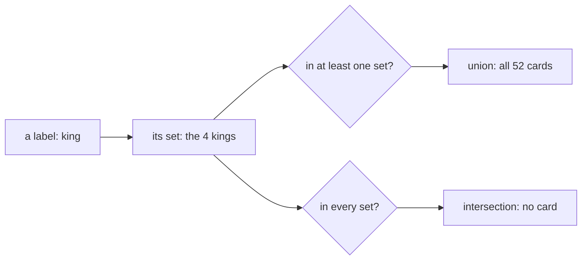

# Indexed families: unions, intersections and products over any number of sets, and De Morgan for infinitely many

[Syllabus](../../../SYLLABUS.md) → [Foundations](../README.md) → [Sets](../README.md#s07) → Indexed families

---

## General Overview

Sort a 52-card deck by rank: 13 piles of 4, each labelled by its rank. Labelled sets like these form an **indexed family**; the labels form the **index set**, here the 13 ranks.

Three questions span every pile:

- **In at least one pile?** All 52 cards: the union.
- **In every pile?** No card, since a card has one rank: the intersection is empty.
- **One card from each suit?** 13 × 13 × 13 × 13 = 28,561 ways: the product of the four suits.

Labels need not run out. Let set n, for n = 1, 2, 3 and on, hold the numbers from 0 up to 1/n, 0 in and 1/n out. Only 0 is in all of them.

**Label each set, and union, intersection and product ask "in at least one?", "in every one?" and "one pick from each?" across all labels at once, however many there are.**

**What kind of fact this is:** three definitions, plus a theorem proved in Why it works: De Morgan's law for any number of sets.

### A label goes in, a set comes out



The family is a **function**: each label gets exactly one set.

---

## The formula

Write $`A_r`$ for the set with label $`r`$, read "A sub r", and $`R`$ for the index set:

```math
\bigcup_{r \in R} A_r = \{\, x : x \in A_r \text{ for at least one } r \,\} \qquad \bigcap_{r \in R} A_r = \{\, x : x \in A_r \text{ for every } r \,\}
```

The product over the suits $`S`$, with $`B_s`$ the cards of suit $`s`$, collects every pick $`f`$:

```math
\prod_{s \in S} B_s = \{\, f : f(s) \in B_s \text{ for every } s \in S \,\}
```

De Morgan, for sets $`A_n`$ labelled $`n`$ = 1, 2, 3 and on, inside a universe $`U`$ named first:

```math
U - \bigcup_{n} A_n = \bigcap_{n} (U - A_n) \qquad U - \bigcap_{n} A_n = \bigcup_{n} (U - A_n)
```

**Read it aloud:** union, some set holds it; intersection, every set holds it; product, every pick of one member from each set. A "not" moved inside swaps "some" and "every".

| Symbol | Plain meaning | In our example | Push it up and the answer… |
| --- | --- | --- | --- |
| $`R`$, $`S`$ | index set: the labels | 13 ranks; 4 suits | more labels: union grows or stays, intersection shrinks or stays |
| $`A_r`$, $`B_s`$, $`A_n`$ | the set with that label | 4 cards of rank r; 13 of suit s | bigger sets: all three grow or stay |
| $`\bigcup`$, $`\bigcap`$ | union: in at least one set; intersection: in every set | 52 cards; no card | — |
| $`n`$, $`x`$ | a counting label 1, 2, 3, …; a member being tested | n = 1000; x = 0.001 | bigger n: set n shrinks |
| $`\prod`$, $`f`$ | product: every pick f, card f(s) from suit s | 28,561 picks | a new set multiplies the count by its size |
| $`U -`$ | complement: what the universe U holds outside | 0 to 1, both ends in | — |

### When it holds

- **The index set is fixed first.** Drop the label "ace" and the union loses 4 cards.
- **A universe comes first.** Without U, "outside the union" has no answer.
- **Every set in a product has a member.** One empty set, and no pick exists.

---

## Why it works

### Step 0: "at least one" and "every" need no count

For two sets the union asks "in A or in B?" ([Set operations](03-set-operations.md)). A family's union asks "does some set hold x?", which needs no last label.

### Step 1: the deck

- **Union, 52.** The 13 piles of 4 hold every card and never overlap: 13 × 4 = 52.
- **Intersection, empty.** A card in every pile would need all 13 ranks.
- **Distributive law.** The hearts in the union equal the union of each pile's hearts, 13: $`\text{hearts} \cap \bigcup_{r} A_r = \bigcup_{r} (\text{hearts} \cap A_r)`$.

### Step 2: a product is a set of functions

A pick sends each suit to one card of that suit, so it is a function on the suits. Each suit gives 13 independent choices: 13 × 13 × 13 × 13 = 28,561.

A pair has two slots ([Ordered pairs and the Cartesian product](05-ordered-pairs-and-cartesian-product.md)); infinitely many sets have no last slot, so the function is the definition. A pick need not follow a rule anyone could state.

### Step 3: infinitely many sets can share one number

Write $`[0, 1/n)`$ for set n: a square bracket keeps its end, a round one drops it.

- **0 stays:** 0 is below every 1/n.
- **Any x above 0 leaves:** at n of at least 1/x, 1/n is at most x.

So the intersection is $`\{0\}`$, the set holding only 0.

### Step 4: De Morgan for any number of sets

x is outside the union when no set holds it, that is, when it is outside every set.

In U, the numbers 0 to 1, the outside of $`[1/n, 1]`$ is $`[0, 1/n)`$. So their union's outside is the Step 3 intersection, $`\{0\}`$, and the union is $`(0, 1]`$.

<details>
<summary>Both De Morgan laws, line by line</summary>

For $`x`$ in $`U`$:

$`\displaystyle x \notin \bigcup_{n} A_n \iff \text{no } n \text{ has } x \in A_n \iff \text{every } n \text{ has } x \in U - A_n \iff x \in \bigcap_{n} (U - A_n)`$

The second law is the same chain with "not every" read as "some not".

</details>

---

## Worked numbers, by hand

The check tests 61 points, 0, 1/60, 2/60 up to 1, against the first 60 sets; Step 3 covers the rest.

| Step | Arithmetic | Value |
| --- | --- | --- |
| rank family | 13 labels, 4 cards each | 13 sets |
| union over ranks | 13 × 4, no card twice | **52** |
| intersection over ranks | a card with every rank | 0 |
| hearts, rank by rank | one per pile | 13 |
| one card from each suit | 13 × 13 × 13 × 13 | **28,561** |
| points in every $`[0, 1/n)`$ | only x = 0 | **1** |
| points in some $`[1/n, 1]`$ | all but 0 | 60 |
| outside that union | De Morgan | 1 |
| where 0.001 leaves | first n with 1/n at most 0.001 | 1000 |

### What breaks if you drop a piece

| Mistake | Comes out at | What went wrong |
| --- | --- | --- |
| One card from the whole deck | 52 | That is the union, not the product |
| Four choices, thirteen times | 67,108,864 | That picks a suit for each rank |
| A "not" moved inside, union kept | 60 of 61 points | Union and intersection must swap |

---

## Code, from first principles, and it actually runs

The code checks the union against 13 × 4, the product against 13^4, and De Morgan point by point. Points stay whole numbers: k/60 is in $`[0, 1/n)`$ when k × n is below 60.

### Python

```python
# Indexed families -- the check behind the card.  Nothing is imported.  The deck
# indexed by rank and by suit, then the intervals [0, 1/n) and [1/n, 1].
SUITS = ["clubs", "diamonds", "hearts", "spades"]
RANKS = ["2", "3", "4", "5", "6", "7", "8", "9", "10", "jack", "queen", "king", "ace"]
DECK = [(s, r) for s in SUITS for r in RANKS]
A = {r: [c for c in DECK if c[1] == r] for r in RANKS}   # the family: rank -> its 4 cards
B = {s: [c for c in DECK if c[0] == s] for s in SUITS}   # suit -> its 13 cards
union = [c for c in DECK if any(c in A[r] for r in RANKS)]
inter = [c for c in DECK if all(c in A[r] for r in RANKS)]
hearts = [c for c in union if c in B["hearts"]]; by_rank = [c for r in RANKS for c in A[r] if c in B["hearts"]]  # distributive law
picks = [[]]                                  # one card from each suit, a suit at a time
for s in SUITS:
    picks = [p + [c] for p in picks for c in B[s]]
G = 60; pts, ns = range(G + 1), range(1, G + 1)   # points k/60, k = 0..60; sets n = 1..60
in_every = [k for k in pts if all(k * n < G for n in ns)]       # in every [0, 1/n)
in_some = [k for k in pts if any(k * n >= G for n in ns)]       # in some [1/n, 1]
outside = [k for k in pts if k not in in_some]                  # complement of the union
no_flip = [k for k in pts if any(k * n < G for n in ns)]        # union of [0, 1/n): wrong
drop = next(n for n in range(1, 10 ** 6) if not 1 * n < 1000)   # 1/1000 is in [0, 1/n) while 1*n < 1000
print(f"rank family: {len(A)} sets of {len(A['ace'])} cards; union {len(union)}, intersection {len(inter)}")
print(f"distributive law: hearts in the union {len(hearts)}; union of the hearts in each pile {len(by_rank)}")
print(f"one card from each suit: {len(picks)} picks, by formula 13^4 = {13 ** 4}")
print(f"points tested: {len(pts)}; in every [0, 1/n): {len(in_every)}, at x = {in_every[0]}")
print(f"in some [1/n, 1]: {len(in_some)}; outside that union: {len(outside)}, at x = {outside[0]}")
print(f"0.001 drops out of [0, 1/n) at n = {drop}")
print(f"the three mistakes come out at {len(union)}, {4 ** 13} and {len(no_flip)}")
assert len(union) == 13 * 4 and inter == [] and hearts == by_rank and len(hearts) == 13 and len(DECK) == 52
assert len(picks) == 13 ** 4 and all(p[i][0] == SUITS[i] for p in picks for i in range(4))
assert outside == in_every == [0] and len(in_some) == G and len(no_flip) == G   # De Morgan
print("ALL CHECKS PASS")
```

**Ran 2026-11-23 on macOS, Python 3.14.10, standard library only. All checks passed. Output, pasted from the run:**

```
rank family: 13 sets of 4 cards; union 52, intersection 0
distributive law: hearts in the union 13; union of the hearts in each pile 13
one card from each suit: 28561 picks, by formula 13^4 = 28561
points tested: 61; in every [0, 1/n): 1, at x = 0
in some [1/n, 1]: 60; outside that union: 1, at x = 0
0.001 drops out of [0, 1/n) at n = 1000
the three mistakes come out at 52, 67108864 and 60
ALL CHECKS PASS
```

### Rust

Same output, built with `rustc --edition 2021 -O`.

```rust
// Indexed families -- the same check as the Python, in Rust.  No crates.  The
// deck indexed by rank and by suit, then the intervals [0, 1/n) and [1/n, 1].
const SUITS: [&str; 4] = ["clubs", "diamonds", "hearts", "spades"];
const RANKS: [&str; 13] = ["2", "3", "4", "5", "6", "7", "8", "9", "10", "jack", "queen", "king", "ace"];
type Card = (&'static str, &'static str);
fn main() {
    let deck: Vec<Card> = SUITS.iter().flat_map(|s| RANKS.iter().map(move |r| (*s, *r))).collect();
    let fam = |r: &str| -> Vec<Card> { deck.iter().copied().filter(|c| c.1 == r).collect() };
    let suit = |s: &str| -> Vec<Card> { deck.iter().copied().filter(|c| c.0 == s).collect() };
    let a: Vec<Vec<Card>> = RANKS.iter().map(|r| fam(r)).collect();   // rank -> its 4 cards
    let union: Vec<Card> = deck.iter().copied().filter(|c| a.iter().any(|x| x.contains(c))).collect();
    let inter: Vec<Card> = deck.iter().copied().filter(|c| a.iter().all(|x| x.contains(c))).collect();
    let hb = suit("hearts");                             // the distributive law, both sides
    let hearts: Vec<Card> = union.iter().copied().filter(|c| hb.contains(c)).collect();
    let by_rank: Vec<Card> = a.iter().flatten().copied().filter(|c| hb.contains(c)).collect();
    let mut picks: Vec<Vec<Card>> = vec![vec![]];       // one card from each suit, a suit at a time
    for s in SUITS {
        picks = picks.iter().flat_map(|p| suit(s).into_iter().map(move |c| { let mut q = p.clone(); q.push(c); q })).collect();
    }
    let g: u64 = 60;                                     // points k/60, k = 0..60; sets n = 1..60
    let pts: Vec<u64> = (0..=g).collect();
    let in_every: Vec<u64> = pts.iter().copied().filter(|k| (1..=g).all(|n| k * n < g)).collect();
    let in_some: Vec<u64> = pts.iter().copied().filter(|k| (1..=g).any(|n| k * n >= g)).collect();
    let outside: Vec<u64> = pts.iter().copied().filter(|k| !in_some.contains(k)).collect();
    let no_flip: Vec<u64> = pts.iter().copied().filter(|k| (1..=g).any(|n| k * n < g)).collect();
    let drop = (1u64..1_000_000).find(|n| !(1 * n < 1000)).unwrap();   // 1/1000 is in [0, 1/n) while 1*n < 1000
    println!("rank family: {} sets of {} cards; union {}, intersection {}", a.len(), a[12].len(), union.len(), inter.len());
    println!("distributive law: hearts in the union {}; union of the hearts in each pile {}", hearts.len(), by_rank.len());
    println!("one card from each suit: {} picks, by formula 13^4 = {}", picks.len(), 13u64.pow(4));
    println!("points tested: {}; in every [0, 1/n): {}, at x = {}", pts.len(), in_every.len(), in_every[0]);
    println!("in some [1/n, 1]: {}; outside that union: {}, at x = {}", in_some.len(), outside.len(), outside[0]);
    println!("0.001 drops out of [0, 1/n) at n = {}", drop);
    println!("the three mistakes come out at {}, {} and {}", union.len(), 4u64.pow(13), no_flip.len());
    assert!(union.len() == 13 * 4 && inter.is_empty() && hearts == by_rank && hearts.len() == 13 && deck.len() == 52);
    assert!(picks.len() == 13usize.pow(4) && picks.iter().all(|p| (0..4).all(|i| p[i].0 == SUITS[i])));
    assert!(outside == in_every && in_every == vec![0] && in_some.len() == 60 && no_flip.len() == 60); // De Morgan
    println!("ALL CHECKS PASS");
}
```

**Ran 2026-11-23 on macOS, rustc 1.98.1, no crates. All checks passed. Output, pasted from the run:**

```
rank family: 13 sets of 4 cards; union 52, intersection 0
distributive law: hearts in the union 13; union of the hearts in each pile 13
one card from each suit: 28561 picks, by formula 13^4 = 28561
points tested: 61; in every [0, 1/n): 1, at x = 0
in some [1/n, 1]: 60; outside that union: 1, at x = 0
0.001 drops out of [0, 1/n) at n = 1000
the three mistakes come out at 52, 67108864 and 60
ALL CHECKS PASS
```

### Lean

Lean proves De Morgan for any index set, the two interval facts and the empty-set rule for products, then checks the deck.

- De Morgan: outside the union is inside every outside. Outside the intersection is inside some outside.
- Take the sets $`[0, 1/n)`$ for n = 1, 2, 3 and on. Then only 0 is in all of them.
- Take the sets $`[1/n, 1]`$ for the same n. Then their union is $`(0, 1]`$.
- One empty set in a product leaves no pick, so the product is empty.
- For the deck, the piles of 4, the union of 52, the empty intersection, 13 hearts and 28,561 picks all check.
- The mistake count 67,108,864 checks too.
- Take x = 0.001. Then x is in $`[0, 1/999)`$ but not in $`[0, 1/1000)`$.

The test of 61 points and the Try changing edits are left to the Python and Rust checks.

```lean
-- Indexed families: for any index set, a "not" moved inside a union becomes an intersection of the outsides and vice versa (De Morgan), the sets [0, 1/n) share only 0 while the sets [1/n, 1] fill (0, 1], a product with one empty set has no pick, and the card's deck counts come out as it says.
import Mathlib.Data.Set.Lattice.Indexed
import Mathlib.Data.Set.Prod
import Mathlib.Algebra.Order.Archimedean.Real.Basic
import Mathlib.Data.Fintype.BigOperators
import Mathlib.Tactic.NormNum

/-- De Morgan's law for any number of sets. The universe `U` is named first: here it is the
type `α`, and the outside of a set `X` is `Xᶜ`, read "U − X". For any index set `ι` and any
family `A i` of sets in `U`: outside the union is inside every outside,
`U − ⋃ A i = ⋂ (U − A i)`, and outside the intersection is inside some outside,
`U − ⋂ A i = ⋃ (U − A i)`. -/
theorem de_morgan_for_indexed_families {α ι : Type*} (A : ι → Set α) :
    (⋃ i, A i)ᶜ = ⋂ i, (A i)ᶜ ∧ (⋂ i, A i)ᶜ = ⋃ i, (A i)ᶜ := by
  exact ⟨Set.compl_iUnion A, Set.compl_iInter A⟩

/-- Infinitely many sets can share one number: over n = 1, 2, 3, ... the sets `[0, 1/n)`,
0 in and 1/n out, have only 0 in common, and the sets `[1/n, 1]` together make `(0, 1]`. -/
theorem shrinking_intervals_share_only_zero :
    (⋂ n : ℕ+, Set.Ico (0 : ℝ) (1 / (n : ℝ))) = {0} ∧
      (⋃ n : ℕ+, Set.Icc (1 / (n : ℝ)) 1) = Set.Ioc (0 : ℝ) 1 := by
  have key : ∀ x : ℝ, 0 < x → ∃ n : ℕ+, 1 / (n : ℝ) < x := by
    intro x hx
    obtain ⟨n, hn⟩ := exists_nat_one_div_lt hx
    refine ⟨n.succPNat, ?_⟩
    have hc : ((n.succPNat : ℕ) : ℝ) = (n : ℝ) + 1 := by
      rw [Nat.succPNat_coe, Nat.cast_succ]
    simpa [hc] using hn
  constructor
  · ext x
    simp only [Set.mem_iInter, Set.mem_Ico, Set.mem_singleton_iff]
    constructor
    · intro h
      have h0 : 0 ≤ x := (h 1).1
      rcases h0.lt_or_eq with hpos | hzero
      · obtain ⟨n, hn⟩ := key x hpos
        exact absurd (h n).2 (not_lt.mpr hn.le)
      · exact hzero.symm
    · rintro rfl n
      refine ⟨le_rfl, ?_⟩
      have : (0 : ℝ) < (n : ℝ) := by exact_mod_cast n.pos
      positivity
  · ext x
    simp only [Set.mem_iUnion, Set.mem_Icc, Set.mem_Ioc]
    constructor
    · rintro ⟨n, h1, h2⟩
      have : (0 : ℝ) < (n : ℝ) := by exact_mod_cast n.pos
      exact ⟨lt_of_lt_of_le (by positivity) h1, h2⟩
    · rintro ⟨hpos, hle⟩
      obtain ⟨n, hn⟩ := key x hpos
      exact ⟨n, hn.le, hle⟩

/-- A product needs every set to have a member: if one set `B s` in the family is empty,
there is no pick `f` with `f s ∈ B s` for every label `s`, so the product is empty. -/
theorem product_with_an_empty_set_is_empty {ι : Type*} {β : ι → Type*} (B : ∀ s, Set (β s))
    (h : ∃ s, B s = ∅) : Set.pi Set.univ B = ∅ := by
  exact Set.univ_pi_eq_empty_iff.2 h

/-- The deck: a card is a suit (4) and a rank (13). -/
abbrev Card := Fin 4 × Fin 13

/-- The family indexed by rank: rank `r` labels its 4 cards. -/
def rankPile (r : Fin 13) : Finset Card := Finset.univ.filter (fun c => c.2 = r)

/-- The family indexed by suit: suit `s` labels its 13 cards. -/
def suitPile (s : Fin 4) : Finset Card := Finset.univ.filter (fun c => c.1 = s)

-- The rank family: 13 sets of 4 cards each.
example : ∀ r : Fin 13, (rankPile r).card = 4 := by decide
-- The union over all 13 ranks is the whole 52-card deck.
example : (Finset.univ.biUnion rankPile).card = 52 := by decide
-- The intersection over the ranks is empty: no card has every rank.
example : ∀ c : Card, ¬ ∀ r : Fin 13, c ∈ rankPile r := by decide
-- Distributive law (suits in the order clubs, diamonds, hearts, spades, so hearts is suit 2): the hearts in the union are the union of each pile's hearts, 13 cards.
example : suitPile 2 ∩ Finset.univ.biUnion rankPile =
    Finset.univ.biUnion (fun r => suitPile 2 ∩ rankPile r) := by decide
example : (suitPile 2 ∩ Finset.univ.biUnion rankPile).card = 13 := by decide
-- One card from each suit: 13 × 13 × 13 × 13 = 28,561 picks.
example : (Fintype.piFinset suitPile).card = 28561 := by
  rw [Fintype.card_piFinset]; decide
-- The mistake "four choices, thirteen times": 4^13 = 67,108,864.
example : (4 : ℕ) ^ 13 = 67108864 := by norm_num
-- 1/1000 is still in [0, 1/999) but drops out of [0, 1/n) at n = 1000.
example : (1 / 1000 : ℝ) ∈ Set.Ico (0 : ℝ) (1 / 999) ∧ (1 / 1000 : ℝ) ∉ Set.Ico (0 : ℝ) (1 / 1000) := by
  norm_num

#print axioms de_morgan_for_indexed_families
#print axioms shrinking_intervals_share_only_zero
#print axioms product_with_an_empty_set_is_empty
```

**Checked 2026-11-23 on macOS, Lean 4.36.0-rc2, Mathlib v4.36.0-rc2. Every proof is complete and uses only Lean's standard axioms. Output, pasted from the run:**

```
'de_morgan_for_indexed_families' depends on axioms: [propext, Classical.choice, Quot.sound]
'shrinking_intervals_share_only_zero' depends on axioms: [propext, Classical.choice, Quot.sound]
'product_with_an_empty_set_is_empty' depends on axioms: [propext, Classical.choice, Quot.sound]
```

> [!TIP]
> **Try changing**
> Guess first, then run it.
> - **Drop spades from `SUITS`.** Picks fall to 2,197, the deck to 39; the first assert stops it.
> - **Set `G = 120`.** 121 points, still only 0 in every set.
> - **In `in_every`, change `k * n < G` to `k * n <= G`.** 1/60 now survives all 60 sets; the last assert stops it.

---

## The usual mistake

> [!warning]
> **Thinking sets that each hold infinitely many numbers must share many.** Each $`[0, 1/n)`$ is infinite, yet they share only 0.
>
> - One card from the whole deck is the union, 52, not the product, 28,561.
> - A "not" moved inside without swapping gives 60 of 61 points, not 1.
> - 0 is in no $`[1/n, 1]`$, so their union is $`(0, 1]`$, not 0 to 1.

---

## Where you meet it in real life

- **Search filters.** "Any of these tags" is a union over the tags; "all of them" an intersection.
- **Risk over time.** "On some day" is a union over days; "every day" an intersection.
- **Car configurators.** One paint, one trim, one engine: a product of option groups.

> **Say it back**
> An indexed family gives each label a set, like one pile per rank. Its union keeps what some set holds: 52 cards. Its intersection keeps what every set holds: none. Its product is every pick of one member from each set: 28,561. None of this counts labels, so it works for infinitely many.

---

## What this builds on

- [Set operations](03-set-operations.md): union, intersection and De Morgan for two sets.
- [Ordered pairs and the Cartesian product](05-ordered-pairs-and-cartesian-product.md): the product of two sets.

## Where this goes next

- [Functions](../08-Relations%20and%20Functions/02-functions.md): one output per input, the shape of every family and pick.
- [The axiom of choice](../09-Sizes%20of%20Infinity/05-axiom-of-choice.md): a product of non-empty sets has a member, even with no rule for the picks.
- [The ZFC axioms](08-zfc-axioms.md): the rules that make these unions and products sets.

Left open: when every set in an infinite family has a member, must the product have one?

---

## Sources

Verified 2026-11-23: every link below resolves to the publisher's page.

- Halmos, Paul R. *Naive Set Theory*. Springer, 1974. Section 9, "Families". [doi:10.1007/978-1-4757-1645-0_9](https://doi.org/10.1007/978-1-4757-1645-0_9). A family as a function; its union, intersection and product.
- Velleman, Daniel J. *How to Prove It*, 3rd ed. Cambridge University Press, 2019. Section 2.3. [doi:10.1017/9781108539890.004](https://doi.org/10.1017/9781108539890.004). Unions and intersections over an index set as "for some" and "for all".
