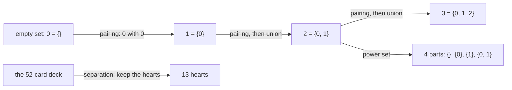

# The ZFC axioms: the rules that say which collections are sets, and how they stop Russell

[Syllabus](../../../SYLLABUS.md) → [Foundations](../README.md) → [Sets](../README.md#s07) → The ZFC axioms

---

## General Overview

Start with the empty set. A few building rules turn it into the numbers 0, 1, 2 and 3, each one a set. Another rule cuts the 13 hearts out of a 52-card deck.

Those rules are the **ZFC axioms** (Zermelo–Fraenkel set theory with Choice). An **axiom** is a rule taken as given, not proved. Eight give sets; two say when sets are equal and forbid a set inside itself.

[Russell's paradox](06-russells-paradox.md) showed that "every set that passes a test" can name a collection that cannot exist.

**ZFC builds sets from sets already in hand, never from "everything": that is how it keeps Russell's collection out.**

**What kind of fact this is:** the axioms are assumptions; what they build here are theorems, proved in Why it works.

### The picture: what the rules build



---

## The formula

The counting numbers come from two rules:

```math
0 = \{\} \qquad n + 1 = n \cup \{n\}
```

**Read it aloud:** zero is the empty set; the next number is n with n itself added as a member.

**Separation**, the rule that blocks Russell, keeps the members of a set in hand that pass a test:

```math
\{x \in A : x \text{ passes the test}\}
```

**Read it aloud:** the members x of A that pass the test, nothing from outside A.

| Symbol | Plain meaning | In our example | Push it up and the answer… |
| --- | --- | --- | --- |
| $`\{\}`$ | the empty set: no members | 0 | — |
| $`n`$, $`n + 1`$ | a counting number as a set, and the next | 2 and 3 | one more member |
| $`\{n\}`$ | the set whose one member is n | $`\{2\}`$ | — |
| $`\cup`$ | union: everything in either set | $`\{0, 1\} \cup \{2\}`$ | — |
| $`x \in A`$ | x is a member of A | a heart is in the deck | — |
| $`\{x \in A : \dots\}`$ | separation: the members of A that pass | the 13 hearts | more to keep from a bigger A |

### The ten axioms

Separation and replacement are one axiom per precise sentence: the full list is infinite.

| Axiom | In plain words | On this card |
| --- | --- | --- |
| Extensionality | Same members, same set | $`\{0, 0\}`$ is $`\{0\}`$ |
| Empty set | A set with no members exists | 0 |
| Pairing | For any a and b, $`\{a, b\}`$ is a set | $`\{2\}`$ |
| Union | The members of a set's members form a set | 3 from 2 and $`\{2\}`$ |
| Power set | All the parts (subsets) of a set form a set | 4 parts of 2 |
| Separation | The members of a set that pass a test form a set | 13 hearts |
| Replacement | A rule applied to each member of a set gives a set | 0 wrapped n times |
| Infinity | Some set holds 0 and, with each n, n + 1 | all counting numbers |
| Foundation | A nonempty set has a member sharing no member with it | no set is in itself |
| Choice | One pick from each nonempty set of a family forms a set | [The axiom of choice](../09-Sizes%20of%20Infinity/05-axiom-of-choice.md) |

### When it holds

- **Separation needs a set in hand.** Allow "all sets that pass a test" with no A, and Russell's collection forms: the rules contradict themselves.
- **The test is a precise sentence.** "The nice cards" picks no definite set.
- **Infinity is assumed, not proved.** Without it, no rule proves an infinite set exists.

---

## Why it works

### Step 0: build, never sweep

Two axioms give a set outright, six build one from sets in hand; none gathers all sets.

### Step 1: build 0, 1, 2 and 3

- **0** is the empty set, $`\{\}`$.
- **1**: pair 0 with itself. By extensionality, $`\{0, 0\}`$ is $`\{0\}`$.
- **2**: pair 1 with itself to get $`\{1\}`$. Pair 1 with $`\{1\}`$ and take the union: $`\{0, 1\}`$.
- **3**: the same two moves on 2 give $`\{0, 1, 2\}`$.

Each number n holds the n numbers before it.

### Step 2: power set and separation

The power set of 2 holds its 4 parts ([Subsets and the power set](02-subsets-and-power-set.md)): $`\{\}`$, $`\{0\}`$, $`\{1\}`$ and $`\{0, 1\}`$.

A card is an ordered pair (suit, rank) ([Ordered pairs and the Cartesian product](05-ordered-pairs-and-cartesian-product.md)). As a set, (a, b) is $`\{\{a\}, \{a, b\}\}`$, three pairings away; code suits and ranks as numbers, and every card is a set. Separation with the test "x is a heart" keeps 13 of the deck's 52.

### Step 3: why Russell's collection never forms

Separation with Russell's test, "x is not a member of x", on a set A gives the Russell cut of A. It exists, and it is never a member of A ([Russell's paradox](06-russells-paradox.md)).

No rule builds "all sets not in themselves" without an A. And no set holds every set: its own Russell cut would be missing.

Foundation adds that no set is a member of itself. So the Russell cut of 3 keeps all 3 members: it equals 3, and 3 is not in 3.

<details>
<summary>Detailed proof: foundation means no set is a member of itself</summary>

Suppose a set x is a member of x. Pairing x with itself builds $`\{x\}`$.

Foundation says $`\{x\}`$ has a member sharing no member with it. Its only member is x, and x shares x with $`\{x\}`$. Contradiction.

</details>

### Step 4: infinity and replacement

Infinity gives a set holding every counting number, the ones [Peano's three rules](../06-Proof/07-peano-and-one-plus-one.md) describe; separation keeps exactly those. Replacement applies "wrap 0 in braces n times" to each of them, and the results form a set: $`\{\}`$, $`\{\{\}\}`$, $`\{\{\{\}\}\}`$ and so on.

---

## Worked numbers, by hand

| Step | Arithmetic | Value |
| --- | --- | --- |
| 0 | the empty set | 0 members |
| 1 | pair 0 with 0 | $`\{0\}`$, 1 member |
| 2 | union of 1 and $`\{1\}`$ | $`\{0, 1\}`$, 2 members |
| 3 | union of 2 and $`\{2\}`$ | $`\{0, 1, 2\}`$, 3 members |
| power set of 2 | 2 × 2 parts | **4** |
| hearts | keep the hearts of 52 cards | **13** |
| Russell cut of 3 | keep members not in themselves | all 3: the cut is 3 |
| is the cut in 3? | its members are 0, 1, 2 | **no** |

Russell's cut exists, but stays outside the set it came from.

### What breaks if you drop a piece

| Mistake | Comes out at | What went wrong |
| --- | --- | --- |
| Building 2 as $`\{1\}`$, with no union | 1 member | 0 was dropped |
| Leaving out the empty part | 3 parts of 2 | $`\{\}`$ is a part of every set |
| Taking the members of 2 for its parts | 2 | Parts are sets of members |

---

## Code, from first principles, and it actually runs

Road 1 builds nested sets, one axiom at a time. Road 2 numbers each set: add 2 to the power of each member's number. So 0, 1, 2 and 3 get 0, 1, 3 and 11. The roads must agree.

### Python

```python
# The ZFC axioms -- the check behind the card.  Nothing is imported.  Road 1: nested frozensets.
# Road 2: each set as a number, 2 to the power of each member's number, added up.
E = frozenset()                                           # the empty set axiom
def pair(a, b): return frozenset([a, b])                  # pairing
def union(a): return frozenset(m for s in a for m in s)   # union: the members of the members
def power(a): ms = list(a); return frozenset(frozenset(m for i, m in enumerate(ms) if k >> i & 1) for k in range(2 ** len(ms)))
def code(s): return sum(2 ** code(m) for m in s)          # road 2: x is in y when bit x of y is 1
def show(c): return "{" + ",".join(show(i) for i in range(c.bit_length()) if c >> i & 1) + "}"
def row(name, value): print(f"{name:<48}{value}")
nums, wraps, ncode, wcode = [E], [E], [0], [0]
for _ in range(3):
    nums.append(union(pair(nums[-1], pair(nums[-1], nums[-1]))))   # n + 1 = n together with {n}
    wraps.append(pair(wraps[-1], wraps[-1]))              # replacement's rule: wrap once more
    ncode.append(ncode[-1] + 2 ** ncode[-1]); wcode.append(2 ** wcode[-1])   # the same, on road 2
p2, p2code = power(nums[2]), sum(2 ** c for c in range(ncode[2] + 1) if c & ncode[2] == c)   # road 2: parts of 2
deck = [(s, r) for s in "CDHS" for r in range(13)]; hearts = [c for c in deck if c[0] == "H"]
russell = frozenset(x for x in nums[3] if x not in x)     # separation: the Russell cut of 3
row("0, 1, 2, 3: members", " ".join(str(len(n)) for n in nums))
row("0, 1, 2, 3: numbers on road 2", " ".join(str(code(n)) for n in nums))
row("3 written out", show(code(nums[3])))
row("power set of 2: members, number, written out", f"{len(p2)} {code(p2)} {show(code(p2))}")
row("hearts cut from the deck by separation", f"{len(hearts)} of {len(deck)}")
row("Russell cut of 3: members, equals 3, inside 3", f"{len(russell)} {'yes' if russell == nums[3] else 'no'} {'yes' if russell in nums[3] else 'no'}")
row("replacement: n goes to 0 wrapped n times", " ".join(show(code(w)) for w in wraps))
row("mistakes: 2 as {1}, no empty part, 2's members", f"{len(pair(nums[1], nums[1]))} {len(p2) - 1} {len(nums[2])}")
assert [code(n) for n in nums] == ncode == [0, 1, 3, 11] and [code(w) for w in wraps] == wcode == [0, 1, 2, 4] and len(hearts) * 4 == len(deck)
assert code(p2) == p2code == 15 and len(p2) == 2 ** len(nums[2]) and russell == nums[3] == frozenset(nums[:3])
print("ALL CHECKS PASS")
```

**Ran 2026-11-23 on macOS, Python 3.14.10, standard library only. All checks passed. Output, pasted from the run:**

```
0, 1, 2, 3: members                             0 1 2 3
0, 1, 2, 3: numbers on road 2                   0 1 3 11
3 written out                                   {{},{{}},{{},{{}}}}
power set of 2: members, number, written out    4 15 {{},{{}},{{{}}},{{},{{}}}}
hearts cut from the deck by separation          13 of 52
Russell cut of 3: members, equals 3, inside 3   3 yes no
replacement: n goes to 0 wrapped n times        {} {{}} {{{}}} {{{{}}}}
mistakes: 2 as {1}, no empty part, 2's members  1 3 2
ALL CHECKS PASS
```

### Rust

Same output, built with `rustc --edition 2021 -O`.

```rust
// The ZFC axioms -- the same check as the Python, in Rust.  No crates.  Road 1: nested sets.
// Road 2: each set as a number, 2 to the power of each member's number, added up.
use std::collections::BTreeSet;
#[derive(Clone, PartialEq, Eq, PartialOrd, Ord)]
struct S(BTreeSet<S>);                                      // a set whose members are sets
fn pair(a: &S, b: &S) -> S { S([a.clone(), b.clone()].into_iter().collect()) }        // pairing
fn union(a: &S) -> S { S(a.0.iter().flat_map(|s| s.0.iter().cloned()).collect()) }  // union
fn power(a: &S) -> S { let ms: Vec<&S> = a.0.iter().collect(); S((0..1u64 << ms.len()).map(|k| S((0..ms.len()).filter(|i| k >> i & 1 == 1).map(|i| ms[i].clone()).collect())).collect()) }
fn code(s: &S) -> u64 { s.0.iter().map(|m| 1u64 << code(m)).sum() }   // road 2: x is in y when bit x of y is 1
fn show(c: u64) -> String { format!("{{{}}}", (0..64 - c.leading_zeros() as u64).filter(|i| c >> i & 1 == 1).map(show).collect::<Vec<_>>().join(",")) }
fn row(name: &str, value: String) { println!("{:<48}{}", name, value); }
fn yn(b: bool) -> &'static str { if b { "yes" } else { "no" } }
fn main() {
    let e = S(BTreeSet::new());                             // the empty set axiom
    let (mut nums, mut wraps, mut ncode, mut wcode) = (vec![e.clone()], vec![e], vec![0u64], vec![0u64]);
    for _ in 0..3 {
        let n = nums[nums.len() - 1].clone(); nums.push(union(&pair(&n, &pair(&n, &n))));   // n + 1 = n together with {n}
        let w = wraps[wraps.len() - 1].clone(); wraps.push(pair(&w, &w));   // replacement's rule: wrap once more
        let (c, d) = (ncode[ncode.len() - 1], wcode[wcode.len() - 1]); ncode.push(c + (1 << c)); wcode.push(1 << d);
    }
    let (p2, p2code) = (power(&nums[2]), (0..=ncode[2]).filter(|c| c & ncode[2] == *c).map(|c| 1u64 << c).sum::<u64>());
    let deck: Vec<(char, u32)> = "CDHS".chars().flat_map(|s| (0..13).map(move |r| (s, r))).collect();
    let hearts = deck.iter().filter(|c| c.0 == 'H').count();
    let russell = S(nums[3].0.iter().filter(|x| !x.0.contains(*x)).cloned().collect());   // separation
    let j = |v: Vec<String>| v.join(" ");
    row("0, 1, 2, 3: members", j(nums.iter().map(|n| n.0.len().to_string()).collect()));
    row("0, 1, 2, 3: numbers on road 2", j(nums.iter().map(|n| code(n).to_string()).collect()));
    row("3 written out", show(code(&nums[3])));
    row("power set of 2: members, number, written out", format!("{} {} {}", p2.0.len(), code(&p2), show(code(&p2))));
    row("hearts cut from the deck by separation", format!("{} of {}", hearts, deck.len()));
    row("Russell cut of 3: members, equals 3, inside 3", format!("{} {} {}", russell.0.len(), yn(russell == nums[3]), yn(nums[3].0.contains(&russell))));
    row("replacement: n goes to 0 wrapped n times", j(wraps.iter().map(|w| show(code(w))).collect()));
    row("mistakes: 2 as {1}, no empty part, 2's members", format!("{} {} {}", pair(&nums[1], &nums[1]).0.len(), p2.0.len() - 1, nums[2].0.len()));
    assert!(nums.iter().map(code).collect::<Vec<_>>() == ncode && ncode == vec![0, 1, 3, 11] && wraps.iter().map(code).collect::<Vec<_>>() == wcode && wcode == vec![0, 1, 2, 4] && hearts * 4 == deck.len());
    assert!(code(&p2) == p2code && p2code == 15 && p2.0.len() == 1 << nums[2].0.len() && russell == nums[3] && nums[3] == S(nums[..3].iter().cloned().collect()));
    println!("ALL CHECKS PASS");
}
```

**Ran 2026-11-23 on macOS, rustc 1.98.1, no crates. All checks passed. Output, pasted from the run:**

```
0, 1, 2, 3: members                             0 1 2 3
0, 1, 2, 3: numbers on road 2                   0 1 3 11
3 written out                                   {{},{{}},{{},{{}}}}
power set of 2: members, number, written out    4 15 {{},{{}},{{{}}},{{},{{}}}}
hearts cut from the deck by separation          13 of 52
Russell cut of 3: members, equals 3, inside 3   3 yes no
replacement: n goes to 0 wrapped n times        {} {{}} {{{}}} {{{{}}}}
mistakes: 2 as {1}, no empty part, 2's members  1 3 2
ALL CHECKS PASS
```

### Lean

Lean proves three facts for every set in Mathlib's model of ZFC, then checks the card's small sets and the deck.

- For every set A, the Russell cut of A is never a member of A. So no set holds every set.
- Foundation: no set is a member of itself.
- Build the numbers from the empty set by pairing and union. Then the members of each number n are exactly the numbers before it.
- $`\{0, 0\}`$ is $`\{0\}`$. And 1, 2 and 3 come out as $`\{0\}`$, $`\{0, 1\}`$ and $`\{0, 1, 2\}`$.
- The power set of 2 is $`\{\{\}, \{0\}, \{1\}, \{0, 1\}\}`$, with 4 members.
- The Russell cut of 3 equals 3, and it is not in 3. Building 2 as $`\{1\}`$ gives 1 member.
- The deck has 52 cards, and keeping the hearts leaves 13.

The wrapped sets for replacement, the road-2 numbers and the Try changing edits are left to the Python and Rust checks.

```lean
-- The ZFC axioms: in Mathlib's model of ZFC sets, separation's Russell cut of any set stays outside it so no set holds every set, foundation keeps every set out of itself, and pairing and union build each counting number as the set of the numbers before it.
import Mathlib.SetTheory.ZFC.Basic
import Mathlib.SetTheory.ZFC.Cardinal
import Mathlib.Data.Fintype.Prod
import Mathlib.Tactic.NormNum

universe u

/-- The counting numbers built by the card's two rules: `0 = {}` and
`n + 1 = n ∪ {n}`, the union of the pair `{n, {n}}`. -/
def vnNat : ℕ → ZFSet.{u}
  | 0 => ∅
  | n + 1 => ZFSet.sUnion {vnNat n, {vnNat n}}

/-- Membership in the next number: `n + 1 = n ∪ {n}`. -/
theorem vnNat_succ_mem (n : ℕ) (x : ZFSet.{u}) :
    x ∈ vnNat (n + 1) ↔ x ∈ vnNat n ∨ x = vnNat n := by
  simp only [vnNat, ZFSet.mem_sUnion, ZFSet.mem_pair]
  constructor
  · rintro ⟨z, rfl | rfl, hz⟩
    · exact Or.inl hz
    · exact Or.inr (ZFSet.mem_singleton.mp hz)
  · rintro (h | rfl)
    · exact ⟨vnNat n, Or.inl rfl, h⟩
    · exact ⟨{vnNat n}, Or.inr rfl, ZFSet.mem_singleton.mpr rfl⟩

#print axioms vnNat_succ_mem

/-- Splitting off the top index of a bounded existential. -/
theorem exists_lt_succ_iff' (n : ℕ) (p : ℕ → Prop) :
    (∃ m < n + 1, p m) ↔ (∃ m < n, p m) ∨ p n := by
  constructor
  · rintro ⟨m, hm, h⟩
    rcases Nat.lt_succ_iff_lt_or_eq.mp hm with hm' | rfl
    · exact Or.inl ⟨m, hm', h⟩
    · exact Or.inr h
  · rintro (⟨m, hm, h⟩ | h)
    · exact ⟨m, Nat.lt_succ_of_lt hm, h⟩
    · exact ⟨n, Nat.lt_succ_self n, h⟩

#print axioms exists_lt_succ_iff'

/-- **Separation blocks Russell.** Separation with Russell's test
"x is not a member of x" on any set A in hand gives a set, the Russell cut of A,
and that cut is never a member of A. So no set holds every set: Russell's
collection of all sets not in themselves never forms. -/
theorem separation_blocks_russell (A : ZFSet.{u}) :
    ZFSet.sep (fun x => x ∉ x) A ∉ A ∧ ¬ ∃ U : ZFSet.{u}, ∀ x : ZFSet.{u}, x ∈ U := by
  have key : ∀ B : ZFSet.{u}, ZFSet.sep (fun x => x ∉ x) B ∉ B := by
    intro B hB
    have h := @ZFSet.mem_sep (fun x => x ∉ x) B (ZFSet.sep (fun x => x ∉ x) B)
    by_cases hS : ZFSet.sep (fun x => x ∉ x) B ∈ ZFSet.sep (fun x => x ∉ x) B
    · exact (h.mp hS).2 hS
    · exact hS (h.mpr ⟨hB, hS⟩)
  refine ⟨key A, ?_⟩
  rintro ⟨U, hU⟩
  exact key U (hU _)

/-- **Foundation: no set is a member of itself.** Every set x satisfies x ∉ x. -/
theorem no_set_mem_self (x : ZFSet.{u}) : x ∉ x := by
  exact ZFSet.mem_irrefl x

/-- **Each number n holds the n numbers before it.** Built from the empty set by
pairing and union, the members of n are exactly 0, 1, ..., n - 1. -/
theorem mem_vnNat_iff (n : ℕ) (x : ZFSet.{u}) : x ∈ vnNat n ↔ ∃ m < n, x = vnNat m := by
  induction n generalizing x with
  | zero =>
    simp only [vnNat, Nat.not_lt_zero, false_and, exists_false, iff_false]
    exact ZFSet.notMem_empty x
  | succ n ih =>
    rw [vnNat_succ_mem, ih, exists_lt_succ_iff']

-- Extensionality: pairing 0 with itself gives {0, 0}, which is {0}.
example : ({vnNat 0, vnNat 0} : ZFSet.{0}) = {vnNat 0} := by
  ext z; rw [ZFSet.mem_pair, ZFSet.mem_singleton, or_self]
-- 1 = {0}, 2 = {0, 1}, 3 = {0, 1, 2}.
example : (vnNat 1 : ZFSet.{0}) = {vnNat 0} := by
  ext z
  rw [vnNat_succ_mem, ZFSet.mem_singleton]
  simp [vnNat, ZFSet.notMem_empty]
example : (vnNat 2 : ZFSet.{0}) = {vnNat 0, vnNat 1} := by
  ext z
  rw [mem_vnNat_iff, ZFSet.mem_pair, exists_lt_succ_iff', exists_lt_succ_iff']
  simp only [Nat.not_lt_zero, false_and, exists_false, false_or]
example : (vnNat 3 : ZFSet.{0}) = {vnNat 0, vnNat 1, vnNat 2} := by
  ext z
  rw [mem_vnNat_iff, ZFSet.mem_insert_iff, ZFSet.mem_pair, exists_lt_succ_iff',
    exists_lt_succ_iff', exists_lt_succ_iff']
  simp only [Nat.not_lt_zero, false_and, exists_false, false_or]
  tauto
-- The power set of 2 is {{}, {0}, {1}, {0, 1}}, 4 parts.
example : ZFSet.powerset (vnNat 2 : ZFSet.{0}) = {∅, {vnNat 0}, {vnNat 1}, vnNat 2} := by
  have h2 : ∀ z : ZFSet.{0}, z ∈ vnNat 2 ↔ z = vnNat 0 ∨ z = vnNat 1 := by
    intro z
    rw [mem_vnNat_iff, exists_lt_succ_iff', exists_lt_succ_iff']
    simp only [Nat.not_lt_zero, false_and, exists_false, false_or]
  ext y
  rw [ZFSet.mem_powerset, ZFSet.mem_insert_iff, ZFSet.mem_insert_iff, ZFSet.mem_pair,
    ZFSet.subset_def]
  constructor
  · intro hy
    by_cases h0 : vnNat 0 ∈ y <;> by_cases h1 : vnNat 1 ∈ y
    · right; right; right
      ext z
      rw [h2]
      constructor
      · intro hz; exact (h2 z).mp (hy hz)
      · rintro (rfl | rfl) <;> assumption
    · right; left
      ext z
      rw [ZFSet.mem_singleton]
      constructor
      · intro hz
        rcases (h2 z).mp (hy hz) with rfl | rfl
        · rfl
        · exact absurd hz h1
      · rintro rfl; exact h0
    · right; right; left
      ext z
      rw [ZFSet.mem_singleton]
      constructor
      · intro hz
        rcases (h2 z).mp (hy hz) with rfl | rfl
        · exact absurd hz h0
        · rfl
      · rintro rfl; exact h1
    · left
      rw [ZFSet.eq_empty]
      intro z hz
      rcases (h2 z).mp (hy hz) with rfl | rfl
      · exact h0 hz
      · exact h1 hz
  · rintro (rfl | rfl | rfl | rfl)
    · intro z hz; exact absurd hz (ZFSet.notMem_empty z)
    · intro z hz
      rw [ZFSet.mem_singleton] at hz
      exact (h2 z).mpr (Or.inl hz)
    · intro z hz
      rw [ZFSet.mem_singleton] at hz
      exact (h2 z).mpr (Or.inr hz)
    · intro z hz; exact hz
example : ZFSet.card (ZFSet.powerset (vnNat 2 : ZFSet.{0})) = 4 := by
  have hne : (vnNat 0 : ZFSet.{0}) ≠ vnNat 1 := by
    intro h
    have : (vnNat 0 : ZFSet.{0}) ∈ vnNat 1 := (vnNat_succ_mem 0 _).mpr (Or.inr rfl)
    rw [← h] at this
    exact ZFSet.mem_irrefl _ this
  have h2 : (vnNat 2 : ZFSet.{0}) = {vnNat 0, vnNat 1} := by
    ext z
    rw [mem_vnNat_iff, ZFSet.mem_pair, exists_lt_succ_iff', exists_lt_succ_iff']
    simp only [Nat.not_lt_zero, false_and, exists_false, false_or]
  rw [ZFSet.card_powerset, h2, ZFSet.card_pair_of_ne hne]
  rw [show (2 : Cardinal.{0}) = ((2 : ℕ) : Cardinal.{0}) from rfl, Cardinal.power_natCast]
  norm_num
-- The Russell cut of 3 keeps all 3 members, so it equals 3, and it is not in 3.
example : ZFSet.sep (fun x => x ∉ x) (vnNat 3 : ZFSet.{0}) = vnNat 3 ∧
    ZFSet.sep (fun x => x ∉ x) (vnNat 3 : ZFSet.{0}) ∉ (vnNat 3 : ZFSet.{0}) := by
  refine ⟨?_, (separation_blocks_russell _).1⟩
  ext z
  rw [ZFSet.mem_sep]
  exact ⟨fun h => h.1, fun h => ⟨h, ZFSet.mem_irrefl z⟩⟩
-- Mistake: building 2 as {1} gives 1 member, not 2.
example : ZFSet.card ({vnNat 1} : ZFSet.{0}) = 1 := by
  exact ZFSet.card_singleton
-- The deck: 4 suits times 13 ranks is 52 cards; separation keeps 13 hearts (suit 2).
example : Fintype.card (Fin 4 × Fin 13) = 52 := by decide
example : ((Finset.univ : Finset (Fin 4 × Fin 13)).filter (fun c => c.1 = 2)).card = 13 := by decide

#print axioms separation_blocks_russell
#print axioms no_set_mem_self
#print axioms mem_vnNat_iff
```

**Checked 2026-11-23 on macOS, Lean 4.36.0-rc2, Mathlib v4.36.0-rc2. Every proof is complete and uses only Lean's standard axioms. Output, pasted from the run:**

```
'vnNat_succ_mem' depends on axioms: [propext, Quot.sound]
'exists_lt_succ_iff'' does not depend on any axioms
'separation_blocks_russell' depends on axioms: [propext, Classical.choice, Quot.sound]
'no_set_mem_self' depends on axioms: [propext, Quot.sound]
'mem_vnNat_iff' depends on axioms: [propext, Quot.sound]
```

> [!TIP]
> **Try changing**
> Guess first, then run it.
> - **Build one more number.** Change `range(3)` to `range(4)`. 4 has 4 members and road-2 number 2059, so the first assert stops it.
> - **Cut spades, not hearts.** Change `"H"` to `"S"`. Still 13 of 52; every check passes.
> - **Take the power set of 3.** Use `nums[3]` and `ncode[3]` in the power set line. It has 8 parts and number 3855, so the second assert stops it.

---

## The usual mistake

> [!warning]
> **Thinking ZFC bans Russell's test.** It does not: the cut of 3 by "x is not a member of x" keeps all 3 members. ZFC refuses only a test with no set to cut from.
>
> - Building 2 as $`\{1\}`$. That set has 1 member, not 2.
> - Forgetting the empty part. The power set of 2 then has 3 members, not 4.
> - Confusing members with parts. 2 has 2 members but 4 parts.

---

## Where you meet it in real life

- **Every later wing.** Numbers, functions and probability spaces are sets built by these rules.
- **Proof checkers.** The Lean library Mathlib models these sets and proves every axiom holds there.
- **Questions with no answer.** If ZFC is free of contradiction, it can neither prove nor disprove [The continuum hypothesis](../../25-Frontier/06-Algebra%2C%20Logic%20and%20Computation/02-continuum-hypothesis-and-independence.md), nor prove itself free of contradiction ([Godel's theorems](../../24-Computability%20and%20complexity/02-Computability%20and%20Logic/03-godels-incompleteness-in-outline.md)).

> **Say it back**
> ZFC is ten rules about sets: eight give sets, two limit them. Pairing and union build 0, 1, 2 and 3 from the empty set. Separation cuts 13 hearts from the deck, but only from a set in hand. So Russell's collection never forms.

---

## What this builds on

- [Russell's paradox](06-russells-paradox.md): the broken rule this list repairs.
- [Subsets and the power set](02-subsets-and-power-set.md): the parts of a set, 2 to the n of them for n members.
- [Indexed families](07-indexed-families-of-sets.md): unions over a family, which union and replacement make into sets.

## Where this goes next

- [The axiom of choice](../09-Sizes%20of%20Infinity/05-axiom-of-choice.md): the tenth rule, what it buys and why it is debated.
- [The continuum hypothesis](../../25-Frontier/06-Algebra%2C%20Logic%20and%20Computation/02-continuum-hypothesis-and-independence.md): a question ZFC cannot settle.

Left open: if ZFC cannot prove it is free of contradiction, what makes it trustworthy?

---

## Sources

Verified 2026-11-23: every link below resolves to the publisher's page.

- Halmos, Paul R. *Naive Set Theory*. Springer, 1974. [doi:10.1007/978-1-4757-1645-0](https://doi.org/10.1007/978-1-4757-1645-0). The axioms in plain prose, with numbers built as sets.
- Enderton, Herbert B. *Elements of Set Theory*. Academic Press, 1977. [doi:10.1016/C2009-0-22079-4](https://doi.org/10.1016/C2009-0-22079-4). The axioms, and full proofs from them.
- Bagaria, Joan. "Set Theory." *Stanford Encyclopedia of Philosophy*. [plato.stanford.edu](https://plato.stanford.edu/entries/set-theory/). The full ZFC list and what it cannot settle.
