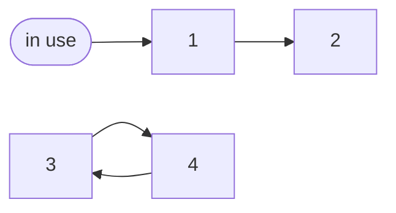

# Knaster-Tarski: an order-keeping map on a complete lattice always has a fixed point

[Syllabus](../../../SYLLABUS.md) → [Foundations](../README.md) → [Relations and Functions](../README.md#s08) → Knaster-Tarski

---

## General Overview

A program's memory holds four records, 1 to 4. Record 1 is in use. Arrows say what points where: 1 to 2, 3 to 4, and 4 back to 3.

Which records must stay? Take a guess S, a set of records, and check it with one rule f: keep record 1, plus everything S points to. A guess the rule hands back unchanged is a **fixed point**.

From no records, apply the rule again and again: {}, {1}, {1, 2}, {1, 2}. The climb stops at what record 1 reaches. From all four, the rule keeps all four. No other of the 16 guesses is fixed.

A rule keeps order when a guess inside another gets an answer inside the other's answer. A complete lattice is an order where every collection of guesses has a meet and a join: a largest guess below them all, and a smallest above them all.

**A rule that keeps order on a complete lattice has a least and a greatest fixed point, and with finitely many guesses, climbing from the bottom finds the least.**

**What kind of fact this is:** a theorem, proved in Why it works for subsets; all but the climb works in any complete lattice. A complete lattice is a definition.

### The picture: four records and their arrows



No path from "in use" reaches 3 or 4.

---

## The formula

- **Order-keeping.** If S is inside T, then f(S) is inside f(T). Here that holds on all 81 pairs.
- **A complete lattice.** An order ([Orders](07-partial-and-total-orders.md)) where every collection, even an infinite one, has a **meet** (the largest member below all of them) and a **join** (the smallest member above all of them).

The 16 subsets of {1, 2, 3, 4} under "inside" are one ([Subsets and the power set](../07-Sets/02-subsets-and-power-set.md)): the meet is what the sets share, the join is everything in any of them. The real numbers from 0 to 1 are another ([The real numbers have no gaps](../02-The%20Number%20Line/04-real-numbers-no-gaps.md)).

Call S **closed** when f(S) is inside S: the rule adds nothing new. Then:

```math
\mathrm{lfp}(f) = \bigcap \{\, S : f(S) \subseteq S \,\} \qquad \mathrm{gfp}(f) = \bigcup \{\, S : S \subseteq f(S) \,\}
```

**Read it aloud:** the least fixed point is what all closed sets share; the greatest is everything in any set the rule does not shrink.

| Symbol | Plain meaning | In our example | Push it up and the answer… |
| --- | --- | --- | --- |
| S, T | sets of records: guesses | {1} | f(S) can only grow |
| ⊆ | is inside: every member is also in the other | {1} ⊆ {1, 2} | — |
| f(S) | record 1, plus everything S points to | f({1}) = {1, 2} | — |
| : | "such that", inside the curly brackets | all S such that f(S) ⊆ S | — |
| ⋂, ⋃ | meet (in all of them) and join (in any of them) | {1, 2} and {1, 2, 3, 4} | — |
| lfp, gfp | least and greatest fixed point | {1, 2} and {1, 2, 3, 4} | — |

### When it holds

- **The rule keeps order.** The complement rule (swap in for out) reverses it, and has 0 fixed points.
- **Every collection has a meet and a join.** The fractions from 0 to 2 fail this, and a rule there can have no fixed point.
- **The climb starts at the bottom.** From {3} the rule cycles between {1, 2, 3} and {1, 2, 4}.
- **Finitely many steps.** On an infinite lattice the formula still works; the climb may not.

---

## Why it works

### Step 0: shrinking a guess never grows its answer

So the part shared by every closed set is closed too. That shared part, call it L, is the least fixed point.

### Step 1: L is closed

Take any closed S. L is inside S, so f(L) is inside f(S), which is inside S. So f(L) is inside every closed set, hence inside L.

### Step 2: L is fixed

Apply f to "f(L) inside L": f(f(L)) is inside f(L), so f(L) is closed. L is inside every closed set, so L is inside f(L). Inside both ways means equal. Here the closed sets {1, 2} and {1, 2, 3, 4} share {1, 2}.

### Step 3: L is least, and the climb finds it

Every fixed point is closed, so contains L. The climb starts at {}, inside L, and stays there: f of a step inside L is inside f(L) = L. {} is inside f({}), and order-keeping carries that up, so each step contains the last. On 16 sets it stops, at a fixed point inside L: L itself.

The greatest fixed point is the mirror image: join the sets the rule does not shrink, or climb down.

---

## Worked numbers, by hand

| Step | Arithmetic | Value |
| --- | --- | --- |
| first step up | f({}) = {1} plus nothing | {1} |
| second step | {1} plus 1's arrow to 2 | {1, 2} |
| third step | 2 points nowhere | {1, 2}, no change |
| down from the top | {1} plus 2, 4 and 3 | {1, 2, 3, 4}, no change |
| closed sets, shared part | 2 of 16 | {1, 2} |
| sets not shrunk, joined | 6 of 16 | {1, 2, 3, 4} |
| fixed points | all 16 sets tried | **{1, 2} and {1, 2, 3, 4}** |

Record 1 needs record 2 and nothing else.

### What breaks if you drop a piece

| Mistake | Comes out at | What went wrong |
| --- | --- | --- |
| The complement rule | 0 fixed points | A bigger guess gives a smaller answer |
| Fractions x from 0 to 2, rule x to (2x + 2) / (x + 2) | 0, 1, 4/3, 7/5, 24/17, 41/29 = 1.41379, never fixed | It climbs toward the square root of 2, which is no fraction |
| Climbing from {3} | {1, 4}, {1, 2, 3}, {1, 2, 4}, {1, 2, 3}, … | {3} is not inside f({3}), so steps need not grow |

The rule keeps order, but a fixed point needs x × x = 2, and no fraction does that. Fractions such as 2 lie above the climb, but none is smallest: that missing join means the fractions are not a complete lattice.

---

## Code, from first principles, and it actually runs

The code tries all 16 sets. Three roads reach {1, 2}: the climb, a walk along the arrows from 1, and Tarski's formula. Two reach {1, 2, 3, 4}: the climb down and the join.

### Python

```python
# Knaster-Tarski -- the check behind the card.  Nothing is imported.  The 16 subsets of {1, 2, 3, 4}
# ordered by "inside", and f(S) = {1} plus every step of S along the arrows 1 -> 2, 3 -> 4, 4 -> 3.
ARROWS, U = {1: {2}, 3: {4}, 4: {3}}, frozenset({1, 2, 3, 4})
ALL = [frozenset(x for x in U if n >> (x - 1) & 1) for n in range(16)]      # all 16 subsets
def f(S): return frozenset({1}).union(*(ARROWS.get(x, set()) for x in S))
def show(S): return "{" + ", ".join(map(str, sorted(S))) + "}"
def run(S, n): return [S] if n == 0 else [S] + run(f(S), n - 1)           # S, f(S), f(f(S)), ...
def gcd(a, b): return a if b == 0 else gcd(b, a % b)
up, down, odd = run(frozenset(), 3), run(U, 1), run(frozenset({3}), 4)
reach, todo = {1}, [1]                                    # second road: walk the arrows from 1
while todo: todo += [y for y in ARROWS.get(todo.pop(), ()) if y not in reach]; reach |= set(todo)
fixed, closed = [S for S in ALL if f(S) == S], [S for S in ALL if f(S) <= S]
post, pairs = [S for S in ALL if S <= f(S)], [(S, T) for S in ALL for T in ALL if S <= T]
meet, join = U.intersection(*closed), frozenset().union(*post)      # third road: Tarski's formula
fr = [(0, 1)]                                             # the fractions: x -> (2x + 2) / (x + 2)
for _ in range(6): p, q = fr[-1]; p, q = 2 * p + 2 * q, p + 2 * q; fr.append((p // gcd(p, q), q // gcd(p, q)))
print("climb from the empty set:", ", ".join(map(show, up)))
print("climb down from the top:", ", ".join(map(show, down)), "| walk from 1 reaches", show(reach))
print(f"order kept on {sum(f(S) <= f(T) for S, T in pairs)} of {len(pairs)} pairs S inside T")
print(f"fixed points among {len(ALL)} subsets: {', '.join(map(show, fixed))}")
print(f"closed sets (f(S) inside S): {len(closed)}, all of them in common {show(meet)}")
print(f"sets inside their own f(S): {len(post)}, all of them together {show(join)}")
print("climb from {3}:", ", ".join(map(show, odd)), "| complement map, fixed points:", sum(U - S == S for S in ALL))
print("fractions climb:", ", ".join(f"{p}/{q}" for p, q in fr[:6]), f"= {fr[5][0] / fr[5][1]:.5f}, never fixed")
assert up[-1] == up[-2] == frozenset(reach) == meet == fixed[0] and len(fixed) == 2 and down[-1] == join == U == fixed[1]
assert len(pairs) == 81 and len(closed) == 2 and len(post) == 6 and frozenset().union(*closed) == U and all(f(S) <= f(T) for S, T in pairs) and not any(U - S == S for S in ALL)
assert odd[2] == odd[4] != odd[3] and all(fr[i] != fr[i + 1] for i in range(6)) and fr[5] == (41, 29)
print("ALL CHECKS PASS")
```

**Ran 2026-11-23 on macOS, Python 3.14.10, standard library only. All checks passed. Output, pasted from the run:**

```
climb from the empty set: {}, {1}, {1, 2}, {1, 2}
climb down from the top: {1, 2, 3, 4}, {1, 2, 3, 4} | walk from 1 reaches {1, 2}
order kept on 81 of 81 pairs S inside T
fixed points among 16 subsets: {1, 2}, {1, 2, 3, 4}
closed sets (f(S) inside S): 2, all of them in common {1, 2}
sets inside their own f(S): 6, all of them together {1, 2, 3, 4}
climb from {3}: {3}, {1, 4}, {1, 2, 3}, {1, 2, 4}, {1, 2, 3} | complement map, fixed points: 0
fractions climb: 0/1, 1/1, 4/3, 7/5, 24/17, 41/29 = 1.41379, never fixed
ALL CHECKS PASS
```

### Rust

Same numbers, built with `rustc --edition 2021 -O`.

```rust
// Knaster-Tarski -- the same check as the Python, in Rust.  No crates.  The 16 subsets of {1, 2, 3, 4}
// ordered by "inside", each kept as four on-off bits, and f(S) = {1} plus every step of S along 1 -> 2, 3 -> 4, 4 -> 3.
const STEP: [u8; 4] = [0b0010, 0, 0b1000, 0b0100];             // where 1, 2, 3 and 4 point
const U: u8 = 0b1111;
fn f(s: u8) -> u8 { (0..4).filter(|i| s >> i & 1 == 1).fold(0b0001, |acc, i| acc | STEP[i]) }
fn inside(s: u8, t: u8) -> bool { s & !t == 0 }
fn show(s: u8) -> String { format!("{{{}}}", (0..4).filter(|i| s >> i & 1 == 1).map(|i| (i + 1).to_string()).collect::<Vec<_>>().join(", ")) }
fn run(s: u8, n: usize) -> Vec<u8> { let mut v = vec![s]; for _ in 0..n { v.push(f(*v.last().unwrap())); } v }
fn shows(v: &[u8]) -> String { v.iter().map(|&s| show(s)).collect::<Vec<_>>().join(", ") }
fn gcd(a: u64, b: u64) -> u64 { if b == 0 { a } else { gcd(b, a % b) } }
fn main() {
    let (up, down, odd) = (run(0, 3), run(U, 1), run(0b0100, 4));
    let (mut reach, mut todo) = (0b0001u8, vec![0usize]);       // second road: walk the arrows from 1
    while let Some(x) = todo.pop() { for y in 0..4 { if STEP[x] >> y & 1 == 1 && reach >> y & 1 == 0 { reach |= 1 << y; todo.push(y); } } }
    let all: Vec<u8> = (0..16).collect();
    let fixed: Vec<u8> = all.iter().cloned().filter(|&s| f(s) == s).collect();
    let closed: Vec<u8> = all.iter().cloned().filter(|&s| inside(f(s), s)).collect();
    let post: Vec<u8> = all.iter().cloned().filter(|&s| inside(s, f(s))).collect();
    let pairs: Vec<(u8, u8)> = all.iter().flat_map(|&s| all.iter().map(move |&t| (s, t))).filter(|&(s, t)| inside(s, t)).collect();
    let (meet, join) = (closed.iter().fold(U, |a, &s| a & s), post.iter().fold(0, |a, &s| a | s));   // third road: Tarski's formula
    let mut fr: Vec<(u64, u64)> = vec![(0, 1)];               // the fractions: x -> (2x + 2) / (x + 2)
    for _ in 0..6 { let (p, q) = *fr.last().unwrap(); let (p, q) = (2 * p + 2 * q, p + 2 * q); let g = gcd(p, q); fr.push((p / g, q / g)); }
    let kept = pairs.iter().filter(|&&(s, t)| inside(f(s), f(t))).count();
    let comp = all.iter().filter(|&&s| U & !s == s).count();
    println!("climb from the empty set: {}", shows(&up));
    println!("climb down from the top: {} | walk from 1 reaches {}", shows(&down), show(reach));
    println!("order kept on {} of {} pairs S inside T", kept, pairs.len());
    println!("fixed points among {} subsets: {}", all.len(), shows(&fixed));
    println!("closed sets (f(S) inside S): {}, all of them in common {}", closed.len(), show(meet));
    println!("sets inside their own f(S): {}, all of them together {}", post.len(), show(join));
    println!("climb from {{3}}: {} | complement map, fixed points: {}", shows(&odd), comp);
    let (lp, lq) = fr[5];
    println!("fractions climb: {} = {:.5}, never fixed", fr[..6].iter().map(|(p, q)| format!("{}/{}", p, q)).collect::<Vec<_>>().join(", "), lp as f64 / lq as f64);
    assert!(up[3] == up[2] && up[3] == reach && reach == meet && meet == fixed[0] && fixed.len() == 2 && down[1] == join && join == U && U == fixed[1]);
    assert!(pairs.len() == 81 && closed.len() == 2 && post.len() == 6 && closed.iter().fold(0, |a, &s| a | s) == U && kept == 81 && comp == 0);
    assert!(odd[2] == odd[4] && odd[4] != odd[3] && (0..6).all(|i| fr[i] != fr[i + 1]) && fr[5] == (41, 29));
    println!("ALL CHECKS PASS");
}
```

**Ran 2026-11-23 on macOS, rustc 1.98.1, no crates. All checks passed. Output, pasted from the run:**

```
climb from the empty set: {}, {1}, {1, 2}, {1, 2}
climb down from the top: {1, 2, 3, 4}, {1, 2, 3, 4} | walk from 1 reaches {1, 2}
order kept on 81 of 81 pairs S inside T
fixed points among 16 subsets: {1, 2}, {1, 2, 3, 4}
closed sets (f(S) inside S): 2, all of them in common {1, 2}
sets inside their own f(S): 6, all of them together {1, 2, 3, 4}
climb from {3}: {3}, {1, 4}, {1, 2, 3}, {1, 2, 4}, {1, 2, 3} | complement map, fixed points: 0
fractions climb: 0/1, 1/1, 4/3, 7/5, 24/17, 41/29 = 1.41379, never fixed
ALL CHECKS PASS
```

### Lean

Lean proves the theorem on every complete lattice, the climb on every finite one, and the card's numbers for the four records.

- Suppose a rule keeps order on a complete lattice. Then the meet of all closed members is its least fixed point.
- In the same lattice, the join of all members the rule does not shrink is its greatest fixed point.
- Suppose the lattice also has finitely many members. Then the climb from the bottom reaches the least fixed point in finitely many steps.
- On the subsets of any nonempty set, the complement rule has no fixed point.
- For the four records, the climb from {} gives {1}, {1, 2}, {1, 2}. The climb down from all four stays put.
- The rule keeps order on all 81 pairs. Of the 16 guesses, exactly {1, 2} and {1, 2, 3, 4} are fixed.
- The 2 closed sets share {1, 2}. The 6 sets the rule does not shrink have join {1, 2, 3, 4}.
- From {3} the climb gives {1, 4}, {1, 2, 3}, {1, 2, 4}, then {1, 2, 3} again.
- The complement rule fixes none of the 16 guesses.
- On the fractions, 7/5 climbs to 24/17, and 24/17 climbs to 41/29.

The walk along the arrows from 1, the first fraction steps, and the printed lines are left to the Python and Rust checks.

```lean
-- Knaster-Tarski: an order-keeping map on a complete lattice has a least and a greatest fixed point, given by Tarski's formulas, and on a finite lattice the climb from the bottom reaches the least one.
import Mathlib.Order.FixedPoints
import Mathlib.Order.Iterate
import Mathlib.Data.Finset.Powerset
import Mathlib.Data.Fintype.Card
import Mathlib.Order.CompleteBooleanAlgebra
import Mathlib.Data.Finset.Prod
import Mathlib.Algebra.Field.Rat
import Mathlib.Tactic.NormNum
import Mathlib.Data.Fintype.Pigeonhole

/-- Knaster-Tarski. If a rule `f` keeps order on a complete lattice (every collection has a meet
and a join), it has a least fixed point and a greatest fixed point. The least is the meet of all
closed elements (`f S ≤ S`); the greatest is the join of all elements the rule does not shrink
(`S ≤ f S`). -/
theorem monotone_map_has_least_and_greatest_fixed_point {α : Type*} [CompleteLattice α]
    (f : α → α) (hf : Monotone f) :
    IsLeast (Function.fixedPoints f) (sInf {S | f S ≤ S}) ∧
      IsGreatest (Function.fixedPoints f) (sSup {S | S ≤ f S}) := by
  exact ⟨OrderHom.isLeast_lfp ⟨f, hf⟩, OrderHom.isGreatest_gfp ⟨f, hf⟩⟩

/-- The climb. With finitely many elements, applying an order-keeping rule again and again from
the bottom `⊥` reaches the least fixed point after finitely many steps. -/
theorem climb_from_bottom_reaches_least_fixed_point {α : Type*} [CompleteLattice α] [Finite α]
    (f : α → α) (hf : Monotone f) :
    ∃ n : ℕ, IsLeast (Function.fixedPoints f) (f^[n] ⊥) := by
  have hmono : Monotone fun n => f^[n] ⊥ := Monotone.monotone_iterate_of_le_map hf bot_le
  have hle : ∀ x ∈ Function.fixedPoints f, ∀ k : ℕ, f^[k] ⊥ ≤ x := by
    intro x hx k
    induction k with
    | zero => exact bot_le
    | succ k ih =>
      rw [Function.iterate_succ_apply']
      calc f (f^[k] ⊥) ≤ f x := hf ih
        _ = x := hx
  obtain ⟨m, n, hmn, heq⟩ := Finite.exists_ne_map_eq_of_infinite (fun n : ℕ => f^[n] ⊥)
  wlog h : m < n generalizing m n
  · exact this n m (Ne.symm hmn) heq.symm (lt_of_le_of_ne (not_lt.mp h) (Ne.symm hmn))
  refine ⟨m, ?_, fun x hx => hle x hx m⟩
  have h1 : f^[m] ⊥ ≤ f^[m + 1] ⊥ := hmono (Nat.le_succ m)
  have h2 : f^[m + 1] ⊥ ≤ f^[n] ⊥ := hmono h
  have h3 : f^[m + 1] ⊥ = f^[m] ⊥ := le_antisymm (heq ▸ h2) h1
  show f (f^[m] ⊥) = f^[m] ⊥
  rw [← Function.iterate_succ_apply' f m]
  exact h3

/-- Order-keeping is needed: the complement rule (swap in for out) on the subsets of a nonempty
set has no fixed point at all. -/
theorem complement_rule_has_no_fixed_point {β : Type*} [Nonempty β] (S : Set β) :
    Sᶜ ≠ S := by
  intro h
  obtain ⟨x⟩ := ‹Nonempty β›
  have h' : x ∈ Sᶜ ↔ x ∈ S := by rw [h]
  rw [Set.mem_compl_iff] at h'
  exact (iff_not_self h'.symm).elim

/-! The card's example: the 16 subsets of {1, 2, 3, 4}, and
`f(S) = {1}` plus every step of `S` along the arrows 1 → 2, 3 → 4, 4 → 3. -/

/-- Where each record points: 1 → 2, 3 → 4, 4 → 3. -/
def arrows : ℕ → Finset ℕ
  | 1 => {2}
  | 3 => {4}
  | 4 => {3}
  | _ => ∅

/-- The card's rule: keep record 1, plus everything `S` points to. -/
def rule (S : Finset ℕ) : Finset ℕ := {1} ∪ S.biUnion arrows

/-- The 16 guesses: all subsets of {1, 2, 3, 4}. -/
def guesses : Finset (Finset ℕ) := ({1, 2, 3, 4} : Finset ℕ).powerset

-- The climb from the empty set: {}, {1}, {1, 2}, {1, 2}.
example : rule ∅ = {1} := by decide
example : rule {1} = {1, 2} := by decide
example : rule {1, 2} = {1, 2} := by decide
-- Down from the top: {1, 2, 3, 4} stays.
example : rule {1, 2, 3, 4} = {1, 2, 3, 4} := by decide
-- 16 guesses; order kept on all 81 pairs S inside T.
example : guesses.card = 16 := by decide
example : ((guesses ×ˢ guesses).filter (fun p => p.1 ⊆ p.2)).card = 81 := by decide
example : ∀ p ∈ (guesses ×ˢ guesses).filter (fun p => p.1 ⊆ p.2), rule p.1 ⊆ rule p.2 := by
  decide
-- The fixed points are exactly {1, 2} and {1, 2, 3, 4}.
example : guesses.filter (fun S => rule S = S) = {{1, 2}, {1, 2, 3, 4}} := by decide
-- 2 closed sets (f(S) inside S), sharing {1, 2}; 6 sets inside their own f(S), joined to {1, 2, 3, 4}.
example : (guesses.filter (fun S => rule S ⊆ S)).card = 2 := by decide
example : guesses.filter (fun S => rule S ⊆ S) = {{1, 2}, {1, 2, 3, 4}} := by decide
example : ({1, 2} : Finset ℕ) ∩ {1, 2, 3, 4} = {1, 2} := by decide
example : (guesses.filter (fun S => S ⊆ rule S)).card = 6 := by decide
example : (guesses.filter (fun S => S ⊆ rule S)).sup id = {1, 2, 3, 4} := by decide
-- The climb from {3} cycles: {3}, {1, 4}, {1, 2, 3}, {1, 2, 4}, {1, 2, 3}.
example : rule {3} = {1, 4} := by decide
example : rule {1, 4} = {1, 2, 3} := by decide
example : rule {1, 2, 3} = {1, 2, 4} := by decide
example : rule {1, 2, 4} = {1, 2, 3} := by decide
-- The complement rule has 0 fixed points among the 16 guesses.
example : (guesses.filter (fun S => ({1, 2, 3, 4} : Finset ℕ) \ S = S)).card = 0 := by decide
-- The fractions climb x ↦ (2x + 2) / (x + 2): 0, 1, 4/3, 7/5, 24/17, 41/29.
example : ((2 * (24 / 17 : ℚ) + 2) / (24 / 17 + 2)) = 41 / 29 := by norm_num
example : ((2 * (7 / 5 : ℚ) + 2) / (7 / 5 + 2)) = 24 / 17 := by norm_num

#print axioms monotone_map_has_least_and_greatest_fixed_point
#print axioms climb_from_bottom_reaches_least_fixed_point
#print axioms complement_rule_has_no_fixed_point
```

**Checked 2026-11-23 on macOS, Lean 4.36.0-rc2, Mathlib v4.36.0-rc2. Every proof is complete and uses only Lean's standard axioms. Output, pasted from the run:**

```
'monotone_map_has_least_and_greatest_fixed_point' depends on axioms: [propext, Quot.sound]
'climb_from_bottom_reaches_least_fixed_point' depends on axioms: [propext, Classical.choice, Quot.sound]
'complement_rule_has_no_fixed_point' depends on axioms: [propext]
```

> [!TIP]
> **Try changing**
> Guess first; a pinned assert will stop the run.
> - **Add an arrow from 2 to 3.** Add `2: {3}` to `ARROWS`. The climb passes {1, 2}, and {1, 2, 3, 4} becomes the only fixed point.
> - **Climb from {3, 4}.** Change `frozenset({3})` to `frozenset({3, 4})`. It is inside f({3, 4}) = {1, 3, 4}, so the steps grow and reach {1, 2, 3, 4}.
> - **Drop "record 1 is in use".** Remove `{1}` from `f`. The least fixed point becomes {}.

---

## The usual mistake

> [!warning]
> **Taking any fixed point as the answer.** {1, 2, 3, 4} is fixed too, but it keeps 3 and 4 only because each points at the other.
>
> - Starting the climb anywhere. From {3} it cycles between {1, 2, 3} and {1, 2, 4}.
> - Expecting every rule to have one. The complement rule has 0 fixed points.
> - Joining the closed sets instead of sharing them gives {1, 2, 3, 4}.

---

## Where you meet it in real life

- **Memory clean-up.** Marking from the records in use keeps {1, 2}, the least fixed point. Reference counting keeps anything pointed to: the greatest, so 3 and 4 leak. Python adds a cycle collector to free them.
- **Infinite sets.** One standard proof of Cantor–Bernstein, stated in [Comparing infinities](../09-Sizes%20of%20Infinity/04-comparing-infinities.md), builds its pairing from such a fixed point on a power set.
- **Grammars, programs, crawlers.** Grammar parts that can match empty text, what a loop computes, and the pages a crawler reaches are all least fixed points.

> **Say it back**
> A complete lattice is an order where every collection has a meet and a join, like the subsets of a set. An order-keeping rule there has a least and a greatest fixed point. The least is what all closed sets share; on finitely many sets, the climb from the bottom reaches it. For the four records, the climb gives {}, {1}, {1, 2}, and stops.

---

## What this builds on

- [Orders](07-partial-and-total-orders.md): the order tests, to which this card adds meets and joins.
- [Subsets and the power set](../07-Sets/02-subsets-and-power-set.md): the 16 subsets, the complete lattice used throughout.
- [Functions](02-functions.md): f is a function from subsets to subsets; the climb is f composed with itself ([Composing functions](03-composition.md)).

## Where this goes next

- [Same size means pairable](../09-Sizes%20of%20Infinity/01-same-size-by-pairing.md): the first card of the next shelf, Sizes of Infinity. It compares endless sets by pairing them off, the road to Cantor–Bernstein.
- [Comparing infinities](../09-Sizes%20of%20Infinity/04-comparing-infinities.md): states Cantor–Bernstein; one fixed point of this kind proves it.
- [Boolean algebra](../../03-Algebra/10-For%20the%20Curious/05-boolean-algebra-and-lattices.md): the laws meet and join obey, and lattices as a structure.

Left open: the climb here stopped because there are only 16 guesses. When a set has no end, how do you tell whether two sets are the same size?

---

## Sources

Verified 2026-11-23: every link below resolves to the publisher's page.

- Tarski, Alfred. "A lattice-theoretical fixpoint theorem and its applications." *Pacific Journal of Mathematics* 5, no. 2 (1955): 285–309. [doi:10.2140/pjm.1955.5.285](https://doi.org/10.2140/pjm.1955.5.285). The theorem, and the lattice of fixed points.
- Davey, B. A., and H. A. Priestley. *Introduction to Lattices and Order*, 2nd ed. Cambridge University Press, 2002. [doi:10.1017/CBO9780511809088](https://doi.org/10.1017/CBO9780511809088). Chapter 2 on complete lattices, chapter 8 on fixpoints.
