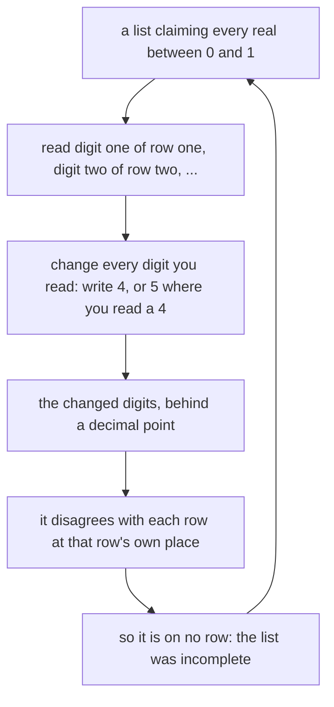

# Cantor's diagonal: the real numbers cannot be listed

[Syllabus](../../../SYLLABUS.md) → [Foundations](../README.md) → [Sizes of Infinity](../README.md#s09) → Cantor's diagonal

---

## General Overview

The hotel has a room for every counting number: room 1, room 2, room 3, on forever. Tonight every real number between 0 and 1 turns up and asks for a room. A real number is an endless string of digits behind a point.

The clerk says the list is complete: nobody left standing. Write it out, one guest's decimals per row.

Read down the diagonal: first digit of the first number, second digit of the second, third of the third. Change every digit you read: write a 4 in its place, or a 5 if the digit you read is a 4. Put a decimal point in front.

That number is not in room 1: it disagrees there in the first place. Not room 2: it disagrees in the second. It disagrees with every room at that room's own place, so it is nobody's.

**Take any list of the reals, change the digits down its diagonal by that rule, and you have built a real the list left out: the reals cannot be queued.** The counting numbers are infinite; the reals are a strictly bigger infinity.

**What kind of fact this is:** a theorem, proved on this card in Why it works.

### The picture



Add the guest and renumber: new list, new diagonal.

---

## The formula

The rule is the whole thing:

**go down the diagonal, digit one of row one onward, and write a 4 in each place you read — or a 5, where you read a 4.**

**Read it aloud:** the new number differs from row one in place one, row two in place two, and on down.

| Piece | Plain meaning | On the hotel list |
| --- | --- | --- |
| a row | one guest's number, as decimals | 0.142857… |
| the diagonal | digit one of row one, digit two of row two, down | read below |
| the new number | the changed digits, behind a point | a string of 4s and 5s |
| uncountable | no queue is long enough | the reals from 0 to 1 |

### When it holds

- **One row per counting number.** That is what a list is; without it there is no diagonal to read.
- **Digits with one spelling.** Add 1 instead and rows reading 0.4999… give 0.50000, a number already listed.
- **The built number belongs to the set.** On a list of fractions it is no fraction, so nothing is missed.

---

## Why it works

### Step 0: a list is a promise you can check

Countable means the members deal out as row one, row two, row three, everybody reached by counting: the pairing from [Same size means pairable](01-same-size-by-pairing.md), a bijection in [One-to-one and onto](../08-Relations%20and%20Functions/04-injective-surjective-bijective.md). Take any such list and find a real it left out.

### Step 1: the diagonal beats each row at its own place

Row one gives its first digit, row two its second, row three its third: every row visited at a different place. Change that digit and what you build disagrees with that row there. Digits that disagree almost always mean different numbers — almost, because a few have two spellings. That is why the rule writes 4s and 5s; Step 2 shows the hole they plug. So what you built is no row at all. That is [Proof by contradiction](../06-Proof/03-proof-by-contradiction.md): assume the list is complete, produce what it missed.

And it is an ordinary real, between 0 and 1. Most reals run on with no pattern: [Irrational numbers](../02-The%20Number%20Line/03-irrational-numbers.md).

### Step 2: the repair the popular version skips

The popular telling says add 1 to every digit, 9 coming round to 0. It leaks. Some numbers have two spellings: 0.4999… and 0.5000… are one number written twice, so different digits need not mean a different number. Give the clerk rows all reading 0.4999… and adding 1 builds 0.50000 — that same number, already listed.

Writing 4s and 5s closes it: never a 0, never a 9, and such a string has one spelling only.

The same move, with no decimals at all, shows any set is smaller than its collection of subsets: [Comparing infinities](04-comparing-infinities.md), on the power set from [Subsets and the power set](../07-Sets/02-subsets-and-power-set.md).

---

## Worked numbers, by hand

Five guests, five places, one spare digit printed. A corner of an endless list.

| Room | Guest, written out | Diagonal digit |
| --- | --- | --- |
| 1 | 1/7 = 0.142857… | 1 |
| 2 | 1/2 = 0.500000… | 0 |
| 3 | 1/3 = 0.333333… | 3 |
| 4 | 5/9 = 0.555555… | 5 |
| 5 | 1/8 = 0.125000… | 0 |

| Step | Arithmetic | Value |
| --- | --- | --- |
| read the diagonal down | the digit column above | 10350 |
| write 4, or 5 for a 4 | no diagonal digit here is a 4 | **0.44444…** |
| the popular rule, add 1 | every digit up by one | **0.21461…** |
| the rooms, as whole numbers | first five digits, so the code can compare | 14285 50000 33333 55555 12500 |

0.44444… disagrees with room 1 in the first place, room 2 in the second, on down; so does 0.21461… here.

The picture lies in one place: a finite table misses many rows by ordinary counting. The theorem is that an *infinite* table still misses at least one.

### What breaks if you drop a piece

| Mistake | Comes out at | What went wrong |
| --- | --- | --- |
| Copying the diagonal, not changing it | 0.10350 | It agrees with every row it touched |
| Adding 1 across room 1, not down | 0.25396 | Room 1 dodged, the rest untouched |
| Adding 1 on rows all reading 0.4999… | 0.50000 | Same number, other spelling |

---

## Code, from first principles, and it actually runs

Nothing is imported. Long division gives the decimals, greedily: 1/2 reads 500000, never 499999. The diagonal is also worked straight from each fraction. Both rules are checked digit by digit against the rows they must disagree with.

### Python

```python
# Cantor's diagonal -- the check behind the card.  Nothing is imported.  Five
# hotel guests hold five reals between 0 and 1.  Read down the diagonal, write a
# 4 in every place (a 5 where the digit read is a 4), and the number is nobody's.
GUESTS = [(1, 7), (1, 2), (1, 3), (5, 9), (1, 8)]
PLACES = 5
def digits(p, q):                 # long division, greedy: 1/2 -> "500000", never "499999"
    out, left = "", p
    for _ in range(PLACES + 1):
        out += str(left * 10 // q)
        left = left * 10 % q
    return out
def bump(d):                      # add 1 to a digit, 9 goes round to 0
    return str((int(d) + 1) % 10)
rows = [digits(p, q) for p, q in GUESTS]
diagonal = "".join(rows[i][i] for i in range(PLACES))
safer = "".join("5" if d == "4" else "4" for d in diagonal)   # the 4-or-5 rule
built = "".join(bump(d) for d in diagonal)                    # the popular add-1 rule
for i, ((p, q), row) in enumerate(zip(GUESTS, rows)):
    print(f"guest {i + 1}  {p}/{q}  0.{row}   diagonal digit {row[i]}")
print(f"the diagonal reads {diagonal}, the 4-or-5 rule builds 0.{safer}")
print(f"the popular add-1 rule builds 0.{built}")
print(f"as whole numbers {int(built)} is none of " + " ".join(str(int(r[:PLACES])) for r in rows))
across = "".join(bump(d) for d in rows[0][:PLACES])           # bumped row 1, not the diagonal
trap = "".join(bump(d) for d in "49999")                      # a list of 0.4999... rows
print(f"the three mistakes come out at 0.{diagonal}, 0.{across} and 0.{trap}")
assert diagonal == "".join(str((p * 10 ** (i + 1) // q) % 10) for i, (p, q) in enumerate(GUESTS))
assert safer == "44444" and all(safer[i] != rows[i][i] for i in range(PLACES))
assert int(built) == 21461 and all(built[i] != rows[i][i] for i in range(PLACES))
print("ALL CHECKS PASS")
```

**Ran 2026-09-06 on macOS, Python 3.14.6, standard library only. All checks passed. Output, pasted from the run:**

```
guest 1  1/7  0.142857   diagonal digit 1
guest 2  1/2  0.500000   diagonal digit 0
guest 3  1/3  0.333333   diagonal digit 3
guest 4  5/9  0.555555   diagonal digit 5
guest 5  1/8  0.125000   diagonal digit 0
the diagonal reads 10350, the 4-or-5 rule builds 0.44444
the popular add-1 rule builds 0.21461
as whole numbers 21461 is none of 14285 50000 33333 55555 12500
the three mistakes come out at 0.10350, 0.25396 and 0.50000
ALL CHECKS PASS
```

### Rust

Built with `rustc --edition 2021 -O`.

```rust
// Cantor's diagonal -- the same check as the Python twin, in Rust.  No crates.
// Five hotel guests hold five reals between 0 and 1.  Read down the diagonal, write
// a 4 in every place (a 5 where the digit read is a 4), and the number is nobody's.
const GUESTS: [(i64, i64); 5] = [(1, 7), (1, 2), (1, 3), (5, 9), (1, 8)];
const PLACES: usize = 5;
fn digits(p: i64, q: i64) -> String {   // long division, greedy: 1/2 -> "500000", not "499999"
    let (mut out, mut left) = (String::new(), p);
    for _ in 0..(PLACES + 1) { out.push_str(&(left * 10 / q).to_string()); left = left * 10 % q; }
    out
}
fn bump(d: u8) -> char {                   // add 1 to a digit, 9 goes round to 0
    char::from(b'0' + (d - b'0' + 1) % 10)
}
fn bump_all(s: &str) -> String { s.bytes().map(bump).collect() }
fn main() {
    let rows: Vec<String> = GUESTS.iter().map(|&(p, q)| digits(p, q)).collect();
    let diagonal: String = (0..PLACES).map(|i| rows[i].as_bytes()[i] as char).collect();
    let safer: String = diagonal.chars().map(|c| if c == '4' { '5' } else { '4' }).collect();
    let built = bump_all(&diagonal);
    for i in 0..PLACES {
        println!("guest {}  {}/{}  0.{}   diagonal digit {}", i + 1, GUESTS[i].0,
                 GUESTS[i].1, rows[i], rows[i].as_bytes()[i] as char);
    }
    println!("the diagonal reads {}, the 4-or-5 rule builds 0.{}", diagonal, safer);
    println!("the popular add-1 rule builds 0.{}", built);
    let heads: Vec<i64> = rows.iter().map(|r| r[..PLACES].parse::<i64>().unwrap()).collect();
    let whole: i64 = built.parse::<i64>().unwrap();
    let listed: Vec<String> = heads.iter().map(|h| h.to_string()).collect();
    println!("as whole numbers {} is none of {}", whole, listed.join(" "));
    let across = bump_all(&rows[0][..PLACES]);          // bumped row 1, not the diagonal
    let trap = bump_all("49999");                       // a list of 0.4999... rows
    println!("the three mistakes come out at 0.{}, 0.{} and 0.{}", diagonal, across, trap);
    let check: String = GUESTS.iter().enumerate()
        .map(|(i, &(p, q))| ((p * 10_i64.pow(i as u32 + 1) / q) % 10).to_string()).collect();
    assert!(diagonal == check);
    assert!(safer == "44444" && (0..PLACES).all(|i| safer.as_bytes()[i] != rows[i].as_bytes()[i]));
    assert!(whole == 21461 && (0..PLACES).all(|i| built.as_bytes()[i] != rows[i].as_bytes()[i]));
    println!("ALL CHECKS PASS");
}
```

**Ran 2026-09-06 on macOS, rustc 1.98.1, no crates. All checks passed. Output, pasted from the run:**

```
guest 1  1/7  0.142857   diagonal digit 1
guest 2  1/2  0.500000   diagonal digit 0
guest 3  1/3  0.333333   diagonal digit 3
guest 4  5/9  0.555555   diagonal digit 5
guest 5  1/8  0.125000   diagonal digit 0
the diagonal reads 10350, the 4-or-5 rule builds 0.44444
the popular add-1 rule builds 0.21461
as whole numbers 21461 is none of 14285 50000 33333 55555 12500
the three mistakes come out at 0.10350, 0.25396 and 0.50000
ALL CHECKS PASS
```

The outputs match line for line.

### Lean

Lean proves the 4-or-5 diagonal number is on no list, so the reals outnumber the counting numbers; Python and Rust run the long division.

<details>
<summary>The Lean proof, 173 lines</summary>

```lean
-- Cantor's diagonal: every list of real numbers, one per counting number, misses a real between 0 and 1, the 4-or-5 diagonal number is one it misses, and so the reals are a strictly bigger infinity than the counting numbers.
import Mathlib.Analysis.Real.Cardinality
import Mathlib.Analysis.SpecificLimits.Basic
import Mathlib.Data.Rat.Floor

/-- The decimal digit of `x` in place `n + 1` after the point (place one is `n = 0`):
shift the point `n + 1` places right, drop what is behind it, and keep the last digit. -/
noncomputable def decimalDigit (x : ℝ) (n : ℕ) : ℤ := ⌊x * 10 ^ (n + 1)⌋ % 10

/-- Tail sum of the digit list `d` from place `n`. -/
noncomputable def tailSum (d : ℕ → ℤ) (n : ℕ) : ℝ := ∑' j, (d (n + j) : ℝ) / 10 ^ (j + 1)

lemma geom_summable : Summable (fun j : ℕ => (1 / 10 : ℝ) ^ j) :=
  summable_geometric_of_lt_one (by norm_num) (by norm_num)

lemma geom_sum : ∑' j : ℕ, (1 / 10 : ℝ) ^ j = 10 / 9 := by
  rw [tsum_geometric_of_lt_one (by norm_num) (by norm_num)]; norm_num

lemma term_eq (c : ℝ) (j : ℕ) : c / 10 ^ (j + 1) = (c / 10) * (1 / 10 : ℝ) ^ j := by
  rw [one_div, inv_pow, pow_succ]; field_simp

lemma tail_summable (d : ℕ → ℤ) (hd : ∀ n, d n = 4 ∨ d n = 5) (n : ℕ) :
    Summable (fun j : ℕ => (d (n + j) : ℝ) / 10 ^ (j + 1)) := by
  refine Summable.of_nonneg_of_le (fun j => ?_) (fun j => ?_)
    ((geom_summable.mul_left (5 / 10 : ℝ)))
  · have : (0 : ℝ) ≤ d (n + j) := by rcases hd (n + j) with h | h <;> simp [h] <;> norm_num
    positivity
  · rw [term_eq]
    have : (d (n + j) : ℝ) ≤ 5 := by rcases hd (n + j) with h | h <;> simp [h] <;> norm_num
    have h2 : (0 : ℝ) < (1 / 10) ^ j := by positivity
    nlinarith

lemma tail_bounds (d : ℕ → ℤ) (hd : ∀ n, d n = 4 ∨ d n = 5) (n : ℕ) :
    4 / 9 ≤ tailSum d n ∧ tailSum d n ≤ 5 / 9 := by
  have hs := tail_summable d hd n
  have h4 : ∑' j : ℕ, (4 / 10 : ℝ) * (1 / 10 : ℝ) ^ j = 4 / 9 := by
    rw [tsum_mul_left, geom_sum]; norm_num
  have h5 : ∑' j : ℕ, (5 / 10 : ℝ) * (1 / 10 : ℝ) ^ j = 5 / 9 := by
    rw [tsum_mul_left, geom_sum]; norm_num
  constructor
  · rw [← h4]
    refine Summable.tsum_le_tsum (fun j => ?_) (geom_summable.mul_left _) hs
    rw [term_eq (d (n + j))]
    have : (4 : ℝ) ≤ d (n + j) := by rcases hd (n + j) with h | h <;> simp [h] <;> norm_num
    have h2 : (0 : ℝ) < (1 / 10) ^ j := by positivity
    nlinarith
  · rw [← h5]
    refine Summable.tsum_le_tsum (fun j => ?_) hs (geom_summable.mul_left _)
    rw [term_eq (d (n + j))]
    have : (d (n + j) : ℝ) ≤ 5 := by rcases hd (n + j) with h | h <;> simp [h] <;> norm_num
    have h2 : (0 : ℝ) < (1 / 10) ^ j := by positivity
    nlinarith

lemma tail_rec (d : ℕ → ℤ) (hd : ∀ n, d n = 4 ∨ d n = 5) (n : ℕ) :
    tailSum d n = (d n : ℝ) / 10 + tailSum d (n + 1) / 10 := by
  unfold tailSum
  rw [(tail_summable d hd n).tsum_eq_zero_add]
  congr 1
  · simp
  · rw [← tsum_div_const]
    refine tsum_congr (fun j => ?_)
    rw [show n + (j + 1) = n + 1 + j by ring, div_div, ← pow_succ]

lemma digit_aux (d : ℕ → ℤ) (hd : ∀ n, d n = 4 ∨ d n = 5) (n : ℕ) :
    ∃ N : ℤ, tailSum d 0 * 10 ^ (n + 1) = N + tailSum d (n + 1) ∧ N % 10 = d n := by
  induction n with
  | zero =>
    refine ⟨d 0, ?_, ?_⟩
    · rw [tail_rec d hd 0]; ring
    · rcases hd 0 with h | h <;> simp [h]
  | succ n ih =>
    obtain ⟨N, h1, h2⟩ := ih
    refine ⟨10 * N + d (n + 1), ?_, ?_⟩
    · rw [pow_succ, ← mul_assoc, h1, tail_rec d hd (n + 1)]
      push_cast; ring
    · rcases hd (n + 1) with h | h <;> simp [h]

lemma digit_tail (d : ℕ → ℤ) (hd : ∀ n, d n = 4 ∨ d n = 5) (n : ℕ) :
    decimalDigit (tailSum d 0) n = d n := by
  obtain ⟨N, h1, h2⟩ := digit_aux d hd n
  unfold decimalDigit
  rw [h1]
  have b1 := tail_bounds d hd (n + 1)
  have : ⌊(N : ℝ) + tailSum d (n + 1)⌋ = N := by
    rw [Int.floor_eq_iff]; constructor <;> push_cast <;> linarith [b1.1, b1.2]
  rw [this, h2]

/-- Main diagonal lemma (same statement as `diagonal_number_is_on_no_row`). -/
lemma diag_main (f : ℕ → ℝ) :
    let d : ℕ → ℤ := fun n => if decimalDigit (f n) n = 4 then 5 else 4
    let x : ℝ := ∑' n, (d n : ℝ) / 10 ^ (n + 1)
    x ∈ Set.Ioo (0 : ℝ) 1 ∧ (∀ n, decimalDigit x n = d n) ∧
      (∀ n, decimalDigit x n ≠ decimalDigit (f n) n) ∧ ∀ n, f n ≠ x := by
  intro d x
  have hd : ∀ n, d n = 4 ∨ d n = 5 := by
    intro n; simp only [d]; split_ifs <;> simp
  have hx : x = tailSum d 0 := by simp [x, tailSum]
  have hdig : ∀ n, decimalDigit x n = d n := fun n => by rw [hx]; exact digit_tail d hd n
  have hne : ∀ n, decimalDigit x n ≠ decimalDigit (f n) n := by
    intro n
    rw [hdig n]
    simp only [d]
    split_ifs with h <;> omega
  refine ⟨?_, hdig, hne, fun n hn => hne n (by rw [hn])⟩
  have b := tail_bounds d hd 0
  rw [hx]; constructor <;> linarith [b.1, b.2]

/-- The card's claim: take any list of real numbers, one row for each counting number
(`f 0, f 1, f 2, …`); some real number strictly between 0 and 1 is on no row.
The reals cannot be queued. -/
theorem reals_between_zero_and_one_cannot_be_listed (f : ℕ → ℝ) :
    ∃ x ∈ Set.Ioo (0 : ℝ) 1, ∀ n, f n ≠ x := by
  obtain ⟨hx, -, -, h⟩ := diag_main f
  exact ⟨_, hx, h⟩

/-- The diagonal construction itself: read digit `n + 1` of row `n`, write a 5 where it is a 4
and a 4 everywhere else, and put the changed digits behind a decimal point. The number built
lies between 0 and 1, its digit in each row's own place is the changed digit (a string of 4s and
5s has one spelling), so it disagrees with every row there and equals no row. -/
theorem diagonal_number_is_on_no_row (f : ℕ → ℝ) :
    let d : ℕ → ℤ := fun n => if decimalDigit (f n) n = 4 then 5 else 4
    let x : ℝ := ∑' n, (d n : ℝ) / 10 ^ (n + 1)
    x ∈ Set.Ioo (0 : ℝ) 1 ∧ (∀ n, decimalDigit x n = d n) ∧
      (∀ n, decimalDigit x n ≠ decimalDigit (f n) n) ∧ ∀ n, f n ≠ x := by
  exact diag_main f

/-- The counting numbers are infinite; the reals are a strictly bigger infinity. -/
theorem reals_strictly_bigger_infinity : Cardinal.mk ℕ < Cardinal.mk ℝ := by
  rw [Cardinal.mk_nat, Cardinal.mk_real]
  exact Cardinal.aleph0_lt_continuum

-- The hotel list: 1/7, 1/2, 1/3, 5/9, 1/8 in rooms 1 to 5. Read down the diagonal: 1, 0, 3, 5, 0.
example : (decimalDigit (1 / 7) 0, decimalDigit (1 / 2) 1, decimalDigit (1 / 3) 2,
    decimalDigit (5 / 9) 3, decimalDigit (1 / 8) 4) = (1, 0, 3, 5, 0) := by
  norm_num [decimalDigit]
-- The rooms as whole numbers, first five digits: 14285 50000 33333 55555 12500.
example : (⌊(1 / 7 : ℝ) * 10 ^ 5⌋, ⌊(1 / 2 : ℝ) * 10 ^ 5⌋, ⌊(1 / 3 : ℝ) * 10 ^ 5⌋,
    ⌊(5 / 9 : ℝ) * 10 ^ 5⌋, ⌊(1 / 8 : ℝ) * 10 ^ 5⌋) = (14285, 50000, 33333, 55555, 12500) := by
  norm_num
-- Write 4, or 5 for a 4: no diagonal digit here is a 4, so the rule builds 44444.
example : [1, 0, 3, 5, 0].map (fun d : ℤ => if d = 4 then 5 else 4) = [4, 4, 4, 4, 4] := by
  decide
-- 0.44444… is 4/9: its first five digits are all 4, and each differs from that room's diagonal digit.
example : (decimalDigit (4 / 9) 0, decimalDigit (4 / 9) 1, decimalDigit (4 / 9) 2,
    decimalDigit (4 / 9) 3, decimalDigit (4 / 9) 4) = (4, 4, 4, 4, 4) := by
  norm_num [decimalDigit]
example : decimalDigit (4 / 9) 0 ≠ decimalDigit (1 / 7) 0 ∧ decimalDigit (4 / 9) 1 ≠ decimalDigit (1 / 2) 1 ∧
    decimalDigit (4 / 9) 2 ≠ decimalDigit (1 / 3) 2 ∧ decimalDigit (4 / 9) 3 ≠ decimalDigit (5 / 9) 3 ∧
    decimalDigit (4 / 9) 4 ≠ decimalDigit (1 / 8) 4 := by
  norm_num [decimalDigit]
-- The popular rule, add 1 with 9 coming round to 0, builds 21461, which is none of the five rooms.
example : [1, 0, 3, 5, 0].map (fun d => (d + 1) % 10) = [2, 1, 4, 6, 1] := by decide
example : 21461 ∉ [14285, 50000, 33333, 55555, 12500] := by decide
-- The three mistakes: copying the diagonal gives 10350; adding 1 across room 1 (14285) gives
-- 25396; adding 1 on rows reading 0.4999… gives 50000, the same number in its other spelling.
example : [1, 4, 2, 8, 5].map (fun d => (d + 1) % 10) = [2, 5, 3, 9, 6] := by decide
example : [4, 9, 9, 9, 9].map (fun d => (d + 1) % 10) = [5, 0, 0, 0, 0] := by decide
-- Try changing: swap guests 1 and 5; the diagonal reads 1, 0, 3, 5, 5 and adding 1 gives 21466.
example : (decimalDigit (1 / 8) 0, decimalDigit (1 / 7) 4) = (1, 5) := by norm_num [decimalDigit]
example : [1, 0, 3, 5, 5].map (fun d => (d + 1) % 10) = [2, 1, 4, 6, 6] := by decide

#print axioms reals_between_zero_and_one_cannot_be_listed
#print axioms diagonal_number_is_on_no_row
#print axioms reals_strictly_bigger_infinity
#print axioms geom_summable
#print axioms geom_sum
#print axioms term_eq
#print axioms tail_summable
#print axioms tail_bounds
#print axioms tail_rec
#print axioms digit_aux
#print axioms digit_tail
#print axioms diag_main
```

</details>

**Checked 2026-11-11 on macOS, Lean 4.36.0-rc2, Mathlib v4.36.0-rc2. Every proof is complete and uses only Lean's standard axioms. Output, pasted from the run:**

```
'reals_between_zero_and_one_cannot_be_listed' depends on axioms: [propext, Classical.choice, Quot.sound]
'diagonal_number_is_on_no_row' depends on axioms: [propext, Classical.choice, Quot.sound]
'reals_strictly_bigger_infinity' depends on axioms: [propext, Classical.choice, Quot.sound]
'geom_summable' depends on axioms: [propext, Classical.choice, Quot.sound]
'geom_sum' depends on axioms: [propext, Classical.choice, Quot.sound]
'term_eq' depends on axioms: [propext, Classical.choice, Quot.sound]
'tail_summable' depends on axioms: [propext, Classical.choice, Quot.sound]
'tail_bounds' depends on axioms: [propext, Classical.choice, Quot.sound]
'tail_rec' depends on axioms: [propext, Classical.choice, Quot.sound]
'digit_aux' depends on axioms: [propext, Classical.choice, Quot.sound]
'digit_tail' depends on axioms: [propext, Classical.choice, Quot.sound]
'diag_main' depends on axioms: [propext, Classical.choice, Quot.sound]
```

> [!TIP]
> **Try changing**
> Guess first, then run it. The asserts are pinned to the hotel numbers, so one will fire.
> - **Subtract 1 instead of adding it**, 0 coming round to 9. The diagonal 10350 gives 0.09249, which escapes every room here — but subtracting puts 9s back and reopens the 0.4999… hole. The assert pinned to 21461 fires.
> - **Swap guest 1 and guest 5.** Same rooms, diagonal 10355, escapee 0.21466. Somebody is left out either way.

---

## The usual mistake

> [!warning]
> **Thinking the fix is to add the missing number to the list.** You can: put it in room 1 and shuffle everyone up. But that list has a new diagonal, which hands you another missing number. The argument is not one number a list forgot; it is a machine that eats any list.
>
> - **"That new number is too weird to be real."** It is an endless string of digits between 0 and 1, like any other real.
> - **"A cleverer list would work."** A list is already the most general way to give one room per counting number.
> - **"Then the fractions are uncountable too."** No, the fractions queue: [Countable sets](02-countable-sets.md).

---

## Where you meet it in real life

- **Software that cannot be written.** No program can decide whether another halts (stops); the proof is this diagonal, run down a list of programs.
- **What a computer can name.** A machine picks from a listable supply of patterns, so the reals it can name are a sliver.
- **The next rung.** Every set is smaller than its collection of subsets, forever: [Comparing infinities](04-comparing-infinities.md).

> **Say it back**
> Someone hands you a list of every real between 0 and 1. Read down the diagonal and change every digit you read: a 4, or a 5 where you read a 4. What you built disagrees with each row at that row's own place, and a string of 4s and 5s has one spelling only, so it is on no row. Every list fails the same way. The reals are uncountable: a strictly bigger infinity than the counting numbers.

---

## What this builds on

- [Countable sets](02-countable-sets.md): what a list of an infinite set is, and that the fractions have one.
- [Proof by contradiction](../06-Proof/03-proof-by-contradiction.md): assume the list is complete, build the guest it missed.
- [Irrational numbers](../02-The%20Number%20Line/03-irrational-numbers.md): decimals running on with no pattern, as almost every guest is.

## Where this goes next

- [Comparing infinities](04-comparing-infinities.md): fits-both-ways means equal size; every set is smaller than its collection of subsets.

Left open: is there an infinity between the counting numbers and the reals?

---

## Sources

Verified 2026-11-11: every link below resolves to the publisher's page.

- Cantor, Georg. "Über eine elementare Frage der Mannigfaltigkeitslehre." *Jahresbericht der Deutschen Mathematiker-Vereinigung* 1 (1891): 75-78.
- Abbott, Stephen. *Understanding Analysis*, 2nd ed. Springer, 2015. [doi:10.1007/978-1-4939-2712-8](https://doi.org/10.1007/978-1-4939-2712-8). Section 1.6, the careful diagonal and its two-spellings repair.
- Halmos, Paul R. *Naive Set Theory*. Springer, 1974. [doi:10.1007/978-1-4757-1645-0](https://doi.org/10.1007/978-1-4757-1645-0). The same argument on subsets.
- Stillwell, John. *The Real Numbers: An Introduction to Set Theory and Analysis*. Springer, 2013. [doi:10.1007/978-3-319-01577-4](https://doi.org/10.1007/978-3-319-01577-4). Reals and sizes of infinity together.
