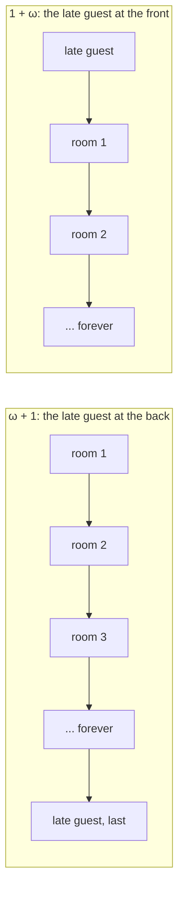

# Ordinals: counting past infinity, where omega + 1 is bigger but 1 + omega is not

[Syllabus](../../../SYLLABUS.md) → [Foundations](../README.md) → [Sizes of Infinity](../README.md#s09) → Ordinals

---

## General Overview

The hotel has a room for every counting number, all full. At breakfast the guests queue in room order: 1, 2, 3, on forever. Nobody stands last.

A late guest arrives. At the back, he becomes the last person. At the front, he is just the new first person: shift every place number back by one and the line looks unchanged.

**An ordinal measures the shape of a line-up, not the size of the crowd; adding at the back of an endless line makes it longer, adding at the front does not.**

**What kind of fact this is:** a definition (ordinal, ordinal sum and product), then two theorems: $`1 + \omega = \omega`$, and $`\omega < \omega + 1`$.

### The picture: one late guest, two places to stand



Arrows point to the person behind. Only the top line has a last person.

---

## The formula

A **line-up** here is a **well-order**: a total order (from [Orders](../08-Relations%20and%20Functions/07-partial-and-total-orders.md)) in which every non-empty group has a front-most person. Its **ordinal** (or **order type**) is its shape. Line-ups share an ordinal when they pair off person to person, keeping order.

The hotel queue has the ordinal $`\omega`$ (omega). Adding puts one line-up behind another:

```math
1 + \omega = \omega \qquad\text{but}\qquad \omega < \omega + 1
```

**Read it aloud:** a guest in front still gives omega; one behind gives a longer shape.

| Symbol | Plain meaning | In our example | Push it up and the answer… |
| --- | --- | --- | --- |
| ω | the endless queue 1, 2, 3, … | the full hotel | — |
| α + β | α, then β behind it | ω + 1: late guest at the back | longer β, longer line |
| α · β | β copies of α in a row | ω·2: two hotels in a row | more copies, longer line |
| α + 1 | the **successor**: one more at the back | ω + 1 has a last person | — |
| < | left is a front part of right, with someone left over | ω < ω + 1 | — |

α (alpha) and β (beta) are any ordinals.

**The rule for sums.** Every line-up here is full hotels, then extra people. Put β behind α. If β has a hotel, α's extra people are absorbed and the hotels add; if not, the extra people add. So 1 then ω gives ω, ω then 1 gives ω + 1, and ω then ω gives ω·2. A line-up has a last person exactly when it ends in extra people.

### When it holds

- **Every group has a front-most person.** The negatives …, −2, −1 have no front, so no ordinal.
- **Order counts, not only size.** ω and ω + 1 have the same size ([Same size means pairable](01-same-size-by-pairing.md)) but differ as ordinals.
- **Sums read left to right.** Finite line-ups commute: $`2 + 3 = 5`$ and $`3 + 2 = 5`$. Endless pieces may not.

---

## Why it works

### Step 0: an order-keeping pairing cannot change shape

An order-keeping pairing sends front to front and back to back. So a line with a last person can only pair in order with another line that has one.

### Step 1: one guest in front is absorbed

The line is: late guest L, then rooms 1, 2, 3, … Pair L with place 1 and room n with place n + 1. This move from [Same size means pairable](01-same-size-by-pairing.md) also keeps order and fills every place. So $`1 + \omega = \omega`$.

### Step 2: one guest at the back is not

Now L stands last. Say an order-keeping pairing with ω gives L place 5. Every hotel guest needs a place before 5. There are only 4, but guests 1 to 5 need five. Any place fails, so $`\omega + 1 \ne \omega`$.

ω is the front part of ω + 1 with L left over; that is what $`\omega < \omega + 1`$ means. Cantor proved any two well-orders compare this way (1897).

### Step 3: each ordinal is the set of smaller ones

Von Neumann's standard construction makes each ordinal the set of all ordinals before it:

- 0 = {} (the empty set), 1 = {0}, 2 = {0, 1}, 3 = {0, 1, 2}.
- ω = {0, 1, 2, 3, …}, every finite ordinal.
- ω + 1 = {0, 1, 2, …, ω}: ω plus ω itself.

So "smaller than" means "is a member of". [The ZFC axioms](../07-Sets/08-zfc-axioms.md) guarantee these sets.

Ordinals compare (Step 2), so every non-empty set of ordinals has a least member: take any member α; if nothing lies below it, it is least; otherwise take the first of those below, inside α.

A **successor ordinal** has a last member, like 3 or ω + 1. A **limit ordinal** is not 0 and has none, like ω or ω·2.

### Step 4: products are copies in a row

ω·2 is hotel A's queue, then hotel B's. Hotel B's first guest has endlessly many people ahead but nobody directly ahead, unlike anyone in ω. Hotel A's queue is a front part, with hotel B left over, so $`\omega < \omega \cdot 2`$.

$`2 \cdot \omega`$ is ω copies of 2: guests in pairs. Pair k takes places 2k − 1 and 2k, so this is just ω. Multiplication does not commute.

---

## Worked numbers, by hand

| Step | Arithmetic | Value |
| --- | --- | --- |
| the hotel queue | 1, 2, 3, … with no last | ω |
| late guest at the back | ω + 1 | **ω + 1**, last person: yes |
| late guest at the front | L, 1, 2, 3, 4, 5 go to places 1, 2, 3, 4, 5, 6 | **ω** |
| back guest given place 5 | 4 places ahead, at least 5 guests ahead | no pairing |
| two hotels in a row | ω + ω | **ω·2** |
| guests in pairs | places 1 2, 3 4, 5 6, … | **2·ω = ω** |
| finite check | 2 + 3, 3 + 2 | 5 both |

### What breaks if you drop a piece

| Mistake | Comes out at | What went wrong |
| --- | --- | --- |
| Assuming 1 + ω = ω + 1 | ω + 1 | Addition does not commute |
| Reading 2·ω as two hotels | ω·2 | 2·ω is pairs in one queue |
| "Anything in front is absorbed", applied to ω + ω | ω | Only a finite front piece is |

---

## Code, from first principles, and it actually runs

Nothing is imported. An ordinal below ω·ω is two whole numbers: full hotels, then extra people. Road 1 applies the addition rule to whole shapes. Road 2 walks the line-up piece by piece, noting any last person; it catches code slips, not a wrong rule. The independent checks are the order-keeping pairings, listed place by place, and the order ω < ω + 1 < ω·2, fixed in advance. It also builds von Neumann 0 to 3 and the three mistakes.

### Python

```python
# Ordinals -- the check behind the card.  Nothing is imported.  An ordinal below ω·ω is (a, b): a full hotels, then b people.
def name(o):
    w = "" if o[0] == 0 else "ω" if o[0] == 1 else f"ω·{o[0]}"
    return w + "+" + str(o[1]) if w and o[1] else w or str(o[1])
def add(x, y): return (x[0] + y[0], y[1]) if y[0] else (x[0], x[1] + y[1])  # y queues behind x
def walk(blocks):           # the same rule, piece by piece: "H" is a full hotel; a number is that many people
    a, b, last = 0, 0, False                 # ω·a + b people stand ahead of the next one
    for blk in blocks:      # after a full hotel the count of people restarts, and nobody is last
        a, b, last = (a + 1, 0, False) if blk == "H" else (a, b + blk, blk > 0)
    return (a, b), last
W, ONE, P = (1, 0), (0, 1), 5                                # P: the room the back guest is sent to
ROWS = [("the hotel, room by room", W, ["H"]), ("late guest at the back", add(W, ONE), ["H", 1]),
        ("late guest at the front", add(ONE, W), [1, "H"]), ("two hotels in a row", add(W, W), ["H", "H"])]
print(f"{'line-up':<26}{'by the rule':<13}{'by walking':<12}last person")
for label, rule, blocks in ROWS: print(f"{label:<26}{name(rule):<13}{name(walk(blocks)[0]):<12}{'yes' if walk(blocks)[1] else 'no'}")
rooms = [1 if g == "L" else g + 1 for g in ["L", 1, 2, 3, 4, 5]]  # 1 + ω re-paired with ω
pairs = [p for k in range(1, 4) for p in (2 * k - 1, 2 * k)]     # 2·ω: pair k takes two places
vn = [s := frozenset()] + [s := s | {s} for _ in range(3)]      # next ordinal: all so far, plus itself
bad = lambda x, y: y if y[0] else add(x, y)                    # "an endless line swallows what is in front"
assert all(walk(b) == (r, r[1] > 0) for _, r, b in ROWS)       # rule and walk agree
assert rooms == pairs == list(range(1, 7))                     # both pairings keep order and fill places 1 to 6
assert all(len(v) == i and vn[i - 1] in v for i, v in enumerate(vn) if i) and W < add(W, ONE) < add(W, W)
assert add(W, ONE) != add(ONE, W) and bad(W, W) != add(W, W) and add((0, 2), (0, 3)) == walk([3, 2])[0]
print(f"front guest re-paired: L, 1, 2, 3, 4, 5 go to rooms {', '.join(map(str, rooms))}, order kept")
print(f"back guest sent to room {P}: {len(range(1, P))} rooms ahead of it, but guests 1 to {P} all stand ahead of him")
print(f"2·ω, pair k takes places 2k-1 and 2k: {' '.join(map(str, pairs))} ..., so 2·ω = ω; ω·2 = {name(add(W, W))}")
print(f"finite line-ups: 2+3 = {name(add((0, 2), (0, 3)))} and 3+2 = {name(add((0, 3), (0, 2)))}")
print("von Neumann: " + ", ".join(f"{i} = {{{', '.join(str(len(e)) for e in sorted(v, key=len))}}}" for i, v in enumerate(vn)))
print(f"order: ω < ω+1 < ω·2; mistakes come out at {name(add(W, ONE))}, {name(add(W, W))} and {name(bad(W, W))}")
print("ALL CHECKS PASS")
```

**Ran 2026-11-23 on macOS, Python 3.14.10, standard library only. All checks passed. Output, pasted from the run:**

```
line-up                   by the rule  by walking  last person
the hotel, room by room   ω            ω           no
late guest at the back    ω+1          ω+1         yes
late guest at the front   ω            ω           no
two hotels in a row       ω·2          ω·2         no
front guest re-paired: L, 1, 2, 3, 4, 5 go to rooms 1, 2, 3, 4, 5, 6, order kept
back guest sent to room 5: 4 rooms ahead of it, but guests 1 to 5 all stand ahead of him
2·ω, pair k takes places 2k-1 and 2k: 1 2 3 4 5 6 ..., so 2·ω = ω; ω·2 = ω·2
finite line-ups: 2+3 = 5 and 3+2 = 5
von Neumann: 0 = {}, 1 = {0}, 2 = {0, 1}, 3 = {0, 1, 2}
order: ω < ω+1 < ω·2; mistakes come out at ω+1, ω·2 and ω
ALL CHECKS PASS
```

### Rust

Same numbers, same labels, built with `rustc --edition 2021 -O`.

```rust
// Ordinals -- the same check as the Python, in Rust.  No crates.  An ordinal below ω·ω is (a, b): a full hotels, then b people.
type O = (u32, u32);
fn name(o: O) -> String {
    let w = match o.0 { 0 => String::new(), 1 => "ω".to_string(), a => format!("ω·{}", a) };
    if !w.is_empty() && o.1 > 0 { format!("{}+{}", w, o.1) } else if w.is_empty() { o.1.to_string() } else { w }
}
fn add(x: O, y: O) -> O { if y.0 > 0 { (x.0 + y.0, y.1) } else { (x.0, x.1 + y.1) } } // y queues behind x
fn bad(x: O, y: O) -> O { if y.0 > 0 { y } else { add(x, y) } } // "an endless line swallows what is in front"
fn walk(blocks: &[Option<u32>]) -> (O, bool) {   // the same rule, piece by piece: None is a full hotel; Some(n) is n people
    let (mut a, mut b, mut last) = (0, 0, false); // ω·a + b people stand ahead of the next one
    for blk in blocks {     // after a full hotel the count of people restarts, and nobody is last
        match blk { None => { a += 1; b = 0; last = false } Some(n) => { b += n; last = *n > 0 } }
    }
    ((a, b), last)
}
fn main() {
    let (w, one, h, p) = ((1, 0), (0, 1), None, 5u32);   // p: the room the back guest is sent to
    let rows: [(&str, O, Vec<Option<u32>>); 4] = [("the hotel, room by room", w, vec![h]), ("late guest at the back", add(w, one), vec![h, Some(1)]),
        ("late guest at the front", add(one, w), vec![Some(1), h]), ("two hotels in a row", add(w, w), vec![h, h])];
    println!("{:<26}{:<13}{:<12}last person", "line-up", "by the rule", "by walking");
    for (label, rule, blocks) in &rows {
        let (o, last) = walk(blocks); assert!(o == *rule && last == (rule.1 > 0)); // rule and walk agree
        println!("{:<26}{:<13}{:<12}{}", label, name(*rule), name(o), if last { "yes" } else { "no" });
    }
    let rooms: Vec<u32> = [0u32, 1, 2, 3, 4, 5].iter().map(|&g| if g == 0 { 1 } else { g + 1 }).collect(); // 0 is L
    let pairs: Vec<u32> = (1..4u32).flat_map(|k| [2 * k - 1, 2 * k]).collect();  // 2·ω: two places per pair
    let mut vn: Vec<Vec<usize>> = vec![vec![]];   // ordinal i as the list of ordinals below it
    for i in 0..3 { let mut next = vn[i].clone(); next.push(i); vn.push(next); }   // all so far, plus itself
    assert!(rooms == (1..7).collect::<Vec<u32>>() && pairs == rooms);   // both pairings keep order and fill places 1 to 6
    assert!(vn.iter().enumerate().all(|(i, v)| v.len() == i && (i == 0 || v.contains(&(i - 1)))) && w < add(w, one) && add(w, one) < add(w, w));
    assert!(add(w, one) != add(one, w) && bad(w, w) != add(w, w) && add((0, 2), (0, 3)) == walk(&[Some(3), Some(2)]).0);
    let s = |v: &[u32]| v.iter().map(|x| x.to_string()).collect::<Vec<_>>();
    println!("front guest re-paired: L, 1, 2, 3, 4, 5 go to rooms {}, order kept", s(&rooms).join(", "));
    println!("back guest sent to room {}: {} rooms ahead of it, but guests 1 to {} all stand ahead of him", p, (1..p).count(), p);
    println!("2·ω, pair k takes places 2k-1 and 2k: {} ..., so 2·ω = ω; ω·2 = {}", s(&pairs).join(" "), name(add(w, w)));
    println!("finite line-ups: 2+3 = {} and 3+2 = {}", name(add((0, 2), (0, 3))), name(add((0, 3), (0, 2))));
    println!("von Neumann: {}", vn.iter().enumerate().map(|(i, v)| format!("{} = {{{}}}", i, v.iter().map(|x| x.to_string()).collect::<Vec<_>>().join(", "))).collect::<Vec<_>>().join(", "));
    println!("order: ω < ω+1 < ω·2; mistakes come out at {}, {} and {}", name(add(w, one)), name(add(w, w)), name(bad(w, w)));
    println!("ALL CHECKS PASS");
}
```

**Ran 2026-11-23 on macOS, rustc 1.98.1, no crates. All checks passed. Output, pasted from the run:**

```
line-up                   by the rule  by walking  last person
the hotel, room by room   ω            ω           no
late guest at the back    ω+1          ω+1         yes
late guest at the front   ω            ω           no
two hotels in a row       ω·2          ω·2         no
front guest re-paired: L, 1, 2, 3, 4, 5 go to rooms 1, 2, 3, 4, 5, 6, order kept
back guest sent to room 5: 4 rooms ahead of it, but guests 1 to 5 all stand ahead of him
2·ω, pair k takes places 2k-1 and 2k: 1 2 3 4 5 6 ..., so 2·ω = ω; ω·2 = ω·2
finite line-ups: 2+3 = 5 and 3+2 = 5
von Neumann: 0 = {}, 1 = {0}, 2 = {0, 1}, 3 = {0, 1, 2}
order: ω < ω+1 < ω·2; mistakes come out at ω+1, ω·2 and ω
ALL CHECKS PASS
```

The two outputs match line for line.

### Lean

Lean proves the big claims for the whole endless hotel, and checks the small counts for the first few guests.

- Put one late guest in front of the hotel queue. Then $`1 + \omega = \omega`$.
- Put him at the back instead. Then $`\omega < \omega + 1`$.
- The line with the late guest in front pairs off in order with the hotel queue. The line with him at the back cannot.
- Put two hotels in a row. Then $`\omega < \omega \cdot 2`$.
- Let the guests arrive in pairs. Then $`2 \cdot \omega = \omega`$.
- Take finite line-ups of 2 and 3 people. Then $`2 + 3 = 5`$ and $`3 + 2 = 5`$.
- L and guests 1 to 5 go to places 1 to 6, in order.
- A back guest given place 5 has 4 places ahead, but 5 guests stand ahead of him.
- Pairs 1 to 3 fill places 1 to 6, in order.

Storing ordinals as two whole numbers, walking the line-ups, building the von Neumann sets and the three mistakes are left to the Python and Rust checks.

```lean
-- Ordinals: one guest in front of the endless queue is absorbed (1 + ω = ω) but one guest behind it makes a longer line-up (ω < ω + 1), and the same holds for pairings that keep order.
import Mathlib.SetTheory.Ordinal.Arithmetic
import Mathlib.Order.Hom.Lex
import Mathlib.Tactic.NormNum
import Mathlib.SetTheory.Ordinal.Principal

open Ordinal

/-- The card's main claim: one person put in front of the endless queue ω still gives the
shape ω, so 1 + ω = ω; but the endless queue with one person put behind it is a longer shape,
so ω < ω + 1. (Mathlib's `Ordinal` is the order type of a well-order, and `α + β` puts the
line-up `β` behind the line-up `α`.) -/
theorem one_add_omega_eq_omega_and_omega_lt_omega_add_one :
    (1 : Ordinal) + ω = ω ∧ ω < ω + 1 := by
  refine ⟨one_add_omega0, ?_⟩
  exact Order.lt_add_one_iff.2 le_rfl

/-- The same claim told with line-ups and order-keeping pairings (Steps 1 and 2): the line
"late guest, then rooms 0, 1, 2, ..." can be paired with the counting numbers person to person
keeping the order, but the line "rooms 0, 1, 2, ..., then the late guest" cannot. -/
theorem guest_in_front_pairs_in_order_guest_behind_does_not :
    Nonempty (Unit ⊕ₗ ℕ ≃o ℕ) ∧ IsEmpty (ℕ ⊕ₗ Unit ≃o ℕ) := by
  have hU : typeLT Unit = 1 := type_eq_one_of_unique _
  constructor
  · have h : typeLT (Unit ⊕ₗ ℕ) = typeLT ℕ := by
      rw [type_lt_sum_lex, hU, type_nat_lt, one_add_omega0]
    obtain ⟨e⟩ := type_eq.1 h
    exact ⟨OrderIso.ofRelIsoLT e⟩
  · refine ⟨fun e => ?_⟩
    have h := e.ordinalType_congr
    rw [type_lt_sum_lex, hU, type_nat_lt] at h
    exact (Order.lt_add_one_iff.2 le_rfl).ne' h

/-- Products are copies in a row (Step 4): two hotels in a row, ω · 2, are longer than one
hotel, but guests arriving in pairs, 2 · ω (ω copies of 2), still give ω. -/
theorem omega_lt_omega_mul_two_and_two_mul_omega_eq_omega :
    ω < ω * 2 ∧ (2 : Ordinal) * ω = ω := by
  refine ⟨?_, ?_⟩
  · have h : ω * 2 = ω + ω := by
      rw [show (2 : Ordinal) = 1 + 1 by norm_num, mul_add, mul_one]
    rw [h]
    exact lt_add_of_pos_right _ omega0_pos
  · exact_mod_cast natCast_mul_omega0 (n := 2) (by norm_num)

-- Finite line-ups commute: 2 + 3 and 3 + 2 are both 5.
example : (2 : Ordinal) + 3 = 5 ∧ (3 : Ordinal) + 2 = 5 := by norm_num

-- The front guest re-paired: L (written 0 here) and guests 1 to 5 go to places 1 to 6, in order.
example : List.map (fun g => if g = 0 then 1 else g + 1) [0, 1, 2, 3, 4, 5]
    = [1, 2, 3, 4, 5, 6] := by decide

-- The back guest sent to place 5: only 4 places lie ahead of it, but guests 1 to 5 all stand ahead of him.
example : (List.range' 1 4).length = 4 ∧ (List.range' 1 5).length = 5 ∧ 4 < 5 := by decide

-- Guests in pairs: pair k takes places 2k - 1 and 2k, so pairs 1 to 3 fill places 1 to 6 in order.
example : List.flatMap (fun k => [2 * k - 1, 2 * k]) [1, 2, 3] = [1, 2, 3, 4, 5, 6] := by decide

#print axioms one_add_omega_eq_omega_and_omega_lt_omega_add_one
#print axioms guest_in_front_pairs_in_order_guest_behind_does_not
#print axioms omega_lt_omega_mul_two_and_two_mul_omega_eq_omega
```

**Checked 2026-11-23 on macOS, Lean 4.36.0-rc2, Mathlib v4.36.0-rc2. Every proof is complete and uses only Lean's standard axioms. Output, pasted from the run:**

```
'one_add_omega_eq_omega_and_omega_lt_omega_add_one' depends on axioms: [propext, Classical.choice, Quot.sound]
'guest_in_front_pairs_in_order_guest_behind_does_not' depends on axioms: [propext, Classical.choice, Quot.sound]
'omega_lt_omega_mul_two_and_two_mul_omega_eq_omega' depends on axioms: [propext, Classical.choice, Quot.sound]
```

> [!TIP]
> **Try changing**
> Guess first, then run it. Expect an assert to stop the program.
> - **Two late guests at the back.** Change the second row's blocks to `["H", 1, 1]`. Walking gives ω+2, the rule says ω+1, and the first assert stops it.
> - **Two late guests at the front.** Change the third row's blocks to `[2, "H"]`. Walking still gives ω, and every assert passes.
> - **Make addition commute.** In `add`, always return `(x[0] + y[0], x[1] + y[1])`. Then 1 + ω gives ω+1, and the first assert stops it.

---

## The usual mistake

> [!warning]
> **Expecting ordinal addition to commute.** Since 2 + 3 = 3 + 2, 1 + ω looks like ω + 1. It is not: a guest in front is absorbed (ω); a guest at the back stands last (ω+1).
>
> - Treating "same size" as "same ordinal" gives ω + 1 = ω. The crowds pair off, but not in order.

---

## Where you meet it in real life

- **Program termination.** To prove a program stops, give each step a falling ordinal; ordinals cannot fall forever. A loop whose inner counter may restart at any size when the outer falls is measured by ω·ω.
- **Proof strength.** Logicians rank theories by how far their induction reaches.
- **Theorem provers.** ACL2 accepts a recursive definition only after proving an ordinal measure falls on every call.

> **Say it back**
> An ordinal is the shape of a line-up in which every group has a front-most person. Line-ups share an ordinal when they pair off in order. A late guest at the front of the endless queue is absorbed, so 1 + ω = ω. At the back he is a last person, so ω + 1 is longer. Two hotels make ω·2; pairs make 2·ω = ω.

---

## What this builds on

- [Strong induction and the least element](../06-Proof/05-strong-induction-and-well-ordering.md): the least-member rule this card extends.
- [Same size means pairable](01-same-size-by-pairing.md): pairing crowds; ordinals also keep order.
- [Orders](../08-Relations%20and%20Functions/07-partial-and-total-orders.md): total orders, the kind a line-up is.
- [The ZFC axioms](../07-Sets/08-zfc-axioms.md): they make the von Neumann ordinals exist.

## Where this goes next

- [Transfinite induction](07-transfinite-induction-and-recursion.md): proof step by step along any ordinal.
- [Zorn's lemma and the well-ordering theorem](08-zorns-lemma-and-well-ordering.md): with choice, every set can be well-ordered.
- [Cardinal arithmetic](09-cardinal-arithmetic.md): sizes, where 1 + ω and ω + 1 are equal.
- [The continuum hypothesis](../../25-Frontier/06-Algebra%2C%20Logic%20and%20Computation/02-continuum-hypothesis-and-independence.md): aleph one, the first uncountable ordinal.

Left open: is there an ordinal whose crowd cannot pair with the counting numbers?

---

## Sources

Verified 2026-11-23: every link below resolves to the publisher's page.

- Cantor, Georg. "Beiträge zur Begründung der transfiniten Mengenlehre (Zweiter Artikel)." *Mathematische Annalen* 49 (1897): 207–246. [doi:10.1007/BF01444205](https://doi.org/10.1007/BF01444205). Ordinal sum and product; any two well-orders compare.
- Halmos, Paul R. *Naive Set Theory*. Springer, 1974. [doi:10.1007/978-1-4757-1645-0](https://doi.org/10.1007/978-1-4757-1645-0). Von Neumann ordinals.
- Enderton, Herbert B. "Ordinals and Order Types." In *Elements of Set Theory*. Academic Press, 1977. [doi:10.1016/B978-0-08-057042-6.50013-2](https://doi.org/10.1016/B978-0-08-057042-6.50013-2). Fuller proofs.
