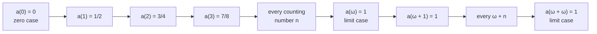

# Transfinite induction: dominoes that keep falling past infinity, and definitions that use every earlier step

[Syllabus](../../../SYLLABUS.md) → [Foundations](../README.md) → [Sizes of Infinity](../README.md#s09) → Transfinite induction

---

## General Overview

Start a number at 0. Each step moves it halfway to 1: 1/2, 3/4, 7/8. After ten steps it is 1023/1024, about 0.999.

The ordinals are positions in a line that keeps going past the counting numbers ([Ordinals](06-ordinals.md)). After every counting number comes ω (omega), then ω + 1, ω + 2, and after all those, ω + ω.

No step leads into ω: it has no position just before it. Such a position is a limit, so the rule at ω is different. Take the smallest number at or above every earlier value, the **least upper bound**. Here that is 1. After ω the halving starts again: (1 + 1) ÷ 2 = 1.

Does it ever pass 1, at any ordinal? Three checks answer for every ordinal at once.

**Check a claim at 0, at each step and at each limit, and it holds at every ordinal; define a sequence by those three cases, and exactly one fits.**

**What kind of fact this is:** two theorems, in Why it works: transfinite induction with a full proof, the recursion theorem with a sketch.

### The picture: one run, two limits



An arrow into a limit is not a step: the limit collects everything earlier.

---

## The formula

The sequence a(α), read "a at alpha", has three cases:

```math
a(0) = 0, \qquad a(\alpha + 1) = \big(1 + a(\alpha)\big) \div 2, \qquad a(\lambda) = \text{least upper bound of every earlier value}
```

**Read it aloud:** start at 0, halve the gap to 1 at every step, and at every limit take the least upper bound of everything so far.

The claim is a(α) ≤ 1 at every ordinal α. Transfinite induction proves it with three checks:

```math
\text{claim at } 0, \qquad \text{claim at } \alpha \Rightarrow \text{claim at } \alpha + 1, \qquad \text{claim below } \lambda \Rightarrow \text{claim at } \lambda \qquad \Longrightarrow \qquad \text{claim at every ordinal}
```

| Symbol | Plain meaning | In our example | Push it up and the answer… |
| --- | --- | --- | --- |
| $`\alpha`$ (alpha) | any ordinal: a position in the line | 3, or ω + 1 | climbs toward 1, never past |
| $`\alpha + 1`$ | the successor: the next position after α | 4, or ω + 2 | one more halving |
| $`\lambda`$ (lambda) | a limit: not 0, with no position just before it | ω, ω + ω | — |
| $`\omega`$ (omega) | the first position after every counting number | a(ω) = 1 | — |
| $`n`$ | a counting number 0, 1, 2, … | a(10) = 1023/1024 | a(n) = 1 − 1/2^n gets closer to 1 |
| $`a(\alpha)`$ | the value at position α | a(3) = 7/8 | stays at most 1 |

### When it holds

- **The zero case is checked.** Start at 2 and the claim fails at once.
- **The successor case is checked at every α.** Drop the halving and a(3) = 3.
- **The limit case is checked.** Ordinary induction never reaches ω.
- **Every non-empty set of positions has a least member.** The numbers above 0 have no least one, so induction fails on the real numbers.

---

## Why it works

### Step 0: a first failure has nowhere to stand

Every non-empty set of ordinals has a least member ([Ordinals](06-ordinals.md)). So a failing claim fails at a first place, and the three checks cover every kind of place.

### Step 1: the three-case proof

Let α be the least ordinal where the claim fails. Every ordinal is 0, a successor or a limit.

1. **α is 0.** The zero case says the claim holds there. Contradiction.
2. **α is a successor.** The claim holds at the position just before α, so the successor case carries it to α. Contradiction.
3. **α is a limit.** The claim holds at every earlier ordinal, so the limit case gives it at α. Contradiction.

So the claim never fails. This is the counting-number argument of [Strong induction and the least element](../06-Proof/05-strong-induction-and-well-ordering.md), plus a limit case.

### Step 2: the claim a(α) ≤ 1, case by case

- **Zero:** a(0) = 0.
- **Successor:** if a(α) ≤ 1, then 1 + a(α) ≤ 2, and half of that is at most 1.
- **Limit:** every earlier value is at most 1, so 1 is an upper bound. The least upper bound is at most any upper bound.

At ω the value is exactly 1. Ordinary induction ([Induction](../06-Proof/04-proof-by-induction.md)) gives a(n) = 1 − 1/2^n, since (2 − 1/2^n) ÷ 2 = 1 − 1/2^(n+1). So 1 bounds every a(n). The gap 1/2^n shrinks below any positive size, so every number below 1 is passed: 0.999 at a(10).

### Step 3: the recursion theorem

**Recursion theorem.** Take any rule that reads the list of all values before α and returns one value. Then exactly one sequence along the ordinals takes, at every α, the value the rule gives.

Our three cases form one such rule.

<details>
<summary>Proof sketch: exactly one sequence fits the rule</summary>

**Only one.** Say two sequences follow the rule. At the first place they differ, both feed the rule the same earlier list and get the same value. Contradiction.

**At least one.** An attempt follows the rule up to some ordinal. Two attempts agree where both are defined, so all attempts join into one sequence. A first ordinal with no value would get one from the rule: a longer attempt. Contradiction.

</details>

---

## Worked numbers, by hand

| Step | Arithmetic | Value |
| --- | --- | --- |
| a(0) | the zero rule | 0 |
| a(1) | (1 + 0) ÷ 2 | 1/2 |
| a(2) | (1 + 1/2) ÷ 2 | 3/4 |
| a(3) | (1 + 3/4) ÷ 2 | 7/8 |
| a(10) | 1 − 1/2^10 | 1023/1024 = 0.9990234375 |
| a(ω) | 1 bounds all; 0.999 is passed at a(10) | 1 |
| a(ω + 1) | (1 + 1) ÷ 2 | 1 |
| a(ω + 5) | four more halvings of a gap of 0 | 1 |
| a(ω + ω) | least upper bound of a run of 1s | **1** |

The number climbs toward 1, reaches it at ω and stays there. This run goes still after ω; the point-thinning under Where you meet it in real life keeps changing past ω.

### What breaks if you drop a piece

| Mistake | Comes out at | What went wrong |
| --- | --- | --- |
| a(ω) as the biggest of the first ten values, a(0) to a(9) | 0.998046875 | No value is biggest: the run keeps climbing |
| a(ω) as the sum of a(0) to a(9) | 8.001953125 | That limit rule breaks the bound |
| Dropping the halving: a(α + 1) = 1 + a(α) | a(3) = 3 | The successor case fails |

---

## Code, from first principles, and it actually runs

Nothing is imported. Values are whole numbers over 2^60, so every step is exact. The pair `(w, n)` means `w` copies of ω, then `n` steps. The run checks a ≤ 1 at 1 zero stage, 120 successor stages and 2 limits.

Three roads meet: the step rule against 1 − 1/2^n, and at each limit, a search for the least upper bound in thousandths against the halving tail. When gaps halve, the steps to come add up to the last step.

### Python

```python
# Transfinite induction -- the check behind the card.  Nothing is imported.  Ordinal
# omega*w + n is the pair (w, n).  Values are whole numbers over D = 2^60; 1 is D.
D, N = 2 ** 60, 60
a = {(0, 0): 0}                                           # zero: a(0) = 0
cases = {"zero": int(a[0, 0] <= D), "successor": 0, "limit": 0}
for w in (0, 1, 2):
    if w > 0:                                             # limit: omega, omega+omega
        run = [a[w - 1, n] for n in range(N + 1)]         # the earlier values
        grid = min(k for k in range(1001) if all(v * 1000 <= k * D for v in run))
        tail = run[-1] + (run[-1] - run[-2])              # the halving steps still to come
        assert grid == 1000 and tail == D                 # two roads to the bound: 1
        a[w, 0] = tail
        cases["limit"] += all(v <= D for v in run) and a[w, 0] <= D
    for n in range(1, N + 1 if w < 2 else 1):
        a[w, n] = (D + a[w, n - 1]) // 2                  # successor: (1 + a) / 2
        cases["successor"] += a[w, n - 1] <= D and a[w, n] <= D
formula = all(a[0, n] == D - D // 2 ** n for n in range(N + 1))   # 1 - 1/2^n
first = min(n for n in range(N + 1) if a[0, n] * 1000 > 999 * D)
slip = 0
for _ in range(3): slip = 1 + slip                        # successor rule, halving dropped
print("a(n) for n = 0 to 4: " + ", ".join(f"{a[0, n] * 2 ** n // D}/{2 ** n}" for n in range(5)))
print(f"a(n) = 1 - 1/2^n for every n from 0 to {N}: " + ("yes" if formula else "no"))
print(f"a({first}) = {a[0, first] * 2 ** first // D}/{2 ** first} = {a[0, first] / D}, the first value above 0.999")
print(f"a(omega) = {a[1, 0] // D}, a(omega+1) = {a[1, 1] // D}, a(omega+5) = {a[1, 5] // D}, a(omega+omega) = {a[2, 0] // D}")
print(f"stages checked for a <= 1: zero {cases['zero']}, successor {cases['successor']}, limit {cases['limit']}")
print(f"mistakes: biggest of first ten {a[0, 9] / D}, sum of first ten {sum(a[0, n] for n in range(10)) / D}, no halving a(3) = {slip}")
assert formula and first == 10 and a[1, 1] == a[2, 0] == D
assert cases == {"zero": 1, "successor": 120, "limit": 2}
assert a[0, 9] * 512 == 511 * D and sum(a[0, n] for n in range(10)) * 512 == 4097 * D and slip == 3
print("ALL CHECKS PASS")
```

**Ran 2026-11-23 on macOS, Python 3.14.10, standard library only. All checks passed. Output, pasted from the run:**

```
a(n) for n = 0 to 4: 0/1, 1/2, 3/4, 7/8, 15/16
a(n) = 1 - 1/2^n for every n from 0 to 60: yes
a(10) = 1023/1024 = 0.9990234375, the first value above 0.999
a(omega) = 1, a(omega+1) = 1, a(omega+5) = 1, a(omega+omega) = 1
stages checked for a <= 1: zero 1, successor 120, limit 2
mistakes: biggest of first ten 0.998046875, sum of first ten 8.001953125, no halving a(3) = 3
ALL CHECKS PASS
```

### Rust

Same numbers, same labels.

```rust
// Transfinite induction -- the same check as the Python, in Rust.  No crates.  An
// ordinal below omega+omega is a pair (w, n), meaning omega*w + n.  Every value is
// a whole number over D = 2^60, so each step is exact; the value 1 is D itself.
const D: u128 = 1 << 60;
const N: usize = 60;
fn main() {
    let mut a = vec![vec![0u128; N + 1]; 3];              // zero: a(0) = 0
    let (zero, mut succ, mut limit) = ((a[0][0] <= D) as u32, 0, 0);
    for w in 0..3 {
        if w > 0 {                                         // limit: omega, omega+omega
            let run = a[w - 1].clone();                    // the earlier values
            let grid = (0..1001u128).find(|k| run.iter().all(|v| v * 1000 <= k * D)).unwrap();
            let tail = run[N] + (run[N] - run[N - 1]);     // the halving steps still to come
            assert!(grid == 1000 && tail == D);            // two roads to the bound: 1
            a[w][0] = tail;
            limit += (run.iter().all(|v| *v <= D) && a[w][0] <= D) as u32;
        }
        for n in 1..(if w < 2 { N + 1 } else { 1 }) {
            a[w][n] = (D + a[w][n - 1]) / 2;               // successor: (1 + a) / 2
            succ += (a[w][n - 1] <= D && a[w][n] <= D) as u32;
        }
    }
    let formula = (0..=N).all(|n| a[0][n] == D - D / (1u128 << n));   // 1 - 1/2^n
    let first = (0..=N).find(|n| a[0][*n] * 1000 > 999 * D).unwrap();
    let mut slip = 0;
    for _ in 0..3 { slip = 1 + slip; }                     // successor rule, halving dropped
    let frac = |n: usize| format!("{}/{}", a[0][n] * (1u128 << n) / D, 1u128 << n);
    let dec = |v: u128| v as f64 / D as f64;
    let sum10: u128 = (0..10).map(|n| a[0][n]).sum();
    println!("a(n) for n = 0 to 4: {}", (0..5).map(|n| frac(n)).collect::<Vec<_>>().join(", "));
    println!("a(n) = 1 - 1/2^n for every n from 0 to {}: {}", N, if formula { "yes" } else { "no" });
    println!("a({}) = {} = {}, the first value above 0.999", first, frac(first), dec(a[0][first]));
    println!("a(omega) = {}, a(omega+1) = {}, a(omega+5) = {}, a(omega+omega) = {}", a[1][0] / D, a[1][1] / D, a[1][5] / D, a[2][0] / D);
    println!("stages checked for a <= 1: zero {}, successor {}, limit {}", zero, succ, limit);
    println!("mistakes: biggest of first ten {}, sum of first ten {}, no halving a(3) = {}", dec(a[0][9]), dec(sum10), slip);
    assert!(formula && first == 10 && a[1][1] == D && a[2][0] == D);
    assert!(zero == 1 && succ == 120 && limit == 2);
    assert!(a[0][9] * 512 == 511 * D && sum10 * 512 == 4097 * D && slip == 3);
    println!("ALL CHECKS PASS");
}
```

**Ran 2026-11-23 on macOS, rustc 1.98.1, no crates. All checks passed. Output, pasted from the run:**

```
a(n) for n = 0 to 4: 0/1, 1/2, 3/4, 7/8, 15/16
a(n) = 1 - 1/2^n for every n from 0 to 60: yes
a(10) = 1023/1024 = 0.9990234375, the first value above 0.999
a(omega) = 1, a(omega+1) = 1, a(omega+5) = 1, a(omega+omega) = 1
stages checked for a <= 1: zero 1, successor 120, limit 2
mistakes: biggest of first ten 0.998046875, sum of first ten 8.001953125, no halving a(3) = 3
ALL CHECKS PASS
```

### Lean

Lean proves both theorems at every ordinal, and the bound a(α) ≤ 1 at every ordinal too.

- A claim checked at 0, at each step and at each limit holds at every ordinal.
- Take any rule that reads all values before α and returns one value. Then exactly one sequence takes, at every α, the value the rule gives.
- Suppose a(0) = 0, a(α + 1) = (1 + a(α)) ÷ 2, and each limit takes the least upper bound of earlier values. Then a(α) ≤ 1 at every ordinal α.
- The worked numbers come out as the card says: 1/2, 3/4, 7/8, and 1023/1024 at a(10), the first above 0.999.
- The step from 1 − 1/2^n gives 1 − 1/2^(n+1), checked for n from 0 to 10.
- After ω the halving keeps 1 fixed: (1 + 1) ÷ 2 = 1.
- The mistakes come out too: the biggest of the first ten is 511/512, their sum is 4097/512, and no halving gives a(3) = 3.

That a(ω) is exactly 1, and the run of 120 steps and 2 limits, stay with the Python and Rust checks.

```lean
-- Transfinite induction: a claim checked at 0, at every step and at every limit holds at every ordinal, exactly one sequence follows any rule that reads all earlier values, and the halving-toward-1 sequence never passes 1.
import Mathlib.SetTheory.Ordinal.Arithmetic
import Mathlib.Order.ConditionallyCompleteLattice.Basic
import Mathlib.Data.Real.Archimedean
import Mathlib.Tactic.NormNum
import Mathlib.Tactic.IntervalCases

open Ordinal Order

/-- The card's main claim (transfinite induction): if a claim holds at 0, carries from every
ordinal α to α + 1, and holds at every limit l whenever it holds at every ordinal below l,
then it holds at every ordinal. (A limit is an ordinal that is not 0 and has no ordinal just
before it: Mathlib's `IsSuccLimit`. Every non-empty set of Mathlib's ordinals has a least
member, which is the card's fourth condition.) -/
theorem transfinite_induction {P : Ordinal → Prop}
    (zero : P 0)
    (succ : ∀ α, P α → P (α + 1))
    (limit : ∀ l, IsSuccLimit l → (∀ β < l, P β) → P l) :
    ∀ α, P α := by
  intro α
  exact Ordinal.limitRecOn α zero succ limit

/-- The recursion theorem (Step 3): take any rule that reads the list of all values before α
and returns one value. Then exactly one sequence along the ordinals takes, at every α, the
value the rule gives. -/
theorem recursion_theorem {X : Type*} (rule : (α : Ordinal) → ((β : Ordinal) → β < α → X) → X) :
    ∃! a : Ordinal → X, ∀ α, a α = rule α (fun β _ => a β) := by
  refine ⟨fun α => Ordinal.lt_wf.fix (fun α f => rule α f) α, ?_, ?_⟩
  · intro α
    exact Ordinal.lt_wf.fix_eq (fun α f => rule α f) α
  · intro b hb
    funext α
    induction α using WellFoundedLT.induction with
    | _ α ih =>
      rw [hb α, Ordinal.lt_wf.fix_eq (fun α f => rule α f) α]
      congr 1
      funext β hβ
      exact ih β hβ

/-- The card's worked claim (Step 2): a sequence with a(0) = 0, a(α + 1) = (1 + a(α)) ÷ 2, and
at every limit l the least upper bound of every earlier value, is at most 1 at every ordinal. -/
theorem halving_sequence_le_one (a : Ordinal → ℝ)
    (h0 : a 0 = 0)
    (hsucc : ∀ α, a (α + 1) = (1 + a α) / 2)
    (hlim : ∀ l, IsSuccLimit l → a l = sSup (a '' Set.Iio l)) :
    ∀ α, a α ≤ 1 := by
  refine transfinite_induction ?_ ?_ ?_
  · rw [h0]; norm_num
  · intro α hα
    rw [hsucc α]; linarith
  · intro l hl ih
    rw [hlim l hl]
    refine Real.sSup_le ?_ zero_le_one
    rintro _ ⟨β, hβ, rfl⟩
    exact ih β hβ

-- Worked numbers: a(1) = 1/2, a(2) = 3/4, a(3) = 7/8, each one halving of the gap to 1.
example : ((1 + 0) / 2 : ℚ) = 1 / 2 ∧ ((1 + 1 / 2) / 2 : ℚ) = 3 / 4 ∧
    ((1 + 3 / 4) / 2 : ℚ) = 7 / 8 := by norm_num

-- The closed form: (2 - 1/2^n) ÷ 2 = 1 - 1/2^(n+1), checked for n = 0 to 10.
example : ∀ n < 11,
    ((1 + (1 - 1 / 2 ^ n)) / 2 : ℚ) = 1 - 1 / 2 ^ (n + 1) := by
  intro n hn; interval_cases n <;> norm_num

-- a(10) = 1 - 1/2^10 = 1023/1024, the first value above 999/1000; a(9) = 1 - 1/2^9 is not.
example : (1 - 1 / 2 ^ 10 : ℚ) = 1023 / 1024 ∧ (999 / 1000 : ℚ) < 1023 / 1024 ∧
    (1 - 1 / 2 ^ 9 : ℚ) ≤ 999 / 1000 := by norm_num

-- After ω the halving keeps 1 fixed: a(ω + 1) = (1 + 1) ÷ 2 = 1.
example : ((1 + 1) / 2 : ℚ) = 1 := by norm_num

-- The mistakes: the biggest of the first ten values is 511/512, their sum is 4097/512 (above 1),
-- and dropping the halving, a(α + 1) = 1 + a(α), gives a(3) = 3.
example : (1 - 1 / 2 ^ 9 : ℚ) = 511 / 512 ∧
    (∑ n ∈ Finset.range 10, (1 - 1 / 2 ^ n : ℚ)) = 4097 / 512 ∧
    Nat.iterate (fun x => 1 + x) 3 0 = 3 := by
  norm_num [Finset.sum_range_succ]

#print axioms transfinite_induction
#print axioms recursion_theorem
#print axioms halving_sequence_le_one
```

**Checked 2026-11-23 on macOS, Lean 4.36.0-rc2, Mathlib v4.36.0-rc2. Every proof is complete and uses only Lean's standard axioms. Output, pasted from the run:**

```
'transfinite_induction' depends on axioms: [propext, Classical.choice, Quot.sound]
'recursion_theorem' depends on axioms: [propext, Classical.choice, Quot.sound]
'halving_sequence_le_one' depends on axioms: [propext, Classical.choice, Quot.sound]
```

> [!TIP]
> **Try changing**
> Guess first, then run it.
> - **Divide by 3, not 2,** on the successor line. Guess the new limit. The values settle toward 1/2, the search finds 500 thousandths, and an assert stops it.
> - **Start at 2:** set the first value to `2 * D`. The zero case fails, no thousandth up to 1 bounds the values, and the search stops the program.
> - **Use the sum at limits:** set `tail = sum(run)`. Guess whether a(ω) stays at most 1. It does not, and an assert stops it.

---

## The usual mistake

> [!warning]
> **Checking 0 and the step, then claiming every ordinal.** That is ordinary induction, and it stops before ω. No step leads into ω, so limits need their own check.
>
> - Taking a(ω) as the biggest earlier value. None exists; the biggest of a(0) to a(9) is 0.998046875.
> - Taking a(ω) as the sum of earlier values. The values a(0) to a(9) add to 8.001953125.
> - Skipping the zero case. Start at 2: every value stays above 1.

---

## Where you meet it in real life

- **Thinning a set of points.** Remove the isolated points (points with no near neighbor in the set), again and again, keeping at each limit what survived every round. In 0, 1/2, 3/4, … and their limit 1, round one leaves only 1; round two removes it. Some sets need more than ω rounds, which first led to the ordinals.
- **Lining up any set.** [Zorn's lemma and the well-ordering theorem](08-zorns-lemma-and-well-ordering.md) picks a first member, then the next from what is left, by the recursion theorem.

> **Say it back**
> To prove a claim at every ordinal, check it at 0, at each step and at each limit. A first failure would sit at one of those, so none exists. The same three cases define exactly one sequence. Halving toward 1 gives 0, 1/2, 3/4, 7/8, then 1 at ω, ω + 1 and ω + ω.

---

## What this builds on

- [Ordinals](06-ordinals.md): the positions, ω and ω + ω, and the least member of every non-empty set of them.
- [Structural induction](../06-Proof/08-structural-induction-and-recursion.md): one check per building rule; this card adds a rule for limits.
- [Induction](../06-Proof/04-proof-by-induction.md): the zero case and the step, which here prove a(n) = 1 − 1/2^n.

## Where this goes next

- [Zorn's lemma and the well-ordering theorem](08-zorns-lemma-and-well-ordering.md): uses the recursion theorem, with the axiom of choice, to line up any set.
- [Cardinal arithmetic](09-cardinal-arithmetic.md): sums and products of infinite sizes.

Left open: can every set be lined up along the ordinals, so this induction reaches all of it?

---

## Sources

Verified 2026-11-23: every link below resolves to the publisher's page.

- Halmos, Paul R. *Naive Set Theory*. Springer, 1974. [doi:10.1007/978-1-4757-1645-0](https://doi.org/10.1007/978-1-4757-1645-0). Short chapters on transfinite induction and transfinite recursion.
- Kunen, Kenneth. *Set Theory*. College Publications, 2011. [Publisher's page](https://www.collegepublications.co.uk/logic/mlf/?00016). Ordinals, transfinite induction and the recursion theorem in full.
