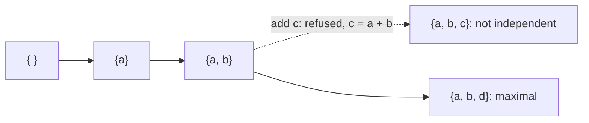

# Zorn's lemma and the well-ordering theorem: the axiom of choice in two more sets of clothes, and why they are the same

[Syllabus](../../../SYLLABUS.md) → [Foundations](../README.md) → [Sizes of Infinity](../README.md#s09) → Zorn's lemma and the well-ordering theorem

---

## General Overview

Take four arrows in 3D space: a = (1, 0, 0), b = (1, 1, 0), c = (2, 1, 0), d = (0, 0, 1). A set of arrows is **independent** when none of them is built from the others by stretching and adding ([Linear independence](../../03-Algebra/03-Vectors/04-linear-independence.md)).

Build an independent set one arrow at a time. Take a, then b. Try c: refused, because c = a + b. Take d. Now nothing more fits, so {a, b, d} is **maximal**: no independent set of these arrows strictly contains it.

Four arrows can be checked by hand. In a space too big to list, the climb never ends on its own. **Zorn's lemma** says a maximal set exists anyway.

**If every climb in a collection has a ceiling inside it, some member has nothing above it; this, the well-ordering theorem and the axiom of choice each prove the others.**

**What kind of fact this is:** a theorem: the three are equivalent, proved in Why it works without assuming any of them, quoting Hartogs' theorem. Zorn and well-ordering hold once choice is an axiom.

### The picture: the climb



Solid arrows keep the set independent. The dotted arrow is the refused step.

---

## The formula

```math
\text{every chain in } P \text{ has an upper bound in } P \;\Longrightarrow\; P \text{ has a maximal element}
```

**Read it aloud:** if every climb in the collection has a ceiling inside it, some member has nothing strictly above it.

The order is "inside", written $`\subseteq`$. It passes the three tests on [Orders](../08-Relations%20and%20Functions/07-partial-and-total-orders.md).

| Symbol | Plain meaning | In our example | Push it up and the answer… |
| --- | --- | --- | --- |
| $`P`$ | the collection, with an order | the 14 independent sets | more arrows, more sets |
| $`\subseteq`$ | "is inside" | {a} inside {a, b} | — |
| chain | members that all compare: one climb | {a}, {a, b}, {a, b, d} | — |
| upper bound | a member of $`P`$ above the whole chain: its ceiling | the union {a, b, d} | — |
| maximal element | nothing in $`P`$ strictly above it | {a, b, d}, {a, c, d}, {b, c, d} | — |
| well-ordering | a line-up where every non-empty part has a first member | a, b, c, d | — |

The **well-ordering theorem** says every set has a well-ordering. The **axiom of choice** says every pile of non-empty boxes has a choice function: one pick from every box ([The axiom of choice](05-axiom-of-choice.md)).

### When it holds

- **The ceiling must be in the collection.** {a, b, c, d} sits above every chain, but c = a + b. At most 3 of its 4 arrows are independent: its **rank**, the most independent arrows inside it, is 3 of 4. So it is out.
- **Maximal is not biggest.** Three sets are maximal; 0 sit above all others.
- **A refusal is not the top.** Stopping when c is refused leaves {a, b}, and d still fits.
- **Arbitrary infinite collections need choice.** Finite ones can be searched.

---

## Why it works

### Step 0: climb, and pick the next step

All three statements describe one move: climb, picking each next step. Choice supplies the pick. A well-ordering supplies it as "the first one left". Zorn's lemma says the climb ends.

A climb may run past every counting number. [Transfinite induction](07-transfinite-induction-and-recursion.md) carries it on through [Ordinals](06-ordinals.md): step numbers that continue after 1, 2, 3, ….

### Step 1: choice gives a well-ordering

Choice picks a member of the set: that is first. It picks again from what is left: second. Continue by transfinite recursion until nothing is left, which must happen (Hartogs' theorem, Step 3). The order of picking is a well-ordering.

### Step 2: a well-ordering gives choice

Line up everything in all the boxes. From each box, take its first member.

The hotel's rooms 1, 2, 3, … are already well-ordered. So "take the lowest room number" picks from any set of rooms, no axiom spent ([Strong induction and the least element](../06-Proof/05-strong-induction-and-well-ordering.md)).

### Step 3: choice gives Zorn's lemma

Suppose no member is maximal. Then above every chain sits some member strictly higher; choice picks one for each chain. Climb: each step goes strictly above the chain so far, including at limit steps (steps with no step just before them).

Every step lands on a new member. So the climb would pair every ordinal with a different member of $`P`$. No set has that many members, a standard fact (Hartogs' theorem). So a maximal member exists.

### Step 4: Zorn's lemma gives choice

Let $`P`$ hold the **partial picks**: one pick from each of some of the boxes. One is below another when the second keeps its picks and adds more.

The partial picks in a chain agree where they overlap, so their union is the chain's ceiling. Zorn gives a maximal partial pick. If it missed a box, one more pick would extend it. So it covers every box: a choice function.

### Step 5: the arrows at any size

Order the independent sets of any vector space by "inside". A chain's union stays independent, because a failure uses finitely many arrows, all in one set of the chain. Zorn gives a maximal independent set.

That is a **basis** ([Basis and dimension](../../03-Algebra/03-Vectors/05-basis-and-dimension.md)): an arrow it cannot build could join it, so it builds every arrow.

---

## Worked numbers, by hand

| Step | Arithmetic | Value |
| --- | --- | --- |
| sets of four arrows | 2 × 2 × 2 × 2 | 16 |
| independent, by size 0 to 4 | 1 + 4 + 6 + 3 + 0 | 14 |
| ceiling of {a}, {a, b}, {a, b, d} | their union | {a, b, d} |
| add c | c − a − b = (0, 0, 0) | refused |
| maximal sets | triples, none built from the others | {a, b, d}, {a, c, d}, {b, c, d} |
| line-ups ending at each | 24 ÷ 3: the last of a, b, c to arrive is refused | **8** |

The climb in the order a, b, c, d ends at **{a, b, d}**, a basis of 3D space.

### What breaks if you drop a piece

| Mistake | Comes out at | What went wrong |
| --- | --- | --- |
| Stopping at the first refusal | {a, b} | d still fits |
| Taking {a, b, c, d} as the ceiling | rank 3 of 4 | the ceiling left the collection |
| Reading maximal as above all others | 0 such sets | three maximal, none biggest |

---

## Code, from first principles, and it actually runs

Both programs test all 16 sets for independence by elimination in whole numbers. Rank is the number of rows that survive. The maximal sets are found two ways: by checking every bigger set, and by the determinant, a number that is zero exactly when three arrows are dependent. A third road climbs in all 24 line-ups.

### Python

```python
# Zorn's lemma -- the check behind the card.  Nothing is imported.  Four arrows in 3D space; the collection is every independent set of them, ordered by "inside".
V = {"a": (1, 0, 0), "b": (1, 1, 0), "c": (2, 1, 0), "d": (0, 0, 1)}
def rank(s):                       # elimination in whole numbers: count the rows that survive
    rows, r = [list(V[x]) for x in s], 0
    for col in range(3):
        p = next((i for i in range(r, len(rows)) if rows[i][col]), None)
        if p is None: continue
        rows[r], rows[p] = rows[p], rows[r]; rows[r + 1:], r = [[rows[r][col] * x - row[col] * y for x, y in zip(row, rows[r])] for row in rows[r + 1:]], r + 1
    return r
def det(s):                        # second road for three arrows: the determinant
    (p, q, r), (u, v, w), (x, y, z) = (V[t] for t in s)
    return p * (v * z - w * y) - q * (u * z - w * x) + r * (u * y - v * x)
def climb(order, stop=False):      # Zorn's move: add the next arrow that keeps the set independent
    s = ""
    for x in order:
        if rank(s + x) == len(s) + 1: s += x
        elif stop: break
    return "".join(sorted(s))
def perms(s): return [s] if len(s) < 2 else [x + p for x in s for p in perms(s.replace(x, ""))]
ALL = ["".join(x for i, x in enumerate("abcd") if m >> i & 1) for m in range(16)]
IND = [s for s in ALL if rank(s) == len(s)]
MAX, CEIL = sorted(s for s in IND if not any(set(s) < set(t) for t in IND)), "".join(sorted(set("a") | set("ab") | set("abd")))
LAND, TOP = {m: sum(climb(o) == m for o in perms("abcd")) for m in MAX}, sum(all(set(t) <= set(s) for t in IND) for s in IND)
print(f"independent sets among the 16: {len(IND)}; by size 0 to 4: {[sum(len(s) == k for s in IND) for k in range(5)]}\nmaximal, by checking every bigger set: {', '.join(MAX)}\ntriples with nonzero determinant: {', '.join(s for s in ALL if len(s) == 3 and det(s))}; abc gives {det('abc')}")
print(f"c - a - b = {tuple(V['c'][i] - V['a'][i] - V['b'][i] for i in range(3))}; rank of abcd: {rank('abcd')} of 4\nchain a, ab, abd: ceiling {CEIL}, independent {'yes' if rank(CEIL) == 3 else 'no'}, maximal {'yes' if CEIL in MAX else 'no'}")
print(f"climb in the order a, b, c, d: {climb('abcd')}; stopping at the first refusal: {climb('abcd', True)}\n24 line-ups land on: {', '.join(f'{m} {n}' for m, n in LAND.items())}; sets above all others: {TOP}")
assert len(IND) == 14 and MAX == ["abd", "acd", "bcd"] and rank("abcd") == 3 and TOP == 0 and rank("bb") == 1   # bb repeats an arrow
assert MAX == [s for s in ALL if len(s) == 3 and det(s) != 0] and det("abc") == 0 and climb("abcd") == CEIL == "abd"
assert set(LAND.values()) == {8} and sum(LAND.values()) == 24 and climb("abcd", True) == "ab"
print("ALL CHECKS PASS")
```

**Ran 2026-11-23 on macOS, Python 3.14.10, standard library only. All checks passed. Output, pasted from the run:**

```
independent sets among the 16: 14; by size 0 to 4: [1, 4, 6, 3, 0]
maximal, by checking every bigger set: abd, acd, bcd
triples with nonzero determinant: abd, acd, bcd; abc gives 0
c - a - b = (0, 0, 0); rank of abcd: 3 of 4
chain a, ab, abd: ceiling abd, independent yes, maximal yes
climb in the order a, b, c, d: abd; stopping at the first refusal: ab
24 line-ups land on: abd 8, acd 8, bcd 8; sets above all others: 0
ALL CHECKS PASS
```

### Rust

Same numbers, same labels, built with `rustc --edition 2021 -O`.

```rust
// Zorn's lemma -- the same check as the Python, in Rust.  No crates.  Four arrows in 3D space; the collection is every independent set of them, ordered by "inside".
const V: [[i64; 3]; 4] = [[1, 0, 0], [1, 1, 0], [2, 1, 0], [0, 0, 1]];   // a, b, c, d
fn ix(s: &str) -> Vec<usize> { s.chars().map(|c| "abcd".find(c).unwrap()).collect() }
fn rank(s: &str) -> usize {        // elimination in whole numbers: count the rows that survive
    let (mut rows, mut r): (Vec<[i64; 3]>, usize) = (ix(s).iter().map(|&i| V[i]).collect(), 0);
    for col in 0..3 {
        let Some(p) = (r..rows.len()).find(|&i| rows[i][col] != 0) else { continue };
        rows.swap(r, p); let piv = rows[r];
        for i in r + 1..rows.len() { let c = rows[i][col]; for k in 0..3 { rows[i][k] = piv[col] * rows[i][k] - c * piv[k]; } }
        r += 1;
    } r
}
fn det(s: &str) -> i64 {           // second road for three arrows: the determinant
    let t = ix(s); let ([p, q, r], [u, v, w], [x, y, z]) = (V[t[0]], V[t[1]], V[t[2]]); p * (v * z - w * y) - q * (u * z - w * x) + r * (u * y - v * x)
}
fn climb(order: &str, stop: bool) -> String {   // Zorn's move: add the next arrow that keeps the set independent
    let mut s = String::new();
    for x in order.chars() { let t = format!("{}{}", s, x); if rank(&t) == s.len() + 1 { s = t; } else if stop { break; } }
    let mut v: Vec<char> = s.chars().collect(); v.sort(); v.into_iter().collect()
}
fn perms(s: &str) -> Vec<String> { if s.len() < 2 { return vec![s.to_string()]; } s.chars().flat_map(|x| perms(&s.replace(x, "")).into_iter().map(move |p| format!("{}{}", x, p))).collect() }
fn sub(s: &str, t: &str) -> bool { s.chars().all(|c| t.contains(c)) }
fn main() {
    let all: Vec<String> = (0..16).map(|m: u32| "abcd".chars().enumerate().filter(|(i, _)| m >> i & 1 == 1).map(|(_, c)| c).collect()).collect();
    let ind: Vec<&String> = all.iter().filter(|s| rank(s) == s.len()).collect();
    let mut max: Vec<String> = ind.iter().filter(|s| !ind.iter().any(|t| t.len() > s.len() && sub(s, t))).map(|s| s.to_string()).collect(); max.sort();
    let mut u: Vec<char> = ["a", "ab", "abd"].concat().chars().collect(); u.sort(); u.dedup(); let ceil: String = u.into_iter().collect();   // union of the chain
    let land: Vec<usize> = max.iter().map(|m| perms("abcd").iter().filter(|o| &climb(o, false) == m).count()).collect();
    let top = ind.iter().filter(|s| ind.iter().all(|t| sub(t, s))).count(); let dets: Vec<&str> = all.iter().filter(|s| s.len() == 3 && det(s) != 0).map(|s| s.as_str()).collect();
    println!("independent sets among the 16: {}; by size 0 to 4: {:?}", ind.len(), (0..5).map(|k| ind.iter().filter(|s| s.len() == k).count()).collect::<Vec<_>>());
    println!("maximal, by checking every bigger set: {}\ntriples with nonzero determinant: {}; abc gives {}", max.join(", "), dets.join(", "), det("abc"));
    println!("c - a - b = {:?}; rank of abcd: {} of 4", (V[2][0] - V[0][0] - V[1][0], V[2][1] - V[0][1] - V[1][1], V[2][2] - V[0][2] - V[1][2]), rank("abcd"));
    println!("chain a, ab, abd: ceiling {}, independent {}, maximal {}", ceil, if rank(&ceil) == 3 { "yes" } else { "no" }, if max.contains(&ceil) { "yes" } else { "no" });
    println!("climb in the order a, b, c, d: {}; stopping at the first refusal: {}", climb("abcd", false), climb("abcd", true));
    println!("24 line-ups land on: {}; sets above all others: {}", max.iter().zip(&land).map(|(m, n)| format!("{} {}", m, n)).collect::<Vec<_>>().join(", "), top);
    assert!(ind.len() == 14 && max == ["abd", "acd", "bcd"] && rank("abcd") == 3 && top == 0 && rank("bb") == 1);   // bb repeats an arrow
    assert!(max == dets && det("abc") == 0 && climb("abcd", false) == ceil && ceil == "abd");
    assert!(land == [8, 8, 8] && land.iter().sum::<usize>() == 24 && climb("abcd", true) == "ab");
    println!("ALL CHECKS PASS");
}
```

**Ran 2026-11-23 on macOS, rustc 1.98.1, no crates. All checks passed. Output, pasted from the run:**

```
independent sets among the 16: 14; by size 0 to 4: [1, 4, 6, 3, 0]
maximal, by checking every bigger set: abd, acd, bcd
triples with nonzero determinant: abd, acd, bcd; abc gives 0
c - a - b = (0, 0, 0); rank of abcd: 3 of 4
chain a, ab, abd: ceiling abd, independent yes, maximal yes
climb in the order a, b, c, d: abd; stopping at the first refusal: ab
24 line-ups land on: abd 8, acd 8, bcd 8; sets above all others: 0
ALL CHECKS PASS
```

### Lean

Lean proves Zorn's lemma, the well-ordering theorem and Step 4's last move in general, and checks the worked numbers.

- Suppose every chain in an ordered collection has a ceiling inside the collection. Then some member has nothing strictly above it.
- Every set has a well-ordering.
- Suppose every box is non-empty and a partial pick is maximal under "inside". Then it picks from every box.
- c = a + b, so c − a − b = (0, 0, 0).
- The triples abd, acd and bcd have determinants 1, 1 and −1. The triple abc has determinant 0.
- The table's sums hold: 2 × 2 × 2 × 2 = 16 and 1 + 4 + 6 + 3 + 0 = 14.
- The four arrows have 24 line-ups, and 24 ÷ 3 = 8.

Lean assumes choice, so the equivalence goes unproved; the 14 independent sets and the climbs are left to the Python and Rust checks.

```lean
-- Zorn's lemma and the well-ordering theorem: if every chain in an ordered collection has an upper bound in it, some member has nothing strictly above it; every set can be well-ordered; and a maximal partial pick from non-empty boxes picks from every box.
import Mathlib.Order.Zorn
import Mathlib.Order.RelClasses
import Mathlib.LinearAlgebra.Matrix.Determinant.Basic
import Mathlib.Tactic.NormNum
import Mathlib.SetTheory.Cardinal.Order

/-- Zorn's lemma: in a collection with an order ("inside" is one), if every chain
(every climb, a set of members that all compare) has a ceiling inside the collection,
then some member has nothing in the collection strictly above it. -/
theorem zorn_every_chain_bounded_gives_maximal {P : Type*} [PartialOrder P]
    (h : ∀ c : Set P, IsChain (· ≤ ·) c → ∃ u : P, ∀ x ∈ c, x ≤ u) :
    ∃ m : P, ∀ x : P, ¬ m < x := by
  obtain ⟨m, hm⟩ := zorn_le (fun c hc => by
    obtain ⟨u, hu⟩ := h c hc
    exact ⟨u, fun x hx => hu x hx⟩)
  exact ⟨m, fun x hx => hm.not_lt hx⟩

/-- The well-ordering theorem: every set has a well-ordering, a strict line-up in which
any two members compare and every non-empty part has a first member. -/
theorem every_set_has_a_well_ordering (α : Type*) :
    ∃ r : α → α → Prop, IsWellOrder α r := by
  exact ⟨WellOrderingRel, WellOrderingRel.isWellOrder⟩

/-- Zorn gives choice (Step 4): a partial pick is a set of pairs (box, member) with each
member taken from its box and at most one pick per box, ordered by "inside". If every
box is non-empty, a maximal partial pick misses no box: it picks from every box. -/
theorem maximal_partial_pick_picks_from_every_box {ι α : Type*} (S : ι → Set α)
    (hS : ∀ i, (S i).Nonempty) (g : Set (ι × α))
    (hg : Maximal (fun f : Set (ι × α) =>
        (∀ p ∈ f, p.2 ∈ S p.1) ∧ ∀ p ∈ f, ∀ q ∈ f, p.1 = q.1 → p = q) g) :
    ∀ i, ∃ a ∈ S i, (i, a) ∈ g := by
  intro i
  by_contra hne
  push Not at hne
  obtain ⟨a, ha⟩ := hS i
  have hprop : (∀ p ∈ insert (i, a) g, p.2 ∈ S p.1) ∧
      ∀ p ∈ insert (i, a) g, ∀ q ∈ insert (i, a) g, p.1 = q.1 → p = q := by
    refine ⟨?_, ?_⟩
    · intro p hp
      rcases Set.mem_insert_iff.mp hp with rfl | hp
      · exact ha
      · exact hg.prop.1 p hp
    · intro p hp q hq hpq
      rcases Set.mem_insert_iff.mp hp with rfl | hp' <;>
        rcases Set.mem_insert_iff.mp hq with rfl | hq'
      · rfl
      · obtain ⟨q1, q2⟩ := q
        simp only at hpq
        subst hpq
        exact absurd hq' (hne q2 (hg.prop.1 _ hq'))
      · obtain ⟨p1, p2⟩ := p
        simp only at hpq
        subst hpq
        exact absurd hp' (hne p2 (hg.prop.1 _ hp'))
      · exact hg.prop.2 p hp' q hq' hpq
  have hsub : insert (i, a) g ⊆ g := hg.2 hprop (Set.subset_insert _ _)
  exact hne a ha (hsub (Set.mem_insert _ _))

-- The card's worked numbers.
-- c = a + b: (2, 1, 0) = (1, 0, 0) + (1, 1, 0), so c is refused.
example : ((2, 1, 0) : ℤ × ℤ × ℤ) = (1, 0, 0) + (1, 1, 0) := by decide
-- c - a - b = (0, 0, 0).
example : ((2, 1, 0) : ℤ × ℤ × ℤ) - (1, 0, 0) - (1, 1, 0) = (0, 0, 0) := by decide
-- The three maximal sets abd, acd, bcd have nonzero determinant; abc has determinant 0.
example : (!![1, 0, 0; 1, 1, 0; 0, 0, 1] : Matrix (Fin 3) (Fin 3) ℤ).det = 1 := by
  norm_num [Matrix.det_fin_three]
example : (!![1, 0, 0; 2, 1, 0; 0, 0, 1] : Matrix (Fin 3) (Fin 3) ℤ).det = 1 := by
  norm_num [Matrix.det_fin_three]
example : (!![1, 1, 0; 2, 1, 0; 0, 0, 1] : Matrix (Fin 3) (Fin 3) ℤ).det = -1 := by
  norm_num [Matrix.det_fin_three]
example : (!![1, 0, 0; 1, 1, 0; 2, 1, 0] : Matrix (Fin 3) (Fin 3) ℤ).det = 0 := by
  norm_num [Matrix.det_fin_three]
-- Sets of four arrows: 2 × 2 × 2 × 2 = 16; independent by size 0 to 4: 1 + 4 + 6 + 3 + 0 = 14.
example : 2 * 2 * 2 * 2 = 16 := by norm_num
example : 1 + 4 + 6 + 3 + 0 = 14 := by norm_num
-- 24 line-ups split evenly across 3 maximal sets: 8 each.
example : Nat.factorial 4 = 24 ∧ 24 / 3 = 8 := by decide

#print axioms zorn_every_chain_bounded_gives_maximal
#print axioms every_set_has_a_well_ordering
#print axioms maximal_partial_pick_picks_from_every_box
```

**Checked 2026-11-23 on macOS, Lean 4.36.0-rc2, Mathlib v4.36.0-rc2. Every proof is complete and uses only Lean's standard axioms. Output, pasted from the run:**

```
'zorn_every_chain_bounded_gives_maximal' depends on axioms: [propext, Classical.choice, Quot.sound]
'every_set_has_a_well_ordering' depends on axioms: [propext, Classical.choice, Quot.sound]
'maximal_partial_pick_picks_from_every_box' depends on axioms: [propext, Classical.choice, Quot.sound]
```

> [!TIP]
> **Try changing**
> Guess first, then run it.
> - **Set c to `(2, 1, 1)`.** Four maximal sets now, 6 line-ups each, and the first assert stops it.
> - **Change `climb('abcd')` in the print line to `climb('dcba')`.** It ends at bcd, another basis; every assert passes.
> - **In `def climb`, set `stop=True`.** The climb stops at ab, and the second assert stops it.

---

## The usual mistake

> [!warning]
> **Reading Zorn's lemma as a recipe.** It says a maximal member exists, not which one or how to build it. Here 24 line-ups split 8, 8, 8 across three bases. For the real numbers, with fractions as the stretch factors, nobody can write a basis down.
>
> - Calling maximal "biggest": 0 sets sit above all others.
> - Skipping the ceiling check: {a, b, c, d} has rank 3 of 4.
> - Stopping at a refusal: {a, b} is not maximal.

---

## Where you meet it in real life

- **Bases.** Every vector space has one, by Step 5, including spaces of functions.
- **Maximal ideals.** Every ring (a number system with adding and multiplying) with 1 ≠ 0 has a largest-possible ideal short of the whole ring ([Ideals and quotient rings](../../03-Algebra/09-Rings%20and%20Fields/04-ideals-and-quotient-rings.md)). Zorn on ideals ordered by "inside" gives it.
- **Tychonoff's theorem.** A product of compact spaces (every cover by open sets has a finite sub-cover) is compact ([Compactness with no distances, and Tychonoff](../../17-Topology/02-Topological%20Spaces/06-compactness-and-tychonoff.md)).

> **Say it back**
> If every chain has a ceiling in the collection, some member has nothing above it. The climb a, b, d stops at a maximal independent set: a basis. Choice gives a well-ordering by picking the next one; a well-ordering gives choice by taking first members. Choice gives Zorn by a climb that would outrun the ordinals; Zorn gives choice by a maximal partial pick.

---

## What this builds on

- [The axiom of choice](05-axiom-of-choice.md): the pick from every box, here equal in strength to the other two.
- [Transfinite induction](07-transfinite-induction-and-recursion.md): climbing past every finite stage, in Steps 1 and 3.
- [Orders](../08-Relations%20and%20Functions/07-partial-and-total-orders.md): orders, chains, and maximal against biggest.

## Where this goes next

- [Cardinal arithmetic](09-cardinal-arithmetic.md): well-ordering gives every set a cardinal, the least ordinal of its size.
- [Compactness with no distances, and Tychonoff](../../17-Topology/02-Topological%20Spaces/06-compactness-and-tychonoff.md): Zorn's lemma at work on families of sets.
- [Stone-Cech compactification](../../17-Topology/02-Topological%20Spaces/12-stone-cech-compactification.md): the biggest compact space a space sits densely inside.
- [Godel's completeness theorem](../../24-Computability%20and%20complexity/02-Computability%20and%20Logic/12-godels-completeness-theorem.md): whatever is true in every model has a formal proof.

Left open: which theorems need full choice, and which need only a weaker form?

---

## Sources

Verified 2026-11-23: every link below resolves to the publisher's page.

- Halmos, Paul R. *Naive Set Theory*. Springer, 1974. [doi:10.1007/978-1-4757-1645-0](https://doi.org/10.1007/978-1-4757-1645-0). Sections 16 and 17: Zorn's lemma and well ordering, in short steps.
- Bell, John L. "The Axiom of Choice." *Stanford Encyclopedia of Philosophy*. [plato.stanford.edu](https://plato.stanford.edu/entries/axiom-choice/). The three statements' equivalence and its history.
