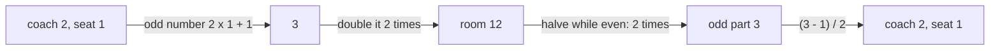

# Cardinal arithmetic: alephs, why aleph-null plus or times aleph-null is aleph-null, and two to the aleph-null is the line

[Syllabus](../../../SYLLABUS.md) → [Foundations](../README.md) → [Sizes of Infinity](../README.md#s09) → Cardinal arithmetic

---

## General Overview

The hotel has a room for every counting number, every room full. A second full hotel closes and its guests move in. The clerk doubles every room number: his guest from room 7 moves to 14. Each newcomer takes the odd room just below: the newcomer from room 7 takes 13.

The hotel empties. Then come endless coaches of endless seats, numbered from 0. Coach m, seat n takes room $`2^m \times (2n + 1)`$. Coach 0, seat 0 takes room 1; coach 2, seat 1 takes room 12.

Merging adds sizes; coaches multiply them. Both fit. The endless 0-1 lists do not. A 0-1 list marks each room 1 or 0: a guest list.

**An infinite size added to or multiplied by itself stays the same, so sums and nonzero products with an infinite size go to the bigger one; only powers climb.**

**What kind of fact this is:** theorems, proved in Why it works; the rule for every infinite size rests on the axiom of choice.

### The picture: the coach rule, both ways



Each room splits one way only into doublings and an odd part.

---

## The formula

The size of the counting numbers is $`\aleph_0`$, "aleph-null". Aleph is a Hebrew letter; the small 0 marks the first infinite size.

```math
\aleph_0 + \aleph_0 = \aleph_0, \qquad \aleph_0 \times \aleph_0 = \aleph_0, \qquad 2^{\aleph_0} > \aleph_0
```

**Read it aloud:** two hotels fit in one, endless coaches of guests fit in one, but the 0-1 lists never fit.

- **Add:** the size of two separate sets put together.
- **Multiply:** the size of all pairs, one from each set: coach and seat.
- **Raise 2 to a size:** the size of all 0-1 lists with one entry per member. Three members give 8 lists, as $`2^3`$ in [Exponents](../03-Powers%2C%20Roots%20and%20Logarithms/01-exponents-and-powers.md).

For every infinite size $`\kappa`$:

```math
\kappa \times \kappa = \kappa
```

| Symbol | Plain meaning | In our example | Push it up and the answer… |
| --- | --- | --- | --- |
| $`\aleph_0`$ | aleph-null: size of the counting numbers | the rooms | — |
| $`\kappa`$, $`\lambda`$ | kappa, lambda: any sizes, kappa infinite | the line, the rooms | the sum goes to the bigger |
| $`2^{\aleph_0}`$ | size of all endless 0-1 lists | the points of the line | — |
| $`\aleph_1`$ | aleph-one: the next size above $`\aleph_0`$ | at most the line | — |
| m | the coach, from 0 | 2 | the room doubles |
| n | the seat, from 0 | 1 | the room climbs by $`2^{m+1}`$ per seat |

### When it holds

- **Separate sets when adding.** Shared guests count once.
- **At least one size infinite.** Finite sizes give 3 + 4 = 7 and 3 x 4 = 12: nothing collapses.
- **No zero in a product.** Zero coaches carry zero guests.
- **Choice, beyond the counting numbers.** The general law needs every set in a well-order.

---

## Why it works

### Step 0: arithmetic on sizes is pairing

A sum, product or power is a set, sized by pairing it with a known one ([Same size means pairable](01-same-size-by-pairing.md)).

### Step 1: two hotels make one

Evens take one hotel, odds the other, one guest per room. So $`\aleph_0 + \aleph_0 = \aleph_0`$.

### Step 2: coaches of seats make one

Halve the room number while it is even; the halvings count the coach m. The odd part left is 2n + 1, which gives the seat n. Room 12 halves 2 times to 3: coach 2, seat 1.

Each room splits one way only: $`\aleph_0 \times \aleph_0 = \aleph_0`$. [Countable sets](02-countable-sets.md) showed this first, with the fraction grid.

### Step 3: any infinite size times itself is itself

A second road: queue the pairs in **shells** by their larger number, then by first number, then second. For the counting numbers each shell is finite, so every pair is reached. Pair (2,1) sits at place 8.

Beyond the counting numbers, the set must first stand in a **well-order**: a queue where every non-empty part has a first member ([Zorn's lemma and the well-ordering theorem](08-zorns-lemma-and-well-ordering.md)). Its **cardinal** is the least ordinal that pairs with it ([Ordinals](06-ordinals.md)). $`\aleph_1`$ is the first ordinal that is not countable.

<details>
<summary>The shell proof for every infinite size</summary>

Suppose $`\kappa`$ is the smallest infinite cardinal with $`\kappa \times \kappa`$ bigger than $`\kappa`$. Queue its pairs in shells.

Pairs ahead of a pair use only members up to its larger member. Those are fewer than $`\kappa`$, as $`\kappa`$ is the least ordinal of its size. Their pairs are then finite in number, or no more than those members, as $`\kappa`$ was the smallest failure.

Every pair has fewer than $`\kappa`$ ahead, so its place is below $`\kappa`$ (a place at $`\kappa`$ or later has at least $`\kappa`$ ahead). So the pairs fit inside $`\kappa`$: a contradiction.

</details>

### Step 4: the quick rule

Let $`\kappa`$ be infinite and $`\lambda`$ no bigger, not 0:

```math
\kappa \le \kappa + \lambda \le \kappa + \kappa \le \kappa \times \kappa = \kappa, \qquad \kappa \le \kappa \times \lambda \le \kappa \times \kappa = \kappa
```

Fitting both ways means equal ([Comparing infinities](04-comparing-infinities.md)), so sum and product are $`\kappa`$. The plane is pairs of points of the line, so the same size as the line.

### Step 5: powers climb, and 2 to the aleph-null is the line

A 0-1 list is a guest list: which rooms are in. Guest lists outnumber rooms ([Comparing infinities](04-comparing-infinities.md), built on [Cantor's diagonal](03-cantors-diagonal-argument.md)). So $`2^{\aleph_0} > \aleph_0`$.

Read a list as binary digits after a point: 0.0101… is 1/3 (0.333333…). A few points get two lists: 0.1000… and 0.0111… both give 0.500000. Those doubles are countable, and Step 4 absorbs them. So the lists match the points from 0 to 1, and that stretch fits the whole line both ways.

$`\aleph_1`$ is the next size after $`\aleph_0`$, so it is at most the line. Is $`2^{\aleph_0}`$ equal to $`\aleph_1`$? Standard set theory cannot say.

---

## Worked numbers, by hand

| Step | Arithmetic | Value |
| --- | --- | --- |
| merge: own guest, room 7 | 2 x 7 | 14 |
| merge: newcomer, room 7 | 2 x 7 − 1 | 13 |
| coach 0, seat 0 | $`2^0 \times (2 \times 0 + 1)`$ | 1 |
| coach 2, seat 1 | $`2^2 \times (2 \times 1 + 1)`$ | 12 |
| coach 3, seat 4 | $`2^3 \times (2 \times 4 + 1)`$ | 72 |
| room 12, back | halve 2 times to 3, then (3 − 1) / 2 | **coach 2, seat 1** |
| pair (2,1) in shells | (0,0); (0,1), (1,0), (1,1); (0,2), (1,2), (2,0), (2,1) | **place 8** |

Every guest gets one room and every room one guest.

### What breaks if you drop a piece

| Mistake | Comes out at | What went wrong |
| --- | --- | --- |
| Room = m + n + 1 | 100 guests in 19 rooms | coach 0 seat 1 meets coach 1 seat 0 |
| Room = $`2^m \times (n + 1)`$ | 100 guests in 55 rooms | splits stop being unique |
| $`\aleph_0 - \aleph_0 = 0`$ | 50 of rooms 1 to 100 still full | the odd rooms stay full |

---

## Code, from first principles, and it actually runs

One road houses 1000 coach guests and decodes every room. The second checks the shell formula against a plain sort of 900 pairs.

### Python

```python
# Cardinal arithmetic -- the check behind the card.  Nothing is imported.  The full
# hotel takes a second hotel, then a coach of coaches; then the 0-1 lists outgrow it.
def coach(m, n): return 2 ** m * (2 * n + 1)          # coach m, seat n -> room
def back(r):                                           # room -> (coach, seat): halve out the 2s
    m = 0
    while r % 2 == 0: r, m = r // 2, m + 1
    return m, (r - 1) // 2
def place(m, n):                                       # the same pairs, queued shell by shell
    k = max(m, n); return k * k + (m if m < k else k + n) + 1
merged = sorted([2 * n for n in range(1, 501)] + [2 * n - 1 for n in range(1, 501)])
rooms = sorted(coach(m, n) for m in range(10) for n in range(500) if coach(m, n) <= 1000)
shells = sorted((max(m, n), m, n) for m in range(30) for n in range(30))   # second road: sort
places = [place(m, n) for k, m, n in shells]
print(f"merge: hotel A room 7 -> {2 * 7}, hotel B room 7 -> {2 * 7 - 1}; rooms 1-1000 filled once: {len(set(merged))}")
print(f"coaches: (0,0) -> room {coach(0, 0)}, (2,1) -> room {coach(2, 1)}, (3,4) -> room {coach(3, 4)}")
print(f"room 12 -> halve {back(12)[0]} times -> odd part {12 // 2 ** back(12)[0]} -> coach {back(12)[0]}, seat {back(12)[1]}")
print(f"coach rule: guests landing in rooms 1-1000: {len(rooms)}, different rooms: {len(set(rooms))}")
print(f"shells by max: pairs below 30: {len(places)}, places used once: {len(set(places))}, (2,1) at place {place(2, 1)}")
lists = [format(i, "03b") for i in range(2 ** 3)]
print(f"finite: 3 + 4 = {len(['a'] * 3 + ['b'] * 4)}, 3 x 4 = {len([(c, s) for c in range(3) for s in range(4)])}, 0-1 lists of length 3: {len(set(lists))}")
third, half_a, half_b = sum(2.0 ** -i for i in range(2, 60, 2)), 0.5, sum(2.0 ** -i for i in range(2, 60))
print(f"binary lists as points: 0.0101... = {third:.6f}; 0.1000... = {half_a:.6f}, 0.0111... = {half_b:.6f}")
plus, noodd = (len({f(m, n) for m in range(10) for n in range(10)}) for f in (lambda m, n: m + n + 1, lambda m, n: 2 ** m * (n + 1)))
left = len([r for r in range(1, 101) if r % 2 == 1])   # the even rooms emptied
print(f"mistakes: room m+n+1 puts 100 guests in {plus} rooms; room 2^m(n+1) in {noodd}; evens out leaves {left} of rooms 1-100 full")
assert merged == list(range(1, 1001)) and rooms == list(range(1, 1001))
assert all(coach(*back(r)) == r for r in range(1, 1001)) and back(12) == (2, 1)
assert places == list(range(1, 901)) and place(2, 1) == 8                    # formula = sorted order
assert abs(third - 1 / 3) < 1e-12 and abs(half_b - half_a) < 1e-12 and plus == 2 * 10 - 1 and noodd == 55 and left == 50
print("ALL CHECKS PASS")
```

**Ran 2026-11-23 on macOS, Python 3.14.10, standard library only. All checks passed. Output, pasted from the run:**

```
merge: hotel A room 7 -> 14, hotel B room 7 -> 13; rooms 1-1000 filled once: 1000
coaches: (0,0) -> room 1, (2,1) -> room 12, (3,4) -> room 72
room 12 -> halve 2 times -> odd part 3 -> coach 2, seat 1
coach rule: guests landing in rooms 1-1000: 1000, different rooms: 1000
shells by max: pairs below 30: 900, places used once: 900, (2,1) at place 8
finite: 3 + 4 = 7, 3 x 4 = 12, 0-1 lists of length 3: 8
binary lists as points: 0.0101... = 0.333333; 0.1000... = 0.500000, 0.0111... = 0.500000
mistakes: room m+n+1 puts 100 guests in 19 rooms; room 2^m(n+1) in 55; evens out leaves 50 of rooms 1-100 full
ALL CHECKS PASS
```

### Rust

Same numbers, same labels.

```rust
// Cardinal arithmetic -- the same check as cardinal_arithmetic_check.py, in Rust.  No crates.
// The full hotel takes a second hotel, then a coach of coaches; then the 0-1 lists outgrow it.
use std::collections::BTreeSet;
fn coach(m: u64, n: u64) -> u64 { (1u64 << m) * (2 * n + 1) }   // coach m, seat n -> room
fn back(mut r: u64) -> (u64, u64) {                               // room -> (coach, seat)
    let mut m = 0;
    while r % 2 == 0 { r /= 2; m += 1; }
    (m, (r - 1) / 2)
}
fn place(m: u64, n: u64) -> u64 { let k = m.max(n); k * k + if m < k { m } else { k + n } + 1 }
fn main() {
    let sorted = |mut v: Vec<u64>| { v.sort(); v };
    let merged = sorted((1..=500).map(|n| 2 * n).chain((1..=500).map(|n| 2 * n - 1)).collect());
    let rooms = sorted((0..10).flat_map(|m| (0..500).map(move |n| coach(m, n))).filter(|&r| r <= 1000).collect());
    let mut shells: Vec<(u64, u64, u64)> = (0..30).flat_map(|m| (0..30).map(move |n| (m.max(n), m, n))).collect();
    shells.sort();                                                // second road: sort
    let places: Vec<u64> = shells.iter().map(|&(_, m, n)| place(m, n)).collect();
    let count = |v: &Vec<u64>| v.iter().collect::<BTreeSet<_>>().len();
    println!("merge: hotel A room 7 -> {}, hotel B room 7 -> {}; rooms 1-1000 filled once: {}", 2 * 7, 2 * 7 - 1, count(&merged));
    println!("coaches: (0,0) -> room {}, (2,1) -> room {}, (3,4) -> room {}", coach(0, 0), coach(2, 1), coach(3, 4));
    let (m12, s12) = back(12);
    println!("room 12 -> halve {} times -> odd part {} -> coach {}, seat {}", m12, 12 >> m12, m12, s12);
    println!("coach rule: guests landing in rooms 1-1000: {}, different rooms: {}", rooms.len(), count(&rooms));
    println!("shells by max: pairs below 30: {}, places used once: {}, (2,1) at place {}", places.len(), count(&places), place(2, 1));
    let lists: BTreeSet<String> = (0..8).map(|i| format!("{:03b}", i)).collect();
    let pairs = (0..3).flat_map(|c| (0..4).map(move |s| (c, s))).count();
    println!("finite: 3 + 4 = {}, 3 x 4 = {}, 0-1 lists of length 3: {}", [1; 3].iter().chain([2; 4].iter()).count(), pairs, lists.len());
    let third: f64 = (2..60).step_by(2).map(|i| 2f64.powi(-i)).sum();   // 0.010101... in binary
    let (half_a, half_b): (f64, f64) = (0.5, (2..60).map(|i| 2f64.powi(-i)).sum());
    println!("binary lists as points: 0.0101... = {:.6}; 0.1000... = {:.6}, 0.0111... = {:.6}", third, half_a, half_b);
    let plus = (0..10u64).flat_map(|m| (0..10).map(move |n| m + n + 1)).collect::<BTreeSet<_>>().len();
    let noodd = (0..10u64).flat_map(|m| (0..10).map(move |n| (1u64 << m) * (n + 1))).collect::<BTreeSet<_>>().len();
    let left = (1..=100).filter(|r| r % 2 == 1).count();          // the even rooms emptied
    println!("mistakes: room m+n+1 puts 100 guests in {} rooms; room 2^m(n+1) in {}; evens out leaves {} of rooms 1-100 full", plus, noodd, left);
    assert!(merged == (1..=1000).collect::<Vec<u64>>() && rooms == (1..=1000).collect::<Vec<u64>>());
    assert!((1..=1000).all(|r| { let (m, n) = back(r); coach(m, n) == r }) && back(12) == (2, 1));
    assert!(places == (1..=900).collect::<Vec<u64>>() && place(2, 1) == 8);   // formula = sorted order
    assert!((third - 1.0 / 3.0).abs() < 1e-12 && (half_b - half_a).abs() < 1e-12 && plus == 2 * 10 - 1 && noodd == 55 && left == 50);
    println!("ALL CHECKS PASS");
}
```

**Ran 2026-11-23 on macOS, rustc 1.98.1, no crates. All checks passed. Output, pasted from the run:**

```
merge: hotel A room 7 -> 14, hotel B room 7 -> 13; rooms 1-1000 filled once: 1000
coaches: (0,0) -> room 1, (2,1) -> room 12, (3,4) -> room 72
room 12 -> halve 2 times -> odd part 3 -> coach 2, seat 1
coach rule: guests landing in rooms 1-1000: 1000, different rooms: 1000
shells by max: pairs below 30: 900, places used once: 900, (2,1) at place 8
finite: 3 + 4 = 7, 3 x 4 = 12, 0-1 lists of length 3: 8
binary lists as points: 0.0101... = 0.333333; 0.1000... = 0.500000, 0.0111... = 0.500000
mistakes: room m+n+1 puts 100 guests in 19 rooms; room 2^m(n+1) in 55; evens out leaves 50 of rooms 1-100 full
ALL CHECKS PASS
```

### Lean

Lean assumes choice and proves the size rules for every infinite size, the hotel facts for aleph-null, and the small room counts.

- Take any infinite size $`\kappa`$. Then $`\kappa + \kappa = \kappa`$ and $`\kappa \times \kappa = \kappa`$.
- Take $`\kappa`$ infinite and $`\lambda`$ no bigger. Then $`\kappa + \lambda = \kappa`$, and $`\kappa \times \lambda = \kappa`$ when $`\lambda`$ is not 0.
- Merge two full hotels, or seat endless coaches. Then $`\aleph_0 + \aleph_0 = \aleph_0`$ and $`\aleph_0 \times \aleph_0 = \aleph_0`$.
- Take all endless 0-1 lists. Then $`2^{\aleph_0} > \aleph_0`$, and $`2^{\aleph_0}`$ is the size of the line.
- The merge sends room 7 to rooms 14 and 13. The coach rule gives rooms 1, 12 and 72.
- Room 12 decodes to coach 2, seat 1. Pair (2,1) sits at place 8 in the shells.
- The coach rule puts 100 guests in 100 rooms. The two mistakes give 19 and 55 rooms.
- Emptying the even rooms leaves 50 of rooms 1 to 100 full.
- Take finite sizes 3 and 4. Then 3 + 4 = 7 and 3 x 4 = 12, and three members give 8 lists.

Housing all 1000 guests, checking the shells against a sort, and the binary points stay with the Python and Rust checks.

```lean
-- Cardinal arithmetic: an infinite size added to or multiplied by itself stays the same, sums and products go to the bigger size, and two to the aleph-null is strictly bigger and equals the size of the line.
import Mathlib.SetTheory.Cardinal.Arithmetic
import Mathlib.SetTheory.Cardinal.Continuum
import Mathlib.Analysis.Real.Cardinality

open Cardinal

/-- An infinite size added to itself or multiplied by itself stays the same size:
for every infinite cardinal `κ`, `κ + κ = κ` and `κ × κ = κ`. -/
theorem infinite_add_self_and_mul_self {κ : Cardinal} (hκ : ℵ₀ ≤ κ) :
    κ + κ = κ ∧ κ * κ = κ := by
  exact ⟨add_eq_self hκ, mul_eq_self hκ⟩

/-- The quick rule: if `κ` is infinite and `λ` is no bigger, then `κ + λ = κ`;
if also `λ` is not zero, then `κ × λ = κ`. Sums and products go to the bigger size. -/
theorem sum_and_product_go_to_bigger {κ μ : Cardinal} (hκ : ℵ₀ ≤ κ) (hμ : μ ≤ κ) :
    κ + μ = κ ∧ (μ ≠ 0 → κ * μ = κ) := by
  exact ⟨add_eq_left hκ hμ, fun h => mul_eq_left hκ hμ h⟩

/-- The card's formula: aleph-null plus aleph-null is aleph-null, aleph-null times
aleph-null is aleph-null, but two to the aleph-null is strictly bigger and is the
size of the real line. -/
theorem aleph0_add_mul_and_two_pow_is_the_line :
    ℵ₀ + ℵ₀ = ℵ₀ ∧ ℵ₀ * ℵ₀ = ℵ₀ ∧ ℵ₀ < (2 : Cardinal) ^ ℵ₀ ∧ (2 : Cardinal) ^ ℵ₀ = #ℝ := by
  exact ⟨aleph0_add_aleph0, aleph0_mul_aleph0, cantor ℵ₀, by rw [two_power_aleph0, mk_real]⟩

-- Merging hotels: own guest in room 7 moves to 14, the newcomer from room 7 takes 13.
example : 2 * 7 = 14 ∧ 2 * 7 - 1 = 13 := by decide
-- The coach rule, room 2^m (2n + 1): (0,0) → 1, (2,1) → 12, (3,4) → 72.
example : 2 ^ 0 * (2 * 0 + 1) = 1 ∧ 2 ^ 2 * (2 * 1 + 1) = 12 ∧ 2 ^ 3 * (2 * 4 + 1) = 72 := by
  decide
-- Room 12 back: halve 2 times to the odd part 3, then (3 - 1) / 2 = 1: coach 2, seat 1.
example : 12 / 2 = 6 ∧ 6 / 2 = 3 ∧ 3 % 2 = 1 ∧ (3 - 1) / 2 = 1 := by decide
-- The coach rule sends the 100 guests of coaches 0-9, seats 0-9 to 100 different rooms.
set_option maxRecDepth 100000 in
example : ((Finset.range 10 ×ˢ Finset.range 10).image
    (fun p : ℕ × ℕ => 2 ^ p.1 * (2 * p.2 + 1))).card = 100 := by decide
-- Shells by the larger number: pair (2,1) sits at place 8.
example : (fun m n : ℕ => max m n * max m n + (if m < max m n then m else max m n + n) + 1) 2 1 = 8 := by
  decide
-- Mistakes: room m + n + 1 puts 100 guests in 19 rooms; room 2^m (n + 1) in 55.
set_option maxRecDepth 100000 in
example : ((Finset.range 10 ×ˢ Finset.range 10).image (fun p : ℕ × ℕ => p.1 + p.2 + 1)).card = 19 := by
  decide
set_option maxRecDepth 100000 in
example : ((Finset.range 10 ×ˢ Finset.range 10).image
    (fun p : ℕ × ℕ => 2 ^ p.1 * (p.2 + 1))).card = 55 := by decide
-- Emptying the even rooms leaves 50 of rooms 1-100 full.
set_option maxRecDepth 100000 in
example : ((Finset.Icc 1 100).filter (fun r => r % 2 = 1)).card = 50 := by decide
-- Finite sizes do not collapse: 3 + 4 = 7, 3 × 4 = 12, and 8 lists of 0s and 1s of length 3.
example : 3 + 4 = 7 ∧ 3 * 4 = 12 ∧ Fintype.card (Fin 3 → Bool) = 8 := by decide

#print axioms infinite_add_self_and_mul_self
#print axioms sum_and_product_go_to_bigger
#print axioms aleph0_add_mul_and_two_pow_is_the_line
```

**Checked 2026-11-23 on macOS, Lean 4.36.0-rc2, Mathlib v4.36.0-rc2. Every proof is complete and uses only Lean's standard axioms. Output, pasted from the run:**

```
'infinite_add_self_and_mul_self' depends on axioms: [propext, Classical.choice, Quot.sound]
'sum_and_product_go_to_bigger' depends on axioms: [propext, Classical.choice, Quot.sound]
'aleph0_add_mul_and_two_pow_is_the_line' depends on axioms: [propext, Classical.choice, Quot.sound]
```

> [!TIP]
> **Try changing**
> Guess first, then run it.
> - **Drop the odd part.** Make the coach rule `2 ** m * (n + 1)`. Rooms are shared; the first assert stops it.
> - **Shells by sum.** Sort by `m + n`, not `max(m, n)`: the third assert stops it.
> - **Shift the list.** Use `range(1, 60, 2)`. The point is two thirds; the last assert stops it.

---

## The usual mistake

> [!warning]
> **Cancelling alephs.** $`\aleph_0 + \aleph_0 = \aleph_0 + 0`$, yet $`\aleph_0`$ is not 0. Subtraction has no single answer: empty the even rooms and 50 of rooms 1 to 100 stay full.
>
> - Adding coach and seat: 100 guests in 19 rooms.
> - Thinking powers collapse like products. $`2^{\aleph_0}`$ is strictly bigger.
> - Mixing in ordinals. A late guest makes a longer queue ([Ordinals](06-ordinals.md)), not more guests.

---

## Where you meet it in real life

- **Storing pairs under one key.** The coach rule turns two counting numbers into one, reversibly.
- **What programs can name.** Programs are finite texts, only $`\aleph_0`$ of them, so most reals have no program printing them.

> **Say it back**
> Adding merges separate sets, multiplying takes pairs, raising 2 takes all 0-1 lists. Two full hotels fit in one by evens and odds. Coaches fit by room $`2^m \times (2n + 1)`$. With choice, an infinite size times itself is itself. Only powers climb: the 0-1 lists outnumber the rooms and match the line.

---

## What this builds on

- [Ordinals](06-ordinals.md): a cardinal is the least ordinal of its size.
- [Zorn's lemma and the well-ordering theorem](08-zorns-lemma-and-well-ordering.md): every set has a well-order.
- [Comparing infinities](04-comparing-infinities.md): fitting both ways means equal; guest lists beat rooms.
- [Countable sets](02-countable-sets.md): the queue that defines $`\aleph_0`$.
- [Cantor's diagonal](03-cantors-diagonal-argument.md): the line cannot be listed.

## Where this goes next

- [The continuum hypothesis](../../25-Frontier/06-Algebra%2C%20Logic%20and%20Computation/02-continuum-hypothesis-and-independence.md): whether $`2^{\aleph_0} = \aleph_1`$, and why standard set theory cannot settle it.
- [Compactness and Lowenheim-Skolem](../../24-Computability%20and%20complexity/02-Computability%20and%20Logic/13-compactness-and-lowenheim-skolem.md): first-order rules hold somewhere if every finite part does, and none can fix an infinite size.

This card closes Foundations. The two links above carry sizes of infinity further, into later wings. The reading order goes on with [Divides](../../02-Number%20theory/01-Divisibility%20and%20Primes/01-divides.md), the first card of Number theory, which starts again from whole numbers.

Left open: which aleph is the line?

---

## Sources

Verified 2026-11-23: every link below resolves to the publisher's page.

- Halmos, Paul R. *Naive Set Theory*. Springer, 1974. [doi:10.1007/978-1-4757-1645-0](https://doi.org/10.1007/978-1-4757-1645-0). Sections 24 and 25: sums, products and powers of cardinals, and cardinals as least ordinals.
- Cantor, Georg. "Beiträge zur Begründung der transfiniten Mengenlehre." *Mathematische Annalen* 46 (1895): 481–512. [doi:10.1007/BF02124929](https://doi.org/10.1007/BF02124929). Aleph-null, and sums, products and powers of sizes, first defined.
