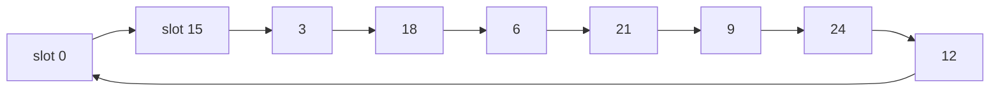

# Coprime numbers: sharing no factor but 1, and why that one condition unlocks so much

[Syllabus](../../../SYLLABUS.md) → [Number theory](../README.md) → [Greatest Common Divisor and Euclid's Algorithm](../README.md#s02) → Coprime numbers

---

## General Overview

A small gear with 15 teeth drives a bigger one with 28 teeth. Number the teeth 0 to 14 and the slots 0 to 27. Tooth 0 drops into slot 0. One full turn of the small gear advances the big one 15 slots, so tooth 0 comes back down at slot 15, then 2, then 17.

Keep turning. Tooth 0 visits all 28 slots before it repeats, and so does every tooth: 420 tooth-and-slot pairings, all 420 used, so a rough tooth wears a little off every slot.

Swap in a 27-tooth gear. Tooth 0 now meets slots 0, 15, 3, 18, 6, 21, 9, 24, 12 — nine of them — then repeats forever. Only 135 of the 405 pairings happen, and the tooth grinds those nine slots.

One number does that: 15 and 27 both divide by 3; 15 and 28 divide by nothing but 1.

**Two numbers are coprime when the only whole number that divides both of them is 1 — their greatest common divisor is 1.**

**What kind of fact this is:** a definition, then a theorem proved in Why it works: a pair is coprime exactly when some whole-number mix of the two equals 1.

### The picture: where tooth 0 can land on the 27-gear



Each arrow is one turn of the small gear: nine slots, all multiples of 3, then back to the start. On the 28-tooth gear the walk visits all 28.

---

## The formula

The whole test is one number:

**the greatest common divisor of 15 and 28 = 1**

The greatest common divisor, gcd for short, is the biggest whole number going into both with nothing left over ([Greatest common divisor](01-gcd.md)). When it is 1 the pair is **coprime**.

The same fact in the form that does the work:

**28 × 7 − 15 × 13 = 1**

**Read it aloud:** seven 28s take away thirteen 15s lands exactly on 1 — only a coprime pair can.

| Piece | Plain meaning | In our gears |
| --- | --- | --- |
| a common factor | goes into both, nothing over | 1 for 15 and 28; 1 and 3 for 15 and 27 |
| greatest common divisor | the biggest common factor ([Greatest common divisor](01-gcd.md)) | 1 here, 3 for 15 and 27 |
| coprime | that divisor is 1 | 15 and 28 |
| a whole-number mix | so many of one, less so many of the other ([Bezout's identity](04-bezouts-identity.md)) | 28 × 7 − 15 × 13 |

### When it holds

- **Whole numbers.** The test counts whole teeth and whole helpings. Allow fractions and any two numbers mix to 1, so the test says nothing.
- **The mix may take away.** 28 × 7 − 15 × 13 reaches 1 only by taking thirteen 15s away. Adding alone, 15s and 28s never make 1.
- **The shared factor is exactly 1.** At 3, as with 15 and 27, the smallest mix is 3 and tooth 0 meets only 9 of the 27 slots.

---

## Why it works

### Step 0: a shared factor rules everything you build

3 goes into 15 five times and into 27 nine times, so both are whole numbers of 3s. Mix them however you like: the total is still a whole number of 3s, never 1. The smallest they build is 3 itself: 27 × 4 − 15 × 7 = 3.

### Step 1: coprime is exactly "some mix of them equals 1"

Forward: Bezout's identity ([Bezout's identity](04-bezouts-identity.md)) says the greatest common divisor is always a mix of the two. For 15 and 28 it is 1, so some mix is 1: 28 × 7 − 15 × 13.

Back: suppose a mix equals 1. Anything dividing both numbers divides everything built from them, so it divides that mix, so it divides 1 — so it is 1. A direct proof ([Direct proof](../../01-Foundations/06-Proof/01-direct-proof.md)), three lines. **Coprime is a licence to build 1**, not merely a shortage of shared factors.

### Step 2: neighbours are always coprime

28 − 27 = 1 is already a mix equal to 1, so 27 and 28 are coprime. Nothing about them was special: any neighbours are.

### Step 3: lowest terms means coprime

15/27 cancels: divide both by 3 to get 5/9. 15/28 does not cancel at all. A fraction is in lowest terms exactly when top and bottom are coprime ([Fractions](../../01-Foundations/01-Everyday%20Arithmetic/07-fractions.md)).

### Step 4: back to the gears

Tooth 0 comes home after a run of teeth that is a whole number of both counts: their least common multiple ([Least common multiple](02-lcm.md)), the counts multiplied then divided by the shared factor. Factor 1 gives the full 420; factor 3 gives 135 of the 405, and tooth 0 sees 9 slots.

---

## Worked numbers, by hand

| Step | Arithmetic | Value |
| --- | --- | --- |
| shared factor of 15 and 28 | Euclid ([Euclid's algorithm](03-euclidean-algorithm.md)) | **1** |
| the same, by a mix | 28 × 7 − 15 × 13 | **1** |
| pairings used, of 420 | 15 × 28 | **420** |
| shared factor of 15 and 27 | Euclid | **3** |
| slots tooth 0 meets, 27-gear | 0, 15, 3, 18, 6, 21, 9, 24, 12 | 9 |
| pairings used, of 405 | 15 × 9 | **135** |
| 15/27 in lowest terms | divide by 3 | **5/9** |

The coprime pair uses every pairing; the other, one in three.

### What breaks if you drop a piece

| Mistake | Comes out at | What went wrong |
| --- | --- | --- |
| Fitting a 27-tooth gear | 135 | The shared 3 costs two thirds of the pairings |
| Mixing 15 and 27 to get 1 | 3 | The smallest positive mix is the shared factor |
| Counting all 27 slots as met | 9 | Only multiples of 3 come round |

The code prints all three.

---

## Code, from first principles, and it actually runs

Nothing is imported. Each pair is done twice: Euclid's algorithm for the shared factor, and walking the small gear round the big one for the pairings. The mix is a third road.

### Python

```python
# Coprime numbers -- the check behind the card.  Nothing is imported.  Two
# meshing gears, 15 teeth and 28 teeth, then 15 and 27 for contrast.  Euclid
# finds the shared factor; a whole-number mix of the two is the second road.
def gcd(a, b):                       # Euclid: keep the remainder, repeat
    while b:
        a, b = b, a % b
    return a
def meets(small, big):               # slots of the big gear that tooth 0 meets
    seen, step = [0], small
    while step % big:
        seen.append(step % big)
        step += small
    return seen
def row(name, value):
    print(f"{name:<42}{value:>7}")
for small, big in ((15, 28), (15, 27)):
    g = gcd(small, big)
    met = meets(small, big)
    row(f"gcd of {small} and {big}, by Euclid", g)
    row(f"slots of the {big}-gear that tooth 0 meets", len(met))
    row(f"tooth pairs used, of the {small * big} there are", small * len(met))
    row(f"{small}/{big} in lowest terms", f"{small // g}/{big // g}")
row("the mix 28 x 7 - 15 x 13", 28 * 7 - 15 * 13)
row("the mix 27 x 4 - 15 x 7, the smallest", 27 * 4 - 15 * 7)
print("slots of the 27-gear tooth 0 meets: " + " ".join(str(t) for t in meets(15, 27)))
assert gcd(15, 28) == 1 and 28 * 7 - 15 * 13 == 1 and meets(15, 28)[:4] == [0, 15, 2, 17]
assert len(meets(15, 28)) == 28 and 15 * len(meets(15, 28)) == 15 * 28
assert gcd(15, 27) == 3 and len(meets(15, 27)) == 27 // 3 and 15 * len(meets(15, 27)) == 135
print("ALL CHECKS PASS")
```

**Ran 2026-09-06 on macOS, Python 3.14.6, standard library only. All checks passed. Output, pasted from the run:**

```
gcd of 15 and 28, by Euclid                     1
slots of the 28-gear that tooth 0 meets        28
tooth pairs used, of the 420 there are        420
15/28 in lowest terms                       15/28
gcd of 15 and 27, by Euclid                     3
slots of the 27-gear that tooth 0 meets         9
tooth pairs used, of the 405 there are        135
15/27 in lowest terms                         5/9
the mix 28 x 7 - 15 x 13                        1
the mix 27 x 4 - 15 x 7, the smallest           3
slots of the 27-gear tooth 0 meets: 0 15 3 18 6 21 9 24 12
ALL CHECKS PASS
```

### Rust

Same numbers, same labels, built with `rustc --edition 2021 -O`.

```rust
// Coprime numbers -- the same check as coprime_numbers_check.py, in Rust.  No
// crates.  Two meshing gears, 15 teeth and 28 teeth, then 15 and 27 for
// contrast.  Euclid finds the shared factor; a whole-number mix is the second road.
fn gcd(mut a: i64, mut b: i64) -> i64 {      // Euclid: keep the remainder, repeat
    while b != 0 { let r = a % b; a = b; b = r; }
    a
}
fn meets(small: i64, big: i64) -> Vec<i64> { // slots of the big gear that tooth 0 meets
    let (mut seen, mut step) = (vec![0], small);
    while step % big != 0 {
        seen.push(step % big);
        step += small;
    }
    seen
}
fn row(name: &str, value: &str) { println!("{:<42}{:>7}", name, value); }
fn main() {
    for (small, big) in [(15i64, 28i64), (15, 27)] {
        let g = gcd(small, big);
        let met = meets(small, big);
        row(&format!("gcd of {} and {}, by Euclid", small, big), &g.to_string());
        row(&format!("slots of the {}-gear that tooth 0 meets", big), &met.len().to_string());
        row(&format!("tooth pairs used, of the {} there are", small * big),
            &(small * met.len() as i64).to_string());
        row(&format!("{}/{} in lowest terms", small, big),
            &format!("{}/{}", small / g, big / g));
    }
    row("the mix 28 x 7 - 15 x 13", &(28 * 7 - 15 * 13).to_string());
    row("the mix 27 x 4 - 15 x 7, the smallest", &(27 * 4 - 15 * 7).to_string());
    let list: Vec<String> = meets(15, 27).iter().map(|t| t.to_string()).collect();
    println!("slots of the 27-gear tooth 0 meets: {}", list.join(" "));
    assert!(gcd(15, 28) == 1 && 28 * 7 - 15 * 13 == 1 && meets(15, 28)[..4] == [0, 15, 2, 17]);
    assert!(meets(15, 28).len() == 28 && 15 * meets(15, 28).len() == 15 * 28);
    assert!(gcd(15, 27) == 3 && meets(15, 27).len() == 27 / 3 && 15 * meets(15, 27).len() == 135);
    println!("ALL CHECKS PASS");
}
```

**Ran 2026-09-06 on macOS, rustc 1.98.1, no crates. All checks passed. Output, pasted from the run:**

```
gcd of 15 and 28, by Euclid                     1
slots of the 28-gear that tooth 0 meets        28
tooth pairs used, of the 420 there are        420
15/28 in lowest terms                       15/28
gcd of 15 and 27, by Euclid                     3
slots of the 27-gear that tooth 0 meets         9
tooth pairs used, of the 405 there are        135
15/27 in lowest terms                         5/9
the mix 28 x 7 - 15 x 13                        1
the mix 27 x 4 - 15 x 7, the smallest           3
slots of the 27-gear tooth 0 meets: 0 15 3 18 6 21 9 24 12
ALL CHECKS PASS
```

Both outputs match line for line.

### Lean

Lean proves all three claims for every pair of whole numbers, not just 15 with 28 and 27.

- Two whole numbers are coprime exactly when some whole-number mix of them equals 1. The mix may take away.
- Any two neighbours are coprime.
- A small gear drives a big one. Tooth 0 meets the big gear's slot count divided by the shared factor. So it meets every slot exactly when the counts are coprime.

It also checks the card's numbers exactly: the shared factors, the mixes, the slot lists, the pairings, 15/27 in lowest terms and the usual mistake. The lowest-terms rule in general and walking the gears turn by turn are left to the Python and Rust checks.

<details>
<summary>The Lean proof, 115 lines</summary>

```lean
-- Coprime numbers: two whole numbers have greatest common divisor 1 exactly when some whole-number mix of them equals 1, neighbours are always coprime, and a gear stepping a slots at a time round b slots meets exactly b ÷ gcd(a, b) of them, so all b when the counts are coprime.
import Mathlib.Data.Int.GCD
import Mathlib.RingTheory.Coprime.Lemmas
import Mathlib.Tactic.Linarith
import Mathlib.Tactic.Ring
import Mathlib.Data.Int.Interval
import Mathlib.Data.Set.Card
import Mathlib.Data.Rat.Defs
import Mathlib.Tactic.NormNum.GCD
import Mathlib.Tactic.NormNum.Prime

/-- Coprime is a licence to build 1. Two whole numbers a and b are coprime (their greatest common
divisor is 1) exactly when some whole-number mix of them, a × x + b × y with counts x and y that
may be negative, equals 1. -/
theorem coprime_iff_some_mix_equals_one (a b : ℤ) :
    Int.gcd a b = 1 ↔ ∃ x y : ℤ, a * x + b * y = 1 := by
  rw [← Int.isCoprime_iff_gcd_eq_one]
  constructor
  · rintro ⟨u, v, h⟩
    exact ⟨u, v, by linarith⟩
  · rintro ⟨x, y, h⟩
    exact ⟨x, y, by linarith⟩

/-- Neighbours are always coprime: for every whole number n, the only common divisor of n and
n + 1 is 1. -/
theorem neighbours_are_coprime (n : ℤ) : Int.gcd n (n + 1) = 1 := by
  rw [← Int.isCoprime_iff_gcd_eq_one]
  exact ⟨-1, 1, by ring⟩

/-- The gears. A small gear with a teeth drives a big gear with b slots, numbered 0 to b − 1.
After k turns of the small gear, tooth 0 drops into slot (k × a) mod b. Over all turns, tooth 0
meets exactly b ÷ gcd(a, b) different slots; so it meets every one of the b slots exactly when
a and b are coprime. -/
theorem slots_met_by_tooth_zero (a b : ℕ) (hb : 0 < b) :
    Set.ncard {s : ℕ | ∃ k : ℕ, k * a % b = s} = b / Nat.gcd a b ∧
      (Set.ncard {s : ℕ | ∃ k : ℕ, k * a % b = s} = b ↔ Nat.Coprime a b) := by
  have hg : 0 < Nat.gcd a b := Nat.gcd_pos_of_pos_right a hb
  have hgb : Nat.gcd a b ∣ b := Nat.gcd_dvd_right a b
  have hS : {s : ℕ | ∃ k : ℕ, k * a % b = s} =
      (fun m => Nat.gcd a b * m) '' Set.Iio (b / Nat.gcd a b) := by
    ext s
    simp only [Set.mem_ofPred_eq, Set.mem_image, Set.mem_Iio]
    constructor
    · rintro ⟨k, rfl⟩
      have hd : Nat.gcd a b ∣ k * a % b :=
        (Nat.dvd_mod_iff hgb).2 (Dvd.dvd.mul_left (Nat.gcd_dvd_left a b) k)
      obtain ⟨m, hm⟩ := hd
      refine ⟨m, ?_, hm.symm⟩
      rw [Nat.lt_div_iff_mul_lt' hgb, ← hm]
      exact Nat.mod_lt _ hb
    · rintro ⟨m, hm, rfl⟩
      rw [Nat.lt_div_iff_mul_lt' hgb] at hm
      rcases Nat.eq_zero_or_pos m with rfl | hm0
      · exact ⟨0, by simp⟩
      · have hlt : Nat.gcd a b < b := by
          calc Nat.gcd a b = Nat.gcd a b * 1 := (mul_one _).symm
            _ ≤ Nat.gcd a b * m := Nat.mul_le_mul_left _ hm0
            _ < b := hm
        obtain ⟨x, -, hx⟩ := Nat.exists_mul_mod_eq_gcd hlt
        refine ⟨x * m, ?_⟩
        calc x * m * a % b = (a * x % b) * m % b := by
              rw [Nat.mod_mul_mod]
              congr 1
              ring
          _ = Nat.gcd a b * m % b := by rw [hx]
          _ = Nat.gcd a b * m := Nat.mod_eq_of_lt hm
  have hcard : Set.ncard {s : ℕ | ∃ k : ℕ, k * a % b = s} = b / Nat.gcd a b := by
    rw [hS, Set.ncard_image_of_injective _ (fun x y h => Nat.eq_of_mul_eq_mul_left hg h)]
    have : Set.Iio (b / Nat.gcd a b) = ((Finset.range (b / Nat.gcd a b) : Finset ℕ) : Set ℕ) := by
      ext; simp
    rw [this, Set.ncard_coe_finset, Finset.card_range]
  refine ⟨hcard, ?_⟩
  rw [hcard, Nat.div_eq_self]
  constructor
  · rintro (h | h)
    · omega
    · exact h
  · intro h
    exact Or.inr h

-- The card's gears: 15 and 28 share only 1; 15 and 27 share 3.
example : Nat.gcd 15 28 = 1 ∧ Nat.Coprime 15 28 := by norm_num
example : Nat.gcd 15 27 = 3 ∧ ¬ Nat.Coprime 15 27 := by norm_num
-- The mix: seven 28s take away thirteen 15s lands on 1.
example : (28 : ℤ) * 7 - 15 * 13 = 1 := by decide
-- 15 and 27: the smallest mix is 3.
example : (27 : ℤ) * 4 - 15 * 7 = 3 := by decide
-- Counts from -9 to 9 never mix 15 and 27 to 1 or 2.
example : ∀ i ∈ Finset.Icc (-9 : ℤ) 9, ∀ j ∈ Finset.Icc (-9 : ℤ) 9,
    15 * i + 27 * j ≠ 1 ∧ 15 * i + 27 * j ≠ 2 := by decide
-- Adding alone (counts 0 to 9), 15s and 28s never make 1.
example : ∀ i ∈ Finset.range 10, ∀ j ∈ Finset.range 10, 15 * i + 28 * j ≠ 1 := by decide
-- On the 28-gear tooth 0 starts at slots 0, 15, 2, 17 and meets all 28 slots.
example : (List.range 4).map (fun k => k * 15 % 28) = [0, 15, 2, 17] := by decide
example : ((Finset.range 28).image (fun k => k * 15 % 28)).card = 28 := by decide
-- On the 27-gear tooth 0 meets only nine slots, all multiples of 3.
example : (List.range 9).map (fun k => k * 15 % 27) = [0, 15, 3, 18, 6, 21, 9, 24, 12] := by
  decide
example : (Finset.range 27).image (fun k => k * 15 % 27) = {0, 15, 3, 18, 6, 21, 9, 24, 12} := by
  decide
-- Pairings used: 15 × 28 = 420 of 420, and 15 × 9 = 135 of 405.
example : 15 * 28 = 420 ∧ 15 * 27 = 405 ∧ 15 * 9 = 135 := by decide
example : Nat.lcm 15 28 = 420 ∧ Nat.lcm 15 27 = 135 := by norm_num
-- Neighbours 27 and 28: 28 − 27 = 1, so they are coprime.
example : (28 : ℤ) - 27 = 1 ∧ Nat.Coprime 27 28 := by norm_num
-- Lowest terms: 15/27 cancels to 5/9; 15/28 does not cancel.
example : (15 : ℚ) / 27 = 5 / 9 := by norm_num
example : ((15 : ℚ) / 28).num = 15 ∧ ((15 : ℚ) / 28).den = 28 := by
  decide +kernel
-- Neither 15 nor 28 is prime, yet they are coprime.
example : ¬ Nat.Prime 15 ∧ ¬ Nat.Prime 28 ∧ Nat.Coprime 15 28 := by norm_num

#print axioms coprime_iff_some_mix_equals_one
#print axioms neighbours_are_coprime
#print axioms slots_met_by_tooth_zero
```

</details>

**Checked 2026-11-11 on macOS, Lean 4.36.0-rc2, Mathlib v4.36.0-rc2. Every proof is complete and uses only Lean's standard axioms. Output, pasted from the run:**

```
'coprime_iff_some_mix_equals_one' depends on axioms: [propext, Classical.choice, Quot.sound]
'neighbours_are_coprime' depends on axioms: [propext, Classical.choice, Quot.sound]
'slots_met_by_tooth_zero' depends on axioms: [propext, Classical.choice, Quot.sound]
```

> [!TIP]
> **Try changing**
> Guess first, then run it.
> - **Fit a 30-tooth gear.** Change the first pair in the loop to (15, 30). They share 15, so tooth 0 meets 2 of the 30 slots and only 30 of the 450 pairings happen.
> - **Break the mix.** Change 28 × 7 − 15 × 13 to 28 × 7 − 15 × 12 in the printed row *and* in the first assert: the row prints 16, not 1, and that assert fires.

---

## The usual mistake

> [!warning]
> **Reading coprime as "both prime".** 15 is 3 × 5 and 28 is 2 × 2 × 7. Neither is prime, yet they are coprime: no factor turns up in both lists. Coprime is a fact about a pair, never about one number.
>
> - "No common factor" is never true: 1 divides everything. The test is no common factor **except** 1.
> - Expecting any pair to reach 1. Mix 15 and 27 how you like; you cannot get below 3.
> - Thinking coprime pairs are rare. Any pair of neighbours is coprime.

---

## Where you meet it in real life

- **Gear and chain design.** A "hunting tooth" is added to make the counts coprime, so wear spreads over 420 pairings instead of 135.
- **Fractions in lowest terms.** Reducing hunts the shared factor; stop when top and bottom are coprime: [Fractions](../../01-Foundations/01-Everyday%20Arithmetic/07-fractions.md).
- **Cicadas.** Some broods surface on a prime number of years, coprime with the cycles of what eats them, so the two seldom peak together.

> **Say it back**
> Two numbers are coprime when nothing but 1 divides both. 15 and 28 are; 15 and 27 share a 3. Coprime also means some mix of the two lands exactly on 1, which is what makes such a pair useful elsewhere. In the gearbox every tooth meets every slot, so wear spreads instead of digging in.

---

## What this builds on

- [Fractions](../../01-Foundations/01-Everyday%20Arithmetic/07-fractions.md): cancelling until nothing goes into both. That end state is coprimality.
- [Greatest common divisor](01-gcd.md): the greatest common divisor, the number this card sets to 1.
- [Bezout's identity](04-bezouts-identity.md): the divisor is always a mix of the two, turning coprime into "some mix equals 1".

## Where this goes next

- [Euclid's lemma](06-euclids-lemma.md): a prime dividing a product divides one of the factors, proved by mixing to 1.
- [The modular inverse](../03-Clock%20Arithmetic/04-modular-inverse.md): undoing a multiplication on a clock face needs a coprime multiplier.
- [Solving a x ≡ b (mod n)](../03-Clock%20Arithmetic/05-linear-congruences.md): which remainder puzzles have answers, decided by the shared factor.
- [The Chinese remainder theorem](../03-Clock%20Arithmetic/06-chinese-remainder-theorem.md): two remainders pin down one number when the counts are coprime.

Left open: a coprime pair can build 1, but how does that 1 undo a multiplication on a clock face?

---

## Sources

Verified 2026-11-11: every link below resolves to the publisher's page.

- Euclid. *Elements*, Book VII, Proposition 22, c. 300 BC. [D. E. Joyce's edition](https://mathcs.clarku.edu/~djoyce/elements/bookVII/propVII22.html). Lowest terms and coprime, one theorem, 2,300 years old.
- Graham, Ronald L., Donald E. Knuth and Oren Patashnik. *Concrete Mathematics*, 2nd ed. Addison-Wesley, 1994. [Publisher page](https://www.informit.com/store/concrete-mathematics-a-foundation-for-computer-science-9780201558029). Section 4.5, "Relative primality".
- Apostol, Tom M. *Introduction to Analytic Number Theory*. Springer, 1976. [doi:10.1007/978-1-4757-5579-4](https://doi.org/10.1007/978-1-4757-5579-4). Chapter 1, the greatest common divisor.
