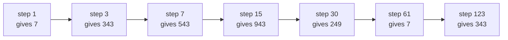

# Powers on the clock: repeated squaring finds 7 to the 123 mod 1000 without ever writing a huge number

[Syllabus](../../../SYLLABUS.md) → [Number theory](../README.md) → [Powers on the Clock](../README.md#s04) → Powers on the clock

---

## General Overview

Simulations and games need long streams of random-looking numbers. The simplest random-number generator makes each new number from the last one. It multiplies by a fixed number and keeps only the remainder. This small one multiplies by 7 and keeps the last three digits.

It starts at 001. Step one gives 007, step two 049, step three 343. At step four the true number is 2401, and the generator keeps 401: the thousands fall away.

A simulation split across many computers gives each one its own part of the stream. One may need step 123 without making the 122 before it.

The generator itself gets there one multiplication per step, 123 of them. You do not have to. Multiply an output by itself and the steps it stands for double at once. Six such squarings, plus five extra 7s for the odd step counts, land on step 123: **eleven multiplications**.

**Throw the thousands away as you go, and square instead of repeating: 123 steps cost eleven multiplications instead of 123.**

**What kind of fact this is:** a method, proved correct in Why it works.

### The picture



Each arrow squares the output, doubling the steps, and multiplies by one more 7 where the step count is odd. Name the parts: the 1000 that keeps three digits is the modulus; the step count is the exponent, 123; the 7 is the base. The method is called **modular exponentiation**, done by **square-and-multiply**. Those words carry the rest of the card.

---

## The formula

The question in symbols:

**7^123 ≡ 343 (mod 1000)**

7^123 is 7 multiplied by itself 123 times: 7 the base, 123 the exponent. The three-bar ≡ means "leaves the same remainder as", not "equals" ([Congruence](../03-Clock%20Arithmetic/01-congruence-mod-n.md)). (mod 1000) names the clock: divide by 1000, keep what is left.

Two lines are the whole method, with b the base and e the exponent:

**Even exponent: b^e = (b^(e/2))^2.** Halve the step count, then square that output.

**Odd exponent: b^e = b × (b^((e−1)/2))^2.** Halve, drop the spare step, square that output, then one more 7.

**Read it aloud:** halve the steps to 1, then climb back, squaring at each rung and slipping in a 7 where the step count was odd. Keep only the last three digits: 2401 ≡ 401 (mod 1000).

| Piece | Plain meaning | In the generator |
| --- | --- | --- |
| the base, b | what each output is multiplied by | 7 |
| the exponent, e | how many times the base is used: the steps | 123 |
| the modulus, n | what you divide by: 1000 keeps three digits | 1000 |
| the remainder, r | what is left over: the output | 343 at step 123 |

### When it holds

- **The step count is a positive whole number** (step 0 gives 1 mod n directly). Halving walks any positive count to 1; a negative or fractional count has no rung.
- **The same 7 at every step.** Squaring doubles the steps only because every step uses the same base. Change the multiplier from step to step and there is no ladder.
- **Every product fits the computer's numbers.** Here the biggest is 889249. On a far wider clock, fixed-size computer numbers, like the Rust check's 64-bit `i64`, overflow and the outputs come out wrong.

---

## Why it works

### Step 0: what falls off never comes back

Remainders multiply on their own ([Adding and multiplying on the clock](../03-Clock%20Arithmetic/02-modular-addition-and-multiplication.md)): reduce first or reduce at the end, same remainder. At step 7 the true number is 823543 and the generator keeps 543. Dropping the thousands costs nothing.

It also caps the work. Both numbers entering a multiplication are under 1000, so every product is under 1000 × 1000 = 1,000,000 — the same ceiling on the last step as the first.

### Step 1: squaring doubles the steps

The step 15 output is 7 used 15 times, thousands thrown away. Square it and 7 has been used 30 times ([Exponents](../../01-Foundations/03-Powers%2C%20Roots%20and%20Logarithms/01-exponents-and-powers.md)): 943 × 943 = 889249, keep 249. Step 30, one multiplication.

### Step 2: every step count halves to 1

Halve, dropping the spare when the count is odd: 123, 61, 30, 15, 7, 3, 1. Seven rungs; the five odd ones above the bottom each cost an extra 7. Double any positive step count and the list gains one rung, not double the rungs.

### Step 3: climb back up

Step 1: the output is 7. Read the list bottom to top. Each rung is double the one below, plus a spare when odd: square for the doubling, one more 7 for the spare.

Nothing drifts: if a rung's output is right, its square is right for double that rung, and one more 7 is right for double-plus-one. The bottom rung is plainly right, so all are ([Induction](../../01-Foundations/06-Proof/04-proof-by-induction.md)).

Six rungs sit above the first: six squarings. Five of those are odd: five more 7s. Eleven multiplications, with the step-1 output of 7 free; the slow road starts at 1 and pays 123.

---

## Worked numbers, by hand

| Step | Arithmetic | Output |
| --- | --- | --- |
| step 1 | the output is 7 | 7 |
| step 3 | square 7, one more 7 | 343 |
| step 7 | square 343, one more 7 | 543 |
| step 15 | square 543, one more 7 | 943 |
| step 30 | square 943: 889249, last three | 249 |
| step 61 | square 249, one more 7 | 7 |
| step 123 | square 7, one more 7 | **343** |

At step 123 the generator gives 343, with nothing longer than six digits written. Step 3 gives 343 too, which is not luck: [The order of a number and primitive roots](05-order-and-primitive-roots.md).

### What breaks if you drop a piece

| Mistake | Comes out at | What went wrong |
| --- | --- | --- |
| Squaring only, no spare 7s | 401 | The six squarings reach step 64, not step 123: a right output for the wrong step |
| Keeping the thousands, reducing at the end | 823543 at step 7 | Still ends in 543, but step 123 in full is 104 digits; at key sizes, more digits than atoms in the universe |

---

## Code, from first principles, and it actually runs

Nothing is imported. The ladder is climbed rung by rung, then checked against the generator's own road: 123 steps of multiplying by 7.

### Python

```python
# Powers on the clock -- the check behind the card.  Nothing is imported.  A toy random-number
# generator multiplies its output by 7 at each step and keeps only the last three digits.
def by_squaring(steps, spare=True):    # halve the steps down, then square back up
    rungs = []
    while steps: rungs.append(steps); steps //= 2
    rungs.reverse()
    reading, mults, trace = 7, 0, [7]
    for rung in rungs[1:]:
        reading = reading * reading % 1000; mults += 1        # square: doubles the steps
        if spare and rung % 2: reading = reading * 7 % 1000; mults += 1   # the spare step
        trace.append(reading)
    return reading, mults, rungs, trace
def slow(steps):                       # the generator's own way, one multiplication a step
    reading = 1
    for _ in range(steps): reading = reading * 7 % 1000
    return reading
def line(name, values): print(f"{name:<33}" + "".join(f"{v:>7}" for v in values))
STEPS = 123; fast, mults, rungs, readings = by_squaring(STEPS)
line(f"the steps, from 1 up to {STEPS}", rungs)
line("what the generator gives on them", readings)
line(f"step {STEPS} by squaring, mod 1000", [fast])
line(f"step {STEPS} the slow way, mod 1000", [slow(STEPS)])
line("multiplications, fast then slow", [mults, STEPS])
line("step 7 with nothing thrown away", [7 * 7 * 7 * 7 * 7 * 7 * 7])
line("biggest number written down", [943 * 943])
line("skipping the spare 7s", [by_squaring(STEPS, False)[0]])
assert fast == 343 and slow(STEPS) == 343 and fast == slow(STEPS)
assert rungs == [1, 3, 7, 15, 30, 61, 123] and readings == [7, 343, 543, 943, 249, 7, 343]
assert mults == 11 and 7 ** 7 % 1000 == readings[2] and by_squaring(123, False)[0] == 401
print("ALL CHECKS PASS")
```

**Ran 2026-11-25 on macOS, Python 3.14.10, standard library only. All checks passed. Output, pasted from the run:**

```
the steps, from 1 up to 123            1      3      7     15     30     61    123
what the generator gives on them       7    343    543    943    249      7    343
step 123 by squaring, mod 1000       343
step 123 the slow way, mod 1000      343
multiplications, fast then slow       11    123
step 7 with nothing thrown away   823543
biggest number written down       889249
skipping the spare 7s                401
ALL CHECKS PASS
```

### Rust

Same numbers, same labels, built with `rustc --edition 2021 -O`.

```rust
// Powers on the clock -- the same check as modular_exponentiation_check.py, in Rust.  No
// crates.  A toy random-number generator multiplies its output by 7 at each step and keeps
// only the last three digits.
fn by_squaring(mut steps: i64, spare: bool) -> (i64, i64, Vec<i64>, Vec<i64>) {
    let mut rungs: Vec<i64> = Vec::new();          // halve the steps down, then square back up
    while steps > 0 { rungs.push(steps); steps /= 2; }
    rungs.reverse();
    let (mut reading, mut mults, mut trace) = (7i64, 0i64, vec![7i64]);
    for rung in &rungs[1..] {
        reading = reading * reading % 1000; mults += 1;        // square: doubles the steps
        if spare && rung % 2 == 1 { reading = reading * 7 % 1000; mults += 1; }  // spare step
        trace.push(reading);
    }
    (reading, mults, rungs, trace)
}
fn slow(steps: i64) -> i64 {            // the generator's own way, one multiplication a step
    let mut reading = 1i64;
    for _ in 0..steps { reading = reading * 7 % 1000; }
    reading
}
fn line(name: &str, values: &[i64]) {
    let mut out = format!("{:<33}", name);
    for v in values { out.push_str(&format!("{:>7}", v)); }
    println!("{}", out);
}
fn main() {
    const STEPS: i64 = 123; let (fast, mults, rungs, readings) = by_squaring(STEPS, true);
    line(&format!("the steps, from 1 up to {}", STEPS), &rungs);
    line("what the generator gives on them", &readings);
    line(&format!("step {} by squaring, mod 1000", STEPS), &[fast]);
    line(&format!("step {} the slow way, mod 1000", STEPS), &[slow(STEPS)]);
    line("multiplications, fast then slow", &[mults, STEPS]);
    line("step 7 with nothing thrown away", &[7 * 7 * 7 * 7 * 7 * 7 * 7]);
    line("biggest number written down", &[943 * 943]);
    line("skipping the spare 7s", &[by_squaring(STEPS, false).0]);
    assert!(fast == 343 && slow(STEPS) == 343 && fast == slow(STEPS));
    assert!(rungs == vec![1, 3, 7, 15, 30, 61, 123] && readings == vec![7, 343, 543, 943, 249, 7, 343]);
    assert!(mults == 11 && 7i64.pow(7) % 1000 == readings[2] && by_squaring(123, false).0 == 401);
    println!("ALL CHECKS PASS");
}
```

**Ran 2026-11-25 on macOS, rustc 1.98.1, no crates. All checks passed. Output, pasted from the run:**

```
the steps, from 1 up to 123            1      3      7     15     30     61    123
what the generator gives on them       7    343    543    943    249      7    343
step 123 by squaring, mod 1000       343
step 123 the slow way, mod 1000      343
multiplications, fast then slow       11    123
step 7 with nothing thrown away   823543
biggest number written down       889249
skipping the spare 7s                401
ALL CHECKS PASS
```

The two outputs match line for line.

### Lean

Lean proves the method for every non-negative whole-number base, exponent and modulus.

- Square-and-multiply, reducing after each multiplication, matches multiplying by the base step by step.
- For step count at least 1, the ladder uses at most two multiplications per halving.
- Doubling a step count of at least 1 adds one rung and one multiplication, not double the work.
- For any positive modulus, every product stays below the modulus squared: under 1,000,000 here.
- On the generator itself: step 123 gives 343, the rungs give the outputs in the table, and the ladder makes eleven multiplications.

Running the method as real programs, where Rust's `i64` whole numbers must hold every product, is left to the Python and Rust checks.

```lean
-- Powers on the clock: square-and-multiply, keeping only the remainder after every step, always gives the remainder of b to the e divided by n, with at most two multiplications per halving of e and no product as big as n × n.
import Mathlib.Data.Nat.Log
import Mathlib.Tactic.NormNum.Pow
import Mathlib.Tactic.NormNum.DivMod

/-- Square-and-multiply on a clock of size n. Step 0 gives 1 and step 1 gives the base b (its
remainder). For a step count of 2 or more: halve it, dropping the spare step when it is odd, find
that output, square it and keep the remainder; on an odd step count multiply once more by the base
and keep the remainder again. -/
def ladder (b n : ℕ) : ℕ → ℕ
  | 0 => 1 % n
  | 1 => b % n
  | e + 2 =>
    let r := ladder b n ((e + 2) / 2)
    if (e + 2) % 2 = 0 then r * r % n else r * r % n * (b % n) % n
decreasing_by omega

/-- How many multiplications the ladder makes: none for step 0 or step 1, and on each rung above
one squaring plus one more multiplication by the base when the step count is odd. -/
def ladderMults : ℕ → ℕ
  | 0 => 0
  | 1 => 0
  | e + 2 => ladderMults ((e + 2) / 2) + 1 + (e + 2) % 2
decreasing_by omega

/-- Modular exponentiation by square-and-multiply is correct. For every base b, every whole-number
step count e and every clock size n, climbing the ladder (square on each rung, one more b on the
odd rungs, throw away everything but the remainder after each multiplication) gives exactly the
remainder of b to the power e divided by n: the same output as multiplying by b one step at a
time. -/
theorem square_and_multiply_gives_power_mod (b e n : ℕ) : ladder b n e = b ^ e % n := by
  induction e using Nat.strong_induction_on with
  | _ e ih =>
    match e, ih with
    | 0, _ => simp [ladder]
    | 1, _ => simp [ladder]
    | e + 2, ih =>
      rw [ladder]
      have h := ih ((e + 2) / 2) (by omega)
      simp only [h]
      have hsq : b ^ ((e + 2) / 2) % n * (b ^ ((e + 2) / 2) % n) % n
          = b ^ (2 * ((e + 2) / 2)) % n := by
        rw [← Nat.mul_mod, two_mul, pow_add]
      split_ifs with hp
      · rw [hsq]
        congr 1
        congr 1
        omega
      · have h2 : e + 2 = 2 * ((e + 2) / 2) + 1 := by omega
        have h3 : b ^ (e + 2) = b ^ (2 * ((e + 2) / 2)) * b := by
          rw [← pow_succ]
          congr 1
        rw [hsq, h3, Nat.mul_mod_mod, Nat.mod_mul_mod]

/-- The ladder is short. For a step count e of at least 1, it makes at most two multiplications per
halving, at most 2 × log₂ e in all; and doubling the step count adds one rung, one multiplication,
not double the work. -/
theorem ladder_uses_at_most_two_multiplications_per_halving (e : ℕ) (he : 1 ≤ e) :
    ladderMults e ≤ 2 * Nat.log 2 e ∧ ladderMults (2 * e) = ladderMults e + 1 := by
  constructor
  · induction e using Nat.strong_induction_on with
    | _ e ih =>
      match e, ih, he with
      | 1, _, _ => simp [ladderMults]
      | e + 2, ih, _ =>
        rw [ladderMults]
        have h := ih ((e + 2) / 2) (by omega) (by omega)
        have hl : Nat.log 2 (e + 2) = Nat.log 2 ((e + 2) / 2) + 1 := by
          rw [Nat.log_div_base]
          have : 1 ≤ Nat.log 2 (e + 2) := Nat.log_pos (by norm_num) (by omega)
          omega
        omega
  · obtain ⟨k, rfl⟩ : ∃ k, e = k + 1 := ⟨e - 1, by omega⟩
    have : 2 * (k + 1) = (2 * k) + 2 := by omega
    rw [this, ladderMults]
    have h1 : (2 * k + 2) / 2 = k + 1 := by omega
    have h2 : (2 * k + 2) % 2 = 0 := by omega
    rw [h1, h2]

/-- What falls off never piles up. On a clock of size n, every output on the ladder is a
remainder, so both products the ladder forms on the next rung, the squaring and the extra
multiplication by the base, stay below n × n. -/
theorem ladder_products_stay_below_modulus_squared (b n e : ℕ) (hn : 0 < n) :
    ladder b n e * ladder b n e < n * n ∧
      ladder b n e * ladder b n e % n * (b % n) < n * n := by
  have h : ladder b n e < n := by
    rw [square_and_multiply_gives_power_mod]
    exact Nat.mod_lt _ hn
  constructor
  · exact Nat.mul_lt_mul'' h h
  · exact Nat.mul_lt_mul'' (Nat.mod_lt _ hn) (Nat.mod_lt _ hn)

-- The question: 7 to the 123, mod 1000, is 343.
example : 7 ^ 123 % 1000 = 343 := by norm_num
-- The step counts halve to 1: 123, 61, 30, 15, 7, 3, 1.
example : 123 / 2 = 61 ∧ 61 / 2 = 30 ∧ 30 / 2 = 15 ∧ 15 / 2 = 7 ∧ 7 / 2 = 3 ∧ 3 / 2 = 1 := by
  decide
-- Climbing back by hand: 7, 343, 543, 943, 249, 7, 343.
example : 7 * 7 % 1000 * 7 % 1000 = 343 ∧ 343 * 343 % 1000 * 7 % 1000 = 543 ∧
    543 * 543 % 1000 * 7 % 1000 = 943 ∧ 943 * 943 % 1000 = 249 ∧
    249 * 249 % 1000 * 7 % 1000 = 7 ∧ 7 * 7 % 1000 * 7 % 1000 = 343 := by decide
-- The ladder itself on the card's rungs.
example : ladder 7 1000 1 = 7 ∧ ladder 7 1000 3 = 343 ∧ ladder 7 1000 7 = 543 ∧
    ladder 7 1000 15 = 943 ∧ ladder 7 1000 30 = 249 ∧ ladder 7 1000 61 = 7 ∧
    ladder 7 1000 123 = 343 := by decide +kernel
-- Eleven multiplications instead of 123.
example : ladderMults 123 = 11 := by decide +kernel
-- Step 7 with nothing thrown away is 823543, which still ends in 543; the biggest product is 889249.
example : 7 ^ 7 = 823543 ∧ 823543 % 1000 = 543 ∧ 943 * 943 = 889249 := by norm_num
-- Step 4: the true number is 2401 and the generator keeps 401.
example : 7 ^ 4 = 2401 ∧ 2401 % 1000 = 401 := by norm_num
-- Skipping the spare 7s: six squarings reach step 64, which gives 401, not 343.
example : 7 ^ 64 % 1000 = 401 := by norm_num

#print axioms square_and_multiply_gives_power_mod
#print axioms ladder_uses_at_most_two_multiplications_per_halving
#print axioms ladder_products_stay_below_modulus_squared
```

**Checked 2026-11-25 on macOS, Lean 4.36.0-rc2, Mathlib v4.36.0-rc2. Every proof is complete and uses only Lean's standard axioms. Output, pasted from the run:**

```
'square_and_multiply_gives_power_mod' depends on axioms: [propext, Quot.sound]
'ladder_uses_at_most_two_multiplications_per_halving' depends on axioms: [propext, Classical.choice, Quot.sound]
'ladder_products_stay_below_modulus_squared' depends on axioms: [propext, Quot.sound]
```

> [!TIP]
> **Try changing**
> Guess first, then run it.
> - **Take the spare steps away.** Switch the spare-step flag off: 401, not 343 — six squarings land on step 64.
> - **Move the step count.** Set `STEPS` to 61. Both roads still agree, on 7, and the first assert, which expects 343, fires.

---

## The usual mistake

> [!warning]
> **Squaring the output doubles the steps, not the output.** Squaring 943 does not give twice 943. It gives 249: the output for twice as many steps.
>
> - Skipping the spare 7 on an odd rung: 401, not 343.
> - Rounding a halving up instead of dropping the spare step: every odd rung lands a step too far.
> - The output wraps at 1000; the exponent does not. Shrinking the exponent has its own rule: [Fermat's little theorem](02-fermats-little-theorem.md).

---

## Where you meet it in real life

- **Keys and secrets.** Encryption is this ladder on a clock hundreds of digits wide: [One-way streets](../06-Codes%20and%20Secrets/01-one-way-streets.md).
- **Testing for primeness.** The standard test is a huge power on a clock: [The Miller-Rabin test](../06-Codes%20and%20Secrets/05-miller-rabin.md).
- **Random numbers for simulations.** Multiply-and-keep-the-remainder generators use this ladder to jump far ahead, so parallel runs can share one stream without overlap.
- **Last digits of huge powers.** Every "what does it end in" is a power on a clock of 10, 100 or 1000: [Fermat's little theorem](02-fermats-little-theorem.md).

> **Say it back**
> A toy random-number generator multiplies by 7 at each step and keeps the last three digits: base 7, modulus 1000. To reach exponent 123, halve the step count over and over — 123, 61, 30, 15, 7, 3, 1 — then climb the list backwards from an output of 7. Square at each rung, since squaring doubles the exponent, and slip in a 7 where the rung is odd. Drop the thousands as you go: no product passes 1,000,000. That is modular exponentiation by square-and-multiply: eleven multiplications, and step 123 gives 343.

---

## What this builds on

- [Congruence](../03-Clock%20Arithmetic/01-congruence-mod-n.md): what ≡ and (mod 1000) mean — same remainder, same spot on the clock.
- [Adding and multiplying on the clock](../03-Clock%20Arithmetic/02-modular-addition-and-multiplication.md): why reducing at every step lands where reducing at the end lands.
- [Exponents](../../01-Foundations/03-Powers%2C%20Roots%20and%20Logarithms/01-exponents-and-powers.md): why squaring a power doubles how many times the base was used.

## Where this goes next

- [Fermat's little theorem](02-fermats-little-theorem.md): on a prime clock, any base the prime does not divide returns to 1 on a schedule, shrinking the exponent before you climb.
- [One-way streets](../06-Codes%20and%20Secrets/01-one-way-streets.md): the ladder run backwards. Given only the output on a huge clock, nobody knows a fast way to find the step count.
- [The Miller-Rabin test](../06-Codes%20and%20Secrets/05-miller-rabin.md): a fast test for whether a big number is prime, running one ladder per round.
- [Square roots on a prime clock](../06-Codes%20and%20Secrets/06-square-roots-mod-p.md): on many prime clocks, one fast power gives a square root.

Left open: step 3 and step 123 both give 343, so the outputs repeat. On a prime clock, which power always brings a base the prime does not divide back to 1?

---

## Sources

Verified 2026-11-11: every link below resolves to the publisher's page.

- Knuth, Donald E. *The Art of Computer Programming, Volume 2*, 3rd ed. Addison-Wesley, 1997. [Publisher page](https://www.informit.com/store/art-of-computer-programming-volume-2-seminumerical-9780201896848). Section 4.6.3: why squaring is not always the cheapest route.
- Menezes, Alfred J., Paul C. van Oorschot, and Scott A. Vanstone. *Handbook of Applied Cryptography*. CRC Press, 1996. [Free copy from the authors](https://cacr.uwaterloo.ca/hac/). Chapter 14.6: the ladder both ways.
- Hardy, G. H., and E. M. Wright. *An Introduction to the Theory of Numbers*, 6th ed. Oxford University Press, 2008. [Publisher page](https://global.oup.com/academic/product/an-introduction-to-the-theory-of-numbers-9780199219865). Chapter V: the congruence rules behind Step 0.
