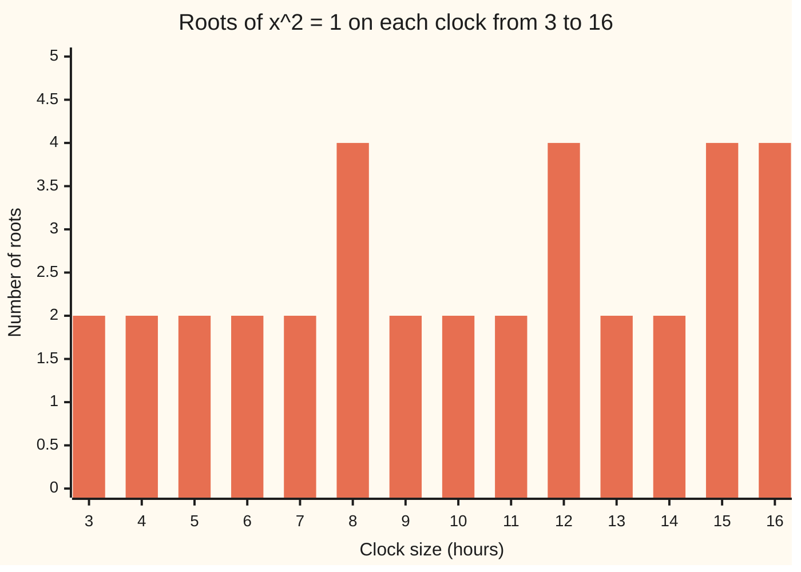

# Lagrange's root bound: a degree-d polynomial not zero on a prime clock has at most d roots, but x^2 = 1 has four on the 8-clock

[Syllabus](../../../SYLLABUS.md) → [Number theory](../README.md) → [Powers on the Clock](../README.md#s04) → Lagrange's root bound

---

## General Overview

Which numbers square to 1 on a 7-hour clock ([Congruence](../03-Clock%20Arithmetic/01-congruence-mod-n.md))? Try all seven. Only 1 and 6 work: 6 × 6 = 36, five whole clocks and 1 over, so it reads 1.

On an 8-hour clock, four work: 1, 3, 5 and 7; 3 × 3 = 9 reads 1.

A **polynomial** is a sum of powers of an unknown x, each times a whole number, positive, negative or zero (its **coefficient**), such as x^2 − 1. Its **degree** is the highest power whose coefficient does not read 0. A **root** is a value of x where it reads 0. On a prime clock, the roots never outnumber the degree. 8 is not prime.

The payoff: on the 7-clock, x^6 − 1 has six roots, the most allowed, so it splits into six pieces. Their constant terms prove [Wilson's theorem](06-wilsons-theorem.md) again.

**On a prime clock, a polynomial of degree d on that clock (not zero on the clock) has at most d roots: each root splits off a factor, and two non-zero pieces never multiply to 0.**

**What kind of fact this is:** a theorem, proved on this card in Why it works.

### The picture: how many numbers square to 1



Prime clocks stay at 2, the degree; the 8-, 12-, 15- and 16-clocks go over.

---

## The formula

For a prime clock p and a polynomial f(x) of degree d on it (not zero on the p-clock):

```math
f(x) \equiv 0 \pmod{p} \;\text{ has at most } d \text{ roots among } 0, 1, \dots, p-1
```

**Read it aloud:** on a prime clock, a polynomial of degree d on it reads 0 at d numbers at most.

The payoff, coefficient by coefficient:

```math
x^{6} - 1 \equiv (x-1)(x-2)(x-3)(x-4)(x-5)(x-6) \pmod{7}
```

| Symbol | Plain meaning | In our example | Push it up and the answer… |
| --- | --- | --- | --- |
| $`p`$, $`\equiv \pmod{p}`$ | the clock size, a prime; ≡: reads the same on the p-clock | 7; 720 ≡ −1 (mod 7) | more numbers; the ceiling stays d |
| $`x`$ | the unknown, a number on the clock | 0 to 6 | — |
| $`f(x)`$ | the polynomial | x^2 − 1, then x^6 − 1 | — |
| $`d`$ | the degree: highest power whose coefficient p does not divide | 2, then 6 | the ceiling rises by one |
| $`r`$ | a root: where f reads 0 | 1 and 6 | — |
| $`k`$, $`s`$, $`g(x)`$ | in proofs: a power, a second root, the smaller piece | — | — |

### When it holds

- **The clock size is prime.** On the 8-clock, x^2 − 1 has 4 roots.
- **Not every coefficient is a multiple of p.** 7x^2 − 7 reads 0 at all 7 numbers.
- **It is a ceiling, not a count.** x^2 + 1 has 0 roots on the 7-clock.

---

## Why it works

### Step 0: a prime clock never makes 0 from two non-zero pieces

If 7 divides a product, it divides one of the pieces ([Euclid's lemma](../02-Greatest%20Common%20Divisor%20and%20Euclid%27s%20Algorithm/06-euclids-lemma.md)). So on the 7-clock a product reads 0 only when a piece does. On the 8-clock, 2 × 4 = 8 reads 0, though neither 2 nor 4 does.

### Step 1: a root splits off a factor x − r

For any positive power k, multiplying out the right side cancels the middle terms:

```math
x^{k} - r^{k} = (x - r)(x^{k-1} + x^{k-2}r + \dots + r^{k-1})
```

So when d is at least 1, f(x) − f(r) is (x − r) times a polynomial g(x) of degree d − 1. If r is a root, f(r) reads 0, so f(x) ≡ (x − r) g(x). For example, x^2 − 1 = (x − 1)(x + 1).

### Step 2: every other root is a root of the smaller piece

A second root s makes (s − r) g(s) read 0. s − r does not, so g(s) does, by Step 0. For x^2 − 1, x + 1 must read 0: s is 6.

### Step 3: count down

Peel g the same way. Each root uses one degree, and a non-zero constant has none: d roots at most. All 294 quadratics on the 7-clock have at most 2 roots, by brute force.

### Step 4: why the 8-clock escapes

On the 8-clock, (3 − 1)(3 + 1) = 2 × 4 = 8 reads 0 while neither piece does. Step 2 breaks, so 3 and 5 get in beside 1 and 7.

### Step 5: x^6 − 1 splits completely, and Wilson follows

By [Fermat's little theorem](02-fermats-little-theorem.md), each of 1 to 6 to the sixth power reads 1, so all six are roots of x^6 − 1. Peel off x − 1 to x − 6. Each peel keeps the leading coefficient 1, so six peels leave 1: the second formula.

Compare constant terms. On the left it is −1. On the right it is (−1) × (−2) × … × (−6): six minus signs make a plus, so 720. So 720 ≡ −1 (mod 7): Wilson's theorem. The same steps work on every odd prime clock, where p − 1 is even. On the 2-clock, 1 is already −1.

---

## Worked numbers, by hand

| Step | Arithmetic | Value |
| --- | --- | --- |
| x^2 − 1, 7-clock | try 0 to 6 | roots 1, 6 |
| x^2 − 1, 8-clock | try 0 to 7 | roots 1, 3, 5, 7 |
| x^6 − 1, 7-clock | each sixth power reads 1 | roots 1 to 6 |
| expand (x − 1)…(x − 6) | coefficients, constant first | 720, −1764, 1624, −735, 175, −21, 1 |
| on the 7-clock | remainders after dividing by 7 | 6, 0, 0, 0, 0, 0, 1: that is x^6 − 1 |
| constant terms | 720 = 103 × 7 − 1 | **720 ≡ −1 (mod 7)** |

So on the 7-clock, 1 × 2 × … × 6 reads −1.

### What breaks if you drop a piece

| Mistake | Comes out at | What went wrong |
| --- | --- | --- |
| The bound on the 8-clock | 4 roots of x^2 = 1 | 8 is not prime: 2 × 4 reads 0 |
| 7x^2 − 7 taken as degree 2 | 7 roots | 7 divides every coefficient |
| Taking the sign as minus: −720 | reads 1, not −1 | (−1) × … × (−6) is +720 |

---

## Code, from first principles, and it actually runs

Three roads. Try every number on the clock, all 294 quadratics too. Multiply out (x − 1)…(x − 6) in full. Peel x − 1 to x − 6 off x^6 − 1 by division.

### Python

```python
# Lagrange's root bound -- the check behind the card.  Nothing is imported.  A
# polynomial is its list of coefficients, constant first; a root on the n-clock
# is a number from 0 to n - 1 where the polynomial reads 0 once clocks come off.
def roots(f, n): return [x for x in range(n) if sum(c * x ** k for k, c in enumerate(f)) % n == 0]
def peel(f, r, n):                       # divide by (x - r) on the n-clock
    q, carry = [0] * (len(f) - 1), 0
    for k in range(len(f) - 1, 0, -1): carry = (carry * r + f[k]) % n; q[k - 1] = carry
    return q, (carry * r + f[0]) % n     # the quotient, and the remainder
SQ, TOP = [-1, 0, 1], [-1, 0, 0, 0, 0, 0, 1]          # x^2 - 1 and x^6 - 1
print("x^2 = 1 on the 7-clock, roots:", *roots(SQ, 7), f"| 6 x 6 = {6 * 6} reads {6 * 6 % 7}")
print("x^2 = 1 on the 8-clock, roots:", *roots(SQ, 8), f"| 3 x 3 = 9 reads {3 * 3 % 8}, (3 - 1) x (3 + 1) = 8 reads {(3 - 1) * (3 + 1) % 8}")
counts = [len(roots(SQ, n)) for n in range(3, 17)]
print("roots of x^2 = 1 on clocks 3 to 16:", *counts)
quads = [[c, b, a] for a in range(1, 7) for b in range(7) for c in range(7)]
most = max(len(roots(f, 7)) for f in quads)            # brute force, every quadratic
print(f"quadratics on the 7-clock: {len(quads)}, most roots any one has: {most}")
full = [1]                                             # (x - 1)(x - 2)...(x - 6), in full
for r in range(1, 7): full = [b - r * a for a, b in zip(full + [0], [0] + full)]
print("x^6 - 1 on the 7-clock, roots:", *roots(TOP, 7))
print("(x - 1)...(x - 6), constant first:", *full, "| on the 7-clock:", *[c % 7 for c in full])
left, rems = TOP, []
for r in range(1, 7): left, rem = peel(left, r, 7); rems.append(rem)
print("peel x - 1 to x - 6 off x^6 - 1, remainders:", *rems, "| left over:", *left)
fact = 1 * 2 * 3 * 4 * 5 * 6                          # 6!, the long way
print(f"6! = {fact} = {(fact + 1) // 7} x 7 - 1, reads {fact % 7}, which is -1")
print(f"traps: 7x^2 - 7 has {len(roots([-7, 0, 7], 7))} roots, -720 reads {-fact % 7}, x^2 + 1 has {len(roots([1, 0, 1], 7))}")
assert roots(SQ, 7) == [1, 6] and roots(SQ, 8) == [1, 3, 5, 7] and len(quads) == 294 and most == 2
assert [c % 7 for c in full] == [c % 7 for c in TOP] and rems == [0] * 6 and left == [1]
assert full[0] == fact and full[0] == 103 * 7 - 1 and sum(full) == 0 and all(c == 2 for n, c in zip(range(3, 17), counts) if all(n % d for d in range(2, n)))
print("ALL CHECKS PASS")
```

**Ran 2026-11-23 on macOS, Python 3.14.10, standard library only. All checks passed. Output, pasted from the run:**

```
x^2 = 1 on the 7-clock, roots: 1 6 | 6 x 6 = 36 reads 1
x^2 = 1 on the 8-clock, roots: 1 3 5 7 | 3 x 3 = 9 reads 1, (3 - 1) x (3 + 1) = 8 reads 0
roots of x^2 = 1 on clocks 3 to 16: 2 2 2 2 2 4 2 2 2 4 2 2 4 4
quadratics on the 7-clock: 294, most roots any one has: 2
x^6 - 1 on the 7-clock, roots: 1 2 3 4 5 6
(x - 1)...(x - 6), constant first: 720 -1764 1624 -735 175 -21 1 | on the 7-clock: 6 0 0 0 0 0 1
peel x - 1 to x - 6 off x^6 - 1, remainders: 0 0 0 0 0 0 | left over: 1
6! = 720 = 103 x 7 - 1, reads 6, which is -1
traps: 7x^2 - 7 has 7 roots, -720 reads 1, x^2 + 1 has 0
ALL CHECKS PASS
```

### Rust

Same output, built with `rustc --edition 2021 -O`.

```rust
// Lagrange's root bound -- the same check as the Python, in Rust.  No crates.  A
// polynomial is its list of coefficients, constant first; a root on the n-clock
// is a number from 0 to n - 1 where the polynomial reads 0 once clocks come off.
fn roots(f: &[i64], n: i64) -> Vec<i64> {
    (0..n).filter(|&x| f.iter().rev().fold(0, |acc, &c| acc * x + c).rem_euclid(n) == 0).collect()
}
fn peel(f: &[i64], r: i64, n: i64) -> (Vec<i64>, i64) {  // divide by (x - r) on the n-clock
    let (mut q, mut carry) = (vec![0; f.len() - 1], 0);
    for k in (1..f.len()).rev() { carry = (carry * r + f[k]).rem_euclid(n); q[k - 1] = carry; }
    (q, (carry * r + f[0]).rem_euclid(n))                // the quotient, and the remainder
}
fn j(v: &[i64]) -> String { v.iter().map(|c| c.to_string()).collect::<Vec<_>>().join(" ") }
fn main() {
    let (sq, top) = (vec![-1i64, 0, 1], vec![-1i64, 0, 0, 0, 0, 0, 1]);  // x^2 - 1 and x^6 - 1
    println!("x^2 = 1 on the 7-clock, roots: {} | 6 x 6 = {} reads {}", j(&roots(&sq, 7)), 6 * 6, 6 * 6 % 7);
    println!("x^2 = 1 on the 8-clock, roots: {} | 3 x 3 = 9 reads {}, (3 - 1) x (3 + 1) = 8 reads {}", j(&roots(&sq, 8)), 3 * 3 % 8, (3 - 1) * (3 + 1) % 8);
    let counts: Vec<i64> = (3..17).map(|n| roots(&sq, n).len() as i64).collect();
    println!("roots of x^2 = 1 on clocks 3 to 16: {}", j(&counts));
    let mut quads = vec![];
    for a in 1..7 { for b in 0..7 { for c in 0..7 { quads.push(vec![c, b, a]); } } }
    let most = quads.iter().map(|f| roots(f, 7).len()).max().unwrap();  // brute force
    println!("quadratics on the 7-clock: {}, most roots any one has: {}", quads.len(), most);
    let mut full = vec![1i64];                           // (x - 1)(x - 2)...(x - 6), in full
    for r in 1..7 { let mut g = vec![0; full.len() + 1];
        for (i, &a) in full.iter().enumerate() { g[i + 1] += a; g[i] -= r * a; } full = g; }
    println!("x^6 - 1 on the 7-clock, roots: {}", j(&roots(&top, 7)));
    let red: Vec<i64> = full.iter().map(|c| c.rem_euclid(7)).collect();
    println!("(x - 1)...(x - 6), constant first: {} | on the 7-clock: {}", j(&full), j(&red));
    let (mut left, mut rems) = (top.clone(), vec![]);
    for r in 1..7 { let (q, rem) = peel(&left, r, 7); left = q; rems.push(rem); }
    println!("peel x - 1 to x - 6 off x^6 - 1, remainders: {} | left over: {}", j(&rems), j(&left));
    let fact: i64 = 1 * 2 * 3 * 4 * 5 * 6;               // 6!, the long way
    println!("6! = {} = {} x 7 - 1, reads {}, which is -1", fact, (fact + 1) / 7, fact % 7);
    println!("traps: 7x^2 - 7 has {} roots, -720 reads {}, x^2 + 1 has {}", roots(&[-7, 0, 7], 7).len(), (-fact).rem_euclid(7), roots(&[1, 0, 1], 7).len());
    assert!(roots(&sq, 7) == vec![1, 6] && roots(&sq, 8) == vec![1, 3, 5, 7] && quads.len() == 294 && most == 2);
    assert!(red == top.iter().map(|c| c.rem_euclid(7)).collect::<Vec<_>>() && rems == vec![0; 6] && left == vec![1]);
    let prime = |n: i64| (2..n).all(|d| n % d != 0);
    assert!(full[0] == fact && full[0] == 103 * 7 - 1 && full.iter().sum::<i64>() == 0 && (3..17).zip(&counts).all(|(n, &c)| !prime(n) || c == 2));
    println!("ALL CHECKS PASS");
}
```

**Ran 2026-11-23 on macOS, rustc 1.98.1, no crates. All checks passed. Output, pasted from the run:**

```
x^2 = 1 on the 7-clock, roots: 1 6 | 6 x 6 = 36 reads 1
x^2 = 1 on the 8-clock, roots: 1 3 5 7 | 3 x 3 = 9 reads 1, (3 - 1) x (3 + 1) = 8 reads 0
roots of x^2 = 1 on clocks 3 to 16: 2 2 2 2 2 4 2 2 2 4 2 2 4 4
quadratics on the 7-clock: 294, most roots any one has: 2
x^6 - 1 on the 7-clock, roots: 1 2 3 4 5 6
(x - 1)...(x - 6), constant first: 720 -1764 1624 -735 175 -21 1 | on the 7-clock: 6 0 0 0 0 0 1
peel x - 1 to x - 6 off x^6 - 1, remainders: 0 0 0 0 0 0 | left over: 1
6! = 720 = 103 x 7 - 1, reads 6, which is -1
traps: 7x^2 - 7 has 7 roots, -720 reads 1, x^2 + 1 has 0
ALL CHECKS PASS
```

### Lean

Lean proves the bound, the splitting and Wilson's theorem for every prime clock, not just 7.

- Suppose p is prime and f has degree d on the p-clock (its x^d coefficient is not a multiple of p, and every higher one is). Then f reads 0 at d of the numbers 0 to p − 1 at most.
- Take any prime clock size p. Then x^(p − 1) − 1 ≡ (x − 1)(x − 2)…(x − (p − 1)), coefficient by coefficient.
- Take any prime clock size p. Then 1 × 2 × … × (p − 1) reads −1 on the p-clock.
- It re-checks the card's numbers: the roots on the 7- and 8-clocks, the row for clocks 3 to 16, and all 294 quadratics.
- It re-checks the expansion of (x − 1)…(x − 6), 720 = 103 × 7 − 1, and the three traps.

Peeling x − 1 to x − 6 off x^6 − 1 by division is left to the Python and Rust checks.

```lean
-- Lagrange's root bound: on a prime clock a whole-number polynomial of degree d reads 0 at no more than d of the numbers 0 to p - 1, so x^(p-1) - 1 splits into (x - 1)...(x - (p - 1)) and Wilson's theorem follows.
import Mathlib.Algebra.Polynomial.Eval.Defs
import Mathlib.Algebra.Polynomial.Coeff
import Mathlib.Algebra.BigOperators.Intervals
import Mathlib.Data.ZMod.Basic
import Mathlib.Data.Int.ModEq
import Mathlib.Data.Nat.Factorial.Basic
import Mathlib.Data.Nat.Prime.Defs
import Mathlib.Tactic.Ring
import Mathlib.Tactic.NormNum
import Mathlib.Algebra.Polynomial.Roots
import Mathlib.FieldTheory.Finite.Basic

open Polynomial

namespace LagrangeRootBound

/-- **Lagrange's root bound.** Let `p` be prime and `f` a polynomial with whole-number
coefficients whose degree on the `p`-clock is `d`: the coefficient of `x^d` is not a multiple
of `p`, and every higher coefficient is. Then `f(x) ≡ 0 (mod p)` has at most `d` roots among
`0, 1, …, p - 1`. -/
theorem lagrange_root_bound (p : ℕ) (hp : p.Prime) (f : ℤ[X]) (d : ℕ)
    (hd : ¬ (p : ℤ) ∣ f.coeff d) (htop : ∀ k, d < k → (p : ℤ) ∣ f.coeff k) :
    ((Finset.range p).filter (fun x : ℕ => (p : ℤ) ∣ f.eval (x : ℤ))).card ≤ d := by
  have := Fact.mk hp
  classical
  set g : (ZMod p)[X] := f.map (Int.castRingHom (ZMod p)) with hg
  have hgd : g.coeff d ≠ 0 := by
    rw [hg, coeff_map]
    simpa [ZMod.intCast_zmod_eq_zero_iff_dvd] using hd
  have hg0 : g ≠ 0 := fun h => hgd (by rw [h, coeff_zero])
  have hdeg : g.natDegree ≤ d := by
    rw [natDegree_le_iff_coeff_eq_zero]
    intro k hk
    rw [hg, coeff_map]
    simpa [ZMod.intCast_zmod_eq_zero_iff_dvd] using htop k (by exact_mod_cast hk)
  calc ((Finset.range p).filter (fun x : ℕ => (p : ℤ) ∣ f.eval (x : ℤ))).card
      ≤ g.roots.toFinset.card := by
        apply Finset.card_le_card_of_injOn (fun x : ℕ => (x : ZMod p))
        · intro x hx
          simp only [Finset.coe_filter, Finset.mem_range] at hx
          simp only [Finset.mem_coe, Multiset.mem_toFinset, mem_roots hg0, IsRoot.def]
          have h1 := (ZMod.intCast_zmod_eq_zero_iff_dvd _ p).2 hx.2
          have h2 : ((x : ℕ) : ZMod p) = ((x : ℤ) : ZMod p) := (Int.cast_natCast x).symm
          rw [h2, hg, eval_intCast_map]
          simpa using h1
        · intro x hx y hy hxy
          simp only [Finset.coe_filter, Finset.mem_range] at hx hy
          simpa [ZMod.natCast_eq_natCast_iff', Nat.mod_eq_of_lt hx.1, Nat.mod_eq_of_lt hy.1]
            using hxy
    _ ≤ Multiset.card g.roots := Multiset.toFinset_card_le _
    _ ≤ g.natDegree := card_roots' g
    _ ≤ d := hdeg

/-- **`x^(p-1) - 1` splits completely.** On a prime clock, every one of `1, …, p - 1` is a
root of `x^(p-1) - 1`, so it is the product `(x - 1)(x - 2)⋯(x - (p - 1))`, coefficient by
coefficient. -/
theorem X_pow_sub_one_eq_prod_X_sub (p : ℕ) [Fact p.Prime] :
    (X ^ (p - 1) - 1 : (ZMod p)[X]) = ∏ a ∈ Finset.Ico 1 p, (X - C (a : ZMod p)) := by
  classical
  have hp2 := (Fact.out : p.Prime).two_le
  have hQm : (X ^ (p - 1) - C 1 : (ZMod p)[X]).Monic := monic_X_pow_sub_C 1 (by omega)
  have hQdeg : (X ^ (p - 1) - C 1 : (ZMod p)[X]).natDegree = p - 1 := natDegree_X_pow_sub_C 1
  rw [C_1] at hQm hQdeg
  have hPm : (∏ a ∈ Finset.Ico 1 p, (X - C (a : ZMod p))).Monic :=
    monic_prod_of_monic _ _ (fun a _ => monic_X_sub_C _)
  have hPdeg : (∏ a ∈ Finset.Ico 1 p, (X - C (a : ZMod p))).natDegree = p - 1 := by
    rw [natDegree_prod_of_monic _ _ (fun a _ => monic_X_sub_C _)]
    simp only [natDegree_X_sub_C, Finset.sum_const, smul_eq_mul, mul_one, Nat.card_Ico]
  refine eq_of_monic_of_dvd_of_natDegree_le hPm hQm ?_ (by rw [hQdeg, hPdeg])
  have hmap : (Finset.Ico 1 p).val.map (fun a : ℕ => X - C (a : ZMod p)) =
      ((Finset.Ico 1 p).val.map (fun a : ℕ => (a : ZMod p))).map (fun a => X - C a) := by
    rw [Multiset.map_map]; rfl
  rw [Finset.prod_eq_multiset_prod, hmap,
    Multiset.prod_X_sub_C_dvd_iff_le_roots hQm.ne_zero, Multiset.le_iff_subset]
  · intro x hx
    obtain ⟨a, ha, rfl⟩ := Multiset.mem_map.1 hx
    have ha' : a ∈ Finset.Ico 1 p := ha
    rw [Finset.mem_Ico] at ha'
    rw [mem_roots hQm.ne_zero, IsRoot.def, eval_sub, eval_pow, eval_X, eval_one, sub_eq_zero]
    apply ZMod.pow_card_sub_one_eq_one
    rw [Ne, ZMod.natCast_eq_zero_iff]
    exact fun h => absurd (Nat.le_of_dvd (by omega) h) (by omega)
  · apply Multiset.Nodup.map_on _ (Finset.nodup _)
    intro x hx y hy hxy
    have hx' : x ∈ Finset.Ico 1 p := hx
    have hy' : y ∈ Finset.Ico 1 p := hy
    rw [Finset.mem_Ico] at hx' hy'
    simpa [ZMod.natCast_eq_natCast_iff', Nat.mod_eq_of_lt hx'.2, Nat.mod_eq_of_lt hy'.2] using hxy

/-- **Wilson's theorem, by Lagrange's route.** Comparing constant terms in the splitting of
`x^(p-1) - 1` gives `(p - 1)! ≡ -1 (mod p)` for every prime `p`. -/
theorem wilson_from_root_bound (p : ℕ) (hp : p.Prime) :
    ((p - 1).factorial : ℤ) ≡ -1 [ZMOD p] := by
  have := Fact.mk hp
  have h := congrArg (eval (0 : ZMod p)) (X_pow_sub_one_eq_prod_X_sub p)
  have hp1 : p - 1 ≠ 0 := by have := hp.two_le; omega
  rw [eval_sub, eval_pow, eval_X, eval_one, zero_pow hp1, zero_sub, eval_prod] at h
  simp only [eval_sub, eval_X, eval_C, zero_sub] at h
  rw [Finset.prod_neg, Nat.card_Ico,
    ZMod.pow_card_sub_one_eq_one (neg_ne_zero.2 one_ne_zero), one_mul] at h
  have hfac : ((p - 1).factorial : ZMod p) = ∏ a ∈ Finset.Ico 1 p, (a : ZMod p) := by
    rw [← Nat.cast_prod]
    congr 1
    have : p = p - 1 + 1 := by have := hp.two_le; omega
    conv_rhs => rw [this]
    exact (Finset.prod_Ico_id_eq_factorial _).symm
  rw [← ZMod.intCast_eq_intCast_iff]
  push_cast
  rw [hfac, ← h]

-- x^2 ≡ 1 on the 7-clock: exactly the roots 1 and 6 (6 × 6 = 36 reads 1).
example : (Finset.range 7).filter (fun x : ℕ => (7 : ℤ) ∣ (x : ℤ) ^ 2 - 1) = {1, 6} := by decide
-- x^2 ≡ 1 on the 8-clock: four roots, 1, 3, 5, 7; and (3 - 1)(3 + 1) = 8 reads 0.
example : (Finset.range 8).filter (fun x : ℕ => (8 : ℤ) ∣ (x : ℤ) ^ 2 - 1) = {1, 3, 5, 7} ∧
    (3 - 1) * (3 + 1) % 8 = 0 := by decide
-- Roots of x^2 = 1 on the clocks 3 to 16: 2 2 2 2 2 4 2 2 2 4 2 2 4 4.
example : (List.range' 3 14).map (fun n => ((Finset.range n).filter (fun x => x ^ 2 % n = 1)).card)
    = [2, 2, 2, 2, 2, 4, 2, 2, 2, 4, 2, 2, 4, 4] := by decide
-- All 294 quadratics a x^2 + b x + c on the 7-clock (a from 1 to 6) have at most 2 roots.
example : ∀ a ∈ Finset.Icc 1 6, ∀ b ∈ Finset.range 7, ∀ c ∈ Finset.range 7,
    ((Finset.range 7).filter (fun x => (a * x ^ 2 + b * x + c) % 7 = 0)).card ≤ 2 := by decide
-- Each of 1 to 6 to the sixth power reads 1 on the 7-clock.
example : ∀ x ∈ Finset.Icc 1 6, x ^ 6 % 7 = 1 := by decide
-- (x - 1)...(x - 6) multiplied out: constant term first, 720, -1764, 1624, -735, 175, -21, 1.
example : ((X - 1) * (X - 2) * (X - 3) * (X - 4) * (X - 5) * (X - 6) : ℤ[X]) =
    X ^ 6 - 21 * X ^ 5 + 175 * X ^ 4 - 735 * X ^ 3 + 1624 * X ^ 2 - 1764 * X + 720 := by ring
-- Those coefficients on the 7-clock: 6, 0, 0, 0, 0, 0, 1, which is x^6 - 1.
example : [720, -1764, 1624, -735, 175, -21, 1].map (fun c : ℤ => c % 7) = [6, 0, 0, 0, 0, 0, 1] := by
  decide
-- 6! = 720 = 103 × 7 - 1, so 6! ≡ -1 (mod 7).
example : Nat.factorial 6 = 720 ∧ (720 : ℤ) = 103 * 7 - 1 ∧ (720 : ℤ) ≡ -1 [ZMOD 7] := by decide
-- Traps: 7x^2 - 7 reads 0 at all 7 numbers, x^2 + 1 at none, and -720 reads 1.
example : ((Finset.range 7).filter (fun x : ℕ => (7 : ℤ) ∣ 7 * (x : ℤ) ^ 2 - 7)).card = 7 ∧
    ((Finset.range 7).filter (fun x : ℕ => (7 : ℤ) ∣ (x : ℤ) ^ 2 + 1)).card = 0 ∧
    (-720 : ℤ) % 7 = 1 := by decide

#print axioms lagrange_root_bound
#print axioms X_pow_sub_one_eq_prod_X_sub
#print axioms wilson_from_root_bound

end LagrangeRootBound
```

**Checked 2026-11-23 on macOS, Lean 4.36.0-rc2, Mathlib v4.36.0-rc2. Every proof is complete and uses only Lean's standard axioms. Output, pasted from the run:**

```
'LagrangeRootBound.lagrange_root_bound' depends on axioms: [propext, Classical.choice, Quot.sound]
'LagrangeRootBound.X_pow_sub_one_eq_prod_X_sub' depends on axioms: [propext, Classical.choice, Quot.sound]
'LagrangeRootBound.wilson_from_root_bound' depends on axioms: [propext, Classical.choice, Quot.sound]
```

> [!TIP]
> **Try changing**
> An assert stops the program on a wrong number.
> - **Guess first: how many numbers square to 1 on a 24-clock?** Change `range(3, 17)` on the `counts` line to `range(3, 25)`. The row ends in 8; the checks pass.
> - **Guess first: can a quadratic on the 8-clock beat 4 roots?** Change `roots(f, 7)` on the `most` line to `roots(f, 8)`. The most is 8, and the first assert stops it.
> - **Guess first: does x^7 − 1 split the same way on the 7-clock?** Add one more `0, ` inside `TOP`. Only 1 is a root, and the second assert stops it.

---

## The usual mistake

> [!warning]
> **Using the bound on a clock that is not prime.** The proof needs Step 0, which only prime clocks give. On the 8-clock, x^2 = 1 has 4 roots.
>
> - The 15-clock fails too: x^2 = 1 has 4 roots there.
> - If p divides every coefficient, f reads 0 everywhere: 7x^2 − 7 has 7 roots.
> - Six minus signs make +720; −720 reads 1.

---

## Where you meet it in real life

- **Error-correcting codes.** Reed–Solomon codes, used in QR codes, can be read as values of a polynomial on a clock-like system where every non-zero number has an undo. Two different polynomials of degree at most d agree at d points at most, since their difference has at most d roots. So spare values expose damaged ones.
- **Primality testing.** On a prime clock only 1 and −1 square to 1. A third, like 3 on the 8-clock, proves the clock size is not prime. [The Miller-Rabin test](../06-Codes%20and%20Secrets/05-miller-rabin.md) hunts for one.

> **Say it back**
> Each root splits off a factor x − r. On a prime clock a product reads 0 only when a factor does, so a polynomial not zero on the clock has at most its degree in roots. On the 8-clock that fails: x^2 = 1 has four roots. On the 7-clock, x^6 − 1 has six roots, so it equals (x − 1)…(x − 6), and the constant terms give 720 ≡ −1.

---

## What this builds on

- [Fermat's little theorem](02-fermats-little-theorem.md): gives x^6 − 1 its six roots.
- [Euclid's lemma](../02-Greatest%20Common%20Divisor%20and%20Euclid%27s%20Algorithm/06-euclids-lemma.md): Step 0.
- [Solving a x ≡ b (mod n)](../03-Clock%20Arithmetic/05-linear-congruences.md): the degree-1 case: one root on a prime clock.
- [Wilson's theorem](06-wilsons-theorem.md): the first proof, by pairing partners.

## Where this goes next

- [Every prime clock has a primitive root](08-primitive-roots-mod-p.md): uses this bound to find a number whose powers visit every nonzero number on the clock.
- [Gauss's lemma](12-gauss-lemma.md): uses the same count to sort squares from non-squares on an odd prime clock.
- [Roots and factors](../../03-Algebra/02-Polynomials/05-roots-and-the-factor-theorem.md): the full factor theorem for ordinary polynomials.
- [Finding a pattern in text](../../14-Applied%20and%20computational/01-Algorithms%20and%20Growth/11-string-matching-kmp-and-rabin-karp.md): Rabin–Karp text search treats two words as polynomials on a prime clock. This bound keeps false matches rare.

Left open: on the 7-clock, all six nonzero numbers are roots of x^6 − 1. Is there one number whose powers reach all six?

---

## Sources

Verified 2026-11-23: every link below resolves to the publisher's page.

- Lagrange, Joseph-Louis. "Démonstration d'un théorème nouveau concernant les nombres premiers" (1771), in *Œuvres de Lagrange*, tome 3, Gauthier-Villars, 1869. [Internet Archive scan](https://archive.org/details/uvresdelagrange03lagr). The original polynomial route to Wilson's theorem.
- Ireland, Kenneth, and Michael Rosen. *A Classical Introduction to Modern Number Theory*, 2nd ed. Springer, 1990. [doi:10.1007/978-1-4757-2103-4](https://link.springer.com/book/10.1007/978-1-4757-2103-4). Chapter 4, section 1: the factorisation of x^(p−1) − 1 on a prime clock.
- Apostol, Tom M. *Introduction to Analytic Number Theory*. Springer, 1976. [doi:10.1007/978-1-4757-5579-4](https://link.springer.com/book/10.1007/978-1-4757-5579-4). Chapter 5: polynomial congruences mod p and Lagrange's theorem.
