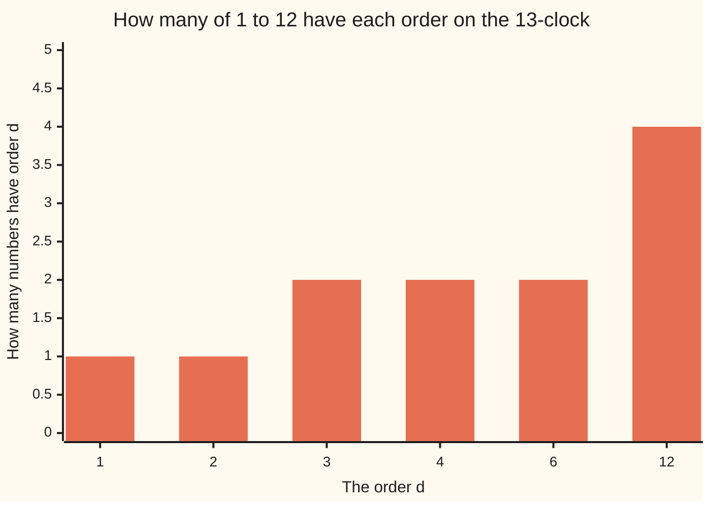

# Every prime clock has a primitive root: count how many numbers have each order

[Syllabus](../../../SYLLABUS.md) → [Number theory](../README.md) → [Powers on the Clock](../README.md#s04) → Every prime clock has a primitive root

---

## General Overview

A random-number generator multiplies by a fixed multiplier each step, keeping the remainder on a prime clock ([Congruence](../03-Clock%20Arithmetic/01-congruence-mod-n.md)). A good multiplier visits every nonzero remainder.

On the 13-clock, multiplier 2 gives 2, 4, 8, 3, 6, 12, 11, 9, 5, 10, 7, 1: all twelve. Multiplier 3 gives 3, 9, 1: a loop of three.

Call the clock size p, a prime; here p = 13. A number that visits everything is a **primitive root**: its order, the steps until its powers return to 1, is the full p − 1 ([The order of a number and primitive roots](05-order-and-primitive-roots.md)). Every prime clock has one; the 13-clock has four: 2, 6, 7 and 11.

phi(d), [Euler's totient](03-eulers-totient.md), counts the numbers from 1 to d sharing no factor above 1 with d.

**On a prime clock p, exactly phi(d) numbers have order d for each d dividing p − 1, so phi(p − 1) of them, never zero, are primitive roots.**

**What kind of fact this is:** a theorem, proved on this card in Why it works.

### The picture: the twelve numbers, piled by order



Each bar is phi(d); the last bar is the primitive roots.

---

## The formula

```math
\text{numbers of order } d = \varphi(d) \text{ for each } d \text{ dividing } p - 1, \qquad \text{primitive roots} = \varphi(p - 1)
```

**Read it aloud:** on a prime clock, phi(d) numbers have order d, for each d dividing p − 1.

| Symbol | Plain meaning | In our example | Push it up and the answer… |
| --- | --- | --- | --- |
| $`p`$ | the clock size, a prime | 13 | more numbers to sort |
| $`d`$ | a divisor of p − 1: a possible order | 1, 2, 3, 4, 6, 12 | — |
| $`\varphi(d)`$, phi(d) | how many of 1 to d share no factor with d | 1, 1, 2, 2, 2, 4 | — |
| $`a`$; $`j`$, $`f`$, $`m`$, $`c`$ | any number from 1 to p − 1; then whole numbers inside proofs | 3 | — |
| $`x^d - 1`$ | a polynomial in the unknown x; roots: the x with x^d = 1 | x^3 − 1: roots 1, 3, 9 | more roots allowed |
| $`q`$ | a prime dividing p − 1 (Step 4) | 2 and 3 | — |

### When it holds

- **The clock is prime.** On the 15-clock x^2 − 1 has 4 roots. phi(8) = 4 promises four numbers of order phi(15) = 8; there are 0.
- **Count with phi(p − 1), not phi(p).** phi(13) = 12 counts every number.
- **Existence, not a recipe.** The proof names none; Step 4 finds one by search.

---

## Why it works

### Step 0: sort the numbers by order

Every order here divides 12, as the order card shows. So the twelve numbers fall into six piles, one per divisor. The goal: the pile for 12 is not empty.

### Step 1: a pile holds either nothing or exactly phi(d)

Take a of order d. Its powers a, a^2, …, a^d are d different numbers (as the order card shows), each solving x^d = 1.

On a prime clock, a polynomial of degree d has at most d roots ([Lagrange's root bound](07-lagrange-root-bound.md)). So the powers of a are all the roots, and any number of order d is one of them.

A power of a has order exactly d when its exponent shares no factor with d: phi(d) of them. On the 13-clock, 3 has powers 3, 9, 1; exponents 1 and 2 qualify, so phi(3) = 2 numbers have order 3.

<details>
<summary>Why the exponent decides the order</summary>

Let a have order d. If the exponent j shares a factor f above 1 with d, then a^j raised to d/f is a^d raised to j/f, which is 1: fewer than d steps.

If j shares no factor with d and a^j raised to m is 1, then d divides j × m (the order card). So d divides m ([Coprime numbers](../02-Greatest%20Common%20Divisor%20and%20Euclid%27s%20Algorithm/05-coprime-numbers.md)), and the order is d.

</details>

### Step 2: the phi(d) add up to p − 1

Write 1/12, 2/12, up to 12/12 in lowest terms; each bottom d divides 12. Each c/d in lowest terms, c from 1 to d, is (c × 12/d)/12, exactly once. So bottom d appears phi(d) times.

| Bottom d | Fractions |
| --- | --- |
| 1 | 12/12 |
| 2 | 6/12 |
| 3 | 4/12, 8/12 |
| 4 | 3/12, 9/12 |
| 6 | 2/12, 10/12 |
| 12 | 1/12, 5/12, 7/12, 11/12 |

So 1 + 1 + 2 + 2 + 2 + 4 = 12. The same holds with p − 1 in place of 12.

### Step 3: no pile can fall short

Each pile holds at most phi(d) (Step 1), and the phi(d) add up to 12 (Step 2). One short pile would leave the total below 12, so every pile is full, including the pile for order 12. phi(p − 1) is never 0, because 1 always shares no factor above 1 with p − 1.

### Step 4: testing one candidate

Suppose a has a shorter order d. Then (p − 1)/d is at least 2, so some prime q divides it, and d divides (p − 1)/q. That q also divides p − 1. So a is a primitive root exactly when a^((p − 1)/q) is not 1 for every prime q dividing p − 1.

On the 13-clock, q is 2 or 3: test the 6th and 4th powers. 2^6 = 12 and 2^4 = 3, so 2 passes. 5 fails, because 5^4 = 1.

---

## Worked numbers, by hand

| Step | Arithmetic | Value |
| --- | --- | --- |
| order 1 | 1 only; phi(1) | 1 |
| order 2 | 12, the clock's −1; phi(2) | 1 |
| order 3 | 3, 9; phi(3) | 2 |
| order 4 | 5, 8; phi(4) | 2 |
| order 6 | 4, 10; phi(6) | 2 |
| order 12 | 2, 6, 7, 11; phi(12) | **4** |
| all piles | 1 + 1 + 2 + 2 + 2 + 4 | 12 |

Four of the twelve multipliers give the generator a full cycle.

### What breaks if you drop a piece

| Mistake | Comes out at | What went wrong |
| --- | --- | --- |
| Every number taken for a primitive root | 12 | Only order 12 visits everything |
| Testing only the 6th power | 6 | 5 and 8, of order 4, pass too |
| The count used on the 15-clock | promises 4, finds 0 | Not prime: the root bound fails |

---

## Code, from first principles, and it actually runs

Four roads meet: orders by brute force, phi(d) by its definition, Step 2's fractions and Step 4's power test. It also counts roots of x^d − 1 and checks every prime below 200.

### Python

```python
# Primitive roots mod p -- the check behind the card.  Nothing is imported.  The 13-clock, sorted by order.
P, BIG = 13, 2**31 - 1                            # the card's clock, and the prime of a real random generator
gcd = lambda a, b: a if b == 0 else gcd(b, a % b)
phi = lambda n: sum(1 for k in range(1, n + 1) if gcd(k, n) == 1)      # the definition: count them
order = lambda a, n: next(k for k in range(1, n + 1) if pow(a, k, n) == 1)   # road one: first power at 1
def primes_of(n):                                 # the different primes that divide n, by trial division
    out = []
    for q in range(2, int(n ** 0.5) + 2):
        while n % q == 0: n //= q; out += [] if q in out else [q]
    return out + ([n] if n > 1 else [])
test = lambda g, p: all(pow(g, (p - 1) // q, p) != 1 for q in primes_of(p - 1))  # road two: power test
row = lambda name, xs: print(f"{name:<24}" + "".join(f"{x:>3}" for x in xs))
D, orders = [d for d in range(1, P) if (P - 1) % d == 0], [order(a, P) for a in range(1, P)]
count, fracs = [orders.count(d) for d in D], [sum(1 for k in range(1, P) if (P - 1) // gcd(k, P - 1) == d) for d in D]
roots, prims = [sum(1 for x in range(1, P) if pow(x, d, P) == 1) for d in D], [a for a in range(1, P) if orders[a - 1] == P - 1]
primes = [p for p in range(2, 200) if primes_of(p) == [p]]
agree = sum(1 for p in primes if sum(1 for a in range(1, p) if order(a, p) == p - 1) == phi(p - 1))
half, on15 = sum(1 for g in range(1, P) if pow(g, 6, P) != 1), sum(1 for a in range(1, 15) if gcd(a, 15) == 1 and order(a, 15) == 8)
print(f"powers of 2: {' '.join(str(pow(2, k, P)) for k in range(1, P))};  powers of 3: {' '.join(str(pow(3, k, P)) for k in range(1, 4))}")
row(f"order of 1 to {P - 1}:", orders); row("possible order d", D); row("numbers with order d", count)
row("phi(d)", [phi(d) for d in D]); row(f"k/{P - 1} with bottom d", fracs); row("roots of x^d - 1", roots)
print(f"total {' + '.join(map(str, count))} = {sum(count)};  primitive roots: {prims}, by the power test: {[g for g in range(1, P) if test(g, P)]}")
print(f"primes below 200 whose primitive roots number phi(p - 1): {agree} of {len(primes)}")
print(f"16807 on the {BIG}-clock passes the power test: {'yes, order ' + str(BIG - 1) if test(16807, BIG) else 'no'}, primes {primes_of(BIG - 1)}")
print(f"the three mistakes come out at {P - 1}, {half} and {phi(phi(15))} ({on15} found);  15-clock: phi(15) = {phi(15)}, phi(8) = {phi(8)}, x^2 - 1 has {sum(1 for x in range(15) if x * x % 15 == 1)} roots")
assert count == [phi(d) for d in D] == fracs and sum(count) == P - 1 and roots == D and orders[2] == 3
assert prims == [g for g in range(1, P) if test(g, P)] == [2, 6, 7, 11] and agree == len(primes) == 46
assert test(16807, BIG) and not test(16807 ** 2, BIG) and (half, on15, phi(phi(15))) == (6, 0, 4)
print("ALL CHECKS PASS")
```

**Ran 2026-11-23 on macOS, Python 3.14.10, standard library only. All checks passed. Output, pasted from the run:**

```
powers of 2: 2 4 8 3 6 12 11 9 5 10 7 1;  powers of 3: 3 9 1
order of 1 to 12:         1 12  3  6  4 12 12  4  3  6 12  2
possible order d          1  2  3  4  6 12
numbers with order d      1  1  2  2  2  4
phi(d)                    1  1  2  2  2  4
k/12 with bottom d        1  1  2  2  2  4
roots of x^d - 1          1  2  3  4  6 12
total 1 + 1 + 2 + 2 + 2 + 4 = 12;  primitive roots: [2, 6, 7, 11], by the power test: [2, 6, 7, 11]
primes below 200 whose primitive roots number phi(p - 1): 46 of 46
16807 on the 2147483647-clock passes the power test: yes, order 2147483646, primes [2, 3, 7, 11, 31, 151, 331]
the three mistakes come out at 12, 6 and 4 (0 found);  15-clock: phi(15) = 8, phi(8) = 4, x^2 - 1 has 4 roots
ALL CHECKS PASS
```

### Rust

```rust
// Primitive roots mod p -- the same check as the Python, in Rust.  No crates.  The 13-clock, sorted by order.
fn gcd(a: u64, b: u64) -> u64 { if b == 0 { a } else { gcd(b, a % b) } }
fn phi(n: u64) -> u64 { (1..=n).filter(|&k| gcd(k, n) == 1).count() as u64 }   // the definition
fn pw(a: u64, mut e: u64, n: u64) -> u64 {                // a to the e on the n-clock, by repeated squaring
    let (mut r, mut b) = (1 % n, a % n);
    while e > 0 { if e & 1 == 1 { r = r * b % n; } b = b * b % n; e >>= 1; } r
}
fn order(a: u64, n: u64) -> u64 { (1..=n).find(|&k| pw(a, k, n) == 1).unwrap() }   // road one: first power at 1
fn primes_of(mut n: u64) -> Vec<u64> {                     // the different primes that divide n
    let (mut out, top) = (vec![], (n as f64).sqrt() as u64 + 2);
    for q in 2..top { while n % q == 0 { n /= q; if !out.contains(&q) { out.push(q); } } }
    if n > 1 { out.push(n); } out
}
fn test(g: u64, p: u64) -> bool { primes_of(p - 1).iter().all(|&q| pw(g, (p - 1) / q, p) != 1) }   // road two
fn row(name: &str, xs: &[u64]) { println!("{:<24}{}", name, xs.iter().map(|x| format!("{:>3}", x)).collect::<String>()); }
fn join(xs: &[u64], sep: &str) -> String { xs.iter().map(|x| x.to_string()).collect::<Vec<_>>().join(sep) }
fn main() {
    let (p, big) = (13u64, (1u64 << 31) - 1);             // the card's clock, and a real generator's prime
    let d: Vec<u64> = (1..p).filter(|x| (p - 1) % x == 0).collect();
    let orders: Vec<u64> = (1..p).map(|a| order(a, p)).collect();
    let count: Vec<u64> = d.iter().map(|&x| orders.iter().filter(|&&o| o == x).count() as u64).collect();
    let fracs: Vec<u64> = d.iter().map(|&x| (1..p).filter(|&k| (p - 1) / gcd(k, p - 1) == x).count() as u64).collect();
    let roots: Vec<u64> = d.iter().map(|&x| (1..p).filter(|&y| pw(y, x, p) == 1).count() as u64).collect();
    let (prims, by_test): (Vec<u64>, Vec<u64>) = ((1..p).filter(|&a| orders[(a - 1) as usize] == p - 1).collect(), (1..p).filter(|&g| test(g, p)).collect());
    let primes: Vec<u64> = (2..200).filter(|&x| primes_of(x) == vec![x]).collect();
    let agree = primes.iter().filter(|&&q| (1..q).filter(|&a| order(a, q) == q - 1).count() as u64 == phi(q - 1)).count();
    let (half, on15) = ((1..p).filter(|&g| pw(g, 6, p) != 1).count(), (1..15).filter(|&a| gcd(a, 15) == 1 && order(a, 15) == 8).count());
    let phis: Vec<u64> = d.iter().map(|&x| phi(x)).collect();
    println!("powers of 2: {};  powers of 3: {}", join(&(1..p).map(|k| pw(2, k, p)).collect::<Vec<_>>(), " "), join(&(1..4).map(|k| pw(3, k, p)).collect::<Vec<_>>(), " "));
    row(&format!("order of 1 to {}:", p - 1), &orders); row("possible order d", &d); row("numbers with order d", &count);
    row("phi(d)", &phis); row(&format!("k/{} with bottom d", p - 1), &fracs); row("roots of x^d - 1", &roots);
    println!("total {} = {};  primitive roots: [{}], by the power test: [{}]", join(&count, " + "), count.iter().sum::<u64>(), join(&prims, ", "), join(&by_test, ", "));
    println!("primes below 200 whose primitive roots number phi(p - 1): {} of {}", agree, primes.len());
    println!("16807 on the {}-clock passes the power test: {}, primes [{}]", big, if test(16807, big) { format!("yes, order {}", big - 1) } else { "no".to_string() }, join(&primes_of(big - 1), ", "));
    println!("the three mistakes come out at {}, {} and {} ({} found);  15-clock: phi(15) = {}, phi(8) = {}, x^2 - 1 has {} roots", p - 1, half, phi(phi(15)), on15, phi(15), phi(8), (0..15u64).filter(|x| x * x % 15 == 1).count());
    assert!(count == phis && phis == fracs && count.iter().sum::<u64>() == p - 1 && roots == d && orders[2] == 3);
    assert!(prims == by_test && by_test == vec![2, 6, 7, 11] && agree == primes.len() && agree == 46);
    assert!(test(16807, big) && !test(16807 * 16807 % big, big) && (half, on15, phi(phi(15))) == (6, 0, 4));
    println!("ALL CHECKS PASS");
}
```

**Ran 2026-11-23 on macOS, rustc 1.98.1, no crates. All checks passed. Output, pasted from the run:**

```
powers of 2: 2 4 8 3 6 12 11 9 5 10 7 1;  powers of 3: 3 9 1
order of 1 to 12:         1 12  3  6  4 12 12  4  3  6 12  2
possible order d          1  2  3  4  6 12
numbers with order d      1  1  2  2  2  4
phi(d)                    1  1  2  2  2  4
k/12 with bottom d        1  1  2  2  2  4
roots of x^d - 1          1  2  3  4  6 12
total 1 + 1 + 2 + 2 + 2 + 4 = 12;  primitive roots: [2, 6, 7, 11], by the power test: [2, 6, 7, 11]
primes below 200 whose primitive roots number phi(p - 1): 46 of 46
16807 on the 2147483647-clock passes the power test: yes, order 2147483646, primes [2, 3, 7, 11, 31, 151, 331]
the three mistakes come out at 12, 6 and 4 (0 found);  15-clock: phi(15) = 8, phi(8) = 4, x^2 - 1 has 4 roots
ALL CHECKS PASS
```

### Lean

Lean proves the counts and the power test for every prime clock, not just 13.

- Take any d dividing p − 1. Then exactly phi(d) numbers on the clock have order d.
- The primitive roots number exactly phi(p − 1), and that count is never zero.
- Take a nonzero number a. Then a is a primitive root exactly when a^((p − 1)/q) is not 1 for every prime q dividing p − 1.
- It also re-checks the 13-clock: the piles 1, 1, 2, 2, 2, 4 and the primitive roots 2, 6, 7, 11.
- On the 15-clock, not prime, no number has order 8, though phi(8) = 4.

The fractions table, the primes below 200 and the 16807 generator are left to the Python and Rust checks.

```lean
-- Every prime clock has a primitive root: on the p-clock, exactly phi(d) nonzero numbers have order d for each d dividing p - 1, so phi(p - 1) of them, never zero, are primitive roots, and a power test picks them out.
import Mathlib.FieldTheory.Finite.Basic
import Mathlib.GroupTheory.SpecificGroups.Cyclic
import Mathlib.Data.Nat.Totient

open Finset

/-- The card's main claim: on a prime clock `p`, for each `d` dividing `p - 1`, exactly
`phi(d)` numbers on the clock have order `d`. -/
theorem card_order_eq_totient_mod_prime (p : ℕ) [Fact p.Prime] {d : ℕ} (hd : d ∣ p - 1) :
    (univ.filter fun a : ZMod p => orderOf a = d).card = Nat.totient d := by
  classical
  have hp := (Fact.out : p.Prime)
  have hd0 : d ≠ 0 := by
    rintro rfl
    have := Nat.eq_zero_of_zero_dvd hd
    have := hp.two_le
    omega
  have hunits : (univ.filter fun u : (ZMod p)ˣ => orderOf u = d).card = Nat.totient d := by
    apply IsCyclic.card_orderOf_eq_totient
    rw [ZMod.card_units p]
    exact hd
  rw [← hunits]
  have himg : (univ.filter fun a : ZMod p => orderOf a = d) =
      (univ.filter fun u : (ZMod p)ˣ => orderOf u = d).image Units.val := by
    ext a
    simp only [mem_filter, mem_univ, true_and, mem_image]
    constructor
    · intro h
      have ha : a ≠ 0 := by
        rintro rfl
        have h0 : orderOf (0 : ZMod p) = 0 := by
          rw [orderOf_eq_zero_iff']
          intro n hn h0
          rw [zero_pow hn.ne'] at h0
          exact zero_ne_one h0
        exact hd0 (h.symm.trans h0)
      exact ⟨Units.mk0 a ha, by rw [← orderOf_units]; simpa using h, by simp⟩
    · rintro ⟨u, hu, rfl⟩
      rw [orderOf_units]
      exact hu
  rw [himg, card_image_of_injective _ Units.val_injective]

/-- The primitive roots, the numbers of order `p - 1`, number exactly `phi(p - 1)`,
and that count is never zero: every prime clock has a primitive root. -/
theorem card_primitive_roots_eq_totient (p : ℕ) [Fact p.Prime] :
    (univ.filter fun a : ZMod p => orderOf a = p - 1).card = Nat.totient (p - 1) ∧
      0 < (univ.filter fun a : ZMod p => orderOf a = p - 1).card := by
  have hp := (Fact.out : p.Prime)
  have h := card_order_eq_totient_mod_prime p (dvd_refl (p - 1))
  refine ⟨h, ?_⟩
  rw [h]
  apply Nat.totient_pos.mpr
  have := hp.two_le
  omega

/-- Step 4, the power test: a nonzero number `a` on a prime clock is a primitive root
exactly when `a ^ ((p - 1) / q)` is not 1 for every prime `q` dividing `p - 1`. -/
theorem primitive_root_iff_power_test (p : ℕ) [Fact p.Prime] {a : ZMod p} (ha : a ≠ 0) :
    orderOf a = p - 1 ↔ ∀ q : ℕ, q.Prime → q ∣ p - 1 → a ^ ((p - 1) / q) ≠ 1 := by
  have hp := (Fact.out : p.Prime)
  have hp2 := hp.two_le
  constructor
  · intro h q hq hqd hpow
    have hpos : 0 < (p - 1) / q := Nat.div_pos (Nat.le_of_dvd (by omega) hqd) hq.pos
    have hle := orderOf_le_of_pow_eq_one hpos hpow
    rw [h] at hle
    have := Nat.div_lt_self (show 0 < p - 1 by omega) hq.one_lt
    omega
  · intro h
    set u := Units.mk0 a ha with hu
    have hua : (u : ZMod p) = a := rfl
    rw [← hua, orderOf_units]
    apply orderOf_eq_of_pow_and_pow_div_prime (by omega)
    · ext
      rw [Units.val_pow_eq_pow_val, hua, Units.val_one]
      exact ZMod.pow_card_sub_one_eq_one ha
    · intro q hq hqd hpow
      apply h q hq hqd
      rw [← hua, ← Units.val_pow_eq_pow_val, hpow, Units.val_one]

-- On the 13-clock the powers of 2 visit all twelve nonzero numbers; the powers of 3 loop 3, 9, 1.
example : (List.range' 1 12).map (fun k => (2 : ZMod 13) ^ k) =
    [2, 4, 8, 3, 6, 12, 11, 9, 5, 10, 7, 1] := by decide
example : (List.range' 1 3).map (fun k => (3 : ZMod 13) ^ k) = [3, 9, 1] := by decide
-- The orders of 2 and 3 on the 13-clock are 12 and 3.
example : orderOf (2 : ZMod 13) = 12 := by rw [orderOf_eq_iff (by norm_num)]; decide
example : orderOf (3 : ZMod 13) = 3 := by rw [orderOf_eq_iff (by norm_num)]; decide
-- The piles: numbers of order d (d-th power 1, no earlier power 1) for d = 1, 2, 3, 4, 6, 12.
example : [1, 2, 3, 4, 6, 12].map (fun d =>
    (univ.filter fun a : ZMod 13 => a ^ d = 1 ∧ ∀ m < d, 0 < m → a ^ m ≠ 1).card) =
    [1, 1, 2, 2, 2, 4] := by decide
-- phi(d) for the divisors of 12 is 1, 1, 2, 2, 2, 4, and these add up to 12.
example : Nat.divisors 12 = {1, 2, 3, 4, 6, 12} := by decide
example : [1, 2, 3, 4, 6, 12].map Nat.totient = [1, 1, 2, 2, 2, 4] := by decide
example : ∑ d ∈ Nat.divisors 12, Nat.totient d = 12 := by decide
-- The primitive roots of 13 are 2, 6, 7 and 11.
example : (univ.filter fun a : ZMod 13 => a ^ 12 = 1 ∧ ∀ m < 12, 0 < m → a ^ m ≠ 1) =
    {2, 6, 7, 11} := by decide
-- Step 4 on the 13-clock: 2^6 = 12 and 2^4 = 3, so 2 passes; 5 has 5^4 = 1, so it fails.
example : (2 : ZMod 13) ^ 6 = 12 ∧ (2 : ZMod 13) ^ 4 = 3 ∧ (5 : ZMod 13) ^ 4 = 1 := by decide
-- The full power test finds 2, 6, 7, 11; testing only the 6th power passes 6 numbers.
example : (univ.filter fun a : ZMod 13 => a ≠ 0 ∧ a ^ 6 ≠ 1 ∧ a ^ 4 ≠ 1) = {2, 6, 7, 11} := by
  decide
example : (univ.filter fun a : ZMod 13 => a ≠ 0 ∧ a ^ 6 ≠ 1).card = 6 := by decide
-- The 15-clock is not prime: x^2 - 1 has 4 roots, phi(15) = 8, phi(8) = 4, yet no number has order 8.
example : (univ.filter fun x : ZMod 15 => x ^ 2 = 1).card = 4 := by decide
example : Nat.totient 15 = 8 ∧ Nat.totient 8 = 4 := by decide
example : (univ.filter fun a : ZMod 15 => a ^ 8 = 1 ∧ ∀ m < 8, 0 < m → a ^ m ≠ 1).card = 0 := by
  decide

#print axioms card_order_eq_totient_mod_prime
#print axioms card_primitive_roots_eq_totient
#print axioms primitive_root_iff_power_test
```

**Checked 2026-11-23 on macOS, Lean 4.36.0-rc2, Mathlib v4.36.0-rc2. Every proof is complete and uses only Lean's standard axioms. Output, pasted from the run:**

```
'card_order_eq_totient_mod_prime' depends on axioms: [propext, Classical.choice, Quot.sound]
'card_primitive_roots_eq_totient' depends on axioms: [propext, Classical.choice, Quot.sound]
'primitive_root_iff_power_test' depends on axioms: [propext, Classical.choice, Quot.sound]
```

> [!TIP]
> **Try changing**
> Guess first; the asserts stop the run after the printout.
> - **The 11-clock.** Set `P` to `11`. Piles: 1, 1, 4, 4. Primitive roots: 2, 6, 7, 8.
> - **The 17-clock.** Set `P` to `17`. 2 now has order 8; phi(16) = 8 primitive roots, the first being 3.
> - **The 7-clock.** Set `P` to `7`. Piles: 1, 1, 2, 2. Primitive roots: 3 and 5.

---

## The usual mistake

> [!warning]
> **Testing one power and calling it done.** A primitive root must avoid 1 at (p − 1)/q for every prime q dividing p − 1. On the 13-clock, the 6th power alone passes 6 numbers, but 5 and 8 have order 4.
>
> - Counting phi(p) instead of phi(p − 1) gives 12: every number.
> - The count on the 15-clock, not prime, promises 4 and finds 0.
> - Any multiplier will do: 3 loops 3, 9, 1.

---

## Where you meet it in real life

- **Random-number generators.** The "minimal standard" generator multiplies by 16807 on the prime 2147483647-clock. 16807 passes the power test, so it visits all 2147483646 nonzero remainders.
- **Key exchange.** [Diffie-Hellman key exchange](../06-Codes%20and%20Secrets/02-diffie-hellman.md) needs a large prime and a number of large order.
- **Clock logarithms.** Every nonzero number is a power of a primitive root, so multiplying becomes adding ([Indices](10-discrete-logarithms-and-indices.md)).

> **Say it back**
> On a prime clock, sort 1 to p − 1 by order. The pile for order d holds at most phi(d), because x^d − 1 has at most d roots. The phi(d) add up to p − 1, so no pile falls short. The pile for order p − 1 holds the phi(p − 1) primitive roots: 2, 6, 7 and 11 on the 13-clock.

---

## What this builds on

- [Lagrange's root bound](07-lagrange-root-bound.md): at most d roots, the cap on each pile.
- [The order of a number and primitive roots](05-order-and-primitive-roots.md): order, primitive root, and why orders divide p − 1.
- [Euler's totient](03-eulers-totient.md): phi(d), the size of each full pile.

## Where this goes next

- [Which clocks have a primitive root](09-primitive-roots-mod-prime-powers.md): prime powers and twice them.
- [Indices](10-discrete-logarithms-and-indices.md): logarithms on the clock, base a primitive root.
- [Carmichael's function](11-carmichael-function.md): the longest order on any clock.

Left open: 3 is a primitive root on the 7-clock. Is it still one on the 49-clock, and on every power of 7?

---

## Sources

Verified 2026-11-23: every link below resolves to the publisher's page.

- Gauss, Carl Friedrich. *Disquisitiones Arithmeticae*, trans. Clarke. Springer, 1986. [doi:10.1007/978-1-4939-7560-0](https://doi.org/10.1007/978-1-4939-7560-0). Section III: primitive roots of primes and their count.
- Ireland, Kenneth, and Michael Rosen. *A Classical Introduction to Modern Number Theory*, 2nd ed. Springer GTM 84, 1990. [doi:10.1007/978-1-4757-2103-4](https://doi.org/10.1007/978-1-4757-2103-4). Chapter 4, section 1: the counting proof used here.
- Park, Stephen K., and Keith W. Miller. "Random number generators: good ones are hard to find." *Communications of the ACM* 31, no. 10 (1988): 1192–1201. [doi:10.1145/63039.63042](https://doi.org/10.1145/63039.63042). The 16807 generator.
