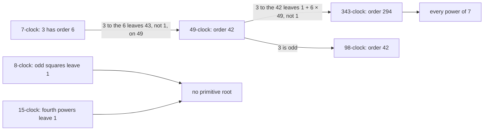

# Which clocks have a primitive root: lifting from 7 to 49 to every power of 7, and why the 8-clock and 15-clock have none

[Syllabus](../../../SYLLABUS.md) → [Number theory](../README.md) → [Powers on the Clock](../README.md#s04) → Which clocks have a primitive root

---

## General Overview

On the 7-clock (remainders after dividing by 7), the powers of 3 run 3, 2, 6, 4, 5, 1. They visit every nonzero remainder before returning to 1, so 3 is a **primitive root** there ([Every prime clock has a primitive root](08-primitive-roots-mod-p.md)).

On the 49-clock, 42 remainders share no factor with 49. One test shows 3 visits them all: $`3^6 = 729 = 14 \times 49 + 43`$ leaves 43, not 1.

Only numbers sharing no factor with the clock count here. A number's **order** is its steps back to 1. A **lift** of 3 is a number on a bigger clock leaving 3 on the 7-clock, like 31 on the 49-clock.

Some clocks have none: on the 8-clock every odd square leaves 1, short of 4 steps; on the 15-clock every fourth power does, short of 8.

**A primitive root of an odd prime p lifts to every power of p after one test, and if odd, to twice those; no other clock above 4 has one.**

**What kind of fact this is:** a theorem, proved in Why it works. It proves the list stated in [The order of a number and primitive roots](05-order-and-primitive-roots.md).

### The picture



---

## The formula

For an odd prime $`p`$ and a primitive root $`g`$ on the $`p`$-clock:

```math
g^{p-1} \not\equiv 1 \pmod{p^2} \;\Longrightarrow\; g \text{ is a primitive root mod } p^k \text{ for every } k \ge 1
```

**Read it aloud:** if g to the p minus 1 does not leave 1 on the p-squared clock, g is a primitive root on every power of p.

Here $`\equiv`$ with "(mod m)" means "same remainder on the m-clock" ([Congruence](../03-Clock%20Arithmetic/01-congruence-mod-n.md)). Gauss's list of clocks with a primitive root:

```math
n = 1,\ 2,\ 4,\ p^k \text{ or } 2p^k
```

**Read it aloud:** 1, 2, 4, an odd prime power, or twice one.

| Symbol | Plain meaning | In our example | Push it up and the answer… |
| --- | --- | --- | --- |
| $`p`$ | an odd prime | 7 | still one test |
| $`k`$ | how many $`p`$ are multiplied | 1 to 4: clocks 7, 49, 343, 2401 | order times 7 per step |
| $`g`$ | a primitive root on the $`p`$-clock | 3 | — |
| $`n`$ | any clock size | 98, 8, 15 | — |
| $`\varphi(n)`$ | phi: how many of 1 to n share no factor with n ([Euler's totient](03-eulers-totient.md)) | 42 for 49 and 98 | the target rises |
| $`m`$, $`s`$, $`j`$, $`t`$, $`x`$ | whole numbers inside proofs | — | — |

### When it holds

- **The prime is odd.** Otherwise: the 8-clock's best order is 2, not 4.
- **The test is passed.** Otherwise the order stops short: 31 has order 6 on the 49-clock.
- **The clock does not split into two parts above 2.** Otherwise no root exists: on the 15-clock the best order is 4, not 8.

---

## Why it works

### Step 0: the order on a bigger clock is squeezed

Leaving 1 on the 49-clock means leaving 1 on the 7-clock, so the order on the 49-clock is a multiple of 6.

It also divides $`\varphi(49) = 42`$. [Euler's theorem](04-eulers-theorem.md) says $`3^{42}`$ leaves 1, and a run lands on 1 only at multiples of the order. So it is 6 or 42. The test rules out 6.

### Step 1: if the test fails, add p

Of the numbers below 49 leaving 3 on the 7-clock, only 31 fails. $`31 + 7 = 38`$ passes: order 42.

<details>
<summary>Why g and g + p cannot both fail</summary>

After the first two terms, every term carries $`p^2`$:

$`\displaystyle (g+p)^{p-1} \equiv g^{p-1} + (p-1)\, g^{p-2}\, p \pmod{p^2}`$

$`p`$ divides neither $`p - 1`$ nor $`g`$, so the added term is no multiple of $`p^2`$: at most one of the two leaves 1.

</details>

### Step 2: from 49 to every power of 7

Write 43 as a gap from 1: $`43 = 1 + 6 \times 7`$. Each 7th power adds one more factor of 7 to the gap: $`3^{42}`$ leaves $`295 = 1 + 6 \times 49`$ on the 343-clock. So the gap never closes.

Step 0's squeeze makes the order on a power of 7 six times a power of 7. Every candidate below phi divides a seventh of phi, where the gap is still open. So the order is phi: 294 on 343, 2058 on 2401.

<details>
<summary>The gap gains exactly one factor of p</summary>

Let $`x = 1 + p^j t`$, $`j \ge 1`$, with $`p`$ not dividing $`t`$. Expand:

$`\displaystyle x^p = 1 + p^{j+1} t + \tbinom{p}{2}\, p^{2j} t^2 + \dots`$

Every later term is a multiple of $`p^{j+2}`$: middle coefficients like $`\tbinom{p}{2} = p(p-1)/2`$ are multiples of $`p`$; the last term has $`p^{pj}`$, enough once $`p \ge 3`$.

</details>

### Step 3: the 98-clock

By [The Chinese remainder theorem](../03-Clock%20Arithmetic/06-chinese-remainder-theorem.md), a remainder on the 98-clock is a pair: one on the 2-clock, one on the 49-clock. An odd number always leaves 1 on the 2-clock. So 3 keeps order 42 = $`\varphi(98)`$. An even root needs 49 added to make it odd.

### Step 4: the 8-clock

An odd number $`2m + 1`$ squares to $`4m(m+1) + 1`$, and $`m(m+1)`$ is even, so it leaves 1 on the 8-clock. Each squaring doubles the clock that leaves 1: $`(1 + 8s)^2 = 1 + 16s + 64s^2`$. So no order passes a quarter of the clock, half of phi: 2, 4, 8, 16 on the 8, 16, 32, 64 clocks.

### Step 5: the 15-clock

$`15 = 3 \times 5`$, and 4 is a multiple of $`\varphi(3) = 2`$ and $`\varphi(5) = 4`$. So every fourth power leaves 1 on both parts: best order 4, but $`\varphi(15) = 8`$.

In general, phi of a number above 2 is even: x and n minus x pair up. Split a clock into two parts above 2 sharing no factor: the power $`\varphi(n)/2`$ is a multiple of both phis, so it leaves 1 on both. Every clock off Gauss's list splits so, or is 8, 16, 32 and on.

---

## Worked numbers, by hand

| Step | Arithmetic | Value |
| --- | --- | --- |
| order on the 7-clock | 3, 2, 6, 4, 5, 1 | 6 |
| the test | $`3^6 = 729 = 14 \times 49 + 43`$ | 43, not 1 |
| order on the 49-clock | 6 or 42, and not 6 | 42 |
| next power | $`3^{42}`$ on the 343-clock | $`295 = 1 + 6 \times 49`$ |
| orders on 343 and 2401 | equal to phi | 294, 2058 |
| the 98-clock | 3 is odd | **42, equal to $`\varphi(98)`$** |

So 3 is primitive on every power of 7 and twice each.

### What breaks if you drop a piece

| Mistake | Comes out at | What went wrong |
| --- | --- | --- |
| 31 lifted without the test | order 6 | it fails the test |
| the even lift 52 on the 98-clock | never returns to 1 | 52 shares 2 with 98 |
| 2 treated as an odd prime | best order 2, not 4 | the lift needs an odd prime |

---

## Code, from first principles, and it actually runs

Two roads: brute force multiplies until the remainder is 1; the lifting test and Gauss's list read the answer from the factors. They agree on clocks 2 to 100.

### Python

```python
# Primitive roots on prime-power clocks -- the check behind the card.  Nothing is imported.  Road one:
# brute force, multiplying until the remainder is 1.  Road two: the lifting test, and Gauss's list from the factors.
def gcd(a, b): return a if b == 0 else gcd(b, a % b)
def order(a, n):                    # fewest multiplications by a back to 1; 0 if it never gets there
    r, k = a % n, 1
    while r != 1 and k <= n: r, k = r * a % n, k + 1
    return k if r == 1 else 0
def phi(n): return sum(1 for i in range(1, n + 1) if gcd(i, n) == 1)
def best(n): return max(order(a, n) for a in range(1, n))          # the longest order on the clock
def on_list(n):                     # Gauss's list: 2, 4, p to the k, 2 x p to the k, p an odd prime
    if n in (2, 4): return True
    m = n // 2 if n % 4 == 2 else n
    p = next(d for d in range(2, m + 1) if m % d == 0)            # smallest prime factor
    while m % p == 0: m //= p
    return p > 2 and m == 1
sizes, bad = [7, 49, 343, 2401, 98], [x for x in range(1, 49) if x % 7 == 3 and x ** 6 % 49 == 1]
units15, twos = [x for x in range(1, 15) if gcd(x, 15) == 1], [8, 16, 32, 64]
agree = sum(1 for n in range(2, 101) if on_list(n) == (best(n) == phi(n)))                 # Gauss against brute force
print(f"3 to the 6 = {3 ** 6} = {3 ** 6 // 49} x 49 + {3 ** 6 % 49}, and {3 ** 6 % 49} = 1 + {(3 ** 6 % 49 - 1) // 7} x 7; 3 to the 42 on the 343-clock: {3 ** 42 % 343} = 1 + {(3 ** 42 % 343 - 1) // 49} x 49")
print(f"powers of 3 on the 7-clock: {[3 ** e % 7 for e in range(1, 7)]}; order of 3 on the {sizes} clocks: {[order(3, n) for n in sizes]}, phi {[phi(n) for n in sizes]}")
print(f"order of 10 on the 7, 49, 343 clocks: {[order(10, n) for n in (7, 49, 343)]}")
print(f"lifts of 3 that fail on the 49-clock: {bad}, order {order(bad[0], 49)}; {bad[0]} + 7 has order {order(bad[0] + 7, 49)}")
print(f"8-clock: 1, 9, 25, 49 leave {[x * x % 8 for x in (1, 3, 5, 7)]}; best order on {twos}: {[best(n) for n in twos]}, phi {[phi(n) for n in twos]}")
print(f"15-clock: fourth powers of {units15} leave {[x ** 4 % 15 for x in units15]}; best order {best(15)}, phi {phi(15)}")
print(f"clocks 2 to 30 with a primitive root: {[n for n in range(2, 31) if best(n) == phi(n)]}; to 100, Gauss agrees on {agree} of 99")
print(f"mistakes: {bad[0]} on the 49-clock, order {order(bad[0], 49)}; 52 on the 98-clock, order {order(52, 98) or 'none'}; best on the 8-clock {best(8)}")
assert bad == [31] and order(38, 49) == 42
assert [order(3, n) for n in sizes] == [phi(n) for n in sizes] == [6, 42, 294, 2058, 42] and agree == 99
assert all(x ** 4 % 15 == 1 for x in units15) and [best(n) for n in twos] == [n // 4 for n in twos]
print("ALL CHECKS PASS")
```

**Ran 2026-11-23 on macOS, Python 3.14.10, standard library only. All checks passed. Output, pasted from the run:**

```
3 to the 6 = 729 = 14 x 49 + 43, and 43 = 1 + 6 x 7; 3 to the 42 on the 343-clock: 295 = 1 + 6 x 49
powers of 3 on the 7-clock: [3, 2, 6, 4, 5, 1]; order of 3 on the [7, 49, 343, 2401, 98] clocks: [6, 42, 294, 2058, 42], phi [6, 42, 294, 2058, 42]
order of 10 on the 7, 49, 343 clocks: [6, 42, 294]
lifts of 3 that fail on the 49-clock: [31], order 6; 31 + 7 has order 42
8-clock: 1, 9, 25, 49 leave [1, 1, 1, 1]; best order on [8, 16, 32, 64]: [2, 4, 8, 16], phi [4, 8, 16, 32]
15-clock: fourth powers of [1, 2, 4, 7, 8, 11, 13, 14] leave [1, 1, 1, 1, 1, 1, 1, 1]; best order 4, phi 8
clocks 2 to 30 with a primitive root: [2, 3, 4, 5, 6, 7, 9, 10, 11, 13, 14, 17, 18, 19, 22, 23, 25, 26, 27, 29]; to 100, Gauss agrees on 99 of 99
mistakes: 31 on the 49-clock, order 6; 52 on the 98-clock, order none; best on the 8-clock 2
ALL CHECKS PASS
```

### Rust

```rust
// Primitive roots on prime-power clocks -- the same check as primitive_roots_mod_prime_powers_check.py,
// in Rust.  No crates.  Road one: brute force.  Road two: the lifting test, and Gauss's list from the factors.
fn gcd(a: u64, b: u64) -> u64 { if b == 0 { a } else { gcd(b, a % b) } }
fn pw(a: u64, e: u64, n: u64) -> u64 { (0..e).fold(1, |r, _| r * a % n) }    // a to the e on the n-clock
fn order(a: u64, n: u64) -> u64 {           // fewest multiplications by a back to 1; 0 if it never gets there
    let (mut r, mut k) = (a % n, 1);
    while r != 1 && k <= n { r = r * a % n; k += 1; }
    if r == 1 { k } else { 0 }
}
fn phi(n: u64) -> u64 { (1..=n).filter(|&i| gcd(i, n) == 1).count() as u64 }
fn best(n: u64) -> u64 { (1..n).map(|a| order(a, n)).max().unwrap() }    // the longest order on the clock
fn on_list(n: u64) -> bool {                // Gauss's list: 2, 4, p to the k, 2 x p to the k, p an odd prime
    if n == 2 || n == 4 { return true; }
    let mut m = if n % 4 == 2 { n / 2 } else { n };
    let p = (2..=m).find(|d| m % d == 0).unwrap();                          // smallest prime factor
    while m % p == 0 { m /= p; }
    p > 2 && m == 1
}
fn main() {
    let sizes = [7u64, 49, 343, 2401, 98];
    let bad: Vec<u64> = (1..49).filter(|&x| x % 7 == 3 && pw(x, 6, 49) == 1).collect();
    let (units15, twos): (Vec<u64>, [u64; 4]) = ((1..15).filter(|&x| gcd(x, 15) == 1).collect(), [8, 16, 32, 64]);
    let agree = (2..101).filter(|&n| on_list(n) == (best(n) == phi(n))).count();   // Gauss against brute force
    let ords: Vec<u64> = sizes.iter().map(|&n| order(3, n)).collect();
    let phis: Vec<u64> = sizes.iter().map(|&n| phi(n)).collect();
    let bests: Vec<u64> = twos.iter().map(|&n| best(n)).collect();
    let (r49, r343) = (pw(3, 6, 49), pw(3, 42, 343));
    println!("3 to the 6 = {} = {} x 49 + {}, and {} = 1 + {} x 7; 3 to the 42 on the 343-clock: {} = 1 + {} x 49", pw(3, 6, 1000), pw(3, 6, 1000) / 49, r49, r49, (r49 - 1) / 7, r343, (r343 - 1) / 49);
    println!("powers of 3 on the 7-clock: {:?}; order of 3 on the {:?} clocks: {:?}, phi {:?}", (1..7).map(|e| pw(3, e, 7)).collect::<Vec<_>>(), sizes, ords, phis);
    println!("order of 10 on the 7, 49, 343 clocks: {:?}", [7u64, 49, 343].map(|n| order(10, n)));
    println!("lifts of 3 that fail on the 49-clock: {:?}, order {}; {} + 7 has order {}", bad, order(bad[0], 49), bad[0], order(bad[0] + 7, 49));
    println!("8-clock: 1, 9, 25, 49 leave {:?}; best order on {:?}: {:?}, phi {:?}", [1u64, 3, 5, 7].map(|x| x * x % 8), twos, bests, twos.map(phi));
    println!("15-clock: fourth powers of {:?} leave {:?}; best order {}, phi {}", units15, units15.iter().map(|&x| pw(x, 4, 15)).collect::<Vec<_>>(), best(15), phi(15));
    println!("clocks 2 to 30 with a primitive root: {:?}; to 100, Gauss agrees on {} of 99", (2..31u64).filter(|&n| best(n) == phi(n)).collect::<Vec<_>>(), agree);
    println!("mistakes: {} on the 49-clock, order {}; 52 on the 98-clock, order {}; best on the 8-clock {}", bad[0], order(bad[0], 49), match order(52, 98) { 0 => "none".to_string(), o => o.to_string() }, best(8));
    assert!(bad == [31] && order(38, 49) == 42);
    assert!(ords == phis && ords == [6, 42, 294, 2058, 42] && agree == 99);
    assert!(units15.iter().all(|&x| pw(x, 4, 15) == 1) && bests == twos.map(|n| n / 4));
    println!("ALL CHECKS PASS");
}
```

**Ran 2026-11-23 on macOS, rustc 1.98.1, no crates. All checks passed. Output, pasted from the run:**

```
3 to the 6 = 729 = 14 x 49 + 43, and 43 = 1 + 6 x 7; 3 to the 42 on the 343-clock: 295 = 1 + 6 x 49
powers of 3 on the 7-clock: [3, 2, 6, 4, 5, 1]; order of 3 on the [7, 49, 343, 2401, 98] clocks: [6, 42, 294, 2058, 42], phi [6, 42, 294, 2058, 42]
order of 10 on the 7, 49, 343 clocks: [6, 42, 294]
lifts of 3 that fail on the 49-clock: [31], order 6; 31 + 7 has order 42
8-clock: 1, 9, 25, 49 leave [1, 1, 1, 1]; best order on [8, 16, 32, 64]: [2, 4, 8, 16], phi [4, 8, 16, 32]
15-clock: fourth powers of [1, 2, 4, 7, 8, 11, 13, 14] leave [1, 1, 1, 1, 1, 1, 1, 1]; best order 4, phi 8
clocks 2 to 30 with a primitive root: [2, 3, 4, 5, 6, 7, 9, 10, 11, 13, 14, 17, 18, 19, 22, 23, 25, 26, 27, 29]; to 100, Gauss agrees on 99 of 99
mistakes: 31 on the 49-clock, order 6; 52 on the 98-clock, order none; best on the 8-clock 2
ALL CHECKS PASS
```

### Lean

Lean proves the card's three claims for every odd prime and every clock size, not just 7.

- A primitive root of an odd prime that passes the test is primitive on every power of that prime, and an odd one on twice each power.
- If $`g`$ is a primitive root on an odd prime $`p`$-clock, $`g`$ or $`g + p`$ passes the test.
- Gauss's list is exact: a clock has a primitive root just when it is 1, 2, 4, an odd prime power, or twice one.
- It also re-checks the card's numbers: the 7-, 49-, 98- and 343-clocks, the failing lift 31, and the 8- and 15-clocks.

Brute force on clocks 2 to 100 and printing the output are left to the Python and Rust checks.

```lean
-- Which clocks have a primitive root: a primitive root on an odd prime clock that passes the p-squared test is a primitive root on every power of that prime, and an odd one on twice each power; one of g and g + p always passes; and a clock above 0 has a primitive root exactly when it is 1, 2, 4, an odd prime power, or twice one.
import Mathlib.RingTheory.ZMod.UnitsCyclic
import Mathlib.GroupTheory.OrderOfElement
import Mathlib.Data.Nat.Totient

lemma prpp_not_dvd (p g : ℕ) (hp : p.Prime) (hg : orderOf (g : ZMod p) = p - 1) :
    ¬ p ∣ g := by
  intro h
  have : Fact p.Prime := ⟨hp⟩
  rw [(ZMod.natCast_eq_zero_iff g p).mpr h, orderOf_zero] at hg
  have := hp.two_le
  omega

lemma prpp_lift (p g : ℕ) (hp : p.Prime) (hp2 : p ≠ 2) (hg : orderOf (g : ZMod p) = p - 1)
    (htest : (g : ZMod (p ^ 2)) ^ (p - 1) ≠ 1) (m : ℕ) :
    orderOf (g : ZMod (p ^ (m + 1))) = Nat.totient (p ^ (m + 1)) := by
  have hpg : ¬ p ∣ g := prpp_not_dvd p g hp hg
  have hg0 : g ≠ 0 := by rintro rfl; exact hpg (dvd_zero p)
  have h1 : (g : ZMod p) ^ (p - 1) = 1 := hg ▸ pow_orderOf_eq_one _
  have hmod : g ^ (p - 1) ≡ 1 [MOD p] := by
    rw [← ZMod.natCast_eq_natCast_iff]; push_cast; exact h1
  have hge : 1 ≤ g ^ (p - 1) := Nat.one_le_pow _ _ (Nat.pos_of_ne_zero hg0)
  obtain ⟨a, ha⟩ : p ∣ g ^ (p - 1) - 1 := (Nat.modEq_iff_dvd' hge).mp hmod.symm
  have hga : g ^ (p - 1) = 1 + p * a := by omega
  have hpa : ¬ p ∣ a := by
    rintro ⟨b, rfl⟩
    apply htest
    have hz : ((p ^ 2 : ℕ) : ZMod (p ^ 2)) = 0 := ZMod.natCast_self _
    have : ((g ^ (p - 1) : ℕ) : ZMod (p ^ 2)) = 1 := by
      rw [hga]; push_cast at hz ⊢
      linear_combination (b : ZMod (p ^ 2)) * hz
    exact_mod_cast this
  have hord : orderOf ((g : ZMod (p ^ (m + 1))) ^ (p - 1)) = p ^ m := by
    have := ZMod.orderOf_one_add_mul_prime hp hp2 (a : ℤ) (by exact_mod_cast hpa) m
    rw [← this]; congr 1
    rw [← Nat.cast_pow, hga]; push_cast; ring
  have hdvd : p - 1 ∣ orderOf (g : ZMod (p ^ (m + 1))) := by
    have h := orderOf_map_dvd
      (ZMod.castHom (dvd_pow_self p (Nat.succ_ne_zero m)) (ZMod p)).toMonoidHom
      (g : ZMod (p ^ (m + 1)))
    simpa [hg] using h
  have hp1 : p - 1 ≠ 0 := by have := hp.two_le; omega
  rw [orderOf_pow_of_dvd hp1 hdvd] at hord
  rw [Nat.totient_prime_pow_succ hp m, ← hord, Nat.div_mul_cancel hdvd]

lemma prpp_two_mul (q g : ℕ) (hq : Odd q) (hgodd : Odd g) :
    orderOf (g : ZMod (2 * q)) = orderOf (g : ZMod q) := by
  let e := ZMod.chineseRemainder (Nat.coprime_two_left.mpr hq)
  rw [← MulEquiv.orderOf_eq e.toMulEquiv, Prod.orderOf]
  simp only [RingEquiv.toMulEquiv_eq_coe, RingEquiv.coe_toMulEquiv, map_natCast, e]
  simp [ZMod.natCast_eq_one_iff_odd.mpr hgodd]

lemma prpp_totient_two_mul (q : ℕ) (hq : Odd q) :
    Nat.totient (2 * q) = Nat.totient q := by
  rw [Nat.totient_mul (Nat.coprime_two_left.mpr hq), Nat.totient_two, one_mul]

lemma prpp_exists_iff_cyclic (n : ℕ) (hn : 0 < n) :
    (∃ g : ZMod n, orderOf g = Nat.totient n) ↔ IsCyclic (ZMod n)ˣ := by
  have : NeZero n := ⟨hn.ne'⟩
  rw [isCyclic_iff_exists_orderOf_eq_natCard, Nat.card_eq_fintype_card,
    ZMod.card_units_eq_totient]
  constructor
  · rintro ⟨g, hg⟩
    have hpos : Nat.totient n ≠ 0 := (Nat.totient_pos.mpr hn).ne'
    have hu : IsUnit g := IsUnit.of_pow_eq_one (hg ▸ pow_orderOf_eq_one g) hpos
    exact ⟨hu.unit, by rw [← orderOf_units, IsUnit.unit_spec, hg]⟩
  · rintro ⟨u, hu⟩
    exact ⟨u, by rw [orderOf_units, hu]⟩

#print axioms prpp_not_dvd
#print axioms prpp_lift
#print axioms prpp_two_mul
#print axioms prpp_totient_two_mul
#print axioms prpp_exists_iff_cyclic

/-- The card's main claim. Let p be an odd prime and g a primitive root on the p-clock (its
order there is p - 1). If g to the p - 1 does not leave 1 on the p-squared clock (the test),
then g is a primitive root on every power of p: its order on the p^k clock equals phi(p^k).
If g is also odd, it is a primitive root on twice each power too: its order on the 2p^k clock
equals phi(2p^k). -/
theorem primitive_root_lifts_to_every_prime_power_and_twice_it (p g : ℕ) (hp : p.Prime)
    (hp2 : p ≠ 2) (hg : orderOf (g : ZMod p) = p - 1)
    (htest : (g : ZMod (p ^ 2)) ^ (p - 1) ≠ 1) :
    ∀ k : ℕ, orderOf (g : ZMod (p ^ k)) = Nat.totient (p ^ k) ∧
      (Odd g → orderOf (g : ZMod (2 * p ^ k)) = Nat.totient (2 * p ^ k)) := by
  intro k
  rcases k with _ | m
  · refine ⟨?_, fun hodd => ?_⟩
    · show orderOf (g : ZMod 1) = Nat.totient 1
      rw [Nat.totient_one]
      exact orderOf_eq_one_iff.mpr (Subsingleton.elim _ _)
    · show orderOf (g : ZMod 2) = Nat.totient 2
      rw [ZMod.natCast_eq_one_iff_odd.mpr hodd, orderOf_one, Nat.totient_two]
  have hodd_p : Odd (p ^ (m + 1)) := (hp.odd_of_ne_two hp2).pow
  refine ⟨prpp_lift p g hp hp2 hg htest m, fun hodd => ?_⟩
  rw [prpp_two_mul _ g hodd_p hodd, prpp_totient_two_mul _ hodd_p]
  exact prpp_lift p g hp hp2 hg htest m

/-- Step 1. If g is a primitive root on the odd prime p-clock, then g or g + p is a primitive
root on the p-squared clock: the two cannot both fail the test. -/
theorem primitive_root_or_add_prime_is_primitive_mod_prime_sq (p g : ℕ) (hp : p.Prime)
    (hp2 : p ≠ 2) (hg : orderOf (g : ZMod p) = p - 1) :
    orderOf (g : ZMod (p ^ 2)) = Nat.totient (p ^ 2) ∨
      orderOf ((g + p : ℕ) : ZMod (p ^ 2)) = Nat.totient (p ^ 2) := by
  by_cases htest : (g : ZMod (p ^ 2)) ^ (p - 1) = 1
  · right
    have hg' : orderOf ((g + p : ℕ) : ZMod p) = p - 1 := by
      simpa using hg
    refine prpp_lift p (g + p) hp hp2 hg' ?_ 1
    have hpg : ¬ p ∣ g := prpp_not_dvd p g hp hg
    obtain ⟨n, hn⟩ : ∃ n, p - 1 = n + 1 := ⟨p - 2, by have := hp.two_le; omega⟩
    have hz : ((p : ZMod (p ^ 2))) ^ 2 = 0 := by
      rw [← Nat.cast_pow, ZMod.natCast_self]
    have key : ∀ j : ℕ, ((g : ZMod (p ^ 2)) + p) ^ (j + 1) =
        (g : ZMod (p ^ 2)) ^ (j + 1) + (j + 1) * (g : ZMod (p ^ 2)) ^ j * p := by
      intro j
      induction j with
      | zero => simp
      | succ j ih =>
        rw [pow_succ ((g : ZMod (p ^ 2)) + p) (j + 1), ih]; push_cast
        linear_combination ((j + 1) * (g : ZMod (p ^ 2)) ^ j) * hz
    push_cast
    rw [hn, key n, ← hn, htest]
    intro h
    have h0 : (((n + 1) * g ^ n * p : ℕ) : ZMod (p ^ 2)) = 0 := by
      push_cast; linear_combination h
    rw [ZMod.natCast_eq_zero_iff, pow_two] at h0
    have h1 : p ∣ (n + 1) * g ^ n := Nat.dvd_of_mul_dvd_mul_right hp.pos h0
    rcases (Nat.Prime.dvd_mul hp).mp h1 with h2 | h2
    · have := Nat.le_of_dvd (by omega) h2
      omega
    · exact hpg (hp.dvd_of_dvd_pow h2)
  · left
    exact prpp_lift p g hp hp2 hg htest 1

/-- Gauss's list. A clock of size n (n at least 1) has a primitive root, a remainder whose
order equals phi(n), exactly when n is 1, 2, 4, a power p^k of an odd prime p, or twice one.
Every other clock, such as 8, 16, 32, ... or one that splits into two parts above 2 like 15,
has none. -/
theorem primitive_root_exists_iff_gauss_list (n : ℕ) (hn : 0 < n) :
    (∃ g : ZMod n, orderOf g = Nat.totient n) ↔
      n = 1 ∨ n = 2 ∨ n = 4 ∨
        ∃ p k : ℕ, p.Prime ∧ Odd p ∧ 1 ≤ k ∧ (n = p ^ k ∨ n = 2 * p ^ k) := by
  rw [prpp_exists_iff_cyclic n hn, ZMod.isCyclic_units_iff]
  have : n ≠ 0 := hn.ne'
  simp [this]

-- The 7-clock: the powers of 3 run 3, 2, 6, 4, 5, 1, so 3 has order 6 there.
example : (List.range 6).map (fun e => 3 ^ (e + 1) % 7) = [3, 2, 6, 4, 5, 1] := by decide
-- The test: 3^6 = 729 = 14 × 49 + 43 leaves 43, not 1, on the 49-clock, and 43 = 1 + 6 × 7.
example : 3 ^ 6 = 729 ∧ 729 = 14 * 49 + 43 ∧ 3 ^ 6 % 49 = 43 ∧ 43 = 1 + 6 * 7 := by decide
-- 3 has order 42 on the 49-clock: 42 multiplications reach 1, and no fewer.
example : 3 ^ 42 % 49 = 1 ∧ ∀ e ∈ Finset.Ioo 0 42, 3 ^ e % 49 ≠ 1 := by decide
-- The next power: 3^42 leaves 295 = 1 + 6 × 49 on the 343-clock.
example : 3 ^ 42 % 343 = 295 ∧ 295 = 1 + 6 * 49 := by decide
-- phi(49) = 42, phi(98) = 42, phi(343) = 294, phi(2401) = 2058.
example : Nat.totient 49 = 42 ∧ Nat.totient 98 = 42 := by decide
example : Nat.totient 343 = 294 ∧ Nat.totient 2401 = 2058 := by
  rw [show (343 : ℕ) = 7 ^ 3 by norm_num, show (2401 : ℕ) = 7 ^ 4 by norm_num,
    Nat.totient_prime_pow (by decide) (by norm_num),
    Nat.totient_prime_pow (by decide) (by norm_num)]
  norm_num
-- The 98-clock: 3 has order 42 there too.
example : 3 ^ 42 % 98 = 1 ∧ ∀ e ∈ Finset.Ioo 0 42, 3 ^ e % 98 ≠ 1 := by decide
-- Step 1: below 49, only 31 leaves 3 on the 7-clock and fails the test; 31 + 7 = 38 passes,
-- with order 42.
example : (List.range 49).filter (fun x => x % 7 = 3 ∧ x ^ 6 % 49 = 1) = [31] := by decide
example : 38 ^ 42 % 49 = 1 ∧ ∀ e ∈ Finset.Ioo 0 42, 38 ^ e % 49 ≠ 1 := by decide
-- 31 lifted without the test has order 6 on the 49-clock.
example : 31 ^ 6 % 49 = 1 ∧ ∀ e ∈ Finset.Ioo 0 6, 31 ^ e % 49 ≠ 1 := by decide
-- The even lift 52 never returns to 1 on the 98-clock: it shares 2 with 98.
example : Nat.gcd 52 98 = 2 ∧ ∀ e ∈ Finset.Ioo 0 98, 52 ^ e % 98 ≠ 1 := by decide
-- The 8-clock: the odd squares 1, 9, 25, 49 all leave 1, short of phi(8) = 4.
example : [1, 3, 5, 7].map (fun x => x * x % 8) = [1, 1, 1, 1] ∧ Nat.totient 8 = 4 := by decide
-- The 15-clock: every number sharing no factor with 15 has fourth power 1, short of phi(15) = 8.
example : (∀ x, x < 15 → Nat.gcd x 15 = 1 → x ^ 4 % 15 = 1) ∧ Nat.totient 15 = 8 := by decide

#print axioms primitive_root_lifts_to_every_prime_power_and_twice_it
#print axioms primitive_root_or_add_prime_is_primitive_mod_prime_sq
#print axioms primitive_root_exists_iff_gauss_list
```

**Checked 2026-11-23 on macOS, Lean 4.36.0-rc2, Mathlib v4.36.0-rc2. Every proof is complete and uses only Lean's standard axioms. Output, pasted from the run:**

```
'prpp_not_dvd' depends on axioms: [propext, Classical.choice, Quot.sound]
'prpp_lift' depends on axioms: [propext, Classical.choice, Quot.sound]
'prpp_two_mul' depends on axioms: [propext, Classical.choice, Quot.sound]
'prpp_totient_two_mul' depends on axioms: [propext, Classical.choice, Quot.sound]
'prpp_exists_iff_cyclic' depends on axioms: [propext, Classical.choice, Quot.sound]
'primitive_root_lifts_to_every_prime_power_and_twice_it' depends on axioms: [propext, Classical.choice, Quot.sound]
'primitive_root_or_add_prime_is_primitive_mod_prime_sq' depends on axioms: [propext, Classical.choice, Quot.sound]
'primitive_root_exists_iff_gauss_list' depends on axioms: [propext, Classical.choice, Quot.sound]
```

> [!TIP]
> **Try changing**
> Guess first. An assert stops the program on a wrong number.
> - **Lift 5 instead of 3.** In the `bad` line, change `x % 7 == 3` to `x % 7 == 5`. The failing lift is 19; the first assert stops it.
> - **3 on the 98-clock.** Change `order(52, 98)` to `order(3, 98)`: 42.
> - **A bigger power of 2.** In the Python, add 128 to `twos`. Its best order is 32.

---

## The usual mistake

> [!warning]
> **Lifting without the test.** 31 is primitive on the 7-clock, yet $`31^6`$ leaves 1 on the 49-clock: order 6, not 42.
>
> - **Treating 2 like an odd prime.** The 8-clock's best order is 2, not 4.
> - **Reading phi as a reachable order.** $`\varphi(15) = 8`$; the best order is 4.
> - **Adding 49 to an odd root.** 52 is even and never returns to 1.

---

## Where you meet it in real life

- **Repeating decimals.** 1/n repeats with the order of 10 on the n-clock. 10 passes the test, so 1/49 repeats every 42 digits, 1/343 every 294.
- **Random-number generators.** Multiplying by a constant on a power-of-2 clock cycles at most a quarter of the clock (Step 4).

> **Say it back**
> The order on a bigger clock is squeezed: a multiple of the p-clock order, dividing phi. For an odd prime, one test on the p-squared clock settles every power of p. An odd root also works on twice the power. Powers of 2 from 8 up, and clocks splitting into two parts above 2, have none.

---

## What this builds on

- [Every prime clock has a primitive root](08-primitive-roots-mod-p.md): the 7-clock root this card lifts.
- [The Chinese remainder theorem](../03-Clock%20Arithmetic/06-chinese-remainder-theorem.md): splits the 98-clock and 15-clock in two.
- [Euler's theorem](04-eulers-theorem.md): every order divides phi.

## Where this goes next

- [Indices](10-discrete-logarithms-and-indices.md): a primitive root turns multiplying into adding exponents.
- [Carmichael's function](11-carmichael-function.md): the best order on any clock, root or not.

Left open: is 10 a primitive root on infinitely many prime clocks? That is Artin's conjecture, still unproved. The next card uses primitive roots as the base of clock logarithms.

---

## Sources

Verified 2026-11-23: every link below resolves to the publisher's page.

- Gauss, Carl Friedrich. *Disquisitiones Arithmeticae*, trans. Clarke. Springer, 1986. [doi:10.1007/978-1-4939-7560-0](https://doi.org/10.1007/978-1-4939-7560-0). Section III: the full list of clocks.
- Ireland, Kenneth, and Michael Rosen. *A Classical Introduction to Modern Number Theory*, 2nd ed. Springer, 1990. [doi:10.1007/978-1-4757-2103-4](https://doi.org/10.1007/978-1-4757-2103-4). Chapter 4: the modern proof.
