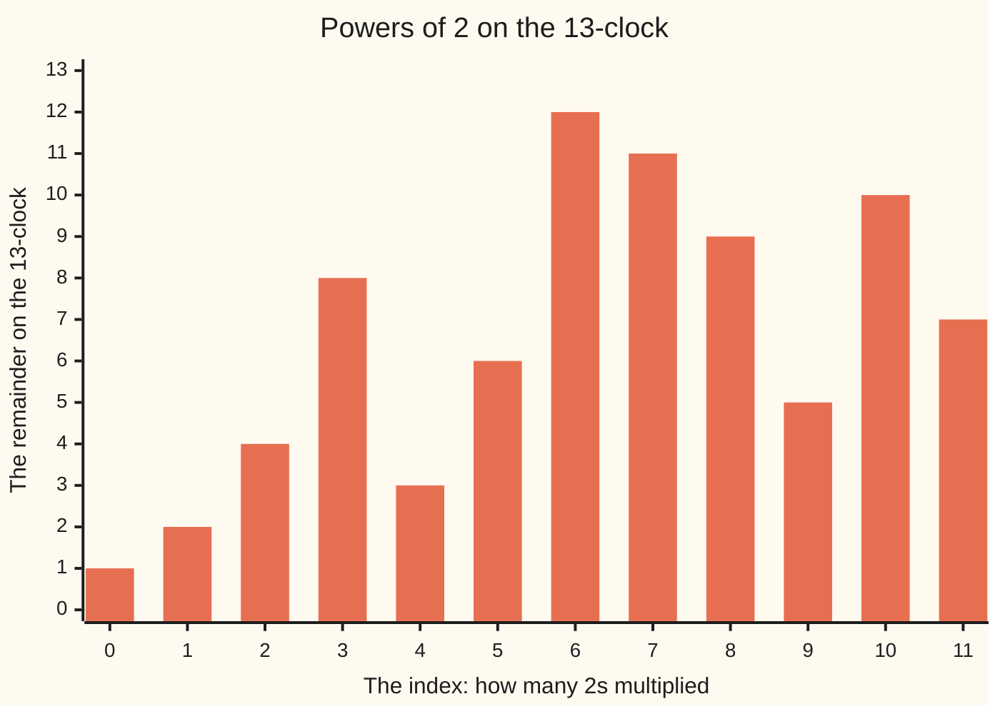

# Indices: logarithms on a prime clock turn powers into multiplication and solve x^k ≡ a

[Syllabus](../../../SYLLABUS.md) → [Number theory](../README.md) → [Powers on the Clock](../README.md#s04) → Indices

---

## General Overview

On the 13-clock, every number is replaced by its remainder after dividing by 13 ([Congruence](../03-Clock%20Arithmetic/01-congruence-mod-n.md)). Which number, raised to the fifth power, leaves 7?

Trying all twelve works; indices are faster. Start at 1 and keep doubling: 1, 2, 4, 8, 3, 6, 12, 11, 9, 5, 10, 7. Every nonzero remainder turns up once, because 2 is a **primitive root** of 13: its powers visit them all.

So each remainder has a step number: 7 is step 11. That number is its **index**, also called its **discrete logarithm**: how many 2s, multiplied together, got here ([Logarithms](../../01-Foundations/03-Powers%2C%20Roots%20and%20Logarithms/05-logarithms.md)).

Indices turn a fifth power into multiplying by 5. With $`i`$ the index of the unknown, the question becomes $`5i \equiv 11 \pmod{12}`$, a **linear congruence**: an equation on a clock with the unknown to the first power only ([Solving a x ≡ b (mod n)](../03-Clock%20Arithmetic/05-linear-congruences.md)). Its answer $`i = 7`$ gives $`x = 2^7 \equiv 11`$, and indeed $`11^5 \equiv 7`$.

**An index table turns every power equation on a prime clock into a linear congruence on a clock one smaller, which gives the number of answers and the answers themselves.**

**What kind of fact this is:** a theorem, proved in Why it works; a primitive root exists by [Every prime clock has a primitive root](08-primitive-roots-mod-p.md).

### The picture: doubling round the 13-clock



All twelve heights appear once. Height 7 stands at index 11.

---

## The formula

Three rules, on a prime clock $`p`$ with a primitive root $`g`$, for nonzero remainders $`a`$ and $`b`$:

```math
\mathrm{ind}(ab) \equiv \mathrm{ind}(a) + \mathrm{ind}(b) \pmod{p-1}
```

```math
x^k \equiv a \pmod{p} \iff k \cdot \mathrm{ind}(x) \equiv \mathrm{ind}(a) \pmod{p-1}
```

```math
x^k \equiv a \text{ has } d \text{ answers if } a^{(p-1)/d} \equiv 1 \pmod{p}, \text{ and none otherwise}
```

**Read it aloud:** indices add when numbers multiply, on a clock of size p − 1. A k-th power multiplies the index by k. Passing the power test means d answers.

| Symbol | Plain meaning | In our example | Push it up and the answer… |
| --- | --- | --- | --- |
| $`p`$ | the prime clock size | 13 | the table has p − 1 entries |
| $`g`$ | the base, a primitive root | 2 | another base, another table, same answers |
| $`\mathrm{ind}(a),\ i`$ | the index: the power of $`g`$ that leaves $`a`$; $`i`$ is the unknown's | 11 for 7; $`i = 7`$ | — |
| $`x,\ a,\ b`$ | the unknown, the target, a second remainder | 11, 7; $`b = 11`$ in $`7 \times 11`$ | — |
| $`k`$ | the power on the unknown | 5, then 3 | — |
| $`d`$ | $`\gcd(k,\, p-1)`$, the biggest number dividing both | 1, then 3 | more answers, fewer targets reachable |

### When it holds

- **The clock is prime.** Otherwise a primitive root may not exist, and then there is no table ([Which clocks have a primitive root](09-primitive-roots-mod-prime-powers.md)).
- **The target is not 0.** No power of 2 is 0, so 0 has no index.
- **Indices count mod p − 1.** Work mod 13 and $`x^5 \equiv 7`$ gives $`x = 10`$, whose fifth power is 4.

---

## Why it works

### Step 0: one index per remainder

The powers $`2^0`$ to $`2^{11}`$ hit each nonzero remainder once. So each has exactly one index from 0 to 11.

### Step 1: indices add when numbers multiply

Exponents add: $`2^i \cdot 2^j = 2^{i+j}`$. That is the log law ([Log laws and log scales](../../01-Foundations/03-Powers%2C%20Roots%20and%20Logarithms/06-log-laws-and-log-scales.md)).

The twist: $`2^{12} \equiv 1`$ ([Fermat's little theorem](02-fermats-little-theorem.md)), so twelve more steps change nothing. Indices live on a 12-clock. For $`7 \times 11`$: $`11 + 7 = 18 \equiv 6`$, and $`2^6 \equiv 12`$. Directly, 77 leaves 12.

Division subtracts: $`5 \div 7`$ has index $`9 - 11 = -2 \equiv 10`$, and $`2^{10} \equiv 10`$. Check: $`7 \times 10 \equiv 5`$.

### Step 2: a power becomes a multiple

A k-th power adds the index to itself k times. Write $`i`$ for the unknown index of $`x`$:

- $`x^5 \equiv 7`$ becomes $`5i \equiv 11 \pmod{12}`$.
- $`x^3 \equiv 5`$ becomes $`3i \equiv 9 \pmod{12}`$.

[Solving a x ≡ b (mod n)](../03-Clock%20Arithmetic/05-linear-congruences.md) handles these: if $`d`$ divides the right side, there are exactly $`d`$ answers, else none. For $`k = 5`$, one answer. For $`k = 3`$, three answers, 4 apart.

### Step 3: the test without the table

Raise $`a`$ to the power $`12/d`$: its index is multiplied by $`12/d`$. The result is a multiple of 12, leaving 1, exactly when $`d`$ divides the index of $`a`$.

So $`5^4 \equiv 1`$ means $`x^3 \equiv 5`$ has three answers, and $`2^4 \equiv 3`$ means $`x^3 \equiv 2`$ has none.

---

## Worked numbers, by hand

The table, from the doubling read backwards:

| Remainder | 1 | 2 | 3 | 4 | 5 | 6 | 7 | 8 | 9 | 10 | 11 | 12 |
| --- | --- | --- | --- | --- | --- | --- | --- | --- | --- | --- | --- | --- |
| Index | 0 | 1 | 4 | 2 | 9 | 5 | 11 | 3 | 8 | 10 | 7 | 6 |

| Step | Arithmetic | Value |
| --- | --- | --- |
| $`x^5 \equiv 7`$: take indices | $`5i \equiv 11 \pmod{12}`$, $`d = 1`$ | one answer |
| undo the 5 | $`5 \times 5 \equiv 1`$, so $`i \equiv 5 \times 11`$ | $`i = 7`$ |
| back to a remainder | $`2^7`$ | **$`x = 11`$** |
| $`x^3 \equiv 5`$: take indices | $`3i \equiv 9 \pmod{12}`$, $`d = 3`$, $`5^4 \equiv 1`$ | three answers |
| shrink by 3 | $`i \equiv 3 \pmod{4}`$ | $`i = 3, 7, 11`$ |
| back to remainders | $`2^3, 2^7, 2^{11}`$ | **$`x = 8, 11, 7`$** |
| $`x^3 \equiv 2`$ | $`3i \equiv 1`$, and $`2^4 \equiv 3`$ | **no answer** |

On the 13-clock, 7 has one fifth root, 5 has three cube roots, and 2 has none.

### What breaks if you drop a piece

| Mistake | Comes out at | What went wrong |
| --- | --- | --- |
| Solving $`5i \equiv 11`$ mod 13 | $`x = 10`$, and $`10^5 \equiv 4`$ | indices repeat every 12 steps, not 13 |
| Stopping at the first answer of $`x^3 \equiv 5`$ | only $`x = 8`$ | $`d = 3`$: there are three |
| Multiplying indices for $`7 \times 11`$ | $`2^5 \equiv 6`$ | multiplying numbers adds indices |

---

## Code, from first principles, and it actually runs

Nothing is imported. The table is built by doubling. Road one tries every $`x`$. Road two takes indices and solves the linear congruence. A sweep checks the count rule against road one for all 144 pairs of $`k`$ and $`a`$.

### Python

```python
# Indices on the 13-clock, nothing imported.  Road one: try every x.  Road two: k i = ind a (mod 12).
P, G, N = 13, 2, 12                                      # the clock, the base, the index clock
def gcd(a, b): return a if b == 0 else gcd(b, a % b)
power = [1]
for _ in range(N - 1): power.append(power[-1] * G % P)    # 2^0 .. 2^11 on the clock
ind = {v: i for i, v in enumerate(power)}                  # the index table: power read backwards
def brute(k, a): return [x for x in range(1, P) if x ** k % P == a]       # road one
def by_index(k, a):                      # road two: solve k i = ind a (mod 12), then x = 2^i
    d = gcd(k, N); m = N // d
    if ind[a] % d: return []
    inv = next(t for t in range(m) if k // d * t % m == 1 % m)
    return [ind[a] // d * inv % m + m * t for t in range(d)]
print("index table, base 2 mod 13: " + " ".join(f"{a}:{ind[a]}" for a in range(1, P)))
s, q = (ind[7] + ind[11]) % N, (ind[5] - ind[7] + N) % N
print(f"7 x 11: indices {ind[7]} + {ind[11]} = {ind[7] + ind[11]} = {s} (mod 12), 2^{s} = {power[s]}; direct 77 mod 13 = {77 % P}")
print(f"5 / 7: indices {ind[5]} - {ind[7]} = {ind[5] - ind[7]} = {q} (mod 12), 2^{q} = {power[q]}; check 7 x {power[q]} mod 13 = {7 * power[q] % P}")
for k, a in [(5, 7), (3, 5), (3, 2)]:
    i, d = by_index(k, a), gcd(k, N)
    print(f"x^{k} = {a}: {k}i = {ind[a]} (mod 12), gcd {d}, test {a}^{N // d} = {a ** (N // d) % P}; "
          f"i = {i}, x = {[power[j] for j in i]}; trying all x: {brute(k, a)}")
agree = sum(sorted(power[i] for i in by_index(k, a)) == brute(k, a) and len(brute(k, a)) ==
            (gcd(k, N) if a ** (N // gcd(k, N)) % P == 1 else 0) for k in range(1, P) for a in range(1, P))
print(f"rule against trying every x, k and a from 1 to 12: {agree} of 144 cases agree")
w = ind[7] * next(t for t in range(P) if 5 * t % P == 1) % P            # the index worked mod 13
print(f"mistakes: index mod 13 gives x = {power[w]}, and {power[w]}^5 = {power[w] ** 5 % P}; first answer only: "
      f"{power[by_index(3, 5)[0]]}; multiplying indices: 2^{ind[7] * ind[11] % N} = {power[ind[7] * ind[11] % N]}; base 3 reaches only {sorted({3 ** i % P for i in range(N)})}")
assert agree == 144 and by_index(5, 7) == [7] and power[7] == 11 and brute(5, 7) == [11]
assert sorted(power[i] for i in by_index(3, 5)) == [7, 8, 11] == brute(3, 5) and brute(3, 2) == []
assert power[s] == 12 and power[s] == 77 % P and 7 * power[q] % P == 5 and len(set(power)) == N
print("ALL CHECKS PASS")
```

**Ran 2026-11-23 on macOS, Python 3.14.10, standard library only. All checks passed. Output, pasted from the run:**

```
index table, base 2 mod 13: 1:0 2:1 3:4 4:2 5:9 6:5 7:11 8:3 9:8 10:10 11:7 12:6
7 x 11: indices 11 + 7 = 18 = 6 (mod 12), 2^6 = 12; direct 77 mod 13 = 12
5 / 7: indices 9 - 11 = -2 = 10 (mod 12), 2^10 = 10; check 7 x 10 mod 13 = 5
x^5 = 7: 5i = 11 (mod 12), gcd 1, test 7^12 = 1; i = [7], x = [11]; trying all x: [11]
x^3 = 5: 3i = 9 (mod 12), gcd 3, test 5^4 = 1; i = [3, 7, 11], x = [8, 11, 7]; trying all x: [7, 8, 11]
x^3 = 2: 3i = 1 (mod 12), gcd 3, test 2^4 = 3; i = [], x = []; trying all x: []
rule against trying every x, k and a from 1 to 12: 144 of 144 cases agree
mistakes: index mod 13 gives x = 10, and 10^5 = 4; first answer only: 8; multiplying indices: 2^5 = 6; base 3 reaches only [1, 3, 9]
ALL CHECKS PASS
```

### Rust

Same output, built with `rustc --edition 2021 -O`.

```rust
// Indices on the 13-clock, no crates.  Road one: try every x.  Road two: k i = ind a (mod 12).
const P: i64 = 13; const G: i64 = 2; const N: i64 = 12;   // the clock, the base, the index clock
fn gcd(a: i64, b: i64) -> i64 { if b == 0 { a } else { gcd(b, a % b) } }
fn show(v: &[i64]) -> String { format!("[{}]", v.iter().map(|x| x.to_string()).collect::<Vec<_>>().join(", ")) }
fn brute(k: i64, a: i64) -> Vec<i64> { (1..P).filter(|x| x.pow(k as u32) % P == a).collect() }   // road one
fn by_index(k: i64, a: i64, ind: &[i64]) -> Vec<i64> {    // road two: solve k i = ind a (mod 12), then x = 2^i
    let (d, ia) = (gcd(k, N), ind[a as usize]); let m = N / d;
    if ia % d != 0 { return vec![]; }
    let inv = (0..m).find(|t| k / d * t % m == 1 % m).unwrap();
    (0..d).map(|t| ia / d * inv % m + m * t).collect()
}
fn main() {
    let mut power = vec![1i64];
    for _ in 0..N - 1 { let l = power[power.len() - 1]; power.push(l * G % P); }   // 2^0 .. 2^11
    let mut ind = vec![0i64; P as usize];                  // the index table: power read backwards
    for (i, v) in power.iter().enumerate() { ind[*v as usize] = i as i64; }
    println!("index table, base 2 mod 13: {}", (1..P).map(|a| format!("{}:{}", a, ind[a as usize])).collect::<Vec<_>>().join(" "));
    let (s, q) = ((ind[7] + ind[11]) % N, (ind[5] - ind[7] + N) % N);
    println!("7 x 11: indices {} + {} = {} = {} (mod 12), 2^{} = {}; direct 77 mod 13 = {}", ind[7], ind[11], ind[7] + ind[11], s, s, power[s as usize], 77 % P);
    println!("5 / 7: indices {} - {} = {} = {} (mod 12), 2^{} = {}; check 7 x {} mod 13 = {}", ind[5], ind[7], ind[5] - ind[7], q, q, power[q as usize], power[q as usize], 7 * power[q as usize] % P);
    for (k, a) in [(5i64, 7i64), (3, 5), (3, 2)] {
        let (i, d) = (by_index(k, a, &ind), gcd(k, N));
        let x: Vec<i64> = i.iter().map(|j| power[*j as usize]).collect();
        println!("x^{} = {}: {}i = {} (mod 12), gcd {}, test {}^{} = {}; i = {}, x = {}; trying all x: {}",
                 k, a, k, ind[a as usize], d, a, N / d, a.pow((N / d) as u32) % P, show(&i), show(&x), show(&brute(k, a)));
    }
    let mut agree = 0; for k in 1..P { for a in 1..P {
        let d = gcd(k, N); let mut x: Vec<i64> = by_index(k, a, &ind).iter().map(|j| power[*j as usize]).collect(); x.sort();
        if x == brute(k, a) && brute(k, a).len() as i64 == (if a.pow((N / d) as u32) % P == 1 { d } else { 0 }) { agree += 1; } } }
    println!("rule against trying every x, k and a from 1 to 12: {} of 144 cases agree", agree);
    let w = (ind[7] * (0..P).find(|t| 5 * t % P == 1).unwrap() % P) as usize;   // the index worked mod 13
    let (f, mi) = (power[by_index(3, 5, &ind)[0] as usize], (ind[7] * ind[11] % N) as usize);
    println!("mistakes: index mod 13 gives x = {}, and {}^5 = {}; first answer only: {}; multiplying indices: 2^{} = {}; base 3 reaches only {}", power[w], power[w], power[w].pow(5) % P, f, mi, power[mi],
             show(&{ let mut v: Vec<i64> = (0..N).map(|i| 3i64.pow(i as u32) % P).collect(); v.sort(); v.dedup(); v }));
    let mut b35: Vec<i64> = by_index(3, 5, &ind).iter().map(|j| power[*j as usize]).collect(); b35.sort();
    assert!(agree == 144 && by_index(5, 7, &ind) == vec![7] && power[7] == 11 && brute(5, 7) == vec![11]);
    assert!(b35 == vec![7, 8, 11] && b35 == brute(3, 5) && brute(3, 2).is_empty());
    assert!(power[s as usize] == 12 && power[s as usize] == 77 % P && 7 * power[q as usize] % P == 5 && { let mut u = power.clone(); u.sort(); u.dedup(); u.len() as i64 == N });
    println!("ALL CHECKS PASS");
}
```

**Ran 2026-11-23 on macOS, rustc 1.98.1, no crates. All checks passed. Output, pasted from the run:**

```
index table, base 2 mod 13: 1:0 2:1 3:4 4:2 5:9 6:5 7:11 8:3 9:8 10:10 11:7 12:6
7 x 11: indices 11 + 7 = 18 = 6 (mod 12), 2^6 = 12; direct 77 mod 13 = 12
5 / 7: indices 9 - 11 = -2 = 10 (mod 12), 2^10 = 10; check 7 x 10 mod 13 = 5
x^5 = 7: 5i = 11 (mod 12), gcd 1, test 7^12 = 1; i = [7], x = [11]; trying all x: [11]
x^3 = 5: 3i = 9 (mod 12), gcd 3, test 5^4 = 1; i = [3, 7, 11], x = [8, 11, 7]; trying all x: [7, 8, 11]
x^3 = 2: 3i = 1 (mod 12), gcd 3, test 2^4 = 3; i = [], x = []; trying all x: []
rule against trying every x, k and a from 1 to 12: 144 of 144 cases agree
mistakes: index mod 13 gives x = 10, and 10^5 = 4; first answer only: 8; multiplying indices: 2^5 = 6; base 3 reaches only [1, 3, 9]
ALL CHECKS PASS
```

### Lean

Lean proves the card's three rules for every prime clock $`p`$ and every primitive root, not just 13 and 2.

- Indices add when numbers multiply. Take $`i`$ an index of $`a`$ and $`j`$ one of $`b`$. Then $`m`$ is an index of $`ab`$ exactly when $`m \equiv i + j \pmod{p-1}`$.
- A k-th power multiplies the index by k. Take $`i`$ an index of $`x`$ and $`j`$ one of $`a`$. Then $`x^k \equiv a \pmod{p}`$ exactly when $`ki \equiv j \pmod{p-1}`$.
- The count of answers. Take a target $`a`$ that is not 0, and $`d = \gcd(k, p-1)`$. Then $`x^k \equiv a`$ has exactly $`d`$ nonzero answers when $`a^{(p-1)/d} \equiv 1`$. Otherwise it has none.
- It also re-checks the card's numbers: the 13-clock table, $`7 \times 11`$, $`5 \div 7`$, the three power equations and the mod 13 mistake.

Printing the output line by line is left to the Python and Rust checks.

```lean
-- Indices: on a prime clock p with a primitive root g, indices add when numbers multiply and a k-th power multiplies the index by k (both counted mod p - 1), so for a nonzero target a the congruence x^k ≡ a has exactly gcd(k, p - 1) nonzero answers when a^((p - 1)/gcd(k, p - 1)) ≡ 1 and none otherwise.
import Mathlib.FieldTheory.Finite.Basic
import Mathlib.RingTheory.RootsOfUnity.PrimitiveRoots
import Mathlib.Data.Nat.ModEq
import Mathlib.Tactic.NormNum.GCD

/-- The card's main claim. On a prime clock p, take a target a that is not 0 and a power k, and
let d = gcd(k, p - 1). If a^((p - 1)/d) leaves 1, then x^k ≡ a has exactly d answers among the
nonzero remainders; otherwise it has none. -/
theorem power_congruence_has_gcd_answers_or_none (p : ℕ) [Fact p.Prime] (k : ℕ) (a : ZMod p)
    (ha : a ≠ 0) :
    (Finset.univ.filter (fun x : ZMod p => x ≠ 0 ∧ x ^ k = a)).card =
      if a ^ ((p - 1) / Nat.gcd k (p - 1)) = 1 then Nat.gcd k (p - 1) else 0 := by
  classical
  set n := p - 1 with hn
  set d := Nat.gcd k n with hd
  have hp := (Fact.out : p.Prime)
  have hn0 : 0 < n := by have := hp.two_le; omega
  have hcardG : Fintype.card (ZMod p)ˣ = n := ZMod.card_units p
  have hNcardG : Nat.card (ZMod p)ˣ = n := by rw [Nat.card_eq_fintype_card, hcardG]
  have hd0 : 0 < d := Nat.gcd_pos_of_pos_right _ hn0
  have hdn : d ∣ n := Nat.gcd_dvd_right _ _
  have hdk : d ∣ k := Nat.gcd_dvd_left _ _
  set ua : (ZMod p)ˣ := Units.mk0 a ha with hua
  -- Step A: move the count to the unit group.
  have hA : (Finset.univ.filter (fun x : ZMod p => x ≠ 0 ∧ x ^ k = a)).card =
      (Finset.univ.filter (fun u : (ZMod p)ˣ => u ^ k = ua)).card := by
    symm
    refine Finset.card_bij (fun u _ => (u : ZMod p)) ?_ ?_ ?_
    · intro u hu
      simp only [Finset.mem_filter, Finset.mem_univ, true_and] at hu ⊢
      refine ⟨u.ne_zero, ?_⟩
      rw [← Units.val_pow_eq_pow_val, hu, hua, Units.val_mk0]
    · intro u _ v _ h
      exact Units.ext h
    · intro x hx
      simp only [Finset.mem_filter, Finset.mem_univ, true_and] at hx
      refine ⟨Units.mk0 x hx.1, ?_, rfl⟩
      simp only [Finset.mem_filter, Finset.mem_univ, true_and]
      apply Units.ext
      rw [Units.val_pow_eq_pow_val, Units.val_mk0, hx.2, hua, Units.val_mk0]
  -- The kernel count.
  have hker : (Finset.univ.filter (fun u : (ZMod p)ˣ => u ^ k = 1)).card = d := by
    have h := IsCyclic.card_powMonoidHom_ker (ZMod p)ˣ k
    rw [hNcardG, Nat.gcd_comm, ← hd] at h
    rw [← h, Nat.card_eq_fintype_card, ← Fintype.card_subtype]
    apply Fintype.card_congr
    exact Equiv.subtypeEquivRight (fun u => by simp [MonoidHom.mem_ker])
  -- The range test.
  have hrange : ua ∈ Set.range (powMonoidHom k : (ZMod p)ˣ →* (ZMod p)ˣ) ↔
      a ^ (n / d) = 1 := by
    have hconv : a ^ (n / d) = 1 ↔ ua ^ (n / d) = 1 := by
      rw [← Units.val_eq_one, Units.val_pow_eq_pow_val, hua, Units.val_mk0]
    rw [hconv]
    constructor
    · rintro ⟨u, hu⟩
      rw [← hu, powMonoidHom_apply, ← pow_mul]
      obtain ⟨k', hk'⟩ := hdk
      have : k * (n / d) = n * k' := by
        rw [hk', mul_comm d k', mul_assoc, Nat.mul_div_cancel' hdn, mul_comm]
      rw [this, pow_mul, ← hcardG, pow_card_eq_one, one_pow]
    · intro h1
      have hnd0 : 0 < n / d := Nat.div_pos (Nat.le_of_dvd hn0 hdn) hd0
      set R := (powMonoidHom k : (ZMod p)ˣ →* (ZMod p)ˣ).range
      set S := Finset.univ.filter (fun u : (ZMod p)ˣ => u ^ (n / d) = 1)
      have hS : S.card ≤ n / d := by
        have := IsCyclic.card_pow_eq_one_le (α := (ZMod p)ˣ) hnd0
        convert this
      have hRS : (R : Set (ZMod p)ˣ).toFinset ⊆ S := by
        intro v hv
        rw [Set.mem_toFinset] at hv
        obtain ⟨u, rfl⟩ := hv
        simp only [S, Finset.mem_filter, Finset.mem_univ, true_and]
        rw [powMonoidHom_apply, ← pow_mul]
        obtain ⟨k', hk'⟩ := hdk
        have : k * (n / d) = n * k' := by
          rw [hk', mul_comm d k', mul_assoc, Nat.mul_div_cancel' hdn, mul_comm]
        rw [this, pow_mul, ← hcardG, pow_card_eq_one, one_pow]
      have hRc : (R : Set (ZMod p)ˣ).toFinset.card = n / d := by
        have := IsCyclic.card_powMonoidHom_range (ZMod p)ˣ k
        rw [hNcardG, Nat.gcd_comm] at this
        rw [← this, Set.toFinset_card, ← Nat.card_eq_fintype_card]
        rfl
      have heq := Finset.eq_of_subset_of_card_le hRS (by rw [hRc]; exact hS)
      have hmem : ua ∈ S := by simp [S, h1]
      rw [← heq, Set.mem_toFinset] at hmem
      exact hmem
  rw [hA]
  split_ifs with h
  · have hmem := hrange.mpr h
    have h1 : (1 : (ZMod p)ˣ) ∈ Set.range (powMonoidHom k : (ZMod p)ˣ →* (ZMod p)ˣ) :=
      ⟨1, by simp⟩
    have := MonoidHom.card_fiber_eq_of_mem_range
      (powMonoidHom k : (ZMod p)ˣ →* (ZMod p)ˣ) hmem h1
    simp only [powMonoidHom_apply] at this
    rw [this, hker]
  · rw [Finset.card_eq_zero, Finset.filter_eq_empty_iff]
    intro u _ hu
    exact h (hrange.mp ⟨u, hu⟩)

/-- Indices add when numbers multiply, on a clock of size p - 1. With g a primitive root of the
prime clock p, if i is an index of a and j an index of b, then m is an index of a b exactly when
m ≡ i + j (mod p - 1). -/
theorem index_of_product_is_sum_of_indices (p : ℕ) [Fact p.Prime] (g : ZMod p)
    (hg : IsPrimitiveRoot g (p - 1)) (a b : ZMod p) (i j m : ℕ) (ha : g ^ i = a) (hb : g ^ j = b) :
    g ^ m = a * b ↔ m ≡ i + j [MOD p - 1] := by
  have hfin : IsOfFinOrder g := by
    have hp := (Fact.out : p.Prime)
    apply orderOf_pos_iff.mp
    rw [← hg.eq_orderOf]
    have := hp.two_le
    omega
  rw [← ha, ← hb, ← pow_add, hfin.pow_eq_pow_iff_modEq, ← hg.eq_orderOf]

/-- A k-th power multiplies the index by k. With g a primitive root of the prime clock p, if i
is an index of x and j an index of a, then x^k ≡ a (mod p) exactly when k i ≡ j (mod p - 1). -/
theorem power_congruence_iff_index_congruence (p : ℕ) [Fact p.Prime] (g : ZMod p)
    (hg : IsPrimitiveRoot g (p - 1)) (x a : ZMod p) (i j k : ℕ) (hx : g ^ i = x) (ha : g ^ j = a) :
    x ^ k = a ↔ k * i ≡ j [MOD p - 1] := by
  have hfin : IsOfFinOrder g := by
    have hp := (Fact.out : p.Prime)
    apply orderOf_pos_iff.mp
    rw [← hg.eq_orderOf]
    have := hp.two_le
    omega
  rw [← hx, ← ha, ← pow_mul, mul_comm i k, hfin.pow_eq_pow_iff_modEq, ← hg.eq_orderOf]

-- The index table mod 13 with base 2: the powers 2^0 .. 2^11 visit every nonzero remainder once.
example : (List.range 12).map (fun i => (2 : ZMod 13) ^ i) = [1, 2, 4, 8, 3, 6, 12, 11, 9, 5, 10, 7] := by
  decide
-- 7 x 11: indices 11 + 7 = 18 ≡ 6 (mod 12), and 2^6 = 12 = 77 mod 13.
example : 11 + 7 ≡ 6 [MOD 12] ∧ (2 : ZMod 13) ^ 6 = 12 ∧ (7 * 11 : ZMod 13) = 12 := by decide
-- 5 / 7: index 9 - 11 ≡ 10 (mod 12), 2^10 = 10, and 7 x 10 = 5.
example : 10 + 11 ≡ 9 [MOD 12] ∧ (2 : ZMod 13) ^ 10 = 10 ∧ (7 * 10 : ZMod 13) = 5 := by decide
-- x^5 ≡ 7: 5 i ≡ 11 (mod 12) at i = 7, x = 2^7 = 11, 11^5 = 7, and 11 is the only answer.
example : 5 * 7 ≡ 11 [MOD 12] ∧ (2 : ZMod 13) ^ 7 = 11 ∧ (11 : ZMod 13) ^ 5 = 7 := by decide
example : Finset.univ.filter (fun x : ZMod 13 => x ^ 5 = 7) = {11} := by decide
-- x^3 ≡ 5: 3 i ≡ 9 (mod 12) at i = 3, 7, 11; the test 5^4 = 1 passes; answers 8, 11, 7.
example : 3 * 3 ≡ 9 [MOD 12] ∧ 3 * 7 ≡ 9 [MOD 12] ∧ 3 * 11 ≡ 9 [MOD 12] ∧ (5 : ZMod 13) ^ 4 = 1 := by
  decide
example : Finset.univ.filter (fun x : ZMod 13 => x ^ 3 = 5) = {7, 8, 11} := by decide
-- x^3 ≡ 2: the test 2^4 = 3 fails, and there is no answer.
example : (2 : ZMod 13) ^ 4 = 3 ∧ Finset.univ.filter (fun x : ZMod 13 => x ^ 3 = 2) = ∅ := by decide
-- The usual mistake: working mod 13 gives x = 10, but 10^5 = 4, not 7.
example : (10 : ZMod 13) ^ 5 = 4 := by decide

#print axioms power_congruence_has_gcd_answers_or_none
#print axioms index_of_product_is_sum_of_indices
#print axioms power_congruence_iff_index_congruence
```

**Checked 2026-11-23 on macOS, Lean 4.36.0-rc2, Mathlib v4.36.0-rc2. Every proof is complete and uses only Lean's standard axioms. Output, pasted from the run:**

```
'power_congruence_has_gcd_answers_or_none' depends on axioms: [propext, Classical.choice, Quot.sound]
'index_of_product_is_sum_of_indices' depends on axioms: [propext, Classical.choice, Quot.sound]
'power_congruence_iff_index_congruence' depends on axioms: [propext, Classical.choice, Quot.sound]
```

> [!TIP]
> **Try changing**
> Guess first, then run. Edit the `for k, a in` list; the asserts still pass.
> - **Solve $`x^7 \equiv 7`$.** Change `(5, 7)` to `(7, 7)`. One answer: $`i = 5`$, $`x = 6`$.
> - **Solve $`x^4 \equiv 3`$.** Change `(3, 2)` to `(4, 3)`. $`d = 4`$ and $`3^3 \equiv 1`$: answers 2, 3, 11 and 10.
> - **Seek a square root of 2.** Change `(3, 2)` to `(2, 2)`. The index of 2 is odd and $`2^6 \equiv 12`$: none.

---

## The usual mistake

> [!warning]
> **Working the indices mod p instead of mod p − 1.** The index clock has 12 places, because $`2^{12} \equiv 1`$. Solve $`5i \equiv 11`$ mod 13 and you get $`x = 10`$, but $`10^5 \equiv 4`$, not 7.
>
> - **Stopping at one answer.** $`x^3 \equiv 5`$ has three: 8, 11 and 7.
> - **Multiplying indices.** That gives $`2^5 \equiv 6`$ for $`7 \times 11`$, not 12.
> - **A base that is not a primitive root.** Base 3 reaches only 1, 3 and 9, so 2 gets no index.

---

## Where you meet it in real life

- **Printed index tables.** Before computers, index tables were printed and used like log tables.
- **Key exchange.** On a prime of hundreds of digits, powers are fast but no fast way to find an index is known: the discrete logarithm problem ([One-way streets](../06-Codes%20and%20Secrets/01-one-way-streets.md)). [Diffie-Hellman key exchange](../06-Codes%20and%20Secrets/02-diffie-hellman.md) rests on it.
- **Exponents that can be undone.** If $`\gcd(k, p-1) = 1`$, every target has exactly one k-th root. [RSA in outline](../06-Codes%20and%20Secrets/03-rsa-in-outline.md) picks its exponent with this in mind.

> **Say it back**
> A primitive root's powers visit every nonzero remainder once, so each has an index: its discrete logarithm. Indices add when numbers multiply, on a clock of size p − 1. Taking indices turns $`x^k \equiv a`$ into a linear congruence with $`d`$ answers or none, and $`a^{(p-1)/d} \equiv 1`$ decides which. On the 13-clock, $`x^5 \equiv 7`$ has one answer, 11; $`x^3 \equiv 5`$ has three: 8, 11 and 7.

---

## What this builds on

- [Every prime clock has a primitive root](08-primitive-roots-mod-p.md): the base whose powers give every remainder an index.
- [Solving a x ≡ b (mod n)](../03-Clock%20Arithmetic/05-linear-congruences.md): the gcd rule that counts and finds the answers.
- [Logarithms](../../01-Foundations/03-Powers%2C%20Roots%20and%20Logarithms/05-logarithms.md): "how many of the base got me here?", now on a clock.

## Where this goes next

- [Carmichael's function](11-carmichael-function.md): next on this shelf. On a clock that is not prime there may be no primitive root, so it asks for the longest order instead.
- [One-way streets](../06-Codes%20and%20Secrets/01-one-way-streets.md): powers are fast, indices slow.
- [Diffie-Hellman key exchange](../06-Codes%20and%20Secrets/02-diffie-hellman.md): a shared secret kept safe by that slowness.

Left open: is there a fast way to find an index on a huge prime clock? None is known for ordinary computers. That question belongs to the Codes and Secrets shelf; this shelf goes on to clocks that are not prime.

---

## Sources

Verified 2026-11-23: every link below resolves to the publisher's page.

- Ireland, Kenneth, and Michael Rosen. *A Classical Introduction to Modern Number Theory*, 2nd ed. Springer, 1990. [doi:10.1007/978-1-4757-2103-4](https://doi.org/10.1007/978-1-4757-2103-4). Chapter 4: primitive roots and when $`x^n \equiv a`$ is solvable.
- Diffie, Whitfield, and Martin E. Hellman. "New directions in cryptography." *IEEE Transactions on Information Theory* 22, no. 6 (1976). [doi:10.1109/TIT.1976.1055638](https://doi.org/10.1109/TIT.1976.1055638). Builds key exchange on hard discrete logarithms.
- Shoup, Victor. *A Computational Introduction to Number Theory and Algebra*, 2nd ed. Cambridge University Press, 2008. [doi:10.1017/CBO9780511814549](https://doi.org/10.1017/CBO9780511814549). Computing discrete logarithms.
