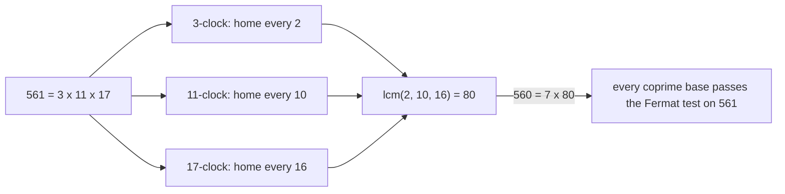

# Carmichael's function: the smallest positive power that sends every coprime number home, often far below Euler's count

[Syllabus](../../../SYLLABUS.md) → [Number theory](../README.md) → [Powers on the Clock](../README.md#s04) → Carmichael's function

---

## General Overview

On the 561-clock (keep the remainder on division by 561), [Euler's theorem](04-eulers-theorem.md) sends any base sharing no factor with 561 (a **coprime** base) back to 1 at the 320th power. Every such base is already home at the 80th.

Why: 561 = 3 × 11 × 17, and a coprime base comes home every 2 steps on the 3-clock, every 10 on the 11-clock and every 16 on the 17-clock. The smallest number that 2, 10 and 16 all divide is 80: their **least common multiple**, written lcm. Euler's count multiplies them: 2 × 10 × 16 = 320.

The **Fermat test** screens n for primality: raise a coprime base to the power n − 1; a prime always gives 1 ([Fermat's little theorem](02-fermats-little-theorem.md)). 80 divides 560, so every coprime base gives 1 on 561, though 561 is composite.

**For any positive clock size n, Carmichael's function λ(n) is the smallest positive power that sends every number coprime to n back to 1 on the n-clock: the lcm of the return times on the prime-power pieces of n.**

**What kind of fact this is:** a theorem, proved in Why it works, with Korselt's test.

### The picture: three small clocks, one power



---

## The formula

```math
\lambda(n) = \mathrm{lcm}\big(\lambda(\text{each prime-power piece of } n)\big)
```

```math
\lambda(p^k) = (p-1)\, p^{k-1} \text{ for an odd prime } p \text{ and } k \ge 1, \qquad \lambda(1) = \lambda(2) = 1, \quad \lambda(4) = 2, \quad \lambda(2^k) = 2^{k-2} \text{ for } k \ge 3
```

```math
\lambda(561) = \mathrm{lcm}(2, 10, 16) = 80, \qquad \lambda(15) = \mathrm{lcm}(2, 4) = 4
```

**Read it aloud:** find each prime-power piece's return time, then take the smallest number they all divide.

| Symbol | Plain meaning | In our example | Push it up and the answer… |
| --- | --- | --- | --- |
| n | the clock size | 561 | depends on the factors |
| p | a prime dividing n | 3, 11, 17 | a longer return time, p − 1 |
| k | how many times p divides n | 1 each | multiplies an odd piece's return time by p |
| a | a base sharing no factor with n | 2, 5, 13 | — (its cycle divides λ(n)) |
| λ(n) | the smallest positive power sending every such base to 1 | 80 | — |
| φ(n) | Euler's totient: the count of such bases | 320 | a whole multiple of λ(n) |

On the 15-clock φ is 8, λ is 4: $`2^4 = 16 = 15 + 1`$.

### When it holds

- **The base shares no factor with n.** $`3^{80}`$ leaves 375 on the 561-clock.
- **The pieces combine by lcm.** Multiplying gives 320: it works, but is not the smallest.
- **Powers of 2 have their own rule.** On the 8-clock $`3^2`$, $`5^2`$ and $`7^2`$ all leave 1, so λ(8) = 2, not φ(8) = 4.
- **λ(n) is the longest cycle, not every cycle.** On the 561-clock 2 returns in 40 steps, 13 in 20, 5 in 80.

---

## Why it works

### Step 0: split the big clock

A power of a base leaves 1 on the 561-clock exactly when it leaves 1 on the 3-, 11- and 17-clocks, since 3, 11 and 17 share no factor ([The Chinese remainder theorem](../03-Clock%20Arithmetic/06-chinese-remainder-theorem.md)). One big clock becomes three small ones.

### Step 1: each piece has a longest cycle

A base's **order** is how many steps its powers take to return to 1; a power gives 1 exactly when the order divides it ([The order of a number and primitive roots](05-order-and-primitive-roots.md)). An odd prime power has a base whose order is the full count $`(p-1)p^{k-1}`$, and every order divides it ([Which clocks have a primitive root](09-primitive-roots-mod-prime-powers.md)). For 561: 2, 10 and 16.

From 8 up, powers of 2 fall short by half.

<details>
<summary>Why λ(2^k) is half of φ(2^k)</summary>

Every odd base is home on the $`2^k`$-clock by power $`2^{k-2}`$ ([Which clocks have a primitive root](09-primitive-roots-mod-prime-powers.md), Step 4).

5 needs all of it. Squaring $`1 + m \times 2^j`$, with m odd and j at least 2, leaves the multiplier odd:

$`\displaystyle (1 + m \times 2^j)^2 = 1 + (m + m^2 \times 2^{j-1}) \times 2^{j+1}`$

From 5 = 1 + 4, for k ≥ 3, $`5^{2^{k-3}}`$ is 1 plus an odd multiple of $`2^{k-1}`$: not 1. The code prints 5's cycle on 8 to 64.

</details>

### Step 2: the lcm works, and nothing smaller does

A multiple of 2, 10 and 16 sends every coprime base to 1 on all three small clocks, so on 561.

The Chinese remainder theorem glues one base with the longest cycle on every piece. It returns to 1 only at a multiple of 2, 10 and 16, so nothing below 80 serves it.

### Step 3: λ(n) = φ(n) exactly when n has a primitive root

A **primitive root** is a base whose cycle is the full φ(n). Step 2 makes λ(n) the longest cycle, so a primitive root exists exactly when λ(n) = φ(n). Two odd primes each bring an even p − 1, so their lcm falls below their product: 561 has none. The code checks 2 to 200: 84 clocks each way.

### Step 4: Korselt's test

A **Carmichael number** is a composite n with $`a^{n-1}`$ leaving 1 for every coprime base: by Step 2, exactly when λ(n) divides n − 1. **Korselt's test** says this happens exactly when:

- **no prime divides n twice.** If $`p^2`$ divides n, p divides λ(n). But p divides n, so not n − 1.
- **each p − 1 divides n − 1.** With no repeats, λ(n) is the lcm of the p − 1, so it divides n − 1 exactly when they all do.

For 561: no prime twice, and 560 = 7 × 80 is a multiple of 2, 10 and 16.

---

## Worked numbers, by hand

| Step | Arithmetic | Value |
| --- | --- | --- |
| factor | 561 = 3 × 11 × 17 | each prime once |
| return times | 3 − 1, 11 − 1, 17 − 1 | 2, 10, 16 |
| lcm | 16 = 2 × 2 × 2 × 2, 10 = 2 × 5, so 16 × 5 | **80** |
| Euler's count | 2 × 10 × 16 | 320 |
| Korselt | 560 ÷ 80 | 7: a Carmichael number |

On the 561-clock, exponents can be cut by 80, not just by 320.

### What breaks if you drop a piece

| Mistake | Comes out at | What went wrong |
| --- | --- | --- |
| multiplying the return times | 320 | that is φ(561): four times too big |
| treating 8 like an odd prime power | 4 | odd squares leave 1: λ(8) = 2 |
| Korselt without "no prime twice" | calls 9 Carmichael | 2 divides 8, but $`2^8`$ leaves 4 |

---

## Code, from first principles, and it actually runs

Road one builds λ(n) from the factorisation; road two keeps the longest cycle over every base. The Carmichael numbers below 10000 come out twice: every base tried, and Korselt's test.

### Python

```python
# Carmichael's function -- the check behind the card.  Nothing is imported.
def gcd(a, b): return gcd(b, a % b) if b else a
def lcm(xs): return xs[0] * lcm(xs[1:]) // gcd(xs[0], lcm(xs[1:])) if xs else 1
def pw(a, e, n): return 1 % n if e == 0 else pw(a * a % n, e // 2, n) * (a if e % 2 else 1) % n
def primes(n, p=2): return [] if n < 2 else [n] if p * p > n else [p] + primes(n // p, p) if n % p == 0 else primes(n, p + 1)
def factor(n): return [(p, primes(n).count(p)) for p in sorted(set(primes(n)))]     # prime, power
def piece(p, k): return 2 ** (k - 2) if p == 2 and k >= 3 else (p - 1) * p ** (k - 1)
def lam(n): return lcm([piece(p, k) for p, k in factor(n)])         # road one: the factorisation
def units(n): return [a for a in range(1, n) if gcd(a, n) == 1]
def order(a, n): return next(e for e in range(1, n + 1) if pw(a, e, n) == 1)
def lam_brute(n): return max(order(a, n) for a in units(n))      # road two: the longest cycle
def korselt(n): return factor(n)[0][0] < n and all(k == 1 and (n - 1) % (p - 1) == 0 for p, k in factor(n))
def fools_all(n): return factor(n)[0][0] < n and all(pw(a, n - 1, n) == 1 for a in units(n))
def has_root(n): return n in (2, 4) or (f := factor(n // 2 if n % 4 == 2 else n)) != [] and len(f) == 1 and f[0][0] > 2
print(f"15 = 3 x 5: lambda = lcm(2, 4) = {lam(15)}, phi = {len(units(15))}, 2^4 mod 15 = {pw(2, 4, 15)}")
print(f"561 = 3 x 11 x 17: lambda = lcm(2, 10, 16) = {lam(561)}, phi = {len(units(561))}, 560 = {560 // lam(561)} x 80")
print(f"longest cycle, every base tried: 15 -> {lam_brute(15)}, 561 -> {lam_brute(561)}; cycles of 2, 5, 13 on 561: {order(2, 561)}, {order(5, 561)}, {order(13, 561)}")
print("2-power clocks 8, 16, 32, 64: lambda", [lam(2 ** k) for k in (3, 4, 5, 6)], "phi", [len(units(2 ** k)) for k in (3, 4, 5, 6)], "cycle of 5", [order(5, 2 ** k) for k in (3, 4, 5, 6)])
same, eq, roots = (sum(map(t, range(2, 201))) for t in (lambda n: lam(n) == lam_brute(n), lambda n: lam(n) == len(units(n)), has_root))
print(f"clocks 2 to 200: formula = longest cycle on {same}; lambda = phi on {eq}, primitive root on {roots}")
brute, kors = [n for n in range(4, 10000) if fools_all(n)], [n for n in range(4, 10000) if korselt(n)]
print(f"Carmichael numbers below 10000, every base tried: {brute}\nCarmichael numbers below 10000, Korselt's test:   {kors}")
d_phi, d_lam = (next(d for d in range(1, m) if 17 * d % m == 1) for m in (3120, lam(3233)))
print(f"RSA, 3233 = 61 x 53, e = 17: d = {d_phi} from phi 3120, d = {d_lam} from lambda {lam(3233)}; 65 -> {pw(65, 17, 3233)} -> {pw(pw(65, 17, 3233), d_lam, 3233)}")
print(f"mistakes: 2 x 10 x 16 = {2 * 10 * 16}; 3^2, 5^2, 7^2 mod 8 = {pw(3, 2, 8)}, {pw(5, 2, 8)}, {pw(7, 2, 8)}; 9 passes Korselt minus 'no prime twice': {['no', 'yes'][all((9 - 1) % (p - 1) == 0 for p, k in factor(9))]}, yet 2^8 mod 9 = {pw(2, 8, 9)}; 3^80 mod 561 = {pw(3, 80, 561)}")
assert lam(561) == lam_brute(561) == 80 and lam(15) == lam_brute(15) == 4 and same == 199 and all(pw(a, 80, 561) == 1 for a in units(561))
assert all((lam(n) == len(units(n))) == has_root(n) for n in range(2, 201)) and roots == eq == 84 and not korselt(9)
assert brute == kors == [561, 1105, 1729, 2465, 2821, 6601, 8911] and pw(pw(65, 17, 3233), d_lam, 3233) == 65 and d_lam == 413
print("ALL CHECKS PASS")
```

**Ran 2026-11-23 on macOS, Python 3.14.10, standard library only. All checks passed. Output, pasted from the run:**

```
15 = 3 x 5: lambda = lcm(2, 4) = 4, phi = 8, 2^4 mod 15 = 1
561 = 3 x 11 x 17: lambda = lcm(2, 10, 16) = 80, phi = 320, 560 = 7 x 80
longest cycle, every base tried: 15 -> 4, 561 -> 80; cycles of 2, 5, 13 on 561: 40, 80, 20
2-power clocks 8, 16, 32, 64: lambda [2, 4, 8, 16] phi [4, 8, 16, 32] cycle of 5 [2, 4, 8, 16]
clocks 2 to 200: formula = longest cycle on 199; lambda = phi on 84, primitive root on 84
Carmichael numbers below 10000, every base tried: [561, 1105, 1729, 2465, 2821, 6601, 8911]
Carmichael numbers below 10000, Korselt's test:   [561, 1105, 1729, 2465, 2821, 6601, 8911]
RSA, 3233 = 61 x 53, e = 17: d = 2753 from phi 3120, d = 413 from lambda 780; 65 -> 2790 -> 65
mistakes: 2 x 10 x 16 = 320; 3^2, 5^2, 7^2 mod 8 = 1, 1, 1; 9 passes Korselt minus 'no prime twice': yes, yet 2^8 mod 9 = 4; 3^80 mod 561 = 375
ALL CHECKS PASS
```

### Rust

```rust
// Carmichael's function -- the same check as the Python, in Rust.  No crates.
fn gcd(a: u64, b: u64) -> u64 { if b == 0 { a } else { gcd(b, a % b) } }
fn lcm(xs: &[u64]) -> u64 { xs.iter().fold(1, |l, &x| l * x / gcd(l, x)) }
fn pw(a: u64, e: u64, n: u64) -> u64 { if e == 0 { 1 % n } else { pw(a * a % n, e / 2, n) * (if e % 2 == 1 { a } else { 1 }) % n } }
fn factor(mut n: u64) -> Vec<(u64, u32)> {           // the prime powers in n, by trial division
    let (mut out, mut p) = (vec![], 2);
    while n > 1 { let mut k = 0; while n % p == 0 { n /= p; k += 1; } if k > 0 { out.push((p, k)); } p += 1; }
    out
}
fn piece(p: u64, k: u32) -> u64 { if p == 2 && k >= 3 { 1 << (k - 2) } else { (p - 1) * p.pow(k - 1) } }
fn lam(n: u64) -> u64 { lcm(&factor(n).iter().map(|&(p, k)| piece(p, k)).collect::<Vec<_>>()) }   // road one
fn units(n: u64) -> Vec<u64> { (1..n).filter(|&a| gcd(a, n) == 1).collect() }
fn phi(n: u64) -> u64 { units(n).len() as u64 }
fn order(a: u64, n: u64) -> u64 { (1..=n).find(|&e| pw(a, e, n) == 1).unwrap() }
fn lam_brute(n: u64) -> u64 { units(n).iter().map(|&a| order(a, n)).max().unwrap() }   // road two
fn korselt(n: u64) -> bool { let f = factor(n); f[0].0 < n && f.iter().all(|&(p, k)| k == 1 && (n - 1) % (p - 1) == 0) }
fn fools_all(n: u64) -> bool { factor(n)[0].0 < n && units(n).iter().all(|&a| pw(a, n - 1, n) == 1) }
fn has_root(n: u64) -> bool { let f = factor(if n % 4 == 2 { n / 2 } else { n }); n == 2 || n == 4 || (f.len() == 1 && f[0].0 > 2) }
fn main() {
    println!("15 = 3 x 5: lambda = lcm(2, 4) = {}, phi = {}, 2^4 mod 15 = {}", lam(15), phi(15), pw(2, 4, 15));
    println!("561 = 3 x 11 x 17: lambda = lcm(2, 10, 16) = {}, phi = {}, 560 = {} x 80", lam(561), phi(561), 560 / lam(561));
    println!("longest cycle, every base tried: 15 -> {}, 561 -> {}; cycles of 2, 5, 13 on 561: {}, {}, {}",
             lam_brute(15), lam_brute(561), order(2, 561), order(5, 561), order(13, 561));
    let ks = [3u32, 4, 5, 6];
    println!("2-power clocks 8, 16, 32, 64: lambda {:?} phi {:?} cycle of 5 {:?}", ks.map(|k| lam(1 << k)), ks.map(|k| phi(1 << k)), ks.map(|k| order(5, 1 << k)));
    let count = |t: &dyn Fn(u64) -> bool| (2..201u64).filter(|&n| t(n)).count();
    let (same, eq, roots) = (count(&|n| lam(n) == lam_brute(n)), count(&|n| lam(n) == phi(n)), count(&has_root));
    println!("clocks 2 to 200: formula = longest cycle on {}; lambda = phi on {}, primitive root on {}", same, eq, roots);
    let (brute, kors): (Vec<u64>, Vec<u64>) = ((4..10000).filter(|&n| fools_all(n)).collect(), (4..10000).filter(|&n| korselt(n)).collect());
    println!("Carmichael numbers below 10000, every base tried: {:?}\nCarmichael numbers below 10000, Korselt's test:   {:?}", brute, kors);
    let inv = |m: u64| (1..m).find(|&d| 17 * d % m == 1).unwrap();
    let (d_phi, d_lam, c) = (inv(3120), inv(lam(3233)), pw(65, 17, 3233));
    println!("RSA, 3233 = 61 x 53, e = 17: d = {} from phi 3120, d = {} from lambda {}; 65 -> {} -> {}", d_phi, d_lam, lam(3233), c, pw(c, d_lam, 3233));
    println!("mistakes: 2 x 10 x 16 = {}; 3^2, 5^2, 7^2 mod 8 = {}, {}, {}; 9 passes Korselt minus 'no prime twice': {}, yet 2^8 mod 9 = {}; 3^80 mod 561 = {}",
             2 * 10 * 16, pw(3, 2, 8), pw(5, 2, 8), pw(7, 2, 8), if factor(9).iter().all(|&(p, _)| (9 - 1) % (p - 1) == 0) { "yes" } else { "no" }, pw(2, 8, 9), pw(3, 80, 561));
    assert!(lam(561) == 80 && lam_brute(561) == 80 && lam(15) == 4 && lam_brute(15) == 4 && same == 199 && units(561).iter().all(|&a| pw(a, 80, 561) == 1));
    assert!((2..201u64).all(|n| (lam(n) == phi(n)) == has_root(n)) && roots == 84 && eq == 84 && !korselt(9));
    assert!(brute == kors && brute == vec![561, 1105, 1729, 2465, 2821, 6601, 8911] && pw(c, d_lam, 3233) == 65 && d_lam == 413);
    println!("ALL CHECKS PASS");
}
```

**Ran 2026-11-23 on macOS, rustc 1.98.1, no crates. All checks passed. Output, pasted from the run:**

```
15 = 3 x 5: lambda = lcm(2, 4) = 4, phi = 8, 2^4 mod 15 = 1
561 = 3 x 11 x 17: lambda = lcm(2, 10, 16) = 80, phi = 320, 560 = 7 x 80
longest cycle, every base tried: 15 -> 4, 561 -> 80; cycles of 2, 5, 13 on 561: 40, 80, 20
2-power clocks 8, 16, 32, 64: lambda [2, 4, 8, 16] phi [4, 8, 16, 32] cycle of 5 [2, 4, 8, 16]
clocks 2 to 200: formula = longest cycle on 199; lambda = phi on 84, primitive root on 84
Carmichael numbers below 10000, every base tried: [561, 1105, 1729, 2465, 2821, 6601, 8911]
Carmichael numbers below 10000, Korselt's test:   [561, 1105, 1729, 2465, 2821, 6601, 8911]
RSA, 3233 = 61 x 53, e = 17: d = 2753 from phi 3120, d = 413 from lambda 780; 65 -> 2790 -> 65
mistakes: 2 x 10 x 16 = 320; 3^2, 5^2, 7^2 mod 8 = 1, 1, 1; 9 passes Korselt minus 'no prime twice': yes, yet 2^8 mod 9 = 4; 3^80 mod 561 = 375
ALL CHECKS PASS
```

### Lean

Lean proves the smallest-power claim, the lcm formula and Korselt's test for every clock, not only 561 and 15.

- Take any clock size n of at least 1. Then λ(n) is the smallest positive power that sends every coprime base to 1.
- Take any clock size n of at least 1. Then λ(n) is the lcm of its prime-power pieces' return times, by the formula above.
- Take a composite n. Then it is a Carmichael number exactly when λ(n) divides n − 1.
- Take a composite n. Then it is a Carmichael number exactly when no prime divides n twice and each p − 1 divides n − 1.
- Take the card's examples. Then λ(561) = 80, φ(561) = 320, λ(15) = 4 and λ(8) = 2.

The primitive-root link, the run over clocks 2 to 200 and the Carmichael numbers below 10000 are left to the Python and Rust checks.

```lean
-- Carmichael's function: lambda(n) is the smallest positive power that sends every number coprime to n back to 1 on the n-clock, it is the lcm of the prime-power pieces' return times, and a composite n fools the Fermat test for every coprime base exactly when lambda(n) divides n - 1, which is Korselt's test.
import Mathlib.NumberTheory.ArithmeticFunction.Carmichael
import Mathlib.NumberTheory.CarmichaelNumber
import Mathlib.Data.Nat.ModEq
import Mathlib.Data.Nat.Totient
import Mathlib.Tactic.NormNum.GCD
import Mathlib.Tactic.NormNum.Pow
import Mathlib.Tactic.NormNum.Prime

open ArithmeticFunction

/-- Carmichael's function. On the n-clock (n at least 1), lambda(n) is the smallest positive power
that sends every number a sharing no factor with n back to 1: a to the lambda(n) leaves remainder 1
on division by n for every such a, and no smaller positive power does that for all of them. -/
theorem carmichael_is_smallest_power_sending_every_coprime_base_home (n : ℕ) (hn : n ≠ 0) :
    IsLeast {e : ℕ | 0 < e ∧ ∀ a : ℕ, Nat.Coprime a n → a ^ e ≡ 1 [MOD n]} (carmichael n) := by
  have : NeZero n := ⟨hn⟩
  refine ⟨⟨Nat.pos_of_dvd_of_pos (carmichael_dvd_totient n) (Nat.totient_pos.2 (Nat.pos_of_ne_zero hn)),
    fun a ha => ?_⟩, ?_⟩
  · rw [← ZMod.natCast_eq_natCast_iff]
    push_cast
    rw [← ZMod.coe_unitOfCoprime a ha, ← Units.val_pow_eq_pow_val, pow_carmichael, Units.val_one]
  · rintro e ⟨he, h⟩
    apply Nat.le_of_dvd he
    rw [carmichael_eq_exponent hn]
    refine Monoid.exponent_dvd_of_forall_pow_eq_one fun u => ?_
    have hu := (ZMod.natCast_eq_natCast_iff _ _ _).2 (h (u : ZMod n).val (ZMod.val_coe_unit_coprime u))
    push_cast at hu
    rw [ZMod.natCast_zmod_val] at hu
    ext
    rw [Units.val_pow_eq_pow_val, hu, Units.val_one]

/-- The formula. Split n into its prime-power pieces p^k. Each piece's return time is
(p - 1) p^(k - 1), except that a power of 2 with k at least 3 has return time 2^(k - 2).
Then lambda(n) is the least common multiple of those return times. -/
theorem carmichael_is_lcm_of_prime_power_return_times (n : ℕ) (hn : n ≠ 0) :
    carmichael n = n.primeFactors.lcm (fun p =>
      if p = 2 ∧ 3 ≤ n.factorization p then 2 ^ (n.factorization p - 2)
      else (p - 1) * p ^ (n.factorization p - 1)) := by
  have : NeZero n := ⟨hn⟩
  rw [carmichael_factorization n]
  refine Finset.lcm_congr rfl fun p hp => ?_
  have hpp := Nat.prime_of_mem_primeFactors hp
  have hk : 0 < n.factorization p :=
    hpp.factorization_pos_of_dvd hn (Nat.dvd_of_mem_primeFactors hp)
  by_cases h2 : p = 2
  · subst h2
    by_cases h3 : 3 ≤ n.factorization 2
    · rw [ite_eq_left ⟨rfl, h3⟩, carmichael_two_pow_of_ne_two (by omega)]
    · rw [ite_eq_right (by tauto), carmichael_two_pow_of_le_two (by omega)]
      simp
  · rw [ite_eq_right (by tauto), carmichael_pow_of_prime_ne_two _ hpp h2, Nat.totient_prime_pow hpp hk,
      mul_comm]

/-- Korselt's test. Take a composite n (above 1 and not prime). It is a Carmichael number, meaning
a to the (n - 1) leaves 1 on the n-clock for every base a sharing no factor with n, exactly when
lambda(n) divides n - 1, and exactly when no prime divides n twice and p - 1 divides n - 1 for
every prime p dividing n. -/
theorem korselt_test (n : ℕ) (h1 : 1 < n) (hnp : ¬ n.Prime) :
    (n.IsCarmichael ↔ carmichael n ∣ n - 1) ∧
    (n.IsCarmichael ↔ Squarefree n ∧ ∀ p : ℕ, p.Prime → p ∣ n → p - 1 ∣ n - 1) := by
  have h2 : 2 < n := by
    by_contra h
    interval_cases n
    exact hnp Nat.prime_two
  refine ⟨⟨Nat.IsCarmichael.carmichael_dvd_sub_one, fun hd => ⟨h2, hnp, fun b hb => ?_⟩⟩, ?_⟩
  · obtain ⟨d, hd⟩ := hd
    have hb0 : b ≠ 0 := by
      rintro rfl
      rw [Nat.coprime_zero_left] at hb
      omega
    rw [Nat.probablePrime_iff_zmod_one n hb0, ← ZMod.coe_unitOfCoprime b hb,
      ← Units.val_pow_eq_pow_val, hd, pow_mul, pow_carmichael, one_pow, Units.val_one]
  · rw [Nat.isCarmichael_iff_korselt]
    tauto

-- 561 = 3 x 11 x 17: return times 2, 10, 16; lcm 80; Euler's count 320; 560 = 7 x 80.
example : 561 = 3 * 11 * 17 := by norm_num
example : Nat.lcm 2 (Nat.lcm 10 16) = 80 := by norm_num
example : 2 * 10 * 16 = 320 := by norm_num
example : 560 = 7 * 80 := by norm_num
example : carmichael 561 = 80 := by 
  rw [show (561 : ℕ) = 3 * (11 * 17) by norm_num, carmichael_mul (by norm_num),
    carmichael_mul (by norm_num), carmichael_of_prime (by norm_num), carmichael_of_prime (by norm_num),
    carmichael_of_prime (by norm_num)]
  norm_num
example : Nat.totient 561 = 320 := by 
  rw [show (561 : ℕ) = 3 * (11 * 17) by norm_num, Nat.totient_mul (by norm_num),
    Nat.totient_mul (by norm_num), Nat.totient_prime (by norm_num), Nat.totient_prime (by norm_num),
    Nat.totient_prime (by norm_num)]
example : Nat.IsCarmichael 561 := by exact Nat.isCarmichael_561

-- 15 = 3 x 5: lambda = lcm(2, 4) = 4, phi = 8, 2^4 = 16 leaves 1.
example : Nat.lcm 2 4 = 4 := by norm_num
example : carmichael 15 = 4 := by 
  rw [show (15 : ℕ) = 3 * 5 by norm_num, carmichael_mul (by norm_num),
    carmichael_of_prime (by norm_num), carmichael_of_prime (by norm_num)]
  norm_num
example : Nat.totient 15 = 8 := by 
  rw [show (15 : ℕ) = 3 * 5 by norm_num, Nat.totient_mul (by norm_num),
    Nat.totient_prime (by norm_num), Nat.totient_prime (by norm_num)]
example : 2 ^ 4 % 15 = 1 := by norm_num

-- When it holds: a base sharing a factor fails; powers of 2 have their own rule.
example : 3 ^ 80 % 561 = 375 := by norm_num
example : 3 ^ 2 % 8 = 1 ∧ 5 ^ 2 % 8 = 1 ∧ 7 ^ 2 % 8 = 1 := by norm_num
example : carmichael 8 = 2 ∧ Nat.totient 8 = 4 := by 
  rw [show (8 : ℕ) = 2 ^ 3 by norm_num, carmichael_two_pow_of_ne_two (by norm_num),
    Nat.totient_prime_pow Nat.prime_two (by norm_num)]
  norm_num

-- On the 561-clock, 2 returns in 40 steps, 13 in 20, 5 in 80.
example : orderOf (2 : ZMod 561) = 40 ∧ orderOf (13 : ZMod 561) = 20 ∧ orderOf (5 : ZMod 561) = 80 := by
  
  refine ⟨orderOf_eq_of_pow_and_pow_div_prime (by norm_num) (by decide) ?_,
    orderOf_eq_of_pow_and_pow_div_prime (by norm_num) (by decide) ?_,
    orderOf_eq_of_pow_and_pow_div_prime (by norm_num) (by decide) ?_⟩ <;>
  · intro p hp hdvd
    have hp80 : p ≤ 80 := Nat.le_of_dvd (by norm_num) (hdvd.trans (by norm_num))
    interval_cases p <;> first | (revert hp hdvd; norm_num; done) | decide

-- Korselt without "no prime twice": 2 divides 8, yet 2^8 leaves 4 on the 9-clock.
example : (3 - 1) ∣ (9 - 1) ∧ 2 ^ 8 % 9 = 4 := by norm_num
example : ¬ Nat.IsCarmichael 9 := by 
  intro h
  have h3 := h.squarefree 3 (by norm_num)
  norm_num at h3

-- RSA, 3233 = 61 x 53, e = 17: lambda = 780, d = 413; 65 locks to 2790 and unlocks back to 65.
example : 3233 = 61 * 53 ∧ Nat.lcm 60 52 = 780 ∧ 17 * 413 % 780 = 1 := by norm_num
example : 65 ^ 17 % 3233 = 2790 ∧ 2790 ^ 413 % 3233 = 65 := by decide
example : carmichael 3233 = 780 := by 
  rw [show (3233 : ℕ) = 61 * 53 by norm_num, carmichael_mul (by norm_num),
    carmichael_of_prime (by norm_num), carmichael_of_prime (by norm_num)]
  norm_num

#print axioms carmichael_is_smallest_power_sending_every_coprime_base_home
#print axioms carmichael_is_lcm_of_prime_power_return_times
#print axioms korselt_test
```

**Checked 2026-11-23 on macOS, Lean 4.36.0-rc2, Mathlib v4.36.0-rc2. Every proof is complete and uses only Lean's standard axioms. Output, pasted from the run:**

```
'carmichael_is_smallest_power_sending_every_coprime_base_home' depends on axioms: [propext, Classical.choice, Quot.sound]
'carmichael_is_lcm_of_prime_power_return_times' depends on axioms: [propext, Classical.choice, Quot.sound]
'korselt_test' depends on axioms: [propext, Classical.choice, Quot.sound]
```

> [!TIP]
> **Try changing**
> Guess first. Each change trips an assert (a line that stops a wrong run).
> - **Give powers of 2 Euler's rule.** In `piece`, change `k >= 3` to `k >= 99`. The formula says 4 on the 8-clock; the longest cycle stays 2.
> - **Drop "no prime twice".** In `korselt`, delete `k == 1 and`. Numbers with a squared prime slip in.
> - **Key RSA on φ.** In the `d_phi, d_lam` line, replace `lam(3233)` with `3120`. d becomes 2753 and 65 still comes back: both keys work.

---

## The usual mistake

> [!warning]
> **Taking Euler's count as the smallest positive power that works.** φ(561) = 320 works, but so does 80. Euler multiplies the return times; Carmichael takes their lcm.
>
> - A base sharing a factor: $`3^{80}`$ leaves 375.
> - λ(8) taken as 4: it is 2.
> - Korselt without "no prime twice": 9 slips in, yet $`2^8`$ leaves 4.

---

## Where you meet it in real life

- **RSA keys.** RSA locks with a public power e, unlocks with a private power d. Its standard (PKCS #1) lets d undo e on a λ(n)-clock: for 3233 = 61 × 53 and e = 17, λ is 780 and d is 413, not 2753, and 2790 still unlocks to 65 ([RSA in outline](../06-Codes%20and%20Secrets/03-rsa-in-outline.md)).
- **Primality testing.** Exactly the composites passing Korselt's test fool the Fermat test for every coprime base: 561, 1105, 1729 and on.
- **Random number generators.** Multiplying by a fixed number coprime to n on an n-clock repeats within λ(n) steps.

> **Say it back**
> For any positive clock size n, λ(n) is the smallest positive power that sends every number coprime to n back to 1. It is the lcm of the prime-power pieces' return times: 80 for 561, against Euler's 320. It equals φ(n) exactly when n has a primitive root. A composite n fools the Fermat test for every coprime base exactly when λ(n) divides n − 1.

---

## What this builds on

- [Which clocks have a primitive root](09-primitive-roots-mod-prime-powers.md): the longest cycle on odd prime powers.
- [The Chinese remainder theorem](../03-Clock%20Arithmetic/06-chinese-remainder-theorem.md): splitting a clock and gluing bases back.
- [Euler's theorem](04-eulers-theorem.md): the power φ(n), which λ(n) divides.

## Where this goes next

- [Gauss's lemma](12-gauss-lemma.md): next on this shelf. It turns from return powers to a new question: which numbers are squares on an odd prime clock.
- [The Fermat test](../06-Codes%20and%20Secrets/04-fermat-test-and-carmichael.md): the test in use, and how Carmichael numbers fool it.
- [The Miller-Rabin test](../06-Codes%20and%20Secrets/05-miller-rabin.md): the repaired test, which catches Carmichael numbers.
- [RSA in outline](../06-Codes%20and%20Secrets/03-rsa-in-outline.md): the cipher, worked there with φ(n); its standard swaps in λ(n), as in the RSA keys example above.

Left open: Carmichael numbers never run out (proved 1994), but how rare are they? No card on this shelf answers that; it is a question about counting, and the shelf turns next to squares.

---

## Sources

Verified 2026-11-23: every link below resolves to the publisher's page.

- Carmichael, R. D. "Note on a new number theory function." *Bulletin of the American Mathematical Society* 16, no. 5 (1910): 232–238. [doi:10.1090/S0002-9904-1910-01892-9](https://doi.org/10.1090/S0002-9904-1910-01892-9). Defines λ(n) and its prime-power rule.
- Alford, W. R., A. Granville and C. Pomerance. "There are infinitely many Carmichael numbers." *Annals of Mathematics* 139 (1994): 703–722. [doi:10.2307/2118576](https://doi.org/10.2307/2118576). Carmichael numbers never run out.
- Shoup, Victor. *A Computational Introduction to Number Theory and Algebra*. Cambridge, 2008. [doi:10.1017/CBO9780511814549](https://doi.org/10.1017/CBO9780511814549); [free full text](https://shoup.net/ntb/). Chapter 10: Carmichael numbers and the stronger test.
