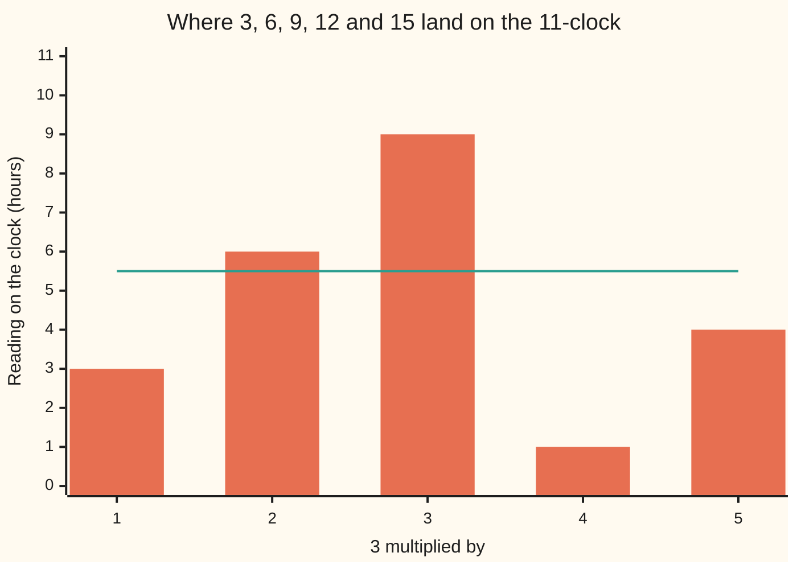

# Gauss's lemma: on an odd prime clock, count how many of the first (p − 1)/2 multiples of a land in the top half, to tell whether a is a square

[Syllabus](../../../SYLLABUS.md) → [Number theory](../README.md) → [Powers on the Clock](../README.md#s04) → Gauss's lemma

---

## General Overview

An 11-hour clock reads 0 to 10, wrapping at 11 ([Congruence](../03-Clock%20Arithmetic/01-congruence-mod-n.md)). Is 3 a **square** there: does some number times itself land on 3? Square 1 to 10 and only five readings appear: 1, 3, 4, 5, 9. So 3 is a square; 2 is not.

For the huge primes inside elliptic-curve keys, listing squares is hopeless; Euler's test, one power by repeated squaring, settles it. Gauss's 1808 count is slower, but shows why.

Multiply 3 by 1 to 5, half the ten nonzero hours. The readings are 3, 6, 9, 1, 4. Two readings, 6 and 9, sit in the top half, above 5.5. That count is even, so 3 is a square. Indeed 5 × 5 = 25 reads 3.

**For a number that an odd prime p does not divide, count how many of its first (p − 1)/2 multiples land in the top half: even means a square, odd means not.**

**What kind of fact this is:** a theorem, proved on this card in Why it works.

### The picture: five multiples of 3 on the 11-clock



Two bars rise above the line at half the clock, 5.5: an even count.

---

## The formula

For an odd prime $`p`$ and a number $`a`$ that $`p`$ does not divide, the **Legendre symbol** $`(a/p)`$ is 1 if $`a`$ is a square on the $`p`$-clock, and -1 if not.

```math
(a/p) \equiv a^{h} \equiv (-1)^{m} \pmod{p}
```

**Read it aloud:** the answer is what $`a`$ multiplied in $`h`$ times reads (Euler's test), and one minus sign per top-half reading (Gauss's count).

On the 11-clock: $`3^5 = 243`$, 22 whole clocks and 1 over, and $`(-1)^2 = 1`$. Both say yes.

| Symbol | Plain meaning | In our example | Push it up and the answer… |
| --- | --- | --- | --- |
| $`p`$ | the clock size, an odd prime | 11 | still half the nonzero hours are squares |
| $`a`$ | the number tested | 3 | the readings reshuffle |
| $`h`$ | half the nonzero hours, $`(p-1)/2`$ | 5 | more multiples to count |
| $`m`$ | how many of $`a, 2a, \dots, ha`$ read above $`p/2`$ | 2 | each extra 1 flips it |
| $`(a/p)`$ | 1 if $`a`$ is a square, -1 if not | 1 | only 1 or -1 |
| $`x`$ | a square root: $`x \times x`$ reads $`a`$ | 5 | — |

For an odd prime $`p`$, two rules follow (Step 4):

- **-1 is a square** exactly when $`p`$ leaves 1 on division by 4: yes on 17 ($`4^2 = 16`$), no on 11.
- **2 is a square** exactly when $`p`$ leaves 1 or 7 on division by 8: yes on 7, 17 and 23, no on 11 and 13.

### When it holds

- **A prime clock.** On the 15-clock 2 counts 4, even, yet is no square: Step 2 needs an undo for every factor.
- **An odd clock.** The 2-clock has no top half.
- **A number the clock does not divide.** 0 reads 0, neither answer.
- **The first half of the multiples only.** All ten always count 5.

---

## Why it works

### Step 0: fold the top half onto the bottom

A top-half reading is minus its distance to $`p`$, and that distance sits in the bottom half: 9 on the 11-clock is -2. Each fold carries one minus sign.

### Step 1: the folded readings are 1 to h, shuffled

For 3 on the 11-clock, 3, 6, 9, 1, 4 fold to 3, 5, 2, 1, 4: each of 1 to 5 once.

Two multiples that fold together are equal or opposite. Cancel $`a`$, which has an undo ([The modular inverse](../03-Clock%20Arithmetic/04-modular-inverse.md)): the multipliers are equal or opposite. Both lie in 1 to $`h`$, so they add to less than $`p`$: equal, not opposite.

### Step 2: multiply the row two ways

The multiples multiply to $`a^h`$ times $`1 \times 2 \times \dots \times h`$. Folded, the same product is $`(-1)^m`$ times $`1 \times 2 \times \dots \times h`$. The prime divides none of 1 to $`h`$, so that product cancels: $`a^h \equiv (-1)^m`$.

### Step 3: Euler's test, squares read 1 and the rest -1

This is **Euler's criterion**. Squaring 1 to $`p-1`$ hits each nonzero square exactly twice, from $`x`$ and $`-x`$ (no third: the root bound), so there are $`h`$ nonzero squares.

- A nonzero square $`x^2`$ raised to the $`h`$ is $`x^{p-1}`$, which reads 1 ([Fermat's little theorem](02-fermats-little-theorem.md)).
- $`x^h - 1`$ has at most $`h`$ roots on a prime clock ([Lagrange's root bound](07-lagrange-root-bound.md)). The squares fill them all.
- A non-square's $`a^h`$ is then not 1, yet squares to $`a^{p-1}`$, which reads 1. Only 1 and -1 do that ([Wilson's theorem](06-wilsons-theorem.md), Step 1), so it reads -1.

### Step 4: the rules for -1 and 2

- **For -1**, the multiples $`-1, \dots, -h`$ read $`p-1`$ down to $`p-h`$, all on top, so $`m = h`$: even when $`p`$ leaves 1 on division by 4. 11 counts 5; 17 counts 8.
- **For 2**, the multiples $`2, 4, \dots, p-1`$ never wrap. The count is $`h`$ minus the evens below $`p/2`$. Adding 8 to $`p`$ adds 4 to $`h`$ and 2 to those evens, so the parity repeats every 8. The clocks 7, 11, 13 and 17 cover all four cases, with counts 2, 3, 3 and 4.

---

## Worked numbers, by hand

Is 2 a square on the 17-clock?

| Step | Arithmetic | Value |
| --- | --- | --- |
| half the nonzero hours | (17 - 1) ÷ 2 | 8 |
| the multiples | 2, 4, 6, 8, 10, 12, 14, 16 | no wrap |
| above 8.5 | 10, 12, 14, 16 | count 4 |
| the sign | 4 is even | **1: a square** |
| the root, by search | 6 × 6 | reads 2 |

So 2 has a square root on the 17-clock.

### What breaks if you drop a piece

| Mistake | Comes out at | What went wrong |
| --- | --- | --- |
| Counting the bottom half, 3 on 11 | 3, odd: "no" | that is $`h - m`$, flipped when $`h`$ is odd |
| All ten multiples, 3 on 11 | 5, odd: "no" | always 5 on top: the row is 1 to 10 shuffled |
| Power 10, not 5, for 2 on 11 | $`2^{10}`$ reads 1: "yes" | every nonzero hour reads 1 there, by Fermat |

---

## Code, from first principles, and it actually runs

Three roads: try every $`x`$ for a root, raise $`a`$ to the $`h`$ (Euler), count top-half readings (Gauss). They must agree on every odd prime clock below 200, with the rules for -1 and 2.

### Python

```python
# Gauss's lemma -- the check behind the card.  Nothing is imported.  Three roads to
# "is a a square on the p-clock?": try every x, Euler's power, and Gauss's count.
def euler(a, p):                 # a multiplied in (p - 1)/2 times, read as 1 or -1
    r = 1
    for _ in range((p - 1) // 2): r = r * a % p
    return -1 if r == p - 1 else r
def top(a, p):                   # readings of a, 2a, ... up to (p - 1)/2 times a, above p/2
    return [k * a % p for k in range(1, (p + 1) // 2) if 2 * (k * a % p) > p]
def root(a, p): return next((x for x in range(1, p) if x * x % p == a % p), None)
reads = [k * 3 % 11 for k in range(1, 6)]
fold = [r if 2 * r < 11 else 11 - r for r in reads]
print("3 x 1, 2, 3, 4, 5 on the 11-clock reads:", *reads)
print("above 5.5:", *top(3, 11), f"(count {len(top(3, 11))}, even); folded:", *fold)
print(f"Euler: 3^5 = {3 ** 5} = {3 ** 5 // 11} x 11 + {3 ** 5 % 11}, reads {euler(3, 11)}; root {root(3, 11)}: 25 reads {25 % 11}")
print("the squares on the 11-clock:", *sorted({x * x % 11 for x in range(1, 11)}))
print(f"-1 on 11: count {len(top(-1, 11))}, Euler {euler(-1, 11)}, root {root(-1, 11) or '-'}; on 17: count {len(top(-1, 17))}, Euler {euler(-1, 17)}, root {root(-1, 17)}")
for p in (7, 11, 13, 17, 23):
    print(f"2 on the {p:>2}-clock ({p % 8} mod 8): count above {p / 2:>4} is {len(top(2, p))}, Euler {euler(2, p):>2}, root {root(2, p) or '-'}")
below = sum(2 * r < 11 for r in reads)
allten = sum(2 * (k * 3 % 11) > 11 for k in range(1, 11))
print(f"mistakes: bottom-half count {below}, all ten multiples count {allten}, 2^10 reads {2 ** 10 % 11}, 2 on 15 counts {len(top(2, 15))}, root {root(2, 15) or '-'}")
primes = [p for p in range(3, 200) if all(p % d for d in range(2, p))]
for p in primes:
    for a in range(1, p):        # brute force, Euler and Gauss all agree
        assert euler(a, p) == (1 if root(a, p) else -1) == (-1) ** len(top(a, p))
    assert (root(-1, p) is not None) == (p % 4 == 1) and (root(2, p) is not None) == (p % 8 in (1, 7))
assert root(3, 11) == 5 and euler(2, 11) == -1 and len(top(2, 15)) == 4 and root(2, 15) is None
print("ALL CHECKS PASS")
```

**Ran 2026-11-23 on macOS, Python 3.14.10, standard library only. All checks passed. Output, pasted from the run:**

```
3 x 1, 2, 3, 4, 5 on the 11-clock reads: 3 6 9 1 4
above 5.5: 6 9 (count 2, even); folded: 3 5 2 1 4
Euler: 3^5 = 243 = 22 x 11 + 1, reads 1; root 5: 25 reads 3
the squares on the 11-clock: 1 3 4 5 9
-1 on 11: count 5, Euler -1, root -; on 17: count 8, Euler 1, root 4
2 on the  7-clock (7 mod 8): count above  3.5 is 2, Euler  1, root 3
2 on the 11-clock (3 mod 8): count above  5.5 is 3, Euler -1, root -
2 on the 13-clock (5 mod 8): count above  6.5 is 3, Euler -1, root -
2 on the 17-clock (1 mod 8): count above  8.5 is 4, Euler  1, root 6
2 on the 23-clock (7 mod 8): count above 11.5 is 6, Euler  1, root 5
mistakes: bottom-half count 3, all ten multiples count 5, 2^10 reads 1, 2 on 15 counts 4, root -
ALL CHECKS PASS
```

### Rust

```rust
// Gauss's lemma -- the same check as the Python one, in Rust.  No crates.  Three roads
// to "is a a square on the p-clock?": try every x, Euler's power, and Gauss's count.
fn euler(a: i64, p: i64) -> i64 {      // a multiplied in (p - 1)/2 times, read as 1 or -1
    let mut r = 1;
    for _ in 0..(p - 1) / 2 { r = (r * a).rem_euclid(p); }
    if r == p - 1 { -1 } else { r }
}
fn top(a: i64, p: i64) -> Vec<i64> {   // readings of a, 2a, ... up to (p - 1)/2 times a, above p/2
    (1..(p + 1) / 2).map(|k| (k * a).rem_euclid(p)).filter(|&r| 2 * r > p).collect()
}
fn root(a: i64, p: i64) -> Option<i64> { (1..p).find(|&x| x * x % p == a.rem_euclid(p)) }
fn show(r: Option<i64>) -> String { r.map_or("-".to_string(), |x| x.to_string()) }
fn join(v: &[i64]) -> String { v.iter().map(|x| x.to_string()).collect::<Vec<_>>().join(" ") }
fn main() {
    let reads: Vec<i64> = (1..6).map(|k| k * 3 % 11).collect();
    let fold: Vec<i64> = reads.iter().map(|&r| if 2 * r < 11 { r } else { 11 - r }).collect();
    println!("3 x 1, 2, 3, 4, 5 on the 11-clock reads: {}", join(&reads));
    println!("above 5.5: {} (count {}, even); folded: {}", join(&top(3, 11)), top(3, 11).len(), join(&fold));
    println!("Euler: 3^5 = {} = {} x 11 + {}, reads {}; root {}: 25 reads {}", 3i64.pow(5), 3i64.pow(5) / 11, 3i64.pow(5) % 11, euler(3, 11), show(root(3, 11)), 25 % 11);
    let mut sq: Vec<i64> = (1..11).map(|x| x * x % 11).collect(); sq.sort(); sq.dedup();
    println!("the squares on the 11-clock: {}", join(&sq));
    println!("-1 on 11: count {}, Euler {}, root {}; on 17: count {}, Euler {}, root {}", top(-1, 11).len(), euler(-1, 11), show(root(-1, 11)), top(-1, 17).len(), euler(-1, 17), show(root(-1, 17)));
    for p in [7i64, 11, 13, 17, 23] {
        println!("2 on the {:>2}-clock ({} mod 8): count above {:>4} is {}, Euler {:>2}, root {}", p, p % 8, p as f64 / 2.0, top(2, p).len(), euler(2, p), show(root(2, p)));
    }
    let below = reads.iter().filter(|&&r| 2 * r < 11).count();
    let allten = (1..11).filter(|k| 2 * (k * 3 % 11) > 11).count();
    println!("mistakes: bottom-half count {}, all ten multiples count {}, 2^10 reads {}, 2 on 15 counts {}, root {}", below, allten, 2i64.pow(10) % 11, top(2, 15).len(), show(root(2, 15)));
    let primes: Vec<i64> = (3..200).filter(|&p| (2..p).all(|d| p % d != 0)).collect();
    for &p in &primes {
        for a in 1..p {                 // brute force, Euler and Gauss all agree
            let gauss = if top(a, p).len() % 2 == 0 { 1 } else { -1 };
            assert!(euler(a, p) == if root(a, p).is_some() { 1 } else { -1 } && euler(a, p) == gauss);
        }
        assert!(root(-1, p).is_some() == (p % 4 == 1) && root(2, p).is_some() == (p % 8 == 1 || p % 8 == 7));
    }
    assert!(root(3, 11) == Some(5) && euler(2, 11) == -1 && top(2, 15).len() == 4 && root(2, 15).is_none());
    println!("ALL CHECKS PASS");
}
```

**Ran 2026-11-23 on macOS, rustc 1.98.1, no crates. All checks passed. Output, pasted from the run:**

```
3 x 1, 2, 3, 4, 5 on the 11-clock reads: 3 6 9 1 4
above 5.5: 6 9 (count 2, even); folded: 3 5 2 1 4
Euler: 3^5 = 243 = 22 x 11 + 1, reads 1; root 5: 25 reads 3
the squares on the 11-clock: 1 3 4 5 9
-1 on 11: count 5, Euler -1, root -; on 17: count 8, Euler 1, root 4
2 on the  7-clock (7 mod 8): count above  3.5 is 2, Euler  1, root 3
2 on the 11-clock (3 mod 8): count above  5.5 is 3, Euler -1, root -
2 on the 13-clock (5 mod 8): count above  6.5 is 3, Euler -1, root -
2 on the 17-clock (1 mod 8): count above  8.5 is 4, Euler  1, root 6
2 on the 23-clock (7 mod 8): count above 11.5 is 6, Euler  1, root 5
mistakes: bottom-half count 3, all ten multiples count 5, 2^10 reads 1, 2 on 15 counts 4, root -
ALL CHECKS PASS
```

### Lean

Lean proves Gauss's count, Euler's test and the rules for -1 and 2 on every odd prime clock, not only 11.

- Take an odd prime clock $`p`$ and a number $`a`$ it does not divide. Then $`a`$ is a square exactly when the top-half count $`m`$ is even.
- Take the same clock and number. Then $`a^h`$ reads 1 when $`a`$ is a square, and -1 when it is not.
- Take any odd prime clock $`p`$. Then -1 is a square exactly when $`p`$ leaves 1 on division by 4.
- Take any odd prime clock $`p`$. Then 2 is a square exactly when $`p`$ leaves 1 or 7 on division by 8.

The printed readings, the search for each root and the run over every prime below 200 are left to the Python and Rust checks.

```lean
-- Gauss's lemma: on the clock of an odd prime p, a number a that p does not divide is a square exactly when an even number of a, 2a, ..., ((p - 1)/2)a read above p/2, Euler's power test agrees, and -1 and 2 are squares exactly on the clocks the card names.
import Mathlib.NumberTheory.LegendreSymbol.GaussEisensteinLemmas
import Mathlib.NumberTheory.LegendreSymbol.QuadraticReciprocity

/-- Gauss's lemma. Take an odd prime clock p and a whole number a that p does not divide.
Multiply a by 1, 2, ... up to (p - 1)/2, and count the readings (remainders on division by p)
that sit in the top half, above p/2. The number a is a square on the p-clock exactly when that
count is even. -/
theorem square_iff_top_half_count_even (p : ℕ) (hp : p.Prime) (hp2 : p ≠ 2) (a : ℤ)
    (ha : ¬ (p : ℤ) ∣ a) :
    IsSquare (a : ZMod p) ↔
      Even ((Finset.Icc 1 ((p - 1) / 2)).filter
        (fun k : ℕ => (p : ℤ) < 2 * (a * k % p))).card := by
  have : Fact p.Prime := ⟨hp⟩
  have hodd : p % 2 = 1 := Nat.odd_iff.mp (hp.odd_of_ne_two hp2)
  have ha0 : (a : ZMod p) ≠ 0 := by
    rwa [Ne, ZMod.intCast_zmod_eq_zero_iff_dvd]
  have hset : (Finset.Icc 1 ((p - 1) / 2)).filter
        (fun k : ℕ => (p : ℤ) < 2 * (a * k % p)) =
      (Finset.Ico 1 (p / 2).succ).filter
        (fun x : ℕ => p / 2 < ((a : ZMod p) * (x : ZMod p)).val) := by
    have hI : Finset.Icc 1 ((p - 1) / 2) = Finset.Ico 1 (p / 2).succ := by
      ext x; simp only [Finset.mem_Icc, Finset.mem_Ico]; omega
    rw [hI]
    apply Finset.filter_congr
    intro x _
    have hv : ((((a * x : ℤ)) : ZMod p).val : ℤ) = a * x % p := ZMod.val_intCast _
    have hcast : ((a : ZMod p) * (x : ZMod p)) = (((a * x : ℤ)) : ZMod p) := by push_cast; ring
    rw [hcast]
    constructor
    · intro h; rw [← hv] at h; omega
    · intro h; rw [← hv]; omega
  rw [← legendreSym.eq_one_iff p ha0, ZMod.gauss_lemma hp2 ha0, hset]
  exact neg_one_pow_eq_one_iff_even (by decide)

/-- Euler's test (Euler's criterion). On an odd prime clock p, for a whole number a that p does
not divide, a multiplied in (p - 1)/2 times reads 1 when a is a square and -1 when it is not. -/
theorem euler_test_reads_one_or_neg_one (p : ℕ) (hp : p.Prime) (hp2 : p ≠ 2) (a : ℤ)
    (ha : ¬ (p : ℤ) ∣ a) :
    (IsSquare (a : ZMod p) → (a : ZMod p) ^ ((p - 1) / 2) = 1) ∧
      (¬ IsSquare (a : ZMod p) → (a : ZMod p) ^ ((p - 1) / 2) = -1) := by
  have : Fact p.Prime := ⟨hp⟩
  have ha0 : (a : ZMod p) ≠ 0 := by
    rwa [Ne, ZMod.intCast_zmod_eq_zero_iff_dvd]
  have hodd : p % 2 = 1 := Nat.odd_iff.mp (hp.odd_of_ne_two hp2)
  have hdiv : (p - 1) / 2 = p / 2 := by omega
  rw [hdiv]
  refine ⟨fun h => (ZMod.euler_criterion p ha0).mp h, fun h => ?_⟩
  rcases ZMod.pow_div_two_eq_neg_one_or_one p ha0 with h1 | h1
  · exact absurd ((ZMod.euler_criterion p ha0).mpr h1) h
  · exact h1

/-- The rules for -1 and 2. On an odd prime clock p, -1 is a square exactly when p leaves 1 on
division by 4, and 2 is a square exactly when p leaves 1 or 7 on division by 8. -/
theorem neg_one_and_two_square_rules (p : ℕ) (hp : p.Prime) (hp2 : p ≠ 2) :
    (IsSquare (-1 : ZMod p) ↔ p % 4 = 1) ∧
      (IsSquare (2 : ZMod p) ↔ p % 8 = 1 ∨ p % 8 = 7) := by
  have : Fact p.Prime := ⟨hp⟩
  have hodd : p % 2 = 1 := Nat.odd_iff.mp (hp.odd_of_ne_two hp2)
  refine ⟨?_, ZMod.exists_sq_eq_two_iff hp2⟩
  rw [ZMod.exists_sq_eq_neg_one_iff]
  omega

-- 3 on the 11-clock: 3 × 1, ..., 3 × 5 read 3, 6, 9, 1, 4.
example : (List.range' 1 5).map (fun k => 3 * k % 11) = [3, 6, 9, 1, 4] := by decide
-- Two of them, 6 and 9, sit above 5.5: an even count.
example : ((Finset.Icc 1 ((11 - 1) / 2)).filter
    (fun k : ℕ => ((11 : ℕ) : ℤ) < 2 * ((3 : ℤ) * k % (11 : ℕ)))).card = 2 := by decide
-- Folded, the readings are 3, 5, 2, 1, 4: each of 1 to 5 once.
example : [3, 6, 9, 1, 4].map (fun r => if 2 * r < 11 then r else 11 - r) = [3, 5, 2, 1, 4] := by
  decide
-- Euler: 3^5 = 243 = 22 × 11 + 1. Root: 5 × 5 = 25 reads 3.
example : 3 ^ 5 = 243 ∧ 243 = 22 * 11 + 1 := by norm_num
example : (5 : ZMod 11) * 5 = 3 := by decide
-- The squares on the 11-clock are 1, 3, 4, 5, 9.
example : (Finset.Icc 1 10).image (fun x => x * x % 11) = {1, 3, 4, 5, 9} := by decide
-- 2 is not a square on the 11-clock.
example : ∀ x : ZMod 11, x * x ≠ 2 := by decide
-- -1 on 11 counts 5 (no root); on 17 counts 8, and 4 × 4 = 16 reads -1.
example : ((Finset.Icc 1 ((11 - 1) / 2)).filter
    (fun k : ℕ => ((11 : ℕ) : ℤ) < 2 * ((-1 : ℤ) * k % (11 : ℕ)))).card = 5 := by decide
example : ∀ x : ZMod 11, x * x ≠ -1 := by decide
example : ((Finset.Icc 1 ((17 - 1) / 2)).filter
    (fun k : ℕ => ((17 : ℕ) : ℤ) < 2 * ((-1 : ℤ) * k % (17 : ℕ)))).card = 8 := by decide
example : (4 : ZMod 17) * 4 = -1 := by decide
-- 2 on the 7, 11, 13, 17 and 23 clocks counts 2, 3, 3, 4 and 6.
example : ((Finset.Icc 1 ((7 - 1) / 2)).filter
    (fun k : ℕ => ((7 : ℕ) : ℤ) < 2 * ((2 : ℤ) * k % (7 : ℕ)))).card = 2 := by decide
example : ((Finset.Icc 1 ((11 - 1) / 2)).filter
    (fun k : ℕ => ((11 : ℕ) : ℤ) < 2 * ((2 : ℤ) * k % (11 : ℕ)))).card = 3 := by decide
example : ((Finset.Icc 1 ((13 - 1) / 2)).filter
    (fun k : ℕ => ((13 : ℕ) : ℤ) < 2 * ((2 : ℤ) * k % (13 : ℕ)))).card = 3 := by decide
example : ((Finset.Icc 1 ((17 - 1) / 2)).filter
    (fun k : ℕ => ((17 : ℕ) : ℤ) < 2 * ((2 : ℤ) * k % (17 : ℕ)))).card = 4 := by decide
example : ((Finset.Icc 1 ((23 - 1) / 2)).filter
    (fun k : ℕ => ((23 : ℕ) : ℤ) < 2 * ((2 : ℤ) * k % (23 : ℕ)))).card = 6 := by decide
-- The roots of 2: 3 × 3 reads 2 on 7, 6 × 6 on 17, 5 × 5 on 23; none on 13.
example : (3 : ZMod 7) * 3 = 2 ∧ (6 : ZMod 17) * 6 = 2 ∧ (5 : ZMod 23) * 5 = 2 := by decide
example : ∀ x : ZMod 13, x * x ≠ 2 := by decide
-- The 15-clock is not prime: 2 counts 4, even, yet 2 is no square there.
example : ((Finset.Icc 1 ((15 - 1) / 2)).filter
    (fun k : ℕ => ((15 : ℕ) : ℤ) < 2 * ((2 : ℤ) * k % (15 : ℕ)))).card = 4 := by decide
example : ∀ x : ZMod 15, x * x ≠ 2 := by decide
-- Mistakes: all ten multiples of 3 on 11 count 5 on top; 2^10 reads 1 on 11.
example : ((Finset.Icc 1 10).filter (fun k => 11 < 2 * (3 * k % 11))).card = 5 := by decide
example : 2 ^ 10 % 11 = 1 := by norm_num

#print axioms square_iff_top_half_count_even
#print axioms euler_test_reads_one_or_neg_one
#print axioms neg_one_and_two_square_rules
```

**Checked 2026-11-23 on macOS, Lean 4.36.0-rc2, Mathlib v4.36.0-rc2. Every proof is complete and uses only Lean's standard axioms. Output, pasted from the run:**

```
'square_iff_top_half_count_even' depends on axioms: [propext, Classical.choice, Quot.sound]
'euler_test_reads_one_or_neg_one' depends on axioms: [propext, Classical.choice, Quot.sound]
'neg_one_and_two_square_rules' depends on axioms: [propext, Classical.choice, Quot.sound]
```

> [!TIP]
> **Try changing**
> Guess first, then run it.
> - **Add 29 to the list of clocks** (5 on division by 8). Count 7, Euler -1, no root.
> - **Add 31** (7 on division by 8). Count 8, Euler 1, root 8.
> - **Change 200 to 1000.** The roads still agree, in a few seconds.
> - **In `top`, change `(p + 1) // 2` to `p`.** Every count becomes $`h`$; an assert stops it.

---

## The usual mistake

> [!warning]
> **Counting all the multiples instead of half.** The full row is every nonzero hour once, so $`h`$ always land on top. 3 on 11 then counts 5: "no", wrong.
>
> - **Counting the bottom half.** 3 on 11 gives 3: wrong.
> - **The power one below the prime.** $`2^{10}`$ reads 1 on 11, yet 2 is no square there.
> - **Dividing by 4 for the rule for 2.** 13 and 17 both leave 1, but 2 is a square only on 17.

---

## Where you meet it in real life

- **Elliptic-curve keys.** Rebuilding a stored key takes a square root on an odd prime clock; Euler's test says if one exists.
- **Primality testing.** The Solovay–Strassen test runs Euler's test; composites often fail it.
- **Quadratic reciprocity.** Gauss's count, as dots in a rectangle, proves the law linking $`(p/q)`$ and $`(q/p)`$ ([Quadratic reciprocity by counting dots](13-quadratic-reciprocity-by-lattice-points.md)).

> **Say it back**
> On an odd prime clock, half the nonzero hours are squares. For any nonzero hour, Euler's test raises it to the power $`h = (p - 1)/2`$: a square reads 1, a non-square -1. Gauss's count of top-half readings gives the same sign by its parity. On an odd prime clock, -1 is a square exactly when the prime leaves 1 on division by 4, and 2 when it leaves 1 or 7 on division by 8.

---

## What this builds on

- [Fermat's little theorem](02-fermats-little-theorem.md): every nonzero square reads 1 at Euler's power.
- [Lagrange's root bound](07-lagrange-root-bound.md): at most $`h`$ roots, so the squares are all of them.
- [Wilson's theorem](06-wilsons-theorem.md): only 1 and -1 square to 1 on a prime clock.

## Where this goes next

- [Quadratic reciprocity by counting dots](13-quadratic-reciprocity-by-lattice-points.md): turns Gauss's count into grid dots to prove quadratic reciprocity for different odd primes.
- [Quadratic residues](../../21-Algebraic%20and%20analytic%20number%20theory/03-Characters%20and%20L-functions/02-quadratic-residues-and-the-legendre-symbol.md): goes further with squares on odd prime clocks and the Legendre symbol.

Left open: is there a simple rule for 3, 5 or 7?

---

## Sources

Verified 2026-11-23: every link below resolves to the publisher's page.

- Gauss, C. F. "Theorematis arithmetici demonstratio nova" (1808). *Werke*, vol. 2, Cambridge University Press, 2011. [doi:10.1017/CBO9781139058230.001](https://doi.org/10.1017/CBO9781139058230.001). The original count.
- Hardy, G. H., and E. M. Wright. *An Introduction to the Theory of Numbers*, 6th ed. Oxford University Press, 2008. [doi:10.1093/oso/9780199219858.001.0001](https://doi.org/10.1093/oso/9780199219858.001.0001). Chapter VI: Euler's criterion and Gauss's lemma.
- Ireland, K., and M. Rosen. *A Classical Introduction to Modern Number Theory*, 2nd ed. Springer, 1990. [doi:10.1007/978-1-4757-2103-4](https://link.springer.com/book/10.1007/978-1-4757-2103-4). Chapter 5: the rules for -1 and 2.
