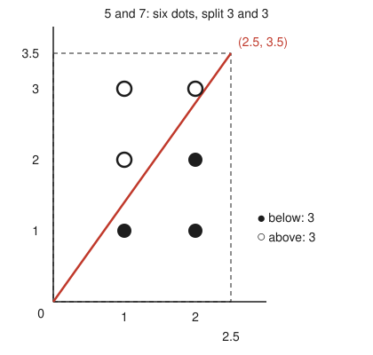

# Quadratic reciprocity by counting dots: Eisenstein's rectangle proof

[Syllabus](../../../SYLLABUS.md) → [Number theory](../README.md) → [Powers on the Clock](../README.md#s04) → Quadratic reciprocity by counting dots

---

## General Overview

Is 5 a square on the 7-hour clock: does some number times itself read 5? Its squares are 1, 2 and 4, so no. Turned round, 7 reads 2 on the 5-clock, whose squares are 1 and 4. No again: they agree.

For 3 and 7 they disagree: 3 is no square on the 7-clock, but 7 reads 1 = 1 × 1 on the 3-clock.

In 1844 Eisenstein showed which happens by cutting a rectangle of dots with a line. Its sides are half of one below each prime. For 5 and 7 it is 2 by 3, split 3 and 3: 6, even, so the answers agree. For 3 and 7 it is 1 by 3, split 2 and 1: 3, odd, so they disagree.

Swaps shrink the question: 29 on the 43-clock comes down to 4 on the 7-clock, plus a sign.

**For two different odd primes, "is p a square on the q-clock?" and "is q a square on the p-clock?" agree unless both leave 3 on division by 4.**

**What kind of fact this is:** a theorem, quadratic reciprocity, proved in Why it works from [Gauss's lemma](12-gauss-lemma.md).

### The picture: 5 and 7

<p align="center"></p>

The line runs to (2.5, 3.5): half of 5 across, half of 7 up.

---

## The formula

```math
(p/q) \times (q/p) = (-1)^{h \times k}, \qquad h = (p-1)/2, \quad k = (q-1)/2
```

**Read it aloud:** the two answers multiply to 1 when the rectangle holds an even number of dots, −1 when odd.

| Symbol | Plain meaning | In our example | Push it up and the answer… |
| --- | --- | --- | --- |
| $`p`$, $`q`$ | two different odd primes, the clock sizes | 5 and 7 | — |
| $`h`$, $`k`$ | half of one below each prime: the rectangle's sides; dots (x, y) run to x = h, y = k | 2 and 3 | — |
| $`(q/p)`$ | the Legendre symbol: 1 if q is a square on the p-clock, −1 if not | $`(7/5) = -1`$ | — |
| $`(-1)^{n}`$ | 1 if the count n is even, −1 if odd | $`(-1)^{6} = 1`$ | flips with each extra dot |
| $`\lfloor x \rfloor`$ | the whole part of x | $`\lfloor 14/5 \rfloor = 2`$ | — |
| $`W`$, $`m`$ | in the proof: total whole clocks; Gauss's count of top-half readings | 3 and 1, for 7 on the 5-clock | — |

h × k is odd only when both primes leave 3 on division by 4, like 3 and 7.

### When it holds

- **Both primes odd.** 2 has no rectangle; its rule is on [Gauss's lemma](12-gauss-lemma.md).
- **Two different primes.** p reads 0 on its own clock.
- **Prime clocks.** On the 15-clock $`(2/3)(2/5) = 1`$, yet 2 is no square there ([The Jacobi symbol](../../21-Algebraic%20and%20analytic%20number%20theory/03-Characters%20and%20L-functions/08-jacobi-symbol-and-computing-without-factoring.md)).

---

## Why it works

### Step 0: one rectangle, counted two ways

[Gauss's lemma](12-gauss-lemma.md) turns the question into "is a count even?". Eisenstein swaps in dots under a line: dots below decide one answer, dots above the other.

### Step 1: whole clocks instead of top-half readings

Divide q, 2q, up to hq by p. Gauss's count m is how many remainders land above p/2. Eisenstein adds the whole parts:

```math
W = \lfloor q/p \rfloor + \lfloor 2q/p \rfloor + \dots + \lfloor hq/p \rfloor
```

For odd q, W and m are both even or both odd, so $`(q/p) = (-1)^{W}`$. For 7 on the 5-clock: 7 = 5 + 2 and 14 = 2 × 5 + 4, so W = 3 and m = 1: both odd, not a square.

<details>
<summary>Proof that W and m are both even or both odd</summary>

Write each multiple as whole clocks plus remainder, and add:

$`\displaystyle q \times (1 + 2 + \dots + h) = p \times W + (\text{small remainders}) + (\text{large remainders})`$

By Gauss's lemma, Step 1, the small remainders and p minus each large one are 1 to h:

$`\displaystyle 1 + 2 + \dots + h = (\text{small remainders}) + p \times m - (\text{large remainders})`$

Subtract:

$`\displaystyle (q - 1) \times (1 + 2 + \dots + h) = p \times (W - m) + 2 \times (\text{large remainders})`$

q − 1 is even, so the left side and the last term are even. So p × (W − m) is even, and p is odd, so W − m is even ([Even and odd](../01-Divisibility%20and%20Primes/02-even-and-odd.md)).

</details>

### Step 2: W counts the dots below the line

Take the rectangle's dots and the line to (p/2, q/2). Over column x it stands at height xq/p, so $`\lfloor xq/p \rfloor`$ dots lie below it. The columns add to W: for 5 and 7, 1 + 2 = 3.

### Step 3: swap the primes for the dots above

Row y holds $`\lfloor yp/q \rfloor`$ dots left of the line: above it. Their total decides $`(p/q)`$: for 5 and 7, 0 + 1 + 2 = 3.

### Step 4: no dot sits on the line

A dot (x, y) on the line needs xq = yp. Then the prime p divides xq but not q, so it divides x ([Euclid's lemma](../02-Greatest%20Common%20Divisor%20and%20Euclid%27s%20Algorithm/06-euclids-lemma.md)), yet x is below p. So the counts add to h × k, and the two signs multiply to $`(-1)^{h \times k}`$.

---

## Worked numbers, by hand

| Step | Arithmetic | Value |
| --- | --- | --- |
| 5 and 7, below | ⌊7/5⌋ + ⌊14/5⌋ = 1 + 2 | 3 |
| 5 and 7, above | ⌊5/7⌋ + ⌊10/7⌋ + ⌊15/7⌋ = 0 + 1 + 2 | 3 |
| the rectangle | 3 + 3 = 2 × 3 | 6, even |
| 3 and 7 | below 2, above 0 + 0 + 1 = 1 | 3 = 1 × 3, odd |
| the answers | (5/7), (7/5); (3/7), (7/3) | **−1, −1 agree; −1, 1 disagree** |

Parity alone predicts both pairs.

### The flip in use: is 29 a square on the 43-clock?

A flip costs a minus sign only when its rectangle is odd.

1. Flip 29 and 43: 14 × 21 = 294 dots, even. (29/43) = (43/29).
2. 43 reads 14 on the 29-clock; add 29s for small odd factors: 275 = 9 × 29 + 14 = 25 × 11. 25 = 5 × 5, so this is a square exactly when 11 is.
3. Flip 11 and 29: 5 × 14 = 70, even. 29 reads 7 on the 11-clock.
4. Flip 7 and 11: 3 × 5 = 15, odd. (7/11) = −(11/7).
5. 11 reads 4 = 2 × 2 on the 7-clock: (11/7) = 1.

**29 is not a square on the 43-clock: −1.** The squares list agrees.

### What breaks if you drop a piece

| Mistake | Comes out at | What went wrong |
| --- | --- | --- |
| The full 2 by 6 grid, 3 and 7 | 12: "agree" | the full grid is always even |
| Flipping 7 and 11 with no sign | 1: "29 is a square" | 15 dots is odd |
| Eisenstein's count, 2 on the 5-clock | 0: "a square" | the count needs odd numbers |

---

## Code, from first principles, and it actually runs

Two roads, dots and a squares list, agree on all 91 pairs of odd primes below 50; Gauss's count joins them on the two examples.

### Python

```python
# Quadratic reciprocity by counting dots -- the check behind the card.  Nothing
# is imported.  Road one counts dots under a diagonal (Eisenstein); road two
# lists every square on the clock and looks the number up.
def col(q, p): return [q * k // p for k in range(1, (p - 1) // 2 + 1)]  # whole parts
def sign(n): return 1 if n % 2 == 0 else -1                             # even +1, odd -1
def sq(p): return sorted({x * x % p for x in range(1, p)})              # the squares
def listed(a, p): return 1 if a % p in sq(p) else -1                    # road two
def rect(p, q): return (p - 1) // 2 * ((q - 1) // 2)                    # h x k dots
for p, q in [(5, 7), (3, 7)]:
    lo, hi, g = col(q, p), col(p, q), sum(k * q % p * 2 > p for k in range(1, p // 2 + 1))  # g: Gauss
    print(f"{p} and {q}: below {' + '.join(map(str, lo))} = {sum(lo)}, above {' + '.join(map(str, hi))}"
          f" = {sum(hi)}, total {sum(lo) + sum(hi)} = {(p - 1) // 2} x {(q - 1) // 2}")
    print(f"  ({p}/{q}) = {sign(sum(hi))}, ({q}/{p}) = {sign(sum(lo))}; squares mod {q}: {sq(q)}, mod {p}: {sq(p)}; Gauss count {g}")
    assert sum(lo) + sum(hi) == rect(p, q) and sign(sum(hi)) == listed(p, q) and sign(sum(lo)) == listed(q, p) == sign(g)
def side(s): return " ".join(f"({x},{y})" for x in (1, 2) for y in (1, 2, 3) if s * (7 * x - 5 * y) > 0)  # 5, 7 dots
print(f"figure, below {side(1)}; above {side(-1)}; line (0,0) to ({5 / 2},{7 / 2})")
for p, q in [(29, 43), (11, 29), (7, 11)]:
    print(f"flip {p} and {q}: {(p - 1) // 2} x {(q - 1) // 2} = {rect(p, q)} dots, sign {sign(rect(p, q))};"
          f" then {q} reads {q % p} on the {p}-clock")
road1 = sign(rect(29, 43)) * sign(rect(11, 29)) * sign(rect(7, 11)) * listed(4, 7)
print(f"275 = 9 x 29 + {275 % 29} = 25 x 11. Is 29 a square mod 43? flips {road1}, squares list {listed(29, 43)}")
assert road1 == listed(29, 43) == -1
ps = [n for n in range(3, 50) if all(n % d for d in range(2, n))]
pairs = [(p, q) for p in ps for q in ps if p < q]
for p, q in pairs:
    assert sum(col(q, p)) + sum(col(p, q)) == rect(p, q) and sign(sum(col(q, p))) == listed(q, p) and listed(p, q) * listed(q, p) == sign(rect(p, q))
print(f"all {len(pairs)} pairs of odd primes up to {ps[-1]}: dots fill the rectangle, both roads agree")
print(f"mistakes: full rectangle {(3 - 1) * (7 - 1)} dots for 3 and 7; no flip sign gives {-road1}; "
      f"2 on the 5-clock counts {sum(col(2, 5))} dots but is {listed(2, 5)}; (2/3)(2/5) = {listed(2, 3) * listed(2, 5)}, squares mod 15: {sq(15)}")
print("ALL CHECKS PASS")
```

**Ran 2026-11-23 on macOS, Python 3.14.10, standard library only. All checks passed. Output, pasted from the run:**

```
5 and 7: below 1 + 2 = 3, above 0 + 1 + 2 = 3, total 6 = 2 x 3
  (5/7) = -1, (7/5) = -1; squares mod 7: [1, 2, 4], mod 5: [1, 4]; Gauss count 1
3 and 7: below 2 = 2, above 0 + 0 + 1 = 1, total 3 = 1 x 3
  (3/7) = -1, (7/3) = 1; squares mod 7: [1, 2, 4], mod 3: [1]; Gauss count 0
figure, below (1,1) (2,1) (2,2); above (1,2) (1,3) (2,3); line (0,0) to (2.5,3.5)
flip 29 and 43: 14 x 21 = 294 dots, sign 1; then 43 reads 14 on the 29-clock
flip 11 and 29: 5 x 14 = 70 dots, sign 1; then 29 reads 7 on the 11-clock
flip 7 and 11: 3 x 5 = 15 dots, sign -1; then 11 reads 4 on the 7-clock
275 = 9 x 29 + 14 = 25 x 11. Is 29 a square mod 43? flips -1, squares list -1
all 91 pairs of odd primes up to 47: dots fill the rectangle, both roads agree
mistakes: full rectangle 12 dots for 3 and 7; no flip sign gives 1; 2 on the 5-clock counts 0 dots but is -1; (2/3)(2/5) = 1, squares mod 15: [1, 4, 6, 9, 10]
ALL CHECKS PASS
```

### Rust

```rust
// Quadratic reciprocity by counting dots -- the same check as the Python, in
// Rust.  No crates.  Road one counts dots under a diagonal (Eisenstein); road
// two lists every square on the clock and looks the number up.
fn col(q: i64, p: i64) -> Vec<i64> { (1..=(p - 1) / 2).map(|k| q * k / p).collect() } // whole parts
fn sign(n: i64) -> i64 { if n % 2 == 0 { 1 } else { -1 } }                          // even +1, odd -1
fn sq(p: i64) -> Vec<i64> { let mut v: Vec<i64> = (1..p).map(|x| x * x % p).collect(); v.sort(); v.dedup(); v }
fn listed(a: i64, p: i64) -> i64 { if sq(p).contains(&(a % p)) { 1 } else { -1 } }  // road two
fn rect(p: i64, q: i64) -> i64 { (p - 1) / 2 * ((q - 1) / 2) }                       // h x k dots
fn sum(v: &[i64]) -> i64 { v.iter().sum() }
fn join(v: &[i64]) -> String { v.iter().map(|x| x.to_string()).collect::<Vec<_>>().join(" + ") }
fn main() {
    for (p, q) in [(5, 7), (3, 7)] {
        let (lo, hi) = (col(q, p), col(p, q));
        let g = (1..=p / 2).filter(|&k| k * q % p * 2 > p).count() as i64;   // g: Gauss
        println!("{} and {}: below {} = {}, above {} = {}, total {} = {} x {}", p, q, join(&lo), sum(&lo),
                 join(&hi), sum(&hi), sum(&lo) + sum(&hi), (p - 1) / 2, (q - 1) / 2);
        println!("  ({}/{}) = {}, ({}/{}) = {}; squares mod {}: {:?}, mod {}: {:?}; Gauss count {}", p, q,
                 sign(sum(&hi)), q, p, sign(sum(&lo)), q, sq(q), p, sq(p), g);
        assert!(sum(&lo) + sum(&hi) == rect(p, q) && sign(sum(&hi)) == listed(p, q) && sign(sum(&lo)) == listed(q, p) && sign(g) == sign(sum(&lo)));
    }
    let side = |s: i64| (1..=2).flat_map(|x| (1..=3).map(move |y| (x, y))).filter(|&(x, y)| s * (7 * x - 5 * y) > 0)
        .map(|(x, y)| format!("({},{})", x, y)).collect::<Vec<_>>().join(" ");   // 5, 7 dots
    println!("figure, below {}; above {}; line (0,0) to ({},{})", side(1), side(-1), 5.0 / 2.0, 7.0 / 2.0);
    for (p, q) in [(29, 43), (11, 29), (7, 11)] {
        println!("flip {} and {}: {} x {} = {} dots, sign {}; then {} reads {} on the {}-clock",
                 p, q, (p - 1) / 2, (q - 1) / 2, rect(p, q), sign(rect(p, q)), q, q % p, p);
    }
    let road1 = sign(rect(29, 43)) * sign(rect(11, 29)) * sign(rect(7, 11)) * listed(4, 7);
    println!("275 = 9 x 29 + {} = 25 x 11. Is 29 a square mod 43? flips {}, squares list {}", 275 % 29, road1, listed(29, 43));
    assert!(road1 == listed(29, 43) && road1 == -1);
    let ps: Vec<i64> = (3..50).filter(|&n| (2..n).all(|d| n % d != 0)).collect();
    let pairs: Vec<(i64, i64)> = ps.iter().flat_map(|&p| ps.iter().filter(move |&&q| p < q).map(move |&q| (p, q))).collect();
    for &(p, q) in &pairs {
        assert!(sum(&col(q, p)) + sum(&col(p, q)) == rect(p, q) && sign(sum(&col(q, p))) == listed(q, p) && listed(p, q) * listed(q, p) == sign(rect(p, q)));
    }
    println!("all {} pairs of odd primes up to {}: dots fill the rectangle, both roads agree", pairs.len(), ps[ps.len() - 1]);
    println!("mistakes: full rectangle {} dots for 3 and 7; no flip sign gives {}; 2 on the 5-clock counts {} dots but is {}; (2/3)(2/5) = {}, squares mod 15: {:?}",
             (3 - 1) * (7 - 1), -road1, sum(&col(2, 5)), listed(2, 5), listed(2, 3) * listed(2, 5), sq(15));
    println!("ALL CHECKS PASS");
}
```

**Ran 2026-11-23 on macOS, rustc 1.98.1, no crates. All checks passed. Output, pasted from the run:**

```
5 and 7: below 1 + 2 = 3, above 0 + 1 + 2 = 3, total 6 = 2 x 3
  (5/7) = -1, (7/5) = -1; squares mod 7: [1, 2, 4], mod 5: [1, 4]; Gauss count 1
3 and 7: below 2 = 2, above 0 + 0 + 1 = 1, total 3 = 1 x 3
  (3/7) = -1, (7/3) = 1; squares mod 7: [1, 2, 4], mod 3: [1]; Gauss count 0
figure, below (1,1) (2,1) (2,2); above (1,2) (1,3) (2,3); line (0,0) to (2.5,3.5)
flip 29 and 43: 14 x 21 = 294 dots, sign 1; then 43 reads 14 on the 29-clock
flip 11 and 29: 5 x 14 = 70 dots, sign 1; then 29 reads 7 on the 11-clock
flip 7 and 11: 3 x 5 = 15 dots, sign -1; then 11 reads 4 on the 7-clock
275 = 9 x 29 + 14 = 25 x 11. Is 29 a square mod 43? flips -1, squares list -1
all 91 pairs of odd primes up to 47: dots fill the rectangle, both roads agree
mistakes: full rectangle 12 dots for 3 and 7; no flip sign gives 1; 2 on the 5-clock counts 0 dots but is -1; (2/3)(2/5) = 1, squares mod 15: [1, 4, 6, 9, 10]
ALL CHECKS PASS
```

### Lean

Lean proves reciprocity and Eisenstein's dot counts for every pair of different odd primes, not only 5 and 7.

- Take two different odd primes $`p`$ and $`q`$. Then $`(p/q)`$ and $`(q/p)`$ agree exactly when the primes do not both leave 3 on division by 4.
- Take the same primes. Then $`(q/p) = (-1)^{W}`$, where W counts the dots below the line.
- Take the same primes. Then the dots below and above the line add to h × k, and $`(p/q) \times (q/p) = (-1)^{h \times k}`$.

The squares lists, the figure's dots and the run over all 91 pairs are left to the Python and Rust checks.

```lean
-- Quadratic reciprocity by counting dots: for two different odd primes p and q, "is p a square mod q?" and "is q a square mod p?" have the same answer exactly when the primes are not both 3 mod 4, because the dots below and above the diagonal of the (p-1)/2 by (q-1)/2 rectangle decide the two answers and together fill the rectangle.
import Mathlib.NumberTheory.LegendreSymbol.GaussEisensteinLemmas
import Mathlib.NumberTheory.LegendreSymbol.QuadraticReciprocity
import Mathlib.Tactic.NormNum.LegendreSymbol
import Mathlib.Tactic.NormNum.Prime

instance fact_prime_5 : Fact (Nat.Prime 5) := ⟨by norm_num⟩
instance fact_prime_7 : Fact (Nat.Prime 7) := ⟨by norm_num⟩
instance fact_prime_11 : Fact (Nat.Prime 11) := ⟨by norm_num⟩
instance fact_prime_29 : Fact (Nat.Prime 29) := ⟨by norm_num⟩
instance fact_prime_43 : Fact (Nat.Prime 43) := ⟨by norm_num⟩

theorem Icc_eq_Ico_half (p : ℕ) (hp : p % 2 = 1) :
    Finset.Icc 1 ((p - 1) / 2) = Finset.Ico 1 (p / 2).succ := by
  have : (p - 1) / 2 = p / 2 := by omega
  rw [this, Nat.succ_eq_add_one, Finset.Ico_add_one_right_eq_Icc]

theorem odd_prime_mod_two (p : ℕ) [Fact p.Prime] (hp : p ≠ 2) : p % 2 = 1 :=
  (Nat.Prime.mod_two_eq_one_iff_ne_two Fact.out).mpr hp

#print axioms Icc_eq_Ico_half
#print axioms odd_prime_mod_two

/-- **Quadratic reciprocity, the card's main claim.** For two different odd primes p and q,
"is p a square on the q-clock?" and "is q a square on the p-clock?" have the same answer
exactly when the two primes do not both leave 3 on division by 4.
In Mathlib, `legendreSym q p` is (p/q): 1 if p is a nonzero square mod q, -1 if not. -/
theorem same_answer_iff_not_both_three_mod_four (p q : ℕ) [Fact p.Prime] [Fact q.Prime]
    (hp : p ≠ 2) (hq : q ≠ 2) (hpq : p ≠ q) :
    legendreSym q p = legendreSym p q ↔ ¬ (p % 4 = 3 ∧ q % 4 = 3) := by
  have hp2 := odd_prime_mod_two p hp
  have hq2 := odd_prime_mod_two q hq
  constructor
  · rintro h ⟨h3p, h3q⟩
    have h' := legendreSym.quadratic_reciprocity_three_mod_four h3p h3q
    have hne : legendreSym p q ≠ 0 := by
      rw [Ne, legendreSym.eq_zero_iff]
      exact_mod_cast ZMod.prime_ne_zero p q hpq
    apply hne
    linarith
  · intro h
    rcases (by omega : p % 4 = 1 ∨ q % 4 = 1) with h1 | h1
    · exact legendreSym.quadratic_reciprocity_one_mod_four h1 hq
    · exact (legendreSym.quadratic_reciprocity_one_mod_four h1 hp).symm

/-- **Step 1 and Step 2: whole clocks decide the answer.** For two different odd primes p and q,
with h = (p-1)/2, let W = ⌊q/p⌋ + ⌊2q/p⌋ + … + ⌊hq/p⌋, the number of dots below the diagonal.
Then (q/p) = (-1)^W: q is a square on the p-clock exactly when W is even. -/
theorem legendreSym_eq_neg_one_pow_dots_below (p q : ℕ) [Fact p.Prime] [Fact q.Prime]
    (hp : p ≠ 2) (hq : q ≠ 2) (hpq : p ≠ q) :
    legendreSym p q = (-1) ^ (∑ x ∈ Finset.Icc 1 ((p - 1) / 2), x * q / p) := by
  rw [Icc_eq_Ico_half p (odd_prime_mod_two p hp)]
  exact_mod_cast ZMod.eisenstein_lemma hp (odd_prime_mod_two q hq) (ZMod.prime_ne_zero p q hpq)

/-- **Step 4: the dots fill the rectangle.** For two different odd primes p and q, with
h = (p-1)/2 and k = (q-1)/2, the dots below the diagonal, ⌊xq/p⌋ summed over x = 1 to h, and
the dots above it, ⌊yp/q⌋ summed over y = 1 to k, add to h × k; so the two signs multiply to
(-1)^(h × k): (p/q) × (q/p) = (-1)^(h × k). -/
theorem dots_fill_rectangle_and_signs_multiply (p q : ℕ) [Fact p.Prime] [Fact q.Prime]
    (hp : p ≠ 2) (hq : q ≠ 2) (hpq : p ≠ q) :
    (∑ x ∈ Finset.Icc 1 ((p - 1) / 2), x * q / p) + (∑ y ∈ Finset.Icc 1 ((q - 1) / 2), y * p / q)
        = (p - 1) / 2 * ((q - 1) / 2) ∧
      legendreSym q p * legendreSym p q = (-1) ^ ((p - 1) / 2 * ((q - 1) / 2)) := by
  have hp2 := odd_prime_mod_two p hp
  have hq2 := odd_prime_mod_two q hq
  have ep : (p - 1) / 2 = p / 2 := by omega
  have eq' : (q - 1) / 2 = q / 2 := by omega
  refine ⟨?_, ?_⟩
  · rw [Icc_eq_Ico_half p hp2, Icc_eq_Ico_half q hq2, ep, eq']
    exact ZMod.sum_mul_div_add_sum_mul_div_eq_mul p q (ZMod.prime_ne_zero p q hpq)
  · rw [ep, eq']
    exact legendreSym.quadratic_reciprocity hp hq hpq

-- 5 and 7: below ⌊7/5⌋ + ⌊14/5⌋ = 1 + 2 = 3, above ⌊5/7⌋ + ⌊10/7⌋ + ⌊15/7⌋ = 0 + 1 + 2 = 3, total 6 = 2 × 3.
example : 7 / 5 + 14 / 5 = 3 ∧ 5 / 7 + 10 / 7 + 15 / 7 = 3 ∧ 3 + 3 = 2 * 3 := by decide
example : (∑ x ∈ Finset.Icc 1 2, x * 7 / 5) = 3 ∧ (∑ y ∈ Finset.Icc 1 3, y * 5 / 7) = 3 := by decide
-- (5/7) = -1 and (7/5) = -1: they agree.
example : legendreSym 7 5 = -1 ∧ legendreSym 5 7 = -1 := by norm_num
-- 3 and 7: below ⌊7/3⌋ = 2, above 0 + 0 + 1 = 1, total 3 = 1 × 3, odd.
example : (∑ x ∈ Finset.Icc 1 1, x * 7 / 3) = 2 ∧ (∑ y ∈ Finset.Icc 1 3, y * 3 / 7) = 1 := by decide
-- (3/7) = -1 but (7/3) = 1: they disagree.
example : legendreSym 7 3 = -1 ∧ legendreSym 3 7 = 1 := by norm_num
-- Is 29 a square on the 43-clock? Flip counts 14 × 21 = 294, 5 × 14 = 70, 3 × 5 = 15; 275 = 9 × 29 + 14 = 25 × 11.
example : 14 * 21 = 294 ∧ 5 * 14 = 70 ∧ 3 * 5 = 15 ∧ 275 = 9 * 29 + 14 ∧ 275 = 25 * 11 := by norm_num
example : 43 % 29 = 14 ∧ 29 % 11 = 7 ∧ 11 % 7 = 4 := by norm_num
example : legendreSym 7 11 = 1 ∧ legendreSym 11 7 = -1 ∧ legendreSym 43 29 = -1 := by norm_num
-- Mistakes: 2 on the 5-clock counts 0 dots, yet is no square; on the 15-clock (2/3)(2/5) = 1, yet 2 is no square mod 15.
example : (∑ x ∈ Finset.Icc 1 2, x * 2 / 5) = 0 ∧ legendreSym 5 2 = -1 := by
  constructor
  · decide
  · norm_num
example : legendreSym 3 2 * legendreSym 5 2 = 1 ∧ ¬ IsSquare (2 : ZMod 15) := by
  constructor
  · norm_num
  · decide
-- Try changing: 11 and 19 have 5 × 9 = 45 dots, split 23 and 22.
example : (∑ x ∈ Finset.Icc 1 5, x * 19 / 11) = 23 ∧ (∑ y ∈ Finset.Icc 1 9, y * 11 / 19) = 22 := by
  decide

#print axioms same_answer_iff_not_both_three_mod_four
#print axioms legendreSym_eq_neg_one_pow_dots_below
#print axioms dots_fill_rectangle_and_signs_multiply
```

**Checked 2026-11-23 on macOS, Lean 4.36.0-rc2, Mathlib v4.36.0-rc2. Every proof is complete and uses only Lean's standard axioms. Output, pasted from the run:**

```
'Icc_eq_Ico_half' depends on axioms: [propext, Classical.choice, Quot.sound]
'odd_prime_mod_two' depends on axioms: [propext]
'same_answer_iff_not_both_three_mod_four' depends on axioms: [propext, Classical.choice, Quot.sound]
'legendreSym_eq_neg_one_pow_dots_below' depends on axioms: [propext, Classical.choice, Quot.sound]
'dots_fill_rectangle_and_signs_multiply' depends on axioms: [propext, Classical.choice, Quot.sound]
```

> [!TIP]
> **Try changing**
> Guess first, then run it.
> - **11 and 19?** Change `[(5, 7), (3, 7)]` to `[(11, 19)]`. 5 × 9 = 45 dots, split 23 and 22: odd, they disagree.
> - **Any failures below 200?** Change `range(3, 50)` to `range(3, 200)`. None: 990 pairs pass.
> - **Does 2 obey?** Change `range(3, 50)` to `range(2, 50)`. No: 2 and 3 have an empty rectangle, yet 2 is no square on the 3-clock. The last assert stops it.

---

## The usual mistake

> [!warning]
> **Treating the two questions as one.** "Is 3 a square on the 7-clock?" is no; "is 7 a square on the 3-clock?" is yes. Reciprocity links the answers; it does not make them equal.
>
> - **Flipping an even number.** 14 has no rectangle; trade it for 275 = 25 × 11 first.
> - **Dropping a flip's sign.** Skip it for 7 and 11 and 29 comes out a square: 1.
> - **Counting dots for 2.** On the 5-clock it counts 0, yet is no square.

---

## Where you meet it in real life

- **Factoring.** The quadratic sieve keeps only small primes on whose clock the target number is a square.
- **Elliptic-curve keys.** Rebuilding a stored key asks whether a number is a square on a prime clock; fast code flips and shrinks.
- **Primality testing.** The Solovay–Strassen test checks Euler's test against the symbol found by flips.

> **Say it back**
> "Is p a square on the q-clock?" and "is q a square on the p-clock?" answer each other. Cut the h by k rectangle of dots with a line from the corner. Dots below decide one answer, dots above the other. Together they fill the rectangle. The answers agree unless both primes leave 3 on division by 4.

---

## What this builds on

- [Gauss's lemma](12-gauss-lemma.md): turns "is it a square?" into the evenness of a count.

## Where this goes next

- [Quadratic reciprocity](../../21-Algebraic%20and%20analytic%20number%20theory/03-Characters%20and%20L-functions/07-quadratic-reciprocity-via-gauss-sums.md): a second, deeper proof, by Gauss sums.
- [The Jacobi symbol](../../21-Algebraic%20and%20analytic%20number%20theory/03-Characters%20and%20L-functions/08-jacobi-symbol-and-computing-without-factoring.md): flips without factoring.
- [The Langlands program](../../25-Frontier/06-Algebra%2C%20Logic%20and%20Computation/06-langlands-program-and-geometric-langlands.md): the far-reaching modern descendant of this law.
- [Barcode check digits](../05-Check%20Digits%2C%20Calendars%20and%20Cycles/01-barcode-check-digit.md): the first card of the next shelf in this wing, where clock arithmetic catches typing errors in everyday codes.

Left open: is there a law like this for cubes? The Gauss-sums card above leads on to that question in wing 21. This shelf ends here, and the next shelf turns to everyday uses of the clock.

---

## Sources

Verified 2026-11-23: every link below resolves to the publisher's page.

- Eisenstein, Gotthold. "Geometrischer Beweis des Fundamentaltheorems für die quadratischen Reste." *Journal für die reine und angewandte Mathematik* 28 (1844), 246–248. [doi:10.1515/crll.1844.28.246](https://doi.org/10.1515/crll.1844.28.246). The rectangle proof on this card.
- Lemmermeyer, Franz. *Reciprocity Laws: From Euler to Eisenstein*. Springer, 2000. [doi:10.1007/978-3-662-12893-0](https://doi.org/10.1007/978-3-662-12893-0). Chapter 1: the history of the proofs.
