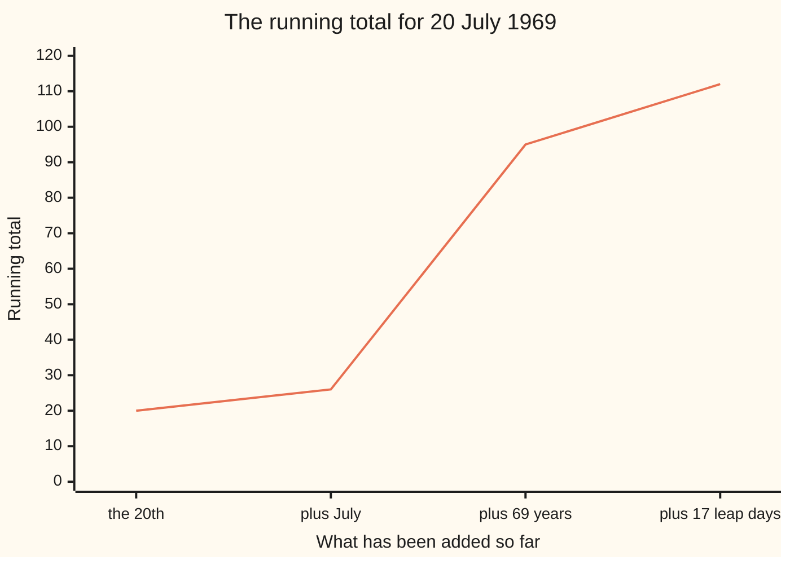

# Day of the week for any date: the calendar is arithmetic mod 7

[Syllabus](../../../SYLLABUS.md) → [Number theory](../README.md) → [Check Digits, Calendars and Cycles](../README.md#s05) → Day of the week for any date

---

## General Overview

Apollo 11 landed on 20 July 1969. What day of the week was that?

The calendar looks like a mess of 30s and 31s and one short month. Underneath it is one number: 7. Weeks never skip, so the question is only how far a date sits past a day you know.

Four numbers do it. For 20 July 1969: the **20** itself, **6** for July, **69** years since 1900, **17** leap days in those years. They add to 112: 16 weeks exactly, nothing over. A leftover of 0 means Sunday. Apollo 11 touched down on a Sunday.

**Every date carries four small numbers; add them, divide by 7, and the leftover names the day.**

**What kind of fact this is:** a theorem, proved on this card in Why it works; the month offsets and the Monday on 1 January 1900 are facts of the calendar.

### The picture: the four pieces stacking up



It stops at 112, a whole number of weeks.

---

## The formula

The date, written out:

**20 + 6 + 69 + 17 = 112, and 112 = 16 × 7 + 0, so 20 July 1969 was a Sunday**

**Read it aloud:** day of the month, plus month offset, plus years since 1900, plus leap days; throw the whole weeks away and read what is left.

The leftovers name the days: 0 Sunday, 1 Monday, 2 Tuesday, 3 Wednesday, 4 Thursday, 5 Friday, 6 Saturday.

| Piece | Plain meaning | For 20 July 1969 |
| --- | --- | --- |
| the day of the month | which day inside the month | 20 |
| the month's offset | how far its 1st sits past 1 January, whole weeks already thrown away | 6, for July |
| years since 1900 | one step a year | 69 |
| leap days since 1900 | one more step per 29 February gone | 17 |
| the leftover after dividing by 7 | 0 to 6, the answer | 0, Sunday |

The twelve month offsets, January to December: **0, 3, 3, 6, 1, 4, 6, 2, 5, 0, 3, 5**. In January or February of a leap year, take 1 back off: that 29 February has not happened yet.

### When it holds

- **A date from 1900 to 2099.** A century year is a leap year only if it divides by 400 — 1900 was not, 2000 was — so in between, every fourth year is right. From 1 January 2100 every answer comes out a day late.
- **The step back in January and February of a leap year.** Leave it out and 1 January 1904 comes out Saturday, not Friday.
- **Leftovers named from a known day.** 1 January 1900 was a Monday and gives leftover 1, so 0 is Sunday. Name the leftovers from the wrong day and every answer is off by the same amount.

---

## Why it works

### Step 0: only the leftover survives

You can throw 7 away whenever you like and keep what is left, 0 to 6 — congruence mod 7 ([Congruence](../03-Clock%20Arithmetic/01-congruence-mod-n.md)). It also lets the pieces be added in any order, each shrunk at any point ([Adding and multiplying on the clock](../03-Clock%20Arithmetic/02-modular-addition-and-multiplication.md)). The sign ≡ says two numbers leave the same leftover: 365 ≡ 1 (mod 7).

### Step 1: a year moves the calendar on one day, a 29 February one more

365 = 52 × 7 + 1 ([Division with a remainder](../01-Divisibility%20and%20Primes/04-division-with-remainder.md)), so 365 ≡ 1 (mod 7): the same date next year falls one day later in the week. A leap year is 366 days, and 366 ≡ 2 (mod 7) — one step for the year, one more for the 29 February. Count them apart: 1900 to 1969 is 69 steps, and the 29 Februaries, 1904 to 1968, are 69 ÷ 4, fraction dropped, so 17.

### Step 2: each month starts a fixed distance into the year

January's 1st is the anchor, offset 0. February's is 31 days later, and 31 ≡ 3 (mod 7), so 3. March's is 28 days on, and 28 ≡ 0 (mod 7), so 3 again. Walk the year out for the rest; July's is 6. That walk uses the short February, which is why January and February of a leap year need the step back.

### Step 3: one known day pins the rest

1 January 1900 was a Monday: 1 + 0 + 0 + 0 = 1. So leftover 1 is Monday, 0 is Sunday, and the rest follow.

<details>
<summary>The doomsday rule</summary>

Conway's version is the same arithmetic, different bookkeeping: each year has one day of the week, its "doomsday", shared by 4/4, 6/6, 8/8, 10/10 and 12/12. Find it, then step to your date.

</details>

A slower road lands on the same day: count the 25402 days from 1 January 1900 to the date and divide by 7, leaving 6. Six days past Monday is Sunday.

---

## Worked numbers, by hand

20 July 1969, one piece at a time.

| Step | Arithmetic | Value |
| --- | --- | --- |
| the day of the month | 20 | 20 |
| July's offset | 20 + 6 | 26 |
| years since 1900 | 26 + 69 | 95 |
| leap days, 69 ÷ 4 with the fraction dropped | 95 + 17 | 112 |
| throw away whole weeks | 112 − 16 × 7 | 0 |
| the leftover, as a day | 0 | **Sunday** |

### What breaks if you drop a piece

| Mistake | Comes out at | What went wrong |
| --- | --- | --- |
| Leaving out the 17 leap days | Thursday | Sum 95, leftover 4 |
| Leaving out July's offset | Monday | Sum 106: every month starting where January does |
| Counting 1904's leap day on 1 January 1904 | Saturday | That 29 February was two months off; the day is Friday |

The code prints all three.

---

## Code, from first principles, and it actually runs

Nothing is imported. The rule runs for 20 July 1969, then the long road counts every day since 1 January 1900. The two are compared across every month.

### Python

```python
# Day of the week -- the check behind the card.  Nothing is imported.  The rule is
# run for 20 July 1969, the Moon landing, then checked the long way, by counting
# every day since 1 January 1900, which was a Monday.
DAYS = ["Sunday", "Monday", "Tuesday", "Wednesday", "Thursday", "Friday", "Saturday"]
OFFSET = [0, 3, 3, 6, 1, 4, 6, 2, 5, 0, 3, 5]              # January to December
LENGTH = [31, 28, 31, 30, 31, 30, 31, 31, 30, 31, 30, 31]
def leap(year):                    # every fourth year, but a century year needs 400
    return year % 4 == 0 and (year % 100 != 0 or year % 400 == 0)
def weekday(day, month, year):     # 0 is Sunday; good from 1900 to 2099
    t = day + OFFSET[month - 1] + (year - 1900) + (year - 1900) // 4
    return (t - (1 if leap(year) and month <= 2 else 0)) % 7
def by_counting(day, month, year):  # the long road: every day since 1 January 1900
    n = day - 1 + sum(365 + (1 if leap(y) else 0) for y in range(1900, year))
    return n + sum(LENGTH[m - 1] + (1 if m == 2 and leap(year) else 0) for m in range(1, month))
for name, value in (("the day of the month", 20), ("July's offset", OFFSET[6]),
                    ("years since 1900", 1969 - 1900), ("leap days since 1900", 69 // 4)):
    print(f"{name:<30}{value:>5}")
sums = [20, 20 + OFFSET[6], 20 + OFFSET[6] + 69, 20 + OFFSET[6] + 69 + 17]
print("running sum, piece by piece:  " + ", ".join(str(s) for s in sums))
print(f"{sums[3]} = {sums[3] // 7} x 7 + {sums[3] % 7}, so 20 July 1969 was a {DAYS[weekday(20, 7, 1969)]}")
n = by_counting(20, 7, 1969)
print(f"the long road: {n} days on from Monday, {n} = {n // 7} x 7 + {n % 7}, a {DAYS[(1 + n) % 7]}")
print("1 January 1900 " + DAYS[weekday(1, 1, 1900)] + ", 1 January 1904 " + DAYS[weekday(1, 1, 1904)]
      + ", 6 September 2026 " + DAYS[weekday(6, 9, 2026)])
print(f"the three mistakes come out at {DAYS[(sums[3] - 17) % 7]}, {DAYS[(sums[3] - OFFSET[6]) % 7]} and {DAYS[(1 + 0 + 4 + 1) % 7]}")
assert weekday(20, 7, 1969) == (1 + n) % 7 == 0 and sums[3] == 112
assert all(weekday(d, m, y) == (1 + by_counting(d, m, y)) % 7 for y in (1900, 1904, 1943, 2000, 2026, 2099) for m in range(1, 13) for d in (1, 28))
assert n == 25402 and not leap(1900) and leap(2000)
print("ALL CHECKS PASS")
```

**Ran 2026-09-06 on macOS, Python 3.14.6, standard library only. All checks passed. Output, pasted from the run:**

```
the day of the month             20
July's offset                     6
years since 1900                 69
leap days since 1900             17
running sum, piece by piece:  20, 26, 95, 112
112 = 16 x 7 + 0, so 20 July 1969 was a Sunday
the long road: 25402 days on from Monday, 25402 = 3628 x 7 + 6, a Sunday
1 January 1900 Monday, 1 January 1904 Friday, 6 September 2026 Sunday
the three mistakes come out at Thursday, Monday and Saturday
ALL CHECKS PASS
```

### Rust

Same numbers, same labels, built with `rustc --edition 2021 -O`.

```rust
// Day of the week -- the same check as day_of_the_week_check.py, in Rust.  No crates.  The rule is
// run for 20 July 1969, then checked the long way, by counting every day since 1 January 1900.
const DAYS: [&str; 7] = ["Sunday", "Monday", "Tuesday", "Wednesday", "Thursday", "Friday", "Saturday"];
const OFFSET: [i64; 12] = [0, 3, 3, 6, 1, 4, 6, 2, 5, 0, 3, 5];              // January to December
const LENGTH: [i64; 12] = [31, 28, 31, 30, 31, 30, 31, 31, 30, 31, 30, 31];
fn leap(year: i64) -> bool {       // every fourth year, but a century year needs 400
    year % 4 == 0 && (year % 100 != 0 || year % 400 == 0)
}
fn weekday(day: i64, month: i64, year: i64) -> i64 {   // 0 is Sunday; good from 1900 to 2099
    let t = day + OFFSET[(month - 1) as usize] + (year - 1900) + (year - 1900) / 4;
    (t - if leap(year) && month <= 2 { 1 } else { 0 }) % 7
}
fn by_counting(day: i64, month: i64, year: i64) -> i64 {  // the long road: every day since 1900
    let mut n = day - 1;
    for y in 1900..year { n += 365 + if leap(y) { 1 } else { 0 }; }
    for m in 1..month { n += LENGTH[(m - 1) as usize] + if m == 2 && leap(year) { 1 } else { 0 }; }
    n
}
fn main() {
    for (name, value) in [("the day of the month", 20), ("July's offset", OFFSET[6]), ("years since 1900", 1969 - 1900), ("leap days since 1900", 69 / 4)] {
        println!("{:<30}{:>5}", name, value);
    }
    let sums = [20, 20 + OFFSET[6], 20 + OFFSET[6] + 69, 20 + OFFSET[6] + 69 + 17];
    let parts: Vec<String> = sums.iter().map(|s| s.to_string()).collect();
    println!("running sum, piece by piece:  {}", parts.join(", "));
    println!("{} = {} x 7 + {}, so 20 July 1969 was a {}", sums[3], sums[3] / 7, sums[3] % 7,
             DAYS[weekday(20, 7, 1969) as usize]);
    let n = by_counting(20, 7, 1969);
    println!("the long road: {} days on from Monday, {} = {} x 7 + {}, a {}", n, n, n / 7, n % 7,
             DAYS[((1 + n) % 7) as usize]);
    println!("1 January 1900 {}, 1 January 1904 {}, 6 September 2026 {}",
             DAYS[weekday(1, 1, 1900) as usize], DAYS[weekday(1, 1, 1904) as usize],
             DAYS[weekday(6, 9, 2026) as usize]);
    println!("the three mistakes come out at {}, {} and {}", DAYS[((sums[3] - 17) % 7) as usize],
             DAYS[((sums[3] - OFFSET[6]) % 7) as usize], DAYS[((1 + 0 + 4 + 1) % 7) as usize]);
    assert!(weekday(20, 7, 1969) == (1 + n) % 7 && (1 + n) % 7 == 0 && sums[3] == 112);
    for y in [1900, 1904, 1943, 2000, 2026, 2099] { for m in 1..=12 { for d in [1, 28] { assert!(weekday(d, m, y) == (1 + by_counting(d, m, y)) % 7); } } }
    assert!(n == 25402 && !leap(1900) && leap(2000));
    println!("ALL CHECKS PASS");
}
```

**Ran 2026-09-06 on macOS, rustc 1.98.1, no crates. All checks passed. Output, pasted from the run:**

```
the day of the month             20
July's offset                     6
years since 1900                 69
leap days since 1900             17
running sum, piece by piece:  20, 26, 95, 112
112 = 16 x 7 + 0, so 20 July 1969 was a Sunday
the long road: 25402 days on from Monday, 25402 = 3628 x 7 + 6, a Sunday
1 January 1900 Monday, 1 January 1904 Friday, 6 September 2026 Sunday
the three mistakes come out at Thursday, Monday and Saturday
ALL CHECKS PASS
```

The two outputs match line for line.

### Lean

Lean proves the rule for every date from 1900 to 2099, and its one-day slip from 2100 to 2199.

- For any date from 1900 to 2099, the rule, step back included, leaves the same leftover as counting every day from Monday 1 January 1900.
- Each month's offset is the days before its 1st in an ordinary year, with the whole weeks thrown away.
- From 1 January 2100 to the end of 2199, every answer comes out one day late.
- The card's numbers come out as it says: the 112, the 25402 days, 1 January 1904, 6 September 2026 and the three mistakes.

Turning leftovers into day names and printing the running sums are left to the Python and Rust checks.

<details>
<summary>The Lean proof, 129 lines</summary>

```lean
-- Day of the week for any date: for every real date from 1900 to 2099, the card's sum (day of the month, plus the month's offset, plus years since 1900, plus leap days, with one taken back in January and February of a leap year) leaves the same remainder mod 7 as counting every day from Monday 1 January 1900, the month offsets are the month lengths shrunk mod 7, from 2100 the rule runs one day late, and the card's numbers come out as it says.
import Mathlib.Algebra.BigOperators.Group.Finset.Basic
import Mathlib.Order.Interval.Finset.Nat
import Mathlib.Tactic.NormNum
import Mathlib.Tactic.IntervalCases

/-! Days of the week are the remainders 0 to 6: 0 Sunday, 1 Monday, 2 Tuesday, 3 Wednesday,
4 Thursday, 5 Friday, 6 Saturday. Dates are written day `d`, month `m` (1 to 12), year `y`. -/

/-- The Gregorian leap-year rule: every fourth year, but a century year only if it divides
by 400. So 1904 and 2000 are leap years, and 1900 and 2100 are not. -/
def IsLeap (y : ℕ) : Prop := 4 ∣ y ∧ (¬ 100 ∣ y ∨ 400 ∣ y)

instance : DecidablePred IsLeap := fun y => by unfold IsLeap; infer_instance

/-- How many days month `m` of year `y` has: February 28, or 29 in a leap year; April, June,
September and November 30; the rest 31. -/
def monthLength (y m : ℕ) : ℕ :=
  if m = 2 then (if IsLeap y then 29 else 28)
  else if m = 4 ∨ m = 6 ∨ m = 9 ∨ m = 11 then 30
  else 31

/-- A real date: the month is 1 to 12 and the day is 1 up to that month's length. -/
def ValidDate (d m y : ℕ) : Prop := 1 ≤ m ∧ m ≤ 12 ∧ 1 ≤ d ∧ d ≤ monthLength y m

/-- The long road: the number of days from 1 January 1900 to day `d` of month `m` of year `y`,
counting 365 or 366 for each whole year since 1900 and the full length of each whole month
so far this year. -/
def daysSince1900 (d m y : ℕ) : ℕ :=
  (∑ yr ∈ Finset.Ico 1900 y, if IsLeap yr then 366 else 365) +
    (∑ k ∈ Finset.Ico 1 m, monthLength y k) + (d - 1)

/-- The card's twelve month offsets, January to December: 0, 3, 3, 6, 1, 4, 6, 2, 5, 0, 3, 5. -/
def monthOffset (m : ℕ) : ℕ := [0, 3, 3, 6, 1, 4, 6, 2, 5, 0, 3, 5].getD (m - 1) 0

/-- The card's step back: take 1 off in January or February of a leap year. -/
def stepBack (m y : ℕ) : ℕ := if IsLeap y ∧ m ≤ 2 then 1 else 0

/-- Finite check behind the rule for 1900 to 2099. -/
theorem key_1900_2099 : ∀ y ∈ Finset.Ico 1900 2100, ∀ m ∈ Finset.Icc 1 12,
    (monthOffset m + (y - 1900) + (y - 1900) / 4 + 7 - stepBack m y) % 7 =
      ((∑ yr ∈ Finset.Ico 1900 y, if IsLeap yr then 366 else 365) +
        ∑ k ∈ Finset.Ico 1 m, monthLength y k) % 7 := by
  decide +kernel

#print axioms key_1900_2099

/-- Finite check behind the rule for 2100 to 2199. -/
theorem key_2100_2199 : ∀ y ∈ Finset.Ico 2100 2200, ∀ m ∈ Finset.Icc 1 12,
    (monthOffset m + (y - 1900) + (y - 1900) / 4 + 7 - stepBack m y) % 7 =
      ((∑ yr ∈ Finset.Ico 1900 y, if IsLeap yr then 366 else 365) +
        ∑ k ∈ Finset.Ico 1 m, monthLength y k + 1) % 7 := by
  decide +kernel

#print axioms key_2100_2199

theorem stepBack_le_one (m y : ℕ) : stepBack m y ≤ 1 := by
  unfold stepBack; split_ifs <;> omega

#print axioms stepBack_le_one

/-- The card's rule. For any real date from 1900 to 2099, add the day of the month, the
month's offset, the years since 1900 and the leap days in those years (the years since 1900
divided by 4, fraction dropped), take 1 back in January or February of a leap year, and divide
by 7. The leftover is the same as the leftover from 1 plus the count of days since
1 January 1900, which was a Monday (leftover 1). So the leftover names the true day of the
week, 0 being Sunday. -/
theorem day_of_week_rule_mod_seven (d m y : ℕ) (hy : 1900 ≤ y ∧ y ≤ 2099)
    (hdate : ValidDate d m y) :
    (d + monthOffset m + (y - 1900) + (y - 1900) / 4 - stepBack m y) % 7 =
      (1 + daysSince1900 d m y) % 7 := by
  obtain ⟨hm1, hm2, hd1, _⟩ := hdate
  have h := key_1900_2099 y (Finset.mem_Ico.2 ⟨hy.1, by omega⟩) m (Finset.mem_Icc.2 ⟨hm1, hm2⟩)
  have hs := stepBack_le_one m y
  unfold daysSince1900
  omega

/-- Where the month offsets come from: each month's 1st sits as many days past 1 January as
the lengths of the months before it in an ordinary year, and the offset is that count with the
whole weeks thrown away. -/
theorem month_offset_is_days_before_mod_seven (m : ℕ) (hm : 1 ≤ m ∧ m ≤ 12) :
    monthOffset m = (∑ k ∈ Finset.Ico 1 m, monthLength 1900 k) % 7 := by
  obtain ⟨h1, h2⟩ := hm
  interval_cases m <;> decide

/-- Past 2099 the rule breaks: 2100 is not a leap year, but dividing by 4 counts it as one.
So from 1 January 2100 (until 2200, the next skipped leap year) every answer comes out one day
late: the rule's leftover is the true day plus 1. -/
theorem day_of_week_rule_one_day_late_from_2100 (d m y : ℕ) (hy : 2100 ≤ y ∧ y ≤ 2199)
    (hdate : ValidDate d m y) :
    (d + monthOffset m + (y - 1900) + (y - 1900) / 4 - stepBack m y) % 7 =
      (1 + daysSince1900 d m y + 1) % 7 := by
  obtain ⟨hm1, hm2, hd1, _⟩ := hdate
  have h := key_2100_2199 y (Finset.mem_Ico.2 ⟨hy.1, by omega⟩) m (Finset.mem_Icc.2 ⟨hm1, hm2⟩)
  have hs := stepBack_le_one m y
  unfold daysSince1900
  omega

-- 20 July 1969, piece by piece: 20, July's offset 6, 69 years, 69 ÷ 4 = 17 leap days.
example : monthOffset 7 = 6 := by decide
example : 1969 - 1900 = 69 ∧ 69 / 4 = 17 := by decide
example : 20 + 6 = 26 ∧ 26 + 69 = 95 ∧ 95 + 17 = 112 := by decide
-- 112 = 16 × 7 + 0, leftover 0: a Sunday. July 1969 is not a leap-year January or February.
example : 112 = 16 * 7 + 0 ∧ 112 % 7 = 0 := by decide
example : stepBack 7 1969 = 0 := by decide
-- The long road: 25402 days since Monday 1 January 1900, and 25402 = 3628 × 7 + 6, a Sunday.
example : daysSince1900 20 7 1969 = 25402 := by decide
example : 25402 = 3628 * 7 + 6 ∧ (1 + 25402) % 7 = 0 := by decide
-- 1 January 1900 was a Monday: 1 + 0 + 0 + 0 = 1.
example : (1 + monthOffset 1 + 0 + 0 / 4 - stepBack 1 1900) % 7 = 1 := by decide
-- 1 January 1904 is a Friday (leftover 5) with the step back, Saturday (6) without it.
example : (1 + monthOffset 1 + 4 + 4 / 4 - stepBack 1 1904) % 7 = 5 := by decide
example : (1 + 0 + 4 + 1) % 7 = 6 := by decide
-- 6 September 2026: 6 + 5 + 126 + 31 = 168 = 24 × 7, a Sunday.
example : (6 + monthOffset 9 + 126 + 126 / 4 - stepBack 9 2026) % 7 = 0 := by decide
-- The three mistakes: no leap days gives 95, leftover 4, Thursday; no month offset gives 106,
-- leftover 1, Monday.
example : (112 - 17) % 7 = 4 ∧ (112 - 6) % 7 = 1 := by decide
-- The year steps and month steps behind the offsets.
example : 365 = 52 * 7 + 1 ∧ 366 = 52 * 7 + 2 := by decide
example : 31 % 7 = 3 ∧ 28 % 7 = 0 := by decide
-- The leap-year rule: 1900 was not a leap year, 2000 was, 2100 will not be.
example : ¬ IsLeap 1900 ∧ IsLeap 2000 ∧ ¬ IsLeap 2100 := by decide
-- Ninety days on lands one day earlier in the week: 90 ≡ 6 (mod 7).
example : 90 % 7 = 6 := by decide

#print axioms day_of_week_rule_mod_seven
#print axioms month_offset_is_days_before_mod_seven
#print axioms day_of_week_rule_one_day_late_from_2100
```

</details>

**Checked 2026-11-11 on macOS, Lean 4.36.0-rc2, Mathlib v4.36.0-rc2. Every proof is complete and uses only Lean's standard axioms. Output, pasted from the run:**

```
'key_1900_2099' depends on axioms: [propext, Classical.choice, Quot.sound]
'key_2100_2199' depends on axioms: [propext, Classical.choice, Quot.sound]
'stepBack_le_one' depends on axioms: [propext, Quot.sound]
'day_of_week_rule_mod_seven' depends on axioms: [propext, Classical.choice, Quot.sound]
'month_offset_is_days_before_mod_seven' depends on axioms: [propext, Classical.choice, Quot.sound]
'day_of_week_rule_one_day_late_from_2100' depends on axioms: [propext, Classical.choice, Quot.sound]
```

> [!TIP]
> **Try changing**
> Guess first, then run it; an assert will fire.
> - **Drop the step back.** Delete the `if leap(year) and month <= 2` correction: 1 January 1904 slides to Saturday.
> - **Flatten the offsets.** Set every entry of `OFFSET` to 0: the sum falls to 106, the landing reads Monday.

---

## The usual mistake

> [!warning]
> **Counting leap days up to the date instead of up to 1 January.** Dividing by 4 counts every 29 February up to and including this year's. In January or February that one has not happened yet, so take it back off. Skip that and 1 January 1904 comes out Saturday, not Friday.
>
> - Using the calendar year, 1969, instead of the years since 1900, 69.
> - Rounding 69 ÷ 4 up to 18: the fraction is dropped, not rounded.
> - Pushing past 2099. 2100 is not a leap year, but dividing by 4 counts it as one, so every date from 1 January 2100 comes out a day late.

---

## Where you meet it in real life

- **Deadlines.** "Ninety days from today" is not the same day of the week: 90 ≡ 6 (mod 7), so it lands one day earlier in the week.
- **Birthdays drifting.** One day a year, two across a leap year — the same 365 and 366 remainders, in [Division with a remainder](../01-Divisibility%20and%20Primes/04-division-with-remainder.md).
- **Remainder tricks at the till.** Throwing away the multiples also checks a barcode ([Barcode check digits](01-barcode-check-digit.md)) and an ISBN ([ISBN-10 and the prime modulus 11](02-isbn-check-digit.md)).

> **Say it back**
> A week is 7 days and never skips, so any date question is a leftover after dividing by 7. Add the day of the month, the month's offset, the years since 1900 and the leap days in those years; divide by 7 and read the leftover, 0 being Sunday. For 20 July 1969: 20 + 6 + 69 + 17 = 112, leftover 0, Sunday.

---

## What this builds on

- [Congruence](../03-Clock%20Arithmetic/01-congruence-mod-n.md): throwing 7 away and keeping the leftover, 0 to 6.
- [Division with a remainder](../01-Divisibility%20and%20Primes/04-division-with-remainder.md): 365 = 52 × 7 + 1 and 366 = 52 × 7 + 2, the facts the year steps rest on.
- [Adding and multiplying on the clock](../03-Clock%20Arithmetic/02-modular-addition-and-multiplication.md): why the pieces can be added in any order and shrunk mod 7 at any point.
- [Multiplying and dividing](../../01-Foundations/01-Everyday%20Arithmetic/03-multiplying-and-dividing.md): the 69 ÷ 4 with its fraction dropped, and the 16 × 7 taken off at the end.

## Where this goes next

Nothing depends on this card. The shelf goes on to [When cycles meet again](04-cycles-that-realign.md), where cycles of different lengths meet again, and [Perfect shuffles](05-perfect-shuffles.md), where the cycle is a deck of cards.

The question this card leaves open: how to carry the rule past 2099, where century years stop being leap years.

---

## Sources

Verified 6 Sep 2026: every link below resolves to the publisher's page.

- Zeller, Christian. "Kalender-Formeln." *Acta Mathematica*, volume 9, 1887, pp. 131–136. [doi:10.1007/BF02406733](https://doi.org/10.1007/BF02406733). The classic published weekday congruence, arranged differently.
- Reingold, Edward M., and Nachum Dershowitz. *Calendrical Calculations: The Ultimate Edition*, 4th ed. Cambridge University Press, 2018. [doi:10.1017/9781107415058](https://doi.org/10.1017/9781107415058). The careful version, for every calendar.
- United States Naval Observatory. *Introduction to Calendars*. [aa.usno.navy.mil](https://aa.usno.navy.mil/faq/calendars). Where the leap-year rule comes from.
