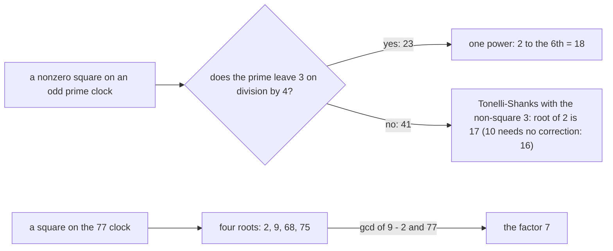

# Square roots on a prime clock: a one-line formula when p is 3 mod 4, and Tonelli-Shanks for other odd primes

[Syllabus](../../../SYLLABUS.md) → [Number theory](../README.md) → [Codes and Secrets](../README.md#s06) → Square roots on a prime clock

---

## General Overview

A Bitcoin key is a point on the curve y × y = x cubed + 7, sent as x and one bit. On a toy 23 clock, x = 4 gives 71 = 3 × 23 + 2, so y is a **square root** of 2, and 2 a **square**. Trying all 23 finds 5 and 18; the bit picks one.

At real size trying all fails, but Bitcoin's prime leaves 3 on division by 4, so one power suffices: on 23, 2 to the (23 + 1)/4 = 6th is 64 = 2 × 23 + 18.

On 41, which leaves 1, **Tonelli-Shanks** guesses, then corrects. **Rabin encryption** locks a message by squaring it on a clock of two secret primes; unlocking takes a square root. On a toy key, 77 = 7 × 11, the message 2 travels as 4; a key holder who unlocks it as 9 leaks the factor 7.

**On a prime clock a square root costs a few powers; on a clock of two primes, it is as hard as factoring.**

**What kind of fact this is:** theorems, proved in Why it works; that factoring is slow is a conjecture, unproved as of 2026-11-23.

### The picture



---

## The formula

On an odd prime clock of size p, a nonzero square has two roots, x and p − x: 18 and 5.

When p leaves 3 on division by 4:

```math
x = a^{(p+1)/4} \bmod p
```

**Read it aloud:** a to the power (p + 1)/4, on the p clock, is a square root of a.

| Symbol | Plain meaning | In our example | Push it up and the answer… |
| --- | --- | --- | --- |
| $`p`$ | the odd prime clock size | 23, then 41 | a few more powers |
| $`a`$ | the nonzero square whose root is wanted | 2, then 10 | — |
| $`x`$ | a square root of $`a`$ | 18, or 5 | — |
| $`s`$, $`t`$ | the 2s and the odd rest of p − 1 | $`40 = 2^3 \times 5`$ | more correction rounds |
| $`z`$ | a non-square: no number squares to it | 3 on 41 | — |

### When it holds

- **The clock is an odd prime.** The 2 clock has one nonzero slot; on 77, 4 has four roots.
- **The number is a nonzero square.** 0 is its own root; 5 has no root on 23, yet the formula returns a number.
- **For the shortcut, p leaves 3 on division by 4.** On 41 the power is not whole.
- **Tonelli-Shanks gets a true non-square.** With the square 2 as helper, the root of 2 on 41 is never found.

---

## Why it works

### Step 0: Euler's test says which numbers are squares

On an odd prime clock, a nonzero a to the power (p − 1)/2 lands on 1 for a square, p − 1 otherwise: Euler's test, proved on [Gauss's lemma](../04-Powers%20on%20the%20Clock/12-gauss-lemma.md). On 23, 2 to the 11th is 1. On 41, 3 to the 20th is 40: a non-square.

### Step 1: the shortcut is Euler's test, multiplied by a

$`a^{(p+1)/4}`$ squared is $`a^{(p+1)/2}`$: a times $`a^{(p-1)/2}`$, which is 1 for nonzero a by Step 0 (0 gives 0). So 18 × 18 lands on 2. The power is whole exactly when p leaves 3 on division by 4.

### Step 2: Tonelli-Shanks guesses, then shrinks the error

Split p − 1 into its 2s and an odd rest: the rest gives a near-root; the 2s are fixed one by one. On 41, $`40 = 2^3 \times 5`$: s = 3, t = 5. Half the nonzero numbers are non-squares, so testing 2, 3, … by Euler's test soon finds a helper z: 3 on 41.

1. Guess $`x = a^{(t+1)/2}`$. Then x × x is a times an **error**, $`a^t`$. For 10: guess 10 cubed, 16; error 10 to the 5th, 1: 16 is a root.
2. For 2: guess 8, error 32. The error's **order**, its smallest power landing on 1 ([The order of a number and primitive roots](../04-Powers%20on%20the%20Clock/05-order-and-primitive-roots.md)): 32 squared is 40, squared again 1, so order 4. Raised to $`2^{s-1}`$, any error is $`a^{(p-1)/2}`$, 1 by Step 0, so its order divides $`2^{s-1}`$, at most 4.
3. The **fix** is $`z^t`$: 3 to the 5th = 38, of order $`2^s`$ = 8 by Step 0, so it has powers of order 2, 4 and 8.
4. Take the fix's power whose order is twice the error's: 38 itself. Multiply the guess by it and the error by its square; the error's order at least halves. 8 × 38 lands on 17, the error on 1: 17 × 17 lands on 2.

At most s − 1 rounds finish.

<details>
<summary>Why the error's order halves</summary>

Halfway to its order, the error lands on p − 1, the only number besides 1 squaring to 1 ([The Miller-Rabin test](05-miller-rabin.md), Step 0): 32 squared is 40.

The fix power's square has the same order, so it also lands on p − 1 halfway: 38 squared is 9, 9 squared is 40. Their product lands halfway on 40 × 40, which is 1: its order at least halved.

</details>

### Step 3: on a clock of two primes, roots give the factors

[The Chinese remainder theorem](../03-Clock%20Arithmetic/06-chinese-remainder-theorem.md) pairs a root of 4 on the 7 clock with one on the 11 clock, giving four roots on 77: 2, 9, 68 and 75.

Roots 2 and 9 are **unrelated**: 9 is neither 2 nor 77 − 2. They agree on 7 and differ in sign on 11. So the **gcd** (greatest common divisor) of 9 − 2 and 77 is 7.

A root-finder handed 4 cannot know you began from 2, so half its answers, 9 and 68, give a factor. Knowing 7 and 11, roots are easy: one per clock, stitched.

---

## Worked numbers, by hand

| Step | Arithmetic | Value |
| --- | --- | --- |
| the power on 23 | (23 + 1)/4 | 6 |
| the shortcut | 2 to the 6th = 64 = 2 × 23 + 18 | 18 |
| other root | 23 − 18 | 5 |
| guess and error for 10 on 41 | 10 cubed; 10 to the 5th | 16; 1 |
| check; other root | 16 × 16 = 256 = 6 × 41 + 10; 41 − 16 | 25 |
| roots of 4 on 77 | try all 77 | 2, 9, 68, 75 |
| two unrelated roots | gcd of 9 − 2 and 77 | **7** |

One power gave 18; one gcd gave 7.

### What breaks if you drop a piece

| Mistake | Comes out at | What went wrong |
| --- | --- | --- |
| Shortcut on 41, power rounded down to 10 | 10 to the 10th = 1, not a root of 10 | 41 leaves 1 on division by 4 |
| 2 as the helper on 41 | 2 to the 20th = 1 | a square: its fix 32 has order 4, too small to cancel the error 32 |
| Roots 2 and 75 on 77 | gcd of 75 − 2 and 77 = 1 | 75 is 77 − 2, the same root, sign flipped |

---

## Code, from first principles, and it actually runs

Shortcut and Tonelli-Shanks checked against brute force on 23 and 41; on 77, a gcd gives factors.

### Python

```python
# Square roots on a prime clock -- the check behind the card.  Nothing is imported.  Mod 23 the
# (p+1)/4 shortcut; mod 41 Tonelli-Shanks with the non-square 3; mod 77 four roots give a factor.
def roots(a, n): return [x for x in range(n) if x * x % n == a % n]   # brute force: try them all
def gcd(a, b): return a if b == 0 else gcd(b, a % b)
def tonelli(a, p, z, log=False):                  # z must be a non-square on the p clock
    s, t = 0, p - 1
    while t % 2 == 0: s, t = s + 1, t // 2        # p - 1 = 2^s x t, t odd
    x, err, fix = pow(a, (t + 1) // 2, p), pow(a, t, p), pow(z, t, p)   # x * x = a * err
    if log: print(f"mod {p}, a = {a}: {p - 1} = 2^{s} x {t}; first guess {a}^{(t + 1) // 2} = {x}, error {a}^{t} = {err}, fix {z}^{t} = {fix}")
    while err != 1:
        i, e = 0, err
        while e != 1: e, i = e * e % p, i + 1     # the error has order 2^i
        f = pow(fix, 2 ** (s - i - 1), p)         # a power of the fix with order 2^(i+1)
        x, err, fix, s = x * f % p, err * f * f % p, f * f % p, i
        if log: print(f"  error had order 2^{i}: multiply by {f} -> x = {x}, error now {err}")
    return x
r, c = pow(2, (23 + 1) // 4, 23), 4 ** 3 + 7     # c: y^2 on the curve y^2 = x^3 + 7 at x = 4
print(f"curve y^2 = x^3 + 7 at x = 4: y^2 = {c} = {c // 23} x 23 + {c % 23} on the 23 clock; Bitcoin's prime 2^256 - 2^32 - 977 leaves {(2 ** 256 - 2 ** 32 - 977) % 4} on division by 4")
print(f"mod 23 (23 % 4 = {23 % 4}): (23 + 1)/4 = {(23 + 1) // 4}; 2^6 = {2 ** 6} = {2 ** 6 // 23} x 23 + {r}; {r}^2 = {r * r} = {r * r // 23} x 23 + {r * r % 23}; other root {23 - r}; 2^11 = {pow(2, 11, 23)}")
print(f"mod 41 (41 % 4 = {41 % 4}): 3^20 = {pow(3, 20, 41)}, so 3 is a non-square; 2^20 = {pow(2, 20, 41)}, so 2 is a square; 10^10 = {pow(10, 10, 41)}; squares 32 -> {32 * 32 % 41}, 38 -> {38 * 38 % 41} -> {pow(38, 4, 41)} -> {pow(38, 8, 41)}, 40 -> {40 * 40 % 41}")
x10, x2, four = tonelli(10, 41, 3, True), tonelli(2, 41, 3, True), roots(4, 77)
print(f"roots of 10 mod 41: {x10} and {41 - x10}; {x10}^2 = {x10 * x10} = {x10 * x10 // 41} x 41 + {x10 * x10 % 41}; roots of 2: {x2} and {41 - x2}")
print(f"brute force: mod 23 roots of 2 {roots(2, 23)}, of 5 {roots(5, 23)}; mod 41 roots of 10 {roots(10, 41)}, of 2 {roots(2, 41)}")
print(f"mod 77 = 7 x 11, the roots of 4: {four}; gcd(root - 2, 77) for each: {[gcd(y - 2, 77) for y in four]}; gcd(9 + 2, 77) = {gcd(9 + 2, 77)}")
sq23, sq41 = sorted({x * x % 23 for x in range(1, 23)}), sorted({x * x % 41 for x in range(1, 41)})
print(f"every square checked against brute force: {len(sq23)} on the 23 clock, {len(sq41)} on the 41 clock")
assert r == 18 and roots(2, 23) == [5, 18] and roots(5, 23) == [] and all(pow(a, 6, 23) in roots(a, 23) for a in sq23)
assert x10 == 16 and x2 == 17 and all(tonelli(a, 41, 3) in roots(a, 41) for a in sq41)
assert four == [2, 9, 68, 75] and [gcd(y - 2, 77) for y in four] == [77, 7, 11, 1] and pow(10, 10, 41) not in roots(10, 41)
print("ALL CHECKS PASS")
```

**Ran 2026-11-23 on macOS, Python 3.14.10, standard library only. All checks passed. Output, pasted from the run:**

```
curve y^2 = x^3 + 7 at x = 4: y^2 = 71 = 3 x 23 + 2 on the 23 clock; Bitcoin's prime 2^256 - 2^32 - 977 leaves 3 on division by 4
mod 23 (23 % 4 = 3): (23 + 1)/4 = 6; 2^6 = 64 = 2 x 23 + 18; 18^2 = 324 = 14 x 23 + 2; other root 5; 2^11 = 1
mod 41 (41 % 4 = 1): 3^20 = 40, so 3 is a non-square; 2^20 = 1, so 2 is a square; 10^10 = 1; squares 32 -> 40, 38 -> 9 -> 40 -> 1, 40 -> 1
mod 41, a = 10: 40 = 2^3 x 5; first guess 10^3 = 16, error 10^5 = 1, fix 3^5 = 38
mod 41, a = 2: 40 = 2^3 x 5; first guess 2^3 = 8, error 2^5 = 32, fix 3^5 = 38
  error had order 2^2: multiply by 38 -> x = 17, error now 1
roots of 10 mod 41: 16 and 25; 16^2 = 256 = 6 x 41 + 10; roots of 2: 17 and 24
brute force: mod 23 roots of 2 [5, 18], of 5 []; mod 41 roots of 10 [16, 25], of 2 [17, 24]
mod 77 = 7 x 11, the roots of 4: [2, 9, 68, 75]; gcd(root - 2, 77) for each: [77, 7, 11, 1]; gcd(9 + 2, 77) = 11
every square checked against brute force: 11 on the 23 clock, 20 on the 41 clock
ALL CHECKS PASS
```

### Rust

Same numbers, same labels.

```rust
// Square roots on a prime clock -- the same check as the Python, in Rust.  No crates.  Mod 23
// the (p+1)/4 shortcut; mod 41 Tonelli-Shanks with the non-square 3; mod 77 four roots, a factor.
fn pw(b: u64, mut e: u64, n: u64) -> u64 {        // square and multiply on the n clock
    let (mut r, mut b) = (1, b % n);
    while e > 0 { if e % 2 == 1 { r = r * b % n; } b = b * b % n; e /= 2; }
    r
}
fn roots(a: u64, n: u64) -> Vec<u64> { (0..n).filter(|x| x * x % n == a % n).collect() }   // brute force
fn gcd(a: u64, b: u64) -> u64 { if b == 0 { a } else { gcd(b, a % b) } }
fn tonelli(a: u64, p: u64, z: u64, log: bool) -> u64 {   // z must be a non-square on the p clock
    let (mut s, mut t) = (0, p - 1);
    while t % 2 == 0 { s += 1; t /= 2; }               // p - 1 = 2^s x t, t odd
    let (mut x, mut err, mut fix) = (pw(a, (t + 1) / 2, p), pw(a, t, p), pw(z, t, p));   // x * x = a * err
    if log { println!("mod {}, a = {}: {} = 2^{} x {}; first guess {}^{} = {}, error {}^{} = {}, fix {}^{} = {}", p, a, p - 1, s, t, a, (t + 1) / 2, x, a, t, err, z, t, fix); }
    while err != 1 {
        let (mut i, mut e) = (0, err);
        while e != 1 { e = e * e % p; i += 1; }        // the error has order 2^i
        let f = pw(fix, 1 << (s - i - 1), p);          // a power of the fix with order 2^(i+1)
        x = x * f % p; err = err * f % p * f % p; fix = f * f % p; s = i;
        if log { println!("  error had order 2^{}: multiply by {} -> x = {}, error now {}", i, f, x, err); }
    }
    x
}
fn main() {
    let (r, c) = (pw(2, (23 + 1) / 4, 23), 4u64.pow(3) + 7);   // c: y^2 on the curve y^2 = x^3 + 7 at x = 4
    println!("curve y^2 = x^3 + 7 at x = 4: y^2 = {} = {} x 23 + {} on the 23 clock; Bitcoin's prime 2^256 - 2^32 - 977 leaves {} on division by 4", c, c / 23, c % 23, (8 + pw(2, 256, 4) - pw(2, 32, 4) - 977 % 4) % 4);
    println!("mod 23 (23 % 4 = {}): (23 + 1)/4 = {}; 2^6 = {} = {} x 23 + {}; {}^2 = {} = {} x 23 + {}; other root {}; 2^11 = {}", 23 % 4, (23 + 1) / 4, 2u64.pow(6), 2u64.pow(6) / 23, r, r, r * r, r * r / 23, r * r % 23, 23 - r, pw(2, 11, 23));
    println!("mod 41 (41 % 4 = {}): 3^20 = {}, so 3 is a non-square; 2^20 = {}, so 2 is a square; 10^10 = {}; squares 32 -> {}, 38 -> {} -> {} -> {}, 40 -> {}", 41 % 4, pw(3, 20, 41), pw(2, 20, 41), pw(10, 10, 41), 32 * 32 % 41, 38 * 38 % 41, pw(38, 4, 41), pw(38, 8, 41), 40 * 40 % 41);
    let (x10, x2, four) = (tonelli(10, 41, 3, true), tonelli(2, 41, 3, true), roots(4, 77));
    println!("roots of 10 mod 41: {} and {}; {}^2 = {} = {} x 41 + {}; roots of 2: {} and {}", x10, 41 - x10, x10, x10 * x10, x10 * x10 / 41, x10 * x10 % 41, x2, 41 - x2);
    println!("brute force: mod 23 roots of 2 {:?}, of 5 {:?}; mod 41 roots of 10 {:?}, of 2 {:?}", roots(2, 23), roots(5, 23), roots(10, 41), roots(2, 41));
    let g: Vec<u64> = four.iter().map(|&y| gcd(y + 77 - 2, 77)).collect();
    println!("mod 77 = 7 x 11, the roots of 4: {:?}; gcd(root - 2, 77) for each: {:?}; gcd(9 + 2, 77) = {}", four, g, gcd(9 + 2, 77));
    let sqs = |p: u64| { let mut v: Vec<u64> = (1..p).map(|x| x * x % p).collect(); v.sort(); v.dedup(); v }; let (sq23, sq41) = (sqs(23), sqs(41));
    println!("every square checked against brute force: {} on the 23 clock, {} on the 41 clock", sq23.len(), sq41.len());
    assert!(r == 18 && roots(2, 23) == vec![5, 18] && roots(5, 23).is_empty() && sq23.iter().all(|&a| roots(a, 23).contains(&pw(a, 6, 23))));
    assert!(x10 == 16 && x2 == 17 && sq41.iter().all(|&a| roots(a, 41).contains(&tonelli(a, 41, 3, false))));
    assert!(four == vec![2, 9, 68, 75] && g == vec![77, 7, 11, 1] && !roots(10, 41).contains(&pw(10, 10, 41)));
    println!("ALL CHECKS PASS");
}
```

**Ran 2026-11-23 on macOS, rustc 1.98.1, no crates. All checks passed. Output, pasted from the run:**

```
curve y^2 = x^3 + 7 at x = 4: y^2 = 71 = 3 x 23 + 2 on the 23 clock; Bitcoin's prime 2^256 - 2^32 - 977 leaves 3 on division by 4
mod 23 (23 % 4 = 3): (23 + 1)/4 = 6; 2^6 = 64 = 2 x 23 + 18; 18^2 = 324 = 14 x 23 + 2; other root 5; 2^11 = 1
mod 41 (41 % 4 = 1): 3^20 = 40, so 3 is a non-square; 2^20 = 1, so 2 is a square; 10^10 = 1; squares 32 -> 40, 38 -> 9 -> 40 -> 1, 40 -> 1
mod 41, a = 10: 40 = 2^3 x 5; first guess 10^3 = 16, error 10^5 = 1, fix 3^5 = 38
mod 41, a = 2: 40 = 2^3 x 5; first guess 2^3 = 8, error 2^5 = 32, fix 3^5 = 38
  error had order 2^2: multiply by 38 -> x = 17, error now 1
roots of 10 mod 41: 16 and 25; 16^2 = 256 = 6 x 41 + 10; roots of 2: 17 and 24
brute force: mod 23 roots of 2 [5, 18], of 5 []; mod 41 roots of 10 [16, 25], of 2 [17, 24]
mod 77 = 7 x 11, the roots of 4: [2, 9, 68, 75]; gcd(root - 2, 77) for each: [77, 7, 11, 1]; gcd(9 + 2, 77) = 11
every square checked against brute force: 11 on the 23 clock, 20 on the 41 clock
ALL CHECKS PASS
```

### Lean

Lean proves the shortcut, the two roots and the factor gcd on every clock where they hold, then re-checks the card's numbers.

- Take a prime p that leaves 3 on division by 4, and a square a on the p clock. Then a to the power (p + 1)/4, squared, lands on a.
- Take a nonzero x on an odd prime clock of size p. Then exactly two numbers square to x × x: x and p − x, and they differ.
- Suppose two roots of the same number on any clock are unrelated: neither is the other, nor the clock size minus the other. Then the gcd of their difference and the clock size is a factor strictly between 1 and the clock size.
- On 23 and 41, it re-checks the roots 18, 5, 16 and 17, and the Tonelli-Shanks guesses, errors and fix.
- On 77, it re-checks the four roots 2, 9, 68 and 75 of 4, and the gcd 7.

Lean does not prove that Tonelli-Shanks always ends with a root; that rests on the written proof in Step 2. Running both methods on every square of 23 and 41 is left to the Python and Rust checks.

```lean
-- Square roots on a prime clock: when p is a prime leaving 3 on division by 4, a^((p+1)/4) is a square root of every square a on the p clock, a nonzero square on an odd prime clock has exactly the two roots x and p - x, and two unrelated square roots of the same number on an n clock give a proper factor of n through a gcd.
import Mathlib.Data.ZMod.Basic
import Mathlib.Algebra.Group.Even
import Mathlib.Algebra.Field.ZMod
import Mathlib.Tactic.NormNum.GCD
import Mathlib.FieldTheory.Finite.Basic

/-- The shortcut: on a prime clock of size p, where p leaves 3 on division by 4, if a is a
square then a to the power (p + 1)/4 is a square root of a. -/
theorem pow_p_add_one_div_four_sq_eq {p : ℕ} [Fact p.Prime] (hp : p % 4 = 3) {a : ZMod p}
    (ha : IsSquare a) : (a ^ ((p + 1) / 4)) ^ 2 = a := by
  obtain ⟨r, rfl⟩ := ha
  have h4 : 4 * ((p + 1) / 4) = p + 1 := by omega
  calc ((r * r) ^ ((p + 1) / 4)) ^ 2 = r ^ (4 * ((p + 1) / 4)) := by ring
    _ = r ^ p * r := by rw [h4, pow_succ]
    _ = r * r := by rw [ZMod.pow_card]

/-- Two roots: on an odd prime clock, a nonzero square x × x has exactly two square roots,
x and p − x (that is, −x), and these two are different. -/
theorem sq_eq_sq_iff_eq_or_eq_neg_of_odd_prime {p : ℕ} [Fact p.Prime] (hp : p ≠ 2)
    {x : ZMod p} (hx : x ≠ 0) :
    (∀ y : ZMod p, y ^ 2 = x ^ 2 ↔ y = x ∨ y = -x) ∧ x ≠ -x := by
  refine ⟨fun y => sq_eq_sq_iff_eq_or_eq_neg, ?_⟩
  intro h
  have h2 : (2 : ZMod p) ≠ 0 := Ring.two_ne_zero (by rw [ZMod.ringChar_zmod_n]; exact hp)
  have : (2 : ZMod p) * x = 0 := by linear_combination h
  rcases mul_eq_zero.mp this with h' | h'
  · exact h2 h'
  · exact hx h'

/-- Roots give factors: if x and y are square roots of the same number on an n clock
(n divides x² − y²) and they are unrelated (n divides neither x − y nor x + y), then the
gcd of x − y and n is a factor of n strictly between 1 and n. -/
theorem gcd_sub_proper_factor_of_unrelated_roots {n : ℕ} {x y : ℤ}
    (hsq : (n : ℤ) ∣ x ^ 2 - y ^ 2) (hsub : ¬ (n : ℤ) ∣ x - y) (hadd : ¬ (n : ℤ) ∣ x + y) :
    1 < Int.gcd (x - y) n ∧ Int.gcd (x - y) n < n := by
  have hfac : x ^ 2 - y ^ 2 = (x - y) * (x + y) := by ring
  rw [hfac] at hsq
  have hn0 : n ≠ 0 := by
    rintro rfl
    simp only [Nat.cast_zero, zero_dvd_iff] at hsq hsub hadd
    rcases mul_eq_zero.mp hsq with h | h
    · exact hsub h
    · exact hadd h
  have hg_dvd : (Int.gcd (x - y) n : ℤ) ∣ (n : ℤ) := Int.gcd_dvd_right _ _
  have hg_dvd' : Int.gcd (x - y) n ∣ n := by exact_mod_cast hg_dvd
  have hg_pos : 0 < Int.gcd (x - y) n := Int.gcd_pos_of_ne_zero_right _ (by exact_mod_cast hn0)
  constructor
  · by_contra hle
    have hg1 : Int.gcd (x - y) n = 1 := by omega
    have hcop : IsCoprime (n : ℤ) (x - y) := by
      rw [Int.isCoprime_iff_gcd_eq_one, Int.gcd_comm]; exact hg1
    exact hadd (hcop.dvd_of_dvd_mul_left hsq)
  · rcases lt_or_eq_of_le (Nat.le_of_dvd (Nat.pos_of_ne_zero hn0) hg_dvd') with h | h
    · exact h
    · exfalso
      apply hsub
      have : (Int.gcd (x - y) n : ℤ) ∣ x - y := Int.gcd_dvd_left _ _
      rw [h] at this
      exact this

-- Mod 23 (23 leaves 3 on division by 4): the power is (23 + 1)/4 = 6, 2^6 = 64 = 2 × 23 + 18,
-- 18^2 = 324 = 14 × 23 + 2, the other root is 23 − 18 = 5, and 2^11 lands on 1.
example : 23 % 4 = 3 ∧ (23 + 1) / 4 = 6 ∧ 2 ^ 6 = 64 ∧ 64 = 2 * 23 + 18 ∧
    18 ^ 2 = 324 ∧ 324 = 14 * 23 + 2 ∧ 23 - 18 = 5 ∧ 2 ^ 11 % 23 = 1 := by norm_num
example : (2 : ZMod 23) ^ ((23 + 1) / 4) = 18 ∧ (18 : ZMod 23) ^ 2 = 2 ∧ (5 : ZMod 23) ^ 2 = 2 := by
  decide
-- On 23 the square roots of 2 are exactly 5 and 18, and 5 has none.
example : (List.range 23).filter (fun x => x * x % 23 = 2) = [5, 18] := by decide
example : (List.range 23).filter (fun x => x * x % 23 = 5) = [] := by decide
-- The curve y^2 = x^3 + 7 at x = 4: 71 = 3 × 23 + 2.
example : 4 ^ 3 + 7 = 71 ∧ 71 = 3 * 23 + 2 := by norm_num
-- Mod 41: 3^20 lands on 40 (3 is a non-square), 2^20 and 10^10 land on 1, and 40 = 2^3 × 5.
example : 41 % 4 = 1 ∧ 40 = 2 ^ 3 * 5 ∧ 3 ^ 20 % 41 = 40 ∧ 2 ^ 20 % 41 = 1 ∧ 10 ^ 10 % 41 = 1 := by
  norm_num
-- Tonelli-Shanks on 41: for 10, guess 10^3 = 16 with error 10^5 = 1; for 2, guess 2^3 = 8,
-- error 2^5 = 32, fix 3^5 = 38, and 8 × 38 lands on 17.
example : 10 ^ 3 % 41 = 16 ∧ 10 ^ 5 % 41 = 1 ∧ 2 ^ 3 = 8 ∧ 2 ^ 5 = 32 ∧ 3 ^ 5 % 41 = 38 ∧
    32 ^ 2 % 41 = 40 ∧ 38 ^ 2 % 41 = 9 ∧ 9 ^ 2 % 41 = 40 ∧ 8 * 38 % 41 = 17 := by norm_num
-- 16^2 = 256 = 6 × 41 + 10; the roots of 10 on 41 are 16 and 25, the roots of 2 are 17 and 24.
example : 16 ^ 2 = 256 ∧ 256 = 6 * 41 + 10 ∧ 17 ^ 2 % 41 = 2 := by norm_num
example : (List.range 41).filter (fun x => x * x % 41 = 10) = [16, 25] := by decide
example : (List.range 41).filter (fun x => x * x % 41 = 2) = [17, 24] := by decide
-- Mod 77 = 7 × 11: 4 has the four roots 2, 9, 68, 75; gcd(9 − 2, 77) = 7, gcd(75 − 2, 77) = 1.
example : 77 = 7 * 11 := by norm_num
example : (List.range 77).filter (fun x => x * x % 77 = 4) = [2, 9, 68, 75] := by decide
example : Nat.gcd (9 - 2) 77 = 7 ∧ Nat.gcd (68 - 2) 77 = 11 ∧ Nat.gcd (75 - 2) 77 = 1 ∧
    Nat.gcd (9 + 2) 77 = 11 := by norm_num

#print axioms pow_p_add_one_div_four_sq_eq
#print axioms sq_eq_sq_iff_eq_or_eq_neg_of_odd_prime
#print axioms gcd_sub_proper_factor_of_unrelated_roots
```

**Checked 2026-11-23 on macOS, Lean 4.36.0-rc2, Mathlib v4.36.0-rc2. Every proof is complete and uses only Lean's standard axioms. Output, pasted from the run:**

```
'pow_p_add_one_div_four_sq_eq' depends on axioms: [propext, Classical.choice, Quot.sound]
'sq_eq_sq_iff_eq_or_eq_neg_of_odd_prime' depends on axioms: [propext, Classical.choice, Quot.sound]
'gcd_sub_proper_factor_of_unrelated_roots' depends on axioms: [propext, Classical.choice, Quot.sound]
```

> [!TIP]
> **Try changing**
> - Guess first: does Tonelli-Shanks correct anything on 23? Run `tonelli(2, 23, 5, True)`. No: its first guess is the shortcut, 18.
> - Guess first: can a square help? Make the 3 in `tonelli(2, 41, 3, True)` a 2. No: its fix 32 has order 4, too small: the loop crashes.
> - Guess first: how many roots has 5 on 23? `roots(5, 23)`: none.

---

## The usual mistake

> [!warning]
> **Using the answer unchecked.** Square it: on 41 the rounded-down shortcut gives 1, not a root of 10.
>
> - **An untested helper.** On 41, 2 to the 20th is 1: a square.
> - **Forgetting the second root.** 18 has 5; 16 has 25.
> - **Roots one sign apart.** On 77, 2 and 75 give gcd 1.

---

## Where you meet it in real life

- **Rabin encryption.** The toy 77 key, with primes hundreds of digits long.
- **Factoring programs.** The quadratic sieve takes roots on many small prime clocks.

> **Say it back**
> On an odd prime clock a nonzero square has two roots, x and p − x. If p leaves 3 on division by 4, a to the (p + 1)/4 is one; otherwise Tonelli-Shanks halves the error's order with a non-square. On 77, unrelated roots 9 and 2 give factor 7.

---

## What this builds on

- [Gauss's lemma](../04-Powers%20on%20the%20Clock/12-gauss-lemma.md): Euler's test, which both methods rest on.
- [Powers on the clock](../04-Powers%20on%20the%20Clock/01-modular-exponentiation.md): square-and-multiply, for every power here.
- [The order of a number and primitive roots](../04-Powers%20on%20the%20Clock/05-order-and-primitive-roots.md): the order Tonelli-Shanks halves.
- [The Chinese remainder theorem](../03-Clock%20Arithmetic/06-chinese-remainder-theorem.md): why 4 has four roots on 77.
- [One-way streets](01-one-way-streets.md): factoring as a one-way street.
- [The Miller-Rabin test](05-miller-rabin.md): why only 1 and p − 1 square to 1.

## Where this goes next

- [Pythagorean triples](../07-For%20the%20Curious/01-pythagorean-triples.md): the next shelf, a detour of classic puzzles, starts with whole-number right triangles.
- [The Jacobi symbol](../../21-Algebraic%20and%20analytic%20number%20theory/03-Characters%20and%20L-functions/08-jacobi-symbol-and-computing-without-factoring.md): a square test on 77 that needs no factors, though only its "no" is final.

Left open: can you tell whether a number is a square on 77 without knowing 7 and 11? [The Jacobi symbol](../../21-Algebraic%20and%20analytic%20number%20theory/03-Characters%20and%20L-functions/08-jacobi-symbol-and-computing-without-factoring.md) takes this up. The next shelf is a detour and does not.

---

## Sources

Verified 2026-11-23: every link below resolves to the publisher's page.

- Rabin, Michael O. *Digitalized Signatures and Public-Key Functions as Intractable as Factorization.* MIT-LCS-TR-212, 1979. [MIT record](https://hdl.handle.net/1721.1/149499). The factoring link in Step 3.
- Crandall, Richard, and Carl Pomerance. *Prime Numbers: A Computational Perspective*, 2nd ed. Springer, 2005. [doi:10.1007/0-387-28979-8](https://doi.org/10.1007/0-387-28979-8). Section 2.3: the shortcut, Tonelli-Shanks, Cipolla.
- Cohen, Henri. *A Course in Computational Algebraic Number Theory.* Springer, 1993. [doi:10.1007/978-3-662-02945-9](https://doi.org/10.1007/978-3-662-02945-9). Section 1.5: Tonelli-Shanks.
