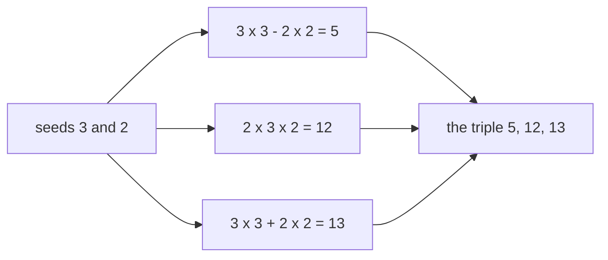

# Pythagorean triples: every whole-number right triangle comes from two smaller numbers

[Syllabus](../../../SYLLABUS.md) → [Number theory](../README.md) → [For the Curious](../README.md#s07) → Pythagorean triples

---

## General Overview

A builder wants a square corner and has no set square. She pegs out a knotted rope with sides of 3, 4 and 5 knot-lengths. The corner between the 3 and the 4 comes out square. Every time.

Behind the rope is arithmetic: 3 × 3 = 9, 4 × 4 = 16, and 9 + 16 = 25, which is 5 × 5. Three whole numbers where the two smaller ones, multiplied by themselves, add to the biggest multiplied by itself are a **Pythagorean triple**. Why that squares a corner is geometry, a later wing.

The rope has company: 5, 12, 13 works, and so does 8, 15, 17. Not luck.

**Pick two whole numbers, bigger first, and multiply each by itself. The difference of those answers, twice the two numbers multiplied together, and the sum of those answers are always a triple — and every triple comes out of that recipe, scaled up if need be.**

**What kind of fact this is:** a theorem. Why it works proves that the recipe always gives a triple, and sketches why every triple comes from it.

### The picture: seeds in, sides out



The two starting numbers are the **seeds**: 3 and 2 in, 5, 12, 13 out.

The two sides that meet at the square corner are the legs. The third side is the long side.

---

## The formula

The recipe on the seeds 3 and 2:

**3 × 3 − 2 × 2 = 5    and    2 × 3 × 2 = 12    and    3 × 3 + 2 × 2 = 13**

Those three pass the test: **5 × 5 + 12 × 12 = 25 + 144 = 169 = 13 × 13**

**Read it aloud:** nine take away four is one leg, twice three times two is the other, nine plus four the long side.

| Piece | Plain meaning | With seeds 3 and 2 |
| --- | --- | --- |
| the seeds | the two numbers you start from, bigger first; called m and n in textbooks and in the other cards | 3 and 2 |
| the odd leg | the seeds multiplied by themselves, subtracted ([Exponents](../../01-Foundations/03-Powers%2C%20Roots%20and%20Logarithms/01-exponents-and-powers.md)); odd whenever one seed is odd and one even | 9 − 4 = 5 |
| the even leg | twice the seeds multiplied | 2 × 3 × 2 = 12 |
| the long side | the same two, added | 9 + 4 = 13 |
| primitive | sides sharing no factor but 1, called coprime ([Coprime numbers](../02-Greatest%20Common%20Divisor%20and%20Euclid%27s%20Algorithm/05-coprime-numbers.md)); needs coprime seeds, one odd and one even | 5, 12, 13 |

### When it holds

- **Bigger seed first.** Put 2 before 3 and a leg comes out at −5, which is no side at all.
- **Coprime seeds, one odd and one even, for a primitive triple.** Seeds 3 and 1, both odd, give 6, 8, 10: shared factor 2, the rope doubled.
- **Scaled copies count.** The recipe gives every primitive triple, and the rest are those scaled up. Drop the scaling and some triples are missed, which is why Step 4 keeps to primitive ones.

---

## Why it works

### Step 0: a triple is arithmetic, not a drawing

The rope's whole claim is 9 + 16 = 25. Any three whole numbers passing that test are a triple.

### Step 1: run it

Seeds 3 and 2 give 5, 12, 13; seeds 4 and 1 give 8, 15 and 17; seeds 2 and 1 give the rope.

### Step 2: why it cannot miss

Take the long side and the odd leg, each multiplied by itself, and subtract: 169 − 25 = 144. A second route is sum times difference: (13 + 5) × (13 − 5) = 18 × 8 = 144. It agrees because the brackets multiply out to 13 × 13 + 5 × 13 − 13 × 5 − 5 × 5, and the middle two cancel.

Now read the brackets in seeds: the long side is 9 + 4 and the odd leg 9 − 4, so the sum is 18 and the difference 8 — twice 9 and twice 4. Their product is four lots of 9 × 4, which is the even leg 2 × 3 × 2 multiplied by itself. Nothing about 3 and 2 was used.

### Step 3: one leg is always even

The recipe's even leg is 2 × bigger × smaller, so it is even by construction. Stronger: no triple has two odd legs. An odd number multiplied by itself sits one above a multiple of 4 — 9 and 25 do — so two of them add to an even number sitting 2 above a multiple of 4. The long side would then be even, and even numbers multiplied by themselves are multiples of 4 ([Even and odd](../01-Divisibility%20and%20Primes/02-even-and-odd.md)). But a multiple of 4 is not 2 above a multiple of 4. So two odd legs is impossible.

### Step 4: nothing is missing from the list

A sketch. Copies first: 6, 8, 10 is the rope doubled, so keep to primitive triples ([Coprime numbers](../02-Greatest%20Common%20Divisor%20and%20Euclid%27s%20Algorithm/05-coprime-numbers.md)). Run Step 2 backwards: 12 × 12 = 18 × 8. A primitive triple has one even leg, so the odd leg and the long side are both odd and both brackets halve cleanly: 9 and 4. Those share no factor but 1, and multiply to 6 × 6, half the even leg multiplied by itself. Two coprime numbers whose product is a square are squares themselves ([Euclid's lemma](../02-Greatest%20Common%20Divisor%20and%20Euclid%27s%20Algorithm/06-euclids-lemma.md)): 9 is 3 × 3 and 4 is 2 × 2 — the seeds, recovered.

---

## Worked numbers, by hand

| Step | Arithmetic | Value |
| --- | --- | --- |
| the rope | 3 × 3 + 4 × 4 = 9 + 16 | **25** |
| seeds 3 and 2, three sides | 9 − 4, 2 × 3 × 2, 9 + 4 | **5, 12, 13** |
| the check | 25 + 144 | **169** |
| seeds 4 and 1 | 2 × 4 × 1, 16 − 1, 16 + 1 | **8, 15, 17** |

### What breaks if you drop a piece

| Mistake | Comes out at | What went wrong |
| --- | --- | --- |
| Seeds 3 and 1, both odd | 6, 8, 10 | Shared factor 2: the rope doubled |
| Smaller seed first, 2 and 3 | −5 | A leg goes negative: bigger seed leads |
| Adding sides, not squares | 7 | 3 + 4 is 7; the side is 5 |

The code prints all three.

---

## Code, from first principles, and it actually runs

Nothing comes from a library. The recipe runs on three pairs of seeds. The second road counts up until a leg fits.

### Python

```python
# Pythagorean triples -- the check behind the card.  Nothing is imported.  The
# builder's 3-4-5 rope, then the recipe: two whole numbers, bigger first, giving
# bigger x bigger - smaller x smaller, 2 x bigger x smaller, and the two sums.
def triple(big, small):                  # the recipe, straight off the card
    legs = sorted((big * big - small * small, 2 * big * small))
    return (legs[0], legs[1], big * big + small * small)
def missing_leg(leg, long_side):         # second road: count up until it fits
    other = 1
    while leg * leg + other * other < long_side * long_side:
        other += 1
    return other if leg * leg + other * other == long_side * long_side else 0
def row(name, value): print(f"{name:<44}{value:>24}")
row("the rope: 3 x 3 + 4 x 4", f"{3 * 3} + {4 * 4} = {3 * 3 + 4 * 4} = 5 x 5")
for big, small in ((3, 2), (4, 1), (2, 1)):
    row(f"seeds {big} and {small}: leg, leg, long side", " ".join(str(v) for v in triple(big, small)))
for a, b, c in (triple(3, 2), triple(4, 1)):
    row(f"{a} x {a} + {b} x {b}", f"{a * a} + {b * b} = {a * a + b * b} = {c} x {c}")
a, b, c = triple(3, 2)
row(f"({c} + {a}) x ({c} - {a}) = {c + a} x {c - a}", f"{(c + a) * (c - a)} = {b} x {b}")
row("missing legs by counting up: 5,13 and 8,17", f"{missing_leg(5, 13)} and {missing_leg(8, 17)}")
odd_seeds = triple(3, 1)
share = max(k for k in range(1, 11) if all(v % k == 0 for v in odd_seeds))
row("seeds 3 and 1, both odd", f"{odd_seeds[0]} {odd_seeds[1]} {odd_seeds[2]}, shared factor {share}")
row("adding the sides, not the squares", 3 + 4)
row("smaller seed first, 2 and 3", triple(2, 3)[0])
assert triple(3, 2) == (5, 12, 13) and triple(4, 1) == (8, 15, 17) and triple(2, 1) == (3, 4, 5)
assert missing_leg(5, 13) == 12 and missing_leg(8, 17) == 15 and 25 + 144 == 169
assert triple(3, 1) == (6, 8, 10) and share == 2 and (13 + 5) * (13 - 5) == 144
print("ALL CHECKS PASS")
```

**Ran 2026-09-06 on macOS, Python 3.14.6, standard library only. All checks passed. Output, pasted from the run:**

```
the rope: 3 x 3 + 4 x 4                          9 + 16 = 25 = 5 x 5
seeds 3 and 2: leg, leg, long side                           5 12 13
seeds 4 and 1: leg, leg, long side                           8 15 17
seeds 2 and 1: leg, leg, long side                             3 4 5
5 x 5 + 12 x 12                             25 + 144 = 169 = 13 x 13
8 x 8 + 15 x 15                             64 + 225 = 289 = 17 x 17
(13 + 5) x (13 - 5) = 18 x 8                           144 = 12 x 12
missing legs by counting up: 5,13 and 8,17                 12 and 15
seeds 3 and 1, both odd                      6 8 10, shared factor 2
adding the sides, not the squares                                  7
smaller seed first, 2 and 3                                       -5
ALL CHECKS PASS
```

### Rust

Same numbers, same labels, built with `rustc --edition 2021 -O`.

```rust
// Pythagorean triples -- the same check as pythagorean_triples_check.py, in Rust.
// No crates.  The builder's 3-4-5 rope, then the recipe: two whole numbers,
// bigger first, giving bigger x bigger - smaller x smaller and 2 x bigger x small.
fn triple(big: i64, small: i64) -> (i64, i64, i64) {   // the recipe, as on the card
    let (p, q) = (big * big - small * small, 2 * big * small);
    (p.min(q), p.max(q), big * big + small * small)
}
fn missing_leg(leg: i64, long_side: i64) -> i64 {      // count up until it fits
    let mut other = 1;
    while leg * leg + other * other < long_side * long_side { other += 1; }
    if leg * leg + other * other == long_side * long_side { other } else { 0 }
}
fn row(name: &str, value: &str) { println!("{:<44}{:>24}", name, value); }
fn main() {
    row("the rope: 3 x 3 + 4 x 4", &format!("{} + {} = {} = 5 x 5", 3 * 3, 4 * 4, 3 * 3 + 4 * 4));
    for (big, small) in [(3i64, 2i64), (4, 1), (2, 1)] {
        let (a, b, c) = triple(big, small);
        row(&format!("seeds {} and {}: leg, leg, long side", big, small), &format!("{} {} {}", a, b, c));
    }
    for (a, b, c) in [triple(3, 2), triple(4, 1)] {
        row(&format!("{} x {} + {} x {}", a, a, b, b),
            &format!("{} + {} = {} = {} x {}", a * a, b * b, a * a + b * b, c, c));
    }
    let (a, b, c) = triple(3, 2);
    row(&format!("({} + {}) x ({} - {}) = {} x {}", c, a, c, a, c + a, c - a),
        &format!("{} = {} x {}", (c + a) * (c - a), b, b));
    row("missing legs by counting up: 5,13 and 8,17",
        &format!("{} and {}", missing_leg(5, 13), missing_leg(8, 17)));
    let s = triple(3, 1);
    let share = (1i64..11).filter(|k| [s.0, s.1, s.2].iter().all(|v| v % k == 0)).max().unwrap();
    row("seeds 3 and 1, both odd", &format!("{} {} {}, shared factor {}", s.0, s.1, s.2, share));
    row("adding the sides, not the squares", &(3 + 4).to_string());
    row("smaller seed first, 2 and 3", &triple(2, 3).0.to_string());
    assert!(triple(3, 2) == (5, 12, 13) && triple(4, 1) == (8, 15, 17) && triple(2, 1) == (3, 4, 5));
    assert!(missing_leg(5, 13) == 12 && missing_leg(8, 17) == 15 && 25 + 144 == 169);
    assert!(triple(3, 1) == (6, 8, 10) && share == 2 && (13 + 5) * (13 - 5) == 144);
    println!("ALL CHECKS PASS");
}
```

**Ran 2026-09-06 on macOS, rustc 1.98.1, no crates. All checks passed. Output, pasted from the run:**

```
the rope: 3 x 3 + 4 x 4                          9 + 16 = 25 = 5 x 5
seeds 3 and 2: leg, leg, long side                           5 12 13
seeds 4 and 1: leg, leg, long side                           8 15 17
seeds 2 and 1: leg, leg, long side                             3 4 5
5 x 5 + 12 x 12                             25 + 144 = 169 = 13 x 13
8 x 8 + 15 x 15                             64 + 225 = 289 = 17 x 17
(13 + 5) x (13 - 5) = 18 x 8                           144 = 12 x 12
missing legs by counting up: 5,13 and 8,17                 12 and 15
seeds 3 and 1, both odd                      6 8 10, shared factor 2
adding the sides, not the squares                                  7
smaller seed first, 2 and 3                                       -5
ALL CHECKS PASS
```

### Lean

Lean proves the card's claims for every pair of seeds and every triple, not just the ones worked by hand.

- Three whole numbers, both legs above 0, are a triple exactly when the recipe gives them, scaled up if need be.
- Those seeds go bigger first, share no factor but 1, and are one odd and one even.
- Any two seeds, bigger first, give a triple through the recipe.
- One leg is always even: no triple has two odd legs.
- The card's worked numbers come out right, from the rope to the Plimpton tablet's 45, 60, 75.

The counting-up search for a missing leg and the printed rows are left to the Python and Rust checks.

<details>
<summary>The Lean proof, 238 lines</summary>

```lean
-- Pythagorean triples: three positive whole numbers form a triple exactly when they come from two seeds, bigger first, coprime and one odd one even, through the recipe (difference of squares, twice the product, sum of squares) scaled up by a whole number; the recipe always gives a triple for any seeds with the bigger first; and every triple has an even leg.
import Mathlib.Data.Nat.GCD.Basic
import Mathlib.Algebra.Group.Nat.Even
import Mathlib.Tactic.NormNum
import Mathlib.NumberTheory.PythagoreanTriples

/-! Sides and seeds are whole numbers (`ℕ`). The seeds are `m` (the bigger) and `n` (the
smaller). The recipe's three sides are `m * m - n * n` (the odd leg), `2 * m * n` (the even leg)
and `m * m + n * n` (the long side). A triple is `a`, `b`, `c` with `a * a + b * b = c * c`,
where `a` and `b` are the legs, in either order. -/

theorem recipe_gives_triple_aux (m n : ℕ) (h : n < m) :
    (m * m - n * n) * (m * m - n * n) + (2 * m * n) * (2 * m * n) =
      (m * m + n * n) * (m * m + n * n) := by
  obtain ⟨d, rfl⟩ := Nat.exists_eq_add_of_lt h
  have e : (n + d + 1) * (n + d + 1) - n * n = (d + 1) * (d + 1) + 2 * n * (d + 1) := by
    apply Nat.sub_eq_of_eq_add
    ring
  rw [e]
  ring

#print axioms recipe_gives_triple_aux

theorem triple_has_even_leg_aux (a b c : ℕ) (h : a * a + b * b = c * c) : Even a ∨ Even b := by
  by_contra hc
  simp only [not_or, Nat.not_even_iff_odd] at hc
  obtain ⟨⟨x, hx⟩, ⟨y, hy⟩⟩ := hc
  subst hx hy
  have h4 := congrArg (· % 4) h
  have : c % 4 = 0 ∨ c % 4 = 1 ∨ c % 4 = 2 ∨ c % 4 = 3 := by omega
  have e1 : (2 * x + 1) * (2 * x + 1) + (2 * y + 1) * (2 * y + 1) = 4 * (x*x + x + y*y + y) + 2 := by ring
  rw [e1] at h4
  have hm := Nat.mul_mod c c 4
  rcases this with h0 | h0 | h0 | h0 <;> rw [h0] at hm <;> omega

#print axioms triple_has_even_leg_aux

theorem prim_aux (a b c : ℕ) (ha : 0 < a) (hb : 0 < b) (hco : Nat.Coprime a b) (hodd : a % 2 = 1)
    (h : a * a + b * b = c * c) :
    ∃ m n : ℕ, 0 < n ∧ n < m ∧ Nat.Coprime m n ∧ ((Odd m ∧ Even n) ∨ (Even m ∧ Odd n)) ∧
      a = m * m - n * n ∧ b = 2 * m * n ∧ c = m * m + n * n := by
  have hT : PythagoreanTriple (a : ℤ) (b : ℤ) (c : ℤ) := by
    unfold PythagoreanTriple; exact_mod_cast h
  have hg : Int.gcd (a : ℤ) (b : ℤ) = 1 := by simpa using hco
  have hc : (0 : ℤ) < c := by
    have : 0 < c * c := by rw [← h]; positivity
    have : 0 < c := Nat.pos_of_mul_pos_left this  
    exact_mod_cast this
  obtain ⟨m, n, h1, h2, h3, h4, h5, h6⟩ :=
    hT.coprime_classification' hg (by omega) hc
  have hbpos : (0 : ℤ) < b := by exact_mod_cast hb
  have hn : 0 ≤ n := by
    by_contra hneg
    simp only [not_le] at hneg
    have : m * n ≤ 0 := mul_nonpos_of_nonneg_of_nonpos h6 hneg.le
    nlinarith
  lift m to ℕ using h6
  lift n to ℕ using hn
  have hpa : a = m * m - n * n := by
    have : (a : ℤ) = (m : ℤ) * m - n * n := by rw [h1]; ring
    have h' : n * n ≤ m * m := by
      have : (0 : ℤ) < a := by exact_mod_cast ha
      have : ((n * n : ℕ) : ℤ) ≤ ((m * m : ℕ) : ℤ) := by push_cast; nlinarith
      exact_mod_cast this
    omega
  have hpb : b = 2 * m * n := by
    have : (b : ℤ) = 2 * m * n := h2
    exact_mod_cast this
  have hpc : c = m * m + n * n := by
    have : (c : ℤ) = m * m + n * n := by rw [h3]; ring
    exact_mod_cast this
  have hN0 : 0 < n := by
    rcases Nat.eq_zero_or_pos n with h0 | h0
    · rw [h0] at hpb; simp at hpb; omega
    · exact h0
  have hNM : n < m := by
    by_contra hh
    simp only [not_lt] at hh
    have : m * m ≤ n * n := Nat.mul_le_mul hh hh
    omega
  refine ⟨m, n, hN0, hNM, ?_, ?_, hpa, hpb, hpc⟩
  · exact h4
  · simp only [Nat.odd_iff, Nat.even_iff]; omega

#print axioms prim_aux

/-- The card's main claim. Three positive whole numbers `a`, `b`, `c` with
`a * a + b * b = c * c` (the two legs of a whole-number right triangle and its long side) are a
triple exactly when they come out of the recipe, scaled up if need be: there are seeds `m` and
`n`, bigger first, sharing no factor but 1, one odd and one even, and a whole number `k ≥ 1`
such that the legs are `k` times `m * m - n * n` and `k` times `2 * m * n` (in either order) and
the long side is `k` times `m * m + n * n`. -/
theorem pythagorean_triple_iff_scaled_recipe (a b c : ℕ) (ha : 0 < a) (hb : 0 < b) :
    a * a + b * b = c * c ↔
      ∃ k m n : ℕ, 0 < k ∧ 0 < n ∧ n < m ∧ Nat.Coprime m n ∧
        ((Odd m ∧ Even n) ∨ (Even m ∧ Odd n)) ∧
        ((a = k * (m * m - n * n) ∧ b = k * (2 * m * n)) ∨
          (a = k * (2 * m * n) ∧ b = k * (m * m - n * n))) ∧
        c = k * (m * m + n * n) := by
  constructor
  · intro h
    set g := Nat.gcd a b with hg
    have hgpos : 0 < g := Nat.gcd_pos_of_pos_left b ha
    obtain ⟨a', ha'⟩ : g ∣ a := Nat.gcd_dvd_left a b
    obtain ⟨b', hb'⟩ : g ∣ b := Nat.gcd_dvd_right a b
    have hco : Nat.Coprime a' b' := by
      have := Nat.coprime_div_gcd_div_gcd (m := a) (n := b) hgpos
      have e1 : a / g = a' := by rw [ha']; exact Nat.mul_div_cancel_left a' hgpos
      have e2 : b / g = b' := by rw [hb']; exact Nat.mul_div_cancel_left b' hgpos
      rwa [e1, e2] at this
    have ha'pos : 0 < a' := by
      rcases Nat.eq_zero_or_pos a' with h0 | h0
      · rw [h0] at ha'; omega
      · exact h0
    have hb'pos : 0 < b' := by
      rcases Nat.eq_zero_or_pos b' with h0 | h0
      · rw [h0] at hb'; omega
      · exact h0
    have hcc : c * c = (g * g) * (a' * a' + b' * b') := by
      rw [← h, ha', hb']; ring
    have hdvd : g ∣ c := by
      have h1 : g ^ 2 ∣ c ^ 2 := ⟨a' * a' + b' * b', by rw [sq, sq, hcc]⟩
      exact (Nat.pow_dvd_pow_iff (by norm_num)).mp h1
    obtain ⟨c', hc'⟩ := hdvd
    have hsum : a' * a' + b' * b' = c' * c' := by
      have : (g * g) * (a' * a' + b' * b') = (g * g) * (c' * c') := by
        rw [← hcc, hc']; ring
      exact Nat.eq_of_mul_eq_mul_left (Nat.mul_pos hgpos hgpos) this
    have heven := triple_has_even_leg_aux a' b' c' hsum
    have hnotboth : ¬ (Even a' ∧ Even b') := by
      rintro ⟨⟨x, hx⟩, ⟨y, hy⟩⟩
      have h2 : 2 ∣ Nat.gcd a' b' := Nat.dvd_gcd ⟨x, by omega⟩ ⟨y, by omega⟩
      rw [hco] at h2
      omega
    rcases Nat.even_or_odd a' with hae | hao
    · have hbo : b' % 2 = 1 := by
        rcases Nat.even_or_odd b' with hbe | hbo
        · exact absurd ⟨hae, hbe⟩ hnotboth
        · exact Nat.odd_iff.mp hbo
      obtain ⟨m, n, hn, hnm, hmn, hpar, e1, e2, e3⟩ :=
        prim_aux b' a' c' hb'pos ha'pos hco.symm hbo (by rw [← hsum]; ring)
      refine ⟨g, m, n, hgpos, hn, hnm, hmn, hpar, Or.inr ⟨?_, ?_⟩, ?_⟩
      · rw [ha', e2]
      · rw [hb', e1]
      · rw [hc', e3]
    · have hao' : a' % 2 = 1 := Nat.odd_iff.mp hao
      obtain ⟨m, n, hn, hnm, hmn, hpar, e1, e2, e3⟩ :=
        prim_aux a' b' c' ha'pos hb'pos hco hao' hsum
      refine ⟨g, m, n, hgpos, hn, hnm, hmn, hpar, Or.inl ⟨?_, ?_⟩, ?_⟩
      · rw [ha', e1]
      · rw [hb', e2]
      · rw [hc', e3]
  · rintro ⟨k, m, n, hk, hn, hnm, hmn, hpar, hab, hc⟩
    have key := recipe_gives_triple_aux m n hnm
    generalize m * m - n * n = X at *
    generalize 2 * m * n = Y at *
    generalize m * m + n * n = Z at *
    subst hc
    rcases hab with ⟨rfl, rfl⟩ | ⟨rfl, rfl⟩
    · calc k * X * (k * X) + k * Y * (k * Y) = k * k * (X * X + Y * Y) := by ring
        _ = k * k * (Z * Z) := by rw [key]
        _ = k * Z * (k * Z) := by ring
    · calc k * Y * (k * Y) + k * X * (k * X) = k * k * (X * X + Y * Y) := by ring
        _ = k * k * (Z * Z) := by rw [key]
        _ = k * Z * (k * Z) := by ring

/-- The recipe always gives a triple. Pick any two whole numbers, bigger first. The difference
of their squares, twice their product, and the sum of their squares pass the test: the first
two, each multiplied by itself, add to the third multiplied by itself. -/
theorem recipe_gives_triple (m n : ℕ) (h : n < m) :
    (m * m - n * n) * (m * m - n * n) + (2 * m * n) * (2 * m * n) =
      (m * m + n * n) * (m * m + n * n) := by
  obtain ⟨d, rfl⟩ := Nat.exists_eq_add_of_lt h
  have e : (n + d + 1) * (n + d + 1) - n * n = (d + 1) * (d + 1) + 2 * n * (d + 1) := by
    apply Nat.sub_eq_of_eq_add
    ring
  rw [e]
  ring

/-- One leg is always even: no triple has two odd legs. -/
theorem triple_has_even_leg (a b c : ℕ) (h : a * a + b * b = c * c) : Even a ∨ Even b := by
  by_contra hc
  simp only [not_or, Nat.not_even_iff_odd] at hc
  obtain ⟨⟨x, hx⟩, ⟨y, hy⟩⟩ := hc
  subst hx hy
  have h4 := congrArg (· % 4) h
  have : c % 4 = 0 ∨ c % 4 = 1 ∨ c % 4 = 2 ∨ c % 4 = 3 := by omega
  have e1 : (2 * x + 1) * (2 * x + 1) + (2 * y + 1) * (2 * y + 1) = 4 * (x*x + x + y*y + y) + 2 := by ring
  rw [e1] at h4
  have hm := Nat.mul_mod c c 4
  rcases this with h0 | h0 | h0 | h0 <;> rw [h0] at hm <;> omega

-- The rope: 3 × 3 + 4 × 4 = 9 + 16 = 25 = 5 × 5.
example : 3 * 3 = 9 ∧ 4 * 4 = 16 ∧ 9 + 16 = 25 ∧ 5 * 5 = 25 := by decide
example : 3 * 3 + 4 * 4 = 5 * 5 := by decide
-- Seeds 3 and 2: 9 − 4 = 5, 2 × 3 × 2 = 12, 9 + 4 = 13.
example : 3 * 3 - 2 * 2 = 5 ∧ 2 * 3 * 2 = 12 ∧ 3 * 3 + 2 * 2 = 13 := by decide
-- The check: 5 × 5 + 12 × 12 = 25 + 144 = 169 = 13 × 13.
example : 5 * 5 = 25 ∧ 12 * 12 = 144 ∧ 25 + 144 = 169 ∧ 13 * 13 = 169 := by decide
example : 5 * 5 + 12 * 12 = 13 * 13 := by decide
-- Seeds 4 and 1: 2 × 4 × 1 = 8, 16 − 1 = 15, 16 + 1 = 17, and 64 + 225 = 289 = 17 × 17.
example : 2 * 4 * 1 = 8 ∧ 4 * 4 - 1 * 1 = 15 ∧ 4 * 4 + 1 * 1 = 17 := by decide
example : 8 * 8 + 15 * 15 = 17 * 17 ∧ 64 + 225 = 289 := by decide
-- Seeds 2 and 1 give the rope: 3, 4, 5.
example : 2 * 2 - 1 * 1 = 3 ∧ 2 * 2 * 1 = 4 ∧ 2 * 2 + 1 * 1 = 5 := by decide
-- Step 2: 169 − 25 = 144, and (13 + 5) × (13 − 5) = 18 × 8 = 144 = 12 × 12.
example : 169 - 25 = 144 ∧ (13 + 5) * (13 - 5) = 18 * 8 ∧ 18 * 8 = 144 ∧ 12 * 12 = 144 := by
  decide
-- In seeds: 18 = 2 × 9 and 8 = 2 × 4, and 18 × 8 = 4 × (9 × 4).
example : 3 * 3 + 2 * 2 + (3 * 3 - 2 * 2) = 2 * 9 ∧
    3 * 3 + 2 * 2 - (3 * 3 - 2 * 2) = 2 * 4 ∧ 18 * 8 = 4 * (9 * 4) := by decide
-- Step 3: odd squares 9 and 25 sit one above a multiple of 4.
example : 9 % 4 = 1 ∧ 25 % 4 = 1 := by decide
-- Step 4: halves 9 and 4 share no factor but 1, multiply to 6 × 6, and are 3 × 3 and 2 × 2.
example : Nat.Coprime 9 4 ∧ 9 * 4 = 6 * 6 ∧ 9 = 3 * 3 ∧ 4 = 2 * 2 := by decide
-- Missing legs by counting up: 5 and 13 need 12; 8 and 17 need 15.
example : 5 * 5 + 12 * 12 = 13 * 13 ∧ 8 * 8 + 15 * 15 = 17 * 17 := by decide
-- Seeds 3 and 1, both odd: 6, 8, 10, shared factor 2, the rope doubled.
example : 2 * 3 * 1 = 6 ∧ 3 * 3 - 1 * 1 = 8 ∧ 3 * 3 + 1 * 1 = 10 := by decide
example : Nat.gcd (Nat.gcd 6 8) 10 = 2 ∧ 6 = 2 * 3 ∧ 8 = 2 * 4 ∧ 10 = 2 * 5 := by decide
-- Seeds 6 and 3: 27, 36, 45, the rope times 9.
example : 6 * 6 - 3 * 3 = 27 ∧ 2 * 6 * 3 = 36 ∧ 6 * 6 + 3 * 3 = 45 ∧
    27 = 9 * 3 ∧ 36 = 9 * 4 ∧ 45 = 9 * 5 := by decide
-- Smaller seed first, 2 and 3: a leg comes out at −5.
example : (2 * 2 - 3 * 3 : ℤ) = -5 := by norm_num
-- Adding the sides, not the squares: 3 + 4 = 7, not 5.
example : 3 + 4 = 7 ∧ 3 + 4 ≠ 5 := by decide
-- Try changing: seeds 5 and 2 give 21, 20, 29.
example : 5 * 5 - 2 * 2 = 21 ∧ 2 * 5 * 2 = 20 ∧ 5 * 5 + 2 * 2 = 29 ∧
    21 * 21 + 20 * 20 = 29 * 29 := by decide
-- Break the recipe: dropping the 2 gives 5, 6, 13, which is not a triple.
example : 3 * 2 = 6 ∧ 5 * 5 + 6 * 6 ≠ 13 * 13 := by decide
-- The Plimpton tablet's 45, 60, 75: the rope times 15.
example : 45 * 45 + 60 * 60 = 75 * 75 ∧ 45 = 15 * 3 ∧ 60 = 15 * 4 ∧ 75 = 15 * 5 := by decide

#print axioms pythagorean_triple_iff_scaled_recipe
#print axioms recipe_gives_triple
#print axioms triple_has_even_leg
```

</details>

**Checked 2026-11-11 on macOS, Lean 4.36.0-rc2, Mathlib v4.36.0-rc2. Every proof is complete and uses only Lean's standard axioms. Output, pasted from the run:**

```
'recipe_gives_triple_aux' depends on axioms: [propext]
'triple_has_even_leg_aux' depends on axioms: [propext, Classical.choice, Quot.sound]
'prim_aux' depends on axioms: [propext, Classical.choice, Quot.sound]
'pythagorean_triple_iff_scaled_recipe' depends on axioms: [propext, Classical.choice, Quot.sound]
'recipe_gives_triple' depends on axioms: [propext]
'triple_has_even_leg' depends on axioms: [propext, Classical.choice, Quot.sound]
```

> [!TIP]
> **Try changing**
> Guess first, then run it.
> - **New seeds.** Put (5, 2) in the loop instead of (3, 2): the row prints 20 21 29, no assert fires.
> - **Break the recipe.** Drop the 2 from the even leg, leaving big * small: seeds 3 and 2 give 5, 6, 13, and the first assert fires.

---

## The usual mistake

> [!warning]
> **Expecting every right corner to have whole-number sides.** Almost none do. Walk 1 along and 1 up: the way back is not a whole number, nor even a fraction. Triples are the rare cases that fit.
>
> - Seeds must share no factor but 1 **and** be one odd, one even, or you get a scaled copy: 3 and 1 give 6, 8, 10; 6 and 3 give 27, 36, 45 — the rope times 9.
> - The seeds are not the sides. 3 and 2 appear nowhere in 5, 12, 13.

---

## Where you meet it in real life

- **Squaring a corner on site.** Still used: 3 along one wall, 4 along the other, until the diagonal reads 5.
- **Clay tablets.** A Babylonian tablet in the Plimpton collection lists rows that are Pythagorean triples, including 45, 60, 75 — the rope times 15 — long before Euclid.
- **Grids in code.** A step of 3 across and 4 up is exactly 5 away — handy when distances must be whole.

> **Say it back**
> Three whole numbers are a triple when the two smaller ones, multiplied by themselves, add to the biggest multiplied by itself: 9 + 16 = 25, the rope. Every triple comes from two seeds, bigger first: 3 and 2 give 5, 12, 13. One leg is always even. Scale those and you have them all.

---

## What this builds on

- [Exponents](../../01-Foundations/03-Powers%2C%20Roots%20and%20Logarithms/01-exponents-and-powers.md): multiplying a number by itself, under every line.
- [Even and odd](../01-Divisibility%20and%20Primes/02-even-and-odd.md): what odds do under multiplication, hence the even leg.
- [Coprime numbers](../02-Greatest%20Common%20Divisor%20and%20Euclid%27s%20Algorithm/05-coprime-numbers.md): sharing no factor but 1, which makes a triple primitive.
- [Euclid's lemma](../02-Greatest%20Common%20Divisor%20and%20Euclid%27s%20Algorithm/06-euclids-lemma.md): why coprime numbers multiplying to a square are squares.

## Where this goes next

Nothing depends on this card, a detour. The rest of the shelf:

- [Perfect numbers and Mersenne primes](02-perfect-numbers-and-mersenne.md): another old hunt for whole numbers with a special pattern.
- [How primes thin out](03-how-primes-thin-out.md): how many primes lie below a number, on average.
- [Goldbach, twin primes and friends](04-goldbach-and-open-problems.md): simple questions about whole numbers that nobody has answered.
- [Continued fractions](05-continued-fractions-and-leap-years.md): Euclid's algorithm read as nested fractions.

The question this card leaves open: which whole numbers can be the long side of a triple? 5, 13 and 17 can, but the recipe alone does not say which others.

---

## Sources

Verified 2026-11-11: every link below resolves to the publisher's page.

- Euclid. *Elements*, Book X, Lemma 1 to Proposition 29, c. 300 BC. [D. E. Joyce's edition](https://mathcs.clarku.edu/~djoyce/elements/bookX/propX29.html). This recipe, in the original.
- Silverman, Joseph H. *A Friendly Introduction to Number Theory*. [Author's page, triples chapter free](https://www.math.brown.edu/johsilve/frint.html). Step 4 in full.
- Robson, Eleanor. "Neither Sherlock Holmes nor Babylon: a reassessment of Plimpton 322." *Historia Mathematica*, 2001. [doi:10.1006/hmat.2001.2317](https://doi.org/10.1006/hmat.2001.2317). What the tablet holds.
