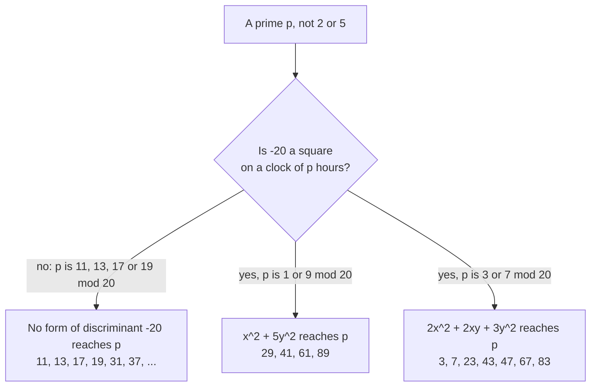

# Binary quadratic forms: which numbers x^2 + 5y^2 and its cousins can reach, read off the discriminant

[Syllabus](../../../SYLLABUS.md) → [Number theory](../README.md) → [Quadratic Forms and Approximation](../README.md#s08) → Binary quadratic forms

---

## General Overview

Feed whole numbers x and y into $`x^2 + 5y^2`$. At x = 3, y = 2 it gives 9 + 20 = 29. Pairs with no common factor give 1, 5, 6, 9, 14, 21, 29. The primes 3 and 7 never appear.

A cousin, $`2x^2 + 2xy + 3y^2`$, reaches them: x = y = 1 gives 7. It also reaches 2, 3 and 23. Both share −20, their **discriminant**: a number from the coefficients that decides what they reach.

No search is needed: a clock test decides. For a prime, only its remainder mod 20 matters.

**A positive whole number n is reached by some form of discriminant D, with x and y sharing no factor, exactly when D is a square on a clock of 4n hours.**

**What kind of fact this is:** a theorem, proved in Why it works. Sorting primes mod 20 also needs quadratic reciprocity, proved elsewhere and checked here below 100.

### The picture: sorting a prime



Primes below 100 on each branch.

---

## The formula

A **binary quadratic form** is $`ax^2 + bxy + cy^2`$ with whole a, b, c: two unknowns, every term of degree two. Write it (a, b, c): $`x^2 + 5y^2`$ is (1, 0, 5). Its discriminant is

```math
D = b^2 - 4ac
```

**Read it aloud:** the middle coefficient squared, less four times the outer two.

With D below zero and a above zero, every value except at (0, 0) is positive: the form is **positive definite**.

A form **properly represents** n when n = f(x, y) with x and y coprime: no common factor but 1 ([Coprime numbers](../02-Greatest%20Common%20Divisor%20and%20Euclid%27s%20Algorithm/05-coprime-numbers.md)). For any positive whole n, the test, with $`\equiv`$ meaning "same remainder" ([Congruence](../03-Clock%20Arithmetic/01-congruence-mod-n.md)):

```math
n \text{ is properly represented by some form of discriminant } D \text{ exactly when } b^2 \equiv D \pmod{4n} \text{ for some whole } b
```

| Symbol | Plain meaning | In our example | Push it up and the answer… |
| --- | --- | --- | --- |
| a, b, c | the form's three whole coefficients | (1, 0, 5), (2, 2, 3) | the values spread out |
| f(x, y) | the form's value at x, y | f(3, 2) = 29 | — |
| x, y (X, Y) | coprime whole inputs; X, Y after renaming | 3, 2 for 29; partner point (1, 1) | the value grows |
| D | the discriminant | −20 | toward 0: fewer forms on the whole (−4 has one) |
| n, 4n | the number to reach; the test's clock | 29; 116 | the clock grows |
| p | a prime being sorted | 3, 7, 23, 29, 41 | only p mod 20 matters |

### When it holds

- **No common factor.** 4 = 2² + 5 × 0² is reached, but −20 is no square mod 16.
- **Some form, not this form.** The test says yes for 23, which $`x^2 + 5y^2`$ never gives.
- **A clock of 4n, not n.** Mod 4, −20 is 0, a square; mod 16 rules 4 out.

---

## Why it works

### Step 0: rename the points

The pairs (x, y) form a grid of whole points. Give them new whole names (X, Y), a **renaming**, so (3, 2), where 29 sits, becomes (1, 0). The form then starts with 29, and its discriminant stays −20.

### Step 1: a partner point

3 and 2 are coprime, so they have a partner point, (1, 1), with **cross number** (first x times second y, less the reverse) 3 × 1 − 2 × 1 = 1 ([Bezout's identity](../02-Greatest%20Common%20Divisor%20and%20Euclid%27s%20Algorithm/04-bezouts-identity.md)). Substitute $`x = 3X + Y`$, $`y = 2X + Y`$. It runs backwards in whole numbers, $`X = x - y`$ and $`Y = 3y - 2x`$, so both namings reach the same numbers.

### Step 2: the new form starts with n

```math
(3X + Y)^2 + 5(2X + Y)^2 = 29X^2 + 26XY + 6Y^2
```

At X = 1, Y = 0 it reads 29, the old value at (3, 2).

### Step 3: the discriminant does not move

26² − 4 × 29 × 6 = −20, as before.

<details>
<summary>Why a renaming keeps the discriminant</summary>

A **shift**, x → x ± y, makes (a, b, c) into (a, b ± 2a, a ± b + c), and (b ± 2a)² − 4a(a ± b + c) = b² − 4ac. A **turn**, x → −y and y → x, makes (c, −b, a): the same D. Every renaming of cross number 1 is a chain of the two, found by running [Euclid's algorithm](../02-Greatest%20Common%20Divisor%20and%20Euclid%27s%20Algorithm/03-euclidean-algorithm.md) on the point renamed (1, 0).

</details>

### Step 4: read the test off

So 26² + 20 = 696 = 6 × 116, and 26² ≡ −20 (mod 116). The same steps work for any n and D.

### Step 5: the converse builds the form

For n ≠ 0, given b² ≡ D (mod 4n), the number c = (b² − D) ÷ 4n is whole. The form (n, b, c) has discriminant D and gives n at (1, 0). For 23, b = 16 gives (23, 16, 3). [Reduced forms](02-reduced-forms-and-class-numbers.md) renames it to (2, 2, 3) and shows −20 has only these two forms.

### Step 6: which form gets which prime

A prime is always reached properly. For any prime other than 2 and 5:

- **$`x^2 + 5y^2`$** is $`x^2`$ mod 5, so 1 or 4; an odd value is 1 mod 4. Together: 1 or 9 mod 20.
- **$`2x^2 + 2xy + 3y^2`$** is $`2(x + 3y)^2`$ mod 5, so 2 or 3; an odd value needs y odd and is then 3 mod 4. Together: 3 or 7 mod 20.

That −20 is a square mod p exactly for these four remainders follows from [Quadratic reciprocity by counting dots](../04-Powers%20on%20the%20Clock/13-quadratic-reciprocity-by-lattice-points.md), whose proof starts from [Gauss's lemma](../04-Powers%20on%20the%20Clock/12-gauss-lemma.md). For odd p, a square root of −20 mod p is enough. If the root is odd, add p to make it even. An even number squared is 0 mod 4, and so is −20, so the root also works mod 4p.

---

## Worked numbers, by hand

| Step | Arithmetic | Value |
| --- | --- | --- |
| discriminants | 0² − 4 × 1 × 5 and 2² − 4 × 2 × 3 | −20, −20 |
| 29 from the first form | 3² + 5 × 2² | 29 |
| partner point | 3 × 1 − 2 × 1 = 1 | (1, 1) |
| new form | x = 3X + Y, y = 2X + Y | (29, 26, 6) |
| its discriminant | 26² − 4 × 29 × 6 | −20 |
| the test | 26² + 20 = 696 = 6 × 116 | **26² ≡ −20 (mod 116)** |
| converse for 23 | b = 16 | (23, 16, 3) |

29 passes with b = 26. For 13 the test fails: no form of discriminant −20 reaches it.

### What breaks if you drop a piece

| Mistake | Comes out at | What went wrong |
| --- | --- | --- |
| Middle coefficient of 2xy read as 1 | −23 | Some books write the middle term 2bxy |
| Testing 4 mod 4, not mod 16 | roots 0 and 2, a false yes | 4 = 2² + 5 × 0² has a shared factor 2 |
| Using x² + 5y² alone | misses 7 primes below 100 | they need the second form |

---

## Code, from first principles, and it actually runs

Two independent roads answer every yes-or-no below 100: searching coprime pairs for each form, and the clock test. The primes also obey Step 6's mod-20 rule.

### Python

```python
# Binary quadratic forms of discriminant -20 -- the check behind the card.  Nothing is imported.
FORMS, D, TOP = [(1, 0, 5), (2, 2, 3)], -20, 100     # (a, b, c) stands for a x^2 + b xy + c y^2
def f(F, x, y): return F[0] * x * x + F[1] * x * y + F[2] * y * y
def disc(F): return F[1] * F[1] - 4 * F[0] * F[2]
def gcd(x, y): return gcd(y, x % y) if y else abs(x)
def reach(F, n):                                     # road 1: search coprime x, y with f(x, y) = n
    return any(f(F, x, y) == n and gcd(x, y) == 1 for x in range(-11, 12) for y in range(-11, 12))
def roots(n): return [b for b in range(2 * n) if (b * b - D) % (4 * n) == 0]   # road 2: D = b^2 mod 4n
print("discriminants:", *[disc(F) for F in FORMS])
for F in FORMS: print(f"{F} reaches, up to 30:", *[n for n in range(1, 31) if reach(F, n)])
p, q = 3, 2                                          # 29 = 3^2 + 5 x 2^2
r, s = next((r, s) for r in range(6) for s in range(6) if p * s - q * r == 1)
A, C = f(FORMS[0], p, q), f(FORMS[0], r, s)
B = f(FORMS[0], p + r, q + s) - A - C                # the new form at X = Y = 1 is A + B + C
print(f"{A} = f({p}, {q}); r, s = {r}, {s}; new form {(A, B, C)}, discriminant {disc((A, B, C))};",
      f"{B}^2 + 20 = {B * B + 20} = {(B * B + 20) // (4 * A)} x {4 * A}")
b = [b for b in roots(23) if b % 2 == 0][0]
print(f"23: b = {b}, form {(23, b, (b * b - D) // 92)}, discriminant {disc((23, b, (b * b - D) // 92))}")
primes = [n for n in range(3, TOP) if n != 5 and all(n % k for k in range(2, n))]
byF = [[n for n in primes if reach(F, n)] for F in FORMS]
none = [n for n in primes if not roots(n)]
for name, L in [("first form", byF[0]), ("second form", byF[1]), ("neither", none)]:
    print(f"primes below {TOP}, {name}:", *L, "| mod 20:", *sorted({n % 20 for n in L}))
print("mistakes: middle read as 1 gives", 1 - 4 * 2 * 3, "| 4 tested mod 4 has roots",
      *[b for b in range(4) if (b * b - D) % 4 == 0], "| x^2 + 5y^2 alone misses", len(byF[1]), "primes")
assert all(any(reach(F, n) for F in FORMS) == bool(roots(n)) for n in range(1, TOP))
assert A == 29 and disc((A, B, C)) == D and (B * B - D) % (4 * A) == 0 and (r, s) == (1, 1)
assert sorted({n % 20 for n in byF[0]}) == [1, 9] and sorted({n % 20 for n in byF[1]}) == [3, 7]
assert sorted(byF[0] + byF[1] + none) == primes and not roots(4) and not any(reach(F, 4) for F in FORMS)
print("ALL CHECKS PASS")
```

**Ran 2026-11-23 on macOS, Python 3.14.10, standard library only. All checks passed. Output, pasted from the run:**

```
discriminants: -20 -20
(1, 0, 5) reaches, up to 30: 1 5 6 9 14 21 29 30
(2, 2, 3) reaches, up to 30: 2 3 7 10 15 18 23 27
29 = f(3, 2); r, s = 1, 1; new form (29, 26, 6), discriminant -20; 26^2 + 20 = 696 = 6 x 116
23: b = 16, form (23, 16, 3), discriminant -20
primes below 100, first form: 29 41 61 89 | mod 20: 1 9
primes below 100, second form: 3 7 23 43 47 67 83 | mod 20: 3 7
primes below 100, neither: 11 13 17 19 31 37 53 59 71 73 79 97 | mod 20: 11 13 17 19
mistakes: middle read as 1 gives -23 | 4 tested mod 4 has roots 0 2 | x^2 + 5y^2 alone misses 7 primes
ALL CHECKS PASS
```

### Rust

```rust
// Binary quadratic forms of discriminant -20 -- the same check as the Python, in Rust.  No crates.
const FORMS: [(i64, i64, i64); 2] = [(1, 0, 5), (2, 2, 3)];   // (a, b, c): a x^2 + b xy + c y^2
const D: i64 = -20; const TOP: i64 = 100;
fn f(g: (i64, i64, i64), x: i64, y: i64) -> i64 { g.0 * x * x + g.1 * x * y + g.2 * y * y }
fn disc(g: (i64, i64, i64)) -> i64 { g.1 * g.1 - 4 * g.0 * g.2 }
fn gcd(x: i64, y: i64) -> i64 { if y == 0 { x.abs() } else { gcd(y, x % y) } }
fn reach(g: (i64, i64, i64), n: i64) -> bool {               // road 1: search coprime x, y
    (-11..12).any(|x| (-11..12).any(|y| f(g, x, y) == n && gcd(x, y) == 1))
}
fn roots(n: i64) -> Vec<i64> { (0..2 * n).filter(|b| (b * b - D) % (4 * n) == 0).collect() } // road 2
fn j(v: &[i64]) -> String { v.iter().map(|n| n.to_string()).collect::<Vec<_>>().join(" ") }
fn m20(v: &[i64]) -> String { let mut m: Vec<i64> = v.iter().map(|n| n % 20).collect(); m.sort(); m.dedup(); j(&m) }
fn main() {
    println!("discriminants: {} {}", disc(FORMS[0]), disc(FORMS[1]));
    for g in FORMS { let v: Vec<i64> = (1..31).filter(|&n| reach(g, n)).collect();
        println!("({}, {}, {}) reaches, up to 30: {}", g.0, g.1, g.2, j(&v)); }
    let (p, q) = (3, 2);                                     // 29 = 3^2 + 5 x 2^2
    let (r, s) = (0..6).flat_map(|r| (0..6).map(move |s| (r, s))).find(|&(r, s)| p * s - q * r == 1).unwrap();
    let (a, c) = (f(FORMS[0], p, q), f(FORMS[0], r, s));
    let b = f(FORMS[0], p + r, q + s) - a - c;               // the new form at X = Y = 1 is a + b + c
    println!("{} = f({}, {}); r, s = {}, {}; new form ({}, {}, {}), discriminant {}; {}^2 + 20 = {} = {} x {}",
             a, p, q, r, s, a, b, c, disc((a, b, c)), b, b * b + 20, (b * b + 20) / (4 * a), 4 * a);
    let b23 = *roots(23).iter().find(|&&b| b % 2 == 0).unwrap();
    let c23 = (b23 * b23 - D) / 92;
    println!("23: b = {}, form (23, {}, {}), discriminant {}", b23, b23, c23, disc((23, b23, c23)));
    let primes: Vec<i64> = (3..TOP).filter(|&n| n != 5 && (2..n).all(|k| n % k != 0)).collect();
    let by: Vec<Vec<i64>> = FORMS.iter().map(|&g| primes.iter().copied().filter(|&n| reach(g, n)).collect()).collect();
    let none: Vec<i64> = primes.iter().copied().filter(|&n| roots(n).is_empty()).collect();
    for (name, l) in [("first form", &by[0]), ("second form", &by[1]), ("neither", &none)] {
        println!("primes below {}, {}: {} | mod 20: {}", TOP, name, j(l), m20(l)); }
    let m4: Vec<i64> = (0..4).filter(|b| (b * b - D) % 4 == 0).collect();
    println!("mistakes: middle read as 1 gives {} | 4 tested mod 4 has roots {} | x^2 + 5y^2 alone misses {} primes",
             1 - 4 * 2 * 3, j(&m4), by[1].len());
    assert!((1..TOP).all(|n| FORMS.iter().any(|&g| reach(g, n)) == !roots(n).is_empty()));
    assert!(a == 29 && disc((a, b, c)) == D && (b * b - D) % (4 * a) == 0 && (r, s) == (1, 1));
    assert!(m20(&by[0]) == "1 9" && m20(&by[1]) == "3 7");
    let mut all: Vec<i64> = [by[0].clone(), by[1].clone(), none.clone()].concat(); all.sort();
    assert!(all == primes && roots(4).is_empty() && !FORMS.iter().any(|&g| reach(g, 4)));
    println!("ALL CHECKS PASS");
}
```

**Ran 2026-11-23 on macOS, rustc 1.98.1, no crates. All checks passed. Output, pasted from the run:**

```
discriminants: -20 -20
(1, 0, 5) reaches, up to 30: 1 5 6 9 14 21 29 30
(2, 2, 3) reaches, up to 30: 2 3 7 10 15 18 23 27
29 = f(3, 2); r, s = 1, 1; new form (29, 26, 6), discriminant -20; 26^2 + 20 = 696 = 6 x 116
23: b = 16, form (23, 16, 3), discriminant -20
primes below 100, first form: 29 41 61 89 | mod 20: 1 9
primes below 100, second form: 3 7 23 43 47 67 83 | mod 20: 3 7
primes below 100, neither: 11 13 17 19 31 37 53 59 71 73 79 97 | mod 20: 11 13 17 19
mistakes: middle read as 1 gives -23 | 4 tested mod 4 has roots 0 2 | x^2 + 5y^2 alone misses 7 primes
ALL CHECKS PASS
```

### Lean

Lean proves the test for every whole n and D, the renaming rule for every form, and the prime sorting for every prime other than 2 and 5.

- Some form of discriminant D properly represents n exactly when D is a square on a clock of 4n hours.
- Suppose a renaming has cross number 1. Then the discriminant stays the same, and the new first coefficient is the old value at the point renamed (1, 0).
- Suppose $`x^2 + 5y^2`$ equals a prime other than 2 and 5. Then that prime is 1 or 9 mod 20.
- Suppose $`2x^2 + 2xy + 3y^2`$ equals a prime other than 2 and 5. Then that prime is 3 or 7 mod 20.
- The worked numbers check out: both discriminants, the new form (29, 26, 6), the form (23, 16, 3), and 13 failing the test.
- The prime lists below 100 sit on the right remainders, and the first two mistakes come out as the table says.

The Python and Rust checks keep the searches below 100, including that every prime at 1, 3, 7 or 9 mod 20 is reached.

```lean
-- Binary quadratic forms: a whole number n is reached with coprime inputs by some form ax² + bxy + cy² of discriminant D exactly when D is a square mod 4n, a renaming of cross number 1 keeps the discriminant, and the two forms of discriminant −20 take primes at 1 or 9 and at 3 or 7 mod 20.
import Mathlib.Algebra.QuadraticDiscriminant
import Mathlib.Data.Int.GCD
import Mathlib.RingTheory.Coprime.Basic
import Mathlib.Data.ZMod.Basic
import Mathlib.Data.Nat.Prime.Basic
import Mathlib.Tactic.NormNum
import Mathlib.Data.Int.ModEq


/-- Residue check mod 20 for `x² + 5y²`. -/
theorem bqf_mod20_form_one : ∀ a b : ZMod 20,
    (a ^ 2 + 5 * b ^ 2).val % 2 = 1 → (a ^ 2 + 5 * b ^ 2).val % 5 ≠ 0 →
      (a ^ 2 + 5 * b ^ 2).val = 1 ∨ (a ^ 2 + 5 * b ^ 2).val = 9 := by
  decide

/-- Residue check mod 20 for `2x² + 2xy + 3y²`. -/
theorem bqf_mod20_form_two : ∀ a b : ZMod 20,
    (2 * a ^ 2 + 2 * a * b + 3 * b ^ 2).val % 2 = 1 →
      (2 * a ^ 2 + 2 * a * b + 3 * b ^ 2).val % 5 ≠ 0 →
      (2 * a ^ 2 + 2 * a * b + 3 * b ^ 2).val = 3 ∨
        (2 * a ^ 2 + 2 * a * b + 3 * b ^ 2).val = 7 := by
  decide

/-- An odd prime other than 5 is odd and prime to 5, read off mod 20. -/
theorem bqf_prime_mod20 (p : ℕ) (hp : p.Prime) (hp2 : p ≠ 2) (hp5 : p ≠ 5) :
    (p : ZMod 20).val % 2 = 1 ∧ (p : ZMod 20).val % 5 ≠ 0 := by
  rw [ZMod.val_natCast, Nat.mod_mod_of_dvd p (by norm_num : 2 ∣ 20),
    Nat.mod_mod_of_dvd p (by norm_num : 5 ∣ 20)]
  refine ⟨?_, ?_⟩
  · rcases Nat.mod_two_eq_zero_or_one p with h | h
    · exfalso
      have h2 : 2 ∣ p := Nat.dvd_of_mod_eq_zero h
      exact hp2 ((Nat.prime_dvd_prime_iff_eq Nat.prime_two hp).mp h2).symm
    · exact h
  · intro h
    have h5 : 5 ∣ p := Nat.dvd_of_mod_eq_zero h
    exact hp5 ((Nat.prime_dvd_prime_iff_eq Nat.prime_five hp).mp h5).symm

#print axioms bqf_mod20_form_one
#print axioms bqf_mod20_form_two
#print axioms bqf_prime_mod20

/-! A form `(a, b, c)` stands for `a x² + b x y + c y²` with whole `a, b, c`. Its discriminant
is Mathlib's `discrim a b c = b² − 4ac`. The form properly represents `n` when
`n = a x² + b x y + c y²` for some whole `x, y` with no common factor but 1 (`IsCoprime x y`). -/

/-- **The test.** A whole number `n` is properly represented by some form of discriminant `D`
(some whole `a, b, c` with `b² − 4ac = D`, and coprime whole `x, y` with
`a x² + b x y + c y² = n`) exactly when `D` is a square on a clock of `4n` hours:
`b² ≡ D (mod 4n)` for some whole `b`. -/
theorem properly_represented_iff_discrim_square_mod_four_n (n D : ℤ) :
    (∃ a b c : ℤ, discrim a b c = D ∧
        ∃ x y : ℤ, IsCoprime x y ∧ a * x ^ 2 + b * x * y + c * y ^ 2 = n) ↔
      ∃ b : ℤ, b ^ 2 ≡ D [ZMOD 4 * n] := by
  constructor
  · rintro ⟨a, b, c, hD, x, y, ⟨u, v, huv⟩, hn⟩
    refine ⟨2 * a * x * (-v) + b * (x * u + y * (-v)) + 2 * c * y * u, ?_⟩
    have hcross : x * u - y * (-v) = 1 := by linarith
    have key : (2 * a * x * (-v) + b * (x * u + y * (-v)) + 2 * c * y * u) ^ 2
        - 4 * (a * x ^ 2 + b * x * y + c * y ^ 2) * (a * (-v) ^ 2 + b * (-v) * u + c * u ^ 2)
        = (x * u - y * (-v)) ^ 2 * (b ^ 2 - 4 * a * c) := by ring
    rw [hcross, hn] at key
    rw [Int.modEq_iff_dvd]
    refine ⟨-(a * (-v) ^ 2 + b * (-v) * u + c * u ^ 2), ?_⟩
    rw [← hD]
    unfold discrim
    linarith
  · rintro ⟨b, hb⟩
    obtain ⟨k, hk⟩ := (Int.modEq_iff_dvd).mp hb
    refine ⟨n, b, -k, ?_, 1, 0, isCoprime_one_left, by ring⟩
    unfold discrim
    linarith

/-- **A renaming keeps the discriminant.** Substitute `x = pX + rY`, `y = qX + sY` with cross
number `ps − qr = 1`. The form `(a, b, c)` becomes the form
`(f(p, q), 2apr + b(ps + qr) + 2cqs, f(r, s))`, which gives the same value at `(X, Y)` as the old
form at `(x, y)` and has the same discriminant. -/
theorem renaming_keeps_discriminant (a b c p q r s : ℤ) (hcross : p * s - q * r = 1) :
    (∀ X Y : ℤ,
        (a * p ^ 2 + b * p * q + c * q ^ 2) * X ^ 2
            + (2 * a * p * r + b * (p * s + q * r) + 2 * c * q * s) * X * Y
            + (a * r ^ 2 + b * r * s + c * s ^ 2) * Y ^ 2 =
          a * (p * X + r * Y) ^ 2 + b * (p * X + r * Y) * (q * X + s * Y)
            + c * (q * X + s * Y) ^ 2) ∧
      discrim (a * p ^ 2 + b * p * q + c * q ^ 2)
          (2 * a * p * r + b * (p * s + q * r) + 2 * c * q * s)
          (a * r ^ 2 + b * r * s + c * s ^ 2) = discrim a b c := by
  refine ⟨fun X Y => by ring, ?_⟩
  have h : discrim (a * p ^ 2 + b * p * q + c * q ^ 2)
      (2 * a * p * r + b * (p * s + q * r) + 2 * c * q * s)
      (a * r ^ 2 + b * r * s + c * s ^ 2) = (p * s - q * r) ^ 2 * discrim a b c := by
    unfold discrim
    ring
  rw [h, hcross]
  ring

/-- **Which form gets which prime.** For a prime `p` other than 2 and 5: if `x² + 5y² = p` then
`p` is 1 or 9 mod 20, and if `2x² + 2xy + 3y² = p` then `p` is 3 or 7 mod 20. -/
theorem discrim_neg_twenty_forms_sort_primes_mod_twenty (p : ℕ) (hp : p.Prime)
    (hp2 : p ≠ 2) (hp5 : p ≠ 5) :
    (∀ x y : ℤ, x ^ 2 + 5 * y ^ 2 = (p : ℤ) → p % 20 = 1 ∨ p % 20 = 9) ∧
      (∀ x y : ℤ, 2 * x ^ 2 + 2 * x * y + 3 * y ^ 2 = (p : ℤ) → p % 20 = 3 ∨ p % 20 = 7) := by
  obtain ⟨hodd, h5⟩ := bqf_prime_mod20 p hp hp2 hp5
  have hv : (p : ZMod 20).val = p % 20 := ZMod.val_natCast 20 p
  refine ⟨fun x y h => ?_, fun x y h => ?_⟩
  · have hz := congrArg (fun t : ℤ => (t : ZMod 20)) h
    simp only [Int.cast_add, Int.cast_mul, Int.cast_pow, Int.cast_ofNat,
      Int.cast_natCast] at hz
    have := bqf_mod20_form_one (x : ZMod 20) (y : ZMod 20)
    rw [hz] at this
    rw [← hv]
    exact this hodd h5
  · have hz := congrArg (fun t : ℤ => (t : ZMod 20)) h
    simp only [Int.cast_add, Int.cast_mul, Int.cast_pow, Int.cast_ofNat,
      Int.cast_natCast] at hz
    have := bqf_mod20_form_two (x : ZMod 20) (y : ZMod 20)
    rw [hz] at this
    rw [← hv]
    exact this hodd h5

/-! The card's worked numbers. -/

-- Both forms have discriminant −20: 0² − 4 × 1 × 5 and 2² − 4 × 2 × 3.
example : discrim (1 : ℤ) 0 5 = -20 ∧ discrim (2 : ℤ) 2 3 = -20 := by norm_num [discrim]
-- 29 = 3² + 5 × 2², with 3 and 2 coprime; 7 = 2 + 2 + 3 at x = y = 1.
example : (3 : ℤ) ^ 2 + 5 * 2 ^ 2 = 29 ∧ Int.gcd 3 2 = 1 := by decide
example : 2 * (1 : ℤ) ^ 2 + 2 * 1 * 1 + 3 * 1 ^ 2 = 7 := by decide
-- Partner point (1, 1): cross number 3 × 1 − 2 × 1 = 1; the new form is (29, 26, 6).
example : (3 : ℤ) * 1 - 2 * 1 = 1 := by decide
example : (1 : ℤ) * 3 ^ 2 + 0 * 3 * 2 + 5 * 2 ^ 2 = 29 ∧
    2 * 1 * 3 * 1 + 0 * (3 * 1 + 2 * 1) + 2 * 5 * 2 * 1 = (26 : ℤ) ∧
    (1 : ℤ) * 1 ^ 2 + 0 * 1 * 1 + 5 * 1 ^ 2 = 6 := by decide
-- Its discriminant: 26² − 4 × 29 × 6 = −20. The test: 26² + 20 = 696 = 6 × 116, so 26² ≡ −20 (mod 116).
example : discrim (29 : ℤ) 26 6 = -20 := by norm_num [discrim]
example : (26 : ℤ) ^ 2 + 20 = 696 ∧ (696 : ℤ) = 6 * 116 := by decide
example : (26 : ℤ) ^ 2 ≡ -20 [ZMOD 4 * 29] := by decide
-- The converse for 23: b = 16, c = (16² + 20) ÷ 92 = 3, the form (23, 16, 3) of discriminant −20.
example : (16 : ℤ) ^ 2 ≡ -20 [ZMOD 4 * 23] ∧ ((16 : ℤ) ^ 2 + 20) / 92 = 3 := by decide
example : discrim (23 : ℤ) 16 3 = -20 := by norm_num [discrim]
-- 4 = 2² + 5 × 0² is not proper: −20 is no square mod 16, though mod 4 it has roots 0 and 2.
example : ∀ b : ZMod 16, b ^ 2 ≠ -20 := by decide
example : (0 : ℤ) ^ 2 ≡ -20 [ZMOD 4] ∧ (2 : ℤ) ^ 2 ≡ -20 [ZMOD 4] := by decide
-- 13 fails the test: −20 is no square mod 52.
example : ∀ b : ZMod (4 * 13), b ^ 2 ≠ -20 := by decide
-- Misreading the middle coefficient of 2xy as 1 gives 1 − 4 × 2 × 3 = −23.
example : discrim (2 : ℤ) 1 3 = -23 := by norm_num [discrim]
-- Primes below 100 reached by x² + 5y²: 29, 41, 61, 89, all 1 or 9 mod 20.
example : (3 : ℤ) ^ 2 + 5 * 2 ^ 2 = 29 ∧ (6 : ℤ) ^ 2 + 5 * 1 ^ 2 = 41 ∧
    (4 : ℤ) ^ 2 + 5 * 3 ^ 2 = 61 ∧ (3 : ℤ) ^ 2 + 5 * 4 ^ 2 = 89 := by decide
example : 29 % 20 = 9 ∧ 41 % 20 = 1 ∧ 61 % 20 = 1 ∧ 89 % 20 = 9 := by decide
-- Primes below 100 reached by 2x² + 2xy + 3y²: 3, 7, 23, 43, 47, 67, 83, all 3 or 7 mod 20.
example : 2 * (0 : ℤ) ^ 2 + 2 * 0 * 1 + 3 * 1 ^ 2 = 3 ∧
    2 * (1 : ℤ) ^ 2 + 2 * 1 * 1 + 3 * 1 ^ 2 = 7 ∧
    2 * (-1 : ℤ) ^ 2 + 2 * (-1) * 3 + 3 * 3 ^ 2 = 23 ∧
    2 * (4 : ℤ) ^ 2 + 2 * 4 * 1 + 3 * 1 ^ 2 = 43 ∧
    2 * (2 : ℤ) ^ 2 + 2 * 2 * 3 + 3 * 3 ^ 2 = 47 ∧
    2 * (-1 : ℤ) ^ 2 + 2 * (-1) * 5 + 3 * 5 ^ 2 = 67 ∧
    2 * (4 : ℤ) ^ 2 + 2 * 4 * 3 + 3 * 3 ^ 2 = 83 := by decide
example : 3 % 20 = 3 ∧ 7 % 20 = 7 ∧ 23 % 20 = 3 ∧ 43 % 20 = 3 ∧ 47 % 20 = 7 ∧
    67 % 20 = 7 ∧ 83 % 20 = 3 := by decide
-- 21 = 4² + 5 × 1² lands on the first form.
example : (4 : ℤ) ^ 2 + 5 * 1 ^ 2 = 21 := by decide

#print axioms properly_represented_iff_discrim_square_mod_four_n
#print axioms renaming_keeps_discriminant
#print axioms discrim_neg_twenty_forms_sort_primes_mod_twenty
```

**Checked 2026-11-23 on macOS, Lean 4.36.0-rc2, Mathlib v4.36.0-rc2. Every proof is complete and uses only Lean's standard axioms. Output, pasted from the run:**

```
'bqf_mod20_form_one' depends on axioms: [propext, Classical.choice, Quot.sound]
'bqf_mod20_form_two' depends on axioms: [propext, Classical.choice, Quot.sound]
'bqf_prime_mod20' depends on axioms: [propext, Classical.choice, Quot.sound]
'properly_represented_iff_discrim_square_mod_four_n' depends on axioms: [propext, Classical.choice, Quot.sound]
'renaming_keeps_discriminant' depends on axioms: [propext, Quot.sound]
'discrim_neg_twenty_forms_sort_primes_mod_twenty' depends on axioms: [propext, Classical.choice, Quot.sound]
```

> [!TIP]
> **Try changing**
> Guess first, then run.
> - **Start from 21.** Set `p, q = 4, 1`. Partner (3, 1), new form (21, 34, 14), 34² + 20 = 1176 = 14 × 84. An assert pinned to 29 stops it.
> - **Go to 200.** Set `TOP` to 200, both ranges to `range(-16, 17)`. 101, 109, 149, 181 join the first form; 103, 107, 127, 163, 167 the second.

---

## The usual mistake

> [!warning]
> **Asking whether one form reaches n.** The test speaks of all forms of that discriminant. It says yes for 23, but $`x^2 + 5y^2`$ never gives 23; $`2x^2 + 2xy + 3y^2`$ does.
>
> - Middle coefficient read as 1: −23, another family.
> - A clock of n, not 4n: a false yes for 4.
> - 9 = 3² + 5 × 0² is not proper; 9 = 2² + 5 × 1² is.

---

## Where you meet it in real life

- **Cryptography.** Some delay functions repeatedly square a form whose discriminant has hundreds of digits. Its number of forms is unknown, so nobody has a shortcut.
- **Crystal lattices.** A positive definite form is squared distance on a flat grid. $`x^2 + xy + y^2`$ is the triangular grid under a graphene sheet.

> **Say it back**
> A form $`ax^2 + bxy + cy^2`$ has discriminant $`b^2 - 4ac`$. Some form of discriminant D reaches n with coprime inputs exactly when D is a square mod 4n. A renaming makes n the first coefficient, keeping D. For −20, $`x^2 + 5y^2`$ takes primes at 1 or 9 mod 20 and $`2x^2 + 2xy + 3y^2`$ those at 3 or 7.

---

## What this builds on

- [Solving a x ≡ b (mod n)](../03-Clock%20Arithmetic/05-linear-congruences.md): asking when a clock equation has answers.
- [Coprime numbers](../02-Greatest%20Common%20Divisor%20and%20Euclid%27s%20Algorithm/05-coprime-numbers.md): a coprime pair mixes to 1, giving the partner point.
- [Gauss's lemma](../04-Powers%20on%20the%20Clock/12-gauss-lemma.md): deciding whether a number is a square on a prime clock.
- [Quadratic reciprocity by counting dots](../04-Powers%20on%20the%20Clock/13-quadratic-reciprocity-by-lattice-points.md): sorts the primes where −20 is a square, used in Step 6.

## Where this goes next

- [Reduced forms](02-reduced-forms-and-class-numbers.md): rename any positive definite form into a unique standard one and count primitive ones per discriminant.
- [Periodic continued fractions](03-periodic-continued-fractions.md), [Farey fractions and Ford circles](04-farey-sequences-and-ford-circles.md), [Hurwitz's theorem](05-hurwitz-approximation-theorem.md): the shelf's turn to approximating real numbers with fractions.
- [Two squares](../../21-Algebraic%20and%20analytic%20number%20theory/07-Diophantine%20and%20Modular/02-sums-of-squares-and-gaussian-integers.md) and [Gaussian integers](../../03-Algebra/10-For%20the%20Curious/03-gaussian-integers-and-sums-of-two-squares.md): the case D = −4, with one form, $`x^2 + y^2`$.
- [Composition and genus](../../21-Algebraic%20and%20analytic%20number%20theory/06-Algebraic%20Numbers/11-gauss-composition-and-genus-theory.md): how forms of one discriminant multiply together, matching ideal classes in algebraic number theory.

Left open: how do you tell when two forms are renamings of each other? The next card, [Reduced forms](02-reduced-forms-and-class-numbers.md), answers that. A second puzzle waits for [Composition and genus](../../21-Algebraic%20and%20analytic%20number%20theory/06-Algebraic%20Numbers/11-gauss-composition-and-genus-theory.md): 3 and 7 need the second form, so why does their product 21 = 4² + 5 × 1² land on the first?

---

## Sources

Verified 2026-11-23: every link below resolves to the publisher's page.

- Cox, David A. *Primes of the Form x² + ny²*, 2nd ed. Wiley, 2013. [doi:10.1002/9781118400722](https://doi.org/10.1002/9781118400722). Chapter 1: the test and discriminant −20.
- Buell, Duncan A. *Binary Quadratic Forms*. Springer, 1989. [doi:10.1007/978-1-4612-4542-1](https://doi.org/10.1007/978-1-4612-4542-1). Forms, discriminants and reduction.
- Wesolowski, Benjamin. "Efficient Verifiable Delay Functions." *EUROCRYPT 2019*, Springer. [doi:10.1007/978-3-030-17659-4_13](https://doi.org/10.1007/978-3-030-17659-4_13). Delay functions on groups of forms.
