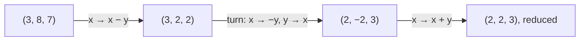

# Reduced forms: every form slides to one tidy representative, and counting them gives the class number

[Syllabus](../../../SYLLABUS.md) → [Number theory](../README.md) → [Quadratic Forms and Approximation](../README.md#s08) → Reduced forms

---

## General Overview

$`3x^2 + 8xy + 7y^2`$ is a **binary quadratic form** ([Binary quadratic forms](01-binary-quadratic-forms.md)), written $`(3, 8, 7)`$. Put $`x - y`$ for $`x`$ and it becomes $`(3, 2, 2)`$: same values, since the renaming can be undone. Two more renamings reach $`(2, 2, 3)`$, the smallest.

That end point is the **reduced form** of its family. Two forms share a family exactly when they reduce to the same triple. The number of families is the **class number**, $`h(D)`$.

**Every positive form slides, by two kinds of renaming, to exactly one reduced form, so equivalence is decided by reducing both sides, and the class number is the length of a short, finite list.**

**What kind of fact this is:** a theorem. Why it works proves it and sketches uniqueness (full proof: Buell, Chapter 2).



Each arrow is one renaming: shrink the middle, swap the ends, fix the sign.

---

## The formula

A form $`(a, b, c)`$ with discriminant $`D = b^2 - 4ac < 0`$ and $`a > 0`$ is **reduced** when

```math
-a < b \le a \le c, \quad \text{and } b \ge 0 \text{ when } a = c
```

The class number counts reduced forms of discriminant $`D`$ with no common factor ($`\#`$ means "how many"):

```math
h(D) = \#\{(a, b, c) \text{ reduced} : b^2 - 4ac = D\}
```

**Read it aloud:** $`b`$ is above minus $`a`$ and at most $`a`$, $`a`$ is at most $`c`$, and on a tie $`b`$ is not negative.

| Symbol | Plain meaning | In our example | Push it up and the answer… |
| --- | --- | --- | --- |
| $`a, c`$ | outer numbers | 3 and 7, ending at 2 and 3 | needs larger $`c`$ |
| $`b`$ | middle number | 8, ending at 2 | above $`a`$: not reduced |
| $`D`$ | discriminant, $`b^2 - 4ac`$ | $`-20`$ throughout | more reduced forms |
| $`k`$ | shift size | $`k = -1`$, then $`k = 1`$ | each step moves $`b`$ by $`2a`$ |
| $`h(D)`$ | number of families | 2 | — |

### When it holds

- **Determinant 1.** A plain swap $`x \leftrightarrow y`$, determinant $`-1`$, merges families.
- **Positive forms.** For $`D > 0`$ reduction loops: see [Periodic continued fractions](03-periodic-continued-fractions.md).
- **One sign at each edge.** $`b = -a`$ is one shift from $`b = a`$, and on a tie a turn flips $`b`$. Without both rules, $`(2, -2, 3)`$ and $`(3, -2, 3)`$ count twice.
- **Primitive only.** $`(2, 0, 4)`$, twice $`(1, 0, 2)`$, is not counted: $`h(-32) = 2`$.

---

## Why it works

### Step 0: renaming the letters keeps everything that matters

Replace $`x, y`$ by $`px + qy, rx + sy`$, with whole numbers and $`ps - qr = 1`$. Values and discriminant stay the same ([Binary quadratic forms](01-binary-quadratic-forms.md) proves both). Such forms are **equivalent**.

### Step 1: two moves are enough

- **Shift**, $`x \to x + ky`$: $`(a, b, c)`$ becomes $`(a,\ b + 2ak,\ ak^2 + bk + c)`$. It moves $`b`$ in steps of $`2a`$, into the window $`-a < b \le a`$.
- **Turn**, $`x \to -y,\ y \to x`$: $`(a, b, c)`$ becomes $`(c, -b, a)`$, swapping the outer numbers.

The recipe: shift $`b`$ into the window; if $`a > c`$, turn and repeat. On a tie with $`b < 0`$, one last turn.

### Step 2: the recipe always stops

A shift never changes $`a`$. Apart from a final tie turn, turns happen only when $`c < a`$, making $`c`$ the new $`a`$. A positive whole number cannot shrink forever.

### Step 3: the reduced form is the only one

In a reduced form, $`a`$ is the smallest nonzero value, and $`c`$ the next, at an input not a multiple of the first. Equivalent forms share values, so they share $`a`$ and $`c`$, and $`b^2 = D + 4ac`$ fixes $`b`$ up to sign.

For the sign: when $`|b| < a < c`$, a renaming between reduced forms can only send $`(1, 0)`$ and $`(0, 1)`$ to themselves up to sign. Determinant 1 forbids one sign flip, and two change nothing, so $`(2, 1, 3)`$ and $`(2, -1, 3)`$ stay apart. At an edge, $`|b| = a`$ or $`a = c`$, a move can flip $`b`$; the window and tie rule pick one sign.

### Step 4: the list is finite

Reduced means $`b^2 \le a^2`$ and $`a \le c`$, so $`4a^2 \le 4ac = b^2 - D \le a^2 - D`$, giving $`3a^2 \le |D|`$. For $`D = -23`$, $`a`$ is 1 or 2 and $`b`$ is odd, leaving $`(1, 1, 6)`$, $`(2, -1, 3)`$ and $`(2, 1, 3)`$: three families.

---

## Worked numbers, by hand

| Step | Arithmetic | Value |
| --- | --- | --- |
| Discriminant of $`(3, 8, 7)`$ | $`8^2 - 4 \cdot 3 \cdot 7 = 64 - 84`$ | $`-20`$ |
| Shift, $`k = -1`$ | $`b = 8 - 6 = 2`$, $`c = 3 - 8 + 7 = 2`$ | $`(3, 2, 2)`$ |
| $`a = 3 > c = 2`$, so turn | swap the outer numbers, flip $`b`$ | $`(2, -2, 3)`$ |
| $`b = -a`$ is outside the window; shift, $`k = 1`$ | $`b = -2 + 4 = 2`$, $`c = 2 - 2 + 3 = 3`$ | $`(2, 2, 3)`$ |
| Test | $`-2 < 2 \le 2 \le 3`$ | reduced |
| Compare with $`x^2 + 5y^2`$ | $`(1, 0, 5)`$ is a different reduced form | **not equivalent** |

So $`(3, 8, 7)`$ and $`(2, 2, 3)`$ are one family and $`(1, 0, 5)`$ the other: $`h(-20) = 2`$. Up to 15, $`(1, 0, 5)`$ takes 1, 4, 5, 6, 9, 14, and $`(2, 2, 3)`$ takes 2, 3, 7, 8, 10, 12, 15.

### What breaks if you drop a piece

| Mistake | Comes out at | What went wrong |
| --- | --- | --- |
| Allow the plain swap $`x \leftrightarrow y`$ | $`h(-23) = 2`$ | two families merge |
| Let $`b = -a`$ in | $`h(-20) = 3`$ | $`(2, -2, 3)`$ counts twice |
| Shift $`b`$ but leave $`c = 7`$ | $`D = -80`$ | not a renaming |

---

## Code, from first principles, and it actually runs

The code reduces $`(3, 8, 7)`$ and lists reduced forms for five discriminants. Checks:

1. Searching renamings with entries $`-2`$ to $`2`$ finds those taking $`(3, 8, 7)`$ to $`(2, 2, 3)`$.
2. Reducing every primitive form in a box gives the same list.
3. Values separate the two families of $`-20`$.
4. Dirichlet's sum gives $`h(-23)`$ and $`h(-163)`$.

Dirichlet's sum, for a prime like 23 that leaves 3 on division by 4: from 1 to half the prime, count squares on that prime's clock minus non-squares. Divide by 1 if the prime leaves 7 on division by 8, else by 3.

### Python

```python
# Reduced forms and class numbers.  Nothing is imported.  A form (a, b, c) is ax^2 + bxy + cy^2, D = b^2 - 4ac < 0.
def shift(f, k): a, b, c = f; return (a, b + 2 * a * k, a * k * k + b * k + c)      # x -> x + ky
def turn(f): a, b, c = f; return (c, -b, a)                                           # x -> -y, y -> x
def reduce(f):                                    # apply the two moves until -a < b <= a <= c
    a, b, c = f
    if not -a < b <= a: return [f] + reduce(shift(f, (a - b) // (2 * a)))
    if a > c or (a == c and b < 0): return [f] + reduce(turn(f))
    return [f]
def gcd(x, y): return gcd(y, x % y) if y else abs(x)
def classes(D, lo=1):                             # list the primitive reduced forms directly; 3a^2 <= -D
    out = [(a, b, (b * b - D) // (4 * a)) for a in range(1, int((-D / 3) ** 0.5) + 1) for b in range(lo - a, a + 1) if (b * b - D) % (4 * a) == 0]
    return [(a, b, c) for a, b, c in out if c >= a and (b >= 0 or a < c) and gcd(gcd(a, b), c) == 1]
def ends(D): return {reduce((a, b, (b * b - D) // (4 * a)))[-1] for a in range(1, 40) for b in range(-40, 41) if (b * b - D) % (4 * a) == 0 and gcd(gcd(a, b), (b * b - D) // (4 * a)) == 1}
def values(f, top): return sorted({f[0] * x * x + f[1] * x * y + f[2] * y * y for x in range(-9, 10) for y in range(-9, 10)} & set(range(1, top + 1)))
def sub(f, p, q, r, s): a, b, c = f; return (a*p*p + b*p*r + c*r*r, 2*a*p*q + b*(p*s + q*r) + 2*c*r*s, a*q*q + b*q*s + c*s*s)
def dirichlet(p): return sum(1 if pow(k, (p - 1) // 2, p) == 1 else -1 for k in range(1, (p + 1) // 2)) // (1 if p % 8 == 7 else 3)
path, R, run = reduce((3, 8, 7)), range(-2, 3), [n for n in range(41) if all((n * n + n + 41) % d for d in range(2, n * n + n + 41))]
hits = [(p, q, r, s) for p in R for q in R for r in R for s in R if p * s - q * r == 1 and sub((3, 8, 7), p, q, r, s) == (2, 2, 3)]
print(f"(3, 8, 7), D = {8 * 8} - {4 * 3 * 7} = {8 * 8 - 4 * 3 * 7}: " + " -> ".join(map(str, path)))
print("search, entries -2 to 2, determinant 1: {} substitutions, e.g. x -> ({})x + ({})y, y -> ({})x + ({})y".format(len(hits), *hits[0]))
for D in (-4, -20, -23, -32, -163): print(f"h({D}) = {len(classes(D))}: " + ", ".join(map(str, classes(D))) + f"   reducing every primitive form in a box lands on {len(ends(D))}")
print(f"values up to 15: (1, 0, 5) {values((1, 0, 5), 15)}, (2, 2, 3) {values((2, 2, 3), 15)}")
print(f"Dirichlet's sum, a second road: h(-23) = {dirichlet(23)}, h(-163) = {dirichlet(163)}")
print(f"n^2 + n + 41 is prime for n = 0 to {len(run) - 1}; n = 40 gives {40 * 40 + 40 + 41} = 41 x 41")
print(f"mistakes: plain swap h(-23) = {len({(a, abs(b), c) for a, b, c in classes(-23)})}; b = -a let in h(-20) = {len(classes(-20, 0))}; c left alone D = {2 * 2 - 4 * 3 * 7}")
assert path == [(3, 8, 7), (3, 2, 2), (2, -2, 3), (2, 2, 3)] and (-1, -2, 1, 1) in hits
assert all(set(classes(D)) == ends(D) for D in (-4, -20, -23, -32, -163)) and [dirichlet(p) for p in (23, 163)] == [3, 1] and len(classes(-32)) == 2
assert values((3, 8, 7), 60) == values((2, 2, 3), 60) != values((1, 0, 5), 60) and run == list(range(40))
print("ALL CHECKS PASS")
```

**Ran 2026-11-23 on macOS, Python 3.14.10, standard library only. All checks passed. Output, pasted from the run:**

```
(3, 8, 7), D = 64 - 84 = -20: (3, 8, 7) -> (3, 2, 2) -> (2, -2, 3) -> (2, 2, 3)
search, entries -2 to 2, determinant 1: 2 substitutions, e.g. x -> (-1)x + (-2)y, y -> (1)x + (1)y
h(-4) = 1: (1, 0, 1)   reducing every primitive form in a box lands on 1
h(-20) = 2: (1, 0, 5), (2, 2, 3)   reducing every primitive form in a box lands on 2
h(-23) = 3: (1, 1, 6), (2, -1, 3), (2, 1, 3)   reducing every primitive form in a box lands on 3
h(-32) = 2: (1, 0, 8), (3, 2, 3)   reducing every primitive form in a box lands on 2
h(-163) = 1: (1, 1, 41)   reducing every primitive form in a box lands on 1
values up to 15: (1, 0, 5) [1, 4, 5, 6, 9, 14], (2, 2, 3) [2, 3, 7, 8, 10, 12, 15]
Dirichlet's sum, a second road: h(-23) = 3, h(-163) = 1
n^2 + n + 41 is prime for n = 0 to 39; n = 40 gives 1681 = 41 x 41
mistakes: plain swap h(-23) = 2; b = -a let in h(-20) = 3; c left alone D = -80
ALL CHECKS PASS
```

### Rust

```rust
// Reduced forms and class numbers, no crates.  A form (a, b, c) is ax^2 + bxy + cy^2, D = b^2 - 4ac < 0.
type F = (i64, i64, i64);
fn shift(f: F, k: i64) -> F { (f.0, f.1 + 2 * f.0 * k, f.0 * k * k + f.1 * k + f.2) }   // x -> x + ky
fn turn(f: F) -> F { (f.2, -f.1, f.0) }                                                   // x -> -y, y -> x
fn reduce(f: F) -> Vec<F> {                       // apply the two moves until -a < b <= a <= c
    let (a, b, c) = f;
    let next = if !(-a < b && b <= a) { shift(f, (a - b).div_euclid(2 * a)) } else if a > c || (a == c && b < 0) { turn(f) } else { return vec![f] };
    let mut out = vec![f]; out.extend(reduce(next)); out
}
fn gcd(x: i64, y: i64) -> i64 { if y == 0 { x.abs() } else { gcd(y, x % y) } }
fn classes(d: i64, lo: i64) -> Vec<F> {           // list the primitive reduced forms directly; 3a^2 <= -D
    let mut out = vec![];
    for a in 1..=((-d as f64 / 3.0).sqrt() as i64) { for b in (lo - a)..=a {
        if (b * b - d) % (4 * a) == 0 { let c = (b * b - d) / (4 * a); if c >= a && (b >= 0 || a < c) && gcd(gcd(a, b), c) == 1 { out.push((a, b, c)); } }
    } }
    out
}
fn ends(d: i64) -> std::collections::BTreeSet<F> { (1..40).flat_map(|a| (-40..41).map(move |b| (a, b))).filter(|&(a, b)| (b * b - d) % (4 * a) == 0 && gcd(gcd(a, b), (b * b - d) / (4 * a)) == 1).map(|(a, b)| *reduce((a, b, (b * b - d) / (4 * a))).last().unwrap()).collect() }
fn values(f: F, top: i64) -> Vec<i64> { let mut v: Vec<i64> = (-9..10).flat_map(|x| (-9..10).map(move |y| f.0 * x * x + f.1 * x * y + f.2 * y * y)).filter(|&n| n >= 1 && n <= top).collect(); v.sort(); v.dedup(); v }
fn sub(f: F, p: i64, q: i64, r: i64, s: i64) -> F { let (a, b, c) = f; (a*p*p + b*p*r + c*r*r, 2*a*p*q + b*(p*s + q*r) + 2*c*r*s, a*q*q + b*q*s + c*s*s) }
fn powmod(k: i64, e: i64, p: i64) -> i64 { (0..e).fold(1, |acc, _| acc * k % p) }
fn dirichlet(p: i64) -> i64 { (1..(p + 1) / 2).map(|k| if powmod(k, (p - 1) / 2, p) == 1 { 1 } else { -1 }).sum::<i64>() / (if p % 8 == 7 { 1 } else { 3 }) }
fn show(v: &[F]) -> String { v.iter().map(|f| format!("{:?}", f)).collect::<Vec<_>>().join(", ") }
fn main() {
    let path = reduce((3, 8, 7));
    let run: Vec<i64> = (0..41).filter(|&n| { let m = n * n + n + 41; (2..m).all(|d| m % d != 0) }).collect();
    let hits: Vec<(i64, i64, i64, i64)> = (-2..3).flat_map(|p| (-2..3).flat_map(move |q| (-2..3).flat_map(move |r| (-2..3).map(move |s| (p, q, r, s))))).filter(|&(p, q, r, s)| p * s - q * r == 1 && sub((3, 8, 7), p, q, r, s) == (2, 2, 3)).collect();
    println!("(3, 8, 7), D = {} - {} = {}: {}", 8 * 8, 4 * 3 * 7, 8 * 8 - 4 * 3 * 7, path.iter().map(|f| format!("{:?}", f)).collect::<Vec<_>>().join(" -> "));
    let h = hits[0]; println!("search, entries -2 to 2, determinant 1: {} substitutions, e.g. x -> ({})x + ({})y, y -> ({})x + ({})y", hits.len(), h.0, h.1, h.2, h.3);
    for d in [-4, -20, -23, -32, -163] { println!("h({}) = {}: {}   reducing every primitive form in a box lands on {}", d, classes(d, 1).len(), show(&classes(d, 1)), ends(d).len()); }
    println!("values up to 15: (1, 0, 5) {:?}, (2, 2, 3) {:?}", values((1, 0, 5), 15), values((2, 2, 3), 15));
    println!("Dirichlet's sum, a second road: h(-23) = {}, h(-163) = {}", dirichlet(23), dirichlet(163));
    println!("n^2 + n + 41 is prime for n = 0 to {}; n = 40 gives {} = 41 x 41", run.len() - 1, 40 * 40 + 40 + 41);
    let plain: std::collections::BTreeSet<F> = classes(-23, 1).iter().map(|&(a, b, c)| (a, b.abs(), c)).collect();
    println!("mistakes: plain swap h(-23) = {}; b = -a let in h(-20) = {}; c left alone D = {}", plain.len(), classes(-20, 0).len(), 2 * 2 - 4 * 3 * 7);
    assert!(path == vec![(3, 8, 7), (3, 2, 2), (2, -2, 3), (2, 2, 3)] && hits.contains(&(-1, -2, 1, 1)));
    assert!([-4, -20, -23, -32, -163].iter().all(|&d| classes(d, 1).into_iter().collect::<std::collections::BTreeSet<F>>() == ends(d)) && [dirichlet(23), dirichlet(163)] == [3, 1] && classes(-32, 1).len() == 2);
    assert!(values((3, 8, 7), 60) == values((2, 2, 3), 60) && values((2, 2, 3), 60) != values((1, 0, 5), 60) && run == (0..40).collect::<Vec<i64>>());
    println!("ALL CHECKS PASS");
}
```

**Ran 2026-11-23 on macOS, rustc 1.98.1, no crates. All checks passed. Output, pasted from the run:**

```
(3, 8, 7), D = 64 - 84 = -20: (3, 8, 7) -> (3, 2, 2) -> (2, -2, 3) -> (2, 2, 3)
search, entries -2 to 2, determinant 1: 2 substitutions, e.g. x -> (-1)x + (-2)y, y -> (1)x + (1)y
h(-4) = 1: (1, 0, 1)   reducing every primitive form in a box lands on 1
h(-20) = 2: (1, 0, 5), (2, 2, 3)   reducing every primitive form in a box lands on 2
h(-23) = 3: (1, 1, 6), (2, -1, 3), (2, 1, 3)   reducing every primitive form in a box lands on 3
h(-32) = 2: (1, 0, 8), (3, 2, 3)   reducing every primitive form in a box lands on 2
h(-163) = 1: (1, 1, 41)   reducing every primitive form in a box lands on 1
values up to 15: (1, 0, 5) [1, 4, 5, 6, 9, 14], (2, 2, 3) [2, 3, 7, 8, 10, 12, 15]
Dirichlet's sum, a second road: h(-23) = 3, h(-163) = 1
n^2 + n + 41 is prime for n = 0 to 39; n = 40 gives 1681 = 41 x 41
mistakes: plain swap h(-23) = 2; b = -a let in h(-20) = 3; c left alone D = -80
ALL CHECKS PASS
```

The outputs match line for line. Flipping both signs never changes a form, so the search also finds $`(1, 2, -1, -1)`$.

### Lean

Lean proves the reduction theorem for every positive form, not just $`(3, 8, 7)`$.

- Every positive form is equivalent, by a renaming with determinant 1, to exactly one reduced form.
- That includes the uniqueness that Why it works only sketches.
- A renaming with determinant 1 never changes the discriminant.
- Suppose $`(a, b, c)`$ is reduced. Then $`3a^2 \le |D|`$, so each discriminant has a finite list.
- The worked example checks out: $`(3, 8, 7)`$ has $`D = -20`$ and reaches $`(2, 2, 3)`$ by a shift, a turn and a shift.
- Lean lists the primitive reduced forms for five discriminants. The counts are $`h(-4) = 1`$, $`h(-20) = 2`$, $`h(-23) = 3`$, $`h(-32) = 2`$ and $`h(-163) = 1`$.

The renaming search, the box test, the values, Dirichlet's sum and Euler's prime run stay with the Python and Rust checks.

```lean
-- Reduced forms: every positive definite binary quadratic form is equivalent, by a whole-number renaming with determinant 1, to exactly one reduced form, renaming keeps the discriminant, and a reduced form has 3a^2 <= |D|, so the class number is a finite count.
import Mathlib.LinearAlgebra.Matrix.SpecialLinearGroup
import Mathlib.Data.Int.GCD
import Mathlib.Order.Interval.Finset.Defs
import Mathlib.Algebra.Order.Group.Int
import Mathlib.Data.Int.Interval
import Mathlib.Tactic.NormNum
import Mathlib.Tactic.Linarith
import Mathlib.Tactic.Ring
import Mathlib.Tactic.Positivity
import Mathlib.Tactic.LinearCombination

open Matrix MatrixGroups

/-- A binary quadratic form `(a, b, c)`, standing for `a x^2 + b x y + c y^2`. -/
abbrev Form := ℤ × ℤ × ℤ

/-- The discriminant `b^2 - 4ac` of the form `(a, b, c)`. -/
def disc (f : Form) : ℤ := f.2.1 ^ 2 - 4 * f.1 * f.2.2

/-- The renaming `x → p x + q y, y → r x + s y` given by the matrix `!![p, q; r, s]` in
`SL(2, ℤ)` (whole entries, `p s - q r = 1`), applied to the form `(a, b, c)`. -/
def rename (γ : SL(2, ℤ)) (f : Form) : Form :=
  let p := γ 0 0; let q := γ 0 1; let r := γ 1 0; let s := γ 1 1
  let a := f.1; let b := f.2.1; let c := f.2.2
  (a * p ^ 2 + b * p * r + c * r ^ 2,
   2 * a * p * q + b * (p * s + q * r) + 2 * c * r * s,
   a * q ^ 2 + b * q * s + c * s ^ 2)

/-- Two forms are equivalent when a renaming with determinant 1 turns the first into the second. -/
def Equivalent (f g : Form) : Prop := ∃ γ : SL(2, ℤ), rename γ f = g

/-- The form `(a, b, c)` is reduced: `-a < b ≤ a ≤ c`, and `b ≥ 0` when `a = c`. -/
abbrev IsReducedForm (f : Form) : Prop :=
  -f.1 < f.2.1 ∧ f.2.1 ≤ f.1 ∧ f.1 ≤ f.2.2 ∧ (f.1 = f.2.2 → 0 ≤ f.2.1)

/-- The form `(a, b, c)` is primitive: no whole number above 1 divides all three numbers. -/
abbrev IsPrimitiveForm (f : Form) : Prop := Int.gcd (Int.gcd f.1 f.2.1) f.2.2 = 1

/-- For the worked examples: the primitive reduced forms of discriminant `D` with `a ≤ N`,
listed as the card's code lists them (`a` from 1 to `N`, `b` from `-N` to `N`, and `c` read off
from `b^2 - 4ac = D`). With `3 a^2 ≤ |D|` (`three_mul_sq_le_neg_disc`) and `|b| ≤ a`, every
primitive reduced form of discriminant `D` lies in this list once `3 N^2 ≥ |D|`. -/
def reducedList (D N : ℤ) : Finset Form :=
  ((Finset.Icc 1 N ×ˢ Finset.Icc (-N) N).image
      fun ab => (ab.1, ab.2, (ab.2 ^ 2 - D) / (4 * ab.1))).filter
    fun f => IsReducedForm f ∧ IsPrimitiveForm f ∧ disc f = D

/-- The entries of a matrix in `SL(2, ℤ)` satisfy `p s - q r = 1`. -/
theorem sl2_det (γ : SL(2, ℤ)) : γ 0 0 * γ 1 1 - γ 0 1 * γ 1 0 = 1 := by
  have h := γ.det_coe
  rw [Matrix.det_fin_two] at h
  exact h

/-- Renaming by `γ` and then by `δ` is renaming by `γ * δ`. -/
theorem rename_mul (γ δ : SL(2, ℤ)) (f : Form) : rename δ (rename γ f) = rename (γ * δ) f := by
  obtain ⟨a, b, c⟩ := f
  simp only [rename, Matrix.SpecialLinearGroup.coe_mul, Matrix.mul_apply, Fin.sum_univ_two]
  refine Prod.ext ?_ (Prod.ext ?_ ?_) <;> simp only <;> ring

/-- Renaming by the identity changes nothing. -/
theorem rename_one (f : Form) : rename 1 f = f := by
  obtain ⟨a, b, c⟩ := f
  simp [rename]

theorem equivalent_trans {f g h : Form} (h1 : Equivalent f g) (h2 : Equivalent g h) :
    Equivalent f h := by
  obtain ⟨γ, rfl⟩ := h1
  obtain ⟨δ, rfl⟩ := h2
  exact ⟨γ * δ, (rename_mul γ δ f).symm⟩

theorem equivalent_symm {f g : Form} (h : Equivalent f g) : Equivalent g f := by
  obtain ⟨γ, rfl⟩ := h
  exact ⟨γ⁻¹, by rw [rename_mul, mul_inv_cancel, rename_one]⟩

/-- `u^2 + v^2 - 1 ≥ |u v|` for whole numbers `u, v` not both zero. -/
theorem abs_mul_le_sq_add_sq_sub_one (x y : ℤ) (hxy : x ≠ 0 ∨ y ≠ 0) :
    |x * y| ≤ x ^ 2 + y ^ 2 - 1 := by
  rw [abs_mul]
  have hx := abs_nonneg x
  have hy := abs_nonneg y
  have ex : x ^ 2 = |x| ^ 2 := (sq_abs x).symm
  have ey : y ^ 2 = |y| ^ 2 := (sq_abs y).symm
  rw [ex, ey]
  rcases hxy with h | h
  · have h' : 1 ≤ |x| := Int.one_le_abs h
    rcases (eq_or_lt_of_le hy) with h0 | h0
    · rw [← h0]; nlinarith
    · nlinarith [sq_nonneg (|x| - |y|)]
  · have h' : 1 ≤ |y| := Int.one_le_abs h
    rcases (eq_or_lt_of_le hx) with h0 | h0
    · rw [← h0]; nlinarith
    · nlinarith [sq_nonneg (|x| - |y|)]

/-- A reduced form `(a, b, c)` takes value at least `a + (c - a) y^2` at any nonzero `(x, y)`. -/
theorem reduced_value_ge (a b c x y : ℤ) (h1 : -a < b) (h2 : b ≤ a) (_h3 : a ≤ c)
    (hxy : x ≠ 0 ∨ y ≠ 0) : a + (c - a) * y ^ 2 ≤ a * x ^ 2 + b * x * y + c * y ^ 2 := by
  have ha : 0 < a := by linarith
  have hb : |b| ≤ a := abs_le.mpr ⟨by linarith, h2⟩
  have k := abs_mul_le_sq_add_sq_sub_one x y hxy
  have k2 : |b * (x * y)| ≤ a * (x ^ 2 + y ^ 2 - 1) := by
    rw [abs_mul]
    exact mul_le_mul hb k (abs_nonneg _) ha.le
  have k3 := neg_abs_le (b * (x * y))
  nlinarith

/-- If `g = rename γ f` with both reduced, then `f.1 ≤ g.1`. -/
theorem reduced_first_le (γ : SL(2, ℤ)) (f : Form) (hf : IsReducedForm f)
    (hg : IsReducedForm (rename γ f)) : f.1 ≤ (rename γ f).1 := by
  obtain ⟨a, b, c⟩ := f
  obtain ⟨h1, h2, h3, -⟩ := hf
  have hdet := sl2_det γ
  have hpr : γ 0 0 ≠ 0 ∨ γ 1 0 ≠ 0 := by
    by_contra h
    push Not at h
    rw [h.1, h.2] at hdet
    simp at hdet
  have := reduced_value_ge a b c (γ 0 0) (γ 1 0) h1 h2 h3 hpr
  have : 0 ≤ (c - a) * γ 1 0 ^ 2 := mul_nonneg (by simp only at h3 ⊢; linarith) (sq_nonneg _)
  simp only [rename] at *
  linarith

/-- If `g = rename γ f` with both reduced, `g.1 = f.1` and `f.1 < f.2.2`, then `g = f`. -/
theorem reduced_eq_of_first_eq (γ : SL(2, ℤ)) (f : Form) (hf : IsReducedForm f)
    (hg : IsReducedForm (rename γ f)) (he : (rename γ f).1 = f.1) (hlt : f.1 < f.2.2) :
    rename γ f = f := by
  obtain ⟨a, b, c⟩ := f
  obtain ⟨h1, h2, h3, -⟩ := hf
  simp only at h1 h2 h3 hlt
  have ha : 0 < a := by linarith
  have hdet := sl2_det γ
  obtain ⟨g1, g2, -, -⟩ := hg
  simp only [rename] at he g1 g2 ⊢
  set p := γ 0 0
  set q := γ 0 1
  set r := γ 1 0
  set s := γ 1 1
  have hr : r = 0 := by
    by_contra hr
    have k := reduced_value_ge a b c p r h1 h2 h3 (Or.inr hr)
    have : 1 ≤ r ^ 2 := by
      have := Int.one_le_abs hr
      nlinarith [sq_abs r]
    nlinarith
  rw [hr] at hdet g1 g2 ⊢
  have hps : p * s = 1 := by linarith
  rcases Int.eq_one_or_neg_one_of_mul_eq_one' hps with ⟨hp, hs⟩ | ⟨hp, hs⟩
  · rw [hp, hs] at g1 g2 ⊢
    have hq : q = 0 := by
      rcases lt_trichotomy q 0 with h | h | h
      · exfalso
        have : a * q ≤ -a := by nlinarith
        nlinarith
      · exact h
      · exfalso
        have : a ≤ a * q := by nlinarith
        nlinarith
    rw [hq]
    refine Prod.ext ?_ (Prod.ext ?_ ?_) <;> simp only <;> ring
  · rw [hp, hs] at g1 g2 ⊢
    have hq : q = 0 := by
      rcases lt_trichotomy q 0 with h | h | h
      · exfalso
        have : a * q ≤ -a := by nlinarith
        nlinarith
      · exact h
      · exfalso
        have : a ≤ a * q := by nlinarith
        nlinarith
    rw [hq]
    refine Prod.ext ?_ (Prod.ext ?_ ?_) <;> simp only <;> ring


theorem disc_rename' (γ : SL(2, ℤ)) (f : Form) : disc (rename γ f) = disc f := by
  obtain ⟨a, b, c⟩ := f
  have hdet := sl2_det γ
  simp only [disc, rename]
  linear_combination (b ^ 2 - 4 * a * c) * (γ 0 0 * γ 1 1 - γ 0 1 * γ 1 0 + 1) * hdet

/-- The shift `x → x + k y`. -/
def shiftM (k : ℤ) : SL(2, ℤ) := ⟨!![1, k; 0, 1], by simp [det_fin_two_of]⟩
/-- The turn `x → -y, y → x`. -/
def turnM : SL(2, ℤ) := ⟨!![0, -1; 1, 0], by simp [det_fin_two_of]⟩

theorem rename_shiftM (k a b c : ℤ) :
    rename (shiftM k) (a, b, c) = (a, 2 * a * k + b, a * k ^ 2 + b * k + c) := by
  simp only [rename, shiftM]
  simp

theorem rename_turnM (a b c : ℤ) : rename turnM (a, b, c) = (c, -b, a) := by
  simp [rename, turnM]

theorem exists_reduced (n : ℕ) : ∀ f : Form, f.1 ≤ n → 0 < f.1 → disc f < 0 →
    ∃ g, IsReducedForm g ∧ Equivalent f g := by
  induction n with
  | zero => intro f h1 h2; simp at h1; omega
  | succ n ih =>
    rintro ⟨a, b, c⟩ hn ha hD
    simp only at hn ha
    simp only [disc] at hD
    have h2a : 0 < 2 * a := by omega
    set m := (b + a - 1) % (2 * a) with hm
    set q := (b + a - 1) / (2 * a) with hq
    have hm0 : 0 ≤ m := Int.emod_nonneg _ h2a.ne'
    have hm1 : m < 2 * a := Int.emod_lt_of_pos _ h2a
    have hmq : m + 2 * a * q = b + a - 1 := by
      have := Int.emod_add_ediv_mul (b + a - 1) (2 * a); rw [hm, hq]; linarith
    set c' := a * (-q) ^ 2 + b * (-q) + c with hc'
    set b' := 2 * a * (-q) + b with hb'
    have e1 : Equivalent (a, b, c) (a, b', c') := ⟨shiftM (-q), rename_shiftM _ _ _ _⟩
    have hD' : b' ^ 2 - 4 * a * c' < 0 := by
      have := disc_rename' (shiftM (-q)) (a, b, c)
      rw [rename_shiftM] at this
      simp only [disc] at this
      linarith
    have hb1 : -a < b' := by rw [hb']; linarith
    have hb2 : b' ≤ a := by rw [hb']; linarith
    have hcpos : 0 < c' := by nlinarith [sq_nonneg b']
    rcases lt_or_ge c' a with hlt | hge
    · obtain ⟨g, hg, hfg⟩ := ih (c', -b', a) (by simp only; omega) hcpos
        (by simp only [disc]; linarith)
      exact ⟨g, hg, equivalent_trans e1
        (equivalent_trans ⟨turnM, rename_turnM _ _ _⟩ hfg)⟩
    · by_cases hc : c' = a ∧ b' < 0
      · refine ⟨(a, -b', a), ?_, equivalent_trans e1 ⟨turnM, by rw [rename_turnM, hc.1]⟩⟩
        refine ⟨by linarith, by linarith, le_refl _, fun _ => by linarith⟩
      · refine ⟨(a, b', c'), ?_, e1⟩
        refine ⟨hb1, hb2, hge, fun h => ?_⟩
        by_contra hneg
        exact hc ⟨h.symm, by linarith⟩

/-- **Reduction.** Every positive form (`a > 0` and discriminant below 0) is equivalent, by a
whole-number renaming with determinant 1, to exactly one reduced form. -/
theorem exists_unique_reduced_equivalent (f : Form) (ha : 0 < f.1) (hD : disc f < 0) :
    ∃! g : Form, IsReducedForm g ∧ Equivalent f g := by
  obtain ⟨g, hg, hfg⟩ := exists_reduced f.1.toNat f (by omega) ha hD
  refine ⟨g, ⟨hg, hfg⟩, ?_⟩
  rintro g' ⟨hg', hfg'⟩
  have e : Equivalent g g' := equivalent_trans (equivalent_symm hfg) hfg'
  obtain ⟨γ, hγ⟩ := e
  obtain ⟨δ, hδ⟩ : Equivalent g' g := ⟨γ⁻¹, by rw [← hγ, rename_mul, mul_inv_cancel, rename_one]⟩
  have l1 := reduced_first_le γ g hg (hγ ▸ hg')
  have l2 := reduced_first_le δ g' hg' (hδ ▸ hg)
  rw [hγ] at l1
  rw [hδ] at l2
  have hdisc : disc g' = disc g := by rw [← hγ, disc_rename']
  have hga : g'.1 = g.1 := le_antisymm l2 l1
  rcases lt_or_eq_of_le hg.2.2.1 with hlt | heq
  · have := reduced_eq_of_first_eq γ g hg (hγ ▸ hg') (hγ ▸ hga) hlt
    rw [← hγ, this]
  rcases lt_or_eq_of_le hg'.2.2.1 with hlt' | heq'
  · have := reduced_eq_of_first_eq δ g' hg' (hδ ▸ hg) (hδ ▸ hga.symm) hlt'
    rw [← this, hδ]
  obtain ⟨a, b, c⟩ := g
  obtain ⟨a', b', c'⟩ := g'
  simp only at hga heq heq' hdisc hg hg' ⊢
  simp only [disc] at hdisc
  subst hga
  have hb : 0 ≤ b := hg.2.2.2 heq
  have hb' : 0 ≤ b' := hg'.2.2.2 heq'
  have : b' ^ 2 = b ^ 2 := by rw [← heq, ← heq'] at hdisc; linarith
  have : b' = b := by nlinarith
  rw [this, ← heq, ← heq']

/-- **Step 0.** A renaming with determinant 1 does not change the discriminant. -/
theorem disc_rename (γ : SL(2, ℤ)) (f : Form) : disc (rename γ f) = disc f := by
  exact disc_rename' γ f

/-- **Step 4.** A reduced form of discriminant `D` has `3 a^2 ≤ |D|`, so the list of reduced
forms of one discriminant is finite. -/
theorem three_mul_sq_le_neg_disc (f : Form) (hf : IsReducedForm f) : 3 * f.1 ^ 2 ≤ -disc f := by
  obtain ⟨a, b, c⟩ := f
  obtain ⟨h1, h2, h3, -⟩ := hf
  simp only [disc] at *
  have ha : 0 < a := by linarith
  nlinarith

/-! Worked examples from the card. -/

/-- The shift `x → x + k y` (matrix `!![1, k; 0, 1]`, determinant 1). -/
def shiftBy (k : ℤ) : SL(2, ℤ) := ⟨!![1, k; 0, 1], by simp [det_fin_two_of]⟩
/-- The turn `x → -y, y → x` (matrix `!![0, -1; 1, 0]`, determinant 1). -/
def turnMat : SL(2, ℤ) := ⟨!![0, -1; 1, 0], by simp [det_fin_two_of]⟩

-- (3, 8, 7) has discriminant 64 - 84 = -20.
example : disc (3, 8, 7) = -20 := by decide +kernel
-- Shift with k = -1: (3, 8, 7) becomes (3, 2, 2).
example : rename (shiftBy (-1)) (3, 8, 7) = (3, 2, 2) := by
  simp [rename, shiftBy]
-- Turn: (3, 2, 2) becomes (2, -2, 3).
example : rename turnMat (3, 2, 2) = (2, -2, 3) := by
  simp [rename, turnMat]
-- Shift with k = 1: (2, -2, 3) becomes (2, 2, 3).
example : rename (shiftBy 1) (2, -2, 3) = (2, 2, 3) := by
  simp [rename, shiftBy]
-- (2, -2, 3) is not reduced (b = -a is outside the window); (2, 2, 3) and (1, 0, 5) are.
example : ¬ IsReducedForm (2, -2, 3) ∧ IsReducedForm (2, 2, 3) ∧ IsReducedForm (1, 0, 5) := by decide +kernel
-- The search's renaming x → -x - 2y, y → x + y turns (3, 8, 7) into (2, 2, 3) in one step.
example : Equivalent (3, 8, 7) (2, 2, 3) :=
  ⟨⟨!![-1, -2; 1, 1], by simp [det_fin_two_of]⟩, by simp [rename]⟩
-- Class numbers: h(-4) = 1, h(-20) = 2, h(-23) = 3, h(-32) = 2, h(-163) = 1.
example : reducedList (-4) 2 = {(1, 0, 1)} := by decide +kernel
example : reducedList (-20) 3 = {(1, 0, 5), (2, 2, 3)} := by decide +kernel
example : reducedList (-23) 3 = {(1, 1, 6), (2, -1, 3), (2, 1, 3)} := by decide +kernel
example : reducedList (-32) 4 = {(1, 0, 8), (3, 2, 3)} := by decide +kernel
example : reducedList (-163) 8 = {(1, 1, 41)} := by decide +kernel

#print axioms sl2_det
#print axioms rename_mul
#print axioms rename_one
#print axioms equivalent_trans
#print axioms equivalent_symm
#print axioms abs_mul_le_sq_add_sq_sub_one
#print axioms reduced_value_ge
#print axioms reduced_first_le
#print axioms reduced_eq_of_first_eq
#print axioms disc_rename'
#print axioms rename_shiftM
#print axioms rename_turnM
#print axioms exists_reduced
#print axioms exists_unique_reduced_equivalent
#print axioms disc_rename
#print axioms three_mul_sq_le_neg_disc
```

**Checked 2026-11-23 on macOS, Lean 4.36.0-rc2, Mathlib v4.36.0-rc2. Every proof is complete and uses only Lean's standard axioms. Output, pasted from the run:**

```
'sl2_det' depends on axioms: [propext, Classical.choice, Quot.sound]
'rename_mul' depends on axioms: [propext, Classical.choice, Quot.sound]
'rename_one' depends on axioms: [propext, Classical.choice, Quot.sound]
'equivalent_trans' depends on axioms: [propext, Classical.choice, Quot.sound]
'equivalent_symm' depends on axioms: [propext, Classical.choice, Quot.sound]
'abs_mul_le_sq_add_sq_sub_one' depends on axioms: [propext, Classical.choice, Quot.sound]
'reduced_value_ge' depends on axioms: [propext, Classical.choice, Quot.sound]
'reduced_first_le' depends on axioms: [propext, Classical.choice, Quot.sound]
'reduced_eq_of_first_eq' depends on axioms: [propext, Classical.choice, Quot.sound]
'disc_rename'' depends on axioms: [propext, Classical.choice, Quot.sound]
'rename_shiftM' depends on axioms: [propext, Classical.choice, Quot.sound]
'rename_turnM' depends on axioms: [propext, Classical.choice, Quot.sound]
'exists_reduced' depends on axioms: [propext, Classical.choice, Quot.sound]
'exists_unique_reduced_equivalent' depends on axioms: [propext, Classical.choice, Quot.sound]
'disc_rename' depends on axioms: [propext, Classical.choice, Quot.sound]
'three_mul_sq_le_neg_disc' depends on axioms: [propext, Classical.choice, Quot.sound]
```

> [!TIP]
> **Try changing**
> - Guess first: how many families has $`D = -56`$? Add it to the `for D` line. It prints $`h(-56) = 4`$: $`(1, 0, 14)`$, $`(2, 0, 7)`$, $`(3, -2, 5)`$, $`(3, 2, 5)`$.
> - Guess first: which family holds $`(23, 16, 3)`$? Add `print(reduce((23, 16, 3)))`. It ends at $`(2, 2, 3)`$, after two turns.
> - Guess first: which family holds $`(6, 14, 9)`$, with $`D = 196 - 216 = -20`$? Add `print(reduce((6, 14, 9)))`. It ends at $`(1, 0, 5)`$.
> - Guess first: what does the plain swap do? Make `turn` return `(c, b, a)`; the path skips $`(2, -2, 3)`$. At $`D = -32`$, $`(3, -2, 3)`$ swaps forever: RecursionError.

---

## The usual mistake

> [!warning]
> **Swapping $`x`$ and $`y`$ without a sign change.** The plain swap, determinant $`-1`$, keeps values but merges $`(2, 1, 3)`$ with $`(2, -1, 3)`$, giving $`h(-23) = 2`$ instead of 3. Use the turn, $`x \to -y,\ y \to x`$.
>
> Equal values alone never prove equivalence; reduce both and compare.

---

## Where you meet it in real life

- **Euler's prime run.** $`h(-163) = 1`$, with reduced form $`x^2 + xy + 41y^2`$. At $`y = 1`$, $`x^2 + x + 41`$ is prime for $`x = 0`$ to 39; $`x = 40`$ gives $`1681 = 41 \times 41`$. Rabinowitsch (1913) tied such runs to class number 1.
- **Lattices.** Squared distance to a grid point is a form; reducing it finds the two shortest grid steps, as in cryptography's lattice reduction.
- **Gauss's class number problem.** $`-163`$ is the last discriminant with class number 1, settled 1952 to 1967.

> **Say it back**
> Shifts and turns push any positive form to $`|b| \le a \le c`$. Each turn shrinks $`a`$, so it stops at the family's only reduced form. $`(3, 8, 7)`$ ends at $`(2, 2, 3)`$, not $`(1, 0, 5)`$: two families. Counting reduced forms gives $`h`$: 1, 2, 3 and 1 for $`-4`$, $`-20`$, $`-23`$ and $`-163`$.

---

## What this builds on

- [Binary quadratic forms](01-binary-quadratic-forms.md): forms and the discriminant.
- [Euclid's algorithm](../02-Greatest%20Common%20Divisor%20and%20Euclid%27s%20Algorithm/03-euclidean-algorithm.md): the shift is its shrink-by-subtraction step.

## Where this goes next

- [Periodic continued fractions](03-periodic-continued-fractions.md): the loop when $`D > 0`$.
- [The class number formula](../../21-Algebraic%20and%20analytic%20number%20theory/06-Algebraic%20Numbers/06-class-number-formula-and-the-dedekind-zeta-function.md): reduced forms return as ideal classes.

Left open: families combine into a group. By what rule?

---

## Sources

Verified 2026-11-23: every link below resolves to the publisher's page.

- Gauss, C. F. *Disquisitiones Arithmeticae*, trans. A. A. Clarke (Springer, 1986). [doi:10.1007/978-1-4939-7560-0](https://doi.org/10.1007/978-1-4939-7560-0). Section V.
- Buell, D. A. *Binary Quadratic Forms: Classical Theory and Modern Computations* (Springer, 1989). [doi:10.1007/978-1-4612-4542-1](https://doi.org/10.1007/978-1-4612-4542-1). Reduction and uniqueness, Chapter 2.
- Cox, D. A. *Primes of the Form x² + ny²*, 2nd ed. (Wiley, 2013). [doi:10.1002/9781118400722](https://doi.org/10.1002/9781118400722). Chapter 1, Section 2.
