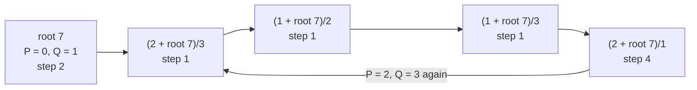

# Periodic continued fractions: a pattern that repeats forever is exactly the mark of a quadratic irrational

[Syllabus](../../../SYLLABUS.md) → [Number theory](../README.md) → [Quadratic Forms and Approximation](../README.md#s08) → Periodic continued fractions

---

## General Overview

Run the flip-and-peel of [Continued fractions](../07-For%20the%20Curious/05-continued-fractions-and-leap-years.md) on root 7 = 2.6457513111: write down the whole part, flip what is left, repeat. The steps come out 2, then 1, 1, 1, 4 over and over.

The golden ratio, 1.6180339887, gives 1 at every step; pi gives no pattern. Both repeaters solve a quadratic (highest power x²) with whole-number coefficients. Pi solves none.

A repeating list folds back into its quadratic. A quadratic's irrational root always repeats, because the flip-and-peel visits only a few states.

**A continued fraction repeats forever exactly when its number is a quadratic irrational: a root of a quadratic with whole-number coefficients that is not itself a fraction.**

**What kind of fact this is:** a theorem in two halves, both proved in Why it works: Euler's (a repeat gives a quadratic) and Lagrange's (a quadratic irrational repeats).

### The picture: root 7 runs round a loop



Each box is the number still to expand. The last arrow returns to a visited box, so the loop never ends.

---

## The formula

One exact step, on whole numbers P, Q and D:

```math
x = (P + \sqrt{D})/Q, \qquad a = \text{whole part of } x, \qquad \text{new } P = aQ - P, \qquad \text{new } Q = (D - \text{new } P^2)/Q
```

**Read it aloud:** the whole part is the step, and the flipped leftover is again a whole number plus root D, over a whole number.

The theorem:

```math
\text{the steps of } x \text{ repeat forever} \iff x = (P + \sqrt{D})/Q \text{ with whole } P, Q \ne 0, D > 0 \text{ and } D \text{ not a square}
```

| Symbol | Plain meaning | In our example | Push it up and the answer… |
| --- | --- | --- | --- |
| $`x`$ | the number being expanded | root 7 = 2.6457513111 | — |
| $`D`$ | the whole number under the root, not a square | 7 | longer loops become possible |
| $`P`$ | the whole number added to root D on top | 0, then 2, 1, 1, 2 | — |
| $`Q`$ | the whole number underneath | 1, then 3, 2, 3, 1 | — |
| $`a`$ | the step: the current number's whole part | 2, then 1, 1, 1, 4 | — |
| $`y`$ | the tail: the number where the block starts | (2 + root 7)/3 | — |

### When it holds

- **D is positive and not a square.** If D < 0 there is no real root; root 9 is 3, x is a fraction, and its list stops.
- **Q is not 0 and divides D − P².** It keeps every new Q whole; if not, multiply top and bottom by |Q| (Q without its sign).
- **Exact arithmetic.** On a decimal, root 7 goes wrong at flip 26.

---

## Why it works

### Step 0: few states, so one comes back

The number left to expand is always (P + root D)/Q. Each pair fixes the next, and the pairs end up in a box. So a pair comes back, and all after it repeats.

### Step 1: a repeat folds into a quadratic (Euler's half)

Take the steps 1, 2, 1, 2, … and call the number x. After 1 and 2 the same list restarts, so x sits inside itself:

```math
x = 1 + 1/(2 + 1/x) = (3x + 1)/(2x + 1) \quad\Rightarrow\quad 2x^2 - 2x - 1 = 0 \quad\Rightarrow\quad x = (1 + \sqrt{3})/2 = 1.3660254038
```

With all 1s:

```math
x = 1 + 1/x \quad\Rightarrow\quad x^2 - x - 1 = 0 \quad\Rightarrow\quad x = (1 + \sqrt{5})/2 = 1.6180339887
```

Any block works. The stops (fractions from cutting the list short) obey new top = step × last top + the top before. Any number may serve as the last step.

With the tail y as the step after the block, y equals a fraction in y. Clearing the bottom gives a whole-number quadratic.

y is no fraction, since a fraction's list stops. A front part, like root 7's 2, is undone by x = a + 1/y.

### Step 2: every quadratic root takes the shape (P + root D)/Q

For a real quadratic root, the quadratic formula gives it as (P + root D)/Q, where:

- P is minus the middle coefficient,
- D is middle² − 4 × first × last,
- Q is twice the first.

For the other root, P and Q change sign. Then D − P² = −4 × first × last, a multiple of Q.

### Step 3: the flip keeps the shape

Subtract the step: x − a = (root D − new P)/Q. Flip it and multiply top and bottom by root D + new P:

```math
Q/(\sqrt{D} - \text{new } P) = Q(\sqrt{D} + \text{new } P)/(D - \text{new } P^2) = (\text{new } P + \sqrt{D})/\text{new } Q
```

New Q is whole, because D − (new P)² is D − P² plus multiples of Q.

### Step 4: the pairs are trapped in a box

Every (P + root D)/Q has a **mirror**, (P − root D)/Q: the other root of its quadratic. The flip treats the mirror the same way, and after a few steps the mirror is negative (fold below).

Once negative, the mirror stays negative: subtracting a step of at least 1 and flipping gives a number between −1 and 0. The number is above 1 (one over a leftover below 1), and it minus its mirror is 2 root D/Q, so Q is positive. One flip later the same holds, so new Q is positive too.

As Q × new Q = D − (new P)², with both positive:

- new P lies strictly between −root D and root D,
- new Q is a whole number from 1 to D.

<details>
<summary>Why the mirror turns negative</summary>

The stops rule builds x from the tail and the last two stops. Swapping root D for its negative changes no whole number, so the mirror obeys the same rule. Solved for the tail's mirror, it gives minus a ratio of two stop bottoms, times (mirror − one stop)/(mirror − the other stop). Both stops close in on x, not the mirror, so that fraction nears 1: the tail's mirror is negative.

</details>

### Step 5: the loop closes

The box holds only so many pairs, so one comes back. Every one of the code's 13,228 starts enters its repeating loop within 4 steps.

---

## Worked numbers, by hand

Root 7 in whole numbers: each row works new P = aQ − P, then new Q = (7 − new P²)/Q.

| Step | Arithmetic | Value |
| --- | --- | --- |
| start | P = 0, Q = 1 | root 7, step 2 |
| flip 1 | 2 × 1 − 0 = 2; (7 − 4)/1 = 3 | (2 + root 7)/3, step 1 |
| flip 2 | 1 × 3 − 2 = 1; (7 − 1)/3 = 2 | (1 + root 7)/2, step 1 |
| flip 3 | 1 × 2 − 1 = 1; (7 − 1)/2 = 3 | (1 + root 7)/3, step 1 |
| flip 4 | 1 × 3 − 1 = 2; (7 − 4)/3 = 1 | (2 + root 7)/1, step 4 |
| flip 5 | 4 × 1 − 2 = 2; (7 − 4)/1 = 3 | **P = 2, Q = 3 again: repeat length 4** |

The tail solves 9y² − 12y − 3 = 0; put back under the 2, it returns 2.6457513111.

### What breaks if you drop a piece

| Mistake | Comes out at | What went wrong |
| --- | --- | --- |
| Repeating 2, 1, 1, 1 | 2.6330 | the front 2 is not in the loop |
| The other root of x² − x − 1 = 0 | −0.6180 | that is the mirror |
| Flip-and-peel on the decimal | 2 at flip 26, not 1 | rounding error grows each flip |

---

## Code, from first principles, and it actually runs

Road one runs the exact step until a pair (P, Q) comes back. Road two folds the block into a quadratic and solves it; the roads must agree to 12 places. Road three sweeps D up to 100 and checks Step 4's box.

### Python

```python
# Periodic continued fractions -- the check behind the card.  Nothing is imported.  Road one: flip-and-peel run exactly on
# (P + root D)/Q in whole numbers.  Road two: the repeating block solved as a quadratic.  Road three: 13,228 starts swept.
def isqrt(n): r = int(n ** 0.5); return r - (r * r > n) + ((r + 1) ** 2 <= n)   # whole part of root n
def run(P, Q, D):                              # steps and pairs until a pair comes back
    seen, steps = [], []
    while (P, Q) not in seen:
        seen.append((P, Q)); r = isqrt(D * Q * Q); a = (P * Q + (r if Q > 0 else -r - 1)) // (Q * Q)   # whole part
        steps.append(a); P = a * Q - P; Q = (D - P * P) // Q
    return steps, seen, seen.index((P, Q))     # the loop starts at this step
def stops(steps, p=1, pb=0, q=0, qb=1):        # top/bottom pairs, built as on Continued fractions
    for a in steps: p, pb, q, qb = a * p + pb, p, a * q + qb, q; yield p, q
def euler(front, block):                       # y = (p y + pb)/(q y + qb), so q y^2 + (qb - p) y - pb = 0
    (pb, qb), (p, q) = ([(1, 0)] + list(stops(block)))[-2:]
    A, B, C = q, qb - p, -pb; y = (-B + (B * B - 4 * A * C) ** 0.5) / (2 * A)
    for a in reversed(front): y = a + 1 / y
    return A, B, C, y
for name, P, Q, D in [("golden ratio", 1, 2, 5), ("(1 + root 3)/2", 1, 2, 3), ("root 7", 0, 1, 7), ("root 2", 0, 1, 2)]:
    st, seen, k = run(P, Q, D); A, B, C, y = euler(st[:k], st[k:]); x, disc = (P + D ** 0.5) / Q, B * B - 4 * A * C
    print(f"{name:<15}{', '.join(map(str, (st[:k] + st[k:] * 9)[:9]))}  repeat length {len(st) - k}  {A}y^2 {B:+}y {C:+} = 0  {x:.10f} = {y:.10f}")
    assert abs(x - y) < 1e-12 and disc % D == 0 and isqrt(disc // D) ** 2 == disc // D   # roads one and two agree
s7, g, r2, x, n, true = list(stops([2, 1, 1, 1])), list(stops([1] * 6)), list(stops([1] + [2] * 5)), 7 ** 0.5, 0, [2] + [1, 1, 1, 4] * 20
print("root 7 pairs (P, Q):", *run(0, 1, 7)[1], run(0, 1, 7)[1][1], "...  stops", *[f"{p}/{q}" for p, q in s7], f" {s7[-1][0]}^2 - 7 x {s7[-1][1]}^2 = {s7[-1][0] ** 2 - 7 * s7[-1][1] ** 2}")
print("golden stops", *[f"{p}/{q}" for p, q in g], "  root 2 stops", *[f"{p}/{q}" for p, q in r2], " A4 297/210 =", *[f"{p}/{q}" for p, q in r2 if p * 210 == q * 297])
runs = [(D, *run(P, Q, D)) for D in range(2, 101) if isqrt(D) ** 2 != D for P in range(-12, 13) for Q in range(-12, 13) if Q and (D - P * P) % Q == 0]
inbox = all(0 < q <= D and p * p < D for D, st, seen, k in runs for p, q in seen[k:])   # the proof's box
print(f"starts tried {len(runs)}, every one repeats, longest wait {max(k for D, st, seen, k in runs)} steps, longest loop {max(len(st) - k for D, st, seen, k in runs)}, loop pairs in the box: {inbox}")
while int(x) == true[n]: x, n = 1 / (x - int(x)), n + 1   # the same flip-and-peel on a decimal
print(f"mistakes: block 2, 1, 1, 1 gives {euler([], [2, 1, 1, 1])[3]:.4f}; other root {(1 - 5 ** 0.5) / 2:.4f}; decimals go wrong at flip {n}: {int(x)}, not {true[n]}")
assert inbox and s7[-1][0] ** 2 - 7 * s7[-1][1] ** 2 == 1 and all(p * p - p * q - q * q in (1, -1) for p, q in g)
print("ALL CHECKS PASS")
```

**Ran 2026-11-23 on macOS, Python 3.14.10, standard library only. All checks passed. Output, pasted from the run:**

```
golden ratio   1, 1, 1, 1, 1, 1, 1, 1, 1  repeat length 1  1y^2 -1y -1 = 0  1.6180339887 = 1.6180339887
(1 + root 3)/2 1, 2, 1, 2, 1, 2, 1, 2, 1  repeat length 2  2y^2 -2y -1 = 0  1.3660254038 = 1.3660254038
root 7         2, 1, 1, 1, 4, 1, 1, 1, 4  repeat length 4  9y^2 -12y -3 = 0  2.6457513111 = 2.6457513111
root 2         1, 2, 2, 2, 2, 2, 2, 2, 2  repeat length 1  1y^2 -2y -1 = 0  1.4142135624 = 1.4142135624
root 7 pairs (P, Q): (0, 1) (2, 3) (1, 2) (1, 3) (2, 1) (2, 3) ...  stops 2/1 3/1 5/2 8/3  8^2 - 7 x 3^2 = 1
golden stops 1/1 2/1 3/2 5/3 8/5 13/8   root 2 stops 1/1 3/2 7/5 17/12 41/29 99/70  A4 297/210 = 99/70
starts tried 13228, every one repeats, longest wait 4 steps, longest loop 16, loop pairs in the box: True
mistakes: block 2, 1, 1, 1 gives 2.6330; other root -0.6180; decimals go wrong at flip 26: 2, not 1
ALL CHECKS PASS
```

### Rust

```rust
// Periodic continued fractions -- the same check in Rust, no crates.  Road one: flip-and-peel run exactly on
// (P + root D)/Q in whole numbers.  Road two: the repeating block solved as a quadratic.  Road three: 13,228 starts swept.
fn isqrt(n: i64) -> i64 { let r = (n as f64).sqrt() as i64; r - (r * r > n) as i64 + ((r + 1) * (r + 1) <= n) as i64 }
fn run(mut p: i64, mut q: i64, d: i64) -> (Vec<i64>, Vec<(i64, i64)>, usize) {   // steps and pairs until a pair comes back
    let (mut seen, mut steps) = (Vec::new(), Vec::new());
    while !seen.contains(&(p, q)) {   // whole part a of (P + root D)/Q, then the new pair
        seen.push((p, q)); let r = isqrt(d * q * q); let a = (p * q + if q > 0 { r } else { -r - 1 }).div_euclid(q * q); steps.push(a); p = a * q - p; q = (d - p * p) / q; }
    let k = seen.iter().position(|&s| s == (p, q)).unwrap(); (steps, seen, k)   // the loop starts at step k
}
fn stops(steps: &[i64]) -> Vec<(i64, i64)> {     // top/bottom pairs, built as on Continued fractions
    let (mut p, mut pb, mut q, mut qb, mut out) = (1, 0, 0, 1, vec![]);
    for &a in steps { (p, pb, q, qb) = (a * p + pb, p, a * q + qb, q); out.push((p, q)); } out
}
fn euler(front: &[i64], block: &[i64]) -> (i64, i64, i64, f64) {   // q y^2 + (qb - p) y - pb = 0
    let s = [vec![(1, 0)], stops(block)].concat(); let ((pb, qb), (p, q)) = (s[s.len() - 2], s[s.len() - 1]);
    let (a2, b, c) = (q, qb - p, -pb); let mut y = (-b as f64 + ((b * b - 4 * a2 * c) as f64).sqrt()) / (2 * a2) as f64;
    for &a in front.iter().rev() { y = a as f64 + 1.0 / y; } (a2, b, c, y)
}
fn fr(v: &[(i64, i64)]) -> String { v.iter().map(|(p, q)| format!("{}/{}", p, q)).collect::<Vec<_>>().join(" ") }
fn main() {
    for (name, p, q, d) in [("golden ratio", 1, 2, 5), ("(1 + root 3)/2", 1, 2, 3), ("root 7", 0, 1, 7), ("root 2", 0, 1, 2)] {
        let (st, _, k) = run(p, q, d); let (a2, b, c, y) = euler(&st[..k], &st[k..]); let (x, disc) = ((p as f64 + (d as f64).sqrt()) / q as f64, b * b - 4 * a2 * c);
        let shown: Vec<String> = (0..9).map(|i| if i < k { st[i] } else { st[k + (i - k) % (st.len() - k)] }.to_string()).collect();
        println!("{:<15}{}  repeat length {}  {}y^2 {:+}y {:+} = 0  {:.10} = {:.10}", name, shown.join(", "), st.len() - k, a2, b, c, x, y);
        assert!((x - y).abs() < 1e-12 && disc % d == 0 && isqrt(disc / d).pow(2) == disc / d);   // roads one and two agree
    }
    let (s7, g, r2, true_) = (stops(&[2, 1, 1, 1]), stops(&[1; 6]), stops(&[1, 2, 2, 2, 2, 2]), [vec![2], [1, 1, 1, 4].repeat(20)].concat());
    let pairs: Vec<String> = run(0, 1, 7).1.iter().chain([run(0, 1, 7).1[1]].iter()).map(|t| format!("{:?}", t)).collect();
    println!("root 7 pairs (P, Q): {} ...  stops {}  {}^2 - 7 x {}^2 = {}", pairs.join(" "), fr(&s7), s7[3].0, s7[3].1, s7[3].0.pow(2) - 7 * s7[3].1.pow(2));
    let a4: Vec<(i64, i64)> = r2.iter().cloned().filter(|&(p, q)| p * 210 == q * 297).collect();
    println!("golden stops {}   root 2 stops {}  A4 297/210 = {}", fr(&g), fr(&r2), fr(&a4));
    let mut runs = vec![]; for d in (2..101).filter(|&d| isqrt(d).pow(2) != d) { for p in -12..13 { for q in (-12..13).filter(|&q| q != 0 && (d - p * p) % q == 0) { runs.push((d, run(p, q, d))); } } }
    let inbox = runs.iter().all(|(d, (_, seen, k))| seen[*k..].iter().all(|&(p, q)| 0 < q && q <= *d && p * p < *d));   // the proof's box
    println!("starts tried {}, every one repeats, longest wait {} steps, longest loop {}, loop pairs in the box: {}", runs.len(), runs.iter().map(|r| r.1 .2).max().unwrap(), runs.iter().map(|r| r.1 .0.len() - r.1 .2).max().unwrap(), if inbox { "True" } else { "False" });
    let (mut x, mut n) = (7f64.sqrt(), 0); while x as i64 == true_[n] { x = 1.0 / (x - (x as i64) as f64); n += 1; }   // the same flip-and-peel on a decimal
    println!("mistakes: block 2, 1, 1, 1 gives {:.4}; other root {:.4}; decimals go wrong at flip {}: {}, not {}", euler(&[], &[2, 1, 1, 1]).3, (1.0 - 5f64.sqrt()) / 2.0, n, x as i64, true_[n]);
    assert!(inbox && s7[3].0.pow(2) - 7 * s7[3].1.pow(2) == 1 && g.iter().all(|&(p, q)| (p * p - p * q - q * q).abs() == 1));
    println!("ALL CHECKS PASS");
}
```

**Ran 2026-11-23 on macOS, rustc 1.98.1, no crates. All checks passed. Output, pasted from the run:**

```
golden ratio   1, 1, 1, 1, 1, 1, 1, 1, 1  repeat length 1  1y^2 -1y -1 = 0  1.6180339887 = 1.6180339887
(1 + root 3)/2 1, 2, 1, 2, 1, 2, 1, 2, 1  repeat length 2  2y^2 -2y -1 = 0  1.3660254038 = 1.3660254038
root 7         2, 1, 1, 1, 4, 1, 1, 1, 4  repeat length 4  9y^2 -12y -3 = 0  2.6457513111 = 2.6457513111
root 2         1, 2, 2, 2, 2, 2, 2, 2, 2  repeat length 1  1y^2 -2y -1 = 0  1.4142135624 = 1.4142135624
root 7 pairs (P, Q): (0, 1) (2, 3) (1, 2) (1, 3) (2, 1) (2, 3) ...  stops 2/1 3/1 5/2 8/3  8^2 - 7 x 3^2 = 1
golden stops 1/1 2/1 3/2 5/3 8/5 13/8   root 2 stops 1/1 3/2 7/5 17/12 41/29 99/70  A4 297/210 = 99/70
starts tried 13228, every one repeats, longest wait 4 steps, longest loop 16, loop pairs in the box: True
mistakes: block 2, 1, 1, 1 gives 2.6330; other root -0.6180; decimals go wrong at flip 26: 2, not 1
ALL CHECKS PASS
```

### Lean

Lean proves the card's theorem in both directions, for every number, plus Step 3 and the by-hand numbers.

- A continued fraction repeats forever exactly when its number is a quadratic irrational.
- Take whole numbers P, Q ≠ 0 and D > 0, with D not a square and Q dividing D − P². Then the steps of (P + root D)/Q repeat forever.
- Suppose the steps of x repeat forever. Then x = (P + root D)/Q for such whole numbers P, Q and D.
- Take x = (P + root D)/Q as above, and any whole number a. Then 1/(x − a) = (new P + root D)/new Q, with new Q whole and not 0.
- Root 7's table is exact: the pair P = 2, Q = 3 comes back after four flips.
- Pell's 8² − 7 × 3² = 1 and A4's 297/210 = 99/70 are checked too.

Step 4's exact box, the decimals, the 13,228-start sweep and the rounding error at flip 26 are left to the Python and Rust checks.

```lean
-- Periodic continued fractions: a real number's continued fraction steps go on forever and repeat exactly when the number is (P + root D)/Q with whole P, Q, D and D not a square, that is, a quadratic irrational.
import Mathlib.Algebra.ContinuedFractions.Computation.Basic
import Mathlib.Analysis.Real.Sqrt
import Mathlib.NumberTheory.Real.Irrational
import Mathlib.Tactic.NormNum
import Mathlib.Algebra.ContinuedFractions.Computation.Translations
import Mathlib.Algebra.ContinuedFractions.Computation.TerminatesIffRat
import Mathlib.Algebra.ContinuedFractions.Computation.ApproximationCorollaries
import Mathlib.Order.Interval.Set.Infinite
import Mathlib.Tactic.LinearCombination

namespace PeriodicContinuedFractions

/-- The steps of `x` (the whole parts the flip-and-peel writes down after the first one, Mathlib's
`GenContFract.of x`) **repeat forever**: the list never stops, and from some step `N` on it repeats
with a block of length `p ≥ 1`. -/
def StepsRepeatForever (x : ℝ) : Prop :=
  ¬ (GenContFract.of x).Terminates ∧
    ∃ N p : ℕ, 0 < p ∧ ∀ n, N ≤ n →
      (GenContFract.of x).partDens.get? (n + p) = (GenContFract.of x).partDens.get? n

noncomputable def cq (x : ℝ) : ℕ → ℝ
  | 0 => x
  | n + 1 => (Int.fract (cq x n))⁻¹

theorem cq_zero (x : ℝ) : cq x 0 = x := rfl
theorem cq_succ (x : ℝ) (n : ℕ) : cq x (n + 1) = (Int.fract (cq x n))⁻¹ := rfl

theorem cq_add (x : ℝ) (k n : ℕ) : cq (cq x k) n = cq x (k + n) := by
  induction n with
  | zero => rfl
  | succ n ih => rw [cq_succ, ih, ← Nat.add_assoc, cq_succ]

theorem irr_fract_inv {z : ℝ} (h : Irrational z) : Irrational (Int.fract z)⁻¹ := by
  rw [Int.fract]; exact (h.sub_intCast _).inv

theorem irr_cq {x : ℝ} (h : Irrational x) (n : ℕ) : Irrational (cq x n) := by
  induction n with
  | zero => exact h
  | succ n ih => exact irr_fract_inv ih

theorem fract_ne_zero_of_irr {z : ℝ} (h : Irrational z) : Int.fract z ≠ 0 := by
  intro h0
  rw [Int.fract, sub_eq_zero] at h0
  exact h.ne_int _ h0

theorem one_lt_cq_succ {x : ℝ} (h : Irrational x) (n : ℕ) : 1 < cq x (n + 1) := by
  rw [cq_succ]
  have h1 := fract_ne_zero_of_irr (irr_cq h n)
  have h2 := Int.fract_nonneg (cq x n)
  have h3 := Int.fract_lt_one (cq x n)
  exact (one_lt_inv₀ (lt_of_le_of_ne h2 (Ne.symm h1))).2 h3

theorem one_le_floor_cq_succ {x : ℝ} (h : Irrational x) (n : ℕ) : 1 ≤ ⌊cq x (n + 1)⌋ := by
  have := one_lt_cq_succ h n
  exact Int.le_floor.2 (by exact_mod_cast this.le)

theorem stream_eq {x : ℝ} (h : Irrational x) (n : ℕ) :
    GenContFract.IntFractPair.stream x n = some (GenContFract.IntFractPair.of (cq x n)) := by
  induction n with
  | zero => exact GenContFract.IntFractPair.stream_zero x
  | succ n ih =>
    exact GenContFract.IntFractPair.stream_succ_of_some ih (fract_ne_zero_of_irr (irr_cq h n))

theorem s_get {x : ℝ} (h : Irrational x) (n : ℕ) :
    (GenContFract.of x).s.get? n = some ⟨1, (⌊cq x (n + 1)⌋ : ℝ)⟩ :=
  GenContFract.get?_of_eq_some_of_succ_get?_intFractPair_stream (stream_eq h (n + 1))

theorem partDens_get {x : ℝ} (h : Irrational x) (n : ℕ) :
    (GenContFract.of x).partDens.get? n = some (⌊cq x (n + 1)⌋ : ℝ) := by
  simp [GenContFract.partDens, s_get h n]

theorem not_terminates {x : ℝ} (h : Irrational x) : ¬ (GenContFract.of x).Terminates := by
  rw [GenContFract.terminates_iff_rat]
  rintro ⟨q, rfl⟩
  exact h ⟨q, rfl⟩

theorem irr_of_not_terminates {x : ℝ} (h : ¬ (GenContFract.of x).Terminates) : Irrational x := by
  rintro ⟨q, rfl⟩
  exact h ((GenContFract.terminates_iff_rat _).2 ⟨q, rfl⟩)

theorem eq_of_floors {y z : ℝ} (hy : Irrational y) (hz : Irrational z)
    (h : ∀ n, ⌊cq y n⌋ = ⌊cq z n⌋) : y = z := by
  have hof : GenContFract.of y = GenContFract.of z := by
    have h1 : (GenContFract.of y).h = (GenContFract.of z).h := by
      rw [GenContFract.of_h_eq_floor, GenContFract.of_h_eq_floor]
      exact_mod_cast h 0
    have h2 : (GenContFract.of y).s = (GenContFract.of z).s := by
      apply Stream'.Seq.ext
      intro n
      rw [s_get hy, s_get hz, h (n + 1)]
    cases hgy : GenContFract.of y
    cases hgz : GenContFract.of z
    rw [hgy, hgz] at h1 h2
    simp_all
  have ty := GenContFract.of_convergence (v := y)
  have tz := GenContFract.of_convergence (v := z)
  rw [hof] at ty
  exact tendsto_nhds_unique ty tz


theorem mul_fract_inv {z : ℝ} (h : Irrational z) :
    z * (Int.fract z)⁻¹ = ⌊z⌋ * (Int.fract z)⁻¹ + 1 := by
  have h1 := fract_ne_zero_of_irr h
  have h2 : z * (Int.fract z)⁻¹ = (⌊z⌋ + Int.fract z) * (Int.fract z)⁻¹ := by
    rw [Int.floor_add_fract]
  rw [h2, add_mul, mul_inv_cancel₀ h1]

theorem mobius {y : ℝ} (hy : Irrational y) (n : ℕ) :
    ∃ A B C D : ℤ, 0 < C ∧ 0 ≤ D ∧ y * (C * cq y (n + 1) + D) = A * cq y (n + 1) + B := by
  induction n with
  | zero =>
    refine ⟨⌊y⌋, 1, 1, 0, one_pos, le_refl _, ?_⟩
    have := mul_fract_inv hy
    simp only [cq_succ, cq_zero, Int.cast_one, Int.cast_zero, one_mul, add_zero]
    exact this
  | succ n ih =>
    obtain ⟨A, B, C, D, hC, hD, hE⟩ := ih
    set z := cq y (n + 1) with hz
    have hzw : z * cq y (n + 1 + 1) = ⌊z⌋ * cq y (n + 1 + 1) + 1 := by
      rw [cq_succ]; exact mul_fract_inv (irr_cq hy _)
    have hf : 1 ≤ ⌊z⌋ := one_le_floor_cq_succ hy n
    refine ⟨A * ⌊z⌋ + B, A, C * ⌊z⌋ + D, C, by nlinarith, hC.le, ?_⟩
    set w := cq y (n + 1 + 1)
    push_cast
    linear_combination w * hE + (A - y * C) * hzw

def IsQuad (x : ℝ) : Prop := ∃ a b c : ℤ, a ≠ 0 ∧ (a : ℝ) * x ^ 2 + b * x + c = 0

theorem quad_back {z : ℝ} (hz : Irrational z) (hq : IsQuad (Int.fract z)⁻¹) : IsQuad z := by
  obtain ⟨a, b, c, ha, he⟩ := hq
  have hf := fract_ne_zero_of_irr hz
  set m := ⌊z⌋
  have ht : Int.fract z = z - m := rfl
  rw [ht] at hf he
  have he2 : (a : ℝ) + b * (z - m) + c * (z - m) ^ 2 = 0 := by
    have := congrArg (· * (z - m) ^ 2) he
    simp only [zero_mul] at this
    rw [← this]; field_simp
  have hc : c ≠ 0 := by
    rintro rfl
    have hb : b ≠ 0 := by
      rintro rfl; simp at he2; exact ha he2
    apply hz
    refine ⟨(m - a / b : ℚ), ?_⟩
    push_cast
    have hb' : (b : ℝ) ≠ 0 := by exact_mod_cast hb
    field_simp
    simp at he2
    linear_combination -he2
  exact ⟨c, b - 2 * c * m, a - b * m + c * m ^ 2, hc, by push_cast; linear_combination he2⟩

theorem quad_of_cq {x : ℝ} (hx : Irrational x) (n : ℕ) (h : IsQuad (cq x n)) : IsQuad x := by
  induction n with
  | zero => exact h
  | succ n ih => exact ih (quad_back (irr_cq hx n) h)

theorem periodic_quad {x : ℝ} (h : StepsRepeatForever x) : Irrational x ∧ IsQuad x := by
  obtain ⟨hT, N, p, hp, hper⟩ := h
  have hx := irr_of_not_terminates hT
  refine ⟨hx, ?_⟩
  set y := cq x (N + 1)
  have hy : Irrational y := irr_cq hx _
  have hyy : cq y p = y := by
    symm
    apply eq_of_floors hy (irr_cq hy p)
    intro n
    have := hper (N + n) (by omega)
    rw [partDens_get hx, partDens_get hx] at this
    have h2 : ⌊cq x (N + n + p + 1)⌋ = ⌊cq x (N + n + 1)⌋ := by
      simpa using this
    rw [cq_add, cq_add, cq_add]
    rw [show N + 1 + (p + n) = N + n + p + 1 by omega, show N + 1 + n = N + n + 1 by omega, h2]
  obtain ⟨k, rfl⟩ : ∃ k, p = k + 1 := ⟨p - 1, by omega⟩
  obtain ⟨A, B, C, D, hC, -, hE⟩ := mobius hy k
  rw [hyy] at hE
  have hq : IsQuad y := ⟨C, D - A, -B, hC.ne', by push_cast; linear_combination hE⟩
  exact quad_of_cq hx _ hq


theorem flip_aux (P Q a : ℤ) (D : ℕ) (s : ℝ) (hs : s ^ 2 = D) (hQ : Q ≠ 0) (hD : ¬ IsSquare D)
    (hdiv : Q ∣ (D : ℤ) - P ^ 2) :
    Q ∣ (D : ℤ) - (a * Q - P) ^ 2 ∧
      ((D : ℤ) - (a * Q - P) ^ 2) / Q ≠ 0 ∧
      ((P + s) / Q - a)⁻¹ =
        ((a * Q - P : ℤ) + s) / ((((D : ℤ) - (a * Q - P) ^ 2) / Q : ℤ) : ℝ) ∧
      ((D : ℤ) - (a * Q - P) ^ 2) / Q ∣ (D : ℤ) - (a * Q - P) ^ 2 := by
  have hdiv' : Q ∣ (D : ℤ) - (a * Q - P) ^ 2 := by
    have : (D : ℤ) - (a * Q - P) ^ 2 = ((D : ℤ) - P ^ 2) + Q * (2 * a * P - a ^ 2 * Q) := by ring
    rw [this]; exact dvd_add hdiv (dvd_mul_right _ _)
  set P' := a * Q - P with hP'
  have hne : (D : ℤ) - P' ^ 2 ≠ 0 := by
    intro h0
    apply hD
    refine ⟨P'.natAbs, ?_⟩
    have : (D : ℤ) = ((P'.natAbs * P'.natAbs : ℕ) : ℤ) := by
      rw [Int.natAbs_mul_self]; linear_combination h0
    exact_mod_cast this
  obtain ⟨k, hk⟩ := hdiv'
  have hk0 : k ≠ 0 := by rintro rfl; simp at hk; exact hne hk
  refine ⟨⟨k, hk⟩, ?_, ?_, ?_⟩
  · rw [hk, Int.mul_ediv_cancel_left _ hQ]; exact hk0
  · rw [hk, Int.mul_ediv_cancel_left _ hQ]
    have hkR : (D : ℝ) - (P' : ℝ) ^ 2 = Q * k := by exact_mod_cast hk
    have hQR : (Q : ℝ) ≠ 0 := by exact_mod_cast hQ
    have hkR0 : (k : ℝ) ≠ 0 := by exact_mod_cast hk0
    have hsP : s - P' ≠ 0 := by
      intro h0
      have : s = P' := by linarith
      apply hne
      have h2 : (D : ℝ) - (P' : ℝ) ^ 2 = 0 := by rw [← hs, this]; ring
      exact_mod_cast h2
    have e1 : (P + s) / Q - a = (s - P') / Q := by
      rw [hP']; push_cast; field_simp; ring
    rw [e1, inv_div, div_eq_div_iff hsP hkR0]
    linear_combination -hkR - hs
  · rw [hk, Int.mul_ediv_cancel_left _ hQ]; exact Dvd.intro_left _ rfl

theorem form_irr {P Q : ℤ} {s : ℝ} (hs : Irrational s) (hQ : Q ≠ 0) : Irrational ((P + s) / Q) :=
  (hs.intCast_add P).div_intCast hQ

theorem quad_of_form {x : ℝ} {P Q : ℤ} {D : ℕ} (hQ : Q ≠ 0) (hD : ¬ IsSquare D)
    (hx : x = (P + Real.sqrt D) / Q) : Irrational x ∧ IsQuad x := by
  have hs : Irrational (Real.sqrt D) := irrational_sqrt_natCast_iff.2 hD
  refine ⟨hx ▸ form_irr hs hQ, Q ^ 2, -2 * P * Q, P ^ 2 - D, pow_ne_zero _ hQ, ?_⟩
  have hQR : (Q : ℝ) ≠ 0 := by exact_mod_cast hQ
  have h1 : (Q : ℝ) * x = P + Real.sqrt D := by rw [hx]; field_simp
  have h2 : Real.sqrt D ^ 2 = D := Real.sq_sqrt (Nat.cast_nonneg _)
  push_cast
  linear_combination (Q * x - P + Real.sqrt D) * h1 + h2

theorem form_of_quad {x : ℝ} (hx : Irrational x) (hq : IsQuad x) :
    ∃ (P Q : ℤ) (D : ℕ), Q ≠ 0 ∧ ¬ IsSquare D ∧ Q ∣ (D : ℤ) - P ^ 2 ∧
        x = (P + Real.sqrt D) / Q := by
  obtain ⟨a, b, c, ha, he⟩ := hq
  have hsq : ((2 * a * x + b) : ℝ) ^ 2 = ((b ^ 2 - 4 * a * c : ℤ) : ℝ) := by
    push_cast; linear_combination 4 * a * he
  have hΔ : 0 ≤ b ^ 2 - 4 * a * c := by
    have : (0 : ℝ) ≤ ((b ^ 2 - 4 * a * c : ℤ) : ℝ) := by rw [← hsq]; positivity
    exact_mod_cast this
  set D : ℕ := (b ^ 2 - 4 * a * c).toNat with hDdef
  have hDZ : (D : ℤ) = b ^ 2 - 4 * a * c := Int.toNat_of_nonneg hΔ
  have hDR : (D : ℝ) = ((b ^ 2 - 4 * a * c : ℤ) : ℝ) := by exact_mod_cast hDZ
  have hsqrt : Real.sqrt D = |2 * a * x + b| := by
    rw [hDR, ← hsq, Real.sqrt_sq_eq_abs]
  have haR : (a : ℝ) ≠ 0 := by exact_mod_cast ha
  have hD : ¬ IsSquare D := by
    rintro ⟨r, hr⟩
    have : Real.sqrt D = r := by
      rw [hr]; push_cast; rw [Real.sqrt_mul_self (Nat.cast_nonneg _)]
    rw [hsqrt] at this
    rcases abs_cases (2 * (a : ℝ) * x + b) with ⟨h1, -⟩ | ⟨h1, -⟩
    · apply hx
      refine ⟨((r : ℚ) - b) / (2 * a), ?_⟩
      push_cast; field_simp; linarith
    · apply hx
      refine ⟨(-(r : ℚ) - b) / (2 * a), ?_⟩
      push_cast; field_simp; linarith
  rcases abs_cases (2 * (a : ℝ) * x + b) with ⟨h1, -⟩ | ⟨h1, -⟩
  · refine ⟨-b, 2 * a, D, by positivity, hD, ⟨-2 * c, by rw [hDZ]; ring⟩, ?_⟩
    rw [hsqrt, h1]; push_cast; field_simp; ring
  · refine ⟨b, -2 * a, D, by simpa using ha, hD, ⟨2 * c, by rw [hDZ]; ring⟩, ?_⟩
    rw [hsqrt, h1]; push_cast; field_simp; ring


theorem periodic_of_eq {x : ℝ} (hx : Irrational x) {i j : ℕ} (hij : i < j)
    (he : cq x i = cq x j) : StepsRepeatForever x := by
  refine ⟨not_terminates hx, i, j - i, by omega, fun n hn => ?_⟩
  rw [partDens_get hx, partDens_get hx]
  have h1 : cq x (n + (j - i) + 1) = cq (cq x j) (n + 1 - i) := by
    rw [cq_add]; congr 1; omega
  have h2 : cq x (n + 1) = cq (cq x i) (n + 1 - i) := by
    rw [cq_add]; congr 1; omega
  rw [h1, h2, he]

noncomputable def PQ (x : ℝ) (D : ℕ) (P0 Q0 : ℤ) : ℕ → ℤ × ℤ
  | 0 => (P0, Q0)
  | n + 1 =>
    (⌊cq x n⌋ * (PQ x D P0 Q0 n).2 - (PQ x D P0 Q0 n).1,
      ((D : ℤ) - (⌊cq x n⌋ * (PQ x D P0 Q0 n).2 - (PQ x D P0 Q0 n).1) ^ 2) / (PQ x D P0 Q0 n).2)

theorem PQ_succ (x : ℝ) (D : ℕ) (P0 Q0 : ℤ) (n : ℕ) :
    PQ x D P0 Q0 (n + 1) =
    (⌊cq x n⌋ * (PQ x D P0 Q0 n).2 - (PQ x D P0 Q0 n).1,
      ((D : ℤ) - (⌊cq x n⌋ * (PQ x D P0 Q0 n).2 - (PQ x D P0 Q0 n).1) ^ 2) / (PQ x D P0 Q0 n).2) :=
  rfl

theorem PQ_inv {x : ℝ} {P0 Q0 : ℤ} {D : ℕ} (hQ : Q0 ≠ 0) (hD : ¬ IsSquare D)
    (hdiv : Q0 ∣ (D : ℤ) - P0 ^ 2) (hx : x = (P0 + Real.sqrt D) / Q0) (n : ℕ) :
    (PQ x D P0 Q0 n).2 ≠ 0 ∧ (PQ x D P0 Q0 n).2 ∣ (D : ℤ) - (PQ x D P0 Q0 n).1 ^ 2 ∧
      cq x n = ((PQ x D P0 Q0 n).1 + Real.sqrt D) / (PQ x D P0 Q0 n).2 ∧
      ((PQ x D P0 Q0 (n + 1)).1 + -Real.sqrt D) / (PQ x D P0 Q0 (n + 1)).2 =
        (((PQ x D P0 Q0 n).1 + -Real.sqrt D) / (PQ x D P0 Q0 n).2 - ⌊cq x n⌋)⁻¹ := by
  have hs : Real.sqrt D ^ 2 = D := Real.sq_sqrt (Nat.cast_nonneg _)
  have hs' : (-Real.sqrt D) ^ 2 = D := by rw [neg_sq, hs]
  induction n with
  | zero =>
    refine ⟨hQ, hdiv, hx, ?_⟩
    obtain ⟨-, -, h3, -⟩ := flip_aux P0 Q0 ⌊cq x 0⌋ D _ hs' hQ hD hdiv
    exact h3.symm
  | succ n ih =>
    obtain ⟨hQn, hdn, hxn, -⟩ := ih
    obtain ⟨-, h2, h3, h4⟩ := flip_aux _ _ ⌊cq x n⌋ D _ hs hQn hD hdn
    have hxn1 : cq x (n + 1) = ((PQ x D P0 Q0 (n + 1)).1 + Real.sqrt D) / (PQ x D P0 Q0 (n + 1)).2 := by
      rw [cq_succ, PQ_succ, ← h3, hxn]; rfl
    obtain ⟨-, -, h3', -⟩ := flip_aux _ _ ⌊cq x (n + 1)⌋ D _ hs' h2 hD h4
    exact ⟨h2, h4, hxn1, h3'.symm⟩


theorem lagrange {x : ℝ} {P0 Q0 : ℤ} {D : ℕ} (hQ : Q0 ≠ 0) (hD : ¬ IsSquare D)
    (hdiv : Q0 ∣ (D : ℤ) - P0 ^ 2) (hx : x = (P0 + Real.sqrt D) / Q0) : StepsRepeatForever x := by
  have hsD : Irrational (Real.sqrt D) := irrational_sqrt_natCast_iff.2 hD
  have hxi : Irrational x := hx ▸ form_irr hsD hQ
  have hinv := PQ_inv hQ hD hdiv hx
  set P : ℕ → ℤ := fun n => (PQ x D P0 Q0 n).1 with hPdef
  set Q : ℕ → ℤ := fun n => (PQ x D P0 Q0 n).2 with hQdef
  set y : ℕ → ℝ := fun n => ((P n : ℝ) + -Real.sqrt D) / Q n with hydef
  set s := Real.sqrt D with hs
  have hQn : ∀ n, Q n ≠ 0 := fun n => (hinv n).1
  have hQnR : ∀ n, (Q n : ℝ) ≠ 0 := fun n => by exact_mod_cast hQn n
  have hcq : ∀ n, cq x n = (P n + s) / Q n := fun n => (hinv n).2.2.1
  have hy : ∀ n, y (n + 1) = (y n - ⌊cq x n⌋)⁻¹ := fun n => (hinv n).2.2.2
  have hyi : ∀ n, Irrational (y n) := fun n => form_irr hsD.neg (hQn n)
  have hsp : 0 < s := lt_of_le_of_ne (Real.sqrt_nonneg _) (Ne.symm hsD.ne_zero)
  have hdiff : ∀ n, cq x n - y n = 2 * s / Q n := by
    intro n; rw [hcq]; simp only [y]; field_simp; ring
  have hu : ∀ n, 0 < cq x n - ⌊cq x n⌋ ∧ cq x n - ⌊cq x n⌋ < 1 := by
    intro n
    have h1 := fract_ne_zero_of_irr (irr_cq hxi n)
    exact ⟨lt_of_le_of_ne (Int.fract_nonneg _) (Ne.symm h1), Int.fract_lt_one _⟩
  have hfl : ∀ n, (1 : ℝ) ≤ ⌊cq x (n + 1)⌋ := fun n => by exact_mod_cast one_le_floor_cq_succ hxi n
  have hcq1 : ∀ n, 1 < cq x (n + 1) := one_lt_cq_succ hxi
  have hcqs : ∀ n, cq x (n + 1) = (cq x n - ⌊cq x n⌋)⁻¹ := fun n => rfl
  -- some conjugate becomes negative
  have hA : ∃ M, y (M + 1) < 0 := by
    by_contra hA
    simp only [not_exists, not_lt] at hA
    have hpos : ∀ M, 0 < y (M + 1) := fun M => lt_of_le_of_ne (hA M) (Ne.symm (hyi _).ne_zero)
    have hgt : ∀ n, 0 < y (n + 1) - ⌊cq x (n + 1)⌋ := by
      intro n
      have := hpos (n + 1)
      rw [hy] at this
      exact inv_pos.1 this
    have hlt : ∀ n, y (n + 1) - ⌊cq x (n + 1)⌋ < 1 := by
      intro n
      have h1 := hgt (n + 1)
      have h2 := hfl (n + 1)
      have h3 : 1 < y (n + 1 + 1) := by linarith
      rw [hy] at h3
      exact (one_lt_inv₀ (hgt n)).1 h3
    have hdec : ∀ n, (Q (n + 2)).natAbs < (Q (n + 1)).natAbs := by
      intro n
      set u := cq x (n + 1) - ⌊cq x (n + 1)⌋
      set v := y (n + 1) - ⌊cq x (n + 1)⌋
      have hu0 := (hu (n + 1)).1
      have hu1 := (hu (n + 1)).2
      have hv0 := hgt n
      have hv1 := hlt n
      have h1 : u - v = 2 * s / Q (n + 1) := by rw [← hdiff]; ring
      have h2 : u⁻¹ - v⁻¹ = 2 * s / Q (n + 2) := by rw [← hdiff, ← hcqs, ← hy]
      have h1' : (Q (n + 1) : ℝ) * (u - v) = 2 * s := by
        rw [h1]; field_simp [hQnR (n + 1)]
      have h2' : (Q (n + 2) : ℝ) * (v - u) = 2 * s * u * v := by
        have hu' : u ≠ 0 := ne_of_gt hu0
        have hv' : v ≠ 0 := ne_of_gt hv0
        have e : v - u = u * v * (u⁻¹ - v⁻¹) := by field_simp
        rw [e, h2]; field_simp [hQnR (n + 2)]
      have hvu : v - u ≠ 0 := by
        intro h0
        have : u - v = 0 := by linarith
        rw [this, mul_zero] at h1'
        linarith
      have h3 : (Q (n + 2) : ℝ) = -((Q (n + 1) : ℝ) * u * v) := by
        have : (v - u) * ((Q (n + 2) : ℝ) + (Q (n + 1) : ℝ) * u * v) = 0 := by
          linear_combination h2' - u * v * h1'
        rcases mul_eq_zero.1 this with h | h
        · exact absurd h hvu
        · linarith
      have h4 : |(Q (n + 2) : ℝ)| < |(Q (n + 1) : ℝ)| := by
        rw [h3, abs_neg, abs_mul, abs_mul, abs_of_pos hu0, abs_of_pos hv0]
        have hq : 0 < |(Q (n + 1) : ℝ)| := abs_pos.2 (hQnR _)
        have huv : u * v < 1 := by nlinarith
        nlinarith
      have h5 : |Q (n + 2)| < |Q (n + 1)| := by exact_mod_cast h4
      have h6 : ((Q (n + 2)).natAbs : ℤ) < (Q (n + 1)).natAbs := by
        rw [Int.natCast_natAbs, Int.natCast_natAbs]; exact h5
      exact_mod_cast h6
    have hind : ∀ n, (Q (n + 1)).natAbs + n ≤ (Q 1).natAbs := by
      intro n
      induction n with
      | zero => simp
      | succ n ih =>
        have := hdec n
        show (Q (n + 2)).natAbs + (n + 1) ≤ _
        omega
    have := hind ((Q 1).natAbs + 1)
    omega
  obtain ⟨M, hM⟩ := hA
  have hstep : ∀ n, y (n + 1) < 0 → -1 < y (n + 2) ∧ y (n + 2) < 0 := by
    intro n hn
    have ha := hfl n
    rw [show n + 2 = n + 1 + 1 from rfl, hy]
    set t := y (n + 1) - ⌊cq x (n + 1)⌋
    have ht : t < -1 := by simp only [t]; linarith
    have htt : t * t⁻¹ = 1 := mul_inv_cancel₀ (by linarith)
    have hneg : t⁻¹ < 0 := inv_lt_zero.2 (by linarith)
    exact ⟨by nlinarith, hneg⟩
  have hneg : ∀ k, y (M + 1 + k) < 0 := by
    intro k
    induction k with
    | zero => exact hM
    | succ k ih =>
      have := (hstep (M + k) (by rw [show M + k + 1 = M + 1 + k by omega]; exact ih)).2
      rwa [show M + k + 2 = M + 1 + (k + 1) by omega] at this
  have hbd : ∀ n, M + 2 ≤ n → -1 < y n ∧ y n < 0 := by
    intro n hn
    have := hstep (M + (n - (M + 2))) (by
      rw [show M + (n - (M + 2)) + 1 = M + 1 + (n - (M + 2)) by omega]; exact hneg _)
    rwa [show M + (n - (M + 2)) + 2 = n by omega] at this
  set K : ℤ := ⌈2 * s⌉
  have hK : 2 * s ≤ K := Int.le_ceil _
  have hmaps : Set.MapsTo (PQ x D P0 Q0) (Set.Ici (M + 2)) (Set.Icc 0 K ×ˢ Set.Icc 0 K) := by
    intro n hn
    simp only [Set.mem_Ici] at hn
    obtain ⟨hy1, hy2⟩ := hbd n hn
    have hc1 : 1 < cq x n := by
      have := hcq1 (n - 1); rwa [Nat.sub_add_cancel (by omega)] at this
    have hQpos : (0 : ℝ) < Q n := by
      by_contra hc
      have hc := not_lt.1 hc
      have h1 := hdiff n
      have h2 : 2 * s / Q n ≤ 0 := div_nonpos_of_nonneg_of_nonpos (by linarith) hc
      linarith
    have e1 : (Q n : ℝ) < P n + s := by
      rw [hcq] at hc1; exact (one_lt_div hQpos).1 hc1
    have e2 : (P n : ℝ) + -s < 0 := by
      by_contra hc
      have hc := not_lt.1 hc
      have : 0 ≤ y n := div_nonneg hc hQpos.le
      linarith
    have e3 : -(Q n : ℝ) < P n + -s := by
      have := (lt_div_iff₀ hQpos).1 hy1
      linarith
    have hP0 : (0 : ℝ) ≤ P n := by linarith
    have hPK : (P n : ℝ) ≤ K := by linarith
    have hQK : (Q n : ℝ) ≤ K := by linarith
    refine ⟨⟨?_, ?_⟩, ⟨?_, ?_⟩⟩
    · exact_mod_cast hP0
    · exact_mod_cast hPK
    · exact_mod_cast hQpos.le
    · exact_mod_cast hQK
  obtain ⟨i, -, j, -, hij, he⟩ := (Set.Ici_infinite (M + 2)).exists_ne_map_eq_of_mapsTo hmaps
    ((Set.finite_Icc 0 K).prod (Set.finite_Icc 0 K))
  have hcij : cq x i = cq x j := by
    rw [hcq, hcq]
    simp only [P, Q, he]
  rcases Nat.lt_or_gt_of_ne hij with h | h
  · exact periodic_of_eq hxi h hcij
  · exact periodic_of_eq hxi h hcij.symm

#print axioms cq_zero
#print axioms cq_succ
#print axioms cq_add
#print axioms irr_fract_inv
#print axioms irr_cq
#print axioms fract_ne_zero_of_irr
#print axioms one_lt_cq_succ
#print axioms one_le_floor_cq_succ
#print axioms stream_eq
#print axioms s_get
#print axioms partDens_get
#print axioms not_terminates
#print axioms irr_of_not_terminates
#print axioms eq_of_floors
#print axioms mul_fract_inv
#print axioms mobius
#print axioms quad_back
#print axioms quad_of_cq
#print axioms periodic_quad
#print axioms flip_aux
#print axioms form_irr
#print axioms quad_of_form
#print axioms form_of_quad
#print axioms periodic_of_eq
#print axioms PQ_succ
#print axioms PQ_inv
#print axioms lagrange

/-- **The theorem (Euler and Lagrange).** The steps of a real number `x` repeat forever exactly
when `x = (P + √D)/Q` for whole numbers `P`, `Q ≠ 0` and `D`, with `D` not a square and `Q`
dividing `D − P²`. -/
theorem steps_repeat_forever_iff_P_plus_root_D_over_Q (x : ℝ) :
    StepsRepeatForever x ↔
      ∃ (P Q : ℤ) (D : ℕ), Q ≠ 0 ∧ ¬ IsSquare D ∧ Q ∣ (D : ℤ) - P ^ 2 ∧
        x = (P + Real.sqrt D) / Q := by
  constructor
  · intro h
    obtain ⟨hi, hq⟩ := periodic_quad h
    exact form_of_quad hi hq
  · rintro ⟨P, Q, D, hQ, hD, hdiv, hx⟩
    exact lagrange hQ hD hdiv hx

/-- **The bold claim.** A continued fraction repeats forever exactly when its number is a
quadratic irrational: a root of a quadratic `a x² + b x + c = 0` with whole-number coefficients
(`a ≠ 0`) that is not itself a fraction. -/
theorem steps_repeat_forever_iff_quadratic_irrational (x : ℝ) :
    StepsRepeatForever x ↔
      Irrational x ∧ ∃ a b c : ℤ, a ≠ 0 ∧ (a : ℝ) * x ^ 2 + b * x + c = 0 := by
  rw [steps_repeat_forever_iff_P_plus_root_D_over_Q]
  constructor
  · rintro ⟨P, Q, D, hQ, hD, -, hx⟩
    exact quad_of_form hQ hD hx
  · rintro ⟨hi, hq⟩
    exact form_of_quad hi hq

/-- **The flip keeps the shape (Step 3).** Take `x = (P + √D)/Q` with `Q ≠ 0`, `D` not a square
and `Q` dividing `D − P²`, and any whole number `a` (such as the step, `x`'s whole part). With
new `P = aQ − P`: `Q` divides `D − (new P)²`, so new `Q = (D − (new P)²)/Q` is a whole number;
it is not zero; and flipping the leftover gives `1/(x − a) = (new P + √D)/new Q`. -/
theorem flip_keeps_the_shape (P Q a : ℤ) (D : ℕ) (hQ : Q ≠ 0) (hD : ¬ IsSquare D)
    (hdiv : Q ∣ (D : ℤ) - P ^ 2) :
    Q ∣ (D : ℤ) - (a * Q - P) ^ 2 ∧
      ((D : ℤ) - (a * Q - P) ^ 2) / Q ≠ 0 ∧
      ((P + Real.sqrt D) / Q - a)⁻¹ =
        ((a * Q - P : ℤ) + Real.sqrt D) / ((((D : ℤ) - (a * Q - P) ^ 2) / Q : ℤ) : ℝ) := by
  obtain ⟨h1, h2, h3, -⟩ :=
    flip_aux P Q a D (Real.sqrt D) (Real.sq_sqrt (Nat.cast_nonneg _)) hQ hD hdiv
  exact ⟨h1, h2, h3⟩

/-! ### The card's worked numbers, in whole numbers -/

/-- One exact step on the pair `(P, Q)` for `(P + √D)/Q` with `Q > 0`, where `r` is the whole part
of `√D`: the step `a` is the whole part, `(P + r) ÷ Q` rounded down; then new `P = aQ − P` and
new `Q = (D − new P²)/Q`. -/
def step (D r : ℤ) (PQ : ℤ × ℤ) : ℤ × (ℤ × ℤ) :=
  let a := (PQ.1 + r) / PQ.2
  let P' := a * PQ.2 - PQ.1
  (a, (P', (D - P' ^ 2) / PQ.2))

/-- The whole part of root 7 is 2: 2² ≤ 7 < 3². -/
example : (2 : ℤ) ^ 2 ≤ 7 ∧ (7 : ℤ) < 3 ^ 2 := by
  decide

/-- Root 7 by hand: from `(P, Q) = (0, 1)` the steps are 2, 1, 1, 1, 4 and the pairs run
(2, 3), (1, 2), (1, 3), (2, 1), then (2, 3) again: repeat length 4. -/
example : step 7 2 (0, 1) = (2, (2, 3)) ∧ step 7 2 (2, 3) = (1, (1, 2)) ∧
    step 7 2 (1, 2) = (1, (1, 3)) ∧ step 7 2 (1, 3) = (1, (2, 1)) ∧
    step 7 2 (2, 1) = (4, (2, 3)) := by
  decide

/-- The table's arithmetic: 2 × 1 − 0 = 2, (7 − 4)/1 = 3; 1 × 3 − 2 = 1, (7 − 1)/3 = 2;
1 × 2 − 1 = 1, (7 − 1)/2 = 3; 1 × 3 − 1 = 2, (7 − 4)/3 = 1; 4 × 1 − 2 = 2, (7 − 4)/1 = 3. -/
example : (2 * 1 - 0 : ℤ) = 2 ∧ (7 - 4) / 1 = (3 : ℤ) ∧ (1 * 3 - 2 : ℤ) = 1 ∧ (7 - 1) / 3 = (2 : ℤ) ∧
    (1 * 2 - 1 : ℤ) = 1 ∧ (7 - 1) / 2 = (3 : ℤ) ∧ (1 * 3 - 1 : ℤ) = 2 ∧ (7 - 4) / 3 = (1 : ℤ) ∧
    (4 * 1 - 2 : ℤ) = 2 ∧ (7 - 4) / 1 = (3 : ℤ) := by
  decide

/-- Folding blocks into quadratics with the stops rule: the block 1, 2 has last two stops 1/1 and
3/2, giving 2y² − 2y − 1 = 0; root 7's block 1, 1, 1, 4 has last two stops 3/2 and 14/9, giving
9y² − 12y − 3 = 0 (coefficients: last bottom, bottom before minus last top, minus top before).
Its discriminant 12² + 4 × 9 × 3 = 252 = 6² × 7. -/
example : (1 - 3 : ℤ) = -2 ∧ (2 - 14 : ℤ) = -12 ∧
    (-12 : ℤ) ^ 2 - 4 * 9 * (-3) = 252 ∧ (252 : ℤ) = 6 ^ 2 * 7 := by
  decide

/-- Pell's equation: root 7's stop at its block's end is 8/3, and 8² − 7 × 3² = 1. -/
example : (8 : ℤ) ^ 2 - 7 * 3 ^ 2 = 1 := by
  norm_num

/-- A4 paper: 297/210 is exactly root 2's stop 99/70. -/
example : (297 : ℚ) / 210 = 99 / 70 := by
  norm_num

/-- The golden ratio's stops 1/1, 2/1, 3/2, 5/3, 8/5, 13/8 all have p² − pq − q² = ±1. -/
example : [(1, 1), (2, 1), (3, 2), (5, 3), (8, 5), (13, 8)].all
    (fun (pq : ℤ × ℤ) => pq.1 ^ 2 - pq.1 * pq.2 - pq.2 ^ 2 = 1 ∨
      pq.1 ^ 2 - pq.1 * pq.2 - pq.2 ^ 2 = -1) = true := by
  decide

#print axioms steps_repeat_forever_iff_P_plus_root_D_over_Q
#print axioms steps_repeat_forever_iff_quadratic_irrational
#print axioms flip_keeps_the_shape

end PeriodicContinuedFractions
```

**Checked 2026-11-23 on macOS, Lean 4.36.0-rc2, Mathlib v4.36.0-rc2. Every proof is complete and uses only Lean's standard axioms. Output, pasted from the run:**

```
'PeriodicContinuedFractions.cq_zero' depends on axioms: [propext, Classical.choice, Quot.sound]
'PeriodicContinuedFractions.cq_succ' depends on axioms: [propext, Classical.choice, Quot.sound]
'PeriodicContinuedFractions.cq_add' depends on axioms: [propext, Classical.choice, Quot.sound]
'PeriodicContinuedFractions.irr_fract_inv' depends on axioms: [propext, Classical.choice, Quot.sound]
'PeriodicContinuedFractions.irr_cq' depends on axioms: [propext, Classical.choice, Quot.sound]
'PeriodicContinuedFractions.fract_ne_zero_of_irr' depends on axioms: [propext, Classical.choice, Quot.sound]
'PeriodicContinuedFractions.one_lt_cq_succ' depends on axioms: [propext, Classical.choice, Quot.sound]
'PeriodicContinuedFractions.one_le_floor_cq_succ' depends on axioms: [propext, Classical.choice, Quot.sound]
'PeriodicContinuedFractions.stream_eq' depends on axioms: [propext, Classical.choice, Quot.sound]
'PeriodicContinuedFractions.s_get' depends on axioms: [propext, Classical.choice, Quot.sound]
'PeriodicContinuedFractions.partDens_get' depends on axioms: [propext, Classical.choice, Quot.sound]
'PeriodicContinuedFractions.not_terminates' depends on axioms: [propext, Classical.choice, Quot.sound]
'PeriodicContinuedFractions.irr_of_not_terminates' depends on axioms: [propext, Classical.choice, Quot.sound]
'PeriodicContinuedFractions.eq_of_floors' depends on axioms: [propext, Classical.choice, Quot.sound]
'PeriodicContinuedFractions.mul_fract_inv' depends on axioms: [propext, Classical.choice, Quot.sound]
'PeriodicContinuedFractions.mobius' depends on axioms: [propext, Classical.choice, Quot.sound]
'PeriodicContinuedFractions.quad_back' depends on axioms: [propext, Classical.choice, Quot.sound]
'PeriodicContinuedFractions.quad_of_cq' depends on axioms: [propext, Classical.choice, Quot.sound]
'PeriodicContinuedFractions.periodic_quad' depends on axioms: [propext, Classical.choice, Quot.sound]
'PeriodicContinuedFractions.flip_aux' depends on axioms: [propext, Classical.choice, Quot.sound]
'PeriodicContinuedFractions.form_irr' depends on axioms: [propext, Classical.choice, Quot.sound]
'PeriodicContinuedFractions.quad_of_form' depends on axioms: [propext, Classical.choice, Quot.sound]
'PeriodicContinuedFractions.form_of_quad' depends on axioms: [propext, Classical.choice, Quot.sound]
'PeriodicContinuedFractions.periodic_of_eq' depends on axioms: [propext, Classical.choice, Quot.sound]
'PeriodicContinuedFractions.PQ_succ' depends on axioms: [propext, Classical.choice, Quot.sound]
'PeriodicContinuedFractions.PQ_inv' depends on axioms: [propext, Classical.choice, Quot.sound]
'PeriodicContinuedFractions.lagrange' depends on axioms: [propext, Classical.choice, Quot.sound]
'PeriodicContinuedFractions.steps_repeat_forever_iff_P_plus_root_D_over_Q' depends on axioms: [propext, Classical.choice, Quot.sound]
'PeriodicContinuedFractions.steps_repeat_forever_iff_quadratic_irrational' depends on axioms: [propext, Classical.choice, Quot.sound]
'PeriodicContinuedFractions.flip_keeps_the_shape' depends on axioms: [propext, Classical.choice, Quot.sound]
```

> [!TIP]
> **Try changing**
> Guess first, then run.
> - **Root 13.** Change `("root 7", 0, 1, 7)` to end in 13. Repeat length 5.
> - **A wider sweep.** Change `range(2, 101)` to `range(2, 201)`. All 27,730 starts repeat; the longest loop is 22.
> - **Break the dividing rule.** Change the golden ratio's `1, 2, 5` to `1, 3, 5`. 3 does not divide 5 − 1, and the run crashes; as `3, 9, 45` the same number repeats, length 6.

---

## The usual mistake

> [!warning]
> **Looking for the repeat in the decimal.** Root 7's decimal never repeats: it is irrational ([Irrational numbers](../../01-Foundations/02-The%20Number%20Line/03-irrational-numbers.md)). The repeat is in the steps.
>
> - Folding the front step into the block: 2.6330.
> - Keeping the mirror root of x² − x − 1 = 0: −0.6180.
> - Taking a rule for a repeat. The steps of e follow a rule, but grow; e solves no quadratic.

---

## Where you meet it in real life

- **Pell's equation.** Root 7's stop at its block's end is 8/3, and 8² − 7 × 3² = 1.
- **A4 paper.** A sizes keep the ratio root 2, steps 1, 2, 2, 2, …. A4, 297 mm by 210 mm, is exactly its stop 99/70.
- **The golden ratio.** All steps are 1, so the stops are Fibonacci ratios: 1/1, 2/1, 3/2, 5/3, 8/5, 13/8.

> **Say it back**
> A continued fraction repeats forever exactly when its number is a quadratic irrational. A repeating block folds into a quadratic. Conversely, the number left to expand is always (P + root D)/Q, with P and Q eventually trapped in a box, so a pair comes back and the steps loop.

---

## What this builds on

- [Continued fractions](../07-For%20the%20Curious/05-continued-fractions-and-leap-years.md): the flip-and-peel and the stops rule, and the question this card answers.
- [Irrational numbers](../../01-Foundations/02-The%20Number%20Line/03-irrational-numbers.md): a repeating decimal means a fraction; here a repeating continued fraction means a quadratic irrational.

## Where this goes next

- [Farey fractions and Ford circles](04-farey-sequences-and-ford-circles.md): the next card. Neighbouring fractions, like the stops 5/2 and 8/3, sit exactly one over the product of their bottoms apart.
- [Pell's equation](../../21-Algebraic%20and%20analytic%20number%20theory/07-Diophantine%20and%20Modular/01-pell-and-continued-fractions-revisited.md): the square-root case in full, and why block ends solve it.
- [Pell's equation](../../03-Algebra/10-For%20the%20Curious/04-pell-equation-and-root-two.md): root 2 alone, in the algebra wing.
- [Hurwitz's theorem](05-hurwitz-approximation-theorem.md): why the golden ratio, all 1s, is the hardest number to trap with fractions.

Earlier on the shelf: [Binary quadratic forms](01-binary-quadratic-forms.md), [Reduced forms](02-reduced-forms-and-class-numbers.md).

Left open: root 7's stops 5/2 and 8/3 cross-multiply to 8 × 2 − 5 × 3 = 1. Why do neighbouring fractions do that, and how close does it let a fraction get to any irrational?

---

## Sources

Verified 2026-11-23: every link below resolves to the publisher's page.

- Khinchin, A. Ya. *Continued Fractions*. Dover, 1997. [Publisher page](https://store.doverpublications.com/products/9780486696300). Lagrange's theorem, both directions.
- Hardy, G. H., and E. M. Wright. "Continued Fractions," chapter X of *An Introduction to the Theory of Numbers*, 6th ed. Oxford University Press, 2008. [doi:10.1093/oso/9780199219858.003.0010](https://doi.org/10.1093/oso/9780199219858.003.0010). Lagrange's proof.
