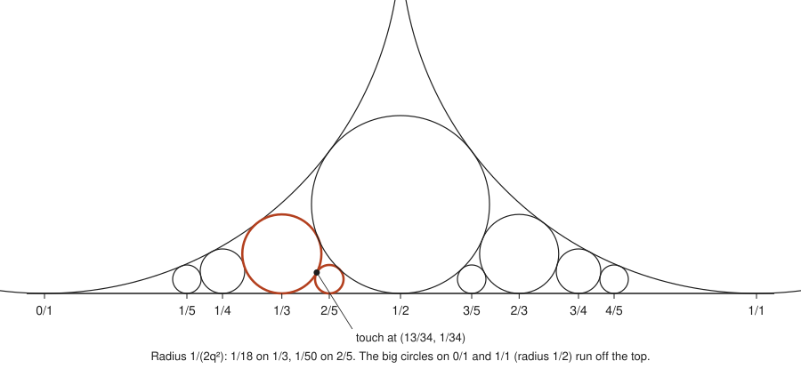

# Farey fractions and Ford circles: neighbours differ by one over the product of their bottoms, and their circles just touch

[Syllabus](../../../SYLLABUS.md) → [Number theory](../README.md) → [Quadratic Forms and Approximation](../README.md#s08) → Farey fractions and Ford circles

---

## General Overview

Mark a ruler from 0 to 1 at every fraction in lowest terms with bottom 5 or less: 0/1, 1/5, 1/4, 1/3, 2/5, 1/2, 3/5, 2/3, 3/4, 4/5, 1/1. These 11 marks are the **Farey sequence of order 5**, the order being the largest bottom.

Neighbours 1/3 and 2/5 cross-multiply to 2 × 3 − 1 × 5 = 1, and their gap is 1/15 = 1/(3 × 5).

Each new mark at a higher order is the **mediant** of its neighbours, tops and bottoms added: 1/3 and 1/2 give (1 + 1)/(3 + 2) = 2/5.

**Farey neighbours a/b and c/d always have b × c − a × d = 1, so their gap is 1/(b × d), their mediant is the first fraction between them, and their circles of radius 1/(2b²) and 1/(2d²) just touch.**

**What kind of fact this is:** a theorem, proved in Why it works. Step 4 is Dirichlet's approximation theorem.

<p align="center"></p>

Each fraction p/q carries a **Ford circle** of radius 1/(2q²); those on 1/3 and 2/5 touch at (13/34, 1/34).

---

## The formula

Neighbours a/b (left) and c/d (right):

```math
b \times c - a \times d = 1, \qquad \text{so} \qquad c/d - a/b = 1/(b \times d)
```

**Read it aloud:** neighbours cross-multiply to 1, so their gap is one over their bottoms' product.

The first fraction between them, and the radius on each p/q:

```math
\text{mediant} = (a + c)/(b + d), \qquad \text{radius at } p/q = 1/(2q^2)
```

For irrational x (not a fraction), infinitely many p/q in lowest terms satisfy:

```math
\lvert x - p/q \rvert < 1/q^2
```

| Symbol | Plain meaning | In our example |
| --- | --- | --- |
| $`N`$ | the order: largest bottom | 5 |
| $`a/b`$, $`c/d`$ | two neighbours | 1/3 and 2/5 |
| $`(a + c)/(b + d)`$ | the mediant | 2/5, from 1/3 and 1/2 |
| $`p/q`$ | a fraction in lowest terms | 3/5, then 5/8 |
| $`1/(2q^2)`$ | Ford circle radius | 1/18 at 1/3, 1/50 at 2/5 |
| $`x`$ | the irrational trapped | 0.618034, golden ratio less 1 |

### When it holds

- **Lowest terms only.** 2/4 beside 1/2 gives 1 × 4 − 2 × 2 = 0.
- **Radius 1/(2q²) exactly.** With 1/q², the circles on 1/3 and 2/5 overlap by 0.05364.
- **x irrational.** A fraction r/s has only finitely many: other p/q are at least 1/(s × q) away, too far once q ≥ s.

---

## Why it works

### Step 0: new marks arrive only as mediants

Start from 0/1 and 1/1. If new marks are always mediants, and mediants keep the cross-product at 1, it stays 1.

### Step 1: the mediant keeps the cross-product at 1

Put 2/5 between 1/3 and 1/2: 2 × 3 − 1 × 5 = 1 and 1 × 5 − 2 × 2 = 1. In general, (a + c) × b − a × (b + d) = b × c − a × d = 1; likewise on the right.

A cross-product of 1 also forces lowest terms ([Bezout's identity](../02-Greatest%20Common%20Divisor%20and%20Euclid%27s%20Algorithm/04-bezouts-identity.md)).

### Step 2: no smaller bottom fits between neighbours

Any p/q strictly between neighbours a/b and c/d has q ≥ b + d, with equality only for the mediant. So 2/5 comes first between 1/3 and 1/2.

<details>
<summary>Detailed proof: between neighbours, the bottom is at least b + d</summary>

Since a/b < p/q < c/d, the whole numbers b × p − a × q and c × q − d × p are both at least 1. Multiply b × c − a × d = 1 by q and regroup:

$`\displaystyle q = q(bc - ad) = d(bp - aq) + b(cq - dp) \ge d + b`$

Equality needs both brackets 1: the mediant.

Induction: a new mark between order-N neighbours a/b and c/d has q = N + 1 ≥ b + d. But b + d > N, or the mediant would already be there. So it is the mediant.

</details>

### Step 3: neighbours' circles just touch

Each centre's height is its radius, so neighbours' centres are 1/(b × d) apart sideways. By Pythagoras, distance² = gap² + (difference of radii)². And (sum of radii)² − (difference)² = 4 × 1/(2b²) × 1/(2d²) = 1/(b × d)², the gap squared. So the distance is the sum of the radii.

### Step 4: trapping an irrational within 1/q²

At order 5, x = 0.618034 sits between 3/5 and 2/3. Their mediant 5/8 splits the gap, leaving x within 1/(5 × 8) of 3/5, under 1/5².

In general, the mediant cuts the gap into widths 1/(b(b + d)) and 1/(d(b + d)). So x is under 1/(q(b + d)) from the neighbour p/q ending its half: under 1/q², and at most 1/(N + 1).

As x is not a fraction, that distance is positive; a larger N with 1/(N + 1) below it catches a closer fraction, forever. Order 8 gives 5/8.

---

## Worked numbers, by hand

| Step | Arithmetic | Value |
| --- | --- | --- |
| neighbour check | 2 × 3 − 1 × 5 | 1 |
| gap from 1/3 to 2/5 | 1/(3 × 5) | 1/15 = 0.06667 |
| mediant of 1/3 and 1/2 | (1 + 1)/(3 + 2) | 2/5 |
| Ford radii | 1/(2 × 9), 1/(2 × 25) | 0.05556, 0.02000 |
| centre distance | √((1/15)² + (1/18 − 1/50)²) | **0.07556** |
| radii added | 0.05556 + 0.02000 | **0.07556** |
| trap at order 5 | x − 3/5, 1/(5 × 8), 1/25 | 0.01803 < 0.02500 < 0.040000 |
| trap at order 8 | 5/8 − x, 1/(8 × 13), 1/64 | 0.00697 < 0.00962 < 0.015625 |

### What breaks if you drop a piece

| Mistake | Comes out at | What went wrong |
| --- | --- | --- |
| Averaging 1/3 and 1/2 | 5/12 | 2/5 arrived first, at order 5 |
| Radius 1/q² instead of 1/(2q²) | overlap 0.05364 | Touching needs the 2 |
| Expecting every fraction near x | 3/4: 0.13197 off, over 0.06250 | Not all qualify |

The code prints all three.

---

## Code, from first principles, and it actually runs

The code builds order 5 two ways, checks every neighbour pair to order 30, and checks the traps by plain search.

### Python

```python
# Farey fractions and Ford circles -- the check behind the card.  Standard library only.  Order 5 is listed twice.
from math import gcd, sqrt
X = (sqrt(5) - 1) / 2                                # 0.618034, the golden ratio less 1
def farey(n): return sorted({(p, q) for q in range(1, n + 1) for p in range(q + 1) if gcd(p, q) == 1}, key=lambda f: f[0] / f[1])
def by_mediants(n):                                  # road two: 0/1 and 1/1, then mediants only
    fs = [(0, 1), (1, 1)]
    for k in range(2, n + 1): fs = [fs[0]] + [h for (a, b), (c, d) in zip(fs, fs[1:]) for h in ([(a + c, k)] if b + d == k else []) + [(c, d)]]
    return fs
def gap(f, g, s=2):                                  # centre distance and radius sum; radius 1/(s q^2)
    return sqrt((g[0] / g[1] - f[0] / f[1]) ** 2 + (1 / (s * g[1] ** 2) - 1 / (s * f[1] ** 2)) ** 2), 1 / (s * f[1] ** 2) + 1 / (s * g[1] ** 2)
def trap(n):                                         # neighbours around X, then the mediant picks a half
    (a, b), (c, d) = next((f, g) for f, g in zip(farey(n), farey(n)[1:]) if f[0] / f[1] < X < g[0] / g[1])
    p, q = (a, b) if X < (a + c) / (b + d) else (c, d)
    print(f"order {n}: {a}/{b} < {X:.6f} < {c}/{d}, mediant {a + c}/{b + d}, so {p}/{q} is {abs(X - p / q):.5f} off, under 1/({q} x {b + d}) = {1 / (q * (b + d)):.5f} < 1/{q * q} = {1 / q ** 2:.6f}")
    return p, q, abs(X - p / q) < 1 / (q * (b + d)) < 1 / q ** 2
F = farey(5)                                         # road one: every p/q with q <= 5, lowest terms, sorted
print(f"order 5, {len(F)} fractions: " + " ".join(f"{p}/{q}" for p, q in F) + f"; built from mediants: {'same' if by_mediants(5) == F else 'DIFFERENT'}")
print("b x c - a x d: " + " ".join(str(b * c - a * d) for (a, b), (c, d) in zip(F, F[1:])) + "; gaps 1/(b x d): " + " ".join(f"1/{b * d}" for (a, b), (c, d) in zip(F, F[1:])))
print(f"1/3 and 2/5: 2 x 3 - 1 x 5 = {2 * 3 - 1 * 5}, gap {2 / 5 - 1 / 3:.5f} = 1/15; mediant of 1/3 and 1/2: {1 + 1}/{3 + 2}; average {1 * 2 + 1 * 3}/{3 * 2 * 2}; sum {1 * 2 + 1 * 3}/{3 * 2}")
(dist, rsum), (bad, badsum) = gap((1, 3), (2, 5)), gap((1, 3), (2, 5), 1)
print(f"Ford circles at 1/3 and 2/5: radii {1 / 18:.5f} and {1 / 50:.5f}, centres {dist:.5f} apart, radii add to {rsum:.5f}; with radius 1/q^2 they overlap by {badsum - bad:.5f}")
print(f"figure, centre 1/3 ({1 / 3:.5f}, {1 / 18:.5f}), centre 2/5 ({2 / 5:.5f}, {1 / 50:.5f}), touch at ({13 / 34:.5f}, {1 / 34:.5f}) = (13/34, 1/34)")
hits = [trap(5), trap(8)]
near = [(p, q) for q in range(1, 14) for p in range(q + 1) if gcd(p, q) == 1 and abs(X - p / q) < 1 / q ** 2]
print("search, q up to 13, fractions within 1/q^2: " + " ".join(f"{p}/{q}" for p, q in near) + f"; 3/4 misses: {abs(X - 3 / 4):.5f} > 1/16 = {1 / 16:.5f}")
assert by_mediants(30) == farey(30) and all(b * c - a * d == 1 for n in range(1, 31) for (a, b), (c, d) in zip(farey(n), farey(n)[1:]))
assert all(abs(gap(f, g)[0] - gap(f, g)[1]) < 1e-12 for f, g in zip(farey(30), farey(30)[1:])) and gap((1, 4), (1, 2))[0] > gap((1, 4), (1, 2))[1] + 1e-9
assert all(ok and (p, q) in near for p, q, ok in hits) and near == [(0, 1), (1, 1), (1, 2), (2, 3), (3, 5), (5, 8), (8, 13)]
assert abs(1 / 3 + (2 / 5 - 1 / 3) / 18 / dist - 13 / 34) < 1e-12 and abs(1 / 18 - (1 / 18 - 1 / 50) / 18 / dist - 1 / 34) < 1e-12
print("ALL CHECKS PASS")
```

**Ran 2026-11-23 on macOS, Python 3.14.10, standard library only. All checks passed. Output, pasted from the run:**

```
order 5, 11 fractions: 0/1 1/5 1/4 1/3 2/5 1/2 3/5 2/3 3/4 4/5 1/1; built from mediants: same
b x c - a x d: 1 1 1 1 1 1 1 1 1 1; gaps 1/(b x d): 1/5 1/20 1/12 1/15 1/10 1/10 1/15 1/12 1/20 1/5
1/3 and 2/5: 2 x 3 - 1 x 5 = 1, gap 0.06667 = 1/15; mediant of 1/3 and 1/2: 2/5; average 5/12; sum 5/6
Ford circles at 1/3 and 2/5: radii 0.05556 and 0.02000, centres 0.07556 apart, radii add to 0.07556; with radius 1/q^2 they overlap by 0.05364
figure, centre 1/3 (0.33333, 0.05556), centre 2/5 (0.40000, 0.02000), touch at (0.38235, 0.02941) = (13/34, 1/34)
order 5: 3/5 < 0.618034 < 2/3, mediant 5/8, so 3/5 is 0.01803 off, under 1/(5 x 8) = 0.02500 < 1/25 = 0.040000
order 8: 3/5 < 0.618034 < 5/8, mediant 8/13, so 5/8 is 0.00697 off, under 1/(8 x 13) = 0.00962 < 1/64 = 0.015625
search, q up to 13, fractions within 1/q^2: 0/1 1/1 1/2 2/3 3/5 5/8 8/13; 3/4 misses: 0.13197 > 1/16 = 0.06250
ALL CHECKS PASS
```

### Rust

Same numbers, same labels, built with `rustc --edition 2021 -O`.

```rust
// Farey fractions and Ford circles -- the same check as the Python, in Rust.  No crates.  Order 5 is listed twice.
type F = (i64, i64);
fn gcd(a: i64, b: i64) -> i64 { if b == 0 { a } else { gcd(b, a % b) } }
fn v(f: F) -> f64 { f.0 as f64 / f.1 as f64 }
fn show(fs: &[F]) -> String { fs.iter().map(|f| format!("{}/{}", f.0, f.1)).collect::<Vec<_>>().join(" ") }
fn farey(n: i64) -> Vec<F> {                         // road one: every p/q with q <= n, lowest terms, sorted
    let mut fs: Vec<F> = (1..=n).flat_map(|q| (0..=q).map(move |p| (p, q))).filter(|f| gcd(f.0, f.1) == 1).collect();
    fs.sort_by(|f, g| (f.0 * g.1).cmp(&(g.0 * f.1))); fs }
fn by_mediants(n: i64) -> Vec<F> { let mut fs: Vec<F> = vec![(0, 1), (1, 1)];   // road two: 0/1 and 1/1, then mediants only
    for k in 2..=n { let mut out = vec![fs[0]];
        for w in fs.windows(2) { if w[0].1 + w[1].1 == k { out.push((w[0].0 + w[1].0, k)); } out.push(w[1]); } fs = out; }
    fs }
fn gap(f: F, g: F, s: f64) -> (f64, f64) {           // centre distance and radius sum; radius 1/(s q^2)
    let (r1, r2) = (1.0 / (s * (f.1 * f.1) as f64), 1.0 / (s * (g.1 * g.1) as f64));
    (((v(g) - v(f)).powi(2) + (r2 - r1).powi(2)).sqrt(), r1 + r2)
}
fn trap(n: i64, x: f64) -> (F, bool) {               // neighbours around x, then the mediant picks a half
    let fs = farey(n); let w = fs.windows(2).find(|w| v(w[0]) < x && x < v(w[1])).unwrap(); let ((a, b), (c, d)) = (w[0], w[1]);
    let (p, q) = if x < v((a + c, b + d)) { (a, b) } else { (c, d) }; let (off, m) = ((x - v((p, q))).abs(), (q * (b + d)) as f64);
    println!("order {}: {}/{} < {:.6} < {}/{}, mediant {}/{}, so {}/{} is {:.5} off, under 1/({} x {}) = {:.5} < 1/{} = {:.6}", n, a, b, x, c, d, a + c, b + d, p, q, off, q, b + d, 1.0 / m, q * q, 1.0 / (q * q) as f64);
    ((p, q), off < 1.0 / m && 1.0 / m < 1.0 / (q * q) as f64)
}
fn main() {
    let x = (5f64.sqrt() - 1.0) / 2.0;               // 0.618034, the golden ratio less 1
    let f5 = farey(5); let pr: Vec<(F, F)> = f5.windows(2).map(|w| (w[0], w[1])).collect();
    println!("order 5, {} fractions: {}; built from mediants: {}", f5.len(), show(&f5), if by_mediants(5) == f5 { "same" } else { "DIFFERENT" });
    println!("b x c - a x d: {}; gaps 1/(b x d): {}", pr.iter().map(|((a, b), (c, d))| (b * c - a * d).to_string()).collect::<Vec<_>>().join(" "), pr.iter().map(|(f, g)| format!("1/{}", f.1 * g.1)).collect::<Vec<_>>().join(" "));
    println!("1/3 and 2/5: 2 x 3 - 1 x 5 = {}, gap {:.5} = 1/15; mediant of 1/3 and 1/2: {}/{}; average {}/{}; sum {}/{}", 2 * 3 - 1 * 5, 2.0 / 5.0 - 1.0 / 3.0, 1 + 1, 3 + 2, 1 * 2 + 1 * 3, 3 * 2 * 2, 1 * 2 + 1 * 3, 3 * 2);
    let ((dist, rsum), (bad, badsum)) = (gap((1, 3), (2, 5), 2.0), gap((1, 3), (2, 5), 1.0));
    println!("Ford circles at 1/3 and 2/5: radii {:.5} and {:.5}, centres {:.5} apart, radii add to {:.5}; with radius 1/q^2 they overlap by {:.5}", 1.0 / 18.0, 1.0 / 50.0, dist, rsum, badsum - bad);
    println!("figure, centre 1/3 ({:.5}, {:.5}), centre 2/5 ({:.5}, {:.5}), touch at ({:.5}, {:.5}) = (13/34, 1/34)", 1.0 / 3.0, 1.0 / 18.0, 2.0 / 5.0, 1.0 / 50.0, 13.0 / 34.0, 1.0 / 34.0);
    let hits = [trap(5, x), trap(8, x)];
    let near: Vec<F> = (1..14).flat_map(|q| (0..=q).map(move |p| (p, q))).filter(|&(p, q)| gcd(p, q) == 1 && (x - v((p, q))).abs() < 1.0 / (q * q) as f64).collect();
    println!("search, q up to 13, fractions within 1/q^2: {}; 3/4 misses: {:.5} > 1/16 = {:.5}", show(&near), (x - 0.75).abs(), 1.0 / 16.0);
    assert!(by_mediants(30) == farey(30) && (1..31).all(|n| farey(n).windows(2).all(|w| w[0].1 * w[1].0 - w[0].0 * w[1].1 == 1)));
    assert!(farey(30).windows(2).all(|w| { let (d, s) = gap(w[0], w[1], 2.0); (d - s).abs() < 1e-12 }) && gap((1, 4), (1, 2), 2.0).0 > gap((1, 4), (1, 2), 2.0).1 + 1e-9);
    assert!(hits.iter().all(|&(f, ok)| ok && near.contains(&f)) && near == vec![(0, 1), (1, 1), (1, 2), (2, 3), (3, 5), (5, 8), (8, 13)]);
    assert!((1.0 / 3.0 + (2.0 / 5.0 - 1.0 / 3.0) / 18.0 / dist - 13.0 / 34.0).abs() < 1e-12 && (1.0 / 18.0 - (1.0 / 18.0 - 1.0 / 50.0) / 18.0 / dist - 1.0 / 34.0).abs() < 1e-12);
    println!("ALL CHECKS PASS");
}
```

**Ran 2026-11-23 on macOS, rustc 1.98.1, no crates. All checks passed. Output, pasted from the run:**

```
order 5, 11 fractions: 0/1 1/5 1/4 1/3 2/5 1/2 3/5 2/3 3/4 4/5 1/1; built from mediants: same
b x c - a x d: 1 1 1 1 1 1 1 1 1 1; gaps 1/(b x d): 1/5 1/20 1/12 1/15 1/10 1/10 1/15 1/12 1/20 1/5
1/3 and 2/5: 2 x 3 - 1 x 5 = 1, gap 0.06667 = 1/15; mediant of 1/3 and 1/2: 2/5; average 5/12; sum 5/6
Ford circles at 1/3 and 2/5: radii 0.05556 and 0.02000, centres 0.07556 apart, radii add to 0.07556; with radius 1/q^2 they overlap by 0.05364
figure, centre 1/3 (0.33333, 0.05556), centre 2/5 (0.40000, 0.02000), touch at (0.38235, 0.02941) = (13/34, 1/34)
order 5: 3/5 < 0.618034 < 2/3, mediant 5/8, so 3/5 is 0.01803 off, under 1/(5 x 8) = 0.02500 < 1/25 = 0.040000
order 8: 3/5 < 0.618034 < 5/8, mediant 8/13, so 5/8 is 0.00697 off, under 1/(8 x 13) = 0.00962 < 1/64 = 0.015625
search, q up to 13, fractions within 1/q^2: 0/1 1/1 1/2 2/3 3/5 5/8 8/13; 3/4 misses: 0.13197 > 1/16 = 0.06250
ALL CHECKS PASS
```

The two outputs match line for line.

### Lean

Lean proves the card's facts for Farey lists of every order and for every irrational, not just the examples.

- Take neighbours a/b and c/d on a Farey list of any order. Then b × c − a × d = 1, so their gap is 1/(b × d).
- Their Ford circles just touch: the distance between the centres equals the sum of the radii.
- Take the same neighbours. Then the mediant (a + c)/(b + d) lies between them, with bottom b + d. Every other fraction between them has a bigger bottom.
- Take any irrational x. Then infinitely many p/q in lowest terms lie within 1/q² of x.
- It also re-checks the card's order-5 numbers: the 11 marks, their cross-products, the gap 1/15 and the mediant 2/5.
- It checks the touch point (13/34, 1/34), the overlap with radius 1/q², and 2/4 beside 1/2 giving 0.

Building the lists by mediants, the sweep to order 30 and the golden-ratio traps are left to the Python and Rust checks.

```lean
-- Farey fractions and Ford circles: neighbours a/b < c/d on a Farey list have b × c − a × d = 1, so their gap is 1/(b × d), their Ford circles of radius 1/(2b²) and 1/(2d²) touch, the first fraction between them is the mediant, and every irrational has infinitely many fractions p/q within 1/q².
import Mathlib.NumberTheory.DiophantineApproximation.Basic
import Mathlib.Tactic.NormNum.GCD
import Mathlib.Tactic.LinearCombination

/-- The Farey fractions of order `N`: the fractions from 0 to 1 whose bottom, in lowest terms,
is at most `N`. A Lean rational `q` is always kept in lowest terms, with top `q.num` and
bottom `q.den`. -/
def fareySet (N : ℕ) : Set ℚ := {q | 0 ≤ q ∧ q ≤ 1 ∧ q.den ≤ N}

/-- `x` and `y` are neighbours on the Farey list of order `N`: both are on it, `x < y`, and no
fraction of the list lies strictly between them. -/
def FareyNeighbours (N : ℕ) (x y : ℚ) : Prop :=
  x ∈ fareySet N ∧ y ∈ fareySet N ∧ x < y ∧ ∀ z ∈ fareySet N, ¬ (x < z ∧ z < y)

theorem rat_eq_num_div_den' (q : ℚ) : q = (q.num : ℚ) / ((q.den : ℤ) : ℚ) := by
  rw [Int.cast_natCast]; exact (Rat.num_div_den q).symm

theorem farey_aux {N : ℕ} {x y : ℚ} (h : FareyNeighbours N x y) :
    (x.den : ℤ) * y.num - x.num * y.den = 1 := by
  obtain ⟨⟨hx0, hx1, hxN⟩, ⟨hy0, hy1, hyN⟩, hxy, hnone⟩ := h
  have hxq := rat_eq_num_div_den' x
  have hyq := rat_eq_num_div_den' y
  set a : ℤ := x.num with ha
  set b : ℤ := (x.den : ℤ) with hb
  set c : ℤ := y.num with hc
  set d : ℤ := (y.den : ℤ) with hd
  have hbpos : 0 < b := by simp [hb, x.den_pos]
  have hdpos : 0 < d := by simp [hd, y.den_pos]
  have hbq : (0 : ℚ) < (b : ℚ) := by exact_mod_cast hbpos
  have hdq : (0 : ℚ) < (d : ℚ) := by exact_mod_cast hdpos
  have hbN : b ≤ N := by simp only [hb]; exact_mod_cast hxN
  have hdN : d ≤ N := by simp only [hd]; exact_mod_cast hyN
  -- integer forms of order facts
  have ha0 : 0 ≤ a := by
    have : (0 : ℚ) ≤ (a : ℚ) / (b : ℚ) := hxq ▸ hx0
    have := (div_nonneg_iff.mp this)
    rcases this with ⟨h1, _⟩ | ⟨_, h2⟩
    · exact_mod_cast h1
    · linarith
  have hD1 : 1 ≤ b * c - a * d := by
    have : (a : ℚ) / (b : ℚ) < (c : ℚ) / (d : ℚ) := by rw [← hxq, ← hyq]; exact hxy
    rw [div_lt_div_iff₀ hbq hdq] at this
    have : a * d < c * b := by exact_mod_cast this
    linarith
  have hab : a < b := by
    have : (a : ℚ) / (b : ℚ) < 1 := by rw [← hxq]; exact lt_of_lt_of_le hxy hy1
    rw [div_lt_one hbq] at this
    exact_mod_cast this
  -- Bezout
  have hg : Int.gcd a b = 1 := by
    simpa [ha, hb, Int.gcd] using x.reduced
  have hbez := Int.gcd_eq_gcd_ab a b
  rw [hg] at hbez
  set s := Int.gcdA a b
  set t := Int.gcdB a b
  -- b * t - a * v = 1 with v = -s
  set v : ℤ := -s with hv
  set k : ℤ := ((N : ℤ) - v) / b with hk
  have hr0 : 0 ≤ ((N : ℤ) - v) % b := Int.emod_nonneg _ hbpos.ne'
  have hrb : ((N : ℤ) - v) % b < b := Int.emod_lt_of_pos _ hbpos
  have hrk : ((N : ℤ) - v) % b + b * k = (N : ℤ) - v := Int.emod_add_mul_ediv _ _
  set u' : ℤ := t + a * k with hu'
  set v' : ℤ := v + b * k with hv'
  have hbez' : b * u' - a * v' = 1 := by
    simp only [hu', hv', hv]; linear_combination hbez.symm
  have hv'N : v' ≤ N := by simp only [hv']; linarith
  have hv'lo : (N : ℤ) - b < v' := by simp only [hv']; linarith
  have hv'pos : 0 < v' := by
    have : (0 : ℤ) ≤ N - b := by linarith
    linarith
  have hu'pos : 0 < u' := by nlinarith
  have hu'v' : u' ≤ v' := by nlinarith
  have hv'q : (0 : ℚ) < (v' : ℚ) := by exact_mod_cast hv'pos
  set z : ℚ := (u' : ℚ) / (v' : ℚ) with hz
  have hzden : (z.den : ℤ) ≤ v' := by
    have h1 : ((Rat.divInt u' v').den : ℤ) ∣ v' := Rat.den_dvd u' v'
    rw [Rat.divInt_eq_div] at h1
    exact Int.le_of_dvd hv'pos h1
  have hzmem : z ∈ fareySet N := by
    refine ⟨?_, ?_, ?_⟩
    · exact div_nonneg (by exact_mod_cast hu'pos.le) hv'q.le
    · rw [div_le_one hv'q]; exact_mod_cast hu'v'
    · have : (z.den : ℤ) ≤ N := le_trans hzden hv'N
      exact_mod_cast this
  have hxz : x < z := by
    rw [hxq, hz, div_lt_div_iff₀ hbq hv'q]
    have : a * v' < u' * b := by linarith
    exact_mod_cast this
  have hyz : y ≤ z := by
    by_contra hcon
    exact hnone z hzmem ⟨hxz, lt_of_not_ge hcon⟩
  have hD2 : 0 ≤ u' * d - c * v' := by
    have : (c : ℚ) / (d : ℚ) ≤ (u' : ℚ) / (v' : ℚ) := by rw [← hyq]; exact hyz
    rw [div_le_div_iff₀ hdq hv'q] at this
    have : c * v' ≤ u' * d := by exact_mod_cast this
    linarith
  have hid : b * (u' * d - c * v') + v' * (b * c - a * d) = d := by
    linear_combination d * hbez'
  -- D2 = 0
  have hD2z : u' * d - c * v' = 0 := by
    by_contra hne
    have : 1 ≤ u' * d - c * v' := by omega
    nlinarith
  have hdv : d ∣ c * v' := ⟨u', by linarith⟩
  have hgcd : Int.gcd d c = 1 := by
    simpa [hc, hd, Int.gcd, Nat.coprime_comm] using y.reduced
  have hdv' : d ∣ v' := Int.dvd_of_dvd_mul_right_of_gcd_one hdv hgcd
  have hdle : d ≤ v' := Int.le_of_dvd hv'pos hdv'
  nlinarith

/-- Neighbours a/b < c/d on the Farey list of any order have b × c − a × d = 1, so their gap
is 1/(b × d), and their Ford circles (centre (a/b, 1/(2b²)) with radius 1/(2b²), and centre
(c/d, 1/(2d²)) with radius 1/(2d²)) just touch: the distance between the centres equals the
sum of the radii. -/
theorem farey_neighbours_cross_product_eq_one {N : ℕ} {x y : ℚ} (h : FareyNeighbours N x y) :
    (x.den : ℤ) * y.num - x.num * y.den = 1 ∧
    y - x = 1 / ((x.den : ℚ) * y.den) ∧
    Real.sqrt (((y : ℝ) - x) ^ 2 + (1 / (2 * (y.den : ℝ) ^ 2) - 1 / (2 * (x.den : ℝ) ^ 2)) ^ 2)
      = 1 / (2 * (x.den : ℝ) ^ 2) + 1 / (2 * (y.den : ℝ) ^ 2) := by
  have h1 := farey_aux h
  have hcast : (x.den : ℚ) * y.num - x.num * y.den = 1 := by exact_mod_cast h1
  have hbne : (x.den : ℚ) ≠ 0 := by exact_mod_cast x.den_ne_zero
  have hdne : (y.den : ℚ) ≠ 0 := by exact_mod_cast y.den_ne_zero
  have hgap : y - x = 1 / ((x.den : ℚ) * y.den) := by
    conv_lhs => rw [← Rat.num_div_den x, ← Rat.num_div_den y]
    rw [div_sub_div _ _ hdne hbne, ← hcast]
    field_simp
  refine ⟨h1, hgap, ?_⟩
  have hr : ((y : ℝ) - x) = 1 / ((x.den : ℝ) * y.den) := by
    have := congrArg (fun q : ℚ => (q : ℝ)) hgap
    push_cast at this
    exact this
  have hbR : (x.den : ℝ) ≠ 0 := by exact_mod_cast x.den_ne_zero
  have hdR : (y.den : ℝ) ≠ 0 := by exact_mod_cast y.den_ne_zero
  rw [hr]
  rw [show (1 / ((x.den : ℝ) * y.den)) ^ 2 + (1 / (2 * (y.den : ℝ) ^ 2) - 1 / (2 * (x.den : ℝ) ^ 2)) ^ 2
      = (1 / (2 * (x.den : ℝ) ^ 2) + 1 / (2 * (y.den : ℝ) ^ 2)) ^ 2 by field_simp; ring]
  exact Real.sqrt_sq (by positivity)

/-- The first fraction between Farey neighbours a/b < c/d is their mediant (a + c)/(b + d):
the mediant lies strictly between them with bottom exactly b + d, every fraction strictly
between them has bottom at least b + d, and the only one with bottom b + d is the mediant. -/
theorem farey_neighbours_mediant_first_between {N : ℕ} {x y : ℚ} (h : FareyNeighbours N x y) :
    let m : ℚ := ((x.num + y.num : ℤ) : ℚ) / ((x.den + y.den : ℕ) : ℚ)
    x < m ∧ m < y ∧ m.den = x.den + y.den ∧
    ∀ z : ℚ, x < z → z < y → x.den + y.den ≤ z.den ∧ (z.den = x.den + y.den → z = m) := by
  intro m
  have h1 := farey_aux h
  have hxq := rat_eq_num_div_den' x
  have hyq := rat_eq_num_div_den' y
  have hmq : m = ((x.num + y.num : ℤ) : ℚ) / (((x.den : ℤ) + (y.den : ℤ) : ℤ) : ℚ) := by
    simp only [m]; push_cast; rfl
  set a : ℤ := x.num with ha
  set b : ℤ := (x.den : ℤ) with hb
  set c : ℤ := y.num with hc
  set d : ℤ := (y.den : ℤ) with hd
  have hbpos : 0 < b := by simp [hb, x.den_pos]
  have hdpos : 0 < d := by simp [hd, y.den_pos]
  have hbq : (0 : ℚ) < (b : ℚ) := by exact_mod_cast hbpos
  have hdq : (0 : ℚ) < (d : ℚ) := by exact_mod_cast hdpos
  have hbdq : (0 : ℚ) < ((b + d : ℤ) : ℚ) := by exact_mod_cast (by linarith : 0 < b + d)
  have hcop : IsCoprime (a + c) (b + d) := ⟨b, -a, by linear_combination h1⟩
  have hmden : ((m.den : ℤ)) = b + d := by
    rw [hmq]
    exact Rat.den_div_eq_of_coprime (by linarith) (Int.isCoprime_iff_gcd_eq_one.mp hcop)
  refine ⟨?_, ?_, ?_, ?_⟩
  · rw [hxq, hmq, div_lt_div_iff₀ hbq hbdq]
    have : a * (b + d) < (a + c) * b := by nlinarith
    exact_mod_cast this
  · rw [hyq, hmq, div_lt_div_iff₀ hbdq hdq]
    have : (a + c) * d < c * (b + d) := by nlinarith
    exact_mod_cast this
  · have : (m.den : ℤ) = ((x.den + y.den : ℕ) : ℤ) := by rw [hmden]; push_cast; rfl
    exact_mod_cast this
  · intro z hxz hzy
    have hzq := rat_eq_num_div_den' z
    set p : ℤ := z.num with hp
    set q : ℤ := (z.den : ℤ) with hq
    have hqpos : 0 < q := by simp [hq, z.den_pos]
    have hqq : (0 : ℚ) < (q : ℚ) := by exact_mod_cast hqpos
    have hD1 : 1 ≤ b * p - a * q := by
      have h' : (a : ℚ) / (b : ℚ) < (p : ℚ) / (q : ℚ) := by rw [← hxq, ← hzq]; exact hxz
      rw [div_lt_div_iff₀ hbq hqq] at h'
      have : a * q < p * b := by exact_mod_cast h'
      linarith
    have hD2 : 1 ≤ c * q - d * p := by
      have h' : (p : ℚ) / (q : ℚ) < (c : ℚ) / (d : ℚ) := by rw [← hzq, ← hyq]; exact hzy
      rw [div_lt_div_iff₀ hqq hdq] at h'
      have : p * d < c * q := by exact_mod_cast h'
      linarith
    have hid : d * (b * p - a * q) + b * (c * q - d * p) = q := by
      linear_combination q * h1
    have hqge : b + d ≤ q := by nlinarith
    have hqge' : ((x.den + y.den : ℕ) : ℤ) ≤ (z.den : ℤ) := by push_cast; exact hqge
    refine ⟨by exact_mod_cast hqge', fun hzd => ?_⟩
    have hqeq : q = b + d := by simp only [hq, hb, hd]; exact_mod_cast hzd
    have hD1e : b * p - a * q = 1 := by nlinarith
    have hpeq : p = a + c := by
      have : b * p = b * (a + c) := by rw [hqeq] at hD1e; linear_combination hD1e - h1
      exact mul_left_cancel₀ hbpos.ne' this
    rw [hzq, hmq, hpeq, hqeq]

/-- Dirichlet's approximation theorem, the card's Step 4: every irrational `ξ` has infinitely
many fractions p/q in lowest terms with |ξ − p/q| < 1/q². -/
theorem irrational_infinitely_many_within_one_div_den_sq {ξ : ℝ} (hξ : Irrational ξ) :
    {q : ℚ | |ξ - q| < 1 / (q.den : ℝ) ^ 2}.Infinite := by
  exact Real.infinite_rat_abs_sub_lt_one_div_den_sq_of_irrational hξ

/-- The order-5 list from the card, as (top, bottom) pairs. -/
def order5 : List (ℕ × ℕ) :=
  [(0, 1), (1, 5), (1, 4), (1, 3), (2, 5), (1, 2), (3, 5), (2, 3), (3, 4), (4, 5), (1, 1)]

-- Order 5 has exactly 11 fractions from 0 to 1 in lowest terms with bottom at most 5.
example : ((Finset.range 6 ×ˢ Finset.Icc 1 5).filter
    (fun pq : ℕ × ℕ => pq.1 ≤ pq.2 ∧ Nat.gcd pq.1 pq.2 = 1)).card = 11 := by decide

-- Each listed fraction is in lowest terms with bottom at most 5.
example : ∀ pq ∈ order5, Nat.gcd pq.1 pq.2 = 1 ∧ pq.1 ≤ pq.2 ∧ pq.2 ≤ 5 := by decide

-- Every neighbouring pair a/b, c/d on the order-5 list has b × c − a × d = 1.
example : ∀ p ∈ order5.zip order5.tail,
    (p.1.2 * p.2.1 : ℤ) - p.1.1 * p.2.2 = 1 := by decide

-- Neighbours 1/3 and 2/5: 2 × 3 − 1 × 5 = 1, and their gap is 1/15.
example : (2 * 3 - 1 * 5 : ℤ) = 1 := by norm_num
example : (2 / 5 - 1 / 3 : ℚ) = 1 / (3 * 5) := by norm_num

-- The mediant of 1/3 and 1/2 is (1 + 1)/(3 + 2) = 2/5; the average is 5/12 and the sum is 5/6.
example : ((1 + 1) / (3 + 2) : ℚ) = 2 / 5 := by norm_num
example : ((1 / 3 + 1 / 2) / 2 : ℚ) = 5 / 12 ∧ (1 / 3 + 1 / 2 : ℚ) = 5 / 6 := by norm_num

-- Ford circles at 1/3 and 2/5 have radii 1/18 and 1/50; the squared distance between centres
-- equals the squared sum of radii, so they touch.
example : (1 / (2 * 3 ^ 2) : ℚ) = 1 / 18 ∧ (1 / (2 * 5 ^ 2) : ℚ) = 1 / 50 := by norm_num
example : ((2 / 5 - 1 / 3) ^ 2 + (1 / 18 - 1 / 50) ^ 2 : ℚ) = (1 / 18 + 1 / 50) ^ 2 := by norm_num

-- The touching point (13/34, 1/34) lies on both circles.
example : ((13 / 34 - 1 / 3) ^ 2 + (1 / 34 - 1 / 18) ^ 2 : ℚ) = (1 / 18) ^ 2 ∧
    ((13 / 34 - 2 / 5) ^ 2 + (1 / 34 - 1 / 50) ^ 2 : ℚ) = (1 / 50) ^ 2 := by norm_num

-- With radius 1/q² instead, the circles on 1/3 and 2/5 overlap: centres are closer than the radii's sum.
example : ((2 / 5 - 1 / 3) ^ 2 + (1 / 9 - 1 / 25) ^ 2 : ℚ) < (1 / 9 + 1 / 25) ^ 2 := by norm_num

-- Lowest terms only: 2/4 beside 1/2 gives 1 × 4 − 2 × 2 = 0.
example : (1 * 4 - 2 * 2 : ℤ) = 0 := by norm_num

#print axioms farey_neighbours_cross_product_eq_one
#print axioms farey_neighbours_mediant_first_between
#print axioms irrational_infinitely_many_within_one_div_den_sq
#print axioms rat_eq_num_div_den'
#print axioms farey_aux
```

**Checked 2026-11-23 on macOS, Lean 4.36.0-rc2, Mathlib v4.36.0-rc2. Every proof is complete and uses only Lean's standard axioms. Output, pasted from the run:**

```
'farey_neighbours_cross_product_eq_one' depends on axioms: [propext, Classical.choice, Quot.sound]
'farey_neighbours_mediant_first_between' depends on axioms: [propext, Classical.choice, Quot.sound]
'irrational_infinitely_many_within_one_div_den_sq' depends on axioms: [propext, Classical.choice, Quot.sound]
'rat_eq_num_div_den'' depends on axioms: [propext, Classical.choice, Quot.sound]
'farey_aux' depends on axioms: [propext, Classical.choice, Quot.sound]
```

> [!TIP]
> **Try changing**
> Guess first, then run it.
> - **Trap at order 13.** Change `trap(8)` to `trap(13)`. It catches 8/13, 0.00265 off, under 0.00366. The checks pass.
> - **Trap a different irrational.** Set `X = sqrt(2) - 1`. Order 5 catches 2/5, 0.01421 off. The search finds 0/1 1/1 1/2 1/3 2/5 3/7 5/12, so the third assert stops it.
> - **Drop the factor 2.** Change `s=2` to `s=1` in `gap`. The circles overlap, and the second assert stops it.

---

## The usual mistake

> [!warning]
> **Reading the mediant as a sum.** 1/3 + 1/2 = 5/6, not even between them. The mediant adds tops and bottoms separately: 2/5.


---

## Where you meet it in real life

- **Clock gears.** In 1861 the clockmaker Achille Brocot found the best gear ratios by repeated mediants.
- **Rounding to a simple fraction.** The closest fraction with bottom at most N is an order-N neighbour: 3/5 for 0.618034 at N = 5.
- **Points on a circle.** Step round a circle by an irrational part of a turn; the gaps take at most three lengths: [Three distances](../../21-Algebraic%20and%20analytic%20number%20theory/08-Additive%20Combinatorics%20and%20Probabilistic%20Number%20Theory/04-three-distance-theorem.md).

> **Say it back**
> The Farey list of order N holds the fractions from 0 to 1 with bottom at most N. Neighbours a/b and c/d have b × c − a × d = 1, so their gap is 1/(b × d). The first fraction between them is the mediant. Circles of radius 1/(2q²) on neighbours just touch. Trapping an irrational between neighbours gives infinitely many p/q within 1/q².

---

## What this builds on

- [Greatest common divisor](../02-Greatest%20Common%20Divisor%20and%20Euclid%27s%20Algorithm/01-gcd.md): lowest terms means gcd 1.
- [Bezout's identity](../02-Greatest%20Common%20Divisor%20and%20Euclid%27s%20Algorithm/04-bezouts-identity.md): b × c − a × d = 1 forces lowest terms.
- [Continued fractions](../07-For%20the%20Curious/05-continued-fractions-and-leap-years.md): its stops, like 3/5 and 5/8, are Farey neighbours.
- [Periodic continued fractions](03-periodic-continued-fractions.md): the pattern in 3/5, 5/8, 8/13.

## Where this goes next

- [Hurwitz's theorem](05-hurwitz-approximation-theorem.md): 1/q² tightens to 1/(√5 × q²); the golden ratio blocks more.
- [The large sieve](../../21-Algebraic%20and%20analytic%20number%20theory/04-Sieves%20and%20Prime%20Gaps/03-the-large-sieve.md): spread-out Farey fractions limit how numbers crowd into remainder classes.

---

## Sources

Verified 2026-11-23: every link below resolves to the publisher's page.

- Hardy, G. H., and E. M. Wright. *An Introduction to the Theory of Numbers*, 6th ed., ch. III, "Farey Series and a Theorem of Minkowski." Oxford University Press, 2008. [doi:10.1093/oso/9780199219858.003.0003](https://doi.org/10.1093/oso/9780199219858.003.0003). Neighbours, mediants, the 1/q² bound.
- Ford, L. R. "Fractions." *The American Mathematical Monthly* 45, no. 9 (1938): 586–601. [doi:10.1080/00029890.1938.11990863](https://doi.org/10.1080/00029890.1938.11990863). The touching circles.
- Graham, Ronald L., Donald E. Knuth and Oren Patashnik. *Concrete Mathematics*, 2nd ed. Addison-Wesley, 1994. [Publisher page](https://www.informit.com/store/concrete-mathematics-a-foundation-for-computer-science-9780201558029). Section 4.5: Brocot's gears.
