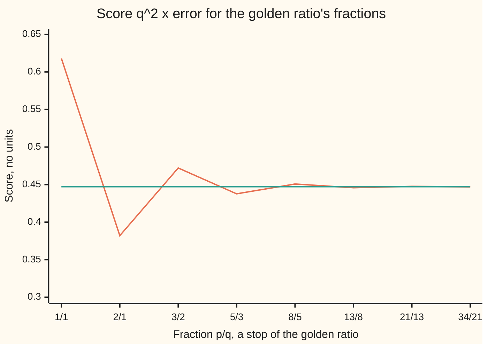

# Hurwitz's theorem: every irrational has infinitely many fractions within 1/(root 5 q^2), and the golden ratio shows root 5 cannot be beaten

[Syllabus](../../../SYLLABUS.md) → [Number theory](../README.md) → [Quadratic Forms and Approximation](../README.md#s08) → Hurwitz's theorem

---

## General Overview

22/7 is off from π by 0.00126. Hurwitz's yardstick at bottom number 7 is 1/(√5 × 7²) = 0.00913, so 22/7 lands far inside it.

Every irrational number (no fraction, such as π or √2) has infinitely many fractions inside that yardstick, and √5 is the best constant. Score a fraction by q² times its error. For the golden ratio φ = 1.6180340, the stops (cut-offs of its continued fraction) 8/5, 13/8 and 21/13 score 0.4508, 0.4458 and 0.4477, closing in on 1/√5 = 0.4472 from both sides.

**Every irrational number α has infinitely many fractions p/q with an error below 1/(√5 q²), and for the golden ratio no constant bigger than √5 works.**

**What kind of fact this is:** a theorem, proved on this card in Why it works.

### The picture: the golden ratio's score closes in on 1/√5



The zigzag is each score; the flat line is 1/√5 = 0.4472. Points under it pass.

---

## The formula

```math
\left| \alpha - p/q \right| < 1/(\sqrt{5}\, q^2)
```

**Read it aloud:** the gap between number and fraction is less than one over root 5 times the bottom number squared.

Times q², the test reads: **score below 1/√5 = 0.4472136**.

| Symbol | Plain meaning | In our example | Push it up and the answer… |
| --- | --- | --- | --- |
| α | the irrational number | π, or the golden ratio | — |
| p/q | a fraction in lowest terms: top p, bottom q | 22/7; 13/8 | the bound shrinks like 1/q² |
| q² × error | the score | 0.0620 for 22/7 | lower is better |
| √5, or k | the constant, 2.2360680; k is any constant tried instead | bound 0.00913 at q = 7; k = 2.3 or 3 | fewer pass; for φ, finitely many past √5 |
| φ | the golden ratio, (1 + √5)/2 | 1.6180340 | — |
| a/b < c/d, t | Farey neighbours trapping α; t = d/b | 8/5 < 13/8 for φ, t = 8/5 | — |

### When it holds

- **α is irrational.** A fraction such as 3/2 has only finitely many that close.
- **Infinitely many, not all.** 333/106 scores 0.9351 and misses.
- **The constant is at most √5.** With 2.3, φ has only one passing fraction, 2/1. Numbers such as √2 allow more.

---

## Why it works

### Step 0: trap α between Farey neighbours

**Farey neighbours** a/b < c/d have bc − ad = 1 ([Farey fractions and Ford circles](04-farey-sequences-and-ford-circles.md)), so their gap is 1/(bd). Their **mediant** (a + c)/(b + d) sits between, a neighbour of each.

Trap α between neighbours. If a/b, c/d and the mediant all missed, the misses would overfill the gap. So one passes.

### Step 1: two misses squeeze the ratio of the bottoms

Say a/b and c/d both miss: α − a/b ≥ 1/(√5 b²) and c/d − α ≥ 1/(√5 d²). The two add to the gap 1/(bd).

<details>
<summary>The algebra: from the two misses to a squeeze on d/b</summary>

Add the two misses and multiply by √5 b²d²:

$`\displaystyle \sqrt{5}\, b d \ge b^2 + d^2`$

Divide by b² and write t = d/b:

$`\displaystyle t^2 - \sqrt{5}\, t + 1 \le 0`$

Its roots are φ − 1 and φ.

</details>

So t lies between φ − 1 and φ.

### Step 2: a third miss pins the ratio to an irrational

Say α lies between a/b and the mediant. If both miss, Step 1 puts (b + d)/b = 1 + t between φ − 1 and φ. So t is at most φ − 1.

Step 1 said t ≥ φ − 1, so t = φ − 1. But t is a fraction and φ − 1 is not, so one passes. If α lies on the mediant's other side, swap b and d.

### Step 3: infinitely many

Swap a neighbour for the mediant, keeping α trapped, and repeat. The gap 1/(bd) shrinks to 0, and each trap holds a passing fraction with error below the gap. Errors never reach 0, so new passing fractions keep appearing.

### Step 4: the golden ratio cannot do better

φ² = φ + 1. For a fraction p/q, the whole number p² − pq − q² is never 0, since φ is irrational, so its size is ≥ 1. It factors as q² × (p/q − φ) × (p/q − (1 − φ)).

The second bracket is √5 + (p/q − φ), at most √5 + score/q² in size. So score × (√5 + score/q²) ≥ 1. A score below 1/k, with k > √5, forces q² below 1/(k × (k − √5)). For k = 2.3, q is below 2.61. Only finitely many fractions qualify.

For φ's stops, p² − pq − q² is exactly ±1, the smallest possible, so the score is exactly 1/(p/q + φ − 1). As p/q swings around φ, the score zigzags around 1/√5. Every irrational gets √5, and φ no more.

---

## Worked numbers, by hand

| Step | Arithmetic | Value |
| --- | --- | --- |
| π against 22/7 | error | 0.00126 |
| the bound at q = 7 | 1/(√5 × 49) | 0.00913 |
| score of 22/7 | 7² × error | 0.0620 |
| φ against 8/5 | error, bound 1/(√5 × 25) = 0.01789 | 0.01803, **misses** |
| φ against 13/8 | error, bound 1/(√5 × 64) = 0.00699 | 0.00697, **meets** |
| p² − pq − q² at 8/5 and 13/8 | 64 − 40 − 25; 169 − 104 − 64 | −1 and 1 |
| every q up to 120, φ | brute force | **2/1, 5/3, 13/8, 34/21, 89/55** |

Every second stop of φ passes, by a shrinking margin: 0.00697 against 0.00699 at 13/8.

### What breaks if you drop a piece

| Mistake | Comes out at | What went wrong |
| --- | --- | --- |
| 3 in place of √5 for φ | 0 fractions up to q = 120 | √5 is the largest constant for φ |
| Not squaring q for 8/5 | bound 0.08944, a false pass | the bound shrinks with q² |
| Rounding φ to 1.618 | 13/8 scores 0.4480, a false miss | 13/8 passes by less than the rounding |

---

## Code, from first principles, and it actually runs

Three independent roads. Road one tries every q up to 120. Road two walks 15 Farey traps; each triple must hold a passing fraction. Road three predicts φ's results from p² − pq − q² = ±1 and is checked against road one.

### Python

```python
# Hurwitz's theorem -- the check behind the card.  Imports: square root, pi, floor and gcd only.
from math import sqrt, pi, floor, gcd
R5, TOP = sqrt(5), 120; PHI = (1 + R5) / 2           # root 5, the search limit, the golden ratio
def eps(x, p, q): return q * q * abs(x - p / q)      # q^2 x error; under 1/c means within 1/(c q^2)
def hits(x, c=R5):                                   # road 1: try every bottom number q up to TOP
    return [f"{round(x * q)}/{q}" for q in range(1, TOP + 1) if gcd(round(x * q), q) == 1 and eps(x, round(x * q), q) < 1 / c]
def farey(x, steps):                                 # road 2: walk Farey neighbours a/b < x < c/d
    a, b, c, d, ok = floor(x), 1, floor(x) + 1, 1, 0
    for _ in range(steps):                           # count triples a/b, mediant, c/d with a hit
        ok += any(eps(x, h, k) < 1 / R5 for h, k in [(a, b), (c, d), (a + c, b + d)])
        a, b, c, d = (a + c, b + d, c, d) if (a + c) / (b + d) < x else (a, b, a + c, b + d)
    return ok
F = [(1, 1), (2, 1), (3, 2), (5, 3), (8, 5), (13, 8), (21, 13), (34, 21)]   # the golden ratio's stops
E, fib = [eps(PHI, p, q) for p, q in F], [1, 1]
while fib[-1] <= 2 * TOP: fib.append(fib[-1] + fib[-2])
print(f"root 5 = {R5:.7f}, 1/root 5 = {1 / R5:.7f}, golden ratio = {PHI:.7f}")
print(f"pi: 22/7 is off by {abs(pi - 22 / 7):.5f}, bound 1/(root 5 x 49) = {1 / (R5 * 49):.5f}")
print("pi, q^2 x error at 3/1 22/7 333/106 355/113:", *[f"{eps(pi, p, q):.4f}" for p, q in [(3, 1), (22, 7), (333, 106), (355, 113)]])
print("phi, q^2 x error at 1/1 2/1 3/2 5/3 8/5 13/8 21/13 34/21:", *[f"{e:.4f}" for e in E])
print("phi, p^2 - pq - q^2 at the same fractions:", *[p * p - p * q - q * q for p, q in F])
print(f"8/5 is off by {PHI - 8 / 5:.5f}, bound {1 / (R5 * 25):.5f} | 13/8 is off by {13 / 8 - PHI:.5f}, bound {1 / (R5 * 64):.5f}")
print(f"every q up to {TOP}, within 1/(root 5 q^2): pi", *hits(pi), "| phi", *hits(PHI))
print("phi with 2.3 for root 5:", *hits(PHI, 2.3), f"| the proof allows only q below {sqrt(1 / (2.3 * (2.3 - R5))):.2f}")
print(f"Farey triples with a hit, of 15 walked: pi {farey(pi, 15)}, phi {farey(PHI, 15)}")
print(f"mistakes: 3 for root 5 finds {len(hits(PHI, 3))} for phi | 8/5 against 1/(root 5 x 5) = {1 / (R5 * 5):.5f} | phi as 1.618 puts 13/8 at {eps(1.618, 13, 8):.4f}")
assert all(abs(p * p - p * q - q * q) == 1 and abs(e - 1 / (p / q + PHI - 1)) < 1e-12 for (p, q), e in zip(F, E))
assert [e > 1 / R5 for e in E[2:]] == [True, False] * 3 and farey(pi, 15) == farey(PHI, 15) == 15
assert hits(PHI) == [f"{p}/{q}" for q, p in zip(fib, fib[1:]) if q <= TOP and p * p - p * q - q * q == 1]
assert hits(pi) == ["3/1", "22/7", "355/113"] and all(int(h.split('/')[1]) < sqrt(1 / (2.3 * (2.3 - R5))) for h in hits(PHI, 2.3))
print("ALL CHECKS PASS")
```

**Ran 2026-11-23 on macOS, Python 3.14.10, standard library only. All checks passed. Output, pasted from the run:**

```
root 5 = 2.2360680, 1/root 5 = 0.4472136, golden ratio = 1.6180340
pi: 22/7 is off by 0.00126, bound 1/(root 5 x 49) = 0.00913
pi, q^2 x error at 3/1 22/7 333/106 355/113: 0.1416 0.0620 0.9351 0.0034
phi, q^2 x error at 1/1 2/1 3/2 5/3 8/5 13/8 21/13 34/21: 0.6180 0.3820 0.4721 0.4377 0.4508 0.4458 0.4477 0.4470
phi, p^2 - pq - q^2 at the same fractions: -1 1 -1 1 -1 1 -1 1
8/5 is off by 0.01803, bound 0.01789 | 13/8 is off by 0.00697, bound 0.00699
every q up to 120, within 1/(root 5 q^2): pi 3/1 22/7 355/113 | phi 2/1 5/3 13/8 34/21 89/55
phi with 2.3 for root 5: 2/1 | the proof allows only q below 2.61
Farey triples with a hit, of 15 walked: pi 15, phi 15
mistakes: 3 for root 5 finds 0 for phi | 8/5 against 1/(root 5 x 5) = 0.08944 | phi as 1.618 puts 13/8 at 0.4480
ALL CHECKS PASS
```

### Rust

Same numbers, same labels, built with `rustc --edition 2021 -O`.

```rust
// Hurwitz's theorem -- the same check as the Python, in Rust.  No crates.
use std::f64::consts::PI;
const TOP: i64 = 120;
fn eps(x: f64, p: i64, q: i64) -> f64 { (q * q) as f64 * (x - p as f64 / q as f64).abs() }  // q^2 x error
fn gcd(a: i64, b: i64) -> i64 { if b == 0 { a } else { gcd(b, a % b) } }
fn hits(x: f64, c: f64) -> Vec<String> {             // road 1: try every bottom number q up to TOP
    (1..=TOP).filter_map(|q| { let p = (x * q as f64).round() as i64;
        if gcd(p, q) == 1 && eps(x, p, q) < 1.0 / c { Some(format!("{}/{}", p, q)) } else { None } }).collect()
}
fn farey(x: f64, steps: usize, r5: f64) -> usize {  // road 2: walk Farey neighbours a/b < x < c/d
    let (mut a, mut b, mut c, mut d, mut ok) = (x.floor() as i64, 1, x.floor() as i64 + 1, 1, 0);
    for _ in 0..steps {                              // count triples a/b, mediant, c/d with a hit
        if [(a, b), (c, d), (a + c, b + d)].iter().any(|&(h, k)| eps(x, h, k) < 1.0 / r5) { ok += 1; }
        if ((a + c) as f64 / (b + d) as f64) < x { a += c; b += d; } else { c += a; d += b; }
    }
    ok
}
fn main() {
    let r5 = 5f64.sqrt(); let phi = (1.0 + r5) / 2.0; let qmax = (1.0 / (2.3 * (2.3 - r5))).sqrt();
    let f: [(i64, i64); 8] = [(1, 1), (2, 1), (3, 2), (5, 3), (8, 5), (13, 8), (21, 13), (34, 21)];  // phi's stops
    let e: Vec<f64> = f.iter().map(|&(p, q)| eps(phi, p, q)).collect();
    let mut fib: Vec<i64> = vec![1, 1]; while fib[fib.len() - 1] <= 2 * TOP { let n = fib[fib.len() - 1] + fib[fib.len() - 2]; fib.push(n); }
    println!("root 5 = {:.7}, 1/root 5 = {:.7}, golden ratio = {:.7}", r5, 1.0 / r5, phi);
    println!("pi: 22/7 is off by {:.5}, bound 1/(root 5 x 49) = {:.5}", (PI - 22.0 / 7.0).abs(), 1.0 / (r5 * 49.0));
    let pe: Vec<String> = [(3, 1), (22, 7), (333, 106), (355, 113)].iter().map(|&(p, q)| format!("{:.4}", eps(PI, p, q))).collect();
    println!("pi, q^2 x error at 3/1 22/7 333/106 355/113: {}", pe.join(" "));
    println!("phi, q^2 x error at 1/1 2/1 3/2 5/3 8/5 13/8 21/13 34/21: {}", e.iter().map(|v| format!("{:.4}", v)).collect::<Vec<_>>().join(" "));
    println!("phi, p^2 - pq - q^2 at the same fractions: {}", f.iter().map(|&(p, q)| (p * p - p * q - q * q).to_string()).collect::<Vec<_>>().join(" "));
    println!("8/5 is off by {:.5}, bound {:.5} | 13/8 is off by {:.5}, bound {:.5}", phi - 1.6, 1.0 / (r5 * 25.0), 1.625 - phi, 1.0 / (r5 * 64.0));
    println!("every q up to {}, within 1/(root 5 q^2): pi {} | phi {}", TOP, hits(PI, r5).join(" "), hits(phi, r5).join(" "));
    println!("phi with 2.3 for root 5: {} | the proof allows only q below {:.2}", hits(phi, 2.3).join(" "), qmax);
    println!("Farey triples with a hit, of 15 walked: pi {}, phi {}", farey(PI, 15, r5), farey(phi, 15, r5));
    println!("mistakes: 3 for root 5 finds {} for phi | 8/5 against 1/(root 5 x 5) = {:.5} | phi as 1.618 puts 13/8 at {:.4}", hits(phi, 3.0).len(), 1.0 / (r5 * 5.0), eps(1.618, 13, 8));
    assert!(f.iter().zip(&e).all(|(&(p, q), &v)| (p * p - p * q - q * q).abs() == 1 && (v - 1.0 / (p as f64 / q as f64 + phi - 1.0)).abs() < 1e-12));
    assert!(e[2..].iter().map(|&v| v > 1.0 / r5).collect::<Vec<_>>() == [true, false].repeat(3) && farey(PI, 15, r5) == 15 && farey(phi, 15, r5) == 15);
    let want: Vec<String> = fib.iter().zip(&fib[1..]).filter(|&(&q, &p)| q <= TOP && p * p - p * q - q * q == 1).map(|(q, p)| format!("{}/{}", p, q)).collect();
    assert!(hits(phi, r5) == want && hits(PI, r5) == ["3/1", "22/7", "355/113"]
            && hits(phi, 2.3).iter().all(|h| (h.split('/').nth(1).unwrap().parse::<i64>().unwrap() as f64) < qmax));
    println!("ALL CHECKS PASS");
}
```

**Ran 2026-11-23 on macOS, rustc 1.98.1, no crates. All checks passed. Output, pasted from the run:**

```
root 5 = 2.2360680, 1/root 5 = 0.4472136, golden ratio = 1.6180340
pi: 22/7 is off by 0.00126, bound 1/(root 5 x 49) = 0.00913
pi, q^2 x error at 3/1 22/7 333/106 355/113: 0.1416 0.0620 0.9351 0.0034
phi, q^2 x error at 1/1 2/1 3/2 5/3 8/5 13/8 21/13 34/21: 0.6180 0.3820 0.4721 0.4377 0.4508 0.4458 0.4477 0.4470
phi, p^2 - pq - q^2 at the same fractions: -1 1 -1 1 -1 1 -1 1
8/5 is off by 0.01803, bound 0.01789 | 13/8 is off by 0.00697, bound 0.00699
every q up to 120, within 1/(root 5 q^2): pi 3/1 22/7 355/113 | phi 2/1 5/3 13/8 34/21 89/55
phi with 2.3 for root 5: 2/1 | the proof allows only q below 2.61
Farey triples with a hit, of 15 walked: pi 15, phi 15
mistakes: 3 for root 5 finds 0 for phi | 8/5 against 1/(root 5 x 5) = 0.08944 | phi as 1.618 puts 13/8 at 0.4480
ALL CHECKS PASS
```

### Lean

Lean proves Hurwitz's theorem for every irrational number, and the golden ratio facts for every fraction and every stop.

- Every irrational number α has infinitely many fractions p/q in lowest terms with an error below 1/(√5 q²).
- Take any constant k bigger than √5. Then only finitely many fractions p/q come within 1/(k q²) of φ.
- Take any fraction p/q with q above 0. Then score × (√5 + score/q²) is at least 1.
- Take any stop p/q of φ, a ratio of neighbouring Fibonacci numbers. Then p² − pq − q² is exactly ±1, and the sign alternates.
- It also re-checks the card's p² − pq − q² values at the stops 1/1 to 34/21.

The decimal scores, the search up to q = 120 and the Farey walk are left to the Python and Rust checks.

```lean
-- Hurwitz's theorem: every irrational number has infinitely many fractions p/q within 1/(√5 q²), for the golden ratio no constant bigger than √5 works, and the golden ratio's stops make p² − pq − q² equal to ±1.
import Mathlib.NumberTheory.Real.GoldenRatio
import Mathlib.Data.Set.Finite.Basic
import Mathlib.Data.Rat.Cast.Order
import Mathlib.Tactic.LinearCombination

open Real
open scoped goldenRatio

lemma hurwitz_sqrt5_irrational : Irrational √5 := by
  simpa using Nat.Prime.irrational_sqrt (show Nat.Prime 5 by norm_num)

lemma hurwitz_quad (x y w : ℝ) (hx : 0 < x) (hw : w ^ 2 = 5)
    (h1 : x ^ 2 + y ^ 2 ≤ w * x * y) (h2 : x ^ 2 + (x + y) ^ 2 ≤ w * x * (x + y)) :
    2 * y + x = w * x := by
  have hwx : w ^ 2 * x ^ 2 = 5 * x ^ 2 := by rw [hw]
  have a : w * x ≤ 2 * y + x := by
    by_contra h
    replace h := lt_of_not_ge h
    have e1 : y - (w - 1) * x / 2 < 0 := by linarith
    have e2 : y - (w + 1) * x / 2 < 0 := by nlinarith
    nlinarith [mul_pos_of_neg_of_neg e1 e2]
  have b : 2 * y + x ≤ w * x := by
    by_contra h
    replace h := lt_of_not_ge h
    have e1 : (x + y) - (w + 1) * x / 2 > 0 := by linarith
    have e2 : (x + y) - (w - 1) * x / 2 > 0 := by nlinarith
    nlinarith [mul_pos e1 e2]
  linarith

lemma hurwitz_sum (w x y u v : ℝ) (hw : 0 < w) (hx : 0 < x) (hy : 0 < y)
    (hu : 1 / (w * x ^ 2) ≤ u) (hv : 1 / (w * y ^ 2) ≤ v) (huv : u + v = 1 / (x * y)) :
    x ^ 2 + y ^ 2 ≤ w * x * y := by
  have h : 1 / (w * x ^ 2) + 1 / (w * y ^ 2) ≤ 1 / (x * y) := by linarith
  rw [div_add_div _ _ (by positivity) (by positivity), div_le_div_iff₀ (by positivity)
    (by positivity)] at h
  nlinarith [h, mul_pos (mul_pos hw hx) hy, mul_pos hx hy]

lemma hurwitz_rat_of (α : ℝ) (p : ℤ) (q : ℕ) (hq : 0 < q)
    (h : |α - (p : ℝ) / q| < 1 / (√5 * (q : ℝ) ^ 2)) :
    ∃ r : ℚ, (r : ℝ) = (p : ℝ) / q ∧ |α - r| < 1 / (√5 * (r.den : ℝ) ^ 2) := by
  have hcast : (((p : ℚ) / q : ℚ) : ℝ) = (p : ℝ) / q := by push_cast; ring
  refine ⟨(p : ℚ) / q, hcast, ?_⟩
  rw [hcast]
  have hden : ((p : ℚ) / q).den ≤ q := by
    have := Rat.den_dvd p q
    rw [Rat.divInt_eq_div] at this
    push_cast at this
    have := Int.le_of_dvd (by exact_mod_cast hq) this
    exact_mod_cast this
  have hd0 : (0 : ℝ) < ((p : ℚ) / q).den := by exact_mod_cast ((p : ℚ) / q).pos
  have hle : (((p : ℚ) / q).den : ℝ) ^ 2 ≤ (q : ℝ) ^ 2 := by
    have : (((p : ℚ) / q).den : ℝ) ≤ q := by exact_mod_cast hden
    gcongr
  have h5 : (0 : ℝ) < √5 := by positivity
  calc |α - (p : ℝ) / q| < 1 / (√5 * (q : ℝ) ^ 2) := h
    _ ≤ 1 / (√5 * (((p : ℚ) / q).den : ℝ) ^ 2) := by
      apply one_div_le_one_div_of_le (by positivity)
      exact mul_le_mul_of_nonneg_left hle h5.le

lemma hurwitz_score_aux (p : ℤ) (q : ℕ) (hq : 0 < q) :
    1 ≤ ((q : ℝ) ^ 2 * |φ - (p : ℝ) / q|) *
      (√5 + ((q : ℝ) ^ 2 * |φ - (p : ℝ) / q|) / (q : ℝ) ^ 2) := by
  have hQ : (0 : ℝ) < q := by exact_mod_cast hq
  set Q : ℝ := (q : ℝ) with hQdef
  set P : ℝ := (p : ℝ) with hPdef
  set t : ℝ := Q * φ - P with htdef
  have hrw : |φ - P / Q| = |t| / Q := by
    rw [show φ - P / Q = t / Q by rw [htdef]; field_simp, abs_div, abs_of_pos hQ]
  rw [hrw]
  have hexp : (Q ^ 2 * (|t| / Q)) * (√5 + (Q ^ 2 * (|t| / Q)) / Q ^ 2)
      = |t| * (Q * √5 + |t|) := by
    field_simp
  rw [hexp]
  have h5 : √5 ^ 2 = 5 := Real.sq_sqrt (by norm_num)
  have hid : P ^ 2 - P * Q - Q ^ 2 = t * (t - Q * √5) := by
    rw [htdef, goldenRatio]
    linear_combination (Q ^ 2 / 4) * h5
  have hN : p ^ 2 - p * (q : ℤ) - (q : ℤ) ^ 2 ≠ 0 := by
    intro h0
    have h0' : P ^ 2 - P * Q - Q ^ 2 = 0 := by
      rw [hPdef, hQdef]; exact_mod_cast h0
    rw [hid] at h0'
    rcases mul_eq_zero.mp h0' with ht | ht
    · apply goldenRatio_irrational.ne_rational p q
      push_cast
      rw [← hPdef, ← hQdef, eq_div_iff hQ.ne', goldenRatio]
      rw [htdef, goldenRatio] at ht
      linear_combination ht
    · apply goldenConj_irrational.ne_rational p q
      push_cast
      rw [← hPdef, ← hQdef, eq_div_iff hQ.ne', goldenConj]
      rw [htdef, goldenRatio] at ht
      linear_combination ht
  have h1 : (1 : ℝ) ≤ |P ^ 2 - P * Q - Q ^ 2| := by
    have := Int.one_le_abs hN
    rw [hPdef, hQdef]
    exact_mod_cast this
  rw [hid, abs_mul] at h1
  have h2 : |t - Q * √5| ≤ |t| + Q * √5 := by
    calc |t - Q * √5| ≤ |t| + |Q * √5| := abs_sub _ _
      _ = |t| + Q * √5 := by rw [abs_of_pos (mul_pos hQ (by positivity) : (0:ℝ) < Q * √5)]
  calc (1 : ℝ) ≤ |t| * |t - Q * √5| := h1
    _ ≤ |t| * (|t| + Q * √5) := mul_le_mul_of_nonneg_left h2 (abs_nonneg _)
    _ = |t| * (Q * √5 + |t|) := by ring

lemma hurwitz_no_triple (α : ℝ) (hα : Irrational α) (a c : ℤ) (b d : ℕ) (hb : 0 < b)
    (hd : 0 < d) (hdet : (b : ℤ) * c - a * d = 1) (hl : (a : ℝ) / b < α)
    (hr : α < (c : ℝ) / d) :
    ∃ r : ℚ, |α - r| < 1 / (√5 * (r.den : ℝ) ^ 2) ∧ |α - r| < 1 / ((b : ℝ) * d) := by
  have hB : (0 : ℝ) < b := by exact_mod_cast hb
  have hD : (0 : ℝ) < d := by exact_mod_cast hd
  have hdetR : (b : ℝ) * c - a * d = 1 := by exact_mod_cast hdet
  have hw0 : (0 : ℝ) < √5 := by positivity
  have hw : √5 ^ 2 = 5 := Real.sq_sqrt (by norm_num)
  have hgap : (c : ℝ) / d - a / b = 1 / ((b : ℝ) * d) := by
    field_simp
    linarith
  have hgapA : ((a : ℝ) + c) / (b + d) - a / b = 1 / ((b : ℝ) * (b + d)) := by
    field_simp
    linarith
  have hgapC : (c : ℝ) / d - (a + c) / (b + d) = 1 / ((d : ℝ) * (b + d)) := by
    field_simp
    linarith
  have hpos1 : (0 : ℝ) < 1 / ((b : ℝ) * (b + d)) := by positivity
  have hpos2 : (0 : ℝ) < 1 / ((d : ℝ) * (b + d)) := by positivity
  have cand : ∀ (p : ℤ) (q : ℕ), 0 < q → |α - (p : ℝ) / q| < 1 / ((b : ℝ) * d) →
      |α - (p : ℝ) / q| < 1 / (√5 * (q : ℝ) ^ 2) →
      ∃ r : ℚ, |α - r| < 1 / (√5 * (r.den : ℝ) ^ 2) ∧ |α - r| < 1 / ((b : ℝ) * d) := by
    intro p q hq hclose hgood
    obtain ⟨r, hr, hg⟩ := hurwitz_rat_of α p q hq hgood
    exact ⟨r, hg, hr ▸ hclose⟩
  by_contra H
  have hA : 1 / (√5 * (b : ℝ) ^ 2) ≤ α - a / b := by
    by_contra h
    replace h := lt_of_not_ge h
    refine H (cand a b hb ?_ ?_)
    · rw [abs_of_pos (by linarith)]; linarith
    · rw [abs_of_pos (by linarith)]; exact h
  have hC : 1 / (√5 * (d : ℝ) ^ 2) ≤ c / d - α := by
    by_contra h
    replace h := lt_of_not_ge h
    refine H (cand c d hd ?_ ?_)
    · rw [abs_sub_comm, abs_of_pos (by linarith)]; linarith
    · rw [abs_sub_comm, abs_of_pos (by linarith)]; exact h
  have hM : 1 / (√5 * ((b : ℝ) + d) ^ 2) ≤ |α - (a + c) / (b + d)| := by
    by_contra h
    replace h := lt_of_not_ge h
    have hq : 0 < b + d := by omega
    refine H (cand (a + c) (b + d) hq ?_ ?_)
    · push_cast
      rw [abs_sub_lt_iff]
      constructor <;> linarith
    · push_cast; exact h
  have P1 : (b : ℝ) ^ 2 + (d : ℝ) ^ 2 ≤ √5 * b * d :=
    hurwitz_sum √5 b d _ _ hw0 hB hD hA hC (by linarith)
  have hne : α ≠ ((a : ℝ) + c) / (b + d) := by
    have := hα.ne_rational (a + c) ((b + d : ℕ) : ℤ)
    push_cast at this
    exact this
  rcases lt_or_gt_of_ne hne with h | h
  · rw [abs_of_neg (by linarith)] at hM
    have P2 : (b : ℝ) ^ 2 + ((b : ℝ) + d) ^ 2 ≤ √5 * b * (b + d) :=
      hurwitz_sum √5 b (b + d) _ _ hw0 hB (by positivity) hA hM (by linarith)
    have hq := hurwitz_quad b d √5 hB hw P1 P2
    apply hurwitz_sqrt5_irrational.ne_rational (2 * d + b) b
    push_cast
    field_simp
    linarith
  · rw [abs_of_pos (by linarith)] at hM
    have P1' : (d : ℝ) ^ 2 + (b : ℝ) ^ 2 ≤ √5 * d * b := by linarith
    have P2 : (d : ℝ) ^ 2 + ((d : ℝ) + b) ^ 2 ≤ √5 * d * (d + b) := by
      have := hurwitz_sum √5 d (b + d) _ _ hw0 hD (by positivity) hC hM (by linarith)
      linarith
    have hq := hurwitz_quad d b √5 hD hw P1' P2
    apply hurwitz_sqrt5_irrational.ne_rational (2 * b + d) d
    push_cast
    field_simp
    linarith

lemma hurwitz_descent (α : ℝ) (hα : Irrational α) (n : ℕ) :
    ∃ (a c : ℤ) (b d : ℕ), 0 < b ∧ 0 < d ∧ (b : ℤ) * c - a * d = 1 ∧ (a : ℝ) / b < α ∧
      α < (c : ℝ) / d ∧ (n : ℝ) + 1 ≤ (b : ℝ) * d := by
  induction n with
  | zero =>
    refine ⟨⌊α⌋, ⌊α⌋ + 1, 1, 1, one_pos, one_pos, by ring, ?_, ?_, by norm_num⟩
    · simp only [Nat.cast_one, div_one]
      exact lt_of_le_of_ne (Int.floor_le α) (fun h => hα.ne_int ⌊α⌋ h.symm)
    · simp only [Nat.cast_one, div_one]
      push_cast
      exact Int.lt_floor_add_one α
  | succ n ih =>
    obtain ⟨a, c, b, d, hb, hd, hdet, hl, hr, hn⟩ := ih
    have hB : (1 : ℝ) ≤ b := by exact_mod_cast hb
    have hD : (1 : ℝ) ≤ d := by exact_mod_cast hd
    have hne : α ≠ ((a : ℝ) + c) / (b + d) := by
      have := hα.ne_rational (a + c) ((b + d : ℕ) : ℤ)
      push_cast at this
      exact this
    rcases lt_or_gt_of_ne hne with h | h
    · refine ⟨a, a + c, b, b + d, hb, by omega, ?_, hl, ?_, ?_⟩
      · push_cast; linear_combination hdet
      · push_cast; exact h
      · push_cast; nlinarith
    · refine ⟨a + c, c, b + d, d, by omega, hd, ?_, ?_, hr, ?_⟩
      · push_cast; linear_combination hdet
      · push_cast; exact h
      · push_cast; nlinarith

/-- Hurwitz's theorem. Every irrational number α has infinitely many fractions p/q (in lowest
terms, q = the bottom number) with |α − p/q| < 1/(√5 q²); and for the golden ratio
φ = (1 + √5)/2, no constant k bigger than √5 works: only finitely many fractions p/q have
|φ − p/q| < 1/(k q²). -/
theorem hurwitz_approximation_theorem :
    (∀ α : ℝ, Irrational α →
      {r : ℚ | |α - r| < 1 / (√5 * (r.den : ℝ) ^ 2)}.Infinite) ∧
    (∀ k : ℝ, √5 < k →
      {r : ℚ | |φ - r| < 1 / (k * (r.den : ℝ) ^ 2)}.Finite) := by
  constructor
  · intro α hα
    have close : ∀ ε : ℝ, 0 < ε → ∃ r ∈ {r : ℚ | |α - r| < 1 / (√5 * (r.den : ℝ) ^ 2)},
        |α - r| < ε := by
      intro ε hε
      obtain ⟨n, hn⟩ := exists_nat_one_div_lt hε
      obtain ⟨a, c, b, d, hb, hd, hdet, hl, hr, hbd⟩ := hurwitz_descent α hα n
      obtain ⟨r, hgood, hclose⟩ := hurwitz_no_triple α hα a c b d hb hd hdet hl hr
      refine ⟨r, hgood, lt_of_lt_of_le hclose ?_⟩
      have : 1 / ((b : ℝ) * d) ≤ 1 / ((n : ℝ) + 1) :=
        one_div_le_one_div_of_le (by positivity) hbd
      linarith
    refine Or.resolve_left (Set.finite_or_infinite _) fun h => ?_
    obtain ⟨r0, hr0, _⟩ := close 1 one_pos
    obtain ⟨q, hqS, hq⟩ := Set.exists_min_image _ (fun q : ℚ => |α - q|) h ⟨r0, hr0⟩
    have hpos : 0 < |α - q| := abs_pos.mpr (sub_ne_zero.mpr (hα.ne_rat q))
    obtain ⟨q', hq'S, hq'⟩ := close _ hpos
    exact lt_irrefl _ (lt_of_le_of_lt (hq q' hq'S) hq')
  · intro k hk
    have h5 : (2 : ℝ) < √5 := by
      rw [show (2 : ℝ) = √4 by rw [show (4 : ℝ) = 2 ^ 2 by norm_num, Real.sqrt_sq (by norm_num)]]
      exact Real.sqrt_lt_sqrt (by norm_num) (by norm_num)
    have hk0 : 0 < k := by linarith
    set M : ℝ := 1 / (k * (k - √5)) with hMdef
    set N : ℕ := ⌈M⌉₊ with hNdef
    apply Set.Finite.subset (((Set.finite_Icc (-(3 * N : ℤ)) (3 * N)).prod
      (Set.finite_Iic N)).image (fun pq : ℤ × ℕ => (pq.1 : ℚ) / pq.2))
    intro r hr
    replace hr : |φ - r| < 1 / (k * (r.den : ℝ) ^ 2) := hr
    have hcast : (r : ℝ) = (r.num : ℝ) / (r.den : ℝ) := Rat.cast_def r
    have score := hurwitz_score_aux r.num r.den r.pos
    rw [← hcast] at score
    have hQ1 : (1 : ℝ) ≤ r.den := by exact_mod_cast r.pos
    set Q : ℝ := (r.den : ℝ) with hQdef
    set e : ℝ := |φ - r| with hedef
    have he0 : 0 ≤ e := abs_nonneg _
    have hQ0 : 0 < Q := by linarith
    rw [mul_div_cancel_left₀ _ (by positivity : Q ^ 2 ≠ 0)] at score
    rw [lt_div_iff₀ (by positivity)] at hr
    have hke : k * (Q ^ 2 * e) < 1 := by linarith
    have hs1 : k ≤ k * (Q ^ 2 * e) * (√5 + e) := by
      have := mul_le_mul_of_nonneg_left score hk0.le
      linarith
    have hs2 : k * (Q ^ 2 * e) * (√5 + e) < 1 * (√5 + e) :=
      mul_lt_mul_of_pos_right hke (by positivity)
    have hek : k - √5 < e := by linarith
    have hQM : Q ^ 2 < M := by
      rw [hMdef, lt_div_iff₀ (mul_pos hk0 (by linarith))]
      have hkQ : 0 < k * Q ^ 2 := by positivity
      nlinarith [mul_lt_mul_of_pos_left hek hkQ]
    have hQN : Q < N := by
      have : Q ≤ Q ^ 2 := by nlinarith
      have := Nat.le_ceil M
      linarith
    have hden : r.den ≤ N := by
      have : r.den < N := by rw [hQdef] at hQN; exact_mod_cast hQN
      omega
    have he1 : e < 1 := by
      have : 1 ≤ k * Q ^ 2 := by nlinarith
      nlinarith
    have hφ1 := one_lt_goldenRatio
    have hφ2 := goldenRatio_lt_two
    have hr03 := abs_sub_lt_iff.mp he1
    have hnum : (r.num : ℝ) = (r : ℝ) * Q := by
      rw [hcast]; field_simp
    have hnum1 : (0 : ℝ) ≤ r.num := by rw [hnum]; nlinarith
    have hnum2 : (r.num : ℝ) ≤ 3 * N := by rw [hnum]; nlinarith
    simp only [Set.mem_image, Set.mem_prod, Set.mem_Icc, Set.mem_Iic, Prod.exists]
    refine ⟨r.num, r.den, ⟨⟨?_, ?_⟩, hden⟩, Rat.num_div_den r⟩
    · have : (0 : ℤ) ≤ r.num := by exact_mod_cast hnum1
      omega
    · exact_mod_cast hnum2

/-- Step 4's key inequality. For any fraction p/q with q > 0, write the score
s = q² × |φ − p/q|. Since p² − pq − q² is a nonzero whole number, s × (√5 + s/q²) ≥ 1. -/
theorem golden_ratio_score_bound (p : ℤ) (q : ℕ) (hq : 0 < q) :
    1 ≤ ((q : ℝ) ^ 2 * |φ - (p : ℝ) / q|) *
      (√5 + ((q : ℝ) ^ 2 * |φ - (p : ℝ) / q|) / (q : ℝ) ^ 2) := by
  exact hurwitz_score_aux p q hq

/-- The golden ratio's stops are ratios of neighbouring Fibonacci numbers p/q, and for each
of them p² − pq − q² is exactly ±1, alternating in sign: −1 at 1/1, +1 at 2/1, −1 at 3/2, … -/
theorem golden_ratio_stops_norm (n : ℕ) :
    (Nat.fib (n + 2) : ℤ) ^ 2 - Nat.fib (n + 2) * Nat.fib (n + 1) - (Nat.fib (n + 1) : ℤ) ^ 2
      = (-1) ^ (n + 1) := by
  induction n with
  | zero => norm_num [Nat.fib]
  | succ n ih =>
    have h : Nat.fib (n + 3) = Nat.fib (n + 1) + Nat.fib (n + 2) := Nat.fib_add_two
    show (Nat.fib (n + 3) : ℤ) ^ 2 - Nat.fib (n + 3) * Nat.fib (n + 2) - (Nat.fib (n + 2) : ℤ) ^ 2
      = (-1) ^ (n + 2)
    rw [h]
    push_cast
    linear_combination (-1 : ℤ) * ih

-- The card's table: p² − pq − q² at the stops 1/1, 2/1, 3/2, 5/3, 8/5, 13/8, 21/13, 34/21.
example : (1 : ℤ) ^ 2 - 1 * 1 - 1 ^ 2 = -1 := by norm_num
example : (2 : ℤ) ^ 2 - 2 * 1 - 1 ^ 2 = 1 := by norm_num
example : (3 : ℤ) ^ 2 - 3 * 2 - 2 ^ 2 = -1 := by norm_num
example : (5 : ℤ) ^ 2 - 5 * 3 - 3 ^ 2 = 1 := by norm_num
example : (8 : ℤ) ^ 2 - 8 * 5 - 5 ^ 2 = -1 := by norm_num
example : (13 : ℤ) ^ 2 - 13 * 8 - 8 ^ 2 = 1 := by norm_num
example : (21 : ℤ) ^ 2 - 21 * 13 - 13 ^ 2 = -1 := by norm_num
example : (34 : ℤ) ^ 2 - 34 * 21 - 21 ^ 2 = 1 := by norm_num
-- The worked arithmetic: 64 − 40 − 25 = −1 at 8/5 and 169 − 104 − 64 = 1 at 13/8.
example : (64 : ℤ) - 40 - 25 = -1 ∧ (169 : ℤ) - 104 - 64 = 1 := by norm_num
-- These stops are ratios of Fibonacci numbers: fib 7 / fib 6 = 13/8 and fib 9 / fib 8 = 34/21.
example : Nat.fib 7 = 13 ∧ Nat.fib 6 = 8 ∧ Nat.fib 9 = 34 ∧ Nat.fib 8 = 21 := by decide

#print axioms hurwitz_sqrt5_irrational
#print axioms hurwitz_quad
#print axioms hurwitz_sum
#print axioms hurwitz_rat_of
#print axioms hurwitz_score_aux
#print axioms hurwitz_no_triple
#print axioms hurwitz_descent
#print axioms hurwitz_approximation_theorem
#print axioms golden_ratio_score_bound
#print axioms golden_ratio_stops_norm
```

**Checked 2026-11-23 on macOS, Lean 4.36.0-rc2, Mathlib v4.36.0-rc2. Every proof is complete and uses only Lean's standard axioms. Output, pasted from the run:**

```
'hurwitz_sqrt5_irrational' depends on axioms: [propext, Classical.choice, Quot.sound]
'hurwitz_quad' depends on axioms: [propext, Classical.choice, Quot.sound]
'hurwitz_sum' depends on axioms: [propext, Classical.choice, Quot.sound]
'hurwitz_rat_of' depends on axioms: [propext, Classical.choice, Quot.sound]
'hurwitz_score_aux' depends on axioms: [propext, Classical.choice, Quot.sound]
'hurwitz_no_triple' depends on axioms: [propext, Classical.choice, Quot.sound]
'hurwitz_descent' depends on axioms: [propext, Classical.choice, Quot.sound]
'hurwitz_approximation_theorem' depends on axioms: [propext, Classical.choice, Quot.sound]
'golden_ratio_score_bound' depends on axioms: [propext, Classical.choice, Quot.sound]
'golden_ratio_stops_norm' depends on axioms: [propext, Classical.choice, Quot.sound]
```

> [!TIP]
> **Try changing**
> Guess first, then run.
> - **Try √2.** Add `print(*hits(sqrt(2)))` before the asserts. Every stop passes: 1/1, 3/2, 7/5, 17/12, 41/29 and 99/70.
> - **Search further.** Set `TOP` to 400. φ gains 233/144 and 610/377; π nothing. Asserts pass.
> - **Tighten the Farey walk.** In `farey`, change `1 / R5` to `1 / 2.3`. π still passes in all 15 triples, φ in only 2. The second assert stops it.

---

## The usual mistake

> [!warning]
> **Expecting every stop to pass.** The theorem promises infinitely many, not all. 333/106, a stop of π, scores 0.9351; 8/5, a stop of φ, misses, 0.01803 against 0.01789. Other traps are in the table above.

---

## Where you meet it in real life

- **Approximating π.** 22/7 and 355/113 score 0.0620 and 0.0034.
- **Gear trains.** Tooth counts make an irrational ratio a fraction p/q; ever larger gear pairs get error under 1/(√5 q²).
- **Sunflower seeds.** Turning each seed by the golden angle, φ − 1 of a turn, never lines seeds up in straight spokes: φ is the hardest number to approximate.

> **Say it back**
> Score p/q by q² times its error. Every irrational has infinitely many fractions scoring under 1/√5 = 0.4472. Trap it between Farey neighbours: of the two and their mediant, one passes. The golden ratio's scores close in on 0.4472 from both sides, so no constant above √5 works for every number.

---

## What this builds on

- [Farey fractions and Ford circles](04-farey-sequences-and-ford-circles.md): neighbours with bc − ad = 1, their gap 1/(bd) and the mediant between them.
- [Periodic continued fractions](03-periodic-continued-fractions.md): φ = [1; 1, 1, …], whose stops are ratios of Fibonacci numbers.
- [Continued fractions](../07-For%20the%20Curious/05-continued-fractions-and-leap-years.md): stops, the best fractions for their size.

## Where this goes next

- [Chasing an algebraic number with fractions](../../21-Algebraic%20and%20analytic%20number%20theory/07-Diophantine%20and%20Modular/10-diophantine-approximation-liouville-to-roth.md): replace q² by a higher power of q; which numbers still have infinitely many fractions that close?

Left open: set φ and its relatives aside, and the next hardest numbers allow √8 for √5. Why do the constants climb in a ladder?

---

## Sources

Verified 2026-11-23: every link below resolves to the publisher's page.

- Hurwitz, A. "Ueber die angenäherte Darstellung der Irrationalzahlen durch rationale Brüche." *Mathematische Annalen* 39 (1891), 279–284. [doi:10.1007/BF01206656](https://doi.org/10.1007/BF01206656). The original theorem, with φ showing √5 is best.
- Hardy, G. H., and E. M. Wright. *An Introduction to the Theory of Numbers*, 6th ed. Oxford University Press, 2008. [Publisher page](https://india.oup.com/product/an-introduction-to-the-theory-of-numbers-sixth-edition-9780199219865). Chapter XI: the Farey-neighbour proof used here.
- Niven, I., H. S. Zuckerman and H. L. Montgomery. *An Introduction to the Theory of Numbers*, 5th ed. Wiley, 1991. [Publisher page](https://www.wiley-vch.de/de/fachgebiete/mathematik-und-statistik/an-introduction-to-the-theory-of-numbers-978-0-471-62546-9). Section 6.2: rational approximation by Farey fractions.
