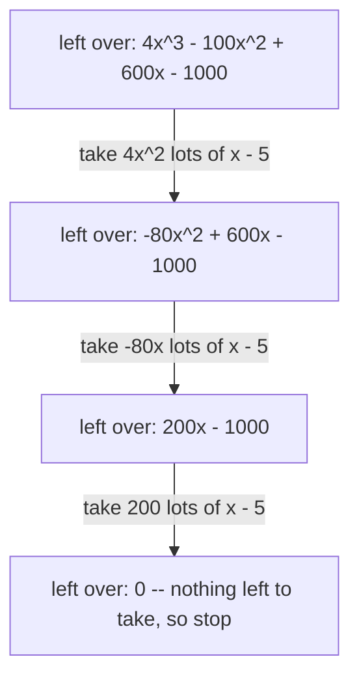
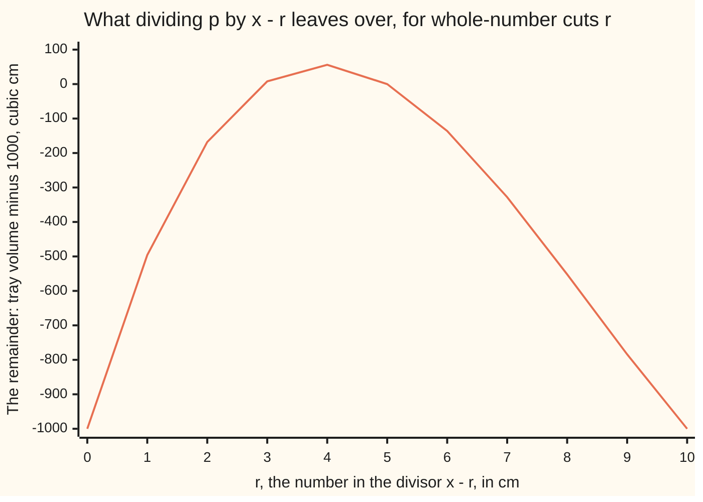

# Polynomial long division: divide with a remainder exactly as with whole numbers, and the remainder is the value at the root

[Syllabus](../../../SYLLABUS.md) → [Algebra](../README.md) → [Polynomials](../README.md#s02) → Polynomial long division

---

## General Overview

A packaging maker folds an open tray from a sheet of card 30 cm by 20 cm. Cut a square x cm a side from each corner and fold up the sides. The tray is x cm deep, on a base (30 − 2x) by (20 − 2x) cm.

The tray must hold one litre, 1000 cubic cm. Multiply out x(30 − 2x)(20 − 2x), take 1000 away, and the tray holds a litre exactly when

4x^3 − 100x^2 + 600x − 1000 = 0.

A first try hits: a 5 cm cut gives 5 × 20 × 10 = 1000. Is there a second cut that also gives a litre? Divide the cubic by x − 5. That strips out the answer you know and leaves a quadratic holding the rest. That division is the job.

Do it and the quotient is 4x^2 − 80x + 200, with nothing left over. [The quadratic formula](03-quadratic-formula.md) finishes it: x is about 2.93 or 17.07. Two 17 cm squares do not fit across a 20 cm side, so the second tray has a 2.93 cm cut. It is shallower and wider, and it holds the same litre.

Dividing 17 by 5 gives 3 with 2 left over, and the 2 stays put because it is smaller than 5 ([Division with a remainder](../../02-Number%20theory/01-Divisibility%20and%20Primes/04-division-with-remainder.md)). Polynomials do the same with one word swapped: the leftover has to be a *lower power* than the divisor, not a smaller number.

**Divide one polynomial by another the way you divide whole numbers. Stop when what is left has a lower highest power than the thing you divided by. And if you divided by x minus a number, what is left is that polynomial worked out at that number.**

**What kind of fact this is:** a theorem. Why it works proves that the division stops, and that dividing by x − r leaves p(r), the polynomial's value at the divisor's root r. That only one pair fits is proved in [Polynomials behave like integers](../09-Rings%20and%20Fields/03-polynomials-behave-like-integers.md).

### The picture: the loop, one step at a time



Each arrow removes the biggest power still standing. The labels, added up, are the answer: 4x^2 − 80x + 200.

---

## The formula

```math
p(x) = d(x)\,q(x) + s(x)
```

**Read it aloud:** what you started with is the divisor, times how many of it fit, plus a scrap too small to divide again.

The size rule is half the formula: the scrap is either zero, or its degree is lower than the divisor's. Degree is the highest power of x present ([Polynomials](01-polynomials.md)). Divide by a degree-1 thing like x − 5 and the scrap is a plain number. And only one pair fits: for a given p and d, one quotient and one scrap.

| Symbol | Plain meaning | In our example | Push it up and the answer… |
| --- | --- | --- | --- |
| $`x`$ | the cut: the side of the square cut from each corner, in cm | 5 gives the 5 by 20 by 10 tray | a deeper, narrower tray; the volume rises, then falls |
| $`p(x)`$ | the polynomial you are cutting up | the volume minus 1000, 4x^3 − 100x^2 + 600x − 1000 | a higher power here means a longer quotient |
| $`d(x)`$ | the divisor: what you divide by | x − 5, from the cut you know | a higher power leaves a shorter quotient, a roomier scrap |
| $`q(x)`$ | the quotient: how many of the divisor fit | 4x^2 − 80x + 200 | its degree is p's degree minus d's |
| $`s(x)`$ | the remainder, or scrap: what is left at the end, zero or lower degree than the divisor | 0 for x − 5; 56 for x − 4 | raise d's degree and the scrap may keep an x |
| $`r`$ | the divisor's root: the number that makes x − r equal zero. It is a root of p only when the scrap is 0 | 5 for x − 5; 4 for x − 4 | move r and the scrap traces the curve of p |

Now the second formula. Divide by x − r and the scrap is a plain number — and that number is p worked out at r:

```math
p(x) = (x - r)\,q(x) + p(r)
```

**Read it aloud:** dividing by x minus a number leaves the polynomial's value at that number.

### When it holds

- **The divisor is not zero, and you can divide by its leading number.** Each pass divides by it. Here it is 1, so every number stays whole. Divide by 2x + 1 and fractions turn up; allow whole numbers only and the division can get stuck.
- **The scrap's degree is below the divisor's.** That rule makes the pair the only one. Drop it, and quotient 4x^2 − 80x with leftover 200x − 1000 also adds back to p.
- **A divisor of the form x minus a number, for the second formula.** Only then is the scrap a plain number to match with p(r). Divide by x^2 and the scrap may keep an x.

---

## Why it works

### Step 0: what a remainder is for

17 = 5 × 3 + 2. The 2 sits there because 5 will not go in again. That is a remainder: what is left when you cannot take another bite. Whole numbers judge that by size, polynomials by degree.

### Step 1: kill the biggest power, then look again

Start with p = 4x^3 − 100x^2 + 600x − 1000 and the divisor x − 5. The biggest power is 4x^3. To make 4x^3 out of x − 5 you need 4x^2 lots of it. Multiply out: 4x^2 times (x − 5) is 4x^3 − 20x^2. Subtract. The 4x^3 cancels, and −100x^2 − (−20x^2) leaves −80x^2 + 600x − 1000.

Look again. The biggest power is −80x^2, so take −80x lots of x − 5, which is −80x^2 + 400x. Subtract: 200x − 1000.

Look again. Take 200 lots of x − 5, which is 200x − 1000 exactly. Subtract: nothing left.

Add up what you took: 4x^2 − 80x + 200. That is the quotient, the quadratic that holds the other cuts.

<details>
<summary>The short way once you trust it: synthetic division</summary>

Dividing by x − 5 means r = 5. Write the coefficients, the numbers in front of each power: 4, −100, 600, −1000. Bring the 4 down. Multiply by 5 and add to the −100: −80. Multiply by 5, add to the 600: 200. Multiply by 5, add to the −1000: 0.

What you wrote is 4, −80, 200, then 0 — the quotient 4x^2 − 80x + 200, remainder 0. Same arithmetic, no x's on the page. It only works for a divisor of the form x minus a number.

</details>

### Step 2: the loop cannot run forever

Every pass cancels the leading term, so the highest power drops by at least one. Degrees are whole numbers going down, so within a few passes the degree falls below the divisor's. At that point there is no bite left to take, and what is sitting there is the remainder.

One catch. Each pass divides the leading number by the divisor's leading number. Here that is 1 every time, so the arithmetic stays whole. Divide by 2x + 1 and you divide by 2 every pass, and fractions turn up. The method still works.

### Step 3: why dividing by x - r leaves p(r)

Put the number r in place of x:

```math
p(r) = (r - r)\,q(r) + s = 0 \times q(r) + s = s
```

x − r was built to vanish at r, so whatever the quotient is worth there gets multiplied by zero and disappears. Only the scrap survives, and a degree-1 divisor leaves it a plain number.

For the tray: r is 5, and p(5) = 500 − 2500 + 3000 − 1000 = 0. Remainder zero, so x − 5 really is a factor, and 5 cm really is a one-litre cut.

Divide the same p by x − 4 and the remainder is 56, which is p(4). A 4 cm cut gives a tray 4 by 22 by 12 cm, holding 1056 cubic cm: 56 more than the litre.

### The picture: the remainder, as the root moves



The line is the remainder from the full division, and also p worked out at r: one line does for both. Here r is the divisor's root, a number you choose. It is a root of p only where the line sits on zero.

The chart plots whole-number values of r only. The line is zero at r = 5, the cut you know. It also crosses zero between 2 and 3, at the second cut, 2.93 cm, which no whole number hits.

A remainder of zero means a factor, and a factor means a root ([Roots and factors](05-roots-and-the-factor-theorem.md)).

---

## Worked numbers, by hand

The tray: p = 4x^3 − 100x^2 + 600x − 1000, known cut 5 cm, so divide by x − 5.

| Step | Arithmetic | Value |
| --- | --- | --- |
| what you start with | the volume minus 1000 | 4x^3 − 100x^2 + 600x − 1000 |
| take 4x^2 lots of x − 5 | subtract 4x^3 − 20x^2 | −80x^2 + 600x − 1000 |
| take −80x lots of x − 5 | subtract −80x^2 + 400x | 200x − 1000 |
| take 200 lots of x − 5 | subtract 200x − 1000 | **0** |
| the quotient | 4x^2 and −80x and 200, added up | **4x^2 − 80x + 200** |
| check by multiplying back | (x − 5)(4x^2 − 80x + 200) | **4x^3 − 100x^2 + 600x − 1000** |
| the quotient's zeros | the quadratic formula on 4, −80, 200 | **2.93** and 17.07 |
| the second tray | 2.93 by 24.14 by 14.14 cm | **1000.00 cubic cm** |

Divide the same p by x − 4 and it does not go exactly: quotient 4x^2 − 84x + 264, remainder 56. That is p(4).

### What breaks if you drop a piece

| Mistake | Comes out at | What went wrong |
| --- | --- | --- |
| Stopping while an x is still standing | quotient 4x^2 − 80x, leftover 200x − 1000 | the leftover is degree 1, same as x − 5: one more bite left |
| Dropping the remainder 56 | 0 at x = 4, not 56 | x − 4 is zero at x = 4, so the quotient contributes nothing there |
| Reading the root of x − 5 as −5 | p(−5) = −7000, so x − 5 looks like no factor | the root is what makes the divisor zero, which is 5 |

The code prints all three.

---

## Code, from first principles, and it actually runs

Nothing is imported. The division is the loop from Step 1: kill the leading power, subtract, repeat. It runs on x − 5, then on x − 4. The quotient's two zeros come from the quadratic formula.

Two roads check it. The first multiplies the quotient back out against p. The second drops polynomials: at x = 20, p is 3000 and x − 5 is 15, and 3000 ÷ 15 = 200, the quotient at 20. Last, the remainder for x − r is matched to p(r), at eleven values of r.

### Python

```python
# Polynomial long division -- the check behind the card.  Nothing is imported.  An open tray
# folded from a 30 by 20 cm card, after cutting an x cm square from each corner, holds
# x(30 - 2x)(20 - 2x) cubic cm: one litre where p(x) = 4x^3 - 100x^2 + 600x - 1000 is zero.
P, D, E = [4, -100, 600, -1000], [1, -5], [1, -4]   # p highest power first, x - 5, x - 4

def show(c):                                  # coefficients back into readable form
    out = ""
    for i, a in enumerate(c):
        k = len(c) - 1 - i                    # the power this coefficient sits on
        if a == 0: continue
        t = ("" if abs(a) == 1 and k else str(abs(a))) + ("x" if k else "") + (f"^{k}" if k > 1 else "")
        out += (" + " if a > 0 else " - ") + t if out else (("-" if a < 0 else "") + t)
    return out or "0"
def divide(p, d):                             # long division, one leading term a step
    q, s, steps = [], list(p), []
    while len(s) >= len(d):
        c = s[0] // d[0]                      # the term that kills the leading term
        q.append(c)
        for i in range(len(d)): s[i] -= c * d[i]
        s.pop(0)                              # the leading term is now zero: drop it
        steps.append(show(s))
    return q, s, steps
def value(p, x): return sum(a * x ** (len(p) - 1 - i) for i, a in enumerate(p))
def mul(a, b):                                # multiply two polynomials back together
    out = [0] * (len(a) + len(b) - 1)
    for i, u in enumerate(a):
        for j, w in enumerate(b): out[i + j] += u * w
    return out
def add(a, b): return [u + w for u, w in zip(a, [0] * (len(a) - len(b)) + b)]
def line(name, text): print(f"{name:<30}{text}")

q, s, steps = divide(P, D)                    # one road: divide by x - 5
q2, s2, _ = divide(P, E)                      # the same p divided by x - 4
line("p(x), volume minus 1000", show(P))
line("leftovers as the loop runs", " | ".join(steps))
line("q(x), the quotient", show(q))
line("s(x), the remainder", show(s))
line("d(x) q(x) + s(x)", show(add(mul(D, q), s)))
print(f"a 5 cm cut: 5 by {30 - 2 * 5} by {20 - 2 * 5} cm, volume {5 * (30 - 2 * 5) * (20 - 2 * 5)}")
disc = q[1] * q[1] - 4 * q[0] * q[2]          # the quotient's zeros, by the quadratic formula
lo, hi = (-q[1] - disc ** 0.5) / (2 * q[0]), (-q[1] + disc ** 0.5) / (2 * q[0])
print(f"q(x) = 0 at x = {lo:.2f} and x = {hi:.2f}; two {hi:.2f} cm squares do not fit across 20 cm")
print(f"a {lo:.2f} cm cut: {lo:.2f} by {30 - 2 * lo:.2f} by {20 - 2 * lo:.2f} cm, "
      f"volume {lo * (30 - 2 * lo) * (20 - 2 * lo):.2f}")
print(f"at x = 20: p = {value(P, 20)}, x - 5 = 15, {value(P, 20)} / 15 = {value(P, 20) // 15} "
      f"remainder {value(P, 20) % 15}, and q(20) = {value(q, 20)}")   # second road: plain numbers
line("divide p(x) by x - 4", f"{show(q2)}   remainder {show(s2)}")
line("p(4), at the root of x - 4", value(P, 4))
roots = list(range(0, 11))
line("r", "".join(f"{r:>6}" for r in roots))
line("remainder, dividing by x - r", "".join(f"{divide(P, [1, -r])[1][0]:>6}" for r in roots))
line("p(r)", "".join(f"{value(P, r):>6}" for r in roots))
print(f"stopping a step early: quotient {show(q[:2] + [0])}, leftover {steps[1]}")
print(f"dropping the remainder 56 leaves {value(mul(q2, E), 4)} at x = 4; "
      f"the root of x - 5 read as -5 gives p(-5) = {value(P, -5)}")
assert s == [0] and add(mul(D, q), s) == P and add(mul(E, q2), s2) == P
assert [divide(P, [1, -r])[1][0] for r in roots] == [value(P, r) for r in roots]
assert s2 == [56] and value(P, 4) == 4 * 22 * 12 - 1000 and value(P, -5) == -7000
assert abs(lo * (30 - 2 * lo) * (20 - 2 * lo) - 1000) < 1e-9 and 20 - 2 * hi < 0 and value(P, 20) == 15 * value(q, 20)
print("ALL CHECKS PASS")
```

**Ran 2026-11-25 on macOS, Python 3.14.10, standard library only. All checks passed. Output, pasted from the run:**

```
p(x), volume minus 1000       4x^3 - 100x^2 + 600x - 1000
leftovers as the loop runs    -80x^2 + 600x - 1000 | 200x - 1000 | 0
q(x), the quotient            4x^2 - 80x + 200
s(x), the remainder           0
d(x) q(x) + s(x)              4x^3 - 100x^2 + 600x - 1000
a 5 cm cut: 5 by 20 by 10 cm, volume 1000
q(x) = 0 at x = 2.93 and x = 17.07; two 17.07 cm squares do not fit across 20 cm
a 2.93 cm cut: 2.93 by 24.14 by 14.14 cm, volume 1000.00
at x = 20: p = 3000, x - 5 = 15, 3000 / 15 = 200 remainder 0, and q(20) = 200
divide p(x) by x - 4          4x^2 - 84x + 264   remainder 56
p(4), at the root of x - 4    56
r                                  0     1     2     3     4     5     6     7     8     9    10
remainder, dividing by x - r   -1000  -496  -168     8    56     0  -136  -328  -552  -784 -1000
p(r)                           -1000  -496  -168     8    56     0  -136  -328  -552  -784 -1000
stopping a step early: quotient 4x^2 - 80x, leftover 200x - 1000
dropping the remainder 56 leaves 0 at x = 4; the root of x - 5 read as -5 gives p(-5) = -7000
ALL CHECKS PASS
```

### Rust

Same numbers, same labels, built with `rustc --edition 2021 -O`.

```rust
// Polynomial long division -- the same check as the Python, in Rust.  No crates.  An open tray
// folded from a 30 by 20 cm card, after cutting an x cm square from each corner, holds
// x(30 - 2x)(20 - 2x) cubic cm: one litre where p(x) = 4x^3 - 100x^2 + 600x - 1000 is zero.
fn show(c: &[i64]) -> String {                // coefficients back into readable form
    let mut out = String::new();
    for (i, &a) in c.iter().enumerate() {
        let k = c.len() - 1 - i;              // the power this coefficient sits on
        if a == 0 { continue; }
        let mut t = String::new();
        if !(a.abs() == 1 && k > 0) { t += &a.abs().to_string(); }
        if k > 0 { t.push('x'); }
        if k > 1 { t += &format!("^{}", k); }
        if out.is_empty() { out = if a < 0 { format!("-{}", t) } else { t }; }
        else { out += if a > 0 { " + " } else { " - " }; out += &t; }
    }
    if out.is_empty() { "0".to_string() } else { out }
}
fn divide(p: &[i64], d: &[i64]) -> (Vec<i64>, Vec<i64>, Vec<String>) {
    let (mut q, mut s, mut steps) = (Vec::new(), p.to_vec(), Vec::new());
    while s.len() >= d.len() {                // long division, one leading term a step
        let c = s[0] / d[0];                  // the term that kills the leading term
        q.push(c);
        for i in 0..d.len() { s[i] -= c * d[i]; }
        s.remove(0);                          // the leading term is now zero: drop it
        steps.push(show(&s));
    }
    (q, s, steps)
}
fn value(p: &[i64], x: i64) -> i64 {          // the polynomial worked out at a number
    (0..p.len()).map(|i| p[i] * x.pow((p.len() - 1 - i) as u32)).sum()
}
fn mul(a: &[i64], b: &[i64]) -> Vec<i64> {    // multiply two polynomials back together
    let mut out = vec![0; a.len() + b.len() - 1];
    for (i, &u) in a.iter().enumerate() {
        for (j, &w) in b.iter().enumerate() { out[i + j] += u * w; }
    }
    out
}
fn add(a: &[i64], b: &[i64]) -> Vec<i64> {
    let mut out = a.to_vec();                 // b is the shorter one: line up the ends
    for (i, &w) in b.iter().enumerate() { out[a.len() - b.len() + i] += w; }
    out
}
fn line(name: &str, text: &str) { println!("{:<30}{}", name, text); }
fn row(v: &[i64]) -> String { v.iter().map(|n| format!("{:>6}", n)).collect() }
fn main() {
    let (p, d, e) = ([4i64, -100, 600, -1000], [1i64, -5], [1i64, -4]);   // p, x - 5, x - 4
    let (q, s, steps) = divide(&p, &d);       // one road: divide by x - 5
    let (q2, s2, _) = divide(&p, &e);         // the same p divided by x - 4
    line("p(x), volume minus 1000", &show(&p));
    line("leftovers as the loop runs", &steps.join(" | "));
    line("q(x), the quotient", &show(&q));
    line("s(x), the remainder", &show(&s));
    line("d(x) q(x) + s(x)", &show(&add(&mul(&d, &q), &s)));
    println!("a 5 cm cut: 5 by {} by {} cm, volume {}", 30 - 2 * 5, 20 - 2 * 5, 5 * (30 - 2 * 5) * (20 - 2 * 5));
    let (a, b, disc) = (q[0] as f64, q[1] as f64, (q[1] * q[1] - 4 * q[0] * q[2]) as f64);   // the formula
    let (lo, hi) = ((-b - disc.sqrt()) / (2.0 * a), (-b + disc.sqrt()) / (2.0 * a));
    println!("q(x) = 0 at x = {:.2} and x = {:.2}; two {:.2} cm squares do not fit across 20 cm", lo, hi, hi);
    println!("a {:.2} cm cut: {:.2} by {:.2} by {:.2} cm, volume {:.2}",
             lo, lo, 30.0 - 2.0 * lo, 20.0 - 2.0 * lo, lo * (30.0 - 2.0 * lo) * (20.0 - 2.0 * lo));
    let p20 = value(&p, 20);                  // second road: plain numbers
    println!("at x = 20: p = {}, x - 5 = 15, {} / 15 = {} remainder {}, and q(20) = {}", p20, p20, p20 / 15, p20 % 15, value(&q, 20));
    line("divide p(x) by x - 4", &format!("{}   remainder {}", show(&q2), show(&s2)));
    line("p(4), at the root of x - 4", &value(&p, 4).to_string());
    let roots: Vec<i64> = (0..11).collect();
    let rems: Vec<i64> = roots.iter().map(|&r| divide(&p, &[1, -r]).1[0]).collect();
    let vals: Vec<i64> = roots.iter().map(|&r| value(&p, r)).collect();
    line("r", &row(&roots));
    line("remainder, dividing by x - r", &row(&rems));
    line("p(r)", &row(&vals));
    let mut part = q[..2].to_vec(); part.push(0);
    println!("stopping a step early: quotient {}, leftover {}", show(&part), steps[1]);
    println!("dropping the remainder 56 leaves {} at x = 4; the root of x - 5 read as -5 \
              gives p(-5) = {}", value(&mul(&q2, &e), 4), value(&p, -5));
    assert!(s == [0] && add(&mul(&d, &q), &s) == p && add(&mul(&e, &q2), &s2) == p);
    assert!(rems == vals);
    assert!(s2 == [56] && value(&p, 4) == 4 * 22 * 12 - 1000 && value(&p, -5) == -7000);
    assert!((lo * (30.0 - 2.0 * lo) * (20.0 - 2.0 * lo) - 1000.0).abs() < 1e-9 && 20.0 - 2.0 * hi < 0.0 && p20 == 15 * value(&q, 20));
    println!("ALL CHECKS PASS");
}
```

**Ran 2026-11-25 on macOS, rustc 1.98.1, no crates. All checks passed. Output, pasted from the run:**

```
p(x), volume minus 1000       4x^3 - 100x^2 + 600x - 1000
leftovers as the loop runs    -80x^2 + 600x - 1000 | 200x - 1000 | 0
q(x), the quotient            4x^2 - 80x + 200
s(x), the remainder           0
d(x) q(x) + s(x)              4x^3 - 100x^2 + 600x - 1000
a 5 cm cut: 5 by 20 by 10 cm, volume 1000
q(x) = 0 at x = 2.93 and x = 17.07; two 17.07 cm squares do not fit across 20 cm
a 2.93 cm cut: 2.93 by 24.14 by 14.14 cm, volume 1000.00
at x = 20: p = 3000, x - 5 = 15, 3000 / 15 = 200 remainder 0, and q(20) = 200
divide p(x) by x - 4          4x^2 - 84x + 264   remainder 56
p(4), at the root of x - 4    56
r                                  0     1     2     3     4     5     6     7     8     9    10
remainder, dividing by x - r   -1000  -496  -168     8    56     0  -136  -328  -552  -784 -1000
p(r)                           -1000  -496  -168     8    56     0  -136  -328  -552  -784 -1000
stopping a step early: quotient 4x^2 - 80x, leftover 200x - 1000
dropping the remainder 56 leaves 0 at x = 4; the root of x - 5 read as -5 gives p(-5) = -7000
ALL CHECKS PASS
```

The two outputs match line for line.

### Lean

Lean proves the card's three general claims for every polynomial, and checks the tray's numbers exactly.

- Divide by a divisor that is not zero and whose leading number you can divide by. Exactly one quotient and remainder fit, with the remainder of lower degree.
- Divide p by x − r, and p(x) = (x − r) q(x) + p(r) for some quotient q.
- Any division by x − r that leaves a remainder of lower degree than x − r leaves exactly p(r).
- The tray: x − 5 goes in exactly with quotient 4x^2 − 80x + 200, and x − 4 leaves 56.

Running the loop step by step, printing each leftover, and the decimal cuts 2.93 and 17.07 are left to the Python and Rust checks.

```lean
-- Polynomial long division: when the divisor is not zero and its leading number can be divided by, there is exactly one quotient and remainder with the remainder of lower degree, and dividing by x - r leaves the value p(r).
import Mathlib.Algebra.Polynomial.Div
import Mathlib.Tactic.Ring
import Mathlib.Tactic.NormNum

open Polynomial

/-- Division with a remainder, for polynomials. Let d be a divisor that is not the zero
polynomial and whose leading number can be divided by (it has an inverse). Then for every
polynomial p there is exactly one pair, a quotient q and a remainder s, with
p(x) = d(x) q(x) + s(x) and the remainder of lower degree than the divisor. -/
theorem polynomial_division_with_remainder_exists_and_is_unique {R : Type*} [CommRing R]
    (p d : R[X]) (hd : d ≠ 0) (hlead : IsUnit d.leadingCoeff) :
    ∃! qs : R[X] × R[X], p = d * qs.1 + qs.2 ∧ qs.2.degree < d.degree := by
  rcases subsingleton_or_nontrivial R with hR | hR
  · exact absurd (Subsingleton.elim d 0) hd
  obtain ⟨u, hu⟩ := hlead
  have hbu : C (↑u⁻¹ : R) * C (↑u : R) = 1 := by rw [← C_mul, Units.inv_mul, C_1]
  have hm : Monic (d * C (↑u⁻¹ : R)) :=
    monic_mul_C_of_leadingCoeff_mul_eq_one (by rw [← hu, Units.mul_inv])
  have hle : ∀ (f : R[X]) (a : R), (f * C a).degree ≤ f.degree := by
    intro f a
    have h := degree_mul_le_of_le (p := f) (q := C a) le_rfl degree_C_le
    rwa [add_zero] at h
  have hdeg : (d * C (↑u⁻¹ : R)).degree = d.degree := by
    apply le_antisymm (hle _ _)
    have : d = d * C (↑u⁻¹ : R) * C (↑u : R) := by rw [mul_assoc, hbu, mul_one]
    conv_lhs => rw [this]
    exact hle _ _
  refine ⟨(C (↑u⁻¹ : R) * (p /ₘ (d * C (↑u⁻¹ : R))), p %ₘ (d * C (↑u⁻¹ : R))), ⟨?_, ?_⟩, ?_⟩
  · have h := modByMonic_add_div p (d * C (↑u⁻¹ : R))
    calc p = p %ₘ (d * C (↑u⁻¹ : R)) + d * C (↑u⁻¹ : R) * (p /ₘ (d * C (↑u⁻¹ : R))) := h.symm
      _ = _ := by ring
  · rw [← hdeg]; exact degree_modByMonic_lt _ hm
  · rintro ⟨q', s'⟩ ⟨hp, hs⟩
    have key := div_modByMonic_unique (f := p) (C (↑u : R) * q') s' hm
      ⟨by
        calc s' + d * C (↑u⁻¹ : R) * (C (↑u : R) * q')
            = s' + d * (C (↑u⁻¹ : R) * C (↑u : R)) * q' := by ring
          _ = p := by rw [hbu, mul_one, hp, add_comm],
       by rw [hdeg]; exact hs⟩
    rw [key.1, key.2, ← mul_assoc, hbu, one_mul]

/-- The remainder theorem, as a formula. Dividing p by x minus a number r leaves the plain
number p(r): p(x) = (x - r) q(x) + p(r) for some polynomial q. -/
theorem dividing_by_x_minus_r_leaves_p_of_r {R : Type*} [CommRing R] (p : R[X]) (r : R) :
    ∃ q : R[X], p = (X - C r) * q + C (p.eval r) := by
  refine ⟨p /ₘ (X - C r), ?_⟩
  rw [← modByMonic_X_sub_C_eq_C_eval, add_comm, modByMonic_add_div]

/-- The remainder is the value at the root (Step 3). Whatever quotient q and remainder s
come out of dividing p by x - r, as long as the remainder has lower degree than x - r,
the remainder is the plain number p(r). -/
theorem remainder_on_dividing_by_x_minus_r_is_p_of_r {R : Type*} [CommRing R]
    (p : R[X]) (r : R) (q s : R[X]) (hdiv : p = (X - C r) * q + s)
    (hdeg : s.degree < (X - C r).degree) :
    s = C (p.eval r) := by
  rw [← modByMonic_X_sub_C_eq_C_eval]
  exact ((div_modByMonic_unique q s (monic_X_sub_C r) ⟨by rw [hdiv, add_comm], hdeg⟩).2).symm

-- The whole-number original: 17 = 5 × 3 + 2, and 2 is smaller than 5.
example : (17 : ℕ) = 5 * 3 + 2 ∧ 2 < 5 := by decide
-- The tray: x cm cut from each corner of a 30 by 20 card holds x(30 - 2x)(20 - 2x) cubic cm,
-- and that minus one litre is p = 4x^3 - 100x^2 + 600x - 1000.
example : (X * (30 - 2 * X) * (20 - 2 * X) - 1000 : ℤ[X]) =
    4 * X ^ 3 - 100 * X ^ 2 + 600 * X - 1000 := by ring
-- A 5 cm cut holds a litre: 5 by 20 by 10.
example : (5 : ℤ) * (30 - 2 * 5) * (20 - 2 * 5) = 1000 := by decide
-- p divided by x - 5 is 4x^2 - 80x + 200, remainder 0.
example : (4 * X ^ 3 - 100 * X ^ 2 + 600 * X - 1000 : ℤ[X]) =
    (X - 5) * (4 * X ^ 2 - 80 * X + 200) + 0 := by ring
-- The loop's leftovers: after 4x^2 lots of x - 5, then -80x lots, then 200 lots.
example : (4 * X ^ 3 - 100 * X ^ 2 + 600 * X - 1000 : ℤ[X]) - 4 * X ^ 2 * (X - 5) =
    -80 * X ^ 2 + 600 * X - 1000 := by ring
example : (-80 * X ^ 2 + 600 * X - 1000 : ℤ[X]) - (-80) * X * (X - 5) = 200 * X - 1000 := by ring
example : (200 * X - 1000 : ℤ[X]) - 200 * (X - 5) = 0 := by ring
-- The same p divided by x - 4: quotient 4x^2 - 84x + 264, remainder 56.
example : (4 * X ^ 3 - 100 * X ^ 2 + 600 * X - 1000 : ℤ[X]) =
    (X - 4) * (4 * X ^ 2 - 84 * X + 264) + 56 := by ring
-- p at 5 is 0, at 4 it is 56 (the 4 by 22 by 12 tray holds 1056), and at -5 (the wrong sign) -7000.
example : (4 * X ^ 3 - 100 * X ^ 2 + 600 * X - 1000 : ℤ[X]).eval 5 = 0 ∧
    (4 * X ^ 3 - 100 * X ^ 2 + 600 * X - 1000 : ℤ[X]).eval 4 = 56 ∧
    (4 * X ^ 3 - 100 * X ^ 2 + 600 * X - 1000 : ℤ[X]).eval (-5) = -7000 := by norm_num
example : (4 * 22 * 12 : ℤ) = 1056 := by decide
-- The chart: for r = 0 to 10, p(r) is -1000, -496, -168, 8, 56, 0, -136, -328, -552, -784, -1000.
example : [0, 1, 2, 3, 4, 5, 6, 7, 8, 9, 10].map
    (fun x : ℤ => 4 * x ^ 3 - 100 * x ^ 2 + 600 * x - 1000) =
    [-1000, -496, -168, 8, 56, 0, -136, -328, -552, -784, -1000] := by decide
-- Drop the degree rule and the pair is not unique: quotient 4x^2 - 80x, leftover 200x - 1000.
example : (4 * X ^ 3 - 100 * X ^ 2 + 600 * X - 1000 : ℤ[X]) =
    (X - 5) * (4 * X ^ 2 - 80 * X) + (200 * X - 1000) := by ring
-- Plain numbers at x = 20: p is 3000, x - 5 is 15, and 3000 / 15 = 200 with nothing left, the quotient at 20.
example : (4 * 20 ^ 3 - 100 * 20 ^ 2 + 600 * 20 - 1000 : ℤ) = 3000 ∧ (3000 : ℤ) / 15 = 200 ∧
    (3000 : ℤ) % 15 = 0 ∧ (4 * 20 ^ 2 - 80 * 20 + 200 : ℤ) = 200 := by decide

#print axioms polynomial_division_with_remainder_exists_and_is_unique
#print axioms dividing_by_x_minus_r_leaves_p_of_r
#print axioms remainder_on_dividing_by_x_minus_r_is_p_of_r
```

**Checked 2026-11-25 on macOS, Lean 4.36.0-rc2, Mathlib v4.36.0-rc2. Every proof is complete and uses only Lean's standard axioms. Output, pasted from the run:**

```
'polynomial_division_with_remainder_exists_and_is_unique' depends on axioms: [propext, Classical.choice, Quot.sound]
'dividing_by_x_minus_r_leaves_p_of_r' depends on axioms: [propext, Classical.choice, Quot.sound]
'remainder_on_dividing_by_x_minus_r_is_p_of_r' depends on axioms: [propext, Classical.choice, Quot.sound]
```

> [!TIP]
> **Try changing**
> Guess first, then run it. An assert is a line that stops the program when a number comes out wrong; these are pinned to this tray.
> - **Divide by x − 3 instead.** Set `D` to `[1, -3]`. A 3 cm cut gives 1008 cubic cm, not a litre, so a remainder of 8 appears and the first assert stops it.
> - **Ask for a bigger tray.** Set `P` to `[4, -100, 600, -1056]`, a tray of 1056 cubic cm. Now x − 4 fits exactly, x − 5 leaves −56, and the first assert stops it.
> - **Divide by x^2.** Set `E` to `[1, 0, 0]`. The scrap now only has to come in under degree 2, so it may keep an x: it is 600x − 1000. The first two asserts pass. The third, which expects the remainder 56, stops it.

---

## The usual mistake

> [!warning]
> **Flipping the sign of the root.** To test whether x − 5 is a factor, work the polynomial out at 5, not at −5. The root is whatever makes the divisor zero. At −5, p comes to −7000, and you would throw away a divisor that fits perfectly.
>
> - Stopping while the leftover still has an x in it. 200x − 1000 is not lower degree than x − 5: one more bite is owed.
> - Writing the answer as just the quotient. (x − 4) times 4x^2 − 84x + 264 comes to 0 at x = 4, not 56. A remainder is part of the answer, not a failure.
> - Subtracting only the leading term of the divisor. Every term of it gets multiplied and subtracted.
> - Missing a power. If p had no x^2 term, hold the place for it, the way 1002 holds two zeros.

---

## Where you meet it in real life

- **Finding the other answers.** Once one size that works is known, dividing it out leaves a smaller equation for the rest.
- **Testing a factor without factoring.** Working p out at 5 takes one line and tells you x − 5 divides exactly. That is [Roots and factors](05-roots-and-the-factor-theorem.md).
- **Ordinary long division.** Put a number in for x and the division turns into plain arithmetic: at x = 20, 3000 divided by 15 is 200, nothing left over. That link is [Polynomials behave like integers](../09-Rings%20and%20Fields/03-polynomials-behave-like-integers.md).
- **Check digits on a disc or a network packet.** They are the remainder of a polynomial division, and the receiver divides again. A remainder of zero means the check passed.

> **Say it back**
> Polynomials divide like whole numbers. Take away multiples of the divisor, biggest power first, and stop when what is left has a lower highest power than the divisor. Divisor times quotient plus remainder is what you started with, and that pair is the only one that fits. The tray's 4x^3 − 100x^2 + 600x − 1000, divided by x − 5, leaves 4x^2 − 80x + 200 with nothing over. The 5 cm cut is one answer, and the quadratic gives the other, 2.93 cm. Divide by x minus a number and the remainder is the polynomial worked out at that number, so a remainder of zero means a factor.

---

## What this builds on

- [Polynomials](01-polynomials.md): what a polynomial is, and what degree means — the "size" that decides when the division stops.
- [The quadratic formula](03-quadratic-formula.md): finishes the quotient 4x^2 − 80x + 200, which no whole-number brackets split.
- [Division with a remainder](../../02-Number%20theory/01-Divisibility%20and%20Primes/04-division-with-remainder.md): the whole-number original, where the leftover has to be smaller than the divisor.

## Where this goes next

- [Roots and factors](05-roots-and-the-factor-theorem.md): a remainder of zero means x − r is a factor, which caps a degree-n polynomial at n roots.
- [Polynomials behave like integers](../09-Rings%20and%20Fields/03-polynomials-behave-like-integers.md): greatest common divisors, the Euclidean algorithm and factoring, carried over from whole numbers on the back of this division.

Left open: a remainder of zero finds one factor at a time. How many factors, and so how many roots, can a polynomial have?

---

## Sources

Verified 7 Sep 2026: every link below resolves to the publisher's page.

- *College Algebra 2e*, section 5.4, "Dividing Polynomials." OpenStax, Rice University. [Textbook page](https://openstax.org/books/college-algebra-2e/pages/5-4-dividing-polynomials). Long division and synthetic division worked at this level, free.
- Dummit, David S., and Richard M. Foote. *Abstract Algebra*, 3rd ed. Wiley, 2003. [Wiley](https://www.wiley.com/en-us/Abstract+Algebra%2C+3rd+Edition-p-9780471433347). The grown-up statement: the quotient and remainder exist, and are the only pair that works. Publisher page; the book is paid.
- Artin, Michael. *Algebra*, Classic Version, 2nd ed. Pearson. [Pearson](https://www.pearson.com/en-us/subject-catalog/p/Artin-Algebra-Classic-Version-2nd-Edition/P200000006078/9780137980994). Sets this division beside the whole-number one. Publisher page; the book is paid.
