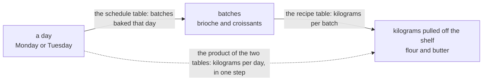
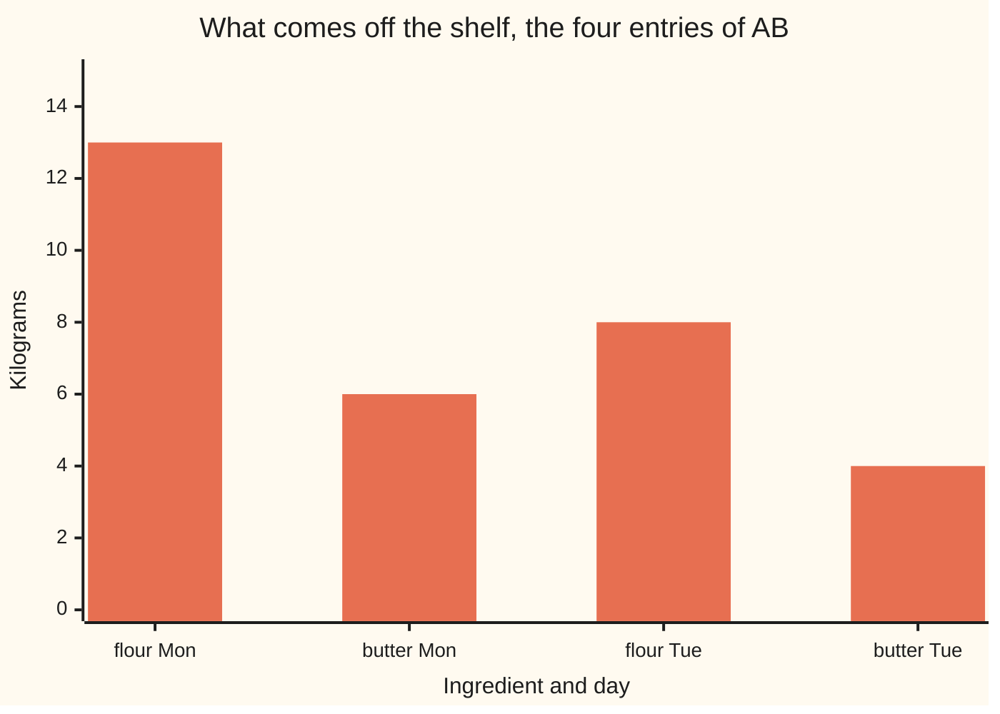

# Matrix multiplication: row by column, because it is 'do this, then that', and why the order matters

[Syllabus](../../../SYLLABUS.md) → [Algebra](../README.md) → [Matrices](../README.md#s04) → Matrix multiplication

---

## General Overview

A bakery bakes brioche and croissants in batches. A batch of brioche takes 5 kg of flour and 2 kg of butter; a batch of croissants takes 3 kg of flour and 2 kg of butter. Monday they bake 2 batches of brioche and 1 of croissants. Tuesday, 1 of each.

The question: how many kilograms of flour and of butter come off the shelf each day?

Two steps answer it: one turns a day into a count of batches, the other turns batches into kilograms. Multiplying those tables, called matrices, builds the single table that does both at once.

Its recipe — a row of the first against a column of the second, multiplied in pairs and added — is no convention someone picked. It is what "do this, then that" comes out as when both steps are tables.

**Multiplying matrices is chaining two steps into one, and row-by-column is the arithmetic that chaining forces.**

**What kind of fact this is:** a definition, but a forced one: Why it works derives it from composition, one step done after another, and proves the size and grouping rules.



Solid arrows: the two steps. Dotted: the table replacing them.

---

## The formula

Shorthand, in words: the entry in row $`i`$, column $`j`$ of $`A`$ is written $`A_{ij}`$ — letter, row, column, that order always. The product of $`A`$ and $`B`$ is written $`AB`$, nothing between.

The rule for every entry of the answer:

```math
(AB)_{ij} = A_{i1}B_{1j} + A_{i2}B_{2j} + \dots + A_{in}B_{nj}
```

**Read it aloud:** slide a finger across row $`i`$ of the left matrix and down column $`j`$ of the right at the same speed, multiply each pair, add the results.

That is the dot product of [Matrix times vector](02-matrix-times-vector.md), once per row-and-column pairing.

| Symbol | Plain meaning | In our example | Change it and… |
| --- | --- | --- | --- |
| $`A`$ | left matrix: kilograms per batch, rows flour/butter | `[[5, 3], [2, 2]]` | kilogram totals change |
| $`B`$ | right matrix: batches per day, columns Mon/Tue | `[[2, 1], [1, 1]]` | daily totals change |
| $`C`$ | a third matrix, right of both, so acting first | `[[4], [4]]`, four of each day | monthly totals change |
| $`AB`$, $`BA`$, $`BC`$ | a product, in that order | $`AB`$ is `[[13, 8], [6, 4]]`, $`BA`$ is `[[12, 8], [7, 5]]` | the answer changes |
| $`A_{ij}`$ | the entry at row $`i`$, column $`j`$ | $`A`$ row 2, column 1 is 2: kilograms of butter in a batch of brioche | — |
| $`i`$, $`j`$, and $`m`$, $`n`$, $`p`$ | row, column; the sizes | $`A`$ is 2 × 2, $`C`$ is 2 × 1 | — |

**The size rule.** With $`A`$ of size $`m`$ × $`n`$ ($`m`$ rows, $`n`$ columns) and $`B`$ of size $`n`$ × $`p`$, $`AB`$ exists and is $`m`$ × $`p`$. The inner numbers must match, or there is no product.

### When it holds

- **The inner numbers match.** Padding a table to force a product invents numbers.
- **The middle labels agree, in the same order** — here brioche and croissants. Sizes can match while labels do not, and then the arithmetic means nothing.
- **The entries are plain numbers**, so sums and products regroup freely: the grouping rule, $`(AB)C = A(BC)`$ in Step 5, rests on that.
- **One fixed table per step.** A batch of brioche takes 5 kg of flour whether the bakery bakes one batch or ten.

---

## Why it works

### Step 0: a matrix is a machine, not a spreadsheet

A matrix takes a list of numbers in and hands a list back ([Matrix times vector](02-matrix-times-vector.md)). Feed the schedule matrix a day, get batches; feed the recipe matrix batches, get kilograms.

Two machines in a row is composition, one function inside another ([Composing functions](../../01-Foundations/08-Relations%20and%20Functions/03-composition.md)), whose order is baked in: the inner one first.

### Step 1: run Monday through both machines

Monday is column 1 of the schedule matrix, (2, 1): 2 batches of brioche and 1 of croissants. Feed it to the recipe matrix. Flour: 5 kg per brioche batch times 2, plus 3 kg per croissant batch times 1, so 13 kg. Butter: 2 times 2 plus 2 times 1, so 6 kg.

### Step 2: the recipe falls out of that arithmetic

Monday's flour paired the flour row of the recipe matrix with the Monday column of the schedule matrix: multiply, add. Every entry comes out that way, one row of the left against one column of the right — Tuesday's column (1, 1) too, giving 8 kg and 4 kg. Nothing imposed it: it is what running the second machine on the first one's output does.

Stack the two days side by side: the kilograms-per-day table `[[13, 8], [6, 4]]`, rows flour and butter, columns Monday and Tuesday.

### Step 3: the size rule is part of the recipe, not an extra rule

Pairing a row with a column entry by entry needs equal lengths: a row is as long as the matrix has columns, a column as long as it has rows. So the left's column count must equal the right's row count, and the answer has one entry per row of the left and column of the right: $`m`$ × $`p`$.

### Step 4: the order carries the meaning

Recipes times schedule asks: for each ingredient and each day, how many kilograms? Flipped, the schedule matrix has to eat ingredients and the recipe matrix days. Nothing lines up.

Both matrices here happen to be 2 × 2, so the flipped arithmetic still runs. It gives `[[12, 8], [7, 5]]` beside `[[13, 8], [6, 4]]`: same matrices, different answer. Under the same labels the flipped table claims 7 kg of butter on Monday, against a true 6 kg.

Some pairs do agree either way, such as a square matrix and the do-nothing matrix of [Matrices](01-matrices-and-the-matrix-zoo.md). But nothing makes that the rule, and at other sizes only one order runs.

### Step 5: brackets do not carry meaning

Chain on a third matrix: $`C`$ counts each weekday in a four-week month, four Mondays and four Tuesdays, the column `[[4], [4]]`. It stands right of the others, so it acts first.

Two routes to the month's list. Kilograms per day first, then the days: `[[13, 8], [6, 4]]` times `[[4], [4]]` gives `[[84], [40]]`. Or batches per month first — `[[2, 1], [1, 1]]` times `[[4], [4]]` gives `[[12], [8]]`, twelve batches of brioche and eight of croissants — then the recipes: `[[84], [40]]`.

Both give 84 kg of flour and 40 kg of butter, and must: each is "do $`C`$, then $`B`$, then $`A`$". Order carries meaning; grouping does not.

<details>
<summary>Detailed proof: why the grouping never matters</summary>

Expand one entry both ways.

An entry of $`(AB)C`$ adds, over the days, a kilograms-per-day figure times that weekday's count. Each such figure is a sum over the batches. So multiplying out leaves one term per batch-and-day pairing: kilograms per batch, times batches that day, times that day's count.

An entry of $`A(BC)`$ groups the same multiplication the other way, over the batches first, and multiplies out to the same terms for the same pairings.

One identical list either way, and a finite sum totals the same in any order, so $`(AB)C = A(BC)`$ whenever the sizes fit.

</details>

<details>
<summary>One column times one row, and why it is worth knowing</summary>

Take column 1 of $`A`$, one brioche batch's ingredients (5, 2) standing up, and row 1 of $`B`$, brioche batches each day (2, 1) lying down. Multiply tall by wide: out comes a 2 × 2 grid, `[[10, 5], [4, 2]]`, the whole brioche business. A column times a row, a grid instead of one number, is an **outer product**.

Column 2 of $`A`$ against row 2 of $`B`$ gives the croissants, `[[3, 3], [2, 2]]`; added, the grids give $`AB`$. So the product reads entry by entry, or slice by slice, and the code does both.

</details>

A second route reaches the recipe from the other end: compose two rules that keep lines straight and read off the table, the job of [Linear maps](04-linear-maps-as-matrices.md).

---

## Worked numbers, by hand

| Step | Arithmetic | Value |
| --- | --- | --- |
| flour on Monday | 5×2 + 3×1 | 13 |
| flour on Tuesday | 5×1 + 3×1 | 8 |
| butter on Monday | 2×2 + 2×1 | 6 |
| butter on Tuesday | 2×1 + 2×1 | 4 |
| the kilograms-per-day table, $`AB`$ | rows flour/butter, columns Mon/Tue | **`[[13, 8], [6, 4]]`** |
| four weeks of it, $`(AB)C`$ | `[[13, 8], [6, 4]]` × `[[4], [4]]` | **`[[84], [40]]`** |

Monday takes 13 kg of flour and 6 kg of butter, Tuesday 8 kg and 4 kg; four weeks, 84 kg and 40 kg.



Every bar adds a share from both kinds of batch. Tuesday bakes one brioche batch fewer, so flour drops by 5 kg and butter by 2 kg: the brioche column of $`A`$.

### What breaks if you drop a piece

| Mistake | Comes out at | What went wrong |
| --- | --- | --- |
| Multiplying entry by entry | `[[10, 3], [2, 2]]` | Each entry keeps one product's share and drops the other |
| Flipping the order to $`BA`$ | `[[12, 8], [7, 5]]` | The arithmetic runs; the labels stop meaning anything |
| Stopping after the first product | `[[10, 5], [4, 2]]` | Only the brioche half is counted |
| $`C`$ on the left of $`AB`$ | no product at all | 2 × 1 then 2 × 2: inner numbers 1 and 2 |

The code prints all four.

---

## Code, from first principles, and it actually runs

Nothing is imported. One road is the definition itself: three nested loops, across a row and down a column. A second adds up outer products, one grid per product line, in a different order of operations, so a swapped index shows as a mismatch. Both groupings of the chain are compared, and every mistake above is printed.

### Python

```python
# Matrix multiplication -- the check behind the card.  Nothing is imported.
# A: kilograms per batch.  B: batches per day.  C: weekdays in four weeks.  Each
# product is reached twice: by the row-by-column definition, and by slices.
A = [[5, 3], [2, 2]]        # rows: flour, butter.       columns: brioche, croissant
B = [[2, 1], [1, 1]]        # rows: brioche, croissant.  columns: Monday, Tuesday
C = [[4], [4]]              # rows: Monday, Tuesday.     one column: four weeks

def size(M): return len(M), len(M[0])

def times(M, N):                                   # road 1: the definition itself
    (rm, cm), (rn, cn) = size(M), size(N)
    if cm != rn: return None                       # inner sizes disagree: no product
    out = []
    for i in range(rm):
        row = []
        for j in range(cn):
            total = 0
            for k in range(cm):                    # across M's row, down N's column
                total += M[i][k] * N[k][j]
            row.append(total)
        out.append(row)
    return out

def slice_k(M, N, k):                              # road 2: column k of M times row k of N
    return [[M[i][k] * N[k][j] for j in range(size(N)[1])] for i in range(size(M)[0])]

def add(M, N):
    return [[M[i][j] + N[i][j] for j in range(len(M[0]))] for i in range(len(M))]

def show(name, value): print(f"{name:<52}{value}")

AB, BA, BC = times(A, B), times(B, A), times(B, C)
s1, s2, t1, t2 = slice_k(A, B, 0), slice_k(A, B, 1), slice_k(AB, C, 0), slice_k(AB, C, 1)
ABC, A_BC = times(AB, C), times(A, BC)
show("A  kg per batch, flour/butter by brioche/croissant", A)
show("B  batches per day, brioche/croissant by Mon/Tue", B)
show("C  count of each day in four weeks", C)
show("AB kg per day, flour/butter by Mon/Tue", AB)
for nm, i, j in (("flour on Monday", 0, 0), ("flour on Tuesday", 0, 1),
                 ("butter on Monday", 1, 0), ("butter on Tuesday", 1, 1)):
    parts = " + ".join(f"{A[i][k]}*{B[k][j]}" for k in range(2))
    print(f"   {nm:<18}{parts} = {AB[i][j]}")
show("BA the swapped order, same numbers, no meaning", BA)
show("BC batches in four weeks, brioche/croissant", BC)
show("(AB)C kg in four weeks, kg per day first", ABC)
show("A(BC) kg in four weeks, batches first", A_BC)
show("slice 1, brioche recipe times brioche schedule", s1)
show("slice 2, croissant recipe times croissant schedule", s2)
show("(AB)C again, as slices of AB against C", f"{t1} + {t2} = {add(t1, t2)}")
show("wrong: entry by entry", [[A[i][j] * B[i][j] for j in range(2)] for i in range(2)])
show("wrong: first product only, rest of the sum dropped", s1)
show("wrong: C on the left of AB", "no product: 2x1 then 2x2, inner sizes 1 and 2")
print(f"sizes: {size(A)[0]}x{size(A)[1]} times {size(B)[0]}x{size(B)[1]} -> {size(AB)[0]}x{size(AB)[1]}"
      f", and {size(AB)[0]}x{size(AB)[1]} times {size(C)[0]}x{size(C)[1]} -> {size(ABC)[0]}x{size(ABC)[1]}")
assert AB == [[13, 8], [6, 4]] and BA == [[12, 8], [7, 5]] and AB != BA
assert add(s1, s2) == AB and s1 == [[10, 5], [4, 2]] and s2 == [[3, 3], [2, 2]]
assert (ABC == [[84], [40]] and A_BC == [[84], [40]] and BC == [[12], [8]]
        and t1 == [[52], [24]] and t2 == [[32], [16]] and add(t1, t2) == ABC)
assert times(C, AB) is None and size(A_BC) == (2, 1)
print("ALL CHECKS PASS")
```

**Ran 2026-11-25 on macOS, Python 3.14.10, standard library only. All checks passed. Output, pasted from the run:**

```
A  kg per batch, flour/butter by brioche/croissant  [[5, 3], [2, 2]]
B  batches per day, brioche/croissant by Mon/Tue    [[2, 1], [1, 1]]
C  count of each day in four weeks                  [[4], [4]]
AB kg per day, flour/butter by Mon/Tue              [[13, 8], [6, 4]]
   flour on Monday   5*2 + 3*1 = 13
   flour on Tuesday  5*1 + 3*1 = 8
   butter on Monday  2*2 + 2*1 = 6
   butter on Tuesday 2*1 + 2*1 = 4
BA the swapped order, same numbers, no meaning      [[12, 8], [7, 5]]
BC batches in four weeks, brioche/croissant         [[12], [8]]
(AB)C kg in four weeks, kg per day first            [[84], [40]]
A(BC) kg in four weeks, batches first               [[84], [40]]
slice 1, brioche recipe times brioche schedule      [[10, 5], [4, 2]]
slice 2, croissant recipe times croissant schedule  [[3, 3], [2, 2]]
(AB)C again, as slices of AB against C              [[52], [24]] + [[32], [16]] = [[84], [40]]
wrong: entry by entry                               [[10, 3], [2, 2]]
wrong: first product only, rest of the sum dropped  [[10, 5], [4, 2]]
wrong: C on the left of AB                          no product: 2x1 then 2x2, inner sizes 1 and 2
sizes: 2x2 times 2x2 -> 2x2, and 2x2 times 2x1 -> 2x1
ALL CHECKS PASS
```

### Rust

Same numbers and labels, built with `rustc --edition 2021 -O`.

```rust
// Matrix multiplication -- the same check as the Python, in Rust.  No crates.
// A: kilograms per batch.  B: batches per day.  C: weekdays in four weeks.  Each
// product is reached twice: by the row-by-column definition, and by slices.
type Mat = Vec<Vec<i64>>;

fn size(m: &Mat) -> (usize, usize) { (m.len(), m[0].len()) }

fn times(m: &Mat, n: &Mat) -> Option<Mat> {          // road 1: the definition itself
    let ((rm, cm), (rn, cn)) = (size(m), size(n));
    if cm != rn { return None; }                     // inner sizes disagree: no product
    let mut out: Mat = Vec::new();
    for i in 0..rm {
        let mut row: Vec<i64> = Vec::new();
        for j in 0..cn {
            let mut total = 0;
            for k in 0..cm {                         // across m's row, down n's column
                total += m[i][k] * n[k][j];
            }
            row.push(total);
        }
        out.push(row);
    }
    Some(out)
}

fn slice_k(m: &Mat, n: &Mat, k: usize) -> Mat {      // road 2: column k of m times row k of n
    (0..size(m).0).map(|i| (0..size(n).1).map(|j| m[i][k] * n[k][j]).collect()).collect()
}

fn add(m: &Mat, n: &Mat) -> Mat {
    (0..m.len()).map(|i| (0..m[0].len()).map(|j| m[i][j] + n[i][j]).collect()).collect()
}

fn show(name: &str, value: &Mat) { println!("{:<52}{:?}", name, value); }
fn show_s(name: &str, value: &str) { println!("{:<52}{}", name, value); }

fn main() {
    let a: Mat = vec![vec![5, 3], vec![2, 2]];     // rows: flour, butter.       cols: brioche, croissant
    let b: Mat = vec![vec![2, 1], vec![1, 1]];     // rows: brioche, croissant.  cols: Monday, Tuesday
    let c: Mat = vec![vec![4], vec![4]];           // rows: Monday, Tuesday.     one column
    let (ab, ba, bc) = (times(&a, &b).unwrap(), times(&b, &a).unwrap(), times(&b, &c).unwrap());
    let (s1, s2) = (slice_k(&a, &b, 0), slice_k(&a, &b, 1));
    let (t1, t2) = (slice_k(&ab, &c, 0), slice_k(&ab, &c, 1));
    let (abc, a_bc) = (times(&ab, &c).unwrap(), times(&a, &bc).unwrap());
    show("A  kg per batch, flour/butter by brioche/croissant", &a);
    show("B  batches per day, brioche/croissant by Mon/Tue", &b);
    show("C  count of each day in four weeks", &c);
    show("AB kg per day, flour/butter by Mon/Tue", &ab);
    for &(nm, i, j) in [("flour on Monday", 0usize, 0usize), ("flour on Tuesday", 0, 1),
                        ("butter on Monday", 1, 0), ("butter on Tuesday", 1, 1)].iter() {
        let parts: Vec<String> = (0..2).map(|k| format!("{}*{}", a[i][k], b[k][j])).collect();
        println!("   {:<18}{} = {}", nm, parts.join(" + "), ab[i][j]);
    }
    show("BA the swapped order, same numbers, no meaning", &ba);
    show("BC batches in four weeks, brioche/croissant", &bc);
    show("(AB)C kg in four weeks, kg per day first", &abc);
    show("A(BC) kg in four weeks, batches first", &a_bc);
    show("slice 1, brioche recipe times brioche schedule", &s1);
    show("slice 2, croissant recipe times croissant schedule", &s2);
    show_s("(AB)C again, as slices of AB against C",
           &format!("{:?} + {:?} = {:?}", t1, t2, add(&t1, &t2)));
    let ew: Mat = (0..2).map(|i| (0..2).map(|j| a[i][j] * b[i][j]).collect()).collect();
    show("wrong: entry by entry", &ew);
    show("wrong: first product only, rest of the sum dropped", &s1);
    show_s("wrong: C on the left of AB", "no product: 2x1 then 2x2, inner sizes 1 and 2");
    println!("sizes: {}x{} times {}x{} -> {}x{}, and {}x{} times {}x{} -> {}x{}",
             size(&a).0, size(&a).1, size(&b).0, size(&b).1, size(&ab).0, size(&ab).1,
             size(&ab).0, size(&ab).1, size(&c).0, size(&c).1, size(&abc).0, size(&abc).1);
    assert!(ab == vec![vec![13, 8], vec![6, 4]] && ba == vec![vec![12, 8], vec![7, 5]] && ab != ba);
    assert!(add(&s1, &s2) == ab && s1 == vec![vec![10, 5], vec![4, 2]] && s2 == vec![vec![3, 3], vec![2, 2]]);
    assert!(abc == vec![vec![84], vec![40]] && a_bc == vec![vec![84], vec![40]] && bc == vec![vec![12], vec![8]]
            && t1 == vec![vec![52], vec![24]] && t2 == vec![vec![32], vec![16]] && add(&t1, &t2) == abc);
    assert!(times(&c, &ab).is_none() && size(&a_bc) == (2, 1));
    println!("ALL CHECKS PASS");
}
```

**Ran 2026-11-25 on macOS, rustc 1.98.1, no crates. All checks passed. Output, pasted from the run:**

```
A  kg per batch, flour/butter by brioche/croissant  [[5, 3], [2, 2]]
B  batches per day, brioche/croissant by Mon/Tue    [[2, 1], [1, 1]]
C  count of each day in four weeks                  [[4], [4]]
AB kg per day, flour/butter by Mon/Tue              [[13, 8], [6, 4]]
   flour on Monday   5*2 + 3*1 = 13
   flour on Tuesday  5*1 + 3*1 = 8
   butter on Monday  2*2 + 2*1 = 6
   butter on Tuesday 2*1 + 2*1 = 4
BA the swapped order, same numbers, no meaning      [[12, 8], [7, 5]]
BC batches in four weeks, brioche/croissant         [[12], [8]]
(AB)C kg in four weeks, kg per day first            [[84], [40]]
A(BC) kg in four weeks, batches first               [[84], [40]]
slice 1, brioche recipe times brioche schedule      [[10, 5], [4, 2]]
slice 2, croissant recipe times croissant schedule  [[3, 3], [2, 2]]
(AB)C again, as slices of AB against C              [[52], [24]] + [[32], [16]] = [[84], [40]]
wrong: entry by entry                               [[10, 3], [2, 2]]
wrong: first product only, rest of the sum dropped  [[10, 5], [4, 2]]
wrong: C on the left of AB                          no product: 2x1 then 2x2, inner sizes 1 and 2
sizes: 2x2 times 2x2 -> 2x2, and 2x2 times 2x1 -> 2x1
ALL CHECKS PASS
```

The two outputs match line for line.

### Lean

Lean proves the three rules for every size that fits and any plain-number entries, not just the bakery's tables.

- One table does "$`B`$, then $`A`$" on every list fed in exactly when each entry is a row of $`A`$ against a column of $`B`$.
- The grouping never matters: $`(AB)C = A(BC)`$ whenever the sizes fit.
- The order can matter: for square tables of every size from 2 × 2 up, some pair gives $`AB`$ different from $`BA`$.
- The bakery's numbers match the card: $`AB`$, $`BA`$, $`BC`$, both groupings of the month, the outer products, and the entry-by-entry mistake.

Showing that $`C`$ on the left of $`AB`$ is no product, and printing the tables, are left to the Python and Rust checks.

```lean
-- Matrix multiplication: the row-by-column rule is the only table that does "B, then A" in one step, grouping a chain never changes it, order can change it at every square size from 2 up, and the card's bakery numbers come out as it says.
import Mathlib.LinearAlgebra.Matrix.Notation
import Mathlib.LinearAlgebra.Matrix.Hadamard
import Mathlib.Data.Matrix.Basis

open Matrix

/-- Row by column is what "do this, then that" forces. Take `B` of size n × p (the first step)
and `A` of size m × n (the second step), with entries plain numbers. A table `M` of size m × p
does both steps in one, on every input list `v`, exactly when each of its entries is a row of `A`
against a column of `B`, multiplied in pairs and added:
`M i j = A i 1 * B 1 j + A i 2 * B 2 j + ... + A i n * B n j`. -/
theorem row_by_column_is_forced_by_chaining {R : Type*} [CommRing R] {m n p : ℕ}
    (A : Matrix (Fin m) (Fin n) R) (B : Matrix (Fin n) (Fin p) R)
    (M : Matrix (Fin m) (Fin p) R) :
    (∀ v : Fin p → R, M *ᵥ v = A *ᵥ (B *ᵥ v)) ↔
      ∀ i j, M i j = ∑ k, A i k * B k j := by
  rw [show (∀ v : Fin p → R, M *ᵥ v = A *ᵥ (B *ᵥ v)) ↔ M = A * B by
    simp_rw [Matrix.mulVec_mulVec]
    exact Matrix.ext_iff_mulVec.symm]
  constructor
  · rintro rfl i j
    exact Matrix.mul_apply
  · intro h
    ext i j
    rw [h i j, Matrix.mul_apply]

/-- Brackets do not carry meaning. For any sizes that fit (`A` is m × n, `B` is n × p, `C` is
p × q) and plain-number entries, multiplying `A` by `B` first and then by `C` gives the same
table as multiplying `B` by `C` first and then `A` by that. -/
theorem grouping_never_matters {R : Type*} [CommRing R] {m n p q : ℕ}
    (A : Matrix (Fin m) (Fin n) R) (B : Matrix (Fin n) (Fin p) R)
    (C : Matrix (Fin p) (Fin q) R) :
    (A * B) * C = A * (B * C) := by
  exact Matrix.mul_assoc A B C

/-- The order carries the meaning. For square tables of every size from 2 × 2 up, with
plain-number entries (so 1 is not 0), there are two tables `A` and `B` for which `A * B` and
`B * A` differ. -/
theorem order_can_change_the_answer {R : Type*} [CommRing R] [Nontrivial R] (n : ℕ)
    (hn : 2 ≤ n) :
    ∃ A B : Matrix (Fin n) (Fin n) R, A * B ≠ B * A := by
  classical
  refine ⟨Matrix.single ⟨0, by omega⟩ ⟨1, by omega⟩ 1,
    Matrix.single ⟨1, by omega⟩ ⟨0, by omega⟩ 1, ?_⟩
  intro h
  have h2 := congrFun (congrFun h ⟨0, by omega⟩) ⟨0, by omega⟩
  rw [Matrix.single_mul_single_same, Matrix.single_mul_single_same, Matrix.single_apply_same,
    Matrix.single_apply_of_ne] at h2
  · simp at h2
  · simp [Fin.ext_iff]

/-- `A`: kilograms per batch. Rows flour and butter, columns brioche and croissant. -/
def recipe : Matrix (Fin 2) (Fin 2) ℤ := !![5, 3; 2, 2]

/-- `B`: batches per day. Rows brioche and croissant, columns Monday and Tuesday. -/
def schedule : Matrix (Fin 2) (Fin 2) ℤ := !![2, 1; 1, 1]

/-- `C`: how many of each weekday in four weeks. Rows Monday and Tuesday, one column. -/
def month : Matrix (Fin 2) (Fin 1) ℤ := !![4; 4]

-- The four entries of AB, worked by hand.
example : (5 : ℤ) * 2 + 3 * 1 = 13 := by norm_num
example : (5 : ℤ) * 1 + 3 * 1 = 8 := by norm_num
example : (2 : ℤ) * 2 + 2 * 1 = 6 := by norm_num
example : (2 : ℤ) * 1 + 2 * 1 = 4 := by norm_num
-- A row 2, column 1 is 2: 2 kg of butter in a batch of brioche.
example : recipe 1 0 = 2 := by decide
-- Monday through both machines: Monday's column (2, 1) of batches becomes 13 kg and 6 kg.
example : recipe *ᵥ ![2, 1] = ![13, 6] := by decide
-- The kilograms-per-day table AB.
example : recipe * schedule = !![13, 8; 6, 4] := by decide
-- The flipped order BA: same tables, different answer.
example : schedule * recipe = !![12, 8; 7, 5] := by decide
example : recipe * schedule ≠ schedule * recipe := by decide
-- Batches per month BC: twelve of brioche and eight of croissants.
example : schedule * month = !![12; 8] := by decide
-- Both groupings of the month: 84 kg of flour and 40 kg of butter.
example : (recipe * schedule) * month = !![84; 40] := by decide
example : recipe * (schedule * month) = !![84; 40] := by decide
-- One column times one row: the outer products, and their sum is AB.
example : vecMulVec (fun i => recipe i 0) (fun j => schedule 0 j) = !![10, 5; 4, 2] := by decide
example : vecMulVec (fun i => recipe i 1) (fun j => schedule 1 j) = !![3, 3; 2, 2] := by decide
example : (!![10, 5; 4, 2] : Matrix (Fin 2) (Fin 2) ℤ) + !![3, 3; 2, 2] = !![13, 8; 6, 4] := by
  decide
-- The mistake: entry by entry gives a different table.
example : recipe ⊙ schedule = !![10, 3; 2, 2] := by decide
-- The slices of AB against C: 52 + 32 and 24 + 16.
example : vecMulVec (fun i => (recipe * schedule) i 0) (fun j => month 0 j) = !![52; 24] := by
  decide
example : vecMulVec (fun i => (recipe * schedule) i 1) (fun j => month 1 j) = !![32; 16] := by
  decide

#print axioms row_by_column_is_forced_by_chaining
#print axioms grouping_never_matters
#print axioms order_can_change_the_answer
```

**Checked 2026-11-25 on macOS, Lean 4.36.0-rc2, Mathlib v4.36.0-rc2. Every proof is complete and uses only Lean's standard axioms. Output, pasted from the run:**

```
'row_by_column_is_forced_by_chaining' depends on axioms: [propext, Classical.choice, Quot.sound]
'grouping_never_matters' depends on axioms: [propext, Classical.choice, Quot.sound]
'order_can_change_the_answer' depends on axioms: [propext, Classical.choice, Quot.sound]
```

> [!TIP]
> **Try changing**
> Guess first, then run it. An assert is a line that stops the program when a number comes out wrong; these are pinned to the bakery's numbers.
> - **Swap the order.** Compute `times(B, A)` on the `AB` line: the labels stop matching, and the first assert halts it.
> - **Open on Wednesday too.** Give `B` a third column; `A` never changes, and `AB` becomes 2 × 3. The rest is built for two days, so `C` no longer fits `B` and the run stops there, before any assert.
> - **Bake a leaner croissant.** Set the bottom-right slot of `A` to 1: both butter sums drop by 1 kg per croissant batch, `AB` becomes `[[13, 8], [5, 3]]`, and the first assert stops it.

---

## The usual mistake

> [!warning]
> **Assuming $`AB`$ and $`BA`$ are the same thing.** With ordinary numbers 3 × 7 and 7 × 3 both give 21; matrices are not like that. Here $`AB`$ is `[[13, 8], [6, 4]]` and $`BA`$ is `[[12, 8], [7, 5]]`: same tables, other order, different answer. The order says which step happens first.
>
> - **Multiplying entry by entry** gives `[[10, 3], [2, 2]]`: nothing was added.
> - **Stopping after the first product** gives `[[10, 5], [4, 2]]`: row against column means multiply *and add*.
> - **Treating the size rule as a formality.** $`C`$ on the left of $`AB`$ is no product — not a zero, not an error.
> - **Losing the labels.** Rows come from the left matrix, columns from the right.

---

## Where you meet it in real life

- **Costing a production run.** Recipes times a schedule gives a shopping list, as above. Change the schedule and the list follows.
- **Moving things on a screen.** Turning a shape and stretching it are each a matrix; design tools multiply the chain into one and apply it to every point. Turn then stretch lands elsewhere than stretch then turn.
- **Neural networks.** Each layer multiplies its input by a table of learned numbers, and a step between layers that is no matrix keeps the stack from collapsing into one. Nearly all the electricity a large model burns goes on these products.

> **Say it back**
> To multiply two matrices, take a row from the left and a column from the right, and multiply the pairs and add them up. Put that number at that row and column of the answer. Recipes times schedule gave `[[13, 8], [6, 4]]`: 13 kg of flour and 6 kg of butter on Monday, 8 kg and 4 kg on Tuesday. It works that way because a product means one step and then the other, so swapping the order asks a different question.

---

## What this builds on

- [Matrix times vector](02-matrix-times-vector.md): one matrix acting on one list of numbers, done here once per column of the second matrix.
- [Composing functions](../../01-Foundations/08-Relations%20and%20Functions/03-composition.md): one function inside another, inner first. That order is where $`AB`$ against $`BA`$ comes from.

## Where this goes next

- [Linear maps](04-linear-maps-as-matrices.md): why keeping lines straight forces this recipe.
- [The inverse matrix](../05-Solving%20Systems/03-inverse-matrix.md): the matrix undoing another, defined through this product.
- [Least squares](../06-Dot%20Products%20and%20Best%20Fits/04-least-squares.md): a best-fit line, from a matrix times a rearranged copy.
- [Rings](../09-Rings%20and%20Fields/01-rings.md): multiplication that need not answer the same either way.
- [A recurrence is a matrix](../../04-Combinatorics%20and%20graphs/05-Recurrences/06-recurrences-as-matrix-powers.md): a growth rule as one matrix multiplied by itself.
- [The adjacency matrix](../../04-Combinatorics%20and%20graphs/09-Graphs%20-%20Dots%20and%20Lines/07-adjacency-matrix-and-walk-counting.md): powers of a table of links count routes.
- [Chain rule in several variables](../../06-Calculus%20and%20analysis/07-Several%20Variables/04-multivariable-chain-rule-and-jacobians.md): chained rates of change, a product per link.
- [Mobius transformations](../../07-Complex%20analysis/07-Conformal%20Maps%20and%20Harmonic%20Functions/02-mobius-transformations-and-the-point-at-infinity.md): maps of the plane chained as 2 × 2 products.
- [The matrix exponential](../../08-Differential%20equations%20and%20dynamics/04-Systems%20and%20the%20Matrix%20Exponential/04-the-matrix-exponential.md): matrix powers added up to move a system in time.
- [Markov chains](../../11-Stochastic%20processes%20and%20calculus/03-Markov%20Chains/01-markov-chains.md): a table of chances multiplied per step.
- [Rating transition matrices](../../12-Financial%20mathematics/41-Default%2C%20Survival%20and%20the%20Hazard%20Rate/04-rating-transition-matrix-and-cumulative-default-rates.md): a year of rating moves multiplied out.
- [Riemann curvature tensor](../../23-Differential%20geometry%20and%20Lie%20groups/05-Riemannian%20Geometry/06-riemann-curvature-tensor.md): products of tables of rates, measuring how space bends.
- [Tensor products](../11-Duals%2C%20Quotients%20and%20Tensors/03-tensor-products.md): two spaces paired into a bigger one, where maps on both sides act through the Kronecker product and order matters again.
- [Two-ports](../../13-Engineering%20mathematics/06-Circuits%20and%20Electromagnetism/13-two-port-networks-and-s-parameters.md): four numbers describe a box with an input and an output, and two boxes in a chain multiply their matrices.
- [Attention](../../14-Applied%20and%20computational/09-Deep%20Networks/04-attention-and-transformers.md): one matrix product scores every word against every other word, and a second mixes their values by softmax weights.

This card got row-by-column from chaining two tables. Why every rule that keeps lines straight and the origin fixed is a table at all, and why chaining two such rules forces this product, is the next card: [Linear maps](04-linear-maps-as-matrices.md).

---

## Sources

Verified 19 Sep 2026: every link below resolves to the publisher's page.

- Strang, Gilbert. *Introduction to Linear Algebra*, 6th ed. Wellesley-Cambridge Press, 2023. [Author's edition page at MIT](https://math.mit.edu/~gs/linearalgebra/ila6/indexila6.html). Reads the product four ways, outer products among them.
- MIT OpenCourseWare, 18.06SC *Linear Algebra*. [Course page](https://ocw.mit.edu/courses/18-06sc-linear-algebra-fall-2011/). Free lectures on the same ground.
- Axler, Sheldon. *Linear Algebra Done Right*, 4th ed. Springer, 2024. [Publisher page](https://link.springer.com/book/10.1007/978-3-031-41026-0); free copy at [linear.axler.net](https://linear.axler.net/). Defines the product as the matrix of a composition, the argument in Step 2.
- Hefferon, Jim. *Linear Algebra*. [Free textbook and exercises](https://hefferon.net/linearalgebra/). A slower, exercise-heavy route to the same definition.
