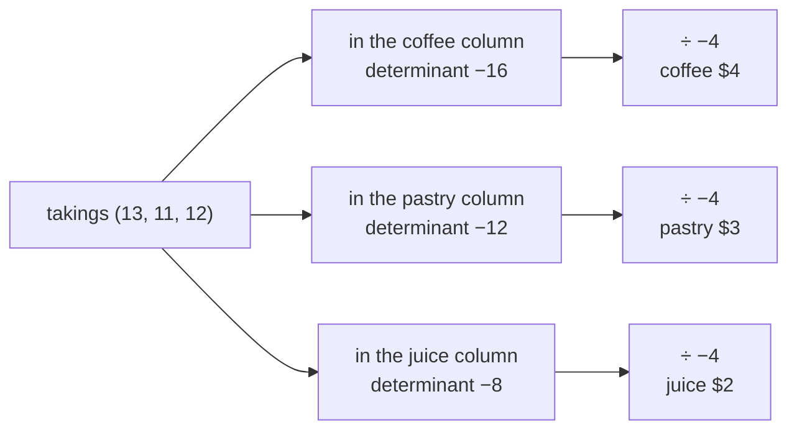

# Cramer's rule: each unknown is a ratio of two determinants, and the inverse is the cofactor table divided by the determinant

[Syllabus](../../../SYLLABUS.md) → [Algebra](../README.md) → [Solving Systems](../README.md#s05) → Cramer's rule

---

## General Overview

A small cafe sells three things: coffee, pastries and juice. The owner wrote down three days of sales but not the prices:

- Monday: 2 coffees, 1 pastry, 1 juice. $13 in the till.
- Tuesday: 1 coffee, 1 pastry, 2 juices. $11.
- Wednesday: 1 coffee, 2 pastries, 1 juice. $12.

Write the counts as a matrix: numbers in rows and columns, a row per day, a column per item. Its determinant, the number that says how much the matrix stretches volume ([Determinants](04-determinants.md)), is −4.

Now put the takings column (13, 11, 12) in place of the coffee column and take the determinant again: −16. Divide: −16 ÷ −4 = 4, so a coffee costs $4. Do the same in the pastry column and the juice column: −12 and −8, so a pastry is $3 and a juice $2.

No clearing out of unknowns, as in [Gaussian elimination](02-gaussian-elimination.md): each price comes on its own. Determinants arranged in a table also give the inverse matrix (the matrix that undoes the counts).

**Each unknown is a determinant with the known column swapped in, over the determinant of the counts; and the inverse is the table of cofactors, flipped across its diagonal, divided by that same determinant.**

**What kind of fact this is:** a theorem, proved on this card in Why it works. It is exact but slow: worth it for formulas with letters; with numbers, elimination does less work.

### The picture: one swap per unknown



---

## The formula

Write the system as $`A x = b`$ ([Solving A x = b](01-matrix-equation-ax-b.md)): counts times unknown prices equals known takings. For $`n`$ equations in $`n`$ unknowns with $`\det A`$ not zero, where $`A_j`$ is $`A`$ with $`b`$ in column $`j`$, unknown $`j`$ is

```math
x_j = \frac{\det A_j}{\det A}
```

**Read it aloud:** to find unknown $`j`$, swap the takings into column $`j`$, take that determinant, and divide by the determinant of the plain counts.

The inverse comes from the same pieces. Cross out row $`i`$ and column $`j`$ of $`A`$; the determinant of what is left is the **minor** $`M_{ij}`$. Give it a checkerboard sign and it is the **cofactor** $`C_{ij}`$. Flip the table of cofactors across its main diagonal (row 1 becomes column 1) and it is the **adjugate**, $`\mathrm{adj}(A)`$.

```math
C_{ij} = (-1)^{i+j} M_{ij} \qquad \mathrm{adj}(A)_{ij} = C_{ji} \qquad A\,\mathrm{adj}(A) = \mathrm{adj}(A)\,A = (\det A)\, I
```

**Read it aloud:** the counts times their adjugate is the determinant times the do-nothing matrix. So, when the determinant is not zero, dividing the adjugate by it gives the inverse:

```math
A^{-1} = \frac{1}{\det A}\,\mathrm{adj}(A)
```

| Symbol | Plain meaning | In our example | Push it up and the answer… |
| --- | --- | --- | --- |
| $`A`$ | the counts: a row per day, a column per item | `[[2, 1, 1], [1, 1, 2], [1, 2, 1]]` | every price moves |
| $`b`$ | the takings, in dollars | (13, 11, 12) | raise Monday's by $1: prices (4.75, 2.75, 1.75) |
| $`x`$, $`x_j`$ | the unknown prices; $`x_j`$ is item $`j`$'s | (4, 3, 2) | — |
| $`n`$, $`n!`$ | how many unknowns, and equations; n factorial, $`n \times (n-1) \times \dots \times 1`$ | 3 | the cost of Cramer's rule explodes |
| $`A_j`$ | $`A`$ with column $`j`$ replaced by $`b`$ | $`A_1`$ = `[[13, 1, 1], [11, 1, 2], [12, 2, 1]]` | its determinant sets $`x_j`$ |
| $`\det A`$, $`\det A_j`$ | determinants: volume multipliers, with sign | −4; then −16, −12, −8 | toward zero, the prices swing wildly |
| $`M_{ij}`$, $`C_{ij}`$ | minor: crossed-out determinant; cofactor: minor with checkerboard sign | $`C_{11}`$ = −3, $`C_{12}`$ = 1 | — |
| $`\mathrm{adj}(A)`$, $`I`$, $`A^{-1}`$ | adjugate: flipped cofactor table; identity: ones on the diagonal; inverse: undoes $`A`$ | `[[-3, 1, 1], [1, 1, -3], [1, -3, 1]]` | — |

### When it holds

- **Square: as many equations as unknowns.** Two days and three items have no $`\det A`$.
- **$`\det A`$ not zero.** If Wednesday's counts were Monday's plus Tuesday's, $`\det A`$ = 0: nothing to divide by. If the takings add up too, the column determinants are 0 too: 0 ÷ 0 names no price.
- **Numbers that divide.** The adjugate uses only multiplying, adding and subtracting, so whole-number counts give a whole-number adjugate. Only the last step divides. On a clock (arithmetic that wraps round), that step needs [The modular inverse](../../02-Number%20theory/03-Clock%20Arithmetic/04-modular-inverse.md) of $`\det A`$.
- **Small $`n`$.** The work grows like $`n!`$ (n factorial, in the table). Even at the cafe's 3 unknowns, elimination needs fewer products: 17 against 39.

---

## Why it works

### Step 0: the takings are a mix of the count columns

The coffee column (2, 1, 1) is the coffees sold each day. Times the coffee price, plus the same for pastry and juice, it gives the takings.

```math
b = x_1\,(\text{column } 1) + x_2\,(\text{column } 2) + x_3\,(\text{column } 3)
```

On the cafe: 4 × (2, 1, 1) + 3 × (1, 1, 2) + 2 × (1, 2, 1) = (13, 11, 12).

Two facts from the folds on [Determinants](04-determinants.md) do the rest:

- **Columns split.** If one column is a sum, the determinant is the sum of the determinants, and a number multiplying a column comes out in front.
- **A repeated column gives zero.** Swapping the two copies flips the sign but changes nothing, so it is 0.

### Step 1: swapping the takings in picks out one price

Put $`b`$ in place of column 1 and split it into its three parts:

```math
\det A_1 = x_1 \det[\,\text{col } 1,\ \text{col } 2,\ \text{col } 3\,] + x_2 \det[\,\text{col } 2,\ \text{col } 2,\ \text{col } 3\,] + x_3 \det[\,\text{col } 3,\ \text{col } 2,\ \text{col } 3\,]
```

The last two have a repeated column, so they are zero. What survives is $`x_1 \det A`$. Divide by $`\det A`$ and $`x_1`$ stands alone. The same holds for any column and any $`n`$, which proves Cramer's rule.

On the cafe: $`\det A_1`$ = 4 × (−4) = −16.

### Step 2: a determinant can be expanded along any row

[Determinants](04-determinants.md) expands along the top row. Any row works, with the checkerboard signs $`(-1)^{i+j}`$: moving row $`i`$ to the top takes $`i - 1`$ neighbor swaps, and each flips the sign. Down any column works too, proved in Interactive Linear Algebra (Sources), not on this shelf.

### Step 3: the adjugate times A is det A times the identity

Entry $`(i, k)`$ of $`A\,\mathrm{adj}(A)`$ is row $`i`$ of $`A`$ against the cofactors of row $`k`$. Two cases:

- **Same row, $`i = k`$.** That is the expansion of $`\det A`$ along row $`i`$ (Step 2). Every diagonal entry is $`\det A`$.
- **Different rows.** Row $`k`$'s cofactors never look at row $`k`$, so this expands a matrix whose row $`k`$ is a copy of row $`i`$. Two equal rows: zero.

On the cafe, row 1 of $`A`$ is (2, 1, 1). Against its own cofactors (−3, 1, 1): −6 + 1 + 1 = −4. Against row 2's cofactors (1, 1, −3): 2 + 1 − 3 = 0. So $`A\,\mathrm{adj}(A)`$ is −4 down the diagonal and 0 elsewhere.

Divide by $`\det A`$ and the product is $`I`$: the adjugate over the determinant is the inverse.

<details>
<summary>Detailed proof: the other order, adj(A) times A</summary>

The same argument runs on columns. Entry $`(j, k)`$ of $`\mathrm{adj}(A)\,A`$ is the cofactors of column $`j`$ against column $`k`$ of $`A`$. For $`j = k`$ it is an expansion down column $`j`$, which equals $`\det A`$ (Step 2). For $`j \ne k`$ it expands a matrix with two equal columns, so it is zero:

$`\displaystyle \mathrm{adj}(A)\,A = (\det A)\, I`$

</details>

### Step 4: Cramer's rule and the adjugate are one formula

Multiply $`A x = b`$ on the left by $`\mathrm{adj}(A)`$. Step 3 turns the left side into $`(\det A)\, x`$. Entry $`j`$ of $`\mathrm{adj}(A)\, b`$ is the cofactors of column $`j`$ against $`b`$: the expansion of $`A_j`$ down column $`j`$. So

$`\det A \cdot x_j = \det A_j`$, which is Cramer's rule again.

On the cafe, $`\mathrm{adj}(A)\, b`$ = (−16, −12, −8): the same three determinants.

### Step 5: why elimination wins for big n

Cofactor expansion breaks a determinant into $`n`$ smaller ones, each into $`n - 1`$, and so on: about $`n!`$ pieces, and Cramer's rule needs $`n + 1`$ determinants. Elimination needs about $`n^3/3`$ multiplications: clearing a column costs about (rows left)² products, and $`1^2 + 2^2 + \dots + n^2`$ is about $`n^3/3`$.

The code's counts:

| Unknowns $`n`$ | Cramer by cofactors | Elimination |
| --- | --- | --- |
| 3 | 39 | 17 |
| 4 | 204 | 36 |
| 6 | 8658 | 106 |
| 10 | 6.86 × 10⁷ (0.069 seconds at a billion a second) | 430 |
| 20 | 8.78 × 10¹⁹ (2782 years) | 3060 |

Finding each determinant by elimination does not rescue it: each costs about one whole solve, so Cramer's rule still does $`n + 1`$ times the work.

---

## Worked numbers, by hand

The cafe: counts `[[2, 1, 1], [1, 1, 2], [1, 2, 1]]`, takings (13, 11, 12). Each determinant is expanded along its top row.

| Step | Arithmetic | Value |
| --- | --- | --- |
| det A | 2(1·1 − 2·2) − 1(1·1 − 2·1) + 1(1·2 − 1·1) | −6 + 1 + 1 = **−4** |
| det A₁, takings in the coffee column | 13(1·1 − 2·2) − 1(11·1 − 2·12) + 1(11·2 − 1·12) | −39 + 13 + 10 = −16 |
| det A₂, takings in the pastry column | 2(11·1 − 2·12) − 13(1·1 − 2·1) + 1(1·12 − 11·1) | −26 + 13 + 1 = −12 |
| det A₃, takings in the juice column | 2(1·12 − 11·2) − 1(1·12 − 11·1) + 13(1·2 − 1·1) | −20 − 1 + 13 = −8 |
| prices | −16 ÷ −4, −12 ÷ −4, −8 ÷ −4 | **(4, 3, 2)** |
| cofactors of row 1 | +(1·1 − 2·2), −(1·1 − 2·1), +(1·2 − 1·1) | −3, 1, 1 |
| rows 2 and 3 | −(1·1 − 1·2), +(2·1 − 1·1), −(2·2 − 1·1); +(1·2 − 1·1), −(2·2 − 1·1), +(2·1 − 1·1) | 1, 1, −3; 1, −3, 1 |
| all nine, flipped | this $`A`$ is its own mirror, so the flip changes nothing | adj(A) = `[[-3, 1, 1], [1, 1, -3], [1, -3, 1]]` |
| inverse | adj(A) ÷ −4 | **`[[0.75, -0.25, -0.25], [-0.25, -0.25, 0.75], [-0.25, 0.75, -0.25]]`** |
| adj(A) b, then ÷ −4 | (−3·13 + 11 + 12, …) | (−16, −12, −8) → (4, 3, 2) |

A coffee is $4, a pastry $3, a juice $2. Check Monday: 2 × 4 + 3 + 2 = 13.

### What breaks if you drop a piece

| Mistake | Comes out at | What went wrong |
| --- | --- | --- |
| Minors with no checkerboard signs | prices (9.5, −8.5, −14.5) | a minus sign on half the entries is part of the cofactor |
| Stop before dividing by det A | prices (−16, −12, −8) | the column determinants are only numerators |
| Cofactor table not flipped, on the sandwich cafe from [The inverse matrix](03-inverse-matrix.md) | (1, 18, −3), not (4, 3, 6) | row $`i`$ of cofactors belongs in column $`i`$ |
| Cramer on a singular cafe: Wednesday `[3, 2, 3]` takes $24, Monday plus Tuesday | det 0, column determinants (0, 0, 0) | 0 ÷ 0: the days do not pin the prices |

The code prints all four.

---

## Code, from first principles, and it actually runs

Nothing is imported. The prices come out by three independent roads: Cramer's ratios of determinants, the adjugate times the takings over $`\det A`$, and elimination. The checks also confirm Step 3's identity both ways round. Every multiply and divide is counted and matched to the cost formulas.

### Python

```python
# Cramer's rule and the adjugate -- the check behind the card.  Nothing is imported.  The cafe's
# prices come out three ways: Cramer's ratios of determinants, the adjugate times the takings over
# det A, and plain elimination.  Every multiply and divide is counted, to compare the costs.
A, b, OPS = [[2, 1, 1], [1, 1, 2], [1, 2, 1]], [13, 11, 12], [0]   # a row per day: coffee, pastry, juice; OPS counts
def det(M):                             # cofactor expansion along the top row (OPS: multiplies and divides)
    if len(M) == 1: return M[0][0]
    OPS[0] += len(M)
    return sum((-1) ** j * M[0][j] * det([r[:j] + r[j + 1:] for r in M[1:]]) for j in range(len(M)))
def with_col(M, j, v): return [r[:j] + [v[i]] + r[j + 1:] for i, r in enumerate(M)]
def minor(M, i, j): return [r[:j] + r[j + 1:] for k, r in enumerate(M) if k != i]
def cofactors(M, s=1): return [[(-1) ** (s * (i + j)) * det(minor(M, i, j)) for j in range(len(M))] for i in range(len(M))]
def flip(M): return [list(col) for col in zip(*M)]          # rows become columns
def mul(P, Q): return [[sum(p * q for p, q in zip(r, c)) for c in zip(*Q)] for r in P]
def mv(P, v): return [sum(p * q for p, q in zip(r, v)) for r in P]
def cramer(M, v):                       # road 1: one determinant over another, n times
    d = det(M); OPS[0] += len(M)
    return [det(with_col(M, j, v)) / d for j in range(len(M))]
def eliminate(M, v):                    # road 3: elimination, then back-substitution
    n, T = len(M), [r[:] + [v[i]] for i, r in enumerate(M)]
    for k in range(n):
        for i in range(k + 1, n):
            f = T[i][k] / T[k][k]; OPS[0] += 1 + n - k
            T[i] = T[i][:k + 1] + [T[i][j] - f * T[k][j] for j in range(k + 1, n + 1)]
    x = [0.0] * n
    for i in reversed(range(n)):
        OPS[0] += n - i; x[i] = (T[i][n] - sum(T[i][j] * x[j] for j in range(i + 1, n))) / T[i][i]
    return x
def vec(v): return "(" + ", ".join(f"{x:g}" for x in v) + ")"
def mat(M): return "[" + ", ".join(vec(r)[1:-1].join("[]") for r in M) + "]"
def P(n): return 0 if n == 1 else n * (P(n - 1) + 1)        # products in one n by n expansion
def cost(n): return (n + 1) * P(n) + n, sum(m * m - 1 for m in range(1, n + 1)) + n * (n + 1) // 2
def sci(x): e = len(str(int(x))) - 1; return f"{x / 10 ** e:.2f} x 10^{e}"
d, dets, x1, C = det(A), [det(with_col(A, j, b)) for j in range(3)], cramer(A, b), cofactors(A); adj = flip(C)
x2, x3, inv = [v / d for v in mv(adj, b)], eliminate(A, b), [[v / d for v in r] for r in adj]
print(f"cafe A = {mat(A)}   takings b = {vec(b)}   det A = {d}")
print(f"takings put in column 1, 2, 3: determinants {vec(dets)}; Cramer: prices {vec(x1)}\ntop-row terms: " + "; ".join(
    k + " " + " ".join(f"{(-1) ** j * M[0][j] * det(minor(M, 0, j)):+g}" for j in range(3)) for k, M in [("A", A)] + [(f"A_{j + 1}", with_col(A, j, b)) for j in range(3)]))
print(f"cofactor table C = {mat(C)}   adjugate = C flipped = {mat(adj)}")
print(f"adj(A) b = {vec(mv(adj, b))}   A adj(A) = {mat(mul(A, adj))} = adj(A) A")
print(f"inverse = adj(A) / det A = {mat(inv)}")
print(f"adjugate road: prices {vec(x2)}   elimination road: {vec(x3)}   A x = {vec(mv(A, x1))}")
for n in (3, 4, 6):                     # count the work on a test system, then match the formulas
    M, v = [[n if i == j else 1 for j in range(n)] for i in range(n)], list(range(1, n + 1))
    OPS[0] = 0; cramer(M, v); cr = OPS[0]; OPS[0] = 0; eliminate(M, v); assert (cr, OPS[0]) == cost(n)
    print(f"n = {n}: Cramer by cofactors {cr} products, elimination {OPS[0]} (counted = formula)")
print(f"n = 10: Cramer {sci(cost(10)[0])}, elimination {cost(10)[1]}; at a billion a second {cost(10)[0] / 1e9:.3f} seconds")
print(f"n = 20: Cramer {sci(cost(20)[0])}, elimination {cost(20)[1]}; Cramer {cost(20)[0] / 1e9 / 31557600:.0f} years")
S, bs, Z, plain = [[2, 1, 1], [1, 1, 1], [1, 2, 1]], [17, 13, 16], [[2, 1, 1], [1, 1, 2], [3, 2, 3]], [v / d for v in mv(flip(cofactors(A, 0)), b)]
print(f"mistakes: minors with no signs {vec(plain)}; sandwich cafe, table not flipped "
      f"{vec([v / det(S) for v in mv(cofactors(S), bs)])} not {vec(cramer(S, bs))}")
print(f"singular cafe {mat(Z)}, takings (13, 11, 24): det {det(Z)}, column determinants "
      f"{vec([det(with_col(Z, j, [13, 11, 24])) for j in range(3)])}")
print(f"try changing: Monday $14 {vec(cramer(A, [14, 11, 12]))}; Tue and Wed swapped det {det([A[0], A[2], A[1]])} "
      f"prices {vec(cramer([A[0], A[2], A[1]], [13, 12, 11]))}; n = 25 Cramer {sci(cost(25)[0] / 1e9 / 31557600)} years")
assert d == -4 and dets == [-16, -12, -8] and x1 == [4, 3, 2] and mv(A, x1) == b
assert mv(adj, b) == dets and x2 == x1 and max(abs(p - q) for p, q in zip(x3, x1)) < 1e-12
assert mul(A, adj) == [[d if i == j else 0 for j in range(3)] for i in range(3)] == mul(adj, A)
assert cramer(S, bs) == [4, 3, 6] and det(Z) == 0 and mul(A, inv) == [[1, 0, 0], [0, 1, 0], [0, 0, 1]]
assert mul(S, flip(cofactors(S))) == [[-1, 0, 0], [0, -1, 0], [0, 0, -1]]   # S is lopsided: the flip matters
print("ALL CHECKS PASS")
```

**Ran 2026-11-23 on macOS, Python 3.14.10, standard library only. All checks passed. Output, pasted from the run:**

```
cafe A = [[2, 1, 1], [1, 1, 2], [1, 2, 1]]   takings b = (13, 11, 12)   det A = -4
takings put in column 1, 2, 3: determinants (-16, -12, -8); Cramer: prices (4, 3, 2)
top-row terms: A -6 +1 +1; A_1 -39 +13 +10; A_2 -26 +13 +1; A_3 -20 -1 +13
cofactor table C = [[-3, 1, 1], [1, 1, -3], [1, -3, 1]]   adjugate = C flipped = [[-3, 1, 1], [1, 1, -3], [1, -3, 1]]
adj(A) b = (-16, -12, -8)   A adj(A) = [[-4, 0, 0], [0, -4, 0], [0, 0, -4]] = adj(A) A
inverse = adj(A) / det A = [[0.75, -0.25, -0.25], [-0.25, -0.25, 0.75], [-0.25, 0.75, -0.25]]
adjugate road: prices (4, 3, 2)   elimination road: (4, 3, 2)   A x = (13, 11, 12)
n = 3: Cramer by cofactors 39 products, elimination 17 (counted = formula)
n = 4: Cramer by cofactors 204 products, elimination 36 (counted = formula)
n = 6: Cramer by cofactors 8658 products, elimination 106 (counted = formula)
n = 10: Cramer 6.86 x 10^7, elimination 430; at a billion a second 0.069 seconds
n = 20: Cramer 8.78 x 10^19, elimination 3060; Cramer 2782 years
mistakes: minors with no signs (9.5, -8.5, -14.5); sandwich cafe, table not flipped (1, 18, -3) not (4, 3, 6)
singular cafe [[2, 1, 1], [1, 1, 2], [3, 2, 3]], takings (13, 11, 24): det 0, column determinants (0, 0, 0)
try changing: Monday $14 (4.75, 2.75, 1.75); Tue and Wed swapped det 4 prices (4, 3, 2); n = 25 Cramer 2.20 x 10^10 years
ALL CHECKS PASS
```

### Rust

Same numbers, same labels, built with `rustc --edition 2021 -O`.

```rust
// Cramer's rule and the adjugate -- the same check as the Python, in Rust.  No crates.  The cafe's
// prices come out three ways: Cramer's ratios of determinants, the adjugate times the takings over
// det A, and plain elimination.  Every multiply and divide is counted, to compare the costs.
use std::sync::atomic::{AtomicU64, Ordering::Relaxed};
type Mat = Vec<Vec<f64>>;
static OPS: AtomicU64 = AtomicU64::new(0);  // multiplies and divides done so far
fn det(m: &Mat) -> f64 {                    // cofactor expansion along the top row
    if m.len() == 1 { return m[0][0]; }
    OPS.fetch_add(m.len() as u64, Relaxed);
    (0..m.len()).map(|j| {
        let sub: Mat = m[1..].iter().map(|r| [&r[..j], &r[j + 1..]].concat()).collect();
        (if j % 2 == 0 { 1.0 } else { -1.0 }) * m[0][j] * det(&sub)
    }).sum()
}
fn with_col(m: &Mat, j: usize, v: &[f64]) -> Mat { m.iter().enumerate().map(|(i, r)| { let mut r = r.clone(); r[j] = v[i]; r }).collect() }
fn minor(m: &Mat, i: usize, j: usize) -> Mat { m.iter().enumerate().filter(|(k, _)| *k != i).map(|(_, r)| [&r[..j], &r[j + 1..]].concat()).collect() }
fn cofactors(m: &Mat, s: usize) -> Mat { (0..m.len()).map(|i| (0..m.len()).map(|j| (if s * (i + j) % 2 == 0 { 1.0 } else { -1.0 }) * det(&minor(m, i, j))).collect()).collect() }
fn flip(m: &Mat) -> Mat { (0..m[0].len()).map(|j| m.iter().map(|r| r[j]).collect()).collect() }
fn mul(p: &Mat, q: &Mat) -> Mat { p.iter().map(|r| (0..q[0].len()).map(|j| (0..q.len()).map(|k| r[k] * q[k][j]).sum()).collect()).collect() }
fn mv(p: &Mat, v: &[f64]) -> Vec<f64> { p.iter().map(|r| r.iter().zip(v).map(|(a, b)| a * b).sum()).collect() }
fn cramer(m: &Mat, v: &[f64]) -> Vec<f64> {   // road 1: one determinant over another, n times
    let d = det(m); OPS.fetch_add(m.len() as u64, Relaxed);
    (0..m.len()).map(|j| det(&with_col(m, j, v)) / d).collect()
}
fn eliminate(m: &Mat, v: &[f64]) -> Vec<f64> {   // road 3: elimination, then back-substitution
    let n = m.len();
    let mut t: Mat = m.iter().enumerate().map(|(i, r)| { let mut r = r.clone(); r.push(v[i]); r }).collect();
    for k in 0..n { for i in k + 1..n {
        let f = t[i][k] / t[k][k]; OPS.fetch_add((1 + n - k) as u64, Relaxed);
        for j in k + 1..n + 1 { t[i][j] -= f * t[k][j]; } } }
    let mut x = vec![0.0; n];
    for i in (0..n).rev() { OPS.fetch_add((n - i) as u64, Relaxed); x[i] = (t[i][n] - (i + 1..n).map(|j| t[i][j] * x[j]).sum::<f64>()) / t[i][i]; }
    x
}
fn g(x: f64) -> String { if x.fract() == 0.0 { format!("{}", x as i64) } else { format!("{}", x) } }
fn vec_s(v: &[f64]) -> String { format!("({})", v.iter().map(|x| g(*x)).collect::<Vec<_>>().join(", ")) }
fn mat(m: &Mat) -> String { format!("[{}]", m.iter().map(|r| { let s = vec_s(r); format!("[{}]", &s[1..s.len() - 1]) }).collect::<Vec<_>>().join(", ")) }
fn p(n: u128) -> u128 { if n == 1 { 0 } else { n * (p(n - 1) + 1) } }   // products in one expansion
fn cost(n: u128) -> (u128, u128) { ((n + 1) * p(n) + n, (1..=n).map(|m| m * m - 1).sum::<u128>() + n * (n + 1) / 2) }
fn sci(x: f64) -> String { let e = format!("{}", x as u128).len() as i32 - 1; format!("{:.2} x 10^{}", x / 10f64.powi(e), e) }
fn ops() -> u64 { OPS.swap(0, Relaxed) }
fn main() {
    let a: Mat = vec![vec![2.0, 1.0, 1.0], vec![1.0, 1.0, 2.0], vec![1.0, 2.0, 1.0]];
    let b = [13.0, 11.0, 12.0];   // a row per day: coffee, pastry, juice; takings in dollars
    let (d, x1, c, dets): (f64, Vec<f64>, Mat, Vec<f64>) = (det(&a), cramer(&a, &b), cofactors(&a, 1), (0..3).map(|j| det(&with_col(&a, j, &b))).collect());
    let adj = flip(&c); let x2: Vec<f64> = mv(&adj, &b).iter().map(|v| v / d).collect();
    let (x3, inv): (Vec<f64>, Mat) = (eliminate(&a, &b), adj.iter().map(|r| r.iter().map(|v| v / d).collect()).collect());
    println!("cafe A = {}   takings b = {}   det A = {}", mat(&a), vec_s(&b), g(d));
    let tops: Vec<String> = [("A".to_string(), a.clone())].into_iter().chain((0..3).map(|j| (format!("A_{}", j + 1), with_col(&a, j, &b))))
        .map(|(k, m)| format!("{} {}", k, (0..3).map(|j| format!("{:+}", (if j == 1 { -1.0 } else { 1.0 }) * m[0][j] * det(&minor(&m, 0, j)))).collect::<Vec<_>>().join(" "))).collect();
    println!("takings put in column 1, 2, 3: determinants {}; Cramer: prices {}\ntop-row terms: {}", vec_s(&dets), vec_s(&x1), tops.join("; "));
    println!("cofactor table C = {}   adjugate = C flipped = {}", mat(&c), mat(&adj));
    println!("adj(A) b = {}   A adj(A) = {} = adj(A) A", vec_s(&mv(&adj, &b)), mat(&mul(&a, &adj)));
    println!("inverse = adj(A) / det A = {}", mat(&inv));
    println!("adjugate road: prices {}   elimination road: {}   A x = {}", vec_s(&x2), vec_s(&x3), vec_s(&mv(&a, &x1)));
    for n in [3usize, 4, 6] {               // count the work on a test system, then match the formulas
        let m: Mat = (0..n).map(|i| (0..n).map(|j| if i == j { n as f64 } else { 1.0 }).collect()).collect();
        let v: Vec<f64> = (1..=n).map(|k| k as f64).collect();
        ops(); cramer(&m, &v); let cr = ops(); eliminate(&m, &v); let el = ops(); assert!((cr as u128, el as u128) == cost(n as u128));
        println!("n = {}: Cramer by cofactors {} products, elimination {} (counted = formula)", n, cr, el);
    }
    let (c10, c20, y) = (cost(10), cost(20), 1e9 * 31557600.0);
    println!("n = 10: Cramer {}, elimination {}; at a billion a second {:.3} seconds", sci(c10.0 as f64), c10.1, c10.0 as f64 / 1e9);
    println!("n = 20: Cramer {}, elimination {}; Cramer {:.0} years", sci(c20.0 as f64), c20.1, c20.0 as f64 / y);
    let (s, bs, z) = (vec![vec![2.0, 1.0, 1.0], vec![1.0, 1.0, 1.0], vec![1.0, 2.0, 1.0]], [17.0, 13.0, 16.0], vec![vec![2.0, 1.0, 1.0], vec![1.0, 1.0, 2.0], vec![3.0, 2.0, 3.0]]);
    let plain: Vec<f64> = mv(&flip(&cofactors(&a, 0)), &b).iter().map(|v| v / d).collect();
    let wrong: Vec<f64> = mv(&cofactors(&s, 1), &bs).iter().map(|v| v / det(&s)).collect();
    println!("mistakes: minors with no signs {}; sandwich cafe, table not flipped {} not {}", vec_s(&plain), vec_s(&wrong), vec_s(&cramer(&s, &bs)));
    println!("singular cafe {}, takings (13, 11, 24): det {}, column determinants {}", mat(&z), g(det(&z)),
        vec_s(&(0..3).map(|j| det(&with_col(&z, j, &[13.0, 11.0, 24.0]))).collect::<Vec<f64>>()));
    let sw: Mat = vec![a[0].clone(), a[2].clone(), a[1].clone()];
    println!("try changing: Monday $14 {}; Tue and Wed swapped det {} prices {}; n = 25 Cramer {} years",
        vec_s(&cramer(&a, &[14.0, 11.0, 12.0])), g(det(&sw)), vec_s(&cramer(&sw, &[13.0, 12.0, 11.0])), sci(cost(25).0 as f64 / y));
    assert!(d == -4.0 && dets == vec![-16.0, -12.0, -8.0] && x1 == vec![4.0, 3.0, 2.0] && mv(&a, &x1) == b.to_vec());
    assert!(mv(&adj, &b) == dets && x2 == x1 && x3.iter().zip(&x1).all(|(p, q)| (p - q).abs() < 1e-12));
    let id = |k: f64| -> Mat { (0..3).map(|i| (0..3).map(|j| if i == j { k } else { 0.0 }).collect()).collect() };
    assert!(mul(&a, &adj) == id(d) && mul(&adj, &a) == id(d) && cramer(&s, &bs) == vec![4.0, 3.0, 6.0] && det(&z) == 0.0 && mul(&a, &inv) == id(1.0));
    assert!(mul(&s, &flip(&cofactors(&s, 1))) == id(-1.0));   // s is lopsided: the flip matters
    println!("ALL CHECKS PASS");
}
```

**Ran 2026-11-23 on macOS, rustc 1.98.1, no crates. All checks passed. Output, pasted from the run:**

```
cafe A = [[2, 1, 1], [1, 1, 2], [1, 2, 1]]   takings b = (13, 11, 12)   det A = -4
takings put in column 1, 2, 3: determinants (-16, -12, -8); Cramer: prices (4, 3, 2)
top-row terms: A -6 +1 +1; A_1 -39 +13 +10; A_2 -26 +13 +1; A_3 -20 -1 +13
cofactor table C = [[-3, 1, 1], [1, 1, -3], [1, -3, 1]]   adjugate = C flipped = [[-3, 1, 1], [1, 1, -3], [1, -3, 1]]
adj(A) b = (-16, -12, -8)   A adj(A) = [[-4, 0, 0], [0, -4, 0], [0, 0, -4]] = adj(A) A
inverse = adj(A) / det A = [[0.75, -0.25, -0.25], [-0.25, -0.25, 0.75], [-0.25, 0.75, -0.25]]
adjugate road: prices (4, 3, 2)   elimination road: (4, 3, 2)   A x = (13, 11, 12)
n = 3: Cramer by cofactors 39 products, elimination 17 (counted = formula)
n = 4: Cramer by cofactors 204 products, elimination 36 (counted = formula)
n = 6: Cramer by cofactors 8658 products, elimination 106 (counted = formula)
n = 10: Cramer 6.86 x 10^7, elimination 430; at a billion a second 0.069 seconds
n = 20: Cramer 8.78 x 10^19, elimination 3060; Cramer 2782 years
mistakes: minors with no signs (9.5, -8.5, -14.5); sandwich cafe, table not flipped (1, 18, -3) not (4, 3, 6)
singular cafe [[2, 1, 1], [1, 1, 2], [3, 2, 3]], takings (13, 11, 24): det 0, column determinants (0, 0, 0)
try changing: Monday $14 (4.75, 2.75, 1.75); Tue and Wed swapped det 4 prices (4, 3, 2); n = 25 Cramer 2.20 x 10^10 years
ALL CHECKS PASS
```

The two outputs match line for line.

### Lean

Lean proves Cramer's rule and both adjugate facts for square matrices of every size, not just the cafe's 3 by 3.

- Suppose $`A x = b`$ is square and $`\det A`$ is not zero. Then unknown $`j`$ is $`x_j = \det A_j / \det A`$.
- The counts times their adjugate, in either order, is $`\det A`$ times the identity. It never divides, so it holds for whole numbers too.
- Suppose $`\det A`$ is not zero. Then entry $`(i, j)`$ of the inverse is the cofactor $`C_{ji}`$ divided by $`\det A`$.
- It also re-checks the cafe: $`\det A`$ = −4, and the column determinants are −16, −12 and −8.
- It checks the prices (4, 3, 2), the adjugate, and $`\mathrm{adj}(A)\, b`$ = (−16, −12, −8).

The elimination road, the cost counts and the mistakes table are left to the Python and Rust checks.

```lean
-- Cramer's rule: each unknown of a square system with nonzero determinant is det A_j over det A, A adj(A) = adj(A) A = (det A) I, and the inverse is the flipped cofactor table over det A.
import Mathlib.LinearAlgebra.Matrix.Adjugate
import Mathlib.LinearAlgebra.Matrix.NonsingularInverse

open Matrix

/-- Cramer's rule: for a square system `A x = b` whose determinant is not zero, unknown `j` is the
determinant of `A` with `b` put in column `j`, divided by the determinant of `A`. -/
theorem cramers_rule {K : Type*} [Field K] {n : Type*} [Fintype n] [DecidableEq n]
    (A : Matrix n n K) (b x : n → K) (hA : A.det ≠ 0) (hx : A *ᵥ x = b) (j : n) :
    x j = (A.updateCol j b).det / A.det := by
  have hu : IsUnit A.det := isUnit_iff_ne_zero.mpr hA
  have hxb : x = A⁻¹ *ᵥ b := by
    rw [← hx, mulVec_mulVec, nonsing_inv_mul A hu, one_mulVec]
  have h := congrFun (det_smul_inv_mulVec_eq_cramer A b hu) j
  rw [cramer_apply, ← hxb, Pi.smul_apply, smul_eq_mul] at h
  rw [eq_div_iff hA, ← h, mul_comm]

/-- The counts times their adjugate, in either order, is the determinant times the identity.
It uses only multiplying, adding and subtracting, so it holds for whole numbers too. -/
theorem mul_adjugate_eq_det_smul_one {R : Type*} [CommRing R] {n : Type*} [Fintype n]
    [DecidableEq n] (A : Matrix n n R) :
    A * adjugate A = A.det • (1 : Matrix n n R) ∧ adjugate A * A = A.det • (1 : Matrix n n R) := by
  exact ⟨mul_adjugate A, adjugate_mul A⟩

/-- When the determinant is not zero, entry `(i, j)` of the inverse is the cofactor `C_ji`
(the minor with row `j` and column `i` crossed out, with checkerboard sign `(-1)^(j+i)`),
divided by the determinant: the flipped cofactor table over `det A`. -/
theorem inv_eq_flipped_cofactors_div_det {K : Type*} [Field K] {n : ℕ}
    (A : Matrix (Fin (n + 1)) (Fin (n + 1)) K) (hA : A.det ≠ 0) (i j : Fin (n + 1)) :
    A⁻¹ i j = (-1) ^ ((j : ℕ) + (i : ℕ)) * (A.submatrix j.succAbove i.succAbove).det / A.det := by
  rw [inv_def, Ring.inverse_eq_inv', Matrix.smul_apply, adjugate_fin_succ_eq_det_submatrix,
    smul_eq_mul, div_eq_mul_inv, mul_comm]

-- The cafe: counts A, takings (13, 11, 12).  det A = -4.
example : (!![2, 1, 1; 1, 1, 2; 1, 2, 1] : Matrix (Fin 3) (Fin 3) ℤ).det = -4 := by
  norm_num [Matrix.det_fin_three]

-- Takings swapped into the coffee, pastry and juice columns: determinants -16, -12, -8.
example : ((!![2, 1, 1; 1, 1, 2; 1, 2, 1] : Matrix (Fin 3) (Fin 3) ℤ).updateCol 0 ![13, 11, 12]).det
    = -16 := by
  norm_num [Matrix.det_fin_three, Matrix.updateCol_apply]

example : ((!![2, 1, 1; 1, 1, 2; 1, 2, 1] : Matrix (Fin 3) (Fin 3) ℤ).updateCol 1 ![13, 11, 12]).det
    = -12 := by
  norm_num [Matrix.det_fin_three, Matrix.updateCol_apply]

example : ((!![2, 1, 1; 1, 1, 2; 1, 2, 1] : Matrix (Fin 3) (Fin 3) ℤ).updateCol 2 ![13, 11, 12]).det
    = -8 := by
  norm_num [Matrix.det_fin_three, Matrix.updateCol_apply]

-- The prices (4, 3, 2) give the takings.
example : (!![2, 1, 1; 1, 1, 2; 1, 2, 1] : Matrix (Fin 3) (Fin 3) ℤ) *ᵥ ![4, 3, 2] = ![13, 11, 12] := by
  ext i; fin_cases i <;> rfl

-- The adjugate is [[-3, 1, 1], [1, 1, -3], [1, -3, 1]].
example : adjugate (!![2, 1, 1; 1, 1, 2; 1, 2, 1] : Matrix (Fin 3) (Fin 3) ℤ)
    = !![-3, 1, 1; 1, 1, -3; 1, -3, 1] := by
  rw [Matrix.adjugate_fin_three]; norm_num

-- adj(A) b = (-16, -12, -8).
example : adjugate (!![2, 1, 1; 1, 1, 2; 1, 2, 1] : Matrix (Fin 3) (Fin 3) ℤ) *ᵥ ![13, 11, 12]
    = ![-16, -12, -8] := by
  rw [Matrix.adjugate_fin_three]
  ext i; fin_cases i <;> simp [Matrix.mulVec, dotProduct, Fin.sum_univ_three]

#print axioms cramers_rule
#print axioms mul_adjugate_eq_det_smul_one
#print axioms inv_eq_flipped_cofactors_div_det
```

**Checked 2026-11-23 on macOS, Lean 4.36.0-rc2, Mathlib v4.36.0-rc2. Every proof is complete and uses only Lean's standard axioms. Output, pasted from the run:**

```
'cramers_rule' depends on axioms: [propext, Classical.choice, Quot.sound]
'mul_adjugate_eq_det_smul_one' depends on axioms: [propext, Classical.choice, Quot.sound]
'inv_eq_flipped_cofactors_div_det' depends on axioms: [propext, Classical.choice, Quot.sound]
```

> [!TIP]
> **Try changing**
> - **Guess first: Monday's takings go up to $14.** Prices (4.75, 2.75, 1.75). Each moves by the first column of the inverse, (0.75, −0.25, −0.25): one extra dollar on Monday.
> - **Guess first: swap Tuesday and Wednesday, takings too.** The determinant flips to 4, but each column determinant flips too, so the prices stay (4, 3, 2).
> - **Guess first: 25 unknowns by Cramer's rule.** At a billion products a second: 2.20 × 10¹⁰ years.

---

## The usual mistake

> [!warning]
> **Forgetting to flip the cofactor table.** The adjugate is the cofactor table flipped across its diagonal: row $`i`$ of cofactors goes in column $`i`$. On this cafe the counts are their own mirror image, so the slip is invisible. On the sandwich cafe from [The inverse matrix](03-inverse-matrix.md) it gives prices (1, 18, −3) instead of (4, 3, 6).
>
> - **The checkerboard signs are not optional.** Minors without them give (9.5, −8.5, −14.5): a pastry at minus $8.50.
> - **The column determinants are not the answers.** Stopping at (−16, −12, −8) gives negative prices; divide by $`\det A`$ = −4.
> - **Cramer's rule is not for big systems.** At 20 unknowns: 8.78 × 10¹⁹ products against elimination's 3060.

---

## Where you meet it in real life

- **Economics models with letters in them.** A small supply-and-demand system often has symbols for entries. Cramer's rule gives each unknown as a formula, showing how a price responds to a tax.
- **Ray tracing in graphics.** Where a ray of light hits a triangle is a 3 by 3 system, which fast renderers solve by Cramer's rule.
- **Codes on a clock.** The Hill cipher scrambles letters with a matrix, mod 26. Decoding uses the adjugate, which needs no dividing, times the modular inverse of the determinant.

> **Say it back**
> To find unknown $`j`$, swap the known column into column $`j`$, take that determinant, and divide by the plain matrix's determinant. On the cafe: −16, −12 and −8 over −4 give $4, $3 and $2. It works because the known column is a mix of the matrix's columns, and a repeated column has determinant zero. The signed minors, flipped across the diagonal, form the adjugate; adjugate over determinant is the inverse. The rule costs about $`n!`$ work, so elimination does the real solving.

---

## What this builds on

- [Determinants](04-determinants.md): cofactor expansion, and the column rules that prove Cramer's rule.
- [The inverse matrix](03-inverse-matrix.md): the undo matrix; its folded 2 by 2 Cramer shortcut is extended here to any size.
- [Gaussian elimination](02-gaussian-elimination.md): the row moves that beat Cramer's rule on cost.
- [Solving A x = b](01-matrix-equation-ax-b.md): a square system with nonzero determinant has one answer; with zero, none or infinitely many.

## Where this goes next

- [The dot product](../06-Dot%20Products%20and%20Best%20Fits/01-dot-product.md): starts the next shelf, building length and right angles for systems with no exact answer.
- [Matrix norms and the condition number](../../16-Numerical%20analysis/03-Numerical%20Linear%20Algebra/01-matrix-norms-and-the-condition-number.md): how much a nearly flat matrix magnifies errors in the takings.
- [LU with partial pivoting](../../16-Numerical%20analysis/03-Numerical%20Linear%20Algebra/02-lu-decomposition-and-pivoting.md): elimination packaged so one factoring serves every new day.

This closes exact square systems. The open question: with more days than items and slightly wrong takings, no prices fit every day, so which prices fit best? "Best" needs a length and a right angle, and the next shelf builds both, starting with [The dot product](../06-Dot%20Products%20and%20Best%20Fits/01-dot-product.md).

---

## Sources

Verified 2026-11-23: every link below resolves to the publisher's page.

- Strang, Gilbert. *Introduction to Linear Algebra*, 6th ed. Wellesley-Cambridge Press, 2023. [Publisher page](https://wellesleycambridge.com/books/introduction-to-linear-algebra-6th-edition). Chapter 5: Cramer's rule by the column-swap argument, and the cofactor formula for the inverse.
- Margalit, Dan, and Joseph Rabinoff. *Interactive Linear Algebra*. Georgia Institute of Technology. [Cofactor Expansions](https://textbooks.math.gatech.edu/ila/determinants-cofactors.html). Free; 4.2 proves expansion down any column, and 4.2.2 covers Cramer's rule, inverses and why row reduction is faster.
- Dummit, David S., and Richard M. Foote. *Abstract Algebra*, 3rd ed. Wiley, 2004. [Publisher page](https://www.wiley.com/en-us/Abstract+Algebra%2C+3rd+Edition-p-9780471433347). Section 11.4: determinants and the cofactor formula for the inverse, over any commutative ring.
