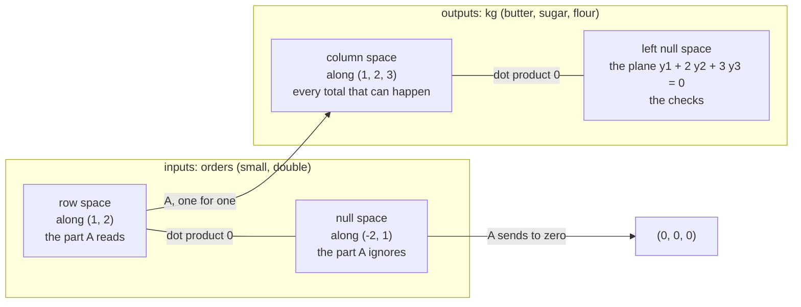

# The four fundamental subspaces: every matrix splits its inputs into row space and null space, its outputs into column space and left null space, at right angles

[Syllabus](../../../SYLLABUS.md) → [Algebra](../README.md) → [Dot Products and Best Fits](../README.md#s06) → The four fundamental subspaces

---

## General Overview

A bakery makes one recipe in two sizes. A small batch uses 1 kg butter, 2 kg sugar and 3 kg flour. A double batch uses twice that: 2, 4 and 6 kg.

An order is a pair of counts, (small batches, double batches). The ingredients it uses are three numbers, (butter, sugar, flour). The order (3, 1) uses (5, 10, 15) kg. So does the order (1, 2).

Some changes to an order make no difference to the ingredients: swap one double batch for two small ones. And some ingredient totals can never happen: sugar is always twice the butter, and flour three times. A stock report of "1 kg butter, no sugar, no flour" is wrong, and two simple checks prove it.

This card names the four collections behind those facts and shows they meet at right angles, which turns "can this total happen?" into a few dot products.

**Every matrix splits its inputs into a part it reads (the row space) and a part it ignores (the null space), and its outputs into what it can reach (the column space) and the checks every reachable output passes (the left null space); each pair meets at right angles.**

**What kind of fact this is:** a theorem, proved on this card in Why it works; the four subspaces are definitions.

### The picture: two sides, two perpendicular pairs



The matrix carries the row space onto the column space and throws the null space away. The left null space holds the checks: each is perpendicular to every total an order can reach.

---

## The formula

Write the recipe as a matrix $`A`$, one row per ingredient, one column per batch size: `[[1, 2], [2, 4], [3, 6]]`. An order $`x`$ = (small, double) gives the ingredients $`A x`$.

The four subspaces, each a collection of vectors closed under adding and scaling:

- **Row space** $`C(A^T)`$ ($`A^T`$ is $`A`$ with rows and columns swapped): every mix of the rows. It lives among the inputs.
- **Null space** $`N(A)`$: every input with $`A x = 0`$. Also among the inputs.
- **Column space** $`C(A)`$: every mix of the columns, so every output $`A x`$ can reach.
- **Left null space** $`N(A^T)`$: every output-sized $`y`$ with $`A^T y = 0`$. Among the outputs.

First, the pairs are perpendicular:

```math
C(A^T) \perp N(A) \qquad\text{and}\qquad C(A) \perp N(A^T)
```

**Read it aloud:** every input the matrix ignores is at right angles to every mix of its rows, and every check is at right angles to every output the matrix can reach.

Second, the solvability test:

```math
A x = b \text{ has a solution exactly when } y \cdot b = 0 \text{ for every } y \text{ with } A^T y = 0
```

**Read it aloud:** some real-number order produces a total exactly when it passes every check in the left null space.

The **rank** $`r`$ is the number of independent rows, always equal to the number of independent columns ([Rank and nullity](../05-Solving%20Systems/05-rank-nullity.md)). Elimination counts it: one per **pivot**, a row's surviving leading entry.

With $`n`$ inputs and $`m`$ outputs, the sizes are $`r`$ and $`n - r`$ on the input side, $`r`$ and $`m - r`$ on the output side. The null space's size, $`n - r`$, is the **nullity**. Here that is 1 + 1 = 2 and 1 + 2 = 3.

| Symbol | Plain meaning | In our example | Push it up and the answer… |
| --- | --- | --- | --- |
| $`A`$ | the recipe matrix: kg of each ingredient per batch | `[[1, 2], [2, 4], [3, 6]]` | — |
| $`x`$, $`x_j`$ | an input: (small batches, double batches); $`x_j`$ is its entry $`j`$ | (3, 1) | more ingredients, same ratio 1 : 2 : 3 |
| $`b`$; $`p`$, $`e`$ | an output to test, in kg; its nearest reachable point; the leftover $`b - p`$ | (1, 0, 0); (0.0714, 0.1429, 0.2143); (0.9286, −0.1429, −0.2143) | a bigger leftover means a worse report |
| $`y`$, $`y_i`$ | a check: weights on the three ingredients; $`y_i`$ is its entry $`i`$ | (−2, 1, 0): sugar minus twice the butter | — |
| $`A^T`$ | "A transpose": rows and columns swapped | `[[1, 2, 3], [2, 4, 6]]` | — |
| $`m`$, $`n`$, $`r`$ | rows (outputs), columns (inputs), and the rank | 3, 2 and 1 | a higher rank leaves fewer checks |
| $`C(A^T)`$, $`N(A)`$ | row space and null space; $`\perp`$ means every vector of one is at right angles to every vector of the other | along (1, 2); along (−2, 1) | — |
| $`C(A)`$, $`N(A^T)`$ | column space and left null space | along (1, 2, 3); the plane of all mixes of (−2, 1, 0) and (−3, 0, 1) | — |

### When it holds

- **A matrix of real numbers, used with the ordinary dot product.** Over clock arithmetic a vector can be perpendicular to itself, and the pairs can overlap.
- **Orders of any real size.** The test promises some order, maybe negative or fractional. For whole, non-negative batches the checks are not enough: Step 4's nearest total passes them, yet needs a fraction of a batch.
- **Finitely many rows and columns.** The size counts come from [Rank and nullity](../05-Solving%20Systems/05-rank-nullity.md); with infinitely many, a total can pass every check yet be reachable only approximately.
- **Exact arithmetic.** Measured data gives tests that come out a little off 0, so rounding makes every report look slightly impossible.
- **Every check, not one.** A single check lets wrong totals through.

---

## Why it works

### Step 0: each output is a row dotted with the input

Multiply $`A`$ by $`x`$ and each output entry is one row dotted with $`x`$ ([The dot product](01-dot-product.md)). Butter used is (1, 2) · (3, 1) = 5.

So $`A x = 0`$ says one thing: $`x`$ is perpendicular to every row.

### Step 1: the row space is perpendicular to the null space

Take $`x`$ = (−2, 1): two fewer small batches, one more double. Each row dotted with it gives 0: 1 × (−2) + 2 × 1 = 0, and the other rows are multiples of (1, 2). It is in the null space.

A dot product splits over sums and scalings: (row 1 + 2 × row 2) · x = row 1 · x + 2 × (row 2 · x). So a vector perpendicular to every row is perpendicular to every mix of rows. That is the whole row space.

Every order splits into a row part, its projection onto the row space ([Projection](02-orthogonal-projection.md)), and a leftover perpendicular to every row, which Step 0 puts in the null space.

The order (3, 1) is (1, 2) + (2, −1). The null part changes nothing, so (3, 1) and (1, 2) both use (5, 10, 15) kg. Two row parts never share a total: their difference, in both spaces, is perpendicular to itself, so zero.

### Step 2: the column space is perpendicular to the left null space

Swap the roles. $`A^T y = 0`$ says $`y`$ dotted with each column of $`A`$ is 0. The same splitting makes $`y`$ perpendicular to every mix of columns: the whole column space.

The check $`y`$ = (−2, 1, 0) reads "sugar minus twice the butter". On the first column, (1, 2, 3), it gives −2 + 2 + 0 = 0. The check (−3, 0, 1) reads "flour minus three times the butter", and gives 0 too.

Sizes: the column space has size $`r`$ = 1. The left null space is the null space of $`A^T`$, a 2 × 3 matrix of rank 1, so rank and nullity give it 3 − 1 = 2.

### Step 3: a reachable output passes every check

Suppose $`A x = b`$. For any check $`y`$:

```math
y \cdot b = y \cdot (A x) = (A^T y) \cdot x = 0 \cdot x = 0
```

The middle step moves $`A`$ across the dot product as $`A^T`$. Both sides add the same products: $`y_i`$ times entry $`(i, j)`$ of $`A`$ times $`x_j`$, over every row $`i`$ and column $`j`$.

So the report (1, 0, 0) cannot happen. The check (−2, 1, 0) gives −2, not 0.

Two checks are enough: every check is a mix of (−2, 1, 0) and (−3, 0, 1), and dot products split over mixes (Step 1).

### Step 4: an output that passes every check is reachable

This half uses [Least squares](04-least-squares.md). Drop $`b`$ onto the column space at its nearest point $`p`$ ([Projection](02-orthogonal-projection.md)). The leftover $`e = b - p`$ is perpendicular to every column, so $`A^T e = 0`$: the leftover is itself a check.

If $`b`$ passes every check, then $`b \cdot e = 0`$. Also $`p \cdot e = 0`$, since $`p`$ is in the column space. Subtract: $`e \cdot e = 0`$. A vector whose length squared is 0 is the zero vector, so $`b = p`$, which is reachable.

For the bad report (1, 0, 0), the nearest reachable total is (0.0714, 0.1429, 0.2143) kg, a fourteenth of a small batch. The leftover (0.9286, −0.1429, −0.2143) has length 0.9636, and $`A^T`$ sends it to (0, 0). Least squares always leaves its misses in the left null space.

Steps 0 to 4, with Step 4 run on $`A^T`$ as well, say more: each subspace is everything perpendicular to its partner, called its **orthogonal complement**.

---

## Worked numbers, by hand

| Step | Arithmetic | Value |
| --- | --- | --- |
| staircase of $`A`$: its rows after elimination | rows 2 and 3 are 2 and 3 times row 1 | one pivot, rank **1** |
| row space | the surviving row | along (1, 2) |
| null space | small = −2 × double, double = 1 | along (−2, 1) |
| column space | the pivot column of $`A`$ | along (1, 2, 3) |
| left null space | $`y_1 + 2 y_2 + 3 y_3 = 0`$, free $`y_2`$ then free $`y_3`$ | (−2, 1, 0) and (−3, 0, 1) |
| sizes | inputs, then outputs | 1 + 1 = 2, 1 + 2 = 3 |
| perpendicular | (1, 2) · (−2, 1); (1, 2, 3) · each check | 0, 0, 0 |
| test (1, 0, 0) | −2 + 0 + 0; −3 + 0 + 0 | **−2, −3: impossible** |
| test (5, 10, 15) | −10 + 10 + 0; −15 + 0 + 15 | **0, 0: reachable** |

So no order produces the report (1, 0, 0), while the order (3, 1) produces (5, 10, 15).

### What breaks if you drop a piece

| Mistake | Comes out at | What went wrong |
| --- | --- | --- |
| Using one check, not a basis | (1, 2, 0) gives 0 on (−2, 1, 0) but −3 on (−3, 0, 1) | The left null space has two directions; one check misses the flour |
| Testing with a column, not a check | (1, 2, 3) · (5, 10, 15) = 70, rejecting a reachable report | Columns are what $`A`$ reaches, not what it rules out |
| Counting rows as the rank | nullity 2 − 3 = −1 | Rows 2 and 3 copy row 1; only one pivot survives |

The code prints all three.

---

## Code, from first principles, and it actually runs

Nothing is imported. Road one reads all four bases off elimination on $`A`$ and $`A^T`$. Road two hunts every whole-number vector from −3 to 3 and confirms each is built from those bases. Each stock report is judged three independent ways, and the asserts require them to agree: the checks, the rank of $`A`$ with $`b`$ as an extra column, and the least-squares leftover's length.

### Python

```python
# The four fundamental subspaces -- the check behind the card.  Nothing is imported.
# A bakery: a small batch uses 1 kg butter, 2 sugar, 3 flour; a double batch twice that.
# Bases by elimination and by brute force; each stock report b is judged three ways.
A = [[1, 2], [2, 4], [3, 6]]; T = [list(c) for c in zip(*A)]   # T is A^T: rows and columns swapped
def dot(u, v): return sum(a * b for a, b in zip(u, v))
def times(M, v): return [dot(row, v) for row in M]
def staircase(M):                                  # row moves until each pivot stands alone
    M, piv, r = [[float(x) for x in row] for row in M], [], 0
    for c in range(len(M[0])):
        s = next((i for i in range(r, len(M)) if abs(M[i][c]) > 1e-9), None)
        if s is None: continue                     # no pivot here: a free column
        M[r], M[s] = M[s], M[r]
        M[r] = [x / M[r][c] for x in M[r]]
        for i in range(len(M)):
            if i != r: M[i] = [a - M[i][c] * b for a, b in zip(M[i], M[r])]
        piv.append(c); r += 1
    return M, piv
def null_basis(M):                                 # one killed direction per free column
    R, piv = staircase(M); out = []
    for j in (c for c in range(len(M[0])) if c not in piv):
        v = [0.0] * len(M[0]); v[j] = 1.0
        for i, c in enumerate(piv): v[c] = -R[i][j]
        out.append(v)
    return out
def num(x): return str(int(round(x))) if abs(x - round(x)) < 1e-9 else f"{x:.4f}"
def show(v): return "(" + ", ".join(num(x) for x in v) + ")"
(R, piv), yn = staircase(A), lambda c: "yes" if c else "no"
rank = len(piv); rows, cols = R[:rank], [[row[c] for row in A] for c in piv]   # row space, column space
nul, lnul = null_basis(A), null_basis(T)                         # null, left null space
grid = range(-3, 4)                                # road 2: every whole-number vector
nul_bf = [[a, b] for a in grid for b in grid if (a, b) != (0, 0) and times(A, [a, b]) == [0, 0, 0]]
lnul_bf = [[a, b, c] for a in grid for b in grid for c in grid
           if (a, b, c) != (0, 0, 0) and times(T, [a, b, c]) == [0, 0]]
on_nul = all(v == [v[1] * x for x in nul[0]] for v in nul_bf)
on_lnul = all(v == [v[1] * p + v[2] * q for p, q in zip(*lnul)] for v in lnul_bf)
perp = [dot(r, z) for r in rows for z in nul] + [dot(c, y) for c in cols for y in lnul]
print(f"A = {A}: rank {rank}; row space {show(rows[0])}; null space {show(nul[0])}")
print(f"column space {show(cols[0])}; left null space {show(lnul[0])}, {show(lnul[1])}")
print(f"sizes: {rank} + {len(nul)} = {len(T)} inputs, {rank} + {len(lnul)} = {len(A)} outputs")
print(f"perpendicular pairs, every dot product: {show(perp)}")
print(f"brute force -3..3: {len(nul_bf)} null, {len(lnul_bf)} left null, all built from the bases: {yn(on_nul and on_lnul)}")
x = [3, 1]; part = [dot(x, rows[0]) / dot(rows[0], rows[0]) * t for t in rows[0]]
print(f"order {show(x)} = row part {show(part)} + null part {show([a - b for a, b in zip(x, part)])}; "
      f"kg used {show(times(A, x))} and {show(times(A, part))}")
verdicts = []
for b in ([1, 0, 0], [5, 10, 15], [1, 2, 0]):
    tests = [dot(y, b) for y in lnul]
    aug = len(staircase([row + [bi] for row, bi in zip(A, b)])[1])
    p = [dot(b, cols[0]) / dot(cols[0], cols[0]) * t for t in cols[0]]
    left = [bi - pi for bi, pi in zip(b, p)]; gap = dot(left, left) ** 0.5; assert max(map(abs, times(T, left))) < 1e-9
    verdicts.append((all(abs(t) < 1e-9 for t in tests), aug == rank, gap < 1e-9))
    print(f"b = {show(b)}: tests {show(tests)}, rank [A | b] {aug}, nearest {show(p)}")
    print(f"   leftover {show(left)}, length {num(gap)}, A^T leftover {show(times(T, left))}")
print(f"mistake, a column as the test: {show(cols[0])} . (5, 10, 15) = {num(dot(cols[0], [5, 10, 15]))}\n"
      f"mistake, counting rows as the rank: nullity {len(T)} - {len(A)} = {len(T) - len(A)}")
assert rank == 1 and len(staircase(nul_bf)[1]) + rank == len(T) and len(lnul) + rank == len(A)
assert on_nul and on_lnul and len(nul_bf) == 2 and all(abs(p) < 1e-12 for p in perp)
assert verdicts == [(False,) * 3, (True,) * 3, (False,) * 3]  # three roads agree on each b
assert times(A, x) == times(A, [1, 2]) and dot(lnul[0], [1, 0, 0]) == -2
print("ALL CHECKS PASS")
```

**Ran 2026-11-23 on macOS, Python 3.14.10, standard library only. All checks passed. Output, pasted from the run:**

```
A = [[1, 2], [2, 4], [3, 6]]: rank 1; row space (1, 2); null space (-2, 1)
column space (1, 2, 3); left null space (-2, 1, 0), (-3, 0, 1)
sizes: 1 + 1 = 2 inputs, 1 + 2 = 3 outputs
perpendicular pairs, every dot product: (0, 0, 0)
brute force -3..3: 2 null, 16 left null, all built from the bases: yes
order (3, 1) = row part (1, 2) + null part (2, -1); kg used (5, 10, 15) and (5, 10, 15)
b = (1, 0, 0): tests (-2, -3), rank [A | b] 2, nearest (0.0714, 0.1429, 0.2143)
   leftover (0.9286, -0.1429, -0.2143), length 0.9636, A^T leftover (0, 0)
b = (5, 10, 15): tests (0, 0), rank [A | b] 1, nearest (5, 10, 15)
   leftover (0, 0, 0), length 0, A^T leftover (0, 0)
b = (1, 2, 0): tests (0, -3), rank [A | b] 2, nearest (0.3571, 0.7143, 1.0714)
   leftover (0.6429, 1.2857, -1.0714), length 1.7928, A^T leftover (0, 0)
mistake, a column as the test: (1, 2, 3) . (5, 10, 15) = 70
mistake, counting rows as the rank: nullity 2 - 3 = -1
ALL CHECKS PASS
```

### Rust

Same numbers, same labels, built with `rustc --edition 2021 -O`.

```rust
// The four fundamental subspaces -- the same check as the Python, in Rust.  No crates.
// A bakery: a small batch uses 1 kg butter, 2 sugar, 3 flour; a double batch twice that.
// Bases by elimination and by brute force; each stock report b is judged three ways.
type M = Vec<Vec<f64>>;
fn dot(u: &[f64], v: &[f64]) -> f64 { u.iter().zip(v).map(|(a, b)| a * b).sum() }
fn times(m: &M, v: &[f64]) -> Vec<f64> { m.iter().map(|row| dot(row, v)).collect() }
fn staircase(a: &M) -> (M, Vec<usize>) {           // row moves until each pivot stands alone
    let (mut m, mut piv, mut r) = (a.clone(), Vec::new(), 0);
    for c in 0..m[0].len() {
        let s = match (r..m.len()).find(|&i| m[i][c].abs() > 1e-9) { Some(s) => s, None => continue };
        m.swap(r, s);
        let lead = m[r][c]; m[r] = m[r].iter().map(|x| x / lead).collect();
        for i in 0..m.len() {
            if i != r { let f = m[i][c]; m[i] = m[i].iter().zip(&m[r]).map(|(a, b)| a - f * b).collect(); }
        }
        piv.push(c); r += 1;
    }
    (m, piv)
}
fn null_basis(a: &M) -> M {                        // one killed direction per free column
    let ((r, piv), n) = (staircase(a), a[0].len());
    (0..n).filter(|c| !piv.contains(c)).map(|j| {
        let mut v = vec![0.0; n]; v[j] = 1.0;
        for (i, &c) in piv.iter().enumerate() { v[c] = -r[i][j]; }
        v
    }).collect()
}
fn num(x: f64) -> String {
    if (x - x.round()).abs() < 1e-9 { format!("{}", x.round() as i64) } else { format!("{:.4}", x) }
}
fn show(v: &[f64]) -> String { format!("({})", v.iter().map(|&x| num(x)).collect::<Vec<_>>().join(", ")) }
fn yn(c: bool) -> &'static str { if c { "yes" } else { "no" } }
fn main() {
    let a: M = vec![vec![1.0, 2.0], vec![2.0, 4.0], vec![3.0, 6.0]];
    let t: M = (0..2).map(|j| a.iter().map(|row| row[j]).collect()).collect();   // A^T
    let (r, piv) = staircase(&a); let rank = piv.len();
    let rows: M = r[..rank].to_vec();                                       // row space
    let cols: M = piv.iter().map(|&c| a.iter().map(|row| row[c]).collect()).collect();
    let (nul, lnul) = (null_basis(&a), null_basis(&t));                      // null, left null
    let grid: Vec<f64> = (-3..4).map(|k| k as f64).collect();             // road 2: brute force
    let (mut nul_bf, mut lnul_bf): (M, M) = (Vec::new(), Vec::new());
    for &p in &grid { for &q in &grid {
        if (p, q) != (0.0, 0.0) && times(&a, &[p, q]) == vec![0.0; 3] { nul_bf.push(vec![p, q]); }
        for &w in &grid {
            if (p, q, w) != (0.0, 0.0, 0.0) && times(&t, &[p, q, w]) == vec![0.0; 2] { lnul_bf.push(vec![p, q, w]); }
        }
    } }
    let on_nul = nul_bf.iter().all(|v| *v == nul[0].iter().map(|x| v[1] * x).collect::<Vec<f64>>());
    let on_lnul = lnul_bf.iter().all(|v| *v == (0..3).map(|i| v[1] * lnul[0][i] + v[2] * lnul[1][i]).collect::<Vec<f64>>());
    let mut perp: Vec<f64> = rows.iter().flat_map(|r| nul.iter().map(move |z| dot(r, z))).collect();
    perp.extend(cols.iter().flat_map(|c| lnul.iter().map(move |y| dot(c, y))));
    let ashow: Vec<String> = a.iter().map(|row| format!("[{}]", row.iter().map(|&x| num(x)).collect::<Vec<_>>().join(", "))).collect();
    println!("A = [{}]: rank {}; row space {}; null space {}", ashow.join(", "), rank, show(&rows[0]), show(&nul[0]));
    println!("column space {}; left null space {}, {}", show(&cols[0]), show(&lnul[0]), show(&lnul[1]));
    println!("sizes: {} + {} = {} inputs, {} + {} = {} outputs", rank, nul.len(), t.len(), rank, lnul.len(), a.len());
    println!("perpendicular pairs, every dot product: {}", show(&perp));
    println!("brute force -3..3: {} null, {} left null, all built from the bases: {}", nul_bf.len(), lnul_bf.len(), yn(on_nul && on_lnul));
    let x = [3.0, 1.0];
    let part: Vec<f64> = rows[0].iter().map(|tt| dot(&x, &rows[0]) / dot(&rows[0], &rows[0]) * tt).collect();
    let rest: Vec<f64> = x.iter().zip(&part).map(|(p, q)| p - q).collect();
    println!("order {} = row part {} + null part {}; kg used {} and {}", show(&x), show(&part), show(&rest), show(&times(&a, &x)), show(&times(&a, &part)));
    let mut verdicts = Vec::new();
    for b in [[1.0, 0.0, 0.0], [5.0, 10.0, 15.0], [1.0, 2.0, 0.0]] {
        let tests: Vec<f64> = lnul.iter().map(|y| dot(y, &b)).collect();
        let augm: M = a.iter().zip(&b).map(|(row, &bi)| { let mut r = row.clone(); r.push(bi); r }).collect();
        let aug = staircase(&augm).1.len();
        let p: Vec<f64> = cols[0].iter().map(|tt| dot(&b, &cols[0]) / dot(&cols[0], &cols[0]) * tt).collect();
        let left: Vec<f64> = b.iter().zip(&p).map(|(bi, pi)| bi - pi).collect(); let gap = dot(&left, &left).sqrt();
        assert!(times(&t, &left).iter().all(|v| v.abs() < 1e-9)); verdicts.push((tests.iter().all(|t| t.abs() < 1e-9), aug == rank, gap < 1e-9));
        println!("b = {}: tests {}, rank [A | b] {}, nearest {}", show(&b), show(&tests), aug, show(&p));
        println!("   leftover {}, length {}, A^T leftover {}", show(&left), num(gap), show(&times(&t, &left)));
    }
    println!("mistake, a column as the test: {} . (5, 10, 15) = {}", show(&cols[0]), num(dot(&cols[0], &[5.0, 10.0, 15.0])));
    println!("mistake, counting rows as the rank: nullity {} - {} = {}", t.len(), a.len(), t.len() as i64 - a.len() as i64);
    assert!(rank == 1 && staircase(&nul_bf).1.len() + rank == t.len() && lnul.len() + rank == a.len());
    assert!(on_nul && on_lnul && nul_bf.len() == 2 && perp.iter().all(|p| p.abs() < 1e-12));
    assert!(verdicts == vec![(false, false, false), (true, true, true), (false, false, false)]);
    assert!(times(&a, &x) == times(&a, &[1.0, 2.0]) && dot(&lnul[0], &[1.0, 0.0, 0.0]) == -2.0);
    println!("ALL CHECKS PASS");
}
```

**Ran 2026-11-23 on macOS, rustc 1.98.1, no crates. All checks passed. Output, pasted from the run:**

```
A = [[1, 2], [2, 4], [3, 6]]: rank 1; row space (1, 2); null space (-2, 1)
column space (1, 2, 3); left null space (-2, 1, 0), (-3, 0, 1)
sizes: 1 + 1 = 2 inputs, 1 + 2 = 3 outputs
perpendicular pairs, every dot product: (0, 0, 0)
brute force -3..3: 2 null, 16 left null, all built from the bases: yes
order (3, 1) = row part (1, 2) + null part (2, -1); kg used (5, 10, 15) and (5, 10, 15)
b = (1, 0, 0): tests (-2, -3), rank [A | b] 2, nearest (0.0714, 0.1429, 0.2143)
   leftover (0.9286, -0.1429, -0.2143), length 0.9636, A^T leftover (0, 0)
b = (5, 10, 15): tests (0, 0), rank [A | b] 1, nearest (5, 10, 15)
   leftover (0, 0, 0), length 0, A^T leftover (0, 0)
b = (1, 2, 0): tests (0, -3), rank [A | b] 2, nearest (0.3571, 0.7143, 1.0714)
   leftover (0.6429, 1.2857, -1.0714), length 1.7928, A^T leftover (0, 0)
mistake, a column as the test: (1, 2, 3) . (5, 10, 15) = 70
mistake, counting rows as the rank: nullity 2 - 3 = -1
ALL CHECKS PASS
```

The two outputs match line for line.

### Lean

Lean proves the card's general claims for every matrix of real numbers, of any size, and checks the bakery exactly.

- A matrix kills an input exactly when the input is perpendicular to every row.
- The row space is perpendicular to the null space, and the column space to the left null space.
- Every input splits into a row part plus a null part, and two row parts never share a total.
- $`A x = b`$ has a solution exactly when $`b`$ passes every check. The second half goes through the least-squares leftover, as in Step 4.
- The row space is everything perpendicular to the null space, and $`A`$ and $`A^T`$ share one rank.
- Take a matrix with $`m`$ rows, $`n`$ columns and rank $`r`$. Then the row space, null space, column space and left null space have sizes $`r`$, $`n - r`$, $`r`$ and $`m - r`$.
- The bakery: every check is a mix of (−2, 1, 0) and (−3, 0, 1), and no real-number order makes (1, 0, 0).
- The bakery's numbers: the zero dot products, the split of (3, 1), the six test values, the nearest total to (1, 0, 0) and its leftover, the fact that no whole-number order makes that nearest total, and the two mistakes.

Finding the bases by elimination and by brute force, the rank 1, and the printed decimals are left to the Python and Rust checks.

```lean
-- The four fundamental subspaces: for every matrix of real numbers, the row space is perpendicular to the null space, the column space is perpendicular to the left null space, A x = b has a solution exactly when b passes every check y with A^T y = 0, and the four sizes are r, n - r, r and m - r, with the card's bakery checked exactly.
import Mathlib

open Matrix

/-! A matrix with `m` rows and `n` columns of real numbers is `A : Matrix (Fin m) (Fin n) ℝ`.
An input is `x : Fin n → ℝ` and `A *ᵥ x` is the output. `Aᵀ` is `A` with rows and columns
swapped, and `u ⬝ᵥ v` is the dot product. A mix of the rows is `Aᵀ *ᵥ c` for weights `c`,
so the row space is every such vector; the null space is every `x` with `A *ᵥ x = 0`. A mix of
the columns is `A *ᵥ x`; the left null space, the checks, is every `y` with `Aᵀ *ᵥ y = 0`. -/

/-- Helper for Steps 1 and 4: least squares always has a best choice. Some `x` solves the normal
equations `Aᵀ A x = Aᵀ b`, because `Aᵀ A` reaches as much as `Aᵀ` does: same rank. -/
theorem ffs_normal_equations_solvable {m n : ℕ} (A : Matrix (Fin m) (Fin n) ℝ)
    (b : Fin m → ℝ) : ∃ x, (Aᵀ * A) *ᵥ x = Aᵀ *ᵥ b := by
  have hle : LinearMap.range (Aᵀ * A).mulVecLin ≤ LinearMap.range Aᵀ.mulVecLin := by
    rw [Matrix.mulVecLin_mul]
    exact LinearMap.range_comp_le_range _ _
  have hrank : Module.finrank ℝ (LinearMap.range (Aᵀ * A).mulVecLin) =
      Module.finrank ℝ (LinearMap.range Aᵀ.mulVecLin) := by
    have h1 := Matrix.rank_transpose_mul_self A
    have h2 := Matrix.rank_transpose A
    unfold Matrix.rank at h1 h2
    rw [h1, h2]
  have heq := Submodule.eq_of_le_of_finrank_eq hle hrank
  have hmem : Aᵀ *ᵥ b ∈ LinearMap.range (Aᵀ * A).mulVecLin := by
    rw [heq]
    exact ⟨b, rfl⟩
  obtain ⟨x, hx⟩ := hmem
  exact ⟨x, hx⟩

/-- Step 0: the matrix kills an input exactly when the input is perpendicular to every row. -/
theorem ffs_null_iff_perp_rows {m n : ℕ} (A : Matrix (Fin m) (Fin n) ℝ) (x : Fin n → ℝ) :
    A *ᵥ x = 0 ↔ ∀ i, A i ⬝ᵥ x = 0 := by
  constructor
  · intro h i
    exact congrFun h i
  · intro h
    funext i
    exact h i

/-- Step 1: every mix of the rows is perpendicular to every input the matrix kills. -/
theorem ffs_row_space_perp_null_space {m n : ℕ} (A : Matrix (Fin m) (Fin n) ℝ)
    (c : Fin m → ℝ) (x : Fin n → ℝ) (hx : A *ᵥ x = 0) :
    (Aᵀ *ᵥ c) ⬝ᵥ x = 0 := by
  rw [mulVec_transpose, ← dotProduct_mulVec, hx, dotProduct_zero]

/-- Step 1: every input splits into a row part, a mix of the rows, plus a part the matrix kills.
The row part comes from the normal equations of `Aᵀ`, as a projection onto the row space. -/
theorem ffs_split_row_plus_null {m n : ℕ} (A : Matrix (Fin m) (Fin n) ℝ) (x : Fin n → ℝ) :
    ∃ c z, A *ᵥ z = 0 ∧ x = Aᵀ *ᵥ c + z := by
  obtain ⟨c, hc⟩ := ffs_normal_equations_solvable Aᵀ x
  rw [transpose_transpose] at hc
  refine ⟨c, x - Aᵀ *ᵥ c, ?_, by abel⟩
  rw [mulVec_sub, mulVec_mulVec, hc, sub_self]

/-- Step 1: two row parts with the same total are equal: the matrix is one for one on its row
space, because their difference lies in both spaces and is perpendicular to itself. -/
theorem ffs_row_space_one_for_one {m n : ℕ} (A : Matrix (Fin m) (Fin n) ℝ) (c d : Fin m → ℝ)
    (h : A *ᵥ (Aᵀ *ᵥ c) = A *ᵥ (Aᵀ *ᵥ d)) : Aᵀ *ᵥ c = Aᵀ *ᵥ d := by
  have hz : A *ᵥ (Aᵀ *ᵥ (c - d)) = 0 := by
    rw [mulVec_sub, mulVec_sub, h, sub_self]
  have h0 := ffs_row_space_perp_null_space A (c - d) _ hz
  rw [← sub_eq_zero, ← mulVec_sub]
  exact dotProduct_self_eq_zero.mp h0

/-- Step 2: every output the matrix reaches is perpendicular to every check. -/
theorem ffs_column_space_perp_left_null_space {m n : ℕ} (A : Matrix (Fin m) (Fin n) ℝ)
    (x : Fin n → ℝ) (y : Fin m → ℝ) (hy : Aᵀ *ᵥ y = 0) :
    (A *ᵥ x) ⬝ᵥ y = 0 := by
  rw [dotProduct_comm, dotProduct_mulVec, ← mulVec_transpose, hy, zero_dotProduct]

/-- Step 3: a reachable output passes every check. -/
theorem ffs_reachable_passes_every_check {m n : ℕ} (A : Matrix (Fin m) (Fin n) ℝ)
    (x : Fin n → ℝ) (b y : Fin m → ℝ) (hb : A *ᵥ x = b) (hy : Aᵀ *ᵥ y = 0) :
    y ⬝ᵥ b = 0 := by
  rw [← hb, dotProduct_comm]
  exact ffs_column_space_perp_left_null_space A x y hy

/-- Step 4: an output that passes every check is reachable. The leftover `e = b - A x` of a
least-squares choice is itself a check; `b` passes it, `A x` passes it, so `e ⬝ᵥ e = 0`. -/
theorem ffs_passes_every_check_reachable {m n : ℕ} (A : Matrix (Fin m) (Fin n) ℝ)
    (b : Fin m → ℝ) (h : ∀ y, Aᵀ *ᵥ y = 0 → y ⬝ᵥ b = 0) : ∃ x, A *ᵥ x = b := by
  obtain ⟨x, hx⟩ := ffs_normal_equations_solvable A b
  have he : Aᵀ *ᵥ (b - A *ᵥ x) = 0 := by
    rw [mulVec_sub, mulVec_mulVec, hx, sub_self]
  have h1 : (b - A *ᵥ x) ⬝ᵥ b = 0 := h _ he
  have h2 : (b - A *ᵥ x) ⬝ᵥ (A *ᵥ x) = 0 := by
    rw [dotProduct_comm]
    exact ffs_column_space_perp_left_null_space A x _ he
  have h3 : (b - A *ᵥ x) ⬝ᵥ (b - A *ᵥ x) = 0 := by
    rw [dotProduct_sub, h1, h2, sub_self]
  exact ⟨x, (sub_eq_zero.mp (dotProduct_self_eq_zero.mp h3)).symm⟩

/-- The solvability test, both halves: `A x = b` has a solution exactly when `b` passes every
check in the left null space. -/
theorem ffs_solvable_iff_passes_every_check {m n : ℕ} (A : Matrix (Fin m) (Fin n) ℝ)
    (b : Fin m → ℝ) : (∃ x, A *ᵥ x = b) ↔ ∀ y, Aᵀ *ᵥ y = 0 → y ⬝ᵥ b = 0 := by
  constructor
  · rintro ⟨x, hx⟩ y hy
    exact ffs_reachable_passes_every_check A x b y hx hy
  · exact ffs_passes_every_check_reachable A b

/-- Step 4 run on `Aᵀ`: the row space is everything perpendicular to the null space. -/
theorem ffs_row_space_iff_perp_null_space {m n : ℕ} (A : Matrix (Fin m) (Fin n) ℝ)
    (v : Fin n → ℝ) : (∃ c, Aᵀ *ᵥ c = v) ↔ ∀ z, A *ᵥ z = 0 → z ⬝ᵥ v = 0 := by
  have h := ffs_solvable_iff_passes_every_check Aᵀ v
  rwa [transpose_transpose] at h

/-- The row space and the column space have the same size: `A` and `Aᵀ` share one rank. -/
theorem ffs_rank_transpose {m n : ℕ} (A : Matrix (Fin m) (Fin n) ℝ) : Aᵀ.rank = A.rank :=
  Matrix.rank_transpose A

/-- The main claim: for every matrix of real numbers, every vector in the row space is at right
angles to every vector in the null space, and every vector in the column space is at right angles
to every vector in the left null space. -/
theorem row_space_perp_null_space_and_column_space_perp_left_null_space {m n : ℕ}
    (A : Matrix (Fin m) (Fin n) ℝ) :
    (∀ v ∈ LinearMap.range Aᵀ.mulVecLin, ∀ x ∈ LinearMap.ker A.mulVecLin, v ⬝ᵥ x = 0) ∧
    (∀ w ∈ LinearMap.range A.mulVecLin, ∀ y ∈ LinearMap.ker Aᵀ.mulVecLin, w ⬝ᵥ y = 0) := by
  constructor
  · rintro v ⟨y, rfl⟩ x hx
    rw [LinearMap.mem_ker, mulVecLin_apply] at hx
    rw [mulVecLin_apply, mulVec_transpose, ← dotProduct_mulVec, hx, dotProduct_zero]
  · rintro w ⟨x, rfl⟩ y hy
    rw [LinearMap.mem_ker, mulVecLin_apply] at hy
    rw [mulVecLin_apply, dotProduct_comm, dotProduct_mulVec, ← mulVec_transpose, hy,
      zero_dotProduct]

/-- The sizes: with rank `r`, the row space and column space both have size `r`, the null space
has size `n - r`, and the left null space has size `m - r`. -/
theorem four_subspace_sizes {m n : ℕ} (A : Matrix (Fin m) (Fin n) ℝ) :
    Module.finrank ℝ (LinearMap.range Aᵀ.mulVecLin) = A.rank ∧
    Module.finrank ℝ (LinearMap.range A.mulVecLin) = A.rank ∧
    Module.finrank ℝ (LinearMap.ker A.mulVecLin) = n - A.rank ∧
    Module.finrank ℝ (LinearMap.ker Aᵀ.mulVecLin) = m - A.rank := by
  have h1 : Module.finrank ℝ (LinearMap.range Aᵀ.mulVecLin) = A.rank := rank_transpose A
  have h2 : Module.finrank ℝ (LinearMap.range A.mulVecLin) = A.rank := rfl
  have h3 := LinearMap.finrank_range_add_finrank_ker A.mulVecLin
  have h4 := LinearMap.finrank_range_add_finrank_ker Aᵀ.mulVecLin
  simp only [Module.finrank_fin_fun] at h3 h4
  refine ⟨h1, h2, ?_, ?_⟩ <;> omega

/-- The bakery: two checks are enough. Every check for `[[1, 2], [2, 4], [3, 6]]` is a mix
of (-2, 1, 0) and (-3, 0, 1). -/
theorem ffs_bakery_two_checks (y : Fin 3 → ℝ)
    (hy : (!![1, 2; 2, 4; 3, 6] : Matrix (Fin 3) (Fin 2) ℝ)ᵀ *ᵥ y = 0) :
    y = y 1 • ![-2, 1, 0] + y 2 • ![-3, 0, 1] := by
  have h0 := congrFun hy 0
  simp [mulVec, dotProduct, Fin.sum_univ_succ] at h0
  funext i
  fin_cases i
  · simp; linarith
  · simp
  · simp

/-- The bakery: no real-number order makes the report (1, 0, 0). -/
theorem ffs_bakery_report_impossible :
    ¬ ∃ x, (!![1, 2; 2, 4; 3, 6] : Matrix (Fin 3) (Fin 2) ℝ) *ᵥ x = ![1, 0, 0] := by
  rintro ⟨x, hx⟩
  have hy : (!![1, 2; 2, 4; 3, 6] : Matrix (Fin 3) (Fin 2) ℝ)ᵀ *ᵥ ![-2, 1, 0] = 0 := by
    funext i; fin_cases i <;> norm_num [mulVec, dotProduct, Fin.sum_univ_succ]
  have h := ffs_reachable_passes_every_check _ x _ _ hx hy
  norm_num [dotProduct, Fin.sum_univ_succ] at h

-- The bakery A = [[1, 2], [2, 4], [3, 6]] kills (-2, 1), and A^T kills the checks (-2, 1, 0) and (-3, 0, 1).
example : (!![1, 2; 2, 4; 3, 6] : Matrix (Fin 3) (Fin 2) ℤ) *ᵥ ![-2, 1] = 0 ∧
    (!![1, 2; 2, 4; 3, 6] : Matrix (Fin 3) (Fin 2) ℤ)ᵀ *ᵥ ![-2, 1, 0] = 0 ∧
    (!![1, 2; 2, 4; 3, 6] : Matrix (Fin 3) (Fin 2) ℤ)ᵀ *ᵥ ![-3, 0, 1] = 0 := by decide
-- Perpendicular pairs: (1, 2) . (-2, 1) = 0; (1, 2, 3) . each check = 0.
example : (![1, 2] : Fin 2 → ℤ) ⬝ᵥ ![-2, 1] = 0 ∧ (![1, 2, 3] : Fin 3 → ℤ) ⬝ᵥ ![-2, 1, 0] = 0 ∧
    (![1, 2, 3] : Fin 3 → ℤ) ⬝ᵥ ![-3, 0, 1] = 0 := by decide
-- The order (3, 1) is (1, 2) + (2, -1), and (3, 1) and (1, 2) both use (5, 10, 15) kg.
example : (![3, 1] : Fin 2 → ℤ) = ![1, 2] + ![2, -1] ∧
    (!![1, 2; 2, 4; 3, 6] : Matrix (Fin 3) (Fin 2) ℤ) *ᵥ ![3, 1] = ![5, 10, 15] ∧
    (!![1, 2; 2, 4; 3, 6] : Matrix (Fin 3) (Fin 2) ℤ) *ᵥ ![1, 2] = ![5, 10, 15] := by decide
-- The tests: (1, 0, 0) gives -2 and -3; (5, 10, 15) gives 0 and 0; (1, 2, 0) gives 0 and -3.
example : (![-2, 1, 0] : Fin 3 → ℤ) ⬝ᵥ ![1, 0, 0] = -2 ∧ (![-3, 0, 1] : Fin 3 → ℤ) ⬝ᵥ ![1, 0, 0] = -3 ∧
    (![-2, 1, 0] : Fin 3 → ℤ) ⬝ᵥ ![5, 10, 15] = 0 ∧ (![-3, 0, 1] : Fin 3 → ℤ) ⬝ᵥ ![5, 10, 15] = 0 ∧
    (![-2, 1, 0] : Fin 3 → ℤ) ⬝ᵥ ![1, 2, 0] = 0 ∧ (![-3, 0, 1] : Fin 3 → ℤ) ⬝ᵥ ![1, 2, 0] = -3 := by
  decide
-- Nearest total to (1, 0, 0): a fourteenth of (1, 2, 3); the leftover is a check, squared length 13/14.
example : (![1, 0, 0] : Fin 3 → ℚ) - (1 / 14 : ℚ) • ![1, 2, 3] = ![13 / 14, -2 / 14, -3 / 14] ∧
    (!![1, 2; 2, 4; 3, 6] : Matrix (Fin 3) (Fin 2) ℚ)ᵀ *ᵥ ![13 / 14, -2 / 14, -3 / 14] = 0 ∧
    (![13 / 14, -2 / 14, -3 / 14] : Fin 3 → ℚ) ⬝ᵥ ![13 / 14, -2 / 14, -3 / 14] = 13 / 14 := by
  refine ⟨?_, ?_, ?_⟩
  · funext i; fin_cases i <;> simp <;> norm_num
  · funext i; fin_cases i <;> simp [mulVec, dotProduct, Fin.sum_univ_succ] <;> norm_num
  · simp [dotProduct, Fin.sum_univ_succ]; norm_num
-- That nearest total passes both checks, yet no whole-number order makes it: butter s + 2 d is never 1/14.
example (s d : ℤ) : ((s : ℚ) + 2 * d) ≠ 1 / 14 := by
  intro h
  have h14 : ((14 * (s + 2 * d) : ℤ) : ℚ) = 1 := by push_cast; linarith
  have : 14 * (s + 2 * d) = 1 := by exact_mod_cast h14
  omega
-- The mistakes: a column as the test gives (1, 2, 3) . (5, 10, 15) = 70; rows as the rank give 2 - 3 = -1.
example : (![1, 2, 3] : Fin 3 → ℤ) ⬝ᵥ ![5, 10, 15] = 70 ∧ (2 : ℤ) - 3 = -1 := by decide

#print axioms ffs_null_iff_perp_rows
#print axioms ffs_row_space_perp_null_space
#print axioms ffs_split_row_plus_null
#print axioms ffs_row_space_one_for_one
#print axioms ffs_column_space_perp_left_null_space
#print axioms ffs_reachable_passes_every_check
#print axioms ffs_normal_equations_solvable
#print axioms ffs_passes_every_check_reachable
#print axioms ffs_solvable_iff_passes_every_check
#print axioms ffs_row_space_iff_perp_null_space
#print axioms ffs_rank_transpose
#print axioms ffs_bakery_two_checks
#print axioms ffs_bakery_report_impossible
#print axioms row_space_perp_null_space_and_column_space_perp_left_null_space
#print axioms four_subspace_sizes
```

**Checked 2026-11-25 on macOS, Lean 4.36.0-rc2, Mathlib v4.36.0-rc2. Every proof is complete and uses only Lean's standard axioms. Output, pasted from the run:**

```
'ffs_null_iff_perp_rows' depends on axioms: [propext, Classical.choice, Quot.sound]
'ffs_row_space_perp_null_space' depends on axioms: [propext, Classical.choice, Quot.sound]
'ffs_split_row_plus_null' depends on axioms: [propext, Classical.choice, Quot.sound]
'ffs_row_space_one_for_one' depends on axioms: [propext, Classical.choice, Quot.sound]
'ffs_column_space_perp_left_null_space' depends on axioms: [propext, Classical.choice, Quot.sound]
'ffs_reachable_passes_every_check' depends on axioms: [propext, Classical.choice, Quot.sound]
'ffs_normal_equations_solvable' depends on axioms: [propext, Classical.choice, Quot.sound]
'ffs_passes_every_check_reachable' depends on axioms: [propext, Classical.choice, Quot.sound]
'ffs_solvable_iff_passes_every_check' depends on axioms: [propext, Classical.choice, Quot.sound]
'ffs_row_space_iff_perp_null_space' depends on axioms: [propext, Classical.choice, Quot.sound]
'ffs_rank_transpose' depends on axioms: [propext, Classical.choice, Quot.sound]
'ffs_bakery_two_checks' depends on axioms: [propext, Classical.choice, Quot.sound]
'ffs_bakery_report_impossible' depends on axioms: [propext, Classical.choice, Quot.sound]
'row_space_perp_null_space_and_column_space_perp_left_null_space' depends on axioms: [propext, Classical.choice, Quot.sound]
'four_subspace_sizes' depends on axioms: [propext, Classical.choice, Quot.sound]
```

> [!TIP]
> **Try changing**
> Guess first, then run it. The asserts are pinned to the card, so some experiments stop the program.
> - **Test a new report.** Replace `[1, 2, 0]` with `[0, 3, 2]`: checks (3, 2), length 1.6475, unreachable. The run still passes.
> - **Add a reachable report.** Add `[2, 4, 6]` to the list: checks (0, 0), rank 1, leftover length 0. The verdict assert stops it, since it now sees four reports.
> - **Widen the hunt.** Set `grid` to `range(-6, 7)`: 6 null vectors and 56 checks, all still built from the bases. The count assert stops it; the label still says −3..3.

---

## The usual mistake

> [!warning]
> **Mixing up the two sides.** The row space and null space hold orders, two numbers each. The column space and left null space hold ingredient totals, three numbers each. A stock report is tested against the left null space, never the null space: (−2, 1) and (1, 0, 0) cannot even be dotted.
>
> - **One check, not all of them.** The report (1, 2, 0) passes "sugar is twice butter" with 0, then fails "flour is three times butter" with −3.
> - **Testing with a column.** Dotting with (1, 2, 3) rejects the reachable report (5, 10, 15) with 70.
> - **Counting rows as the rank.** Three rows suggest rank 3 and a nullity of 2 − 3 = −1, an impossible negative count.

---

## Where you meet it in real life

- **Stock and accounting checks.** A bill of materials with fewer independent recipes than ingredients makes ratios that totals must obey: the left null space, which auditors use to flag reports that cannot be true.
- **Electric circuits.** In a circuit's connection matrix (which wire joins which junction), the left null space holds the loops, so voltage drops are possible exactly when they sum to 0 around every loop (Kirchhoff's voltage law).
- **Error-detecting codes.** The valid codewords are a column space. The parity checks are a left null space, and a nonzero check result flags a corrupted message. Codes count with two-hour clock arithmetic: the test still holds, the right-angle proof does not.
- **Least squares.** Every best fit leaves its misses in the left null space, as with the four used cars in [Least squares](04-least-squares.md).

> **Say it back**
> A matrix has four subspaces: two among its inputs, two among its outputs. Each output is a row dotted with the input, so anything the matrix sends to zero is perpendicular to the row space. The same argument on the transpose makes the left null space perpendicular to the column space. A real-number order reaches a total exactly when it passes every check in the left null space. The bakery's report of 1 kg butter alone fails the check "sugar is twice butter" with −2.

---

## What this builds on

- [Rank and nullity](../05-Solving%20Systems/05-rank-nullity.md): the rank, the staircase that finds null spaces, and the size counts.
- [The dot product](01-dot-product.md): a zero dot product means a right angle.
- [Projection](02-orthogonal-projection.md): the nearest point and its perpendicular leftover, used in Steps 1 and 4.
- [Least squares](04-least-squares.md): the normal equations say the leftover is a check, $`A^T e = 0`$.

## Where this goes next

- [Change of basis](../07-Eigenvalues%20and%20Symmetric%20Matrices/01-change-of-basis.md): the same point and the same matrix written in new axes, opening the next shelf.
- [The singular value decomposition](../07-Eigenvalues%20and%20Symmetric%20Matrices/06-singular-value-decomposition.md): the rank as the count of nonzero stretch factors, and the direction a rank-1 matrix flattens to zero.

Here all four subspaces are written in the standard axes. How the same matrix looks in axes chosen to suit it is the question [Change of basis](../07-Eigenvalues%20and%20Symmetric%20Matrices/01-change-of-basis.md) answers next.

---

## Sources

Verified 2026-11-23: every link below resolves to the publisher's page.

- Strang, Gilbert. "The Fundamental Theorem of Linear Algebra." *The American Mathematical Monthly* 100, no. 9 (1993): 848–855. [doi:10.1080/00029890.1993.11990500](https://doi.org/10.1080/00029890.1993.11990500). The four subspaces, their sizes and the two right-angle pairs, in one picture.
- Strang, Gilbert. *Introduction to Linear Algebra*, 6th ed. Wellesley-Cambridge Press, 2023. [Book page](https://math.mit.edu/~gs/linearalgebra/ila6/indexila6.html). Section 3.5, "Dimensions of the Four Subspaces", counts the four sizes; the orthogonality chapter that follows proves the right-angle pairs.
- Strang, Gilbert. "Lecture 10: The four fundamental subspaces." *18.06 Linear Algebra*, Spring 2010. MIT OpenCourseWare. [Lecture page](https://ocw.mit.edu/courses/18-06-linear-algebra-spring-2010/resources/lecture-10-the-four-fundamental-subspaces/). The bases found by elimination, worked on the board.
