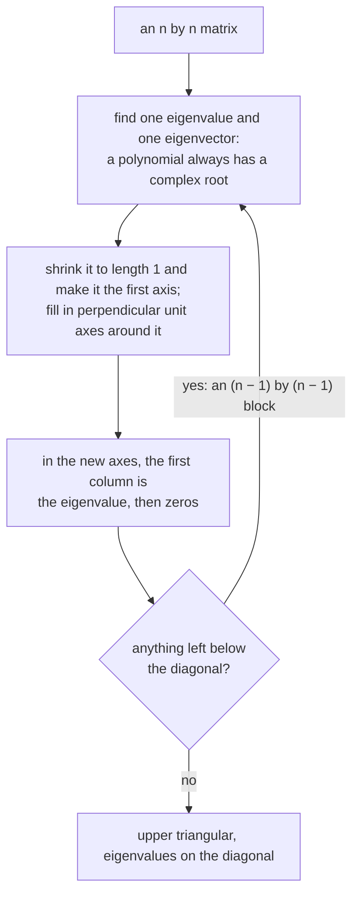

# Schur's triangle: every square matrix is upper triangular in some perpendicular basis, with its eigenvalues on the diagonal

[Syllabus](../../../SYLLABUS.md) → [Algebra](../README.md) → [Eigenvalues and Symmetric Matrices](../README.md#s07) → Schur's triangle

---

## General Overview

A step model updates two numbers each step, as the rental fleet does monthly. Here a step sends (x, y) to (x + y, −x + 3y): the matrix `[[1, 1], [-1, 3]]`, called A. Feed it (1, 1) and out comes (2, 2): the same direction, twice as long. That makes (1, 1) an **eigenvector** (a direction the matrix only stretches) with **eigenvalue** 2 (the stretch) ([Eigenvalues and eigenvectors](02-eigenvalues-and-eigenvectors.md)).

The eigenvalue 2 comes twice, yet every eigenvector lies on the one line through (1, 1). Diagonalisation needs two independent eigenvectors, so A is **defective**, like the shear on [Diagonalisation](03-diagonalisation-and-matrix-powers.md), and cannot be made diagonal.

Schur's answer is to keep the one eigenvector there is. Shrink (1, 1) to length 1 as the first axis, with the perpendicular unit direction (1, −1) as the second. In those axes A becomes `[[2, -2], [0, 2]]`.

That matrix is **upper triangular**: zero below the diagonal (the top-left to bottom-right line). The diagonal holds the eigenvalues, 2 and 2, adding to the trace 4 and multiplying to the determinant 4. The −2 in the corner is what no stretch can do: the gap x − y doubles each step, and the total x + y doubles but loses twice the gap.

**Every square matrix, defective or not, becomes upper triangular once it is read in suitable perpendicular unit axes, and its eigenvalues then sit on the diagonal; a real matrix may need complex axes to get there.**

**What kind of fact this is:** a theorem (Schur's theorem, 1909), proved by induction on this card in Why it works.

### The picture: one eigenvector at a time



---

## The formula

A **complex number** is a + bi, where i is a number whose square is −1; its **conjugate** is a − bi. For a matrix Q, the **conjugate transpose** $`Q^*`$ swaps rows with columns and conjugates every entry. For a real matrix it is the plain transpose $`Q^{\mathsf T}`$.

The **complex dot product** of two columns conjugates the first, then multiplies entry by entry and adds; on real columns it is the usual one. A square matrix is **unitary** when $`Q^* Q = I`$: its columns are perpendicular under this dot product and each one unit long, so $`Q^*`$ undoes Q. A real unitary matrix is the orthogonal matrix of [Gram-Schmidt](../06-Dot%20Products%20and%20Best%20Fits/03-gram-schmidt-and-orthonormal-bases.md), which works unchanged with complex dot products.

Schur's theorem: for every n by n matrix A with real or complex entries there is a unitary Q with

```math
A = Q\,T\,Q^*, \qquad T = Q^* A\, Q \text{ upper triangular}, \qquad t_{11} + \dots + t_{nn} = \mathrm{trace}\,A, \qquad t_{11} \cdots t_{nn} = \det A
```

**Read it aloud:** read A in the perpendicular axes that are Q's columns, and it is a triangle whose diagonal entries are A's eigenvalues, adding to the trace and multiplying to the determinant.

| Symbol | Plain meaning | In our example | Push it up and the answer… |
| --- | --- | --- | --- |
| $`A`$, $`R`$ | the square matrix; the quarter turn | `[[1, 1], [-1, 3]]`; `[[0, -1], [1, 0]]` | — |
| $`Q`$, $`Q^*`$, $`Q^{\mathsf T}`$ | perpendicular unit axes as columns; its conjugate transpose, the inverse; the plain transpose | columns $`q_1`$, $`q_2`$ | — |
| $`q_1`$, $`q_2`$ | the two axes | (0.707107, 0.707107), (0.707107, −0.707107) | — |
| $`T`$, $`B`$ | A in those axes, upper triangular; the block left after one proof step | `[[2, -2], [0, 2]]`; the number 2 | — |
| $`t_{11}`$, $`t_{22}`$, $`t_{12}`$, $`t_{21}`$ | T's entries: diagonal, corner, below the diagonal | 2, 2, −2, 0 | more shear on top of the stretch |
| $`\lambda`$, $`I`$ | an eigenvalue found in the proof; the identity, which changes nothing | 2; `[[1, 0], [0, 1]]` | — |
| $`Q_1`$, $`Q_2`$, $`T_2`$, $`w^*`$, $`e_1`$, $`X`$, $`Y`$ | in the proof fold: first axes; B's axes and triangle; rest of the top row; (1, 0, …, 0); any unitary pair | $`Q_1 = Q`$; 1, 2; −2; (1, 0) | — |
| $`n`$, $`k`$ | the matrix's size; a number of steps | 2; 10 | more steps, bigger powers |

### When it holds

- **The matrix is square.** A 2 by 3 matrix has no eigenvalues; [The singular value decomposition](06-singular-value-decomposition.md) uses two sets of axes instead.
- **Complex axes are allowed.** The quarter turn `[[0, -1], [1, 0]]` has eigenvalues i and −i, so no real axes work (Step 6).
- **Q and T are not unique.** The diagonal can come in any order, and flipping the second axis flips the corner's sign. The squared entries above the diagonal keep a fixed total (Step 5), so a 2 by 2 corner keeps its size.
- **Triangular, not diagonal.** T is diagonal only when the corner is forced to 0. A symmetric matrix is one such case ([The spectral theorem](04-spectral-theorem.md)).

---

## Why it works

### Step 0: one eigenvector gives one clean column

A matrix may lack a full set of eigenvectors, but it always has one. Put it first among perpendicular unit axes: A only stretches it by λ, so the first column reads λ, then zeros. The smaller square left takes the same move.

### Step 1: there is always an eigenvalue

The eigenvalues are the roots of the **characteristic polynomial**, $`\det(A - \lambda I)`$ ([Eigenvalues and eigenvectors](02-eigenvalues-and-eigenvectors.md)). Allow complex numbers, and every polynomial of degree 1 or more has a root: the fundamental theorem of algebra, proved on [The fundamental theorem of algebra](../10-For%20the%20Curious/01-fundamental-theorem-of-algebra.md).

For A: trace 4, determinant 4, so the quadratic is $`\lambda^2 - 4\lambda + 4 = (\lambda - 2)^2`$. Discriminant 0: the root 2, twice.

### Step 2: find its eigenvector and make the axes

Subtract 2 from the diagonal: $`A - 2I`$ = `[[-1, 1], [-1, 1]]`. Both rows say −x + y = 0, so every eigenvector lies along (1, 1). Shrink it to length 1: $`q_1`$ = (0.707107, 0.707107).

Any unit vector perpendicular to $`q_1`$ completes the axes; in more dimensions [Gram-Schmidt](../06-Dot%20Products%20and%20Best%20Fits/03-gram-schmidt-and-orthonormal-bases.md) supplies the rest. Here $`q_2`$ = (0.707107, −0.707107), and $`Q^* Q = I`$.

### Step 3: read A in the new axes

The entry in row r, column c of $`T = Q^* A Q`$ is axis r dotted with A applied to axis c. A sends $`q_1`$ to (1.414214, 1.414214), which is $`2 q_1`$; it sends $`q_2`$ to (0, −2.828427).

- $`t_{11}`$ = $`q_1`$ · $`A q_1`$ = 2, and $`t_{21}`$ = $`q_2`$ · $`A q_1`$ = 0, because $`A q_1`$ lies along $`q_1`$.
- $`t_{12}`$ = $`q_1`$ · $`A q_2`$ = −2, and $`t_{22}`$ = $`q_2`$ · $`A q_2`$ = 2.

So T = `[[2, -2], [0, 2]]`; Step 0 guaranteed the zero.

### Step 4: induction finishes any size

For n by n, Step 3 leaves λ in the corner, zeros below it, and an (n − 1) by (n − 1) block B. Triangulate B by the same argument one size down, and fold its axes into Q. A 1 by 1 matrix is already a triangle, so the chain starts.

<details>
<summary>Detailed proof: the induction step, written out</summary>

Let $`Q_1`$ be unitary with first column $`q_1`$, where $`A q_1 = \lambda q_1`$. Then $`Q_1^* A Q_1`$ has first column $`Q_1^* (\lambda q_1) = \lambda e_1`$, where $`e_1`$ is (1, 0, …, 0). So it has the block shape

$`\displaystyle Q_1^* A\, Q_1 = \begin{pmatrix} \lambda & w^* \\ 0 & B \end{pmatrix}`$

for some row $`w^*`$ and an (n − 1) by (n − 1) block B. By the induction assumption, $`B = Q_2 T_2 Q_2^*`$ with $`Q_2`$ unitary and $`T_2`$ upper triangular. Put

$`\displaystyle Q = Q_1 \begin{pmatrix} 1 & 0 \\ 0 & Q_2 \end{pmatrix}, \qquad Q^* A\, Q = \begin{pmatrix} \lambda & w^* Q_2 \\ 0 & T_2 \end{pmatrix}`$

A product of unitary matrices is unitary, since $`(XY)^*(XY) = Y^* X^* X Y = I`$. The right-hand matrix is upper triangular, which completes the step.

</details>

### Step 5: the diagonal holds the eigenvalues; the part above it has a fixed size

$`T - \lambda I`$ is triangular, and a triangular determinant is the product of its diagonal. So $`\det(T - \lambda I) = (t_{11} - \lambda)(t_{22} - \lambda)`$: T's eigenvalues are its diagonal entries. Since $`Q^* = Q^{-1}`$, T and A are **similar** (the same map written in different axes, [Change of basis](01-change-of-basis.md)), so they share a characteristic polynomial. So the diagonal holds A's eigenvalues, adding to the trace and multiplying to the determinant.

Perpendicular unit axes also keep the sum of squared entry sizes, since Q* keeps each column's length and Q each row's. A gives 1 + 1 + 1 + 9 = 12; T gives 4 + 4 + 4 = 12. Every Schur triangle of A has 2 and 2 on its diagonal, so its corner must hold the other 4: size 2, whichever triangle. At larger sizes this fixes only the total above the diagonal. A defective matrix can never lose its corner.

### Step 6: why a real matrix can need complex axes

The quarter turn R = `[[0, -1], [1, 0]]` has trace 0 and determinant 1, so its quadratic $`\lambda^2 + 1`$ has discriminant −4 and roots i and −i. A real Q makes $`Q^{\mathsf T} R Q`$ real, and a real triangle has real eigenvalues on its diagonal. So no real axes can work.

Complex axes can. With $`\sqrt 2\, q_1`$ = (−1, i) and $`\sqrt 2\, q_2`$ = (−i, 1), $`Q^* R Q`$ = `[[i, 0], [0, -i]]`. Under the complex dot product these two axes are perpendicular and of length 1.

---

## Worked numbers, by hand

| Step | Arithmetic | Value |
| --- | --- | --- |
| trace, determinant | 1 + 3; 1 × 3 − 1 × (−1) | 4, 4 |
| eigenvalue | discriminant 4 × 4 − 4 × 4 = 0, root 4 / 2 | 2, twice |
| eigenvector | rows of `[[-1, 1], [-1, 1]]` say y = x | (1, 1) |
| axes | (1, 1) and (1, −1), each divided by √2 | (0.707107, ±0.707107) |
| four dot products | each axis · A on each axis | 2, 0, −2, 2 |
| the triangle | collect them | **T = `[[2, -2], [0, 2]]`** |
| ten steps, $`A^{10}`$ | $`Q T^{10} Q^*`$, checked by ten multiplications | `[[-4096, 5120], [-5120, 6144]]` |

Each step the gap feeds the total again, so the corner of $`T^k`$ is $`k \times 2^{k-1}`$ times −2: A's powers grow like k × 2^k, not 2^k.

### What breaks if you drop a piece

| Mistake | Comes out at | What went wrong |
| --- | --- | --- |
| Axes (1, 1) and (1, 0), transpose used as inverse | `[[4, 0], [2, 1]]`, diagonal sum 5 | Non-perpendicular axes: the transpose does not undo Q |
| Axes not shrunk to length 1 | `[[4, -4], [0, 4]]`, diagonal 4 and 4 | Each length √2 doubles every entry |
| A's own diagonal read as eigenvalues | 1 and 3, product 3, not 4 | Only a triangle shows eigenvalues on its diagonal |
| Real axes for the quarter turn | lower-left entry 1.000000 at every angle | Its eigenvalues i and −i are not real |

---

## Code, from first principles, and it actually runs

Road one builds T from the eigenvector, as in Steps 1 to 3. Road two never solves for an eigenvalue: it turns perpendicular axes through 18,000 angles and keeps the one where the lower-left entry vanishes. $`A^{10}`$ is found twice, by ten multiplications and by the triangle's formula.

### Python

```python
# Schur's triangle -- the check behind the card.  Only math is imported (cos, sin, sqrt).
# A has the eigenvalue 2 twice and one eigenvector line, yet perpendicular axes make it
# upper triangular.  Road one builds the axes from the eigenvector; road two scans turned
# axes and never solves for an eigenvalue.  A^10 is found twice; R needs complex axes.
from math import cos, sin, pi, sqrt
A, R = [[1, 1], [-1, 3]], [[0, -1], [1, 0]]
def mul(X, Y): return [[sum(X[i][k] * Y[k][j] for k in (0, 1)) for j in (0, 1)] for i in (0, 1)]
def star(X): return [[complex(X[j][i]).conjugate() for j in (0, 1)] for i in (0, 1)]
def cl(x): return 0.0 if abs(x) < 5e-7 else x                  # never print "-0.000000"
def f(x, d=6): return f"{cl(complex(x).real):.{d}f}"
def show(X, d=6): return "[" + ", ".join("[" + ", ".join(f(v, d) for v in r) + "]" for r in X) + "]"
def cs(z): return f"{f(z, 0)}{'-' if cl(z.imag) < 0 else '+'}{abs(cl(z.imag)):.0f}i"

def schur(M):                     # road one: eigenvalue, eigenvector, perpendicular partner
    tr, det = M[0][0] + M[1][1], M[0][0] * M[1][1] - M[0][1] * M[1][0]
    disc = tr * tr - 4 * det
    lam = (tr + (sqrt(disc) if disc >= 0 else 1j * sqrt(-disc))) / 2
    v = (M[0][1], lam - M[0][0])                 # kills the shifted top row (a - lam, b)
    n = sqrt(abs(v[0]) ** 2 + abs(v[1]) ** 2)
    q1 = (v[0] / n, v[1] / n)
    Q = [[q1[0], complex(q1[1]).conjugate()], [q1[1], -complex(q1[0]).conjugate()]]
    return tr, det, disc, lam, v, Q, mul(mul(star(Q), M), Q)

def turned(M, c, s, flip): Q = [[c, s if flip else -s], [s, -c if flip else c]]; return mul(mul(star(Q), M), Q)
def low(M, flip): return [abs(turned(M, cos(k * pi / 18000), sin(k * pi / 18000), flip)[1][0]) for k in range(18000)]
def sq(X): return sum(abs(v) ** 2 for r in X for v in r)
tr, det, disc, lam, v, Q, T = schur(A)
scan = low(A, False); k = scan.index(min(scan)); T2 = turned(A, cos(k * pi / 18000), sin(k * pi / 18000), False)
P = A
for _ in range(9): P = mul(P, A)                                 # A^10, ten factors of A
L, b = T[0][0], T[0][1]
P2 = mul(mul(Q, [[L ** 10, 10 * L ** 9 * b], [0, L ** 10]]), star(Q))  # T^10 by formula
corner = sqrt(sq(A) - abs(T[0][0]) ** 2 - abs(T[1][1]) ** 2)
rt, _, rdisc, rl, _, RQ, RT = schur(R)
real_best = min(min(low(R, False)), min(low(R, True)))
B1 = mul(mul(star([[1, 1], [1, 0]]), A), [[1, 1], [1, 0]]); B2 = mul(mul(star([[1, 1], [1, -1]]), A), [[1, 1], [1, -1]])
print(f"A = {show(A, 0)}  trace {f(tr)}  determinant {f(det)}  discriminant {f(disc)}")
print(f"eigenvalue {f(lam)} twice; A - 2I = {show([[A[0][0] - lam, A[0][1]], [A[1][0], A[1][1] - lam]], 0)}; eigenvector ({f(v[0], 0)}, {f(v[1], 0)})")
print(f"q1 = ({f(Q[0][0])}, {f(Q[1][0])})  q2 = ({f(Q[0][1])}, {f(Q[1][1])})  Q*Q = {show(mul(star(Q), Q))}")
AQ = mul(A, Q); print(f"A q1 = ({f(AQ[0][0])}, {f(AQ[1][0])})  A q2 = ({f(AQ[0][1])}, {f(AQ[1][1])})")
print(f"road one, T = Q*AQ = {show(T)}")
print(f"diagonal sum {f(T[0][0] + T[1][1])} = trace, product {f(T[0][0] * T[1][1])} = determinant")
print(f"road two, turned axes: lower-left smallest {f(scan[k])} at {k / 100:.2f} degrees, T = {show(T2)}")
print(f"squared entries: A {f(sq(A))}, T {f(sq(T))}, so the corner has size {f(corner)}")
print(f"A^10 by ten multiplications = {show(P, 0)}")
print(f"A^10 as Q T^10 Q*            = {show(P2, 0)}")
print(f"quarter turn R = {show(R, 0)}: discriminant {f(rdisc)}, eigenvalues {cs(rl)} and {cs(rt - rl)}")
print(f"real axes, turned or flipped: lower-left never below {f(real_best)}")
print(f"complex axes: sqrt2 q1 = ({cs(RQ[0][0] * sqrt(2))}, {cs(RQ[1][0] * sqrt(2))}), sqrt2 q2 = "
      f"({cs(RQ[0][1] * sqrt(2))}, {cs(RQ[1][1] * sqrt(2))}), T = [[{cs(RT[0][0])}, {cs(RT[0][1])}], [{cs(RT[1][0])}, {cs(RT[1][1])}]]")
print(f"mistake 1, axes (1, 1) and (1, 0), transpose as inverse: {show(B1, 0)}, diagonal sum {f(B1[0][0] + B1[1][1], 0)}")
print(f"mistake 2, axes not shrunk to length 1: {show(B2, 0)}, diagonal {f(B2[0][0], 0)} and {f(B2[1][1], 0)}")
print(f"mistake 3, A's own diagonal as eigenvalues: product {f(A[0][0] * A[1][1], 0)}, not {f(det, 0)}")
assert abs(T[1][0]) < 1e-12 and abs(T[0][0] - 2) < 1e-12 and abs(T[1][1] - 2) < 1e-12   # triangle, 2 and 2
assert abs(T2[1][0]) < 1e-7 and abs(T2[0][0] - lam) < 1e-6 and abs(abs(T2[0][1]) - abs(T[0][1])) < 1e-6
assert max(abs(P[i][j] - P2[i][j]) for i in (0, 1) for j in (0, 1)) < 1e-9   # two roads to A^10
assert abs(T[0][0] + T[1][1] - (A[0][0] + A[1][1])) < 1e-12 and abs(T[0][0] * T[1][1] - det) < 1e-12
assert abs(RT[1][0]) < 1e-12 and abs(RT[0][0] - 1j) < 1e-12 and real_best > 0.999   # R needs complex Q
print("ALL CHECKS PASS")
```

**Ran 2026-11-23 on macOS, Python 3.14.10, standard library only. All checks passed. Output, pasted from the run:**

```
A = [[1, 1], [-1, 3]]  trace 4.000000  determinant 4.000000  discriminant 0.000000
eigenvalue 2.000000 twice; A - 2I = [[-1, 1], [-1, 1]]; eigenvector (1, 1)
q1 = (0.707107, 0.707107)  q2 = (0.707107, -0.707107)  Q*Q = [[1.000000, 0.000000], [0.000000, 1.000000]]
A q1 = (1.414214, 1.414214)  A q2 = (0.000000, -2.828427)
road one, T = Q*AQ = [[2.000000, -2.000000], [0.000000, 2.000000]]
diagonal sum 4.000000 = trace, product 4.000000 = determinant
road two, turned axes: lower-left smallest 0.000000 at 45.00 degrees, T = [[2.000000, 2.000000], [0.000000, 2.000000]]
squared entries: A 12.000000, T 12.000000, so the corner has size 2.000000
A^10 by ten multiplications = [[-4096, 5120], [-5120, 6144]]
A^10 as Q T^10 Q*            = [[-4096, 5120], [-5120, 6144]]
quarter turn R = [[0, -1], [1, 0]]: discriminant -4.000000, eigenvalues 0+1i and 0-1i
real axes, turned or flipped: lower-left never below 1.000000
complex axes: sqrt2 q1 = (-1+0i, 0+1i), sqrt2 q2 = (0-1i, 1+0i), T = [[0+1i, 0+0i], [0+0i, 0-1i]]
mistake 1, axes (1, 1) and (1, 0), transpose as inverse: [[4, 0], [2, 1]], diagonal sum 5
mistake 2, axes not shrunk to length 1: [[4, -4], [0, 4]], diagonal 4 and 4
mistake 3, A's own diagonal as eigenvalues: product 3, not 4
ALL CHECKS PASS
```

### Rust

Same numbers, same labels, built with `rustc --edition 2021 -O`.

```rust
// Schur's triangle -- the same check as the Python, in Rust.  No crates.  A has the
// eigenvalue 2 twice and one eigenvector line, yet perpendicular axes make it upper
// triangular.  Road one builds the axes from the eigenvector; road two scans turned
// axes and never solves for an eigenvalue.  A^10 is found twice; R needs complex axes.
use std::f64::consts::PI;
#[derive(Clone, Copy)] struct C(f64, f64);                    // a complex number re + im i
type M = [[C; 2]; 2];
fn add(a: C, b: C) -> C { C(a.0 + b.0, a.1 + b.1) }
fn cm(a: C, b: C) -> C { C(a.0 * b.0 - a.1 * b.1, a.0 * b.1 + a.1 * b.0) }
fn cj(a: C) -> C { C(a.0, -a.1) }
fn ab(a: C) -> f64 { (a.0 * a.0 + a.1 * a.1).sqrt() }
fn re(m: [[f64; 2]; 2]) -> M { m.map(|r| r.map(|x| C(x, 0.0))) }
fn mul(x: M, y: M) -> M { let e = |i: usize, j: usize| add(cm(x[i][0], y[0][j]), cm(x[i][1], y[1][j])); [[e(0, 0), e(0, 1)], [e(1, 0), e(1, 1)]] }
fn star(x: M) -> M { [[cj(x[0][0]), cj(x[1][0])], [cj(x[0][1]), cj(x[1][1])]] }
fn cl(x: f64) -> f64 { if x.abs() < 5e-7 { 0.0 } else { x } }  // never print "-0.000000"
fn f(x: f64, d: usize) -> String { format!("{:.*}", d, cl(x)) }
fn show(x: M, d: usize) -> String { let r = |i: usize| format!("[{}, {}]", f(x[i][0].0, d), f(x[i][1].0, d)); format!("[{}, {}]", r(0), r(1)) }
fn cs(z: C) -> String { format!("{}{}{:.0}i", f(z.0, 0), if cl(z.1) < 0.0 { "-" } else { "+" }, cl(z.1).abs()) }
fn schur(m: M) -> (f64, f64, f64, C, (C, C), M, M) {          // road one: eigenvalue, eigenvector, partner
    let (tr, det) = (m[0][0].0 + m[1][1].0, m[0][0].0 * m[1][1].0 - m[0][1].0 * m[1][0].0);
    let disc = tr * tr - 4.0 * det;
    let lam = if disc >= 0.0 { C((tr + disc.sqrt()) / 2.0, 0.0) } else { C(tr / 2.0, (-disc).sqrt() / 2.0) };
    let v = (m[0][1], add(lam, C(-m[0][0].0, -m[0][0].1)));   // kills the shifted top row (a - lam, b)
    let n = (ab(v.0).powi(2) + ab(v.1).powi(2)).sqrt();
    let (a, b) = (C(v.0 .0 / n, v.0 .1 / n), C(v.1 .0 / n, v.1 .1 / n));
    let q: M = [[a, cj(b)], [b, C(-a.0, a.1)]];
    (tr, det, disc, lam, v, q, mul(mul(star(q), m), q))
}
fn turned(m: M, c: f64, s: f64, flip: bool) -> M { let q = re([[c, if flip { s } else { -s }], [s, if flip { -c } else { c }]]); mul(mul(star(q), m), q) }
fn low(m: M, flip: bool) -> Vec<f64> { (0..18000).map(|k| { let t = k as f64 * PI / 18000.0; ab(turned(m, t.cos(), t.sin(), flip)[1][0]) }).collect() }
fn sq(x: M) -> f64 { x.iter().flatten().map(|&v| ab(v).powi(2)).sum() }
fn minf(v: &[f64]) -> f64 { v.iter().cloned().fold(f64::INFINITY, f64::min) }
fn main() {
    let (a, r) = (re([[1.0, 1.0], [-1.0, 3.0]]), re([[0.0, -1.0], [1.0, 0.0]]));
    let (tr, det, disc, lam, v, q, t) = schur(a);
    let scan = low(a, false);
    let k = scan.iter().position(|&x| x == minf(&scan)).unwrap();
    let th = k as f64 * PI / 18000.0;
    let t2 = turned(a, th.cos(), th.sin(), false);
    let mut p = a;
    for _ in 0..9 { p = mul(p, a) }                           // A^10, ten factors of A
    let (l, b) = (t[0][0].0, t[0][1].0);
    let p2 = mul(mul(q, re([[l.powi(10), 10.0 * l.powi(9) * b], [0.0, l.powi(10)]])), star(q)); // T^10 by formula
    let corner = (sq(a) - ab(t[0][0]).powi(2) - ab(t[1][1]).powi(2)).sqrt();
    let (rt, _, rdisc, rl, _, rq, rtt) = schur(r);
    let real_best = minf(&low(r, false)).min(minf(&low(r, true)));
    let (n1, n2) = (re([[1.0, 1.0], [1.0, 0.0]]), re([[1.0, 1.0], [1.0, -1.0]]));
    let (b1, b2) = (mul(mul(star(n1), a), n1), mul(mul(star(n2), a), n2));
    let aq = mul(a, q);
    let s2 = |z: C| cs(C(z.0 * 2f64.sqrt(), z.1 * 2f64.sqrt()));
    println!("A = {}  trace {}  determinant {}  discriminant {}", show(a, 0), f(tr, 6), f(det, 6), f(disc, 6));
    println!("eigenvalue {} twice; A - 2I = {}; eigenvector ({}, {})", f(lam.0, 6),
             show(re([[a[0][0].0 - lam.0, a[0][1].0], [a[1][0].0, a[1][1].0 - lam.0]]), 0), f(v.0 .0, 0), f(v.1 .0, 0));
    println!("q1 = ({}, {})  q2 = ({}, {})  Q*Q = {}", f(q[0][0].0, 6), f(q[1][0].0, 6), f(q[0][1].0, 6), f(q[1][1].0, 6), show(mul(star(q), q), 6));
    println!("A q1 = ({}, {})  A q2 = ({}, {})", f(aq[0][0].0, 6), f(aq[1][0].0, 6), f(aq[0][1].0, 6), f(aq[1][1].0, 6));
    println!("road one, T = Q*AQ = {}", show(t, 6));
    println!("diagonal sum {} = trace, product {} = determinant", f(t[0][0].0 + t[1][1].0, 6), f(t[0][0].0 * t[1][1].0, 6));
    println!("road two, turned axes: lower-left smallest {} at {:.2} degrees, T = {}", f(scan[k], 6), k as f64 / 100.0, show(t2, 6));
    println!("squared entries: A {}, T {}, so the corner has size {}", f(sq(a), 6), f(sq(t), 6), f(corner, 6));
    println!("A^10 by ten multiplications = {}", show(p, 0));
    println!("A^10 as Q T^10 Q*            = {}", show(p2, 0));
    println!("quarter turn R = {}: discriminant {}, eigenvalues {} and {}", show(r, 0), f(rdisc, 6), cs(rl), cs(C(rt - rl.0, -rl.1)));
    println!("real axes, turned or flipped: lower-left never below {}", f(real_best, 6));
    println!("complex axes: sqrt2 q1 = ({}, {}), sqrt2 q2 = ({}, {}), T = [[{}, {}], [{}, {}]]", s2(rq[0][0]), s2(rq[1][0]),
             s2(rq[0][1]), s2(rq[1][1]), cs(rtt[0][0]), cs(rtt[0][1]), cs(rtt[1][0]), cs(rtt[1][1]));
    println!("mistake 1, axes (1, 1) and (1, 0), transpose as inverse: {}, diagonal sum {}", show(b1, 0), f(b1[0][0].0 + b1[1][1].0, 0));
    println!("mistake 2, axes not shrunk to length 1: {}, diagonal {} and {}", show(b2, 0), f(b2[0][0].0, 0), f(b2[1][1].0, 0));
    println!("mistake 3, A's own diagonal as eigenvalues: product {}, not {}", f(a[0][0].0 * a[1][1].0, 0), f(det, 0));
    assert!(ab(t[1][0]) < 1e-12 && (t[0][0].0 - 2.0).abs() < 1e-12 && (t[1][1].0 - 2.0).abs() < 1e-12); // triangle, 2 and 2
    assert!(ab(t2[1][0]) < 1e-7 && (t2[0][0].0 - lam.0).abs() < 1e-6 && (ab(t2[0][1]) - ab(t[0][1])).abs() < 1e-6);
    assert!((0..2).all(|i| (0..2).all(|j| ab(add(p[i][j], C(-p2[i][j].0, -p2[i][j].1))) < 1e-9))); // two roads to A^10
    assert!((t[0][0].0 + t[1][1].0 - tr).abs() < 1e-12 && (t[0][0].0 * t[1][1].0 - det).abs() < 1e-12);
    assert!(ab(rtt[1][0]) < 1e-12 && (rtt[0][0].1 - 1.0).abs() < 1e-12 && real_best > 0.999); // R needs complex Q
    println!("ALL CHECKS PASS");
}
```

**Ran 2026-11-23 on macOS, rustc 1.98.1, no crates. All checks passed. Output, pasted from the run:**

```
A = [[1, 1], [-1, 3]]  trace 4.000000  determinant 4.000000  discriminant 0.000000
eigenvalue 2.000000 twice; A - 2I = [[-1, 1], [-1, 1]]; eigenvector (1, 1)
q1 = (0.707107, 0.707107)  q2 = (0.707107, -0.707107)  Q*Q = [[1.000000, 0.000000], [0.000000, 1.000000]]
A q1 = (1.414214, 1.414214)  A q2 = (0.000000, -2.828427)
road one, T = Q*AQ = [[2.000000, -2.000000], [0.000000, 2.000000]]
diagonal sum 4.000000 = trace, product 4.000000 = determinant
road two, turned axes: lower-left smallest 0.000000 at 45.00 degrees, T = [[2.000000, 2.000000], [0.000000, 2.000000]]
squared entries: A 12.000000, T 12.000000, so the corner has size 2.000000
A^10 by ten multiplications = [[-4096, 5120], [-5120, 6144]]
A^10 as Q T^10 Q*            = [[-4096, 5120], [-5120, 6144]]
quarter turn R = [[0, -1], [1, 0]]: discriminant -4.000000, eigenvalues 0+1i and 0-1i
real axes, turned or flipped: lower-left never below 1.000000
complex axes: sqrt2 q1 = (-1+0i, 0+1i), sqrt2 q2 = (0-1i, 1+0i), T = [[0+1i, 0+0i], [0+0i, 0-1i]]
mistake 1, axes (1, 1) and (1, 0), transpose as inverse: [[4, 0], [2, 1]], diagonal sum 5
mistake 2, axes not shrunk to length 1: [[4, -4], [0, 4]], diagonal 4 and 4
mistake 3, A's own diagonal as eigenvalues: product 3, not 4
ALL CHECKS PASS
```

Road two lands on the axes (1, 1) and (−1, 1), so its corner is +2: the sign moved, the size did not.

### Lean

Lean proves Schur's theorem for every complex square matrix, and shows real axes fail for the quarter turn.

- Take any n by n complex matrix A. Then some unitary Q makes $`T = Q^* A Q`$ upper triangular, with $`A = Q T Q^*`$.
- That T's diagonal holds A's eigenvalues, repeats included. Its entries add to A's trace and multiply to A's determinant.
- Take any unitary Q that makes $`Q^* A Q`$ upper triangular. Then its diagonal holds A's eigenvalues, trace and determinant in the same way.
- A real matrix is covered by reading its entries as complex numbers.
- Take any real orthogonal Q. Then $`Q^{\mathsf T} R Q`$ is never upper triangular, for the quarter turn R.
- A's trace 4, determinant 4, eigenvector (1, 1) and characteristic polynomial $`(\lambda - 2)^2`$ check exactly.
- With the unit axes of Step 2, $`Q^{\mathsf T} A Q`$ is exactly `[[2, -2], [0, 2]]`.
- $`A^{10}`$, R's complex axes before dividing by √2, the first two mistakes and the squared-entry totals of 12 also check.

Road two's scan of 18,000 angles, the decimal outputs and the real-axes scan for R are left to the Python and Rust checks.

```lean
-- Schur's triangle: every complex square matrix is Q T Q* with Q unitary and T upper triangular, T's diagonal holds the eigenvalues, and a real quarter turn has no real triangle.
import Mathlib.LinearAlgebra.UnitaryGroup
import Mathlib.LinearAlgebra.Matrix.Charpoly.Basic
import Mathlib.LinearAlgebra.Matrix.Trace
import Mathlib.Analysis.Complex.Basic
import Mathlib.Analysis.SpecialFunctions.Sqrt
import Mathlib.LinearAlgebra.Matrix.Charpoly.Coeff
import Mathlib.Analysis.InnerProductSpace.Adjoint
import Mathlib.Analysis.InnerProductSpace.PiL2
import Mathlib.Analysis.InnerProductSpace.Projection.FiniteDimensional
import Mathlib.LinearAlgebra.Eigenspace.Triangularizable
import Mathlib.Analysis.Complex.Polynomial.Basic

open Matrix Polynomial
open scoped InnerProductSpace ComplexConjugate

lemma schur_aux_basis (n : ℕ) :
    ∀ (V : Type) [NormedAddCommGroup V] [InnerProductSpace ℂ V] [FiniteDimensional ℂ V],
      Module.finrank ℂ V = n → ∀ f : V →ₗ[ℂ] V,
      ∃ b : OrthonormalBasis (Fin n) ℂ V, ∀ i j : Fin n, j < i → ⟪b i, f (b j)⟫_ℂ = 0 := by
  induction n with
  | zero =>
    intro V _ _ _ hV f
    exact ⟨(stdOrthonormalBasis ℂ V).reindex (finCongr hV), fun i => i.elim0⟩
  | succ n ih =>
    intro V _ _ _ hV f
    have : Nontrivial V := Module.nontrivial_of_finrank_eq_succ hV
    obtain ⟨μ, hμ⟩ := Module.End.exists_eigenvalue (LinearMap.adjoint f)
    obtain ⟨v, hv⟩ := hμ.exists_hasEigenvector
    have hv0 : v ≠ 0 := hv.2
    have hfv : LinearMap.adjoint f v = μ • v := Module.End.mem_eigenspace_iff.mp hv.1
    have : Fact (Module.finrank ℂ V = n + 1) := ⟨hV⟩
    have hWdim : Module.finrank ℂ (ℂ ∙ v)ᗮ = n := Submodule.finrank_orthogonal_span_singleton hv0
    have hinv : ∀ w ∈ (ℂ ∙ v)ᗮ, f w ∈ (ℂ ∙ v)ᗮ := by
      intro w hw
      rw [Submodule.mem_orthogonal_singleton_iff_inner_right] at hw ⊢
      rw [← LinearMap.adjoint_inner_left, hfv, inner_smul_left, hw, mul_zero]
    obtain ⟨c, hc⟩ := ih (ℂ ∙ v)ᗮ hWdim (f.restrict hinv)
    set u : V := ((‖v‖ : ℂ)⁻¹) • v with hu
    have hu_norm : ‖u‖ = 1 := by
      rw [hu, norm_smul]
      simp [hv0]
    have huW : ∀ w ∈ (ℂ ∙ v)ᗮ, ⟪u, w⟫_ℂ = 0 := by
      intro w hw
      rw [Submodule.mem_orthogonal_singleton_iff_inner_right] at hw
      rw [hu, inner_smul_left, hw, mul_zero]
    let e : Fin (n+1) → V := Fin.snoc (fun i => (c i : V)) u
    have he_cast : ∀ i : Fin n, e i.castSucc = c i := fun i => Fin.snoc_castSucc (α := fun _ => V) ..
    have he_last : e (Fin.last n) = u := Fin.snoc_last (α := fun _ => V) ..
    have hon : Orthonormal ℂ e := by
      rw [orthonormal_iff_ite]
      intro i j
      induction i using Fin.lastCases with
      | last =>
        induction j using Fin.lastCases with
        | last => simp [he_last, inner_self_eq_norm_sq_to_K, hu_norm]
        | cast j =>
          rw [he_last, he_cast, huW _ (c j).2, ite_eq_right (Fin.castSucc_lt_last j).ne']
      | cast i =>
        induction j using Fin.lastCases with
        | last =>
          rw [he_last, he_cast, ← inner_conj_symm, huW _ (c i).2, map_zero,
            ite_eq_right (Fin.castSucc_lt_last i).ne]
        | cast j =>
          rw [he_cast, he_cast, ← Submodule.coe_inner, orthonormal_iff_ite.mp c.orthonormal]
          simp only [Fin.castSucc_inj]
    have hsp : ⊤ ≤ Submodule.span ℂ (Set.range e) :=
      (hon.linearIndependent.span_eq_top_of_card_eq_finrank' (by simp [hV])).ge
    refine ⟨OrthonormalBasis.mk hon hsp, ?_⟩
    intro i j hij
    simp only [OrthonormalBasis.coe_mk]
    induction i using Fin.lastCases with
    | last =>
      induction j using Fin.lastCases with
      | last => exact absurd hij (lt_irrefl _)
      | cast j =>
        rw [he_last, he_cast]
        exact huW _ (hinv _ (c j).2)
    | cast i =>
      induction j using Fin.lastCases with
      | last => exact absurd hij (not_lt.mpr (Fin.le_last _))
      | cast j =>
        rw [he_cast, he_cast]
        have := hc i j (Fin.castSucc_lt_castSucc_iff.mp hij)
        rwa [Submodule.coe_inner, LinearMap.coe_restrict_apply] at this

lemma schur_exists_unitary (n : ℕ) (A : Matrix (Fin n) (Fin n) ℂ) :
    ∃ Q ∈ Matrix.unitaryGroup (Fin n) ℂ, ∀ i j : Fin n, j < i → (star Q * A * Q) i j = 0 := by
  obtain ⟨b, hb⟩ := schur_aux_basis n (EuclideanSpace ℂ (Fin n)) (finrank_euclideanSpace_fin)
    (Matrix.toEuclideanLin A)
  let Q : Matrix (Fin n) (Fin n) ℂ := Matrix.of fun i j => b j i
  have key : ∀ (M : Matrix (Fin n) (Fin n) ℂ) i j,
      (star Q * M * Q) i j = ⟪b i, Matrix.toEuclideanLin M (b j)⟫_ℂ := by
    intro M i j
    simp [Q, Matrix.mul_apply, PiLp.inner_apply, mulVec, dotProduct]
    simp_rw [Finset.sum_mul]
    rw [Finset.sum_comm]
    refine Finset.sum_congr rfl fun x _ => Finset.sum_congr rfl fun y _ => ?_
    ring
  refine ⟨Q, ?_, fun i j hij => by rw [key]; exact hb i j hij⟩
  rw [mem_unitaryGroup_iff']
  ext i j
  have : (star Q * Q) i j = ⟪b i, b j⟫_ℂ := by
    simp [Q, Matrix.mul_apply, PiLp.inner_apply, mul_comm]
  rw [this, orthonormal_iff_ite.mp b.orthonormal, Matrix.one_apply]

lemma schur_diag_aux (n : ℕ) (A Q : Matrix (Fin n) (Fin n) ℂ)
    (hQ : Q ∈ Matrix.unitaryGroup (Fin n) ℂ)
    (hT : ∀ i j : Fin n, j < i → (star Q * A * Q) i j = 0) :
    A.charpoly = ∏ i, (X - C ((star Q * A * Q) i i)) ∧
    A.trace = ∑ i, (star Q * A * Q) i i ∧
    A.det = ∏ i, (star Q * A * Q) i i := by
  have h1 : Q * star Q = 1 := mem_unitaryGroup_iff.mp hQ
  have hut : (star Q * A * Q).IsUpperTriangular := fun i j hij => hT i j hij
  refine ⟨?_, ?_, ?_⟩
  · rw [← charpoly_of_isUpperTriangular _ hut, Matrix.mul_assoc, Matrix.charpoly_mul_comm,
      Matrix.mul_assoc, h1, Matrix.mul_one]
  · change _ = (star Q * A * Q).trace
    rw [Matrix.mul_assoc, Matrix.trace_mul_comm, Matrix.mul_assoc, h1, Matrix.mul_one]
  · rw [← det_of_isUpperTriangular hut, Matrix.mul_assoc, Matrix.det_mul_comm,
      Matrix.mul_assoc, h1, Matrix.mul_one]

#print axioms schur_aux_basis
#print axioms schur_exists_unitary
#print axioms schur_diag_aux


/-- Schur's theorem: for every n by n complex matrix A there is a unitary matrix Q
(Q* Q = I, its columns perpendicular unit axes) such that T = Q* A Q is upper triangular
(zero below the diagonal) and A = Q T Q*. The diagonal of T holds A's eigenvalues, counted
with repetition: A's characteristic polynomial is the product of (X - t_ii). So the diagonal
entries add to the trace of A and multiply to its determinant. A real matrix is covered by
reading its entries as complex numbers. -/
theorem schur_triangularisation (n : ℕ) (A : Matrix (Fin n) (Fin n) ℂ) :
    ∃ Q ∈ Matrix.unitaryGroup (Fin n) ℂ, ∃ T : Matrix (Fin n) (Fin n) ℂ,
      T = star Q * A * Q ∧ A = Q * T * star Q ∧
      (∀ i j : Fin n, j < i → T i j = 0) ∧
      A.charpoly = ∏ i, (X - C (T i i)) ∧
      A.trace = ∑ i, T i i ∧
      A.det = ∏ i, T i i := by
  obtain ⟨Q, hQ, hT⟩ := schur_exists_unitary n A
  obtain ⟨h1, h2, h3⟩ := schur_diag_aux n A Q hQ hT
  have hQQ : Q * star Q = 1 := mem_unitaryGroup_iff.mp hQ
  refine ⟨Q, hQ, star Q * A * Q, rfl, ?_, hT, h1, h2, h3⟩
  rw [← Matrix.mul_assoc, ← Matrix.mul_assoc, hQQ, Matrix.one_mul, Matrix.mul_assoc, hQQ,
    Matrix.mul_one]

/-- Every Schur triangle shows the eigenvalues (Step 5): Q and T are not unique, but for
any unitary Q that makes T = Q* A Q upper triangular, the diagonal of T holds A's
eigenvalues with repetition (A's characteristic polynomial is the product of (X - t_ii)),
and those diagonal entries add to the trace and multiply to the determinant. -/
theorem schur_triangle_diagonal_is_eigenvalues (n : ℕ) (A Q : Matrix (Fin n) (Fin n) ℂ)
    (hQ : Q ∈ Matrix.unitaryGroup (Fin n) ℂ)
    (hT : ∀ i j : Fin n, j < i → (star Q * A * Q) i j = 0) :
    A.charpoly = ∏ i, (X - C ((star Q * A * Q) i i)) ∧
    A.trace = ∑ i, (star Q * A * Q) i i ∧
    A.det = ∏ i, (star Q * A * Q) i i := by
  exact schur_diag_aux n A Q hQ hT

/-- A real matrix can need complex axes (Step 6): for the quarter turn R = [[0, -1], [1, 0]],
no real orthogonal matrix Q (real unitary, Qᵀ Q = I) makes Qᵀ R Q upper triangular. -/
theorem quarter_turn_no_real_schur_triangle :
    ¬ ∃ Q ∈ Matrix.orthogonalGroup (Fin 2) ℝ,
      ∀ i j : Fin 2, j < i → (Qᵀ * !![(0 : ℝ), -1; 1, 0] * Q) i j = 0 := by
  rintro ⟨Q, hQ, hT⟩
  rw [mem_orthogonalGroup_iff'] at hQ
  have h00 := congrFun (congrFun hQ 0) 0
  have h01 := congrFun (congrFun hQ 0) 1
  have h11 := congrFun (congrFun hQ 1) 1
  have h := hT 1 0 (by decide)
  simp [Matrix.mul_apply, Fin.sum_univ_two] at h00 h01 h11 h
  have : (Q 0 0 * Q 1 1 - Q 0 1 * Q 1 0) ^ 2 = 1 := by
    linear_combination (Q 0 1 ^ 2 + Q 1 1 ^ 2) * h00 + h11 - (Q 0 0 * Q 0 1 + Q 1 0 * Q 1 1) * h01
  nlinarith [this, h]

/-! ### The card's worked numbers, checked exactly -/

-- A = [[1, 1], [-1, 3]]: trace 4, determinant 4.
example : (!![(1 : ℤ), 1; -1, 3]).trace = 4 := by simp [Matrix.trace, Fin.sum_univ_two]
example : (!![(1 : ℤ), 1; -1, 3]).det = 4 := by simp [Matrix.det_fin_two]

-- A - 2I = [[-1, 1], [-1, 1]], and A sends (1, 1) to (2, 2): eigenvalue 2, eigenvector (1, 1).
example : !![(1 : ℤ), 1; -1, 3] - 2 • (1 : Matrix (Fin 2) (Fin 2) ℤ) = !![-1, 1; -1, 1] := by
  decide
example : !![(1 : ℤ), 1; -1, 3] *ᵥ ![1, 1] = ![2, 2] := by
  ext i; fin_cases i <;> simp [mulVec, dotProduct, Fin.sum_univ_two]

-- The characteristic polynomial is λ² - 4λ + 4 = (λ - 2)²: the eigenvalue 2, twice.
example : (!![(1 : ℤ), 1; -1, 3]).charpoly = (X - C 2) ^ 2 := by
  rw [charpoly_fin_two]
  simp [Matrix.trace, Fin.sum_univ_two, Matrix.det_fin_two]
  ring

-- With unit axes (1, 1)/√2 and (1, -1)/√2, Q is orthogonal and Qᵀ A Q = [[2, -2], [0, 2]].
example : (Real.sqrt 2)⁻¹ • !![(1 : ℝ), 1; 1, -1] ∈ Matrix.orthogonalGroup (Fin 2) ℝ := by
  rw [mem_orthogonalGroup_iff']
  have h : Real.sqrt 2 ^ 2 = 2 := Real.sq_sqrt (by norm_num)
  have h0 : Real.sqrt 2 ≠ 0 := by positivity
  ext i j; fin_cases i <;> fin_cases j <;> simp [Matrix.mul_apply, Fin.sum_univ_two] <;> field_simp <;> linarith
example : ((Real.sqrt 2)⁻¹ • !![(1 : ℝ), 1; 1, -1])ᵀ * !![(1 : ℝ), 1; -1, 3] *
    ((Real.sqrt 2)⁻¹ • !![(1 : ℝ), 1; 1, -1]) = !![2, -2; 0, 2] := by
  have h : Real.sqrt 2 ^ 2 = 2 := Real.sq_sqrt (by norm_num)
  have h0 : Real.sqrt 2 ≠ 0 := by positivity
  ext i j; fin_cases i <;> fin_cases j <;> simp [Matrix.mul_apply, Fin.sum_univ_two] <;> field_simp <;> linarith

-- A^10 = [[-4096, 5120], [-5120, 6144]].
example : !![(1 : ℤ), 1; -1, 3] ^ 10 = !![-4096, 5120; -5120, 6144] := by decide

-- The quarter turn: complex axes (-1, i)/√2 and (-i, 1)/√2 give Q* R Q = [[i, 0], [0, -i]].
-- Without the 1/√2 the axes N have N* N = 2I and N* R N = [[2i, 0], [0, -2i]].
example : star !![(-1 : ℂ), -Complex.I; Complex.I, 1] * !![(-1 : ℂ), -Complex.I; Complex.I, 1]
    = 2 • (1 : Matrix (Fin 2) (Fin 2) ℂ) := by
  ext i j; fin_cases i <;> fin_cases j <;> simp [Matrix.mul_apply, Fin.sum_univ_two, Matrix.star_eq_conjTranspose] <;> norm_num
example : star !![(-1 : ℂ), -Complex.I; Complex.I, 1] * !![(0 : ℂ), -1; 1, 0] *
    !![(-1 : ℂ), -Complex.I; Complex.I, 1] = !![2 * Complex.I, 0; 0, -2 * Complex.I] := by
  ext i j; fin_cases i <;> fin_cases j <;> simp [Matrix.mul_apply, Fin.sum_univ_two, Matrix.star_eq_conjTranspose] <;> ring

-- Mistake 1: axes (1, 1) and (1, 0), transpose used as inverse: [[4, 0], [2, 1]], diagonal sum 5.
example : (!![(1 : ℤ), 1; 1, 0])ᵀ * !![(1 : ℤ), 1; -1, 3] * !![(1 : ℤ), 1; 1, 0]
    = !![4, 0; 2, 1] := by decide

-- Mistake 2: axes not shrunk to length 1: [[4, -4], [0, 4]], diagonal 4 and 4.
example : (!![(1 : ℤ), 1; 1, -1])ᵀ * !![(1 : ℤ), 1; -1, 3] * !![(1 : ℤ), 1; 1, -1]
    = !![4, -4; 0, 4] := by decide

-- Squared entries: A gives 1 + 1 + 1 + 9 = 12, T gives 4 + 4 + 4 = 12.
example : (1 : ℤ) ^ 2 + 1 ^ 2 + (-1) ^ 2 + 3 ^ 2 = 12 ∧ (2 : ℤ) ^ 2 + (-2) ^ 2 + 0 ^ 2 + 2 ^ 2 = 12 := by
  norm_num

#print axioms schur_triangularisation
#print axioms schur_triangle_diagonal_is_eigenvalues
#print axioms quarter_turn_no_real_schur_triangle
```

**Checked 2026-11-23 on macOS, Lean 4.36.0-rc2, Mathlib v4.36.0-rc2. Every proof is complete and uses only Lean's standard axioms. Output, pasted from the run:**

```
'schur_aux_basis' depends on axioms: [propext, Classical.choice, Quot.sound]
'schur_exists_unitary' depends on axioms: [propext, Classical.choice, Quot.sound]
'schur_diag_aux' depends on axioms: [propext, Classical.choice, Quot.sound]
'schur_triangularisation' depends on axioms: [propext, Classical.choice, Quot.sound]
'schur_triangle_diagonal_is_eigenvalues' depends on axioms: [propext, Classical.choice, Quot.sound]
'quarter_turn_no_real_schur_triangle' depends on axioms: [propext, Classical.choice, Quot.sound]
```

> [!TIP]
> **Try changing**
> Guess first, then run it. Only the T, road-two and corner lines suit a new A; the rest, asserts included, are written for A, so the first assert stops the run.
> - **The shear.** Set `A` to `[[1, 1], [0, 1]]`. Guess the diagonal: 1 and 1, corner size 1.
> - **The rental fleet.** Set `A` to `[[0.8, 0.3], [0.2, 0.7]]`. Guess the corner: size 0.1, not 0, though the fleet is diagonalisable. Road two lists 0.5 first.
> - **A symmetric table.** Set `A` to `[[2, 1], [1, 2]]`. Guess the corner: 0, so T is diagonal with 3 and 1.

---

## The usual mistake

> [!warning]
> **Expecting a diagonal matrix.** Schur promises a triangle. For A the corner has size 2 in every perpendicular basis that makes it triangular: the squared entries must still add to 12, and the diagonal uses only 8.
>
> - **Transpose undoing skewed axes.** Axes (1, 1) and (1, 0) give diagonal sum 5, not the trace 4.
> - **Axes not shrunk to length 1.** The eigenvalues come out as 4, double the truth.
> - **Eigenvalues read off A itself.** 1 × 3 is 3, not the determinant 4.
> - **Insisting on real axes.** The quarter turn keeps a lower-left entry of size 1 under every real turn or flip.

---

## Where you meet it in real life

- **Eigenvalue software.** The QR algorithm, standard in numerical libraries, turns perpendicular axes, which never magnify rounding errors, until the matrix is a Schur triangle, then reads the eigenvalues off its diagonal.
- **Control and stability.** A state multiplied by A at every step dies away when every diagonal entry has size below 1. A corner can add temporary growth first, defective matrix or not.

> **Say it back**
> Every square matrix has an eigenvector, once complex numbers are allowed. Make it the first perpendicular unit axis, and the first column becomes the eigenvalue, then zeros. Repeat on the smaller block, and the matrix is upper triangular, its diagonal holding the eigenvalues, which add to the trace and multiply to the determinant. A = `[[1, 1], [-1, 3]]` becomes `[[2, -2], [0, 2]]`; the quarter turn needs complex axes.

---

## What this builds on

- [Eigenvalues and eigenvectors](02-eigenvalues-and-eigenvectors.md): the characteristic quadratic, trace and determinant.
- [Diagonalisation](03-diagonalisation-and-matrix-powers.md): the factorisation Schur replaces when a matrix is defective.
- [Gram-Schmidt](../06-Dot%20Products%20and%20Best%20Fits/03-gram-schmidt-and-orthonormal-bases.md): filling in perpendicular unit axes around a chosen first one.

## Where this goes next

- [Cayley-Hamilton and the minimal polynomial](08-cayley-hamilton-and-minimal-polynomial.md): a matrix satisfies its own characteristic polynomial, proved on the triangle.
- [Generalised eigenvectors](09-generalised-eigenvectors.md): directions that fill a defective matrix's gap.
- [Jordan form](10-jordan-canonical-form.md): the simplest triangle, with axes no longer perpendicular.
- [Normal matrices and the polar form](11-normal-matrices-and-polar-decomposition.md): exactly when the triangle is diagonal.
- [Complex vectors and matrices](../../07-Complex%20analysis/01-Complex%20Numbers%20and%20the%20Plane/07-complex-vectors-and-matrices.md): complex dot products and unitary matrices in full.
- [Computing e^A](../../16-Numerical%20analysis/04-Interpolation%20and%20Approximation/10-computing-the-matrix-exponential.md): scale down, use Pade, square back up, and why eigenvectors are a trap.

The triangle hides the eigenvector structure in its corner: what is the simplest form A takes when the axes need not be perpendicular?

---

## Sources

Verified 2026-11-23: every link below resolves to the publisher's page.

- Axler, Sheldon. *Linear Algebra Done Right*, 4th ed. Springer, 2024. [doi:10.1007/978-3-031-41026-0](https://doi.org/10.1007/978-3-031-41026-0). Section 6B: Schur's theorem.
- Horn, Roger A., and Charles R. Johnson. *Matrix Analysis*, 2nd ed. Cambridge, 2013. [doi:10.1017/CBO9781139020411](https://doi.org/10.1017/CBO9781139020411). Section 2.3: Schur's unitary triangularisation theorem.
- Schur, Issai. "Über die charakteristischen Wurzeln einer linearen Substitution mit einer Anwendung auf die Theorie der Integralgleichungen." *Mathematische Annalen* 66 (1909), 488–510. [doi:10.1007/BF01450045](https://doi.org/10.1007/BF01450045). The original theorem.
- Francis, J. G. F. "The QR Transformation: A Unitary Analogue to the LR Transformation, Part 1." *The Computer Journal* 4 (1961), 265–271. [doi:10.1093/comjnl/4.3.265](https://doi.org/10.1093/comjnl/4.3.265). The algorithm that computes Schur triangles in practice.
