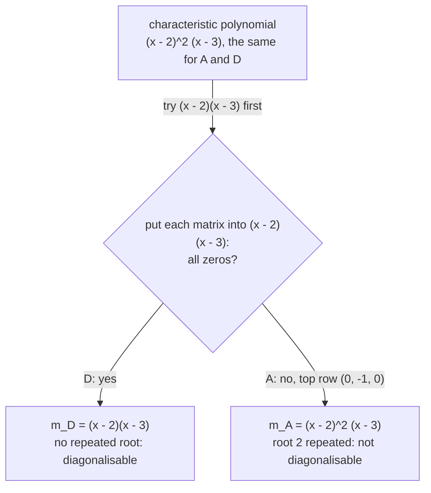

# Cayley-Hamilton and the minimal polynomial: every square matrix satisfies its own characteristic equation, and the smallest such equation says whether it diagonalises over the complex numbers

[Syllabus](../../../SYLLABUS.md) → [Algebra](../README.md) → [Eigenvalues and Symmetric Matrices](../README.md#s07) → Cayley-Hamilton and the minimal polynomial

---

## General Overview

A program lists every binary code (string of 0s and 1s) of a given length. It counts the 1s the codes hold between them, and the codes themselves. A third count is the codes over three symbols, 0, 1 and 2.

Make every code one symbol longer. Each binary code gets a 0 or a 1 on the end, so the codes double. Every old 1 is written twice, and each new code ending in 1 adds one more: the 1s become twice themselves plus the codes. Each three-symbol code gets three endings, so that count triples.

That step is the matrix A = `[[2, 1, 0], [0, 2, 0], [0, 0, 3]]` applied to the column of counts (1s, binary codes, three-symbol codes). Forget the new 1s and the step is D = `[[2, 0, 0], [0, 2, 0], [0, 0, 3]]`, written diag(2, 2, 3). They differ only in A's top-row 1: the codes feed the 1s.

Both have eigenvalues (stretch factors, [Eigenvalues and eigenvectors](02-eigenvalues-and-eigenvectors.md)) 2, 2 and 3, and the same characteristic polynomial, $`x^3 - 7x^2 + 16x - 12`$. Yet their tenth powers differ: the top row of A's is (1024, 5120, 0), D's (1024, 0, 0).

From the empty code, (0, 1, 1), ten steps give 1024 ten-bit codes holding 5120 ones: half of their 10,240 bits.

Two facts explain this. Any square matrix put into its own characteristic polynomial gives the zero matrix. The lowest-degree polynomial that does this, the **minimal polynomial**, sees the difference. For D it is $`(x - 2)(x - 3)`$, with no repeated root. A needs $`(x - 2)^2`$, and can never be made diagonal.

The shelf's rental-car fleet — moving cars between two cities each month by F = `[[0.8, 0.3], [0.2, 0.7]]` — obeys the same rule: $`F^2 = 1.5F - 0.5I`$, as [Eigenvalues and eigenvectors](02-eigenvalues-and-eigenvectors.md) checked.

**Every square matrix is a root of its own characteristic polynomial, the lowest-degree polynomial with that property divides every other one, and the matrix can be diagonalised over the complex numbers exactly when that lowest one has no repeated root.**

**What kind of fact this is:** three theorems, all proved on this card in Why it works.

### The picture: one polynomial, three tests



Cayley-Hamilton guarantees the search ends by the characteristic polynomial.

---

## The formula

To put a matrix into a polynomial, replace $`x^k`$ by the k-th power of the matrix, and a constant c by c times the identity I (1s on the diagonal, 0s elsewhere).

```math
p_A(x) = \det(xI - A), \qquad p_A(A) = 0
```

**Read it aloud:** take the characteristic polynomial of A, put A in for x, and every entry comes out zero.

The eigenvalues card wrote $`\det(A - \lambda I)`$; for a 3 by 3 that is −1 times this, same roots. This form has top coefficient 1: it is **monic**.

The **minimal polynomial** $`m_A`$ is the monic polynomial of lowest degree with $`m_A(A) = 0`$. Two facts about it:

```math
f(A) = 0 \;\Longrightarrow\; m_A \text{ divides } f, \qquad A \text{ diagonalisable} \iff m_A \text{ has no repeated root}
```

**Read it aloud:** any polynomial that kills A is a multiple of the minimal one, and A is diagonalisable exactly when the minimal one has each root once.

| Symbol | Plain meaning | In our example | Push it up and the answer… |
| --- | --- | --- | --- |
| $`A`$, $`D`$, $`F`$ | one step of the code counts, with and without the new 1s; the fleet | `[[2, 1, 0], [0, 2, 0], [0, 0, 3]]`, diag(2, 2, 3); `[[0.8, 0.3], [0.2, 0.7]]` | — |
| $`n`$, $`I`$, $`x`$ | the size; the identity of that size; the polynomial's letter, later replaced by a matrix | 3; 1s on the diagonal | the characteristic polynomial has degree n |
| $`\lambda`$, $`v`$ | an eigenvalue and an eigenvector: $`Av = \lambda v`$ | 2 or 3 | — |
| $`p_A`$ | the characteristic polynomial, $`\det(xI - A)`$ | $`x^3 - 7x^2 + 16x - 12`$ for both | — |
| $`m_A`$ | the minimal polynomial | A: the same cubic; D: $`x^2 - 5x + 6`$ | a higher degree: longer chains of one count feeding another |
| $`Q`$, $`T`$, $`t_1, \dots, t_n`$ | Schur's form $`A = QTQ^{-1}`$: T is triangular, its diagonal entries $`t_i`$ are the eigenvalues | A is already triangular: Q = I, T = A, t = 2, 2, 3 | — |
| $`f`$, $`q`$, $`r`$, $`\deg`$ | a polynomial with $`f(A) = 0`$; quotient and remainder after dividing it by $`m_A`$; deg: the degree (highest power) | $`f = p_D`$, $`q = x - 2`$, $`r = 0`$ | r is always 0 |
| $`e_j`$, $`P_k`$ | in the proof fold: column j of I; the product of the first k factors | $`P_2 = (A - 2I)^2`$ | — |

### When it holds

- **A square matrix.** A 2 by 3 matrix has no powers.
- **Coefficients from a field**, a number system where every nonzero number has a reciprocal. The divisibility proof divides polynomials.
- **Roots counted in the complex numbers.** Schur's triangle may need them. A real quarter-turn has minimal polynomial $`x^2 + 1`$: diagonalisable, but only with complex eigenvectors.
- **Exact arithmetic.** Rounding can split the double root 2 in two and flip the test.

---

## Why it works

### Step 0: on a triangle, each factor wipes out one more column

A triangular matrix has zeros below its diagonal, and its characteristic polynomial has one factor $`(x - t_k)`$ per diagonal entry. Put the matrix in: factor k has a 0 in diagonal place k, so each factor zeroes one more column. Schur's triangle makes every matrix triangular.

### Step 1: a change of basis passes through any polynomial

Schur's theorem gives $`A = QTQ^{-1}`$ with T upper triangular and Q invertible ([Schur's triangle](07-schur-triangularisation.md)). Inner pairs cancel: $`A^2 = QTQ^{-1}QTQ^{-1} = QT^2Q^{-1}`$, so $`f(A) = Q f(T) Q^{-1}`$ for any polynomial f. And $`xI - A = Q(xI - T)Q^{-1}`$, so A and T share a characteristic polynomial. It is enough to prove $`p_T(T) = 0`$.

### Step 2: a triangle's characteristic polynomial is its diagonal

$`xI - T`$ is triangular too, and a triangular determinant is the product of its diagonal entries:

```math
p_T(x) = (x - t_1)(x - t_2)\cdots(x - t_n)
```

For A the diagonal is 2, 2, 3, so $`p_A = (x - 2)^2(x - 3) = x^3 - 7x^2 + 16x - 12`$.

### Step 3: the columns fall one at a time

After $`A - 2I`$, column 1 is zero. After $`(A - 2I)^2`$, columns 1 and 2. After $`(A - 2I)^2(A - 3I)`$, all 3: that is $`p_A(A) = 0`$.

<details>
<summary>Detailed proof: the first k factors send the first k columns to zero</summary>

Write $`e_j`$ for the column with 1 in place j and 0 elsewhere. Let $`P_k`$ be the product of the first k factors $`(T - t_1 I)\cdots(T - t_k I)`$. Claim: $`P_k e_j = 0`$ for every $`j \le k`$.

For k = 1: the first column of $`T - t_1 I`$ has $`t_1 - t_1 = 0`$ on top and zeros below, so it is zero.

From k − 1 to k: $`P_k = P_{k-1}(T - t_k I)`$. Take $`j \le k`$. Column j of $`T - t_k I`$ has zeros below row j, since T is triangular. When j = k, its entry in row k is $`t_k - t_k = 0`$ as well. Either way, $`(T - t_k I)e_j`$ uses only $`e_1, \dots, e_{k-1}`$, which $`P_{k-1}`$ sends to zero. At k = n every column is zero, so $`p_T(T) = P_n = 0`$.

</details>

### Step 4: the minimal polynomial divides everything that kills A

Cayley-Hamilton gives a monic polynomial that kills A, so a lowest-degree one, $`m_A`$, exists. Divide any f with $`f(A) = 0`$ by it. Long division by a monic polynomial always works ([Polynomial long division](../02-Polynomials/04-polynomial-division.md)), leaving a remainder of lower degree:

```math
f = q\,m_A + r, \qquad r = 0 \ \text{or} \ \deg r < \deg m_A
```

Put A in: $`r(A) = f(A) - q(A)\,m_A(A) = 0`$. A nonzero r would beat $`m_A`$'s degree, so r = 0. For D, $`p_D = (x - 2)\,m_D`$.

So $`m_A`$ divides $`p_A`$. Also, if $`Av = \lambda v`$ then $`f(A)v = f(\lambda)v`$, so every eigenvalue is a root of $`m_A`$. The only candidates are $`(x - 2)^a(x - 3)`$ with a = 1 or 2.

### Step 5: no repeated root means enough eigenvectors

**If A is diagonalisable**, a basis of eigenvectors turns it into a diagonal matrix ([Diagonalisation](03-diagonalisation-and-matrix-powers.md)). The product of $`(x - \lambda)`$ over the distinct eigenvalues kills that matrix, each diagonal entry meeting its own zero factor. By Step 1 it kills A, so $`m_A`$ divides it: no repeated root.

**If $`m_A`$ has no repeated root**, every column splits into eigenvectors. For D, $`m_D = (x - 2)(x - 3)`$ and

```math
1 = (x - 2) - (x - 3)
```

Put D in: any column v is $`(D - 2I)v - (D - 3I)v`$. The first piece is killed by $`D - 3I`$, so it is zero or an eigenvector for 3; the second, likewise, for 2. With k roots, scale the product of the other k − 1 factors to equal 1 at each root. These k pieces sum to a polynomial of degree below k that equals 1 at k points: the constant 1.

A fails: $`(A - 2I)(A - 3I)`$ is not zero, and A has 2 eigenvector directions, not 3.

**The fleet.** Its polynomial $`x^2 - 1.5x + 0.5 = (x - 1)(x - 0.5)`$ has distinct roots, so the fleet is diagonalisable, as [Diagonalisation](03-diagonalisation-and-matrix-powers.md) found.

---

## Worked numbers, by hand

| Step | Arithmetic | Value |
| --- | --- | --- |
| characteristic polynomial | expand $`(x - 2)(x - 2)(x - 3)`$ | $`x^3 - 7x^2 + 16x - 12`$ |
| zero columns of A after each factor | $`A - 2I`$, then $`(A - 2I)^2`$, then $`(A - 2I)^2(A - 3I)`$ | 1, then 2, then **3** |
| try $`(x - 2)(x - 3)`$ on D | $`(D - 2I)(D - 3I)`$ | zero, so $`m_D = x^2 - 5x + 6`$ |
| try $`(x - 2)(x - 3)`$ on A | $`(A - 2I)(A - 3I)`$ | `[[0, -1, 0], [0, 0, 0], [0, 0, 0]]`, not zero |
| minimal polynomial of A | only the cubic is left | **$`x^3 - 7x^2 + 16x - 12`$**, root 2 twice |
| eigenvector directions for 2 and 3 | 3 minus the rank of $`A - 2I`$, $`A - 3I`$ | A: 1 and 1; D: 2 and 1 |
| verdict | repeated root against eigenvector count | **A no, D yes** |

A cannot be diagonalised and D can, though their eigenvalues, trace and determinant agree.

Cayley-Hamilton also inverts A: $`A(A^2 - 7A + 16I) = 12I`$, so $`12A^{-1}`$ = `[[6, -3, 0], [0, 6, 0], [0, 0, 4]]`. And $`x^4`$ divided by $`m_D`$ leaves $`65x - 114`$, so $`D^4 = 65D - 114I`$.

### What breaks if you drop a piece

| Mistake | Comes out at | What went wrong |
| --- | --- | --- |
| $`(x - 2)(x - 3)`$ taken as A's minimal polynomial | `[[0, -1, 0], [0, 0, 0], [0, 0, 0]]` | the codes feeding the 1s need $`(x - 2)^2`$ |
| Fleet constant added to every entry | `[[0.0, 0.5], [0.5, 0.0]]` | 0.5 means 0.5 times I |
| The x = A shortcut, tried on the trace | $`3A - 7I`$ = `[[-1, 3, 0], [0, -1, 0], [0, 0, 2]]` | substituting inside a determinant is not allowed |
| Diagonalisability read off the characteristic polynomial | D: root 2 repeated, yet 3 eigenvector directions | A and D share that polynomial |

---

## Code, from first principles, and it actually runs

Whole numbers only, so every test is exact. Each answer has two independent roads:

- **Characteristic polynomial:** from traces alone (the Faddeev-LeVerrier recursion), against the diagonal product, and for a patternless 4 by 4 M against a determinant.
- **Minimal polynomial:** by trying divisors, against the first power that is a mix of lower powers.
- **Diagonalisable:** the repeated-root test, against counting eigenvectors by rank.

### Python

```python
# Cayley-Hamilton and the minimal polynomial -- the check behind the card.  Nothing is imported; whole numbers only.
A, D = [[2, 1, 0], [0, 2, 0], [0, 0, 3]], [[2, 0, 0], [0, 2, 0], [0, 0, 3]]
M, F = [[2, -1, 0, 3], [1, 0, 4, 1], [0, 5, -2, 2], [3, 1, 1, 1]], [[8, 3], [2, 7]]   # no pattern; the fleet times 10
def eye(n, c=1): return [[c * (i == j) for j in range(n)] for i in range(n)]
def mul(X, Y): return [[sum(X[i][k] * Y[k][j] for k in range(len(Y))) for j in range(len(Y[0]))] for i in range(len(X))]
def add(X, Y, c=1): return [[x + c * y for x, y in zip(r, s)] for r, s in zip(X, Y)]
def big(X): return max(abs(x) for r in X for x in r)
def yn(claim): return "yes" if claim else "no"
def at(p, X):                  # Horner: put the matrix in for x; a constant c becomes c I
    return eye(len(X), p[0]) if len(p) == 1 else add(mul(at(p[:-1], X), X), eye(len(X), p[-1]))
def charpoly(X):               # road one, Faddeev-LeVerrier: traces only, no roots
    n, p, N = len(X), [1], eye(len(X), 0)
    for k in range(1, n + 1):
        N = add(mul(X, N), eye(n, p[-1]))
        p.append(-sum(mul(X, N)[i][i] for i in range(n)) // k)
    return p
def det(X):                    # road two, expansion along the top row
    return X[0][0] if len(X) == 1 else sum((-1) ** j * X[0][j] * det([r[:j] + r[j + 1:] for r in X[1:]]) for j in range(len(X)))
def pmul(p, q): return [sum(p[i] * q[k - i] for i in range(len(p)) if 0 <= k - i < len(q)) for k in range(len(p) + len(q) - 1)]
def pdiv(p, m):                # long division by a monic m: quotient, remainder
    p, q = list(p), []
    while len(p) >= len(m): q.append(p[0]); p = [a - p[0] * b for a, b in zip(p, m + [0] * len(p))][1:]
    return q, p
def repeated(p): return any(big(at(p, [[t]])) == 0 == big(at([c * (len(p) - 1 - i) for i, c in enumerate(p[:-1])], [[t]])) for t in (2, 3))   # roots 2, 3 only
def rank(rows):                # elimination in whole numbers: cross-multiply, never divide
    rows = [r for r in rows if any(r)]
    if not rows: return 0
    p = rows[0]; c = next(j for j, x in enumerate(p) if x)
    return 1 + rank([[p[c] * x - r[c] * y for x, y in zip(r, p)] for r in rows[1:]])
def minpoly(X):                # road one: divisors of (x - 2)^2 (x - 3), lowest degree first
    return next(p for p in (pmul([1, -2], [1, -3]), pmul([1, -2], pmul([1, -2], [1, -3]))) if big(at(p, X)) == 0)
def krylov(X):                 # road two: the first power that is a mix of the lower ones
    P = [eye(3)]
    while rank([sum(Q, []) for Q in P]) == len(P): P.append(mul(X, P[-1]))
    return len(P) - 1
def vecs(X): return [3 - rank(add(X, eye(3), -t)) for t in (2, 3)]   # eigenvectors for 2 and for 3
pA, pD, pM, mA, mD, tri = charpoly(A), charpoly(D), charpoly(M), minpoly(A), minpoly(D), pmul([1, -2], pmul([1, -2], [1, -3]))
S, T, (q, r), x4 = add(A, eye(3), -2), add(A, eye(3), -3), pdiv(pD, mD), pdiv([1, 0, 0, 0, 0], mD)[1]
cols = [sum(all(row[j] == 0 for row in X) for j in range(3)) for X in (S, mul(S, S), mul(mul(S, S), T))]
inv12, fleet, D4 = at([1, -7, 16], A), add(mul(F, F), F, -15), mul(mul(D, D), mul(D, D))
print(f"A: characteristic polynomial by traces {pA}; from the diagonal 2, 2, 3: {tri}")
print(f"zero columns: after (A - 2I) {cols[0]}, after (A - 2I)^2 {cols[1]}, after (A - 2I)^2 (A - 3I) {cols[2]}; p(A) largest entry: {big(at(pA, A))}")
print(f"4 by 4 M: characteristic polynomial {pM}, det by expansion {det(M)}; p(M) largest entry: {big(at(pM, M))}")
print(f"D: characteristic polynomial {pD}; p_D divided by m_D: quotient {q}, remainder {r}")
print(f"minimal polynomial by divisor search: A {mA}, D {mD}; degree by first repeating power: A {krylov(A)}, D {krylov(D)}")
print(f"repeated root in the minimal polynomial: A {yn(repeated(mA))}, D {yn(repeated(mD))}")
print(f"eigenvectors for 2 and 3, by 3 minus rank: A {vecs(A)}, D {vecs(D)}; diagonalisable: A {yn(sum(vecs(A)) == 3)}, D {yn(sum(vecs(D)) == 3)}")
print(f"x^4 divided by m_D leaves {x4}; D^4 = 65D - 114I: {yn(D4 == add(eye(3, -114), D, 65))}")
print(f"12 A^-1 = A^2 - 7A + 16I = {inv12}; times A gives 12 I: {yn(mul(inv12, A) == eye(3, 12))}")
print(f"tenth powers, top row: A^10 {at([1] + [0] * 10, A)[0]}, D^10 {at([1] + [0] * 10, D)[0]}")
print(f"fleet F: characteristic polynomial {[c / 10 ** k for k, c in enumerate(charpoly(F))]}; F^2 - 1.5F + 0.5I largest entry: {big(add(fleet, eye(2, 50))) / 100}")
print(f"mistake 1, (A - 2I)(A - 3I) = {mul(S, T)}, not zero")
print(f"mistake 2, the trace through the same substitution: 3A - 7I = {add(eye(3, -7), A, 3)}")
print(f"mistake 3, fleet with 0.5 added to every entry: {[[(x + 50) / 100 for x in row] for row in fleet]}")
assert pA == tri and pM[-1] == det(M) and pM[1] == -sum(M[i][i] for i in range(4))  # traces against diagonal, det, trace
assert big(at(pA, A)) == 0 and big(at(pM, M)) == 0 and cols == [1, 2, 3] and big(add(fleet, eye(2, 50))) == 0  # Cayley-Hamilton
assert [len(mA) - 1, len(mD) - 1] == [krylov(A), krylov(D)] == [3, 2] and r == [0, 0]  # two roads to the degree
assert [sum(vecs(X)) == 3 for X in (A, D)] == [not repeated(m) for m in (mA, mD)]   # the diagonalisability test
assert D4 == add(eye(3, x4[1]), D, x4[0]) and mul(inv12, A) == eye(3, 12)          # remainders against brute force
print("ALL CHECKS PASS")
```

**Ran 2026-11-25 on macOS, Python 3.14.10, standard library only. All checks passed. Output, pasted from the run:**

```
A: characteristic polynomial by traces [1, -7, 16, -12]; from the diagonal 2, 2, 3: [1, -7, 16, -12]
zero columns: after (A - 2I) 1, after (A - 2I)^2 2, after (A - 2I)^2 (A - 3I) 3; p(A) largest entry: 0
4 by 4 M: characteristic polynomial [1, -1, -35, 38, 175], det by expansion 175; p(M) largest entry: 0
D: characteristic polynomial [1, -7, 16, -12]; p_D divided by m_D: quotient [1, -2], remainder [0, 0]
minimal polynomial by divisor search: A [1, -7, 16, -12], D [1, -5, 6]; degree by first repeating power: A 3, D 2
repeated root in the minimal polynomial: A yes, D no
eigenvectors for 2 and 3, by 3 minus rank: A [1, 1], D [2, 1]; diagonalisable: A no, D yes
x^4 divided by m_D leaves [65, -114]; D^4 = 65D - 114I: yes
12 A^-1 = A^2 - 7A + 16I = [[6, -3, 0], [0, 6, 0], [0, 0, 4]]; times A gives 12 I: yes
tenth powers, top row: A^10 [1024, 5120, 0], D^10 [1024, 0, 0]
fleet F: characteristic polynomial [1.0, -1.5, 0.5]; F^2 - 1.5F + 0.5I largest entry: 0.0
mistake 1, (A - 2I)(A - 3I) = [[0, -1, 0], [0, 0, 0], [0, 0, 0]], not zero
mistake 2, the trace through the same substitution: 3A - 7I = [[-1, 3, 0], [0, -1, 0], [0, 0, 2]]
mistake 3, fleet with 0.5 added to every entry: [[0.0, 0.5], [0.5, 0.0]]
ALL CHECKS PASS
```

### Rust

Same numbers, same labels, built with `rustc --edition 2021 -O`.

```rust
// Cayley-Hamilton and the minimal polynomial -- the same check in Rust.  No crates; whole numbers only.
type Mat = Vec<Vec<i64>>;
fn eye(n: usize, c: i64) -> Mat { (0..n).map(|i| (0..n).map(|j| if i == j { c } else { 0 }).collect()).collect() }
fn mul(x: &Mat, y: &Mat) -> Mat { (0..x.len()).map(|i| (0..y[0].len()).map(|j| (0..y.len()).map(|k| x[i][k] * y[k][j]).sum()).collect()).collect() }
fn add(x: &Mat, y: &Mat, c: i64) -> Mat { x.iter().zip(y).map(|(r, s)| r.iter().zip(s).map(|(a, b)| a + c * b).collect()).collect() }
fn big(x: &Mat) -> i64 { x.iter().flatten().map(|v| v.abs()).max().unwrap() }
fn yn(claim: bool) -> &'static str { if claim { "yes" } else { "no" } }
fn at(p: &[i64], x: &Mat) -> Mat {     // Horner: put the matrix in for x; a constant c becomes c I
    if p.len() == 1 { eye(x.len(), p[0]) } else { add(&mul(&at(&p[..p.len() - 1], x), x), &eye(x.len(), p[p.len() - 1]), 1) } }
fn charpoly(x: &Mat) -> Vec<i64> {     // road one, Faddeev-LeVerrier: traces only, no roots
    let (n, mut p, mut nn) = (x.len(), vec![1i64], eye(x.len(), 0));
    for k in 1..=n {
        nn = add(&mul(x, &nn), &eye(n, *p.last().unwrap()), 1);
        let xn = mul(x, &nn);
        p.push(-(0..n).map(|i| xn[i][i]).sum::<i64>() / k as i64);
    }
    p
}
fn det(x: &Mat) -> i64 {               // road two, expansion along the top row
    if x.len() == 1 { return x[0][0] }
    (0..x.len()).map(|j| (1 - 2 * (j % 2) as i64) * x[0][j] * det(&x[1..].iter().map(|r| [&r[..j], &r[j + 1..]].concat()).collect())).sum()
}
fn pmul(p: &[i64], q: &[i64]) -> Vec<i64> {
    (0..p.len() + q.len() - 1).map(|k| (0..p.len()).filter(|&i| k >= i && k - i < q.len()).map(|i| p[i] * q[k - i]).sum()).collect() }
fn pdiv(p: &[i64], m: &[i64]) -> (Vec<i64>, Vec<i64>) {   // long division by a monic m: quotient, remainder
    let (mut p, mut q) = (p.to_vec(), vec![]);
    while p.len() >= m.len() { q.push(p[0]); p = (1..p.len()).map(|i| p[i] - p[0] * if i < m.len() { m[i] } else { 0 }).collect() }
    (q, p)
}
fn repeated(p: &[i64]) -> bool {       // tries only the roots 2 and 3, the eigenvalues of A and D
    let slope: Vec<i64> = p[..p.len() - 1].iter().enumerate().map(|(i, c)| c * (p.len() - 1 - i) as i64).collect();
    [2, 3].iter().any(|&t| big(&at(p, &vec![vec![t]])) == 0 && big(&at(&slope, &vec![vec![t]])) == 0)
}
fn rank(rows: &Mat) -> usize {         // elimination in whole numbers: cross-multiply, never divide
    let rows: Mat = rows.iter().filter(|r| r.iter().any(|v| *v != 0)).cloned().collect();
    if rows.is_empty() { return 0 }; let (p, c) = (&rows[0], rows[0].iter().position(|v| *v != 0).unwrap());
    1 + rank(&rows[1..].iter().map(|r| r.iter().zip(p).map(|(x, y)| p[c] * x - r[c] * y).collect()).collect())
}
fn tri() -> Vec<i64> { pmul(&[1, -2], &pmul(&[1, -2], &[1, -3])) }
fn minpoly(x: &Mat) -> Vec<i64> {      // road one: divisors of (x - 2)^2 (x - 3), lowest degree first
    [pmul(&[1, -2], &[1, -3]), tri()].into_iter().find(|p| big(&at(p, x)) == 0).unwrap()
}
fn krylov(x: &Mat) -> usize {          // road two: the first power that is a mix of the lower ones
    let mut pw = vec![eye(3, 1)];
    while rank(&pw.iter().map(|q| q.concat()).collect()) == pw.len() { let nx = mul(x, pw.last().unwrap()); pw.push(nx) }
    pw.len() - 1
}
fn vecs(x: &Mat) -> Vec<usize> { [2, 3].iter().map(|&t| 3 - rank(&add(x, &eye(3, 1), -t))).collect() }
fn main() {
    let a: Mat = vec![vec![2, 1, 0], vec![0, 2, 0], vec![0, 0, 3]];
    let d: Mat = vec![vec![2, 0, 0], vec![0, 2, 0], vec![0, 0, 3]];
    let m: Mat = vec![vec![2, -1, 0, 3], vec![1, 0, 4, 1], vec![0, 5, -2, 2], vec![3, 1, 1, 1]];   // no pattern
    let f: Mat = vec![vec![8, 3], vec![2, 7]];                                                   // the fleet times 10
    let (pa, pd, pm, ma, md) = (charpoly(&a), charpoly(&d), charpoly(&m), minpoly(&a), minpoly(&d));
    let (s, t, (q, r), x4) = (add(&a, &eye(3, 1), -2), add(&a, &eye(3, 1), -3), pdiv(&pd, &md), pdiv(&[1, 0, 0, 0, 0], &md).1);
    let cols: Vec<usize> = [s.clone(), mul(&s, &s), mul(&mul(&s, &s), &t)].iter().map(|x| (0..3).filter(|&j| x.iter().all(|row| row[j] == 0)).count()).collect();
    let (inv12, fleet, d4, p10) = (at(&[1, -7, 16], &a), add(&mul(&f, &f), &f, -15), mul(&mul(&d, &d), &mul(&d, &d)), [&[1][..], &[0; 10]].concat());
    let (va, vd) = (vecs(&a), vecs(&d));
    println!("A: characteristic polynomial by traces {:?}; from the diagonal 2, 2, 3: {:?}", pa, tri());
    println!("zero columns: after (A - 2I) {}, after (A - 2I)^2 {}, after (A - 2I)^2 (A - 3I) {}; p(A) largest entry: {}", cols[0], cols[1], cols[2], big(&at(&pa, &a)));
    println!("4 by 4 M: characteristic polynomial {:?}, det by expansion {}; p(M) largest entry: {}", pm, det(&m), big(&at(&pm, &m)));
    println!("D: characteristic polynomial {:?}; p_D divided by m_D: quotient {:?}, remainder {:?}", pd, q, r);
    println!("minimal polynomial by divisor search: A {:?}, D {:?}; degree by first repeating power: A {}, D {}", ma, md, krylov(&a), krylov(&d));
    println!("repeated root in the minimal polynomial: A {}, D {}", yn(repeated(&ma)), yn(repeated(&md)));
    println!("eigenvectors for 2 and 3, by 3 minus rank: A {:?}, D {:?}; diagonalisable: A {}, D {}", va, vd, yn(va.iter().sum::<usize>() == 3), yn(vd.iter().sum::<usize>() == 3));
    println!("x^4 divided by m_D leaves {:?}; D^4 = 65D - 114I: {}", x4, yn(d4 == add(&eye(3, -114), &d, 65)));
    println!("12 A^-1 = A^2 - 7A + 16I = {:?}; times A gives 12 I: {}", inv12, yn(mul(&inv12, &a) == eye(3, 12)));
    println!("tenth powers, top row: A^10 {:?}, D^10 {:?}", at(&p10, &a)[0], at(&p10, &d)[0]);
    let fc: Vec<f64> = charpoly(&f).iter().enumerate().map(|(k, c)| *c as f64 / 10f64.powi(k as i32)).collect();
    println!("fleet F: characteristic polynomial {:?}; F^2 - 1.5F + 0.5I largest entry: {:?}", fc, big(&add(&fleet, &eye(2, 50), 1)) as f64 / 100.0);
    println!("mistake 1, (A - 2I)(A - 3I) = {:?}, not zero", mul(&s, &t));
    println!("mistake 2, the trace through the same substitution: 3A - 7I = {:?}", add(&eye(3, -7), &a, 3));
    println!("mistake 3, fleet with 0.5 added to every entry: {:?}", fleet.iter().map(|r| r.iter().map(|x| (x + 50) as f64 / 100.0).collect::<Vec<f64>>()).collect::<Vec<_>>());
    assert!(pa == tri() && pm[4] == det(&m) && pm[1] == -(0..4).map(|i| m[i][i]).sum::<i64>());   // traces against diagonal, det, trace
    assert!(big(&at(&pa, &a)) == 0 && big(&at(&pm, &m)) == 0 && cols == vec![1, 2, 3] && big(&add(&fleet, &eye(2, 50), 1)) == 0); // Cayley-Hamilton
    assert!([ma.len() - 1, md.len() - 1] == [krylov(&a), krylov(&d)] && krylov(&d) == 2 && krylov(&a) == 3 && r == vec![0, 0]);
    assert!([va.iter().sum::<usize>() == 3, vd.iter().sum::<usize>() == 3] == [!repeated(&ma), !repeated(&md)]);
    assert!(d4 == add(&eye(3, x4[1]), &d, x4[0]) && mul(&inv12, &a) == eye(3, 12));             // remainders against brute force
    println!("ALL CHECKS PASS");
}
```

**Ran 2026-11-25 on macOS, rustc 1.98.1, no crates. All checks passed. Output, pasted from the run:**

```
A: characteristic polynomial by traces [1, -7, 16, -12]; from the diagonal 2, 2, 3: [1, -7, 16, -12]
zero columns: after (A - 2I) 1, after (A - 2I)^2 2, after (A - 2I)^2 (A - 3I) 3; p(A) largest entry: 0
4 by 4 M: characteristic polynomial [1, -1, -35, 38, 175], det by expansion 175; p(M) largest entry: 0
D: characteristic polynomial [1, -7, 16, -12]; p_D divided by m_D: quotient [1, -2], remainder [0, 0]
minimal polynomial by divisor search: A [1, -7, 16, -12], D [1, -5, 6]; degree by first repeating power: A 3, D 2
repeated root in the minimal polynomial: A yes, D no
eigenvectors for 2 and 3, by 3 minus rank: A [1, 1], D [2, 1]; diagonalisable: A no, D yes
x^4 divided by m_D leaves [65, -114]; D^4 = 65D - 114I: yes
12 A^-1 = A^2 - 7A + 16I = [[6, -3, 0], [0, 6, 0], [0, 0, 4]]; times A gives 12 I: yes
tenth powers, top row: A^10 [1024, 5120, 0], D^10 [1024, 0, 0]
fleet F: characteristic polynomial [1.0, -1.5, 0.5]; F^2 - 1.5F + 0.5I largest entry: 0.0
mistake 1, (A - 2I)(A - 3I) = [[0, -1, 0], [0, 0, 0], [0, 0, 0]], not zero
mistake 2, the trace through the same substitution: 3A - 7I = [[-1, 3, 0], [0, -1, 0], [0, 0, 2]]
mistake 3, fleet with 0.5 added to every entry: [[0.0, 0.5], [0.5, 0.0]]
ALL CHECKS PASS
```

The outputs match line for line.

### Lean

Lean proves all three theorems for every square matrix, over any field for the first two and over the complex numbers for the third.

- Put any square matrix into its own characteristic polynomial, and every entry comes out zero.
- Suppose a polynomial f kills A, so $`f(A) = 0`$. Then $`m_A`$ divides f.
- Take A with complex entries. Then A can be diagonalised exactly when $`m_A`$ has no repeated root.
- A and D share the characteristic polynomial $`x^3 - 7x^2 + 16x - 12`$, and $`p_A(A) = 0`$.
- A's columns fall one at a time under the three factors.
- The product $`(A - 2I)(A - 3I)`$ is not zero, but $`(D - 2I)(D - 3I)`$ is.
- The shortcuts: $`D^4 = 65D - 114I`$, and $`A(A^2 - 7A + 16I) = 12I`$.
- The tenth powers' top rows: (1024, 5120, 0) for A and (1024, 0, 0) for D.
- The patternless 4 by 4 M gives zero in $`x^4 - x^3 - 35x^2 + 38x + 175`$.
- The fleet matrix times 10 gives zero in $`x^2 - 15x + 50`$.
- The trace mistake: $`3A - 7I`$ = `[[-1, 3, 0], [0, -1, 0], [0, 0, 2]]`, not zero.

Finding each minimal polynomial, the polynomials from traces, counting eigenvectors by rank, and the decimal fleet are left to the Python and Rust checks.

```lean
-- Cayley-Hamilton and the minimal polynomial: every square matrix over a field is a root of its own characteristic polynomial, its minimal polynomial divides every polynomial that kills it, and a complex square matrix is diagonalisable exactly when its minimal polynomial has no repeated root.
import Mathlib.LinearAlgebra.Matrix.Charpoly.Basic
import Mathlib.LinearAlgebra.Matrix.NonsingularInverse
import Mathlib.FieldTheory.Minpoly.Field
import Mathlib.Basic.Complex.Basic
import Mathlib.LinearAlgebra.Eigenspace.Semisimple
import Mathlib.Analysis.Complex.Polynomial.Basic
import Mathlib.LinearAlgebra.Matrix.ToLin
import Mathlib.FieldTheory.Separable

open Polynomial Matrix

theorem aeval_conj_matrix {n : ℕ} (P D Q : Matrix (Fin n) (Fin n) ℂ) (h : Q * P = 1)
    (q : ℂ[X]) : aeval (P * D * Q) q = P * aeval D q * Q := by
  have hpow : ∀ k : ℕ, (P * D * Q) ^ k = P * D ^ k * Q := by
    intro k
    induction k with
    | zero => simpa using (mul_eq_one_comm.mp h).symm
    | succ k ih => rw [pow_succ, ih, pow_succ]; simp only [Matrix.mul_assoc]; rw [← Matrix.mul_assoc Q P, h, Matrix.one_mul]
  induction q using Polynomial.induction_on' with
  | add p q hp hq => simp [hp, hq, Matrix.mul_add, Matrix.add_mul]
  | monomial k c => simp [aeval_monomial, hpow, Algebra.algebraMap_eq_smul_one]

theorem aeval_diagonal_matrix {n : ℕ} (d : Fin n → ℂ) (q : ℂ[X]) :
    aeval (diagonal d) q = diagonal (fun i => eval (d i) q) := by
  induction q using Polynomial.induction_on' with
  | add p q hp hq => simp [hp, hq, diagonal_add]
  | monomial k c =>
    ext i j
    simp [aeval_monomial, diagonal_pow, Algebra.algebraMap_eq_smul_one, diagonal_apply]
    rcases eq_or_ne i j with rfl | hij
    · simp
    · simp [one_apply_ne hij, hij]

theorem minpoly_roots_nodup_of_diagonalisable {n : ℕ}
    (A : Matrix (Fin n) (Fin n) ℂ) :
    (∃ (P : Matrix (Fin n) (Fin n) ℂ) (d : Fin n → ℂ), IsUnit P.det ∧ A = P * diagonal d * P⁻¹)
      → (minpoly ℂ A).roots.Nodup := by
  classical
  rintro ⟨P, d, hP, rfl⟩
  set q : ℂ[X] := ∏ c ∈ Finset.univ.image d, (X - C c) with hq
  have hq0 : q ≠ 0 := (monic_prod_of_monic _ _ fun c _ => monic_X_sub_C c).ne_zero
  have hkill : aeval (P * diagonal d * P⁻¹) q = 0 := by
    rw [aeval_conj_matrix P _ _ (nonsing_inv_mul P hP), aeval_diagonal_matrix]
    have : (fun i => eval (d i) q) = 0 := by
      funext i
      simp only [hq, eval_prod, eval_sub, eval_X, eval_C, Pi.zero_apply]
      exact Finset.prod_eq_zero (Finset.mem_image_of_mem d (Finset.mem_univ i)) (sub_self _)
    simp [this]
  have hdvd := minpoly.dvd ℂ _ hkill
  have hle := Polynomial.roots.le_of_dvd hq0 hdvd
  refine Multiset.nodup_of_le hle ?_
  rw [hq, roots_prod_X_sub_C]
  exact (Finset.univ.image d).nodup

theorem diagonalisable_of_minpoly_roots_nodup {n : ℕ}
    (A : Matrix (Fin n) (Fin n) ℂ) :
    (minpoly ℂ A).roots.Nodup →
    (∃ (P : Matrix (Fin n) (Fin n) ℂ) (d : Fin n → ℂ), IsUnit P.det ∧ A = P * diagonal d * P⁻¹) := by
  classical
  intro hnd
  have hint : IsIntegral ℂ A := Algebra.IsIntegral.isIntegral A
  have hm0 : minpoly ℂ A ≠ 0 := minpoly.ne_zero hint
  have hsep : (minpoly ℂ A).Separable :=
    (nodup_roots_iff_of_splits hm0 (IsAlgClosed.splits _)).mp hnd
  set f : Module.End ℂ (Fin n → ℂ) := toLin' A with hf
  have hfm : aeval f (minpoly ℂ A) = 0 := by
    show aeval (Matrix.toLinAlgEquiv' A) _ = 0
    rw [aeval_algEquiv, AlgHom.comp_apply, minpoly.aeval, map_zero]
  have hss : f.IsSemisimple := Module.End.isSemisimple_of_squarefree_aeval_eq_zero hsep.squarefree hfm
  have htop := hss.iSup_eigenspace_eq_top
  have hI : DirectSum.IsInternal (fun μ : ℂ => f.eigenspace μ) :=
    DirectSum.isInternal_submodule_of_iSupIndep_of_iSup_eq_top (Module.End.eigenspaces_iSupIndep f) htop
  let I := (ν : ℂ) × Fin (Module.finrank ℂ (f.eigenspace ν))
  let v : Module.Basis I ℂ (Fin n → ℂ) := hI.collectedBasis fun μ ↦ Module.finBasis ℂ (f.eigenspace μ)
  have : Fintype I := FiniteDimensional.fintypeBasisIndex v
  have hsv (i : I) : f (v i) = i.1 • v i :=
    Module.End.mem_eigenspace_iff.mp (hI.collectedBasis_mem _ i)
  have hcard : Fintype.card I = n := by
    rw [← Module.finrank_eq_card_basis v, Module.finrank_fin_fun]
  let e : I ≃ Fin n := Fintype.equivFinOfCardEq hcard
  let w := v.reindex e
  let d : Fin n → ℂ := fun j => (e.symm j).1
  have hw (j : Fin n) : A *ᵥ w j = d j • w j := by
    have := hsv (e.symm j)
    simpa [w, d, hf] using this
  let P := (Pi.basisFun ℂ (Fin n)).toMatrix w
  have hPinv : Invertible P := Module.Basis.invertibleToMatrix _ _
  have hPdet : IsUnit P.det := isUnit_det_of_invertible P
  refine ⟨P, d, hPdet, ?_⟩
  have hAP : A * P = P * diagonal d := by
    ext k j
    rw [mul_diagonal]
    have := congrFun (hw j) k
    simp only [mulVec, dotProduct, Pi.smul_apply, smul_eq_mul] at this
    simp only [P, Matrix.mul_apply, Module.Basis.toMatrix_apply, Pi.basisFun_repr]
    rw [this, mul_comm]
  calc A = A * P * P⁻¹ := by rw [Matrix.mul_assoc, mul_nonsing_inv P hPdet, Matrix.mul_one]
    _ = P * diagonal d * P⁻¹ := by rw [hAP]

#print axioms aeval_conj_matrix
#print axioms aeval_diagonal_matrix
#print axioms minpoly_roots_nodup_of_diagonalisable
#print axioms diagonalisable_of_minpoly_roots_nodup


/-- **Cayley-Hamilton, the card's main claim.** Put any n by n matrix A with entries from a
field into its own characteristic polynomial p_A(x) = det(xI - A) (Mathlib's `A.charpoly`):
x^k becomes A^k and a constant c becomes c times I. Every entry comes out zero. -/
theorem matrix_is_root_of_its_characteristic_polynomial {K : Type*} [Field K] {n : ℕ}
    (A : Matrix (Fin n) (Fin n) K) :
    aeval A A.charpoly = 0 := by
  exact Matrix.aeval_self_charpoly A

/-- **The minimal polynomial divides everything that kills A.** For an n by n matrix A over a
field, the minimal polynomial m_A (the monic polynomial of lowest degree with m_A(A) = 0,
Mathlib's `minpoly K A`) divides every polynomial f with f(A) = 0. -/
theorem minimal_polynomial_divides_every_killing_polynomial {K : Type*} [Field K] {n : ℕ}
    (A : Matrix (Fin n) (Fin n) K) (f : K[X]) (hf : aeval A f = 0) :
    minpoly K A ∣ f := by
  exact minpoly.dvd K A hf

/-- **The diagonalisability test.** With roots counted in the complex numbers, an n by n
matrix A can be diagonalised (a basis of eigenvectors, the columns of an invertible P, turns it
into a diagonal matrix: A = P diag(d) P⁻¹) exactly when its minimal polynomial has no
repeated root. -/
theorem diagonalisable_iff_minimal_polynomial_has_no_repeated_root {n : ℕ}
    (A : Matrix (Fin n) (Fin n) ℂ) :
    (∃ (P : Matrix (Fin n) (Fin n) ℂ) (d : Fin n → ℂ), IsUnit P.det ∧ A = P * diagonal d * P⁻¹)
      ↔ (minpoly ℂ A).roots.Nodup := by
  exact ⟨minpoly_roots_nodup_of_diagonalisable A, diagonalisable_of_minpoly_roots_nodup A⟩

-- The code-count step A = [[2, 1, 0], [0, 2, 0], [0, 0, 3]] has characteristic polynomial x^3 - 7x^2 + 16x - 12.
example : (!![2, 1, 0; 0, 2, 0; 0, 0, 3] : Matrix (Fin 3) (Fin 3) ℚ).charpoly
    = X ^ 3 - 7 * X ^ 2 + 16 * X - 12 := by
  rw [Matrix.charpoly, Matrix.det_fin_three]
  simp [C_ofNat]
  ring
-- So does D = diag(2, 2, 3).
example : (!![2, 0, 0; 0, 2, 0; 0, 0, 3] : Matrix (Fin 3) (Fin 3) ℚ).charpoly
    = X ^ 3 - 7 * X ^ 2 + 16 * X - 12 := by
  rw [Matrix.charpoly, Matrix.det_fin_three]
  simp [C_ofNat]
  ring
-- Cayley-Hamilton on A: A^3 - 7A^2 + 16A - 12I = 0.
example : let A : Matrix (Fin 3) (Fin 3) ℤ := !![2, 1, 0; 0, 2, 0; 0, 0, 3]
    A ^ 3 - 7 • A ^ 2 + 16 • A - 12 • 1 = 0 := by decide
-- The columns fall one at a time: A - 2I, (A - 2I)^2, (A - 2I)^2 (A - 3I).
example : let A : Matrix (Fin 3) (Fin 3) ℤ := !![2, 1, 0; 0, 2, 0; 0, 0, 3]
    A - 2 • 1 = !![0, 1, 0; 0, 0, 0; 0, 0, 1] ∧
    (A - 2 • 1) ^ 2 = !![0, 0, 0; 0, 0, 0; 0, 0, 1] ∧
    (A - 2 • 1) ^ 2 * (A - 3 • 1) = 0 := by decide
-- Mistake 1: (x - 2)(x - 3) does not kill A, but it kills D.
example : let A : Matrix (Fin 3) (Fin 3) ℤ := !![2, 1, 0; 0, 2, 0; 0, 0, 3]
    (A - 2 • 1) * (A - 3 • 1) = !![0, -1, 0; 0, 0, 0; 0, 0, 0] := by decide
example : let D : Matrix (Fin 3) (Fin 3) ℤ := !![2, 0, 0; 0, 2, 0; 0, 0, 3]
    (D - 2 • 1) * (D - 3 • 1) = 0 := by decide
-- p_D = (x - 2) m_D, and x^4 divided by m_D = x^2 - 5x + 6 leaves 65x - 114.
example : (X ^ 3 - 7 * X ^ 2 + 16 * X - 12 : ℤ[X]) = (X - 2) * (X ^ 2 - 5 * X + 6) := by ring
example : (X ^ 4 : ℤ[X]) = (X ^ 2 + 5 * X + 19) * (X ^ 2 - 5 * X + 6) + (65 * X - 114) := by ring
-- So D^4 = 65D - 114I.
example : let D : Matrix (Fin 3) (Fin 3) ℤ := !![2, 0, 0; 0, 2, 0; 0, 0, 3]
    D ^ 4 = 65 • D - 114 • 1 := by decide
-- Cayley-Hamilton inverts A: 12 A⁻¹ = A^2 - 7A + 16I = [[6, -3, 0], [0, 6, 0], [0, 0, 4]].
example : let A : Matrix (Fin 3) (Fin 3) ℤ := !![2, 1, 0; 0, 2, 0; 0, 0, 3]
    A ^ 2 - 7 • A + 16 • 1 = !![6, -3, 0; 0, 6, 0; 0, 0, 4] ∧
    (A ^ 2 - 7 • A + 16 • 1) * A = 12 • 1 := by decide
-- Tenth powers, top row: A^10 gives (1024, 5120, 0), D^10 gives (1024, 0, 0).
example : let A : Matrix (Fin 3) (Fin 3) ℤ := !![2, 1, 0; 0, 2, 0; 0, 0, 3]
    (A ^ 10) 0 0 = 1024 ∧ (A ^ 10) 0 1 = 5120 ∧ (A ^ 10) 0 2 = 0 := by decide
example : let D : Matrix (Fin 3) (Fin 3) ℤ := !![2, 0, 0; 0, 2, 0; 0, 0, 3]
    (D ^ 10) 0 0 = 1024 ∧ (D ^ 10) 0 1 = 0 ∧ (D ^ 10) 0 2 = 0 := by decide
-- Mistake 2: the trace through the same substitution, 3A - 7I, is not zero.
example : let A : Matrix (Fin 3) (Fin 3) ℤ := !![2, 1, 0; 0, 2, 0; 0, 0, 3]
    3 • A - 7 • 1 = !![-1, 3, 0; 0, -1, 0; 0, 0, 2] := by decide
-- The patternless 4 by 4 M: p_M = x^4 - x^3 - 35x^2 + 38x + 175, and p_M(M) = 0.
example : let M : Matrix (Fin 4) (Fin 4) ℤ := !![2, -1, 0, 3; 1, 0, 4, 1; 0, 5, -2, 2; 3, 1, 1, 1]
    M ^ 4 - M ^ 3 - 35 • M ^ 2 + 38 • M + 175 • 1 = 0 := by decide
-- The fleet times 10, F = [[8, 3], [2, 7]]: F^2 - 15F + 50I = 0, i.e. the fleet obeys F^2 = 1.5F - 0.5I.
example : let F : Matrix (Fin 2) (Fin 2) ℤ := !![8, 3; 2, 7]
    F ^ 2 - 15 • F + 50 • 1 = 0 := by decide

#print axioms matrix_is_root_of_its_characteristic_polynomial
#print axioms minimal_polynomial_divides_every_killing_polynomial
#print axioms diagonalisable_iff_minimal_polynomial_has_no_repeated_root
```

**Checked 2026-11-25 on macOS, Lean 4.36.0-rc2, Mathlib v4.36.0-rc2. Every proof is complete and uses only Lean's standard axioms. Output, pasted from the run:**

```
'aeval_conj_matrix' depends on axioms: [propext, Classical.choice, Quot.sound]
'aeval_diagonal_matrix' depends on axioms: [propext, Classical.choice, Quot.sound]
'minpoly_roots_nodup_of_diagonalisable' depends on axioms: [propext, Classical.choice, Quot.sound]
'diagonalisable_of_minpoly_roots_nodup' depends on axioms: [propext, Classical.choice, Quot.sound]
'matrix_is_root_of_its_characteristic_polynomial' depends on axioms: [propext, Classical.choice, Quot.sound]
'minimal_polynomial_divides_every_killing_polynomial' depends on axioms: [propext, Classical.choice, Quot.sound]
'diagonalisable_iff_minimal_polynomial_has_no_repeated_root' depends on axioms: [propext, Classical.choice, Quot.sound]
```

> [!TIP]
> **Try changing**
> Guess first, then run it.
> - **Forget the new 1s.** Change A's top row to `[2, 0, 0]`. The minimal polynomial drops to `[1, -5, 6]`, the first factor zeroes 2 columns, and the second assert stops the run.
> - **Any other 4 by 4.** Change M's first row to `[1, 1, 1, 1]`. The polynomial becomes `[1, 0, -30, 8, 10]` and p(M) is still zero.
> - **A different fleet.** Make `F` `[[9, 3], [1, 7]]`. Its polynomial becomes `[1.0, -1.6, 0.6]`; the old equation misses by 0.03, and the second assert stops the run.

---

## The usual mistake

> [!warning]
> **Proving Cayley-Hamilton by putting x = A inside the determinant.** That gives the number $`\det(A - A) = 0`$, while the theorem claims a matrix of zeros. The same move would make the trace $`\mathrm{tr}(xI - A) = 3x - 7`$ vanish at x = A. It does not: $`3A - 7I`$ = `[[-1, 3, 0], [0, -1, 0], [0, 0, 2]]`.
>
> - **One factor per eigenvalue as the minimal polynomial.** For A, $`(A - 2I)(A - 3I)`$ = `[[0, -1, 0], [0, 0, 0], [0, 0, 0]]`, not zero.
> - **A constant added to every entry.** The fleet then gives `[[0.0, 0.5], [0.5, 0.0]]`, not zero. A constant c means c times I.
> - **Diagonalisability read off the characteristic polynomial.** D has root 2 twice there and is already diagonal.

---

## Where you meet it in real life

- **Matrix powers and functions.** Any power is a mix of lower powers: $`D^4 = 65D - 114I`$. So a 3 by 3 matrix exponential's power series ([The matrix exponential](../../08-Differential%20equations%20and%20dynamics/04-Systems%20and%20the%20Matrix%20Exponential/04-the-matrix-exponential.md)) collapses to a mix of I, A and $`A^2`$.
- **Control engineering.** Ackermann's formula for a controller's gains is Cayley-Hamilton on the system matrix ([Pole placement](../../13-Engineering%20mathematics/04-State%20Space%20and%20Optimal%20Control/04-pole-placement-and-observers.md)).
- **Recurrences.** Each entry of A's powers obeys the recurrence: 7 times the last term, minus 16 times the one before, plus 12 times the one before that. ([A recurrence is a matrix](../../04-Combinatorics%20and%20graphs/05-Recurrences/06-recurrences-as-matrix-powers.md)).

> **Say it back**
> Put a square matrix into its own characteristic polynomial and every entry comes out zero. On Schur's triangle each factor wipes out one more column. The lowest-degree monic polynomial that kills the matrix is its minimal polynomial, and it divides every other one. The matrix can be diagonalised over the complex numbers exactly when that polynomial has no repeated root.

---

## What this builds on

- [Schur's triangle](07-schur-triangularisation.md): every square matrix is triangular in a suitable basis.
- [Eigenvalues and eigenvectors](02-eigenvalues-and-eigenvectors.md): the characteristic polynomial, and Cayley-Hamilton at size 2.
- [Diagonalisation](03-diagonalisation-and-matrix-powers.md): what diagonalisable means.

## Where this goes next

- [Generalised eigenvectors](09-generalised-eigenvectors.md): columns that $`(A - 2I)^2`$ kills but $`A - 2I`$ does not, filling A's missing direction.
- [Jordan form](10-jordan-canonical-form.md): the simplest shape of a non-diagonalisable matrix; each root's power in the minimal polynomial is its largest block's size.
- [Smith normal form](../../22-Algebraic%20geometry/06-Schemes%20and%20Modern%20Language/06-smith-normal-form-and-canonical-forms.md): another road, with no roots: reduce $`xI - A`$ to a polynomial diagonal; its last entry is $`m_A`$.
- [Polynomials behave like integers](../09-Rings%20and%20Fields/03-polynomials-behave-like-integers.md): division with remainder, borrowed in Step 4, and Euclid's algorithm, proved in full.
- [Nakayama's lemma](../../22-Algebraic%20geometry/07-Exact%20Sequences%2C%20Ext%20and%20Tor/03-nakayamas-lemma.md): uses Cayley-Hamilton's determinant trick to show a spanning set can be checked at one point.

Here $`(A - 2I)^2`$ kills a direction that $`A - 2I`$ misses. Which vectors fill that gap, and how do they split the space? That is the next card's question.

---

## Sources

Verified 2026-11-23: every link below resolves to the publisher's page.

- Axler, Sheldon. *Linear Algebra Done Right*, 4th ed. Springer, 2024. [doi:10.1007/978-3-031-41026-0](https://doi.org/10.1007/978-3-031-41026-0). Chapter 4 divides polynomials; chapter 5 builds the minimal polynomial and the no-repeated-root test; chapter 8 proves Cayley-Hamilton.
- Horn, Roger A., and Charles R. Johnson. *Matrix Analysis*, 2nd ed. Cambridge, 2013. [doi:10.1017/CBO9781139020411](https://doi.org/10.1017/CBO9781139020411). Proves Cayley-Hamilton from Schur's triangle, as here.
- Dummit, David S., and Richard M. Foote. *Abstract Algebra*, 3rd ed. Wiley, 2003. [Publisher page](https://www.wiley.com/en-us/Abstract+Algebra%2C+3rd+Edition-p-9780471433347). Sections 12.2 and 12.3: the minimal polynomial through canonical forms.
