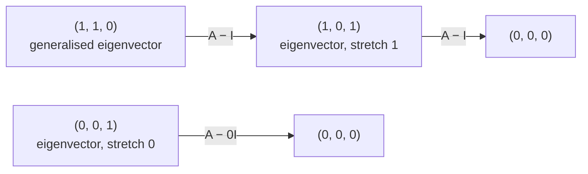

# Generalised eigenvectors: when a square matrix has too few eigenvectors, the vectors killed by a power of A minus lambda I fill the gap

[Syllabus](../../../SYLLABUS.md) → [Algebra](../README.md) → [Eigenvalues and Symmetric Matrices](../README.md#s07) → Generalised eigenvectors

---

## General Overview

A delivery van drives at a steady 1 km a minute. Its tracking app updates once a minute and shows where the van was a minute ago. The state is three numbers: position in km, speed in km a minute, and the shown position.

A minute sends (position, speed, shown) to (position + speed, speed, position): the matrix A = `[[1, 1, 0], [0, 1, 0], [1, 0, 0]]`. Its eigenvalues are 1, 1 and 0, so 1 has multiplicity 2: it comes twice.

[Diagonalisation](03-diagonalisation-and-matrix-powers.md) needs three independent eigenvectors. A has two lines of them: a parked van shown correctly, (1, 0, 1), with eigenvalue 1, and a pure display error, (0, 0, 1), wiped out at the next update. One direction is missing.

Look at (1, 1, 0): the van at km 1 and moving, the app one minute behind. A sends it to itself plus a push of (1, 0, 1). Apply A − I and only the push is left; apply it again and the push goes to zero.

A nonzero vector that some power of A − λI sends to zero is a **generalised eigenvector** for the eigenvalue λ (lambda).

Start at km 3, the app still showing the depot at km 0: (3, 1, 0). Ten minutes on, it is (13, 1, 12). The split is (3, 1, 2), a van tracked one minute behind, plus (0, 0, −2), a display error that dies at the first update. The tracked part gains the push ten times.

**When a square matrix's characteristic polynomial splits, the vectors killed by powers of A − λI form a generalised eigenspace for each eigenvalue λ that A keeps; its size is λ's multiplicity, and together they rebuild the whole space in one way only.**

**What kind of fact this is:** a definition carrying a theorem, proved on this card in Why it works, for every square matrix whose characteristic polynomial splits into factors t − λ (always true with complex numbers).

### The picture: two chains that end at zero



---

## The formula

The **kernel** of a matrix M, written $`\ker M`$, is every column M sends to zero ([Rank and nullity](../05-Solving%20Systems/05-rank-nullity.md)). The **multiplicity** $`m_\lambda`$ of an eigenvalue λ counts how often it is a root of the characteristic polynomial $`p(t) = \det(tI - A)`$, not of the minimal polynomial.

```math
G_\lambda = \{\, v : (A - \lambda I)^k v = 0 \text{ for some whole number } k \,\} = \ker (A - \lambda I)^{m_\lambda}
```

**Read it aloud:** the generalised eigenspace of lambda is every vector that enough applications of A minus lambda I send to zero; lambda's multiplicity is always enough.

```math
\mathbb{R}^n = G_{\lambda_1} \oplus G_{\lambda_2} \oplus \cdots \oplus G_{\lambda_r}, \qquad \dim G_{\lambda_i} = m_{\lambda_i}
```

**Read it aloud:** every column of n numbers splits one way only into a piece from each generalised eigenspace, and each has as many directions as its eigenvalue's multiplicity.

Here $`G_1`$ is the plane where the app is one minute behind, and $`G_0`$ the line through (0, 0, 1): 2 + 1 = 3.

| Symbol | Plain meaning | In our example | Push it up and the answer… |
| --- | --- | --- | --- |
| $`A`$, $`I`$ | the square matrix; the identity | `[[1, 1, 0], [0, 1, 0], [1, 0, 0]]` | more rows, more pieces |
| $`\lambda`$, $`\lambda_i`$, $`r`$, $`\mu`$ | an eigenvalue; the i-th of r different ones; another eigenvalue | 1 and 0; r = 2 | — |
| $`v`$, $`k`$ | a column of n numbers; applications of A − λI | (1, 1, 0); k = 1, 2, 3 | larger k kills more, then stops |
| $`\ker M`$, $`\dim`$ | columns M sends to zero; their count of independent directions | $`\ker (A - I)`$: the line through (1, 0, 1), dim 1 | — |
| $`p(t)`$, $`t`$, $`m_\lambda`$ | characteristic polynomial in the variable t; how often λ is a root of p(t) | $`t^3 - 2t^2 + t`$; $`m_1 = 2`$, $`m_0 = 1`$ | bigger multiplicity, bigger piece |
| $`G_\lambda`$ | the generalised eigenspace of λ | $`G_1`$: a plane; $`G_0`$: a line | — |
| $`\mathbb{R}^n`$, $`\mathbb{C}^n`$, $`n`$, $`\oplus`$ | columns of n real, or complex, numbers; the size; direct sum: pieces split one way only | n = 3 | — |
| $`P_\lambda`$, $`P_i`$, $`q_i`$, $`a_i`$ | projector: picks out a vector's piece in $`G_\lambda`$; built from polynomials $`a_i`$, $`q_i`$ | $`P_1`$ sends (3, 1, 0) to (3, 1, 2) | — |

### When it holds

- **The characteristic polynomial splits.** The quarter turn `[[0, -1], [1, 0]]` has $`p(t) = t^2 + 1`$ and no real root, so no real pieces; with complex numbers it splits, and the pieces fill $`\mathbb{C}^n`$.
- **A finite size.** Kernels of higher powers must stop growing. With infinitely many directions they need not.
- **Exact arithmetic.** Rounding splits the repeated 1 into two nearby eigenvalues, and a kernel's size then hangs on a tolerance.

---

## Why it works

### Step 0: the idea

A − λI measures how far a vector is from being an eigenvector for λ: on the plane, A − I slides (1, 1, 0) to (1, 0, 1), then to zero. A polynomial identity then cuts the space along such chains.

### Step 1: the kernels grow, then stop

If $`(A - \lambda I)^k v = 0`$, one more application still gives zero, so each kernel contains the one before. For λ = 1 the sizes are 1, 2, 2.

Once two kernels in a row are equal, all later ones are. If v is killed by k + 2 applications, (A − λI)v is killed by k + 1, hence by k (equal kernels), so v is killed by k + 1. Sizes cannot pass n, so growth stops by k = n.

### Step 2: A keeps each piece

A and A − λI commute (their order of multiplying does not matter). So if $`(A - \lambda I)^k v = 0`$, then $`(A - \lambda I)^k A v = A (A - \lambda I)^k v = 0`$. Here A sends (1, 0, 1) to itself and (1, 1, 0) to (2, 1, 1): both stay in the plane.

### Step 3: a polynomial mix of 1 splits every vector

[Cayley-Hamilton and the minimal polynomial](08-cayley-hamilton-and-minimal-polynomial.md) says $`p(A) = 0`$. The factors t and $`(t - 1)^2`$ share no root, so Euclid's algorithm run backwards ([Bezout's identity](../../02-Number%20theory/02-Greatest%20Common%20Divisor%20and%20Euclid%27s%20Algorithm/04-bezouts-identity.md)) finds a mix of them equal to 1:

```math
(2 - t)\,t + (t - 1)^2 = 1
```

Put A in place of t: $`P_1 = (2I - A)A`$ and $`P_0 = (A - I)^2`$ add to I, so every v equals $`P_1 v + P_0 v`$.

Each term lands in its own piece: $`(A - I)^2 P_1 v = (2I - A)\, p(A)\, v = 0`$, and $`A P_0 v = p(A)\, v = 0`$. For v = (3, 1, 0): (3, 1, 2) + (0, 0, −2).

### Step 4: the split is unique, and the sizes are the multiplicities

On $`G_\lambda`$ the only eigenvalue is λ. If v is in $`G_\lambda`$ and Av = μv for another number μ, then $`(A - \lambda I)^k v = (\mu - \lambda)^k v`$, never zero unless v is. So two different pieces share only zero.

With three or more pieces that is not enough (three lines in a plane also share only zero, yet split vectors many ways). The projectors make the split unique: $`P_i`$ keeps a vector's piece in $`G_{\lambda_i}`$ and kills the others (fold).

Use bases of the pieces as one basis ([Change of basis](01-change-of-basis.md)). By Step 2, A becomes diagonal blocks: here `[[1, 1], [0, 1]]` in the basis (1, 0, 1), (1, 1, 0), and `[0]`. Its characteristic polynomial is the product of the blocks' ones ([Determinants](../05-Solving%20Systems/04-determinants.md)). Block i has only the eigenvalue $`\lambda_i`$, so it contributes $`t - \lambda_i`$ once per direction. Matching factors with p(t), each size is its multiplicity.

<details>
<summary>Detailed proof: the split for any number of eigenvalues</summary>

Write $`p(t) = (t - \lambda_1)^{m_1} \cdots (t - \lambda_r)^{m_r}`$, and let $`q_i(t)`$ be p(t) with the i-th factor removed. No root is shared by all the $`q_i`$, so polynomials $`a_i(t)`$ exist with

$`\displaystyle a_1(t)\, q_1(t) + \cdots + a_r(t)\, q_r(t) = 1.`$

Set $`P_i = a_i(A)\, q_i(A)`$. Then the $`P_i`$ add to I. Also $`(A - \lambda_i I)^{m_i} P_i = a_i(A)\, p(A) = 0`$, so $`P_i v`$ lies in $`\ker (A - \lambda_i I)^{m_i}`$. For j ≠ i, $`q_j`$ contains the factor $`(t - \lambda_i)^{m_i}`$, so $`P_j`$ is zero on that kernel, and $`P_i`$ is I there.

If v is in $`G_{\lambda_i}`$, each $`P_j v`$ with j ≠ i lies in $`G_{\lambda_i}`$ (Step 2) and in $`G_{\lambda_j}`$, so it is zero (next paragraph). Hence $`v = P_i v`$, killed by the power $`m_i`$: that is why $`G_{\lambda_i} = \ker (A - \lambda_i I)^{m_i}`$.

Two generalised eigenspaces share only zero: for v ≠ 0 in both, the last nonzero vector w in the chain v, (A − λI)v, (A − λI)²v, … is an eigenvector for λ inside the other space, which Step 4 rules out.

Since each piece equals its kernel, $`P_i`$ is I on $`G_{\lambda_i}`$ and zero on the others. If $`v = v_1 + \cdots + v_r`$, one piece from each, then $`P_i v = v_i`$: the pieces are forced.

</details>

### Step 5: what it buys: powers

On $`G_1`$, A is I plus the slide A − I, and two slides give zero. So the binomial expansion keeps two terms: $`A^{10} = I + 10 (A - I)`$ there. On $`G_0`$, A is zero, so $`A^{10}`$ is zero. Split (3, 1, 0), power each piece, add: (3, 1, 2) + 10 × (1, 0, 1) = (13, 1, 12).

---

## Worked numbers, by hand

| Step | Arithmetic | Value |
| --- | --- | --- |
| characteristic polynomial | $`t (t - 1)(t - 1)`$ multiplied out | $`t^3 - 2t^2 + t`$ |
| multiplicities | count each root | 1 twice, 0 once |
| $`\ker (A - I)`$ | `[[0, 1, 0], [0, 0, 0], [1, 0, -1]]` kills it when speed is 0 and shown = position | line through (1, 0, 1), dim 1 |
| $`\ker (A - I)^2`$ | `[[0, 0, 0], [0, 0, 0], [-1, 1, 1]]` kills it when shown = position − speed | a plane, dim 2 |
| $`\ker (A - I)^3`$ | `[[0, 0, 0], [0, 0, 0], [1, -1, -1]]`, the same row negated | dim 2: growth stopped |
| $`\ker A`$ | `[[1, 1, 0], [0, 1, 0], [1, 0, 0]]`: speed 0, then position 0 | the line through (0, 0, 1), dim 1 |
| sizes | 2 + 1 | **3, the whole space** |
| split (3, 1, 0) | $`P_1`$ = `[[1, 0, 0], [0, 1, 0], [1, -1, 0]]`, $`P_0`$ = `[[0, 0, 0], [0, 0, 0], [-1, 1, 1]]` | (3, 1, 2) + (0, 0, −2) |
| ten minutes | (3, 1, 2) + 10 × (1, 0, 1) + 0 × (0, 0, −2) | **(13, 1, 12)** |

Ten multiplications become one push, added ten times.

### What breaks if you drop a piece

| Mistake | Comes out at | What went wrong |
| --- | --- | --- |
| Eigenvectors only, k = 1 | 1 + 1 = 2 directions for 3 | (1, 1, 0) needs two applications of A − I |
| Powers as if A were diagonal | (3, 1, 2) | Drops the push 10 × (1, 0, 1): the van never moves |
| Projector $`A`$, without the factor $`2I - A`$ | (4, 1, 3), not (3, 1, 2) | It kills $`G_0`$ but bends $`G_1`$; the Bezout factor undoes the bend |

---

## Code, from first principles, and it actually runs

Nothing is imported, and every number is whole. Four roads: elimination on powers of A − λI, in A's axes and in others, gives the sizes 2 and 1; roots of the characteristic polynomial, built from traces (diagonal sums) of powers of A, give the multiplicities; the Bezout projectors must add to I; and ten steps of A are taken by brute force and by the pieces.

### Python

```python
# Generalised eigenvectors -- the check behind the card.  Nothing is imported.  A: one minute of a van's (position, speed, shown position).
# Road one: sizes of ker (A - lambda I)^k by elimination, in A's axes and others.  Two: multiplicities from traces.  Three: Bezout projectors.  Four: A^10 two ways.
A, n, v = [[1, 1, 0], [0, 1, 0], [1, 0, 0]], 3, (3, 1, 0)
I, Z = [[int(i == j) for j in range(n)] for i in range(n)], [[0] * n for _ in range(n)]
S, Si = [[1, 1, 1], [0, 1, 1], [1, 1, 2]], [[1, -1, 0], [1, 1, -1], [-1, 0, 1]]   # other axes, and their inverse
def mul(X, Y): return [[sum(X[i][k] * Y[k][j] for k in range(n)) for j in range(n)] for i in range(n)]
def add(X, Y, c=1): return [[X[i][j] + c * Y[i][j] for j in range(n)] for i in range(n)]
def act(X, v): return tuple(sum(X[i][k] * v[k] for k in range(n)) for i in range(n))
def shift(lam): return add(A, I, -lam)                       # A - lambda I
def mpow(X, k): return I if k == 0 else mul(mpow(X, k - 1), X)
def rank(X):                                # elimination that stays in whole numbers
    rows, r = [row[:] for row in X], 0
    for c in range(n):
        p = next((i for i in range(r, n) if rows[i][c]), None)
        if p is None: continue
        rows[r], rows[p] = rows[p], rows[r]
        for i in range(r + 1, n):
            rows[i] = [rows[r][c] * x - rows[i][c] * y for x, y in zip(rows[i], rows[r])]
        r += 1
    return r
def divide(c, r):                           # synthetic division by (t - r)
    q = [c[0]]
    for x in c[1:]: q.append(x + r * q[-1])
    return q[:-1], q[-1]
def mult(c, r):                             # how many times (t - r) divides
    m, (q, rem) = 0, divide(c, r)
    while rem == 0: m, c = m + 1, q; q, rem = divide(c, r)
    return m
def vec(v): return "(" + ", ".join(str(x) for x in v) + ")"
coef, M = [1], Z                            # det(tI - A) from traces of powers
for k in range(1, n + 1):
    M = add(mul(A, M), I, coef[-1])
    coef.append(-sum(mul(A, M)[i][i] for i in range(n)) // k)
roots = [r for r in range(-12, 13) if divide(coef, r)[1] == 0]
dims = {lam: [n - rank(mpow(shift(lam), k)) for k in (1, 2, 3)] for lam in roots}
P1, P0 = mul(add(add(I, I), A, -1), A), mpow(shift(1), 2)   # (2 - t) t and (t - 1)^2
pA = [[sum(c * mpow(A, n - i)[r][s] for i, c in enumerate(coef)) for s in range(n)] for r in range(n)]
u, w, slow = act(P1, v), act(P0, v), act(mpow(A, 10), v)
fast = tuple(1**10 * a + 10 * 1**9 * b + 0**10 * c for a, b, c in zip(u, act(shift(1), u), w))
print(f"A = {A}; characteristic polynomial coefficients {coef}")
for lam in roots:
    print(f"eigenvalue {lam}: multiplicity {mult(coef, lam)}; dim ker (A - {lam}I)^k, k = 1, 2, 3: {dims[lam]}")
print(f"A - I sends (1, 1, 0) to {vec(act(shift(1), (1, 1, 0)))}, which it sends to {vec(act(shift(1), (1, 0, 1)))}")
print(f"A sends (1, 0, 1) to {vec(act(A, (1, 0, 1)))} and (1, 1, 0) to {vec(act(A, (1, 1, 0)))}")
print(f"A - I = {shift(1)}; (A - I)^2 = {P0}; (A - I)^3 = {mpow(shift(1), 3)}")
print(f"(2 - t) t + (t - 1)^2 at t = 0..5: {[(2 - t) * t + (t - 1)**2 for t in range(6)]}")
print(f"P1 = (2I - A) A = {P1}")
print(f"P1 + P0 = {add(P1, P0)}; P1 P0 = {mul(P1, P0)}")
print(f"Cayley-Hamilton, p(A) = {pA}")
print(f"(3, 1, 0) = {vec(u)} + {vec(w)}; piece sizes {rank(P1)} + {rank(P0)} = {rank(P1) + rank(P0)}")
print(f"A^10 (3, 1, 0), ten multiplications: {vec(slow)}; by the pieces: {vec(fast)}")
print(f"mistake, eigenvectors only: {dims[1][0]} + {dims[0][0]} = {dims[1][0] + dims[0][0]} directions for {n}; whole chain added: {sum(dims[1][:2]) + dims[0][0]}")
print(f"mistake, powers as if diagonal: {vec(u)}, missing 10 x {vec(act(shift(1), u))}")
print(f"mistake, projector without the Bezout factor: {vec(act(A, v))}, not {vec(u)}")
assert [dims[lam][-1] for lam in roots] == [mult(coef, lam) for lam in roots] == [1, 2]
assert add(P1, P0) == I and mul(P1, P0) == Z and pA == Z and rank(P1) == dims[1][-1]
assert all(act(P0, act(A, e)) == (0, 0, 0) for e in [(1, 0, 1), (1, 1, 0)])  # A keeps the plane
assert mul(S, Si) == I and all(n - rank(mul(mul(S, mpow(shift(l), k)), Si)) == dims[l][k - 1] for l in roots for k in (1, 2, 3))  # other axes
assert slow == fast and dims[1][0] < dims[1][1] == dims[1][2]
print("ALL CHECKS PASS")
```

**Ran 2026-11-25 on macOS, Python 3.14.10, standard library only. All checks passed. Output, pasted from the run:**

```
A = [[1, 1, 0], [0, 1, 0], [1, 0, 0]]; characteristic polynomial coefficients [1, -2, 1, 0]
eigenvalue 0: multiplicity 1; dim ker (A - 0I)^k, k = 1, 2, 3: [1, 1, 1]
eigenvalue 1: multiplicity 2; dim ker (A - 1I)^k, k = 1, 2, 3: [1, 2, 2]
A - I sends (1, 1, 0) to (1, 0, 1), which it sends to (0, 0, 0)
A sends (1, 0, 1) to (1, 0, 1) and (1, 1, 0) to (2, 1, 1)
A - I = [[0, 1, 0], [0, 0, 0], [1, 0, -1]]; (A - I)^2 = [[0, 0, 0], [0, 0, 0], [-1, 1, 1]]; (A - I)^3 = [[0, 0, 0], [0, 0, 0], [1, -1, -1]]
(2 - t) t + (t - 1)^2 at t = 0..5: [1, 1, 1, 1, 1, 1]
P1 = (2I - A) A = [[1, 0, 0], [0, 1, 0], [1, -1, 0]]
P1 + P0 = [[1, 0, 0], [0, 1, 0], [0, 0, 1]]; P1 P0 = [[0, 0, 0], [0, 0, 0], [0, 0, 0]]
Cayley-Hamilton, p(A) = [[0, 0, 0], [0, 0, 0], [0, 0, 0]]
(3, 1, 0) = (3, 1, 2) + (0, 0, -2); piece sizes 2 + 1 = 3
A^10 (3, 1, 0), ten multiplications: (13, 1, 12); by the pieces: (13, 1, 12)
mistake, eigenvectors only: 1 + 1 = 2 directions for 3; whole chain added: 4
mistake, powers as if diagonal: (3, 1, 2), missing 10 x (1, 0, 1)
mistake, projector without the Bezout factor: (4, 1, 3), not (3, 1, 2)
ALL CHECKS PASS
```

### Rust

Same numbers, same labels, built with `rustc --edition 2021 -O`.

```rust
// Generalised eigenvectors -- the same check as the Python, in Rust.  No crates.  A: one minute of a van's (position, speed, shown position).
// Road one: sizes of ker (A - lambda I)^k by elimination, in A's axes and others.  Two: multiplicities from traces.  Three: Bezout projectors.  Four: A^10 two ways.
type M = Vec<Vec<i64>>;
const N: usize = 3;
fn a() -> M { vec![vec![1, 1, 0], vec![0, 1, 0], vec![1, 0, 0]] }
fn id() -> M { (0..N).map(|i| (0..N).map(|j| (i == j) as i64).collect()).collect() }
fn mul(x: &M, y: &M) -> M { (0..N).map(|i| (0..N).map(|j| (0..N).map(|k| x[i][k] * y[k][j]).sum()).collect()).collect() }
fn add(x: &M, y: &M, c: i64) -> M { (0..N).map(|i| (0..N).map(|j| x[i][j] + c * y[i][j]).collect()).collect() }
fn act(x: &M, v: [i64; 3]) -> [i64; 3] { std::array::from_fn(|i| (0..N).map(|k| x[i][k] * v[k]).sum()) }
fn shift(lam: i64) -> M { add(&a(), &id(), -lam) }              // A - lambda I
fn mpow(x: &M, k: usize) -> M { if k == 0 { id() } else { mul(&mpow(x, k - 1), x) } }
fn rank(x: &M) -> usize {                   // elimination that stays in whole numbers
    let (mut rows, mut r) = (x.clone(), 0);
    for c in 0..N {
        let Some(p) = (r..N).find(|&i| rows[i][c] != 0) else { continue };
        rows.swap(r, p);
        for i in r + 1..N {
            let (pv, f) = (rows[r][c], rows[i][c]);
            for j in 0..N { rows[i][j] = pv * rows[i][j] - f * rows[r][j]; }
        }
        r += 1;
    }
    r
}
fn divide(c: &[i64], r: i64) -> (Vec<i64>, i64) {     // synthetic division by (t - r)
    let mut q = vec![c[0]];
    for &x in &c[1..] { let last = q[q.len() - 1]; q.push(x + r * last); }
    let rem = q.pop().unwrap(); (q, rem)
}
fn mult(c: &[i64], r: i64) -> usize {                  // how many times (t - r) divides
    let (mut m, (mut q, mut rem)) = (0, divide(c, r));
    while rem == 0 { m += 1; let next = divide(&q, r); q = next.0; rem = next.1; }
    m
}
fn vec3(v: [i64; 3]) -> String { format!("({}, {}, {})", v[0], v[1], v[2]) }
fn main() {
    let (am, i3, z, v): (M, M, M, [i64; 3]) = (a(), id(), vec![vec![0; N]; N], [3, 1, 0]);
    let (s, si): (M, M) = (vec![vec![1, 1, 1], vec![0, 1, 1], vec![1, 1, 2]], vec![vec![1, -1, 0], vec![1, 1, -1], vec![-1, 0, 1]]); // other axes, inverse
    let (mut coef, mut m) = (vec![1i64], z.clone());            // det(tI - A) from traces of powers
    for k in 1..=N {
        m = add(&mul(&am, &m), &i3, coef[coef.len() - 1]);
        let am_m = mul(&am, &m);
        coef.push(-(0..N).map(|i| am_m[i][i]).sum::<i64>() / k as i64);
    }
    let roots: Vec<i64> = (-12..13).filter(|&r| divide(&coef, r).1 == 0).collect();
    let dims = |lam: i64| -> Vec<usize> { (1..4).map(|k| N - rank(&mpow(&shift(lam), k))).collect() };
    let (p1, p0) = (mul(&add(&add(&i3, &i3, 1), &am, -1), &am), mpow(&shift(1), 2)); // (2 - t) t, (t - 1)^2
    let mut pa = z.clone();
    for (i, &c) in coef.iter().enumerate() { pa = add(&pa, &mpow(&am, N - i), c); }
    let (u, w, slow) = (act(&p1, v), act(&p0, v), act(&mpow(&am, 10), v));
    let nu = act(&shift(1), u);
    let fast: [i64; 3] = std::array::from_fn(|i| 1i64.pow(10) * u[i] + 10 * 1i64.pow(9) * nu[i] + 0i64.pow(10) * w[i]);
    let (d1, d0) = (dims(1), dims(0));
    let bez: Vec<i64> = (0..6).map(|t: i64| (2 - t) * t + (t - 1) * (t - 1)).collect();
    println!("A = {:?}; characteristic polynomial coefficients {:?}", am, coef);
    for &lam in &roots {
        println!("eigenvalue {}: multiplicity {}; dim ker (A - {}I)^k, k = 1, 2, 3: {:?}", lam, mult(&coef, lam), lam, dims(lam));
    }
    println!("A - I sends (1, 1, 0) to {}, which it sends to {}", vec3(act(&shift(1), [1, 1, 0])), vec3(act(&shift(1), [1, 0, 1])));
    println!("A sends (1, 0, 1) to {} and (1, 1, 0) to {}", vec3(act(&am, [1, 0, 1])), vec3(act(&am, [1, 1, 0])));
    println!("A - I = {:?}; (A - I)^2 = {:?}; (A - I)^3 = {:?}", shift(1), p0, mpow(&shift(1), 3));
    println!("(2 - t) t + (t - 1)^2 at t = 0..5: {:?}", bez);
    println!("P1 = (2I - A) A = {:?}", p1);
    println!("P1 + P0 = {:?}; P1 P0 = {:?}", add(&p1, &p0, 1), mul(&p1, &p0));
    println!("Cayley-Hamilton, p(A) = {:?}", pa);
    println!("(3, 1, 0) = {} + {}; piece sizes {} + {} = {}", vec3(u), vec3(w), rank(&p1), rank(&p0), rank(&p1) + rank(&p0));
    println!("A^10 (3, 1, 0), ten multiplications: {}; by the pieces: {}", vec3(slow), vec3(fast));
    println!("mistake, eigenvectors only: {} + {} = {} directions for {}; whole chain added: {}", d1[0], d0[0], d1[0] + d0[0], N, d1[0] + d1[1] + d0[0]);
    println!("mistake, powers as if diagonal: {}, missing 10 x {}", vec3(u), vec3(nu));
    println!("mistake, projector without the Bezout factor: {}, not {}", vec3(act(&am, v)), vec3(u));
    let stable: Vec<usize> = roots.iter().map(|&l| dims(l)[2]).collect();
    let mults: Vec<usize> = roots.iter().map(|&l| mult(&coef, l)).collect();
    assert!(stable == mults && mults == vec![1, 2]);
    assert!(add(&p1, &p0, 1) == i3 && mul(&p1, &p0) == z && pa == z && rank(&p1) == d1[2]);
    assert!([[1, 0, 1], [1, 1, 0]].iter().all(|&e| act(&p0, act(&am, e)) == [0, 0, 0])); // A keeps the plane
    assert!(mul(&s, &si) == i3 && roots.iter().all(|&l| (1..4).all(|k| N - rank(&mul(&mul(&s, &mpow(&shift(l), k)), &si)) == dims(l)[k - 1]))); // other axes
    assert!(slow == fast && d1[0] < d1[1] && d1[1] == d1[2]);
    println!("ALL CHECKS PASS");
}
```

**Ran 2026-11-25 on macOS, rustc 1.98.1, no crates. All checks passed. Output, pasted from the run:**

```
A = [[1, 1, 0], [0, 1, 0], [1, 0, 0]]; characteristic polynomial coefficients [1, -2, 1, 0]
eigenvalue 0: multiplicity 1; dim ker (A - 0I)^k, k = 1, 2, 3: [1, 1, 1]
eigenvalue 1: multiplicity 2; dim ker (A - 1I)^k, k = 1, 2, 3: [1, 2, 2]
A - I sends (1, 1, 0) to (1, 0, 1), which it sends to (0, 0, 0)
A sends (1, 0, 1) to (1, 0, 1) and (1, 1, 0) to (2, 1, 1)
A - I = [[0, 1, 0], [0, 0, 0], [1, 0, -1]]; (A - I)^2 = [[0, 0, 0], [0, 0, 0], [-1, 1, 1]]; (A - I)^3 = [[0, 0, 0], [0, 0, 0], [1, -1, -1]]
(2 - t) t + (t - 1)^2 at t = 0..5: [1, 1, 1, 1, 1, 1]
P1 = (2I - A) A = [[1, 0, 0], [0, 1, 0], [1, -1, 0]]
P1 + P0 = [[1, 0, 0], [0, 1, 0], [0, 0, 1]]; P1 P0 = [[0, 0, 0], [0, 0, 0], [0, 0, 0]]
Cayley-Hamilton, p(A) = [[0, 0, 0], [0, 0, 0], [0, 0, 0]]
(3, 1, 0) = (3, 1, 2) + (0, 0, -2); piece sizes 2 + 1 = 3
A^10 (3, 1, 0), ten multiplications: (13, 1, 12); by the pieces: (13, 1, 12)
mistake, eigenvectors only: 1 + 1 = 2 directions for 3; whole chain added: 4
mistake, powers as if diagonal: (3, 1, 2), missing 10 x (1, 0, 1)
mistake, projector without the Bezout factor: (4, 1, 3), not (3, 1, 2)
ALL CHECKS PASS
```

### Lean

Lean proves the theorem for every square matrix whose characteristic polynomial splits, and checks the worked numbers.

- Take a square matrix A whose characteristic polynomial splits into factors t − λ. Then A keeps each generalised eigenspace $`G_\lambda`$.
- Take the same A and an eigenvalue λ. Then $`\dim G_\lambda = m_\lambda`$.
- Take the same A. Then every vector splits into one piece from each $`G_\lambda`$, in one way only.
- Take any square matrix A and any number λ. Then a vector is in $`G_\lambda`$ exactly when $`(A - \lambda I)^{m_\lambda}`$ sends it to zero.
- Take any square matrix M of size n. Then a vector killed by $`M^k`$ is also killed by $`M^{k+1}`$.
- Take the same M. Then once two kernels of powers in a row are equal, all later ones are equal too.
- Take the same M. Then the kernels of its powers stop growing by the power n.
- It also re-checks the van's worked numbers: $`p(t)`$, the chain, the powers of A − I, the identity $`(2 - t)\,t + (t - 1)^2 = 1`$, the projectors, $`p(A) = 0`$, the ten-minute state and the bare-factor mistake.

The example's kernel sizes by elimination, the change of axes and the traces are left to the Python and Rust checks.

```lean
-- Generalised eigenvectors: for a square matrix whose characteristic polynomial splits, each generalised eigenspace is kept by the matrix, has as many directions as its eigenvalue's multiplicity, and together they split every vector into one piece per eigenvalue in one way only.
import Mathlib.LinearAlgebra.Eigenspace.Zero
import Mathlib.LinearAlgebra.Eigenspace.Triangularizable
import Mathlib.LinearAlgebra.Charpoly.ToMatrix
import Mathlib.LinearAlgebra.Matrix.ToLin
import Mathlib.LinearAlgebra.Matrix.Notation
import Mathlib.Algebra.DirectSum.Module
import Mathlib.Algebra.Polynomial.Splits
import Mathlib.Tactic.NormNum
import Mathlib.Tactic.Ring

open Matrix Polynomial Module

/-! A square matrix of size `n` with entries in a field `K` is `Matrix (Fin n) (Fin n) K`; a
column of `n` numbers is `Fin n → K`, and `A *ᵥ v` is the matrix applied to it. Working in a
field is the card's "exact arithmetic"; `K = ℝ` or `K = ℂ` are the card's cases. `A - μ • 1` is
`A − λI`, and `M ^ k` is `M` applied `k` times. `A.charpoly` is the characteristic polynomial
`p(t) = det(tI − A)`, `A.charpoly.Splits` says it splits into factors `t − λ`, and
`A.charpoly.rootMultiplicity μ` is the multiplicity `m_λ`. The eigenvalues are the roots of
`p(t)`, the subtype `{μ : K // A.charpoly.IsRoot μ}`.

The generalised eigenspace `G_λ` is Mathlib's `maxGenEigenspace` of the linear map
`Matrix.toLin' A` (the map `v ↦ A *ᵥ v`): every `v` sent to zero by some power of `A − λI`,
which `mem_generalisedEigenspace_iff` below spells out. `finrank K` counts independent
directions, and `DirectSum.IsInternal G` says every vector is a sum of one piece from each `G_λ`
in exactly one way. (Naming the pieces needs equality of eigenvalues to be decidable, which
`open scoped Classical in` supplies; it adds no hypothesis.) -/

theorem toLin'_sub_smul_pow_apply {K : Type*} [Field K] {n : ℕ}
    (A : Matrix (Fin n) (Fin n) K) (μ : K) (k : ℕ) (v : Fin n → K) :
    ((Matrix.toLin' A - μ • (1 : End K (Fin n → K))) ^ k) v = (A - μ • 1) ^ k *ᵥ v := by
  rw [← Matrix.toLin'_apply, Matrix.toLin'_pow, map_sub, map_smul, Matrix.toLin'_one,
    Module.End.one_eq_id]

#print axioms toLin'_sub_smul_pow_apply

theorem finrank_biSup_maxGenEigenspace {K : Type*} [Field K] {n : ℕ}
    (f : End K (Fin n → K)) (s : Finset K) :
    finrank K (⨆ μ ∈ s, f.maxGenEigenspace μ : Submodule K (Fin n → K)) =
      ∑ μ ∈ s, finrank K (f.maxGenEigenspace μ) := by
  classical
  induction s using Finset.induction_on with
  | empty => simp
  | insert a s ha ih =>
    rw [Finset.iSup_insert, Finset.sum_insert ha, ← ih]
    have hd : Disjoint (f.maxGenEigenspace a) (⨆ μ ∈ s, f.maxGenEigenspace μ) :=
      f.independent_maxGenEigenspace.disjoint_biSup ha
    have := Submodule.finrank_sup_add_finrank_inf_eq (f.maxGenEigenspace a)
      (⨆ μ ∈ s, f.maxGenEigenspace μ)
    rw [hd.eq_bot, finrank_bot, add_zero] at this
    exact this

#print axioms finrank_biSup_maxGenEigenspace


open scoped Classical in
/-- Generalised eigenspaces. Take a square matrix `A` over a field whose characteristic
polynomial splits into factors `t − λ`. For each eigenvalue `λ`, the generalised eigenspace
`G_λ` is kept by `A` (if `v` is in it, so is `A v`), it has as many independent directions as
`λ`'s multiplicity as a root of the characteristic polynomial, and the whole space is the direct
sum of the `G_λ`: every vector splits into one piece from each, in one way only. -/
theorem generalised_eigenspaces_fill_the_space {K : Type*} [Field K] {n : ℕ}
    (A : Matrix (Fin n) (Fin n) K) (h_split : A.charpoly.Splits) :
    (∀ μ : K, ∀ v ∈ End.maxGenEigenspace (Matrix.toLin' A) μ,
        A *ᵥ v ∈ End.maxGenEigenspace (Matrix.toLin' A) μ) ∧
    (∀ μ : K, A.charpoly.IsRoot μ →
        finrank K (End.maxGenEigenspace (Matrix.toLin' A) μ) = A.charpoly.rootMultiplicity μ) ∧
    DirectSum.IsInternal
        (fun μ : {μ : K // A.charpoly.IsRoot μ} => End.maxGenEigenspace (Matrix.toLin' A) μ.1) := by
  set f : End K (Fin n → K) := Matrix.toLin' A
  have hfin : ∀ μ, finrank K (f.maxGenEigenspace μ) = A.charpoly.rootMultiplicity μ := by
    intro μ
    rw [LinearMap.finrank_maxGenEigenspace_eq, Matrix.charpoly_toLin']
  refine ⟨fun μ v hv => ?_, fun μ _ => hfin μ, ?_⟩
  · rw [← Matrix.toLin'_apply]
    exact Module.End.mapsTo_maxGenEigenspace_of_comm (Commute.refl f) μ hv
  apply DirectSum.isInternal_submodule_of_iSupIndep_of_iSup_eq_top
  · exact f.independent_maxGenEigenspace.comp Subtype.val_injective
  · have hne : A.charpoly ≠ 0 := (Matrix.charpoly_monic A).ne_zero
    set S := A.charpoly.roots.toFinset
    have htop : (⨆ μ ∈ S, f.maxGenEigenspace μ : Submodule K (Fin n → K)) = ⊤ := by
      apply Submodule.eq_top_of_finrank_eq
      rw [finrank_biSup_maxGenEigenspace]
      simp only [hfin, S, ← Polynomial.count_roots]
      rw [Multiset.toFinset_sum_count_eq, ← h_split.natDegree_eq_card_roots,
        Matrix.charpoly_natDegree_eq_dim]
      simp
    rw [eq_top_iff, ← htop]
    refine iSup₂_le fun μ hμ => ?_
    have hr : A.charpoly.IsRoot μ := by
      rw [Multiset.mem_toFinset, Polynomial.mem_roots hne] at hμ; exact hμ
    exact le_iSup (fun μ : {μ : K // A.charpoly.IsRoot μ} => f.maxGenEigenspace μ.1) ⟨μ, hr⟩

/-- What the generalised eigenspace is, and the power that is always enough. A vector `v` lies
in `G_λ` exactly when some power of `A − λI` sends it to zero, and exactly when the power
`m_λ`, the multiplicity of `λ`, sends it to zero: `G_λ = ker (A − λI)^{m_λ}`. -/
theorem mem_generalisedEigenspace_iff {K : Type*} [Field K] {n : ℕ}
    (A : Matrix (Fin n) (Fin n) K) (μ : K) (v : Fin n → K) :
    (v ∈ End.maxGenEigenspace (Matrix.toLin' A) μ ↔ ∃ k : ℕ, (A - μ • 1) ^ k *ᵥ v = 0) ∧
    (v ∈ End.maxGenEigenspace (Matrix.toLin' A) μ ↔
        (A - μ • 1) ^ A.charpoly.rootMultiplicity μ *ᵥ v = 0) := by
  have h1 : v ∈ End.maxGenEigenspace (Matrix.toLin' A) μ ↔ ∃ k : ℕ, (A - μ • 1) ^ k *ᵥ v = 0 := by
    rw [Module.End.mem_maxGenEigenspace]
    simp only [toLin'_sub_smul_pow_apply]
  refine ⟨h1, ?_, fun h => h1.2 ⟨_, h⟩⟩
  intro hv
  set f := Matrix.toLin' A
  set G := End.maxGenEigenspace f μ
  have hG : ∀ x ∈ G, (f - μ • (1 : End K (Fin n → K))) x ∈ G := by
    intro x hx
    have := Module.End.mapsTo_maxGenEigenspace_of_comm
      (f := f) (g := f - μ • (1 : End K (Fin n → K))) ?_ μ hx
    · exact this
    · exact (Commute.refl f).sub_right (Commute.smul_right (Commute.one_right f) μ)
  set g := (f - μ • (1 : End K (Fin n → K))).restrict hG
  have hfin : finrank K G = A.charpoly.rootMultiplicity μ := by
    rw [LinearMap.finrank_maxGenEigenspace_eq, Matrix.charpoly_toLin']
  obtain ⟨k, hk⟩ := (Module.End.mem_maxGenEigenspace _ _ _).1 hv
  have hx : (⟨v, hv⟩ : G) ∈ LinearMap.ker (g ^ k) := by
    rw [LinearMap.mem_ker, Module.End.pow_restrict]
    ext1; simpa using hk
  have := Module.End.ker_pow_le_ker_pow_finrank g k hx
  rw [hfin, LinearMap.mem_ker, Module.End.pow_restrict] at this
  have := congrArg Subtype.val this
  simp only [LinearMap.coe_restrict_apply, ZeroMemClass.coe_zero] at this
  rw [← toLin'_sub_smul_pow_apply]; exact this

/-- The kernels grow, then stop. For any square matrix `M` of size `n`, a vector sent to zero by
`M^k` is sent to zero by `M^(k+1)`; once two kernels in a row are equal, all later ones equal
them; and the growth has stopped by the power `n`. -/
theorem kernels_grow_then_stop {K : Type*} [Field K] {n : ℕ}
    (M : Matrix (Fin n) (Fin n) K) :
    (∀ k : ℕ, ∀ v : Fin n → K, M ^ k *ᵥ v = 0 → M ^ (k + 1) *ᵥ v = 0) ∧
    (∀ k : ℕ, (∀ v : Fin n → K, M ^ (k + 1) *ᵥ v = 0 → M ^ k *ᵥ v = 0) →
        ∀ j : ℕ, ∀ v : Fin n → K, M ^ (k + j) *ᵥ v = 0 → M ^ k *ᵥ v = 0) ∧
    (∀ j : ℕ, ∀ v : Fin n → K, M ^ (n + j) *ᵥ v = 0 → M ^ n *ᵥ v = 0) := by
  refine ⟨fun k v hv => ?_, fun k hk j => ?_, fun j v hv => ?_⟩
  · rw [pow_succ', ← mulVec_mulVec, hv, mulVec_zero]
  · induction j with
    | zero => intro v hv; simpa using hv
    | succ j ih =>
      intro v hv
      apply ih
      have h1 : M ^ (k + 1) *ᵥ (M ^ j *ᵥ v) = 0 := by
        rw [mulVec_mulVec, ← pow_add]; rw [← hv]; congr 2; ring
      have h2 := hk _ h1
      rw [mulVec_mulVec, ← pow_add] at h2
      exact h2
  · have key := Module.End.ker_pow_eq_ker_pow_finrank_of_le (f := Matrix.toLin' M)
      (m := n + j) (by simp)
    have hv' : v ∈ LinearMap.ker (Matrix.toLin' M ^ (n + j)) := by
      rw [LinearMap.mem_ker, ← Matrix.toLin'_pow, Matrix.toLin'_apply]; exact hv
    rw [key] at hv'
    simpa [LinearMap.mem_ker, ← Matrix.toLin'_pow, Matrix.toLin'_apply] using hv'

/-! The card's worked numbers, for the van `A = [[1, 1, 0], [0, 1, 0], [1, 0, 0]]`, in whole numbers. -/

-- The characteristic polynomial is t³ − 2t² + t = t (t − 1)².
example : (!![1, 1, 0; 0, 1, 0; 1, 0, 0] : Matrix (Fin 3) (Fin 3) ℤ).charpoly =
    X ^ 3 - 2 * X ^ 2 + X := by
  rw [Matrix.charpoly, det_fin_three]
  simp
  ring
example : (X ^ 3 - 2 * X ^ 2 + X : ℤ[X]) = X * (X - 1) ^ 2 := by ring

-- The chain: A − I sends (1, 1, 0) to (1, 0, 1), and (1, 0, 1) to zero.
example : (!![1, 1, 0; 0, 1, 0; 1, 0, 0] - (1 : ℤ) • 1 : Matrix (Fin 3) (Fin 3) ℤ) *ᵥ ![1, 1, 0] =
    ![1, 0, 1] := by decide
example : (!![1, 1, 0; 0, 1, 0; 1, 0, 0] - (1 : ℤ) • 1 : Matrix (Fin 3) (Fin 3) ℤ) *ᵥ ![1, 0, 1] =
    0 := by decide

-- The powers of A − I: the square is [[0, 0, 0], [0, 0, 0], [−1, 1, 1]], and the cube is its negative.
example : (!![1, 1, 0; 0, 1, 0; 1, 0, 0] - (1 : ℤ) • 1 : Matrix (Fin 3) (Fin 3) ℤ) ^ 2 =
    !![0, 0, 0; 0, 0, 0; -1, 1, 1] := by decide
example : (!![1, 1, 0; 0, 1, 0; 1, 0, 0] - (1 : ℤ) • 1 : Matrix (Fin 3) (Fin 3) ℤ) ^ 3 =
    !![0, 0, 0; 0, 0, 0; 1, -1, -1] := by decide

-- Bezout: (2 − t) t + (t − 1)² = 1.
example : ((2 - X) * X + (X - 1) ^ 2 : ℤ[X]) = 1 := by ring

-- The projectors P₁ = (2I − A) A and P₀ = (A − I)² add to I, multiply to zero,
-- and split (3, 1, 0) into (3, 1, 2) + (0, 0, −2).
example : (((2 : ℤ) • 1 - !![1, 1, 0; 0, 1, 0; 1, 0, 0]) * !![1, 1, 0; 0, 1, 0; 1, 0, 0] :
    Matrix (Fin 3) (Fin 3) ℤ) = !![1, 0, 0; 0, 1, 0; 1, -1, 0] := by decide
example : (!![1, 0, 0; 0, 1, 0; 1, -1, 0] + !![0, 0, 0; 0, 0, 0; -1, 1, 1] : Matrix (Fin 3) (Fin 3) ℤ) =
    1 := by decide
example : (!![1, 0, 0; 0, 1, 0; 1, -1, 0] * !![0, 0, 0; 0, 0, 0; -1, 1, 1] : Matrix (Fin 3) (Fin 3) ℤ) =
    0 := by decide
example : (!![1, 0, 0; 0, 1, 0; 1, -1, 0] : Matrix (Fin 3) (Fin 3) ℤ) *ᵥ ![3, 1, 0] = ![3, 1, 2] ∧
    (!![0, 0, 0; 0, 0, 0; -1, 1, 1] : Matrix (Fin 3) (Fin 3) ℤ) *ᵥ ![3, 1, 0] = ![0, 0, -2] := by decide

-- Cayley-Hamilton for A: A³ − 2A² + A = 0.
example : let A : Matrix (Fin 3) (Fin 3) ℤ := !![1, 1, 0; 0, 1, 0; 1, 0, 0]
    A ^ 3 - 2 • A ^ 2 + A = 0 := by decide

-- Ten minutes: A¹⁰ (3, 1, 0) = (13, 1, 12), which is (3, 1, 2) + 10 × (1, 0, 1).
example : (!![1, 1, 0; 0, 1, 0; 1, 0, 0] : Matrix (Fin 3) (Fin 3) ℤ) ^ 10 *ᵥ ![3, 1, 0] =
    ![13, 1, 12] := by decide
example : (3 : ℤ) + 10 * 1 = 13 ∧ (2 : ℤ) + 10 * 1 = 12 := by norm_num

-- The usual mistakes: powering as if diagonal leaves the piece (3, 1, 2) where it was, and the
-- bare factor A sends (3, 1, 0) to (4, 1, 3), not to its plane piece (3, 1, 2).
example : (!![1, 1, 0; 0, 1, 0; 1, 0, 0] : Matrix (Fin 3) (Fin 3) ℤ) *ᵥ ![3, 1, 0] =
    ![4, 1, 3] := by decide

#print axioms generalised_eigenspaces_fill_the_space
#print axioms mem_generalisedEigenspace_iff
#print axioms kernels_grow_then_stop
```

**Checked 2026-11-25 on macOS, Lean 4.36.0-rc2, Mathlib v4.36.0-rc2. Every proof is complete and uses only Lean's standard axioms. Output, pasted from the run:**

```
'toLin'_sub_smul_pow_apply' depends on axioms: [propext, Classical.choice, Quot.sound]
'finrank_biSup_maxGenEigenspace' depends on axioms: [propext, Classical.choice, Quot.sound]
'generalised_eigenspaces_fill_the_space' depends on axioms: [propext, Classical.choice, Quot.sound]
'mem_generalisedEigenspace_iff' depends on axioms: [propext, Classical.choice, Quot.sound]
'kernels_grow_then_stop' depends on axioms: [propext, Classical.choice, Quot.sound]
```

> [!TIP]
> **Try changing**
> Guess first, then run the Python.
> - **Remove the push.** Set the top-middle entry of `A` to 0. The kernel sizes for 1 read 2, 2, 2: nothing is left to generalise, and the last assert stops the run.
> - **Split another vector.** Set `v` to `(10, 1, 4)`. The labels still say (3, 1, 0), but the split is (10, 1, 9) + (0, 0, −5) and both roads give (20, 1, 19).
> - **Use too low a power.** Change `mpow(shift(1), 2)` to `mpow(shift(1), 1)`. The projectors no longer add to I, and the second assert stops the run.

---

## The usual mistake

> [!warning]
> **Counting eigenvectors and stopping there.** A repeated eigenvalue can have fewer eigenvectors than its multiplicity. Here 1 is a double root with one eigenvector line, so plain eigenvectors give 1 + 1 = 2 directions for 3.
>
> - **Powering as if diagonal.** Dropping the push leaves (3, 1, 2) after ten minutes, not (13, 1, 12).
> - **Using the bare factor as a projector.** A kills $`G_0`$, but it sends (3, 1, 0) to (4, 1, 3), not to its plane piece (3, 1, 2).
> - **Adding every kernel in the chain.** The sizes 1 and 2 for λ = 1 are nested, so 1 + 2 + 1 = 4 directions in three dimensions. Only the largest kernel counts.

---

## Where you meet it in real life

- **Tracking.** Trackers and radar filters step position and speed together, as here. The generalised eigenvector adds a term growing with the step count.
- **Critically damped motion.** A door closer tuned to shut without overshoot has a repeated eigenvalue; the t e^(−t) term in its motion comes from one generalised eigenvector ([The matrix exponential](../../08-Differential%20equations%20and%20dynamics/04-Systems%20and%20the%20Matrix%20Exponential/04-the-matrix-exponential.md)).
- **Splitting a system into blocks.** Engineers solve a large system one eigenvalue block at a time; the direct sum guarantees nothing is lost.

> **Say it back**
> When an eigenvalue repeats, its eigenvectors can fall short. The vectors killed by some power of A − λI fill the gap: the generalised eigenspace. A keeps each one, and when the characteristic polynomial splits, a polynomial mix of 1 splits every vector into one piece per eigenvalue. Each piece has as many directions as the multiplicity: here a plane and a line, 2 + 1 = 3.

---

## What this builds on

- [Cayley-Hamilton and the minimal polynomial](08-cayley-hamilton-and-minimal-polynomial.md): p(A) = 0, which sends each projector's piece into its generalised eigenspace.
- [Diagonalisation](03-diagonalisation-and-matrix-powers.md): the case where eigenvectors are enough.
- [Rank and nullity](../05-Solving%20Systems/05-rank-nullity.md): the kernel, and its size as n minus the rank.
- [Bezout's identity](../../02-Number%20theory/02-Greatest%20Common%20Divisor%20and%20Euclid%27s%20Algorithm/04-bezouts-identity.md): Euclid run backwards, which finds the mix of factors equal to 1.

## Where this goes next

- [Jordan form](10-jordan-canonical-form.md): inside each generalised eigenspace, chains like (1, 1, 0) → (1, 0, 1) → 0 give a basis where A is almost diagonal.
- [The matrix exponential](../../08-Differential%20equations%20and%20dynamics/04-Systems%20and%20the%20Matrix%20Exponential/04-the-matrix-exponential.md): the same split, in continuous time, where it produces the factor t.
- [Polynomials behave like integers](../09-Rings%20and%20Fields/03-polynomials-behave-like-integers.md): Euclid's algorithm proved for polynomials.

Left open: how are the chains inside one piece arranged?

---

## Sources

Verified 2026-11-23: every link below resolves to the publisher's page.

- Axler, Sheldon. *Linear Algebra Done Right*, 4th ed. Springer, 2024. Chapter 8: generalised eigenvectors and the generalised eigenspace decomposition. [doi:10.1007/978-3-031-41026-0_8](https://doi.org/10.1007/978-3-031-41026-0_8).
- Dummit, David S., and Richard M. Foote. *Abstract Algebra*, 3rd ed. Wiley, 2003. Section 12.3: the generalised eigenspaces as the primary pieces of the Jordan canonical form. [Publisher page](https://www.wiley.com/en-us/Abstract+Algebra%2C+3rd+Edition-p-9780471433347).
- Horn, Roger A., and Charles R. Johnson. *Matrix Analysis*, 2nd ed. Cambridge, 2013. Chapter 3: repeated eigenvalues that fall short of eigenvectors. [doi:10.1017/CBO9781139020411](https://doi.org/10.1017/CBO9781139020411).
