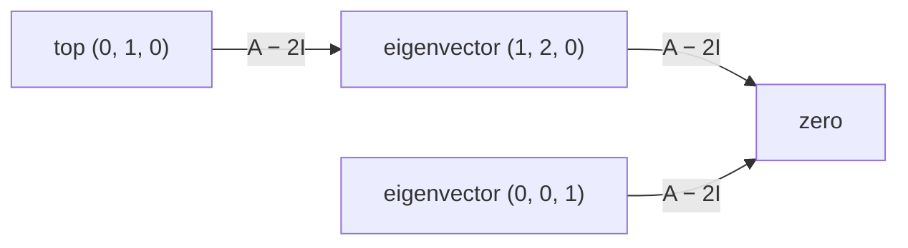

# Jordan form: every complex square matrix becomes a stack of blocks, each an eigenvalue with ones just above the diagonal, with sizes read from ranks

[Syllabus](../../../SYLLABUS.md) → [Algebra](../README.md) → [Eigenvalues and Symmetric Matrices](../README.md#s07) → Jordan form

---

## General Overview

A step rule makes each term from the two before it: a(n + 2) = 4a(n + 1) − 4a(n). Started at 1 and 6, it runs 1, 6, 20, 56, 144, …. Its equation r² = 4r − 4 has only the root 2, standing twice ([The characteristic equation](../../04-Combinatorics%20and%20graphs/05-Recurrences/04-characteristic-equation-and-binet.md) solves it by guessing).

Next to it runs plain doubling, b(n + 1) = 2b(n), from b(0) = 1. A step takes (a(n), a(n + 1), b(n)) to (a(n + 1), 4a(n + 1) − 4a(n), 2b(n)). That is the matrix `A = [[0, 1, 0], [-4, 4, 0], [0, 0, 2]]`.

Its only eigenvalue (stretch factor) is 2. Doubling alone takes b to 1,024 in ten steps. Yet a(10) is 21,504 = 1,024 + 20,480. The extra 20,480 = 4 × 10 × 2^9 grows with the step count.

The cause is a missing eigenvector: eigenvalue 2 counts three times, but only two independent directions are merely stretched, so [Diagonalisation](03-diagonalisation-and-matrix-powers.md) fails. Jordan form replaces it with the nearest-to-diagonal basis.

**Every complex square matrix can be rewritten, by a change of basis, as diagonal blocks; each block has one eigenvalue λ down its diagonal and ones just above it, and the block sizes are read from the ranks of the powers of A − λI.**

**What kind of fact this is:** a theorem, proved in Why it works, with the split into one piece per eigenvalue taken from [Generalised eigenvectors](09-generalised-eigenvectors.md).

### The picture: one chain of two, one chain of one



Each arrow applies A − 2I. The chain of two gives a block of size 2; the lone eigenvector gives a block of size 1.

---

## The formula

A **Jordan block** of size k for eigenvalue λ is the k × k matrix with λ on the diagonal, 1 just above it, 0 elsewhere. Write $`N_k`$ for its part above the diagonal.

```math
J_k(\lambda) = \lambda I + N_k, \qquad P^{-1} A P = J = \begin{pmatrix} J_{k_1}(\lambda_1) & & \\ & \ddots & \\ & & J_{k_m}(\lambda_m) \end{pmatrix}
```

**Read it aloud:** in the right basis, A is blocks down the diagonal, each an eigenvalue times the identity plus a shift that passes each basis vector to the one before it.

The **rank** is how many independent directions a matrix outputs ([Rank and nullity](../05-Solving%20Systems/05-rank-nullity.md)). Write $`r_k`$ for the rank of $`(A - \lambda I)^k`$ ($`r_0`$ is the size):

```math
\#\{\text{blocks for } \lambda \text{ of size at least } k\} = r_{k-1} - r_k \qquad (k \ge 1)
```

**Read it aloud:** each extra power of A − λI loses one rank per block still long enough to feel it.

Since λI commutes with $`N_2`$ and $`N_2^2 = 0`$, the binomial theorem gives, for $`n \ge 1`$ (at $`n = 0`$ the power is $`I`$):

```math
J_2(\lambda)^n = \lambda^n I + n\lambda^{n-1} N_2 = \begin{pmatrix} \lambda^n & n\lambda^{n-1} \\ 0 & \lambda^n \end{pmatrix}
```

| Symbol | Plain meaning | In our example | Push it up and the answer… |
| --- | --- | --- | --- |
| $`A`$ | one step of the rules, on (a(n), a(n + 1), b(n)) | `[[0, 1, 0], [-4, 4, 0], [0, 0, 2]]` | — |
| $`\lambda`$, $`I`$ | an eigenvalue; the identity matrix | 2; the 3 × 3 identity | each power grows faster |
| $`N`$ | $`A - \lambda I`$, the non-stretching part | `[[-2, 1, 0], [-4, 2, 0], [0, 0, 0]]` | — |
| $`J_k(\lambda)`$, $`N_k`$ | a Jordan block of size k; its ones | $`J_2(2)`$ = `[[2, 1], [0, 2]]` | a longer chain |
| $`J`$ | the Jordan form | `[[2, 1, 0], [0, 2, 0], [0, 0, 2]]` | — |
| $`P`$ | the chain vectors as columns | `[[1, 0, 0], [2, 1, 0], [0, 0, 1]]` | — |
| $`r_k`$ | rank of $`(A - \lambda I)^k`$ | $`r_0, r_1, r_2`$ = 3, 1, 0 | falls slowly: fewer, longer blocks |
| $`k`$, $`n`$ | a block size or power; the step count | k = 1, 2; n = 10 | $`n\lambda^{n-1}`$ grows |

### When it holds

- **Complex numbers allowed.** Over the complex numbers every polynomial has a root ([The fundamental theorem of algebra](../10-For%20the%20Curious/01-fundamental-theorem-of-algebra.md)). Over the reals the quarter-turn `[[0, -1], [1, 0]]` has no eigenvalue and no Jordan form; the rational canonical form on [Smith normal form](../../22-Algebraic%20geometry/06-Schemes%20and%20Modern%20Language/06-smith-normal-form-and-canonical-forms.md) needs no roots.
- **Unique up to block order.** Two matrices are similar (one is the other in a new basis) exactly when they have the same blocks. P is not unique: any nonzero multiple of a chain also works.
- **Exact arithmetic.** Change one entry by 0.000001 and the eigenvalues usually split; the form jumps to diagonal. Floating-point software uses [Schur's triangle](07-schur-triangularisation.md) instead.
- **One λ per rank count.** Ranks of A − 2I see only eigenvalue 2's blocks; other eigenvalues keep full rank.

---

## Why it works

### Step 0: a non-stretching part that dies, and chains it leaves behind

On the vectors that belong to λ, write A as λI + N. λI only stretches; N is **nilpotent**: some power of it is zero. Here $`N^2 = 0`$.

Apply N repeatedly: v, Nv, N²v, … until zero. That list is a **Jordan chain**. It ends at an eigenvector; earlier vectors are generalised eigenvectors. In that basis N passes each vector on and kills the last: the ones above the diagonal.

### Step 1: split the space into one piece per eigenvalue

[Generalised eigenvectors](09-generalised-eigenvectors.md) proves every vector splits in exactly one way into pieces, one per eigenvalue. The λ piece is what some power of A − λI kills; A maps each piece into itself. So A is block-diagonal, one block per eigenvalue, with A − λI nilpotent on the λ block. Ours has one eigenvalue, so the piece is everything.

The eigenvalue comes from the characteristic polynomial (whose roots are the eigenvalues, [Eigenvalues and eigenvectors](02-eigenvalues-and-eigenvectors.md)). For a 3 × 3 matrix it is x³ − (trace)x² + (sum of 2 × 2 diagonal minors)x − det; a diagonal minor keeps two rows and the same two columns. Here it is x³ − 6x² + 12x − 8 = (x − 2)³.

### Step 2: every nilpotent map has a basis of chains

By induction on dimension (0 takes the empty basis):

1. Above dimension 0, N's image (its outputs) is smaller than the space, since N kills a nonzero vector.
2. By induction, the image has a chain basis.
3. Each chain's top is N of some vector: put that vector on top. Each chain grows by one.
4. Add eigenvectors (vectors N kills) until the bottoms fill N's kernel. Each is a chain of length one.

<details>
<summary>Detailed proof: the lifted chains are independent and fill the space</summary>

Let the image of N have chains with tops $`w_1, \ldots, w_m`$ and lengths $`\ell_1, \ldots, \ell_m`$. Choose $`u_i`$ with $`Nu_i = w_i`$. The bottoms $`N^{\ell_i - 1} w_i`$ are independent and in the kernel of N; extend them by $`z_1, \ldots, z_p`$ to a kernel basis.

Count: the lifted chains hold $`\sum (\ell_i + 1) = \dim \mathrm{im}\, N + m`$ vectors, and $`m + p = \dim \ker N`$. The total, $`\dim \mathrm{im}\, N + \dim \ker N`$, is the dimension of the space by rank and nullity.

Independence: suppose a combination of these vectors is zero. Apply N. The $`z_j`$ and the bottoms vanish; every other vector moves one place down its chain, onto the image's chain basis. Those are independent, so all other coefficients are zero. What is left is a combination of the kernel basis, so its coefficients are zero too.

</details>

Here the image of N is the line through (1, 2, 0), a chain of length one. Lift it: N(0, 1, 0) = (1, 2, 0). Add the eigenvector (0, 0, 1). That gives a chain of two and a chain of one.

### Step 3: in the chain basis, A is the Jordan matrix

Put the chain vectors into P as columns, bottom first. Column by column, AP = PJ. A sends the eigenvector (1, 2, 0) to (2, 4, 0), 2 times itself. It sends the top (0, 1, 0) to (1, 4, 0), which is 2 times the top plus the vector below it. Hence $`P^{-1} A P = J`$, with J = `[[2, 1, 0], [0, 2, 0], [0, 0, 2]]` ([Change of basis](01-change-of-basis.md)).

In sequence terms, the eigenvector (1, 2, 0) starts the doubling run 1, 2, 4, …. The top (0, 1, 0) starts 0, 1, 4, 12, …, which is n × 2^(n−1). The 1 above J's diagonal feeds it one copy of the doubling run each step.

### Step 4: the ranks fix the block sizes

A size-s block's $`N_s^k`$ has rank s − k for k < s, else 0. For $`k \ge 1`$, $`N^k`$ drops one rank per block of size ≥ k, so $`r_{k-1} - r_k`$ counts them and sizes depend only on A.

Here the ranks are 3, 1, 0. Blocks of size at least 1: 3 − 1 = 2. Of size at least 2: 1 − 0 = 1. So the sizes are 2 and 1, with 3 − 1 = 2 independent eigenvectors, one per block.

### Step 5: powers of a block

λI and N commute, so the binomial theorem applies, and with $`N^2 = 0`$ it stops after two terms. So $`A^n = 2^n I + n 2^{n-1} N`$.

The start (1, 6, 1) is 1 × (1, 2, 0) + 4 × (0, 1, 0) + 1 × (0, 0, 1). So a(n) = 2^n + 4n × 2^(n−1), which is (1 + 2n) × 2^n. At n = 10: 1,024 + 20,480 = 21,504.

---

## Worked numbers, by hand

| Step | Arithmetic | Value |
| --- | --- | --- |
| characteristic polynomial | trace 6, minors 12, det 8 | (x − 2)³ |
| N = A − 2I | subtract 2 down the diagonal | `[[-2, 1, 0], [-4, 2, 0], [0, 0, 0]]` |
| rank of N | row 2 is twice row 1; row 3 zero | 1 |
| N² | row 1 times N: (4 − 4, −2 + 2, 0) | zero matrix, rank 0 |
| block counts | 3 − 1 = 2 blocks; 1 − 0 = 1 of size ≥ 2 | sizes **2 and 1** |
| chain | N(0, 1, 0) = (1, 2, 0), then 0 | P = `[[1, 0, 0], [2, 1, 0], [0, 0, 1]]` |
| the start in chain terms | (1, 6, 1) = 1 × (1, 2, 0) + 4 × (0, 1, 0) + 1 × (0, 0, 1) | 1, 4 and 1 |
| a(10) | 2^10 + 4 × 10 × 2^9 = 1,024 + 20,480 | **21,504** |

The extra 20,480 exists only because an eigenvector is missing. It is twenty times the doubling part, and its share grows with n.

### What breaks if you drop a piece

| Mistake | Comes out at | What went wrong |
| --- | --- | --- |
| Raise each entry of A to the 10th power | a(10) = 6 | A^10 is matrix products, not entry powers |
| Keep only the diagonal of J | a(10) = 2^10 = 1,024 | Dropping the 1 above the diagonal invents a third eigenvector |
| Use $`\lambda^n`$ in the extra term | 2^10 + 4 × 10 × 2^10 = 41,984 | The derivative-like term is $`n\lambda^{n-1}`$ |
| Count blocks as rank N | 1 block, not 2 | Blocks = eigenvectors = 3 − rank N |

The code prints all four.

---

## Code, from first principles, and it actually runs

Nothing is imported; all numbers are whole, so nothing rounds. Block sizes come twice: from ranks of powers of N, and from the longest chain starting at a basis vector, other dimensions being lone eigenvectors (enough for 3 × 3 with one eigenvalue). A^10 is found three ways: ten products of A, P times the block formula for $`J^{10}`$ times P⁻¹, and $`2^{10} I + 10 \times 2^9 N`$. A fourth runs the step rules ten times: 21,504 again.

### Python

```python
# Jordan form -- the check behind the card.  Nothing is imported.  Ranks of the
# powers of N = A - 2I give the block sizes; the longest Jordan chain gives them again.
# A^10 four ways: A times itself, P J^10 P^-1, 2^10 I + 10 x 2^9 N, and the step rules on (a(n), a(n+1), b(n)).
A = [[0, 1, 0], [-4, 4, 0], [0, 0, 2]]
L, n, R, S = 2, 10, range(3), [1, 6, 1]
I = [[int(i == j) for j in R] for i in R]

def mul(X, Y): return [[sum(X[i][k] * Y[k][j] for k in R) for j in R] for i in R]
def power(X, k): return I if k == 0 else mul(power(X, k - 1), X)   # k multiplies
def apply(X, v): return [sum(X[i][k] * v[k] for k in R) for i in R]
def life(v): return next((k for k in range(4) if not any(apply(power(N, k), v))), 4)   # first k with N^k v = 0
def rank(X):                         # whole-number elimination, no fractions
    M, r = [row[:] for row in X], 0
    for c in R:
        p = next((i for i in range(r, 3) if M[i][c]), None)
        if p is None: continue
        M[r], M[p] = M[p], M[r]
        for i in range(r + 1, 3): M[i] = [M[r][c] * M[i][j] - M[i][c] * M[r][j] for j in R]
        r += 1
    return r

N = [[A[i][j] - L * I[i][j] for j in R] for i in R]
minors = sum(A[i][i] * A[j][j] - A[i][j] * A[j][i] for i in R for j in R if i < j)
det = sum(A[0][j] * (A[1][(j + 1) % 3] * A[2][(j + 2) % 3] - A[1][(j + 2) % 3] * A[2][(j + 1) % 3]) for j in R)
ranks = [rank(power(N, k)) for k in range(4)]
at_least = [ranks[k] - ranks[k + 1] for k in range(3)] + [0]   # blocks of size > k
sizes = [k + 1 for k in (2, 1, 0) for _ in range(at_least[k] - at_least[k + 1])]
top = max(I[::-1], key=life)                             # a basis vector with the longest chain (a tie goes to the later one)
low, extra = apply(N, top), next((I[i] for i in R if not any(apply(N, I[i]))), [0, 0, 0])
lengths = [life(top)] + [1] * (3 - life(top))            # the other dimensions: lone eigenvectors
P = [[low[i], top[i], extra[i]] for i in R]
Pinv = [[1, 0, 0], [-2, 1, 0], [0, 0, 1]]                 # by hand, checked below
J = mul(Pinv, mul(A, P))
road1, road2 = power(A, n), mul(P, mul([[L ** n, n * L ** (n - 1), 0], [0, L ** n, 0], [0, 0, L ** n]], Pinv))
road3 = [[L ** n * I[i][j] + n * L ** (n - 1) * N[i][j] for j in R] for i in R]
walk, c = S[:], apply(Pinv, S)                            # the start, and the start in the chain basis
for _ in range(n): walk = [walk[1], 4 * walk[1] - 4 * walk[0], 2 * walk[2]]   # a(n+2) = 4a(n+1) - 4a(n), b(n+1) = 2b(n)
print(f"A = {A}; trace {sum(A[i][i] for i in R)}, 2 by 2 minors {minors}, det {det}: (x - 2)^3")
print(f"N = A - 2I = {N}")
print(f"ranks of N^0, N^1, N^2, N^3: {ranks}")
print(f"blocks of size at least 1, 2, 3: {at_least[:3]}; block sizes {sizes}")
print(f"independent eigenvectors: 3 - rank N = {3 - ranks[1]}")
print(f"chain: top {top} -> N top {low} -> 0; extra eigenvector {extra}")
print(f"chain lengths from the vectors: {lengths}")
print(f"P = {P}; P^-1 P = I: {'yes' if mul(Pinv, P) == I else 'no'}")
print(f"J = P^-1 A P = {J}")
print(f"road 1, A times itself {n} times: {road1}")
print(f"road 2, P J^{n} P^-1 with J^{n} from the block formula, same matrix: {'yes' if road2 == road1 else 'no'}")
print(f"road 3, 2^{n} I + {n} x 2^{n - 1} N, same matrix: {'yes' if road3 == road1 else 'no'}")
print(f"start {S} = {c[0]} x {low} + {c[1]} x {top} + {c[2]} x {extra}, so a({n}) = 2^{n} + {c[1]} x {n} x 2^{n - 1} = {L ** n} + {c[1] * n * L ** (n - 1)} = {apply(road1, S)[0]}")
print(f"step rules run {n} times from {S}: {walk}; A^{n} on {S}, same: {'yes' if apply(road1, S) == walk else 'no'}")
print(f"a(n), n = 0 to 6: {[apply(power(A, k), S)[0] for k in range(7)]}")
print(f"mistake 1, each entry to the 10th power: a(10) = {apply([[x ** n for x in row] for row in A], S)[0]}", f"mistake 2, the diagonal of J only: a(10) = 2^10 = {c[0] * L ** n}", sep="\n")
print(f"mistake 3, 2^10 in the extra term: 2^10 + {c[1]} x 10 x 2^10 = {L ** n} + {c[1] * n * L ** n} = {L ** n + c[1] * n * L ** n}")
print(f"mistake 4, blocks counted as rank N: {ranks[1]} block, not {at_least[0]}")
assert (sum(A[i][i] for i in R), minors, det) == (3 * L, 3 * L * L, L ** 3)  # (x - 2)^3
assert sizes == lengths and mul(A, P) == mul(P, J)       # ranks against the chain
assert J == [[2, 1, 0], [0, 2, 0], [0, 0, 2]] and mul(Pinv, P) == I
assert road1 == road2 == road3 and apply(road1, S) == walk and walk[0] == 21504   # A^10 four ways
print("ALL CHECKS PASS")
```

**Ran 2026-11-25 on macOS, Python 3.14.10, standard library only. All checks passed. Output, pasted from the run:**

```
A = [[0, 1, 0], [-4, 4, 0], [0, 0, 2]]; trace 6, 2 by 2 minors 12, det 8: (x - 2)^3
N = A - 2I = [[-2, 1, 0], [-4, 2, 0], [0, 0, 0]]
ranks of N^0, N^1, N^2, N^3: [3, 1, 0, 0]
blocks of size at least 1, 2, 3: [2, 1, 0]; block sizes [2, 1]
independent eigenvectors: 3 - rank N = 2
chain: top [0, 1, 0] -> N top [1, 2, 0] -> 0; extra eigenvector [0, 0, 1]
chain lengths from the vectors: [2, 1]
P = [[1, 0, 0], [2, 1, 0], [0, 0, 1]]; P^-1 P = I: yes
J = P^-1 A P = [[2, 1, 0], [0, 2, 0], [0, 0, 2]]
road 1, A times itself 10 times: [[-9216, 5120, 0], [-20480, 11264, 0], [0, 0, 1024]]
road 2, P J^10 P^-1 with J^10 from the block formula, same matrix: yes
road 3, 2^10 I + 10 x 2^9 N, same matrix: yes
start [1, 6, 1] = 1 x [1, 2, 0] + 4 x [0, 1, 0] + 1 x [0, 0, 1], so a(10) = 2^10 + 4 x 10 x 2^9 = 1024 + 20480 = 21504
step rules run 10 times from [1, 6, 1]: [21504, 47104, 1024]; A^10 on [1, 6, 1], same: yes
a(n), n = 0 to 6: [1, 6, 20, 56, 144, 352, 832]
mistake 1, each entry to the 10th power: a(10) = 6
mistake 2, the diagonal of J only: a(10) = 2^10 = 1024
mistake 3, 2^10 in the extra term: 2^10 + 4 x 10 x 2^10 = 1024 + 40960 = 41984
mistake 4, blocks counted as rank N: 1 block, not 2
ALL CHECKS PASS
```

### Rust

Same numbers, same labels, built with `rustc --edition 2021 -O`.

```rust
// Jordan form -- the same check as the Python, in Rust.  No crates.  Ranks of the
// powers of N = A - 2I give the block sizes; the longest Jordan chain gives them again.
// A^10 four ways: A times itself, P J^10 P^-1, 2^10 I + 10 x 2^9 N, and the step rules on (a(n), a(n+1), b(n)).
type M = Vec<Vec<i64>>;

fn mul(x: &M, y: &M) -> M {
    (0..3).map(|i| (0..3).map(|j| (0..3).map(|k| x[i][k] * y[k][j]).sum()).collect()).collect()
}
fn eye() -> M { (0..3).map(|i| (0..3).map(|j| (i == j) as i64).collect()).collect() }
fn power(x: &M, k: u32) -> M { if k == 0 { eye() } else { mul(&power(x, k - 1), x) } }
fn apply(x: &M, v: &[i64]) -> Vec<i64> { (0..3).map(|i| (0..3).map(|k| x[i][k] * v[k]).sum()).collect() }
fn nonzero(v: &[i64]) -> bool { v.iter().any(|&a| a != 0) }
fn yn(c: bool) -> &'static str { if c { "yes" } else { "no" } }
fn life(nn: &M, v: &[i64]) -> usize { (0..4).find(|&k| !nonzero(&apply(&power(nn, k), v))).unwrap_or(4) as usize }   // first k with N^k v = 0

fn rank(x: &M) -> usize {                // whole-number elimination, no fractions
    let (mut m, mut r) = (x.clone(), 0);
    for c in 0..3 {
        let Some(p) = (r..3).find(|&i| m[i][c] != 0) else { continue };
        m.swap(r, p);
        for i in r + 1..3 {
            m[i] = (0..3).map(|j| m[r][c] * m[i][j] - m[i][c] * m[r][j]).collect();
        }
        r += 1;
    }
    r
}

fn main() {
    let (a, s): (M, Vec<i64>) = (vec![vec![0, 1, 0], vec![-4, 4, 0], vec![0, 0, 2]], vec![1, 6, 1]);
    let (l, n, id): (i64, u32, M) = (2, 10, eye());
    let nn: M = (0..3).map(|i| (0..3).map(|j| a[i][j] - l * id[i][j]).collect()).collect();
    let trace: i64 = (0..3).map(|i| a[i][i]).sum();
    let mut minors = 0;
    for i in 0..3 { for j in i + 1..3 { minors += a[i][i] * a[j][j] - a[i][j] * a[j][i] } }
    let det: i64 = (0..3).map(|j| a[0][j] * (a[1][(j + 1) % 3] * a[2][(j + 2) % 3]
        - a[1][(j + 2) % 3] * a[2][(j + 1) % 3])).sum();
    let ranks: Vec<usize> = (0..4).map(|k| rank(&power(&nn, k))).collect();
    let mut at_least: Vec<usize> = (0..3).map(|k| ranks[k] - ranks[k + 1]).collect();
    at_least.push(0);                    // blocks of size > k
    let sizes: Vec<usize> = [2, 1, 0].iter().flat_map(|&k| vec![k + 1; at_least[k] - at_least[k + 1]]).collect();
    let top = id.iter().max_by_key(|e| life(&nn, e)).unwrap().clone();   // a basis vector with the longest chain (a tie goes to the later one)
    let low = apply(&nn, &top);
    let extra = id.iter().find(|e| !nonzero(&apply(&nn, e))).cloned().unwrap_or(vec![0, 0, 0]);
    let mut lengths = vec![life(&nn, &top)];
    lengths.extend(vec![1; 3usize.saturating_sub(life(&nn, &top))]);   // the other dimensions: lone eigenvectors
    let p: M = (0..3).map(|i| vec![low[i], top[i], extra[i]]).collect();
    let pinv: M = vec![vec![1, 0, 0], vec![-2, 1, 0], vec![0, 0, 1]];   // by hand, checked below
    let j = mul(&pinv, &mul(&a, &p));
    let road1 = power(&a, n);
    let (big, step) = (l.pow(n), n as i64 * l.pow(n - 1));
    let road2 = mul(&p, &mul(&vec![vec![big, step, 0], vec![0, big, 0], vec![0, 0, big]], &pinv));
    let road3: M = (0..3).map(|r| (0..3).map(|c| big * id[r][c] + step * nn[r][c]).collect()).collect();
    let (mut walk, c, an) = (s.clone(), apply(&pinv, &s), apply(&road1, &s));   // the start, in the chain basis, and A^10 on it
    for _ in 0..n { walk = vec![walk[1], 4 * walk[1] - 4 * walk[0], 2 * walk[2]] }   // a(n+2) = 4a(n+1) - 4a(n), b(n+1) = 2b(n)
    println!("A = {:?}; trace {}, 2 by 2 minors {}, det {}: (x - 2)^3", a, trace, minors, det);
    println!("N = A - 2I = {:?}", nn);
    println!("ranks of N^0, N^1, N^2, N^3: {:?}", ranks);
    println!("blocks of size at least 1, 2, 3: {:?}; block sizes {:?}", &at_least[..3], sizes);
    println!("independent eigenvectors: 3 - rank N = {}", 3 - ranks[1]);
    println!("chain: top {:?} -> N top {:?} -> 0; extra eigenvector {:?}", top, low, extra);
    println!("chain lengths from the vectors: {:?}", lengths);
    println!("P = {:?}; P^-1 P = I: {}", p, yn(mul(&pinv, &p) == id));
    println!("J = P^-1 A P = {:?}", j);
    println!("road 1, A times itself {} times: {:?}", n, road1);
    println!("road 2, P J^{} P^-1 with J^{} from the block formula, same matrix: {}", n, n, yn(road2 == road1));
    println!("road 3, 2^{} I + {} x 2^{} N, same matrix: {}", n, n, n - 1, yn(road3 == road1));
    println!("start {:?} = {} x {:?} + {} x {:?} + {} x {:?}, so a({}) = 2^{} + {} x {} x 2^{} = {} + {} = {}", s, c[0], low, c[1], top, c[2], extra, n, n, c[1], n, n - 1, big, c[1] * step, an[0]);
    println!("step rules run {} times from {:?}: {:?}; A^{} on {:?}, same: {}", n, s, walk, n, s, yn(an == walk));
    println!("a(n), n = 0 to 6: {:?}", (0..7).map(|k| apply(&power(&a, k), &s)[0]).collect::<Vec<i64>>());
    println!("mistake 1, each entry to the 10th power: a(10) = {}\nmistake 2, the diagonal of J only: a(10) = 2^10 = {}",
        apply(&a.iter().map(|row| row.iter().map(|&x| x.pow(n)).collect()).collect::<M>(), &s)[0], c[0] * big);
    println!("mistake 3, 2^10 in the extra term: 2^10 + {} x 10 x 2^10 = {} + {} = {}", c[1], big, c[1] * n as i64 * big, big + c[1] * n as i64 * big);
    println!("mistake 4, blocks counted as rank N: {} block, not {}", ranks[1], at_least[0]);
    assert!((trace, minors, det) == (3 * l, 3 * l * l, l.pow(3)));        // (x - 2)^3
    assert!(sizes == lengths && mul(&a, &p) == mul(&p, &j));               // ranks against the chain
    assert!(j == vec![vec![2, 1, 0], vec![0, 2, 0], vec![0, 0, 2]] && mul(&pinv, &p) == id);
    assert!(road1 == road2 && road2 == road3 && an == walk && walk[0] == 21504);   // A^10 four ways
    println!("ALL CHECKS PASS");
}
```

**Ran 2026-11-25 on macOS, rustc 1.98.1, no crates. All checks passed. Output, pasted from the run:**

```
A = [[0, 1, 0], [-4, 4, 0], [0, 0, 2]]; trace 6, 2 by 2 minors 12, det 8: (x - 2)^3
N = A - 2I = [[-2, 1, 0], [-4, 2, 0], [0, 0, 0]]
ranks of N^0, N^1, N^2, N^3: [3, 1, 0, 0]
blocks of size at least 1, 2, 3: [2, 1, 0]; block sizes [2, 1]
independent eigenvectors: 3 - rank N = 2
chain: top [0, 1, 0] -> N top [1, 2, 0] -> 0; extra eigenvector [0, 0, 1]
chain lengths from the vectors: [2, 1]
P = [[1, 0, 0], [2, 1, 0], [0, 0, 1]]; P^-1 P = I: yes
J = P^-1 A P = [[2, 1, 0], [0, 2, 0], [0, 0, 2]]
road 1, A times itself 10 times: [[-9216, 5120, 0], [-20480, 11264, 0], [0, 0, 1024]]
road 2, P J^10 P^-1 with J^10 from the block formula, same matrix: yes
road 3, 2^10 I + 10 x 2^9 N, same matrix: yes
start [1, 6, 1] = 1 x [1, 2, 0] + 4 x [0, 1, 0] + 1 x [0, 0, 1], so a(10) = 2^10 + 4 x 10 x 2^9 = 1024 + 20480 = 21504
step rules run 10 times from [1, 6, 1]: [21504, 47104, 1024]; A^10 on [1, 6, 1], same: yes
a(n), n = 0 to 6: [1, 6, 20, 56, 144, 352, 832]
mistake 1, each entry to the 10th power: a(10) = 6
mistake 2, the diagonal of J only: a(10) = 2^10 = 1024
mistake 3, 2^10 in the extra term: 2^10 + 4 x 10 x 2^10 = 1024 + 40960 = 41984
mistake 4, blocks counted as rank N: 1 block, not 2
ALL CHECKS PASS
```

The two outputs match line for line.

### Lean

Lean proves the three general facts for every complex square matrix, and checks the card's worked numbers.

- Every square matrix over the complex numbers can be rewritten, by a change of basis, as Jordan blocks down the diagonal.
- For any invertible P with $`P^{-1} A P = J`$ (Jordan blocks) and $`k \ge 1`$, there are $`r_{k-1} - r_k`$ blocks for λ of size ≥ k.
- That holds for every such P, so the block sizes depend only on A, not on the chains chosen.
- For any λ and $`n \ge 1`$, $`J_2(\lambda)^n`$ has $`\lambda^n`$ on the diagonal and $`n\lambda^{n-1}`$ above it ($`I`$ at n = 0).
- Take the card's matrix A. Then its characteristic polynomial is (x − 2)³, $`N^2 = 0`$, the chain vectors work and $`P^{-1} A P = J`$.
- A^10 is the matrix in the outputs above, and it takes the start (1, 6, 1) to (21,504, 47,104, 1,024).
- The terms a(0) to a(6), 1, 6, 20, 56, 144, 352, 832, also check, and so do the mistakes' 6 and 41,984.

Finding the ranks of N, building the chains from the vectors, and running the step rules term by term are left to the Python and Rust checks.

```lean
-- Jordan form: every complex square matrix becomes, after a change of basis, a stack of Jordan blocks (an eigenvalue down the diagonal, ones just above it), the number of blocks of each size is read from the ranks of the powers of A − λI, a block of size 2 has n-th power with corner entry nλ^(n−1), and the card's 3 × 3 step-rule matrix has blocks of sizes 2 and 1 and gives a(10) = 21,504.
import Mathlib.Basic.Complex.Basic
import Mathlib.Data.Matrix.Block
import Mathlib.LinearAlgebra.Matrix.NonsingularInverse
import Mathlib.LinearAlgebra.Matrix.Notation
import Mathlib.LinearAlgebra.Matrix.Rank
import Mathlib.LinearAlgebra.Matrix.Determinant.Basic
import Mathlib.Tactic.NormNum
import Mathlib.Tactic.Ring
import Mathlib

open Matrix

/-! A square matrix with complex entries and `n` rows is `Matrix (Fin n) (Fin n) ℂ`. `P⁻¹` is
Mathlib's inverse and `IsUnit P` says `P` is invertible. `M.rank` is the rank of `M`: how many
independent directions it outputs. `μ • 1` is `μ` times the identity, so `A - μ • 1` is the card's
`A − λI`. Mathlib's `blockDiagonal'` puts square blocks of any sizes down the diagonal, with zeros
elsewhere; its rows are labelled by pairs (block `b`, place inside block `b`). `reindex e e`
relabels those rows and columns as `0, …, n − 1` by the one-to-one matching `e`. -/

/-- The Jordan block of size `k` for the eigenvalue `μ`: `μ` down the diagonal, `1` just above
the diagonal, and `0` everywhere else. -/
def jordanBlock (k : ℕ) (μ : ℂ) : Matrix (Fin k) (Fin k) ℂ :=
  Matrix.of fun i j => if i = j then μ else if (i : ℕ) + 1 = j then 1 else 0

/-- A Jordan matrix: blocks `m` in number, block `b` being the Jordan block of size `size b` for
the eigenvalue `eig b`, stacked down the diagonal with zeros elsewhere. -/
def jordanMatrix {m : ℕ} (size : Fin m → ℕ) (eig : Fin m → ℂ) :
    Matrix (Σ b, Fin (size b)) (Σ b, Fin (size b)) ℂ :=
  blockDiagonal' fun b => jordanBlock (size b) (eig b)

section JordanHelpers
open Module

theorem restrict_pow_coe {V : Type} [AddCommGroup V] [Module ℂ V] (N : Module.End ℂ V)
    (W : Submodule ℂ V) (h : ∀ x ∈ W, N x ∈ W) (j : ℕ) (x : W) :
    (((N.restrict h) ^ j) x : V) = (N ^ j) x := by
  induction j generalizing x with
  | zero => simp
  | succ j ih => rw [pow_succ, pow_succ, Module.End.mul_apply, ih, Module.End.mul_apply,
      LinearMap.coe_restrict_apply]

theorem card_sigma_fin {ι : Type} [Fintype ι] (f : ι → ℕ) :
    Fintype.card (Σ i, Fin (f i)) = ∑ i, f i := by simp

theorem nilpotent_chains (n : ℕ) : ∀ (V : Type) [AddCommGroup V] [Module ℂ V]
    [FiniteDimensional ℂ V], finrank ℂ V = n → ∀ N : Module.End ℂ V, IsNilpotent N →
    ∃ (ι : Type) (_ : Fintype ι) (t : ι → V) (s : ι → ℕ), (∀ i, 0 < s i) ∧
      (∀ i, (N ^ s i) (t i) = 0) ∧
      LinearIndependent ℂ (fun x : Σ i, Fin (s i) => (N ^ (x.2 : ℕ)) (t x.1)) ∧
      ⊤ ≤ Submodule.span ℂ (Set.range (fun x : Σ i, Fin (s i) => (N ^ (x.2 : ℕ)) (t x.1))) := by
  induction n using Nat.strong_induction_on with
  | _ n ih =>
  intro V _ _ _ hn N hN
  by_cases hV : n = 0
  · subst hV
    haveI : Subsingleton V := Module.finrank_zero_iff.mp hn
    refine ⟨Empty, inferInstance, Empty.elim, Empty.elim, fun i => i.elim, fun i => i.elim,
      linearIndependent_empty_type, ?_⟩
    intro v _
    rw [Subsingleton.elim v 0]; exact Submodule.zero_mem _
  obtain ⟨k, hk⟩ := hN
  set W := LinearMap.range N with hWdef
  have hWV : finrank ℂ W < n := by
    rw [← hn]; apply Submodule.finrank_lt
    intro htop
    have hsurj : Function.Surjective N := LinearMap.range_eq_top.mp htop
    have hsk : Function.Surjective (N ^ k) := by
      rw [Module.End.coe_pow]; exact hsurj.iterate k
    rw [hk] at hsk
    haveI : Subsingleton V := ⟨fun a b => by
      obtain ⟨a', rfl⟩ := hsk a; obtain ⟨b', rfl⟩ := hsk b; simp⟩
    exact hV (hn ▸ finrank_zero_of_subsingleton)
  have hWinv : ∀ x ∈ W, N x ∈ W := fun x _ => LinearMap.mem_range_self N x
  set N' := N.restrict hWinv with hN'
  have hN'nil : IsNilpotent N' := ⟨k, by
    ext x; rw [restrict_pow_coe N W hWinv k x, hk]; simp⟩
  obtain ⟨ι, _, t, s, hs, hz, hli, hsp⟩ := ih _ hWV W rfl N' hN'nil
  have hcoe : ∀ (j : ℕ) (x : W), (((N' ^ j) x : W) : V) = (N ^ j) x :=
    fun j x => restrict_pow_coe N W hWinv j x
  choose u hu using fun i => (t i).2
  -- bottoms of the chains in W
  set bot : ι → V := fun i => (N ^ (s i - 1)) (t i : V) with hbot
  have hbot_u : ∀ i, bot i = (N ^ s i) (u i) := by
    intro i
    have : s i = (s i - 1) + 1 := (Nat.succ_pred_eq_of_pos (hs i)).symm
    simp only [hbot]
    conv_rhs => rw [this, pow_succ, Module.End.mul_apply, hu i]
  have hbot_ker : ∀ i, bot i ∈ LinearMap.ker N := by
    intro i
    have : s i - 1 + 1 = s i := Nat.succ_pred_eq_of_pos (hs i)
    rw [LinearMap.mem_ker, hbot, ← Module.End.mul_apply, ← pow_succ', this, ← hcoe, hz]
    rfl
  set B := Submodule.span ℂ (Set.range bot) with hB
  have hBker : B ≤ LinearMap.ker N := by
    rw [hB, Submodule.span_le]; rintro _ ⟨i, rfl⟩; exact hbot_ker i
  obtain ⟨q, hq⟩ := exists_isCompl B
  set C := q ⊓ LinearMap.ker N with hC
  set bC := Module.finBasis ℂ C
  set κ := Fin (finrank ℂ C)
  set z : κ → V := fun k => (bC k : V) with hzdef
  have hzker : ∀ k, N (z k) = 0 := fun k => (bC k).2.2
  have hkerBC : ∀ y ∈ LinearMap.ker N, ∃ b ∈ B, ∃ c ∈ C, b + c = y := by
    intro y hy
    have : y ∈ B ⊔ q := by rw [hq.sup_eq_top]; trivial
    obtain ⟨b, hb, c, hc, rfl⟩ := Submodule.mem_sup.mp this
    refine ⟨b, hb, c, ⟨hc, show N c = 0 from ?_⟩, rfl⟩
    have h1 := hBker hb
    rw [LinearMap.mem_ker] at h1 hy
    rw [map_add, h1, zero_add] at hy; exact hy
  -- the new chains
  let ι' := ι ⊕ κ
  let t' : ι' → V := Sum.elim u z
  let s' : ι' → ℕ := Sum.elim (fun i => s i + 1) (fun _ => 1)
  let F' : (Σ i : ι', Fin (s' i)) → V := fun x => (N ^ (x.2 : ℕ)) (t' x.1)
  have hcomm : ∀ (j : ℕ) y, N ((N ^ j) y) = (N ^ j) (N y) := fun j y => by
    rw [← Module.End.mul_apply, ← pow_succ', pow_succ, Module.End.mul_apply]
  have hspan : ⊤ ≤ Submodule.span ℂ (Set.range F') := by
    set S := Submodule.span ℂ (Set.range F') with hS
    have hmem : ∀ x, F' x ∈ S := fun x => Submodule.subset_span ⟨x, rfl⟩
    have hu_mem : ∀ i (j : ℕ), j ≤ s i → (N ^ j) (u i) ∈ S := fun i j hj =>
      hmem ⟨Sum.inl i, ⟨j, Nat.lt_succ_of_le hj⟩⟩
    have hz_mem : ∀ k, z k ∈ S := fun k => by simpa [F', t'] using hmem ⟨Sum.inr k, (⟨0, by simp [s']⟩ : Fin (s' (Sum.inr k)))⟩
    have hBS : B ≤ S := by
      rw [hB, Submodule.span_le]; rintro _ ⟨i, rfl⟩; rw [hbot_u]; exact hu_mem i _ le_rfl
    have hCS : C ≤ S := by
      intro c hc
      have h1 := bC.sum_repr ⟨c, hc⟩
      have h2 : c = ∑ k, bC.repr ⟨c, hc⟩ k • z k := by
        have h3 := congrArg Subtype.val h1
        rw [Submodule.coe_sum] at h3
        simp only [Submodule.coe_smul] at h3
        exact h3.symm
      rw [h2]; exact Submodule.sum_mem _ fun k _ => Submodule.smul_mem _ _ (hz_mem k)
    intro v _
    have hNv : (⟨N v, LinearMap.mem_range_self N v⟩ : W) ∈ Submodule.span ℂ
        (Set.range fun x : Σ i, Fin (s i) => (N' ^ (x.2 : ℕ)) (t x.1)) := hsp trivial
    obtain ⟨a, ha⟩ := (Submodule.mem_span_range_iff_exists_fun ℂ).mp hNv
    set w : V := ∑ x : Σ i, Fin (s i), a x • (N ^ (x.2 : ℕ)) (u x.1) with hw
    have hwS : w ∈ S :=
      Submodule.sum_mem _ fun x _ => Submodule.smul_mem _ _ (hu_mem x.1 x.2 x.2.2.le)
    have hNw : N w = N v := by
      have h3 : ((∑ x, a x • (N' ^ (x.2 : ℕ)) (t x.1) : W) : V) = N v := by rw [ha]
      rw [← h3, Submodule.coe_sum, hw, map_sum]
      refine Finset.sum_congr rfl fun x _ => ?_
      rw [map_smul, Submodule.coe_smul, hcoe, hcomm, hu]
    have hvw : v - w ∈ LinearMap.ker N := by rw [LinearMap.mem_ker, map_sub, hNw, sub_self]
    obtain ⟨b, hb, c', hc', hbc⟩ := hkerBC _ hvw
    have hv : v = w + (b + c') := by rw [hbc]; abel
    rw [hv]; exact S.add_mem hwS (S.add_mem (hBS hb) (hCS hc'))
  have hcard : Fintype.card (Σ i : ι', Fin (s' i)) = finrank ℂ V := by
    have hW : finrank ℂ W = ∑ i, s i := by
      rw [Module.finrank_eq_card_basis (Basis.mk hli hsp), Fintype.card_sigma]; simp
    have hsup : B ⊔ C = LinearMap.ker N := le_antisymm (sup_le hBker inf_le_right)
      (fun y hy => by
        obtain ⟨b, hb, c, hc, rfl⟩ := hkerBC y hy; exact Submodule.add_mem_sup hb hc)
    have hinf : B ⊓ C = ⊥ := disjoint_iff.mp (hq.disjoint.mono_right inf_le_left)
    have hBC := Submodule.finrank_sup_add_finrank_inf_eq B C
    rw [hsup, hinf, finrank_bot, add_zero] at hBC
    have hbotli : LinearIndependent ℂ bot := by
      have h4 := (hli.comp (fun i => (⟨i, ⟨s i - 1, by have := hs i; omega⟩⟩ : Σ i, Fin (s i)))
        (fun i j h => congrArg Sigma.fst h)).map' W.subtype (Submodule.ker_subtype W)
      convert h4 using 1
      funext i
      simp [Function.comp, hcoe, bot]
    have hBcard : finrank ℂ B = Fintype.card ι := finrank_span_eq_card hbotli
    have hrn := LinearMap.finrank_range_add_finrank_ker N
    rw [← hn] at *
    rw [← hrn, hBC, hBcard, hW, card_sigma_fin, Fintype.sum_sum_type]
    simp only [s', Sum.elim_inl, Sum.elim_inr, Finset.sum_add_distrib, Finset.sum_const,
      Finset.card_univ, smul_eq_mul, mul_one, κ, Fintype.card_fin]
    omega
  refine ⟨ι', inferInstance, t', s', ?_, ?_,
    linearIndependent_of_top_le_span_of_card_eq_finrank hspan hcard, hspan⟩
  · rintro (i | k) <;> simp [s']
  · rintro (i | k)
    · show (N ^ (s i + 1)) (u i) = 0
      rw [pow_succ, Module.End.mul_apply, hu i, ← hcoe, hz]; rfl
    · show (N ^ 1) (z k) = 0
      rw [pow_one, hzker]

theorem exists_jordan_basis {V : Type} [AddCommGroup V] [Module ℂ V] [FiniteDimensional ℂ V]
    (f : Module.End ℂ V) :
    ∃ (m : ℕ) (size : Fin m → ℕ) (eig : Fin m → ℂ) (b : Basis (Σ c, Fin (size c)) ℂ V),
      (∀ c, 0 < size c) ∧ ∀ c (j : Fin (size c)), f (b ⟨c, j⟩) = eig c • b ⟨c, j⟩ +
        (if h : (j : ℕ) = 0 then 0 else b ⟨c, ⟨j - 1, by omega⟩⟩) := by
  classical
  let E : ℂ → Submodule ℂ V := f.maxGenEigenspace
  have hint : DirectSum.IsInternal E :=
    DirectSum.isInternal_submodule_of_iSupIndep_of_iSup_eq_top
      (Module.End.independent_maxGenEigenspace f) (Module.End.iSup_maxGenEigenspace_eq_top f)
  have hmaps : ∀ μ, ∀ x ∈ E μ, (f - algebraMap ℂ (Module.End ℂ V) μ) x ∈ E μ := fun μ =>
    Module.End.mapsTo_maxGenEigenspace_of_comm (Algebra.mul_sub_algebraMap_commutes f μ) μ
  let N : ∀ μ, Module.End ℂ (E μ) := fun μ =>
    (f - algebraMap ℂ (Module.End ℂ V) μ).restrict (hmaps μ)
  have hN : ∀ μ, IsNilpotent (N μ) := fun μ =>
    Module.End.isNilpotent_restrict_maxGenEigenspace_sub_algebraMap f μ
  have hch := fun μ => nilpotent_chains _ (E μ) rfl (N μ) (hN μ)
  choose ι hι t s hs hz hli hsp using hch
  let bE : ∀ μ, Basis (Σ i : ι μ, Fin (s μ i)) ℂ (E μ) := fun μ => Basis.mk (hli μ) (hsp μ)
  let b0 := hint.collectedBasis bE
  let K := Σ μ, ι μ
  have hKfin : Finite K := by
    haveI := Module.Finite.finite_basis b0
    exact Finite.of_surjective (fun x : Σ μ, Σ i : ι μ, Fin (s μ i) => (⟨x.1, x.2.1⟩ : K))
      (fun p => ⟨⟨p.1, p.2, ⟨0, hs p.1 p.2⟩⟩, rfl⟩)
  letI : Fintype K := Fintype.ofFinite K
  let eK := Fintype.equivFin K
  let m := Fintype.card K
  let size : Fin m → ℕ := fun c => s (eK.symm c).1 (eK.symm c).2
  let eig : Fin m → ℂ := fun c => (eK.symm c).1
  let Eq : (Σ μ, Σ i : ι μ, Fin (s μ i)) ≃ Σ c : Fin m, Fin (size c) :=
    (Equiv.sigmaAssoc (fun μ i => Fin (s μ i))).symm.trans
      ((Equiv.sigmaCongrRight (fun p : K => Fin.revPerm)).trans (Equiv.sigmaCongrLeft' eK))
  let b := b0.reindex Eq
  have hb : ∀ c (j : Fin (size c)), b ⟨c, j⟩ =
      (((N (eK.symm c).1) ^ (size c - (j + 1) : ℕ)) (t _ (eK.symm c).2) : V) := by
    intro c j
    simp only [b, Basis.reindex_apply, b0, hint.collectedBasis_coe, bE, Basis.mk_apply]
    rfl
  have hf : ∀ μ (x : E μ), f x = μ • (x : V) + (N μ x : V) := by
    intro μ x
    simp [N, LinearMap.restrict_apply]
  have hpow : ∀ μ (a : ℕ) (x : E μ),
      f ((N μ ^ a) x : V) = μ • ((N μ ^ a) x : V) + ((N μ ^ (a + 1)) x : V) := by
    intro μ a x; rw [hf, pow_succ', Module.End.mul_apply]
  refine ⟨m, size, eig, b, fun c => hs _ _, ?_⟩
  intro c j
  rw [hb, hpow]
  have hj := j.2
  by_cases h0 : (j : ℕ) = 0
  · rw [dif_pos h0]
    have : size c - (j + 1) + 1 = s (eK.symm c).1 (eK.symm c).2 := by
      simp only [size] at hj ⊢; omega
    rw [this, hz]; simp [eig]
  · rw [dif_neg h0, hb]
    have : size c - (j + 1) + 1 = size c - ((j - 1 : ℕ) + 1) := by omega
    rw [this]

theorem toMatrix_eq_jordanMatrix {V : Type} [AddCommGroup V] [Module ℂ V] {m : ℕ}
    (f : Module.End ℂ V) (size : Fin m → ℕ) (eig : Fin m → ℂ)
    (b : Basis (Σ c, Fin (size c)) ℂ V)
    (hf : ∀ c (j : Fin (size c)), f (b ⟨c, j⟩) = eig c • b ⟨c, j⟩ +
        (if h : (j : ℕ) = 0 then 0 else b ⟨c, ⟨j - 1, by omega⟩⟩)) :
    LinearMap.toMatrix b b f = jordanMatrix size eig := by
  classical
  ext ⟨c', j'⟩ ⟨c, j⟩
  rw [LinearMap.toMatrix_apply, hf, jordanMatrix, blockDiagonal'_apply']
  by_cases hc : c' = c
  · subst hc
    simp only [dite_true, cast_eq, jordanBlock, Matrix.of_apply]
    split_ifs with h0 h1 h2 h1 h2 <;>
      simp_all [Finsupp.single_apply, Fin.ext_iff] <;> omega
  · rw [dif_neg hc]
    split_ifs <;> simp [Finsupp.single_apply, hc]

theorem blockDiagonal'_diagonal_sigma {m : ℕ} {s : Fin m → ℕ} (d : ∀ b, Fin (s b) → ℂ) :
    blockDiagonal' (fun b => diagonal (d b)) = diagonal (fun x : Σ b, Fin (s b) => d x.1 x.2) := by
  ext ⟨c, i⟩ ⟨c', j⟩
  rw [blockDiagonal'_apply']
  by_cases hc : c = c'
  · subst hc; simp [diagonal_apply]
  · rw [dif_neg hc, diagonal_apply_ne]
    intro h; exact hc (congrArg Sigma.fst h)

theorem rank_blockDiagonal'_eq_sum {m : ℕ} {s : Fin m → ℕ}
    (M : ∀ b, Matrix (Fin (s b)) (Fin (s b)) ℂ) :
    (blockDiagonal' M).rank = ∑ b, (M b).rank := by
  classical
  choose V U e hV hU hVU using fun b => Matrix.exists_rank_normal_form (M b)
  let d : ∀ b, Fin (s b) → ℂ := fun b i => if (e b i).isLeft then 1 else 0
  have hD : ∀ b, (V b) * (M b) * (U b) = diagonal (d b) := by
    intro b; rw [hVU b]; ext i j
    by_cases hij : i = j
    · subst hij; rcases h : e b i with x | x <;> simp [d, h]
    · rw [diagonal_apply_ne _ hij]; simp only [submatrix_apply]
      have : e b i ≠ e b j := (e b).injective.ne hij
      rcases h1 : e b i with x | x <;> rcases h2 : e b j with y | y <;>
        simp_all [one_apply]
  have hVd : ∀ b, IsUnit (V b).det := fun b => (Matrix.isUnit_iff_isUnit_det _).mp (hV b)
  have hUd : ∀ b, IsUnit (U b).det := fun b => (Matrix.isUnit_iff_isUnit_det _).mp (hU b)
  have hrb : ∀ b, (M b).rank = Fintype.card {i // d b i ≠ 0} := by
    intro b
    rw [← rank_diagonal, ← hD, rank_mul_eq_left_of_isUnit_det _ _ (hUd b),
      rank_mul_eq_right_of_isUnit_det _ _ (hVd b)]
  have hunit : ∀ W : ∀ b, Matrix (Fin (s b)) (Fin (s b)) ℂ, (∀ b, IsUnit (W b).det) →
      IsUnit (blockDiagonal' W).det := by
    intro W hW
    apply Matrix.isUnit_det_of_right_inverse (B := blockDiagonal' fun b => (W b)⁻¹)
    rw [← blockDiagonal'_mul]
    simp_rw [Matrix.mul_nonsing_inv _ (hW _)]
    exact blockDiagonal'_one
  have hall : blockDiagonal' V * blockDiagonal' M * blockDiagonal' U =
      diagonal (fun x : Σ b, Fin (s b) => d x.1 x.2) := by
    rw [← blockDiagonal'_mul, ← blockDiagonal'_mul, ← blockDiagonal'_diagonal_sigma]
    congr 1; funext b; exact hD b
  have h1 : (blockDiagonal' M).rank = (diagonal (fun x : Σ b, Fin (s b) => d x.1 x.2)).rank := by
    rw [← hall, rank_mul_eq_left_of_isUnit_det _ _ (hunit U hUd),
      rank_mul_eq_right_of_isUnit_det _ _ (hunit V hVd)]
  rw [h1, rank_diagonal]
  simp_rw [hrb, Fintype.card_subtype, Finset.card_filter]
  rw [Fintype.sum_sigma]

theorem jordanBlock_sub_pow_apply (s : ℕ) (μ : ℂ) (k : ℕ) (i j : Fin s) :
    ((jordanBlock s μ - μ • (1 : Matrix (Fin s) (Fin s) ℂ)) ^ k) i j =
      if (i : ℕ) + k = j then 1 else 0 := by
  induction k generalizing j with
  | zero => rw [pow_zero, Matrix.one_apply]; simp [Fin.ext_iff]
  | succ k ih =>
    have hi := i.2; have hj := j.2
    rw [pow_succ, Matrix.mul_apply]
    simp_rw [ih]
    by_cases h : (i : ℕ) + (k + 1) = j
    · rw [if_pos h, Finset.sum_eq_single ⟨i + k, by omega⟩]
      · have hne : (⟨i + k, by omega⟩ : Fin s) ≠ j := fun e => by
          have := congrArg Fin.val e; simp at this; omega
        have h1 : (i : ℕ) + k ≠ j := by omega
        have h2 : (i : ℕ) + k + 1 = j := by omega
        rw [Matrix.sub_apply, Matrix.smul_apply, Matrix.one_apply_ne hne]
        simp [jordanBlock, h2, hne]
      · intro l _ hl; rw [if_neg]; · simp
        intro h'; exact hl (Fin.ext h'.symm)
      · simp
    · rw [if_neg h]
      refine Finset.sum_eq_zero fun l _ => ?_
      by_cases h' : (i : ℕ) + k = l
      · rw [if_pos h', one_mul]
        have : (l : ℕ) + 1 ≠ j := by omega
        by_cases hlj : l = j <;> simp [jordanBlock, Matrix.one_apply, hlj, this]
      · simp [h']

theorem card_filter_fin_ge (n k : ℕ) :
    (Finset.univ.filter fun j : Fin n => k ≤ (j : ℕ)).card = n - k := by
  rw [Finset.card_filter, Fin.sum_univ_eq_sum_range (fun j => if k ≤ j then 1 else 0) n,
    ← Finset.card_filter, Finset.range_eq_Ico, Finset.Ico_filter_le, Nat.card_Ico]
  omega

theorem rank_jordanBlock_sub_pow (s : ℕ) (lam μ : ℂ) (k : ℕ) :
    ((jordanBlock s lam - μ • (1 : Matrix (Fin s) (Fin s) ℂ)) ^ k).rank =
      if lam = μ then s - k else s := by
  classical
  split_ifs with h
  · subst h
    rcases Nat.eq_zero_or_pos s with hs | hs
    · subst hs
      have := Matrix.rank_le_card_width ((jordanBlock 0 lam - lam • (1 : Matrix (Fin 0) (Fin 0) ℂ)) ^ k)
      simp at this; simp [this]
    obtain ⟨s', rfl⟩ : ∃ s', s = s' + 1 := ⟨s - 1, by omega⟩
    let d : Fin (s' + 1) → ℂ := fun j => if k ≤ (j : ℕ) then 1 else 0
    let σ : Fin (s' + 1) ≃ Fin (s' + 1) := Equiv.addRight ⟨k % (s' + 1), Nat.mod_lt _ (by omega)⟩
    have hM : (jordanBlock (s' + 1) lam - lam • (1 : Matrix _ _ ℂ)) ^ k =
        (diagonal d).submatrix σ (Equiv.refl _) := by
      ext i j
      rw [jordanBlock_sub_pow_apply, submatrix_apply, diagonal_apply, Equiv.refl_apply]
      have hσ : ((σ i : Fin (s' + 1)) : ℕ) = ((i : ℕ) + k) % (s' + 1) := by
        simp [σ, Fin.val_add, Nat.add_mod_mod]
      have hi := i.2; have hj := j.2
      by_cases hk : k < s' + 1
      · by_cases hik : (i : ℕ) + k < s' + 1
        · rw [Nat.mod_eq_of_lt hik] at hσ
          simp only [d, Fin.ext_iff]; rw [hσ]
          split_ifs <;> first | rfl | (exfalso; omega)
        · have h2 : ((i : ℕ) + k) % (s' + 1) = (i : ℕ) + k - (s' + 1) := by
            rw [Nat.mod_eq_sub_mod (by omega), Nat.mod_eq_of_lt (by omega)]
          rw [h2] at hσ
          simp only [d, Fin.ext_iff]; rw [hσ]
          split_ifs <;> first | rfl | (exfalso; omega)
      · simp only [d, Fin.ext_iff]
        split_ifs <;> first | rfl | (exfalso; omega)
    rw [hM, rank_submatrix, rank_diagonal]
    rw [Fintype.card_subtype]
    have : (Finset.univ.filter fun j : Fin (s' + 1) => d j ≠ 0) =
        Finset.univ.filter fun j : Fin (s' + 1) => k ≤ (j : ℕ) := by
      ext j; simp [d]
    rw [this, card_filter_fin_ge]
  · have htri : (jordanBlock s lam - μ • (1 : Matrix (Fin s) (Fin s) ℂ)).IsUpperTriangular := by
      intro i j hij
      have h1 : i ≠ j := (ne_of_lt hij).symm
      have h3 : (j : ℕ) < i := hij
      have h2 : (i : ℕ) + 1 ≠ j := by omega
      simp [jordanBlock, h1, h2, one_apply]
    have hdet : IsUnit ((jordanBlock s lam - μ • (1 : Matrix (Fin s) (Fin s) ℂ)) ^ k).det := by
      rw [det_pow, Matrix.det_of_isUpperTriangular htri]
      apply IsUnit.pow
      apply IsUnit.mk0
      rw [Finset.prod_ne_zero_iff]
      intro i _
      simp [jordanBlock, sub_eq_zero, h]
    rw [rank_of_isUnit _ ((Matrix.isUnit_iff_isUnit_det _).mpr hdet), Fintype.card_fin]

end JordanHelpers

/-- Jordan form. Every square matrix `A` over the complex numbers can be rewritten by a change of
basis as diagonal blocks: there is an invertible `P` with `P⁻¹ A P = J`, where `J` is a stack of
Jordan blocks of positive sizes, each with one eigenvalue `λ` down its diagonal and ones just
above it. -/
theorem exists_jordan_form {n : ℕ} (A : Matrix (Fin n) (Fin n) ℂ) :
    ∃ (m : ℕ) (size : Fin m → ℕ) (eig : Fin m → ℂ) (e : (Σ b, Fin (size b)) ≃ Fin n)
      (P : Matrix (Fin n) (Fin n) ℂ),
      IsUnit P ∧ (∀ b, 0 < size b) ∧ P⁻¹ * A * P = (jordanMatrix size eig).reindex e e := by
  classical
  obtain ⟨m, size, eig, b, hpos, hf⟩ := exists_jordan_basis (Matrix.toLin' A)
  have hcard : Fintype.card (Σ c, Fin (size c)) = n := by
    rw [← Module.finrank_eq_card_basis b, Module.finrank_fin_fun]
  let e : (Σ c, Fin (size c)) ≃ Fin n := Fintype.equivFinOfCardEq hcard
  let b' := b.reindex e
  let P := (Pi.basisFun ℂ (Fin n)).toMatrix b'
  let Q := b'.toMatrix (Pi.basisFun ℂ (Fin n))
  have hQP : Q * P = 1 := Module.Basis.toMatrix_mul_toMatrix_flip _ _
  have hPQ : P * Q = 1 := Module.Basis.toMatrix_mul_toMatrix_flip _ _
  have hPinv : P⁻¹ = Q := Matrix.inv_eq_left_inv hQP
  refine ⟨m, size, eig, e, P, ?_, hpos, ?_⟩
  · exact (Matrix.isUnit_iff_isUnit_det P).mpr (Matrix.isUnit_det_of_right_inverse hPQ)
  · have h1 : Q * A * P = LinearMap.toMatrix b' b' (Matrix.toLin' A) := by
      rw [← basis_toMatrix_mul_linearMap_toMatrix_mul_basis_toMatrix (b := b') (c := b')
        (b' := Pi.basisFun ℂ (Fin n)) (c' := Pi.basisFun ℂ (Fin n)),
        LinearMap.toMatrix_eq_toMatrix', LinearMap.toMatrix'_toLin']
    rw [hPinv, h1, ← toMatrix_eq_jordanMatrix _ size eig b hf]
    ext i j
    simp [LinearMap.toMatrix_apply, b', Module.Basis.reindex_apply, Module.Basis.repr_reindex]

/-- Block sizes from ranks. Whenever `P⁻¹ A P` is a Jordan matrix, write `r k` for the rank of
`(A − λI)^k` (so `r 0 = n`). Then the number of blocks for `λ` of size at least `k + 1` is
`r k − r (k + 1)`: each extra power of `A − λI` loses one rank for every block still long enough
to feel it. So the block sizes depend only on `A`, not on the chains chosen. -/
theorem card_blocks_size_at_least_eq_rank_drop {n m : ℕ} (A P : Matrix (Fin n) (Fin n) ℂ)
    (size : Fin m → ℕ) (eig : Fin m → ℂ) (e : (Σ b, Fin (size b)) ≃ Fin n) (hP : IsUnit P)
    (hJ : P⁻¹ * A * P = (jordanMatrix size eig).reindex e e) (μ : ℂ) (k : ℕ) :
    (Finset.univ.filter fun b => eig b = μ ∧ k + 1 ≤ size b).card
        + ((A - μ • (1 : Matrix (Fin n) (Fin n) ℂ)) ^ (k + 1)).rank
      = ((A - μ • (1 : Matrix (Fin n) (Fin n) ℂ)) ^ k).rank := by
  classical
  have hdet : IsUnit P.det := (Matrix.isUnit_iff_isUnit_det P).mp hP
  have hPP : P * P⁻¹ = 1 := Matrix.mul_nonsing_inv P hdet
  have hPP' : P⁻¹ * P = 1 := Matrix.nonsing_inv_mul P hdet
  set B := A - μ • (1 : Matrix (Fin n) (Fin n) ℂ) with hB
  have hconj : ∀ j : ℕ, P⁻¹ * B ^ j * P = (P⁻¹ * B * P) ^ j := by
    intro j
    induction j with
    | zero => simp [hPP']
    | succ j ih =>
      rw [pow_succ B, pow_succ (P⁻¹ * B * P), ← ih]
      simp only [Matrix.mul_assoc]
      rw [← Matrix.mul_assoc P P⁻¹, hPP, Matrix.one_mul]
  have hBJ : P⁻¹ * B * P = reindex e e (jordanMatrix size eig - μ • 1) := by
    rw [hB, Matrix.mul_sub, Matrix.sub_mul, hJ, Matrix.mul_smul, Matrix.smul_mul, Matrix.mul_one,
      hPP']
    ext i j
    simp [Matrix.reindex_apply, Matrix.one_apply]
  have h3 : jordanMatrix size eig - μ • 1 =
      blockDiagonal' (fun b => jordanBlock (size b) (eig b) - μ • 1) := by
    show _ = blockDiagonal' ((fun b => jordanBlock (size b) (eig b)) - μ • 1)
    rw [blockDiagonal'_sub, blockDiagonal'_smul, blockDiagonal'_one]
    rfl
  have hrank : ∀ j, (B ^ j).rank = ∑ b, (if eig b = μ then size b - j else size b) := by
    intro j
    have h1 : (B ^ j).rank = (P⁻¹ * B ^ j * P).rank := by
      rw [rank_mul_eq_left_of_isUnit_det _ _ hdet,
        rank_mul_eq_right_of_isUnit_det _ _ (Matrix.isUnit_nonsing_inv_det P hdet)]
    have h2 : ∀ X : Matrix (Σ b, Fin (size b)) (Σ b, Fin (size b)) ℂ,
        (reindex e e X) ^ j = reindex e e (X ^ j) := by
      intro X
      have := map_pow (Matrix.reindexAlgEquiv ℂ ℂ e) X j
      simpa using this.symm
    rw [h1, hconj, hBJ, h2, rank_reindex, h3, ← blockDiagonal'_pow, rank_blockDiagonal'_eq_sum]
    refine Finset.sum_congr rfl fun b _ => ?_
    rw [Pi.pow_apply, rank_jordanBlock_sub_pow]
  rw [hrank, hrank, Finset.card_filter, ← Finset.sum_add_distrib]
  refine Finset.sum_congr rfl fun b _ => ?_
  by_cases he : eig b = μ <;> by_cases hs : k + 1 ≤ size b <;> simp [he, hs] <;> omega

/-- Powers of a block of size 2. By the binomial theorem, with `N₂² = 0`, the `n`-th power of the
Jordan block `[[λ, 1], [0, λ]]` is `λⁿ I + n λⁿ⁻¹ N₂ = [[λⁿ, n λⁿ⁻¹], [0, λⁿ]]`. -/
theorem jordanBlock_two_pow (μ : ℂ) (n : ℕ) :
    jordanBlock 2 μ ^ n = !![μ ^ n, (n : ℂ) * μ ^ (n - 1); 0, μ ^ n] := by
  induction n with
  | zero => ext i j; fin_cases i <;> fin_cases j <;> simp [jordanBlock]
  | succ n ih =>
    rw [pow_succ, ih]
    ext i j; fin_cases i <;> fin_cases j <;> simp [jordanBlock, Matrix.mul_apply, Fin.sum_univ_two, pow_succ]
    rcases n with _ | n
    · simp
    · simp [pow_succ]; push_cast; ring

-- Worked numbers. A = [[0, 1, 0], [-4, 4, 0], [0, 0, 2]] steps (a(n), a(n+1), b(n)) for the rules
-- a(n+2) = 4a(n+1) − 4a(n) and b(n+1) = 2b(n); exact whole numbers throughout.
-- Characteristic polynomial: trace 6, sum of 2 × 2 diagonal minors 12, det 8, so (x − 2)³.
example : (0 : ℤ) + 4 + 2 = 6 ∧ (0 * 4 - 1 * (-4)) + (0 * 2 - 0 * 0) + (4 * 2 - 0 * 0) = (12 : ℤ) ∧
    (!![0, 1, 0; -4, 4, 0; 0, 0, 2] : Matrix (Fin 3) (Fin 3) ℤ).det = 8 := by
  refine ⟨by norm_num, by norm_num, ?_⟩
  simp [Matrix.det_fin_three]
-- x³ − 6x² + 12x − 8 is (x − 2)³.
example (x : ℤ) : x ^ 3 - 6 * x ^ 2 + 12 * x - 8 = (x - 2) ^ 3 := by ring
-- N = A − 2I is [[-2, 1, 0], [-4, 2, 0], [0, 0, 0]], and N² is the zero matrix.
example : (!![0, 1, 0; -4, 4, 0; 0, 0, 2] : Matrix (Fin 3) (Fin 3) ℤ) - 2 • 1 =
    !![-2, 1, 0; -4, 2, 0; 0, 0, 0] := by decide
example : (!![-2, 1, 0; -4, 2, 0; 0, 0, 0] : Matrix (Fin 3) (Fin 3) ℤ) ^ 2 = 0 := by decide
-- The chain: N (0, 1, 0) = (1, 2, 0), N (1, 2, 0) = 0, N (0, 0, 1) = 0.
example : (!![-2, 1, 0; -4, 2, 0; 0, 0, 0] : Matrix (Fin 3) (Fin 3) ℤ) *ᵥ ![0, 1, 0] = ![1, 2, 0] ∧
    (!![-2, 1, 0; -4, 2, 0; 0, 0, 0] : Matrix (Fin 3) (Fin 3) ℤ) *ᵥ ![1, 2, 0] = 0 ∧
    (!![-2, 1, 0; -4, 2, 0; 0, 0, 0] : Matrix (Fin 3) (Fin 3) ℤ) *ᵥ ![0, 0, 1] = 0 := by decide
-- P = [[1, 0, 0], [2, 1, 0], [0, 0, 1]] has inverse [[1, 0, 0], [-2, 1, 0], [0, 0, 1]], and
-- P⁻¹ A P = J = [[2, 1, 0], [0, 2, 0], [0, 0, 2]].
example : (!![1, 0, 0; -2, 1, 0; 0, 0, 1] : Matrix (Fin 3) (Fin 3) ℤ) * !![1, 0, 0; 2, 1, 0; 0, 0, 1] = 1 ∧
    (!![1, 0, 0; -2, 1, 0; 0, 0, 1] : Matrix (Fin 3) (Fin 3) ℤ) * !![0, 1, 0; -4, 4, 0; 0, 0, 2] *
      !![1, 0, 0; 2, 1, 0; 0, 0, 1] = !![2, 1, 0; 0, 2, 0; 0, 0, 2] := by decide
-- Block counts from the ranks 3, 1, 0: 3 − 1 = 2 blocks, 1 − 0 = 1 of size 2 or more; sizes 2 and 1.
example : (3 : ℕ) - 1 = 2 ∧ (1 : ℕ) - 0 = 1 ∧ 2 + 1 = 3 := by norm_num
-- A^10 = [[-9216, 5120, 0], [-20480, 11264, 0], [0, 0, 1024]].
example : (!![0, 1, 0; -4, 4, 0; 0, 0, 2] : Matrix (Fin 3) (Fin 3) ℤ) ^ 10 =
    !![-9216, 5120, 0; -20480, 11264, 0; 0, 0, 1024] := by decide
-- The start (1, 6, 1) is 1 × (1, 2, 0) + 4 × (0, 1, 0) + 1 × (0, 0, 1), and ten steps take it to
-- (21504, 47104, 1024).
example : (!![1, 0, 0; -2, 1, 0; 0, 0, 1] : Matrix (Fin 3) (Fin 3) ℤ) *ᵥ ![1, 6, 1] = ![1, 4, 1] ∧
    (!![0, 1, 0; -4, 4, 0; 0, 0, 2] : Matrix (Fin 3) (Fin 3) ℤ) ^ 10 *ᵥ ![1, 6, 1] =
      ![21504, 47104, 1024] := by decide
-- a(10) = 2^10 + 4 × 10 × 2^9 = 1,024 + 20,480 = 21,504.
example : (2 : ℕ) ^ 10 + 4 * 10 * 2 ^ 9 = 21504 ∧ 4 * 10 * 2 ^ 9 = 20480 := by norm_num
-- a(0), …, a(6): 1, 6, 20, 56, 144, 352, 832.
example : (List.range 7).map (fun k => ((!![0, 1, 0; -4, 4, 0; 0, 0, 2] : Matrix (Fin 3) (Fin 3) ℤ) ^ k
    *ᵥ ![1, 6, 1]) 0) = [1, 6, 20, 56, 144, 352, 832] := by decide
-- The mistakes: entry powers give a(10) = 0 × 1 + 1 × 6 = 6; 2^10 + 4 × 10 × 2^10 = 41,984.
example : (0 : ℤ) ^ 10 * 1 + 1 ^ 10 * 6 + 0 ^ 10 * 1 = 6 ∧ (2 : ℕ) ^ 10 + 4 * 10 * 2 ^ 10 = 41984 := by norm_num

#print axioms restrict_pow_coe
#print axioms card_sigma_fin
#print axioms nilpotent_chains
#print axioms exists_jordan_basis
#print axioms toMatrix_eq_jordanMatrix
#print axioms blockDiagonal'_diagonal_sigma
#print axioms rank_blockDiagonal'_eq_sum
#print axioms jordanBlock_sub_pow_apply
#print axioms card_filter_fin_ge
#print axioms rank_jordanBlock_sub_pow
#print axioms exists_jordan_form
#print axioms card_blocks_size_at_least_eq_rank_drop
#print axioms jordanBlock_two_pow
```

**Checked 2026-11-25 on macOS, Lean 4.36.0-rc2, Mathlib v4.36.0-rc2. Every proof is complete and uses only Lean's standard axioms. Output, pasted from the run:**

```
'restrict_pow_coe' depends on axioms: [propext, Classical.choice, Quot.sound]
'card_sigma_fin' depends on axioms: [propext, Classical.choice, Quot.sound]
'nilpotent_chains' depends on axioms: [propext, Classical.choice, Quot.sound]
'exists_jordan_basis' depends on axioms: [propext, Classical.choice, Quot.sound]
'toMatrix_eq_jordanMatrix' depends on axioms: [propext, Classical.choice, Quot.sound]
'blockDiagonal'_diagonal_sigma' depends on axioms: [propext, Classical.choice, Quot.sound]
'rank_blockDiagonal'_eq_sum' depends on axioms: [propext, Classical.choice, Quot.sound]
'jordanBlock_sub_pow_apply' depends on axioms: [propext, Classical.choice, Quot.sound]
'card_filter_fin_ge' depends on axioms: [propext, Classical.choice, Quot.sound]
'rank_jordanBlock_sub_pow' depends on axioms: [propext, Classical.choice, Quot.sound]
'exists_jordan_form' depends on axioms: [propext, Classical.choice, Quot.sound]
'card_blocks_size_at_least_eq_rank_drop' depends on axioms: [propext, Classical.choice, Quot.sound]
'jordanBlock_two_pow' depends on axioms: [propext, Classical.choice, Quot.sound]
```

> [!TIP]
> **Try changing**
> Guess first, then run it. The asserts are pinned to the card's matrix, so expect one to stop the program.
> - **Ten becomes twelve.** Set `n` to 12. Guess a(12) first: 2^12 + 4 × 12 × 2^11 = 102,400. The last assert stops it, because it expects 21,504.
> - **One long chain.** Change the bottom row of `A` to `[0, 1, 2]`. The ranks become 3, 2, 1, 0, so there is one block of size 3, and the vectors find one chain of 3. The bottom-left entry of A^10 becomes −46,080 = −4 × 45 × 2^8, from the third binomial term. P is still built for a chain of 2 and a lone eigenvector, so the chain assert stops it.
> - **A second eigenvalue.** Change the bottom-right 2 to 3. The ranks of A − 2I become 3, 2, 1, 1: they never reach 0, because eigenvalue 3 keeps one rank. Only the block of size 2 is counted. The first assert stops it.

---

## The usual mistake

> [!warning]
> **Counting blocks from how often the eigenvalue repeats.** A triple root says the blocks add up to 3, not how they split: 1 + 1 + 1, 2 + 1, or 3. Only the ranks decide. Here they give 2 + 1.
>
> - **Other slips.** Entry powers, a diagonal J and $`n\lambda^n`$: see the table above.
> - **Floating point.** A rounding error of 0.000001 splits the eigenvalues. Use exact numbers, or Schur's triangle.

---

## Where you meet it in real life

- **Repeated roots in step rules.** A double root gives an n × r^n term, as in this card's (1 + 2n) × 2^n. The n comes from a block of size 2.
- **Critically damped springs and circuits.** A double root gives a t × e^(−t) term ([The matrix exponential](../../08-Differential%20equations%20and%20dynamics/04-Systems%20and%20the%20Matrix%20Exponential/04-the-matrix-exponential.md)): the same block in continuous time.
- **Classifying matrices.** "Are these the same map in different bases?" becomes: do the block sizes match?
- **Slow decay in stable systems.** In a control loop or Markov chain, a repeated eigenvalue's n × λ^(n−1) term can grow the error before it shrinks.

> **Say it back**
> Some complex square matrices have too few eigenvectors to diagonalise. Jordan form still finds a basis: chains that A − λI passes along, ending at an eigenvector. There A is blocks, λ on the diagonal, ones just above. Ranks of the powers of A − λI count blocks of each size. Powers of a block gain n λ^(n−1): a(10) is 21,504, not 1,024.

---

## What this builds on

- [Generalised eigenvectors](09-generalised-eigenvectors.md): the split into one piece per eigenvalue (Step 1).
- [Change of basis](01-change-of-basis.md): what $`P^{-1} A P`$ means.
- [Diagonalisation](03-diagonalisation-and-matrix-powers.md): the case where every block has size 1.
- [Rank and nullity](../05-Solving%20Systems/05-rank-nullity.md): the rank counts and Step 2's dimension count.
- [Cayley-Hamilton and the minimal polynomial](08-cayley-hamilton-and-minimal-polynomial.md): the power of each root in the minimal polynomial is that eigenvalue's largest block size; here (x − 2)².

## Where this goes next

- [Normal matrices and the polar form](11-normal-matrices-and-polar-decomposition.md): all blocks of size 1, in a perpendicular basis.
- [The matrix exponential](../../08-Differential%20equations%20and%20dynamics/04-Systems%20and%20the%20Matrix%20Exponential/04-the-matrix-exponential.md): $`e^{At}`$ of a Jordan block, by the same binomial step.
- [Smith normal form](../../22-Algebraic%20geometry/06-Schemes%20and%20Modern%20Language/06-smith-normal-form-and-canonical-forms.md): builds a block form over any number system without needing complex eigenvalues.

Jordan form shows what happens when a matrix cannot be diagonalised. It leaves open the opposite extreme: which matrices have all blocks of size 1 and perpendicular eigenvectors? That is the next card's question.

---

## Sources

Verified 2026-11-23: every link below resolves to the publisher's page.

- Axler, Sheldon. *Linear Algebra Done Right*, 4th ed. Springer, 2024. [Publisher page](https://link.springer.com/book/10.1007/978-3-031-41026-0), open access. Section 8C: Jordan basis for nilpotent operators (8.45, by splitting off the longest chain) and Jordan form (8.46).
- Dummit, David S., and Richard M. Foote. *Abstract Algebra*, 3rd ed. Wiley, 2003. [Publisher page](https://www.wiley.com/en-us/Abstract+Algebra%2C+3rd+Edition-p-9780471433347). Section 12.3: Jordan form from modules over a polynomial ring.
- Artin, Michael. *Algebra*, Classic Version, 2nd ed. Pearson. [Publisher page](https://www.pearson.com/en-us/subject-catalog/p/Artin-Algebra-Classic-Version-2nd-Edition/P200000006078/9780137980994). Section 4.7: Jordan form from chains.
