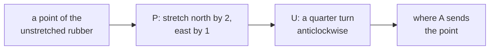

# Normal matrices and the polar form: the matrices that commute with their conjugate transpose are exactly those with perpendicular eigenvectors, and every matrix is a rotation times a stretch

[Syllabus](../../../SYLLABUS.md) → [Algebra](../README.md) → [Eigenvalues and Symmetric Matrices](../README.md#s07) → Normal matrices and the polar form

---

## General Overview

A testing machine pulls a square of rubber to twice its height, then turns it a quarter turn anticlockwise. One matrix records where each point goes, `[[0, -2], [1, 0]]`: the point (east, north) lands at (−2 × north, east).

An engineer wants the two moves apart: the stretch strains the material, the turn does not. The split always exists: every square matrix is a turn U times a stretch P, written A = U P. Here U is the quarter turn `[[0, -1], [1, 0]]` and P stretches north by 2.

The quarter turn alone has no real eigenvector. Over complex numbers it has two, at right angles: (1, −i) and (1, i), with eigenvalues i and −i. Matrices with perpendicular eigenvectors like this are the **normal** matrices. One test finds them: commuting with the conjugate transpose (the transpose, with each i turned to −i). The rubber matrix fails it.

**A complex square matrix has a full set of perpendicular unit eigenvectors exactly when it commutes with its conjugate transpose, and every square matrix, normal or not, is a unitary turn times a stretch that is never negative.**

**What kind of fact this is:** two theorems, proved in Why it works from Schur's triangle and the singular value decomposition.

### The picture: stretch, then turn



Products act right to left: P first, then U.

---

## The formula

[Schur's triangle](07-schur-triangularisation.md) defines the conjugate transpose $`A^*`$, read "A-star", and **unitary** Q: $`Q^* Q = I`$, perpendicular columns of length 1. Columns x and y are **perpendicular** when the complex dot product $`x^* y`$ is 0.

The first theorem: a matrix is **normal** when it commutes with its conjugate transpose, and

```math
A A^* = A^* A \iff A = Q D Q^*, \quad Q \text{ unitary}, \ D \text{ diagonal}
```

**Read it aloud:** A commutes with A-star exactly when A is a pure stretch, by complex factors, along perpendicular unit axes.

The second theorem holds for every square matrix:

```math
A = U P, \quad U^* U = I, \quad P = \sqrt{A^* A}
```

**Read it aloud:** any square matrix is a stretch P, never negative, followed by a unitary turn U.

P is **positive semidefinite**: equal to its conjugate transpose, with no negative eigenvalue ([Quadratic forms](05-quadratic-forms-and-positive-definite.md)). $`\sqrt{A^* A}`$ is the one such matrix whose square is $`A^* A`$.

| Symbol | Plain meaning | In our example | Push it up and the answer… |
| --- | --- | --- | --- |
| $`A`$, $`v_1`$, $`v_2`$ | the square matrix; its unit eigenvectors | `[[0, -2], [1, 0]]`; at 70.528779 degrees | — |
| $`A^*`$, $`x^*`$ | conjugate transpose of a matrix or a column | $`A A^*`$ = `diag(4, 1)`, $`A^* A`$ = `diag(1, 4)` | — |
| $`Q`$, $`q_1`$, $`q_2`$, $`D`$, $`\lambda`$, $`I`$ | unitary matrix of eigenvectors and its columns; diagonal of eigenvalues; one eigenvalue; the identity, which changes nothing | for R: (0.707107, −0.707107i), (0.707107, 0.707107i); D = `diag(i, -i)` | — |
| $`T`$, $`t_{11}`$, $`t_{22}`$, $`t_{12}`$ | Schur's triangle $`Q^* A Q`$: its diagonal, and its corner above the diagonal | corner 0.000000 for R, 1.000000 for A | further from normal |
| $`U`$ | the unitary turn | `[[0, -1], [1, 0]]` | — |
| $`P`$, $`P'`$ | the stretch $`\sqrt{A^* A}`$; the left-hand stretch $`\sqrt{A A^*}`$ | `diag(1, 2)`; `diag(2, 1)` | the rubber strains more |
| $`W`$, $`S`$, $`V`$, $`\sigma`$ | the SVD $`A = W S V^*`$ and its singular values | $`\sigma`$ = 2.000000 and 1.000000 | — |
| $`R`$, $`H`$, $`N`$ | three normal matrices: the quarter turn, a Hermitian matrix, and I + 2R | `[[0, -1], [1, 0]]`, `[[2, i], [-i, 2]]`, `[[1, -2], [2, 1]]` | — |

### When it holds

- **The conjugate, not the plain transpose.** With the plain transpose, written $`^{\mathsf T}`$, R's perpendicular eigenvectors give $`q_1^{\mathsf T} q_2`$ = 1.000000.
- **Commuting with $`A^*`$, not having distinct eigenvalues.** The rubber matrix's two eigenvectors meet at 70.528779 degrees.
- **P is unique; U is unique only when A is invertible.** If A flattens a direction, U is free there.

---

## Why it works

### Step 0: perpendicular axes make A and A* stretch the same axes

If $`A = Q D Q^*`$, then $`A^* = Q D^* Q^*`$: the same axes, each factor conjugated. Stretches along the same axes commute, so A and $`A^*`$ commute. For the converse, [Schur's triangle](07-schur-triangularisation.md) writes every complex square matrix as $`Q T Q^*`$, with Q unitary and T upper triangular. A length count forces T's corner to vanish when A is normal.

### Step 1: the corner of the triangle is the whole failure

Change to the axes Q. Since $`Q^* Q = I`$, A is normal exactly when T is: $`T T^* = Q^* A A^* Q`$ and $`T^* T = Q^* A^* A Q`$.

For a 2 by 2 triangle with diagonal $`t_{11}`$, $`t_{22}`$ and corner $`t_{12}`$, compare the top-left entries:

```math
(T^* T)_{11} = \lvert t_{11}\rvert^2, \qquad (T T^*)_{11} = \lvert t_{11}\rvert^2 + \lvert t_{12}\rvert^2
```

Equal only if $`t_{12} = 0`$. So a normal T is diagonal: Q's columns are perpendicular eigenvectors, and T's diagonal holds the eigenvalues.

<details>
<summary>Detailed proof: every size</summary>

Let T be square, upper triangular and normal. Compare the top-left entries of $`T^* T`$ and $`T T^*`$: the first is $`\lvert t_{11}\rvert^2`$, the second is $`\lvert t_{11}\rvert^2`$ plus the squared lengths of the rest of row 1. So row 1 is zero beyond the diagonal.

Now the second diagonal entry. Row 1 has no corner entries, so $`(T^* T)_{22} = \lvert t_{22}\rvert^2`$, while $`(T T^*)_{22}`$ adds the squared lengths of the rest of row 2. That row is zero too. Continuing down the diagonal clears every row, so T is diagonal.

Conversely, $`D D^* = D^* D`$ for any diagonal D, since both have $`\lvert d_{kk}\rvert^2`$ down the diagonal.

</details>

### Step 2: how far the rubber matrix is from normal

The rubber matrix's eigenvalues ±1.414214i have eigenvectors (1, −0.707107i) and (1, 0.707107i); at unit length $`\lvert v_1^* v_2\rvert`$ = 0.333333, an angle of 70.528779 degrees.

A second road measures the corner without building T. A unitary change of axes keeps the sum of squared entry sizes: 5.000000 for A. T's diagonal holds the eigenvalues, worth 4.000000. The corner gets the rest: $`\lvert t_{12}\rvert^2`$ = 5.000000 − 4.000000 = 1.000000, as T itself confirms. For R the corner is 0.000000.

### Step 3: Hermitian, unitary and skew-Hermitian are normal, read off D

Each family below commutes with its conjugate transpose, since $`A^*`$ is A, $`A^{-1}`$ or −A. So $`A = Q D Q^*`$, and the condition on A becomes one on D:

| Family | Condition | On D, so on the eigenvalues | Example from the checks |
| --- | --- | --- | --- |
| **Hermitian** | $`A^* = A`$ | $`D^* = D`$: every eigenvalue real | H: 3.000000 and 1.000000 |
| **Unitary** | $`A^* A = I`$ | $`D^* D = I`$: every eigenvalue of size 1 | R: i and −i |
| **Skew-Hermitian** | $`A^* = -A`$ | $`D^* = -D`$: every eigenvalue on the imaginary axis | R again: i and −i |
| normal, none of these | $`A A^* = A^* A`$ | no restriction | N: 1 ± 2i |
| not normal | — | the axes are not perpendicular | A: ±1.414214i |

Real symmetric matrices are the real Hermitian ones, so [The spectral theorem](04-spectral-theorem.md) is the all-real case.

### Step 4: the polar form from the SVD

[The singular value decomposition](06-singular-value-decomposition.md) proves $`A = W S V^*`$ for real matrices; Step 1 extends it. $`A^* A`$ is Hermitian, so V's columns can be perpendicular unit eigenvectors v of it. Each eigenvalue is $`\lvert A v\rvert^2`$, never negative; its square root σ goes on the diagonal S. W's columns $`A v / \sigma`$ are perpendicular unit vectors, as $`v^* A^* A v' = 0`$; any perpendicular unit columns fill in where σ = 0. So $`A V = W S`$. Slip $`V^* V = I`$ into the middle:

```math
A = (W V^*)(V S V^*) = U P
```

$`U = W V^*`$ is a product of unitaries, so unitary. $`P = V S V^*`$ stretches by the singular values along V's columns: Hermitian, no negative eigenvalue. And $`P^2 = V S^2 V^* = A^* A`$.

For the rubber: $`A^* A`$ = `diag(1, 4)`, so $`\sigma`$ = 2.000000 along north and 1.000000 along east. V's columns are (0, 1) and (1, 0); W's are (−1, 0) and (0, 1). Multiplying out gives U = `[[0, -1], [1, 0]]` and P = `diag(1, 2)`.

A second road needs no eigenvalues. Start from U = A and repeatedly replace U by the average of U and the conjugate transpose of its inverse. Each round sends every singular value s to (s + 1/s)/2, which runs to 1: the stretch drains out, the turn stays. The top-right entry goes −2.000000, −1.250000, −1.025000, −1.000305, −1.000000 ([Higham 1986](https://doi.org/10.1137/0907079)). Then $`P = U^* A`$.

### Step 5: turn and stretch commute exactly when A is normal

The stretch can also go on the left: $`A = P' U`$ with $`P' = \sqrt{A A^*} = U P U^*`$. A is normal exactly when $`P' = P`$, that is, when U P = P U. For the rubber, P' = `diag(2, 1)` but P = `diag(1, 2)`. For the normal N, P is 2.236068 times I, and U and P commute.

---

## Worked numbers, by hand

| Step | Arithmetic | Value |
| --- | --- | --- |
| is R normal? | $`R R^*`$ and $`R^* R`$ | both I: **yes** |
| R's eigenvalues | λ² + 1 = 0 | i and −i |
| R's unit eigenvectors | top row: second entry −λ times the first, then scale | (0.707107, −0.707107i), (0.707107, 0.707107i) |
| perpendicular? | conjugate the first, multiply, add | $`q_1^* q_2`$ = 0.000000 |
| is A normal? | $`A A^*`$ against $`A^* A`$ | `diag(4, 1)` against `diag(1, 4)`: **no** |
| A's Schur corner | 5.000000 − 4.000000 | $`\lvert t_{12}\rvert`$ = 1.000000 |
| singular values of A | square roots of 4 and 1 | 2.000000 and 1.000000 |
| the turn | $`U = W V^*`$ | `[[0, -1], [1, 0]]` |
| the stretch | $`P = V S V^*`$ | **`diag(1, 2)`** |
| rebuild | U P | **`[[0, -2], [1, 0]]` = A** |

All the strain is in P = `diag(1, 2)`; U only turns.

### What breaks if you drop a piece

| Mistake | Comes out at | What went wrong |
| --- | --- | --- |
| Plain transpose on R's eigenvectors | $`q_1^{\mathsf T} q_2`$ = 1.000000, not 0 | complex columns need the conjugate |
| U and P in the wrong order | P U = `[[0, -1], [2, 0]]`, not A | A is not normal, so the moves do not commute |
| P' from $`A A^*`$ placed on the right | A P'⁻¹ = `[[0, -2], [0.5, 0]]`, whose $`U^* U`$ = `diag(0.25, 4)` | that is no turn: P' belongs on the left |
| the Hermitian part (A + A*)/2 as the stretch | eigenvalues 0.500000 and −0.500000 | a stretch is never negative; P is $`\sqrt{A^* A}`$ |

---

## Code, from first principles, and it actually runs

The code does 2 by 2 complex arithmetic by hand and takes three roads each time. Normality: the commutator $`A A^* - A^* A`$, Schur's corner, and the sum-of-squares count. The polar form: the SVD, the averaging iteration, and the 2 by 2 square root $`\sqrt{M} = (M + \sqrt{\det M}\, I) / \sqrt{\mathrm{tr}\, M + 2 \sqrt{\det M}}`$ for any nonzero positive semidefinite M, with tr the diagonal sum and det the determinant ([Cayley-Hamilton and the minimal polynomial](08-cayley-hamilton-and-minimal-polynomial.md)).

### Python

```python
# Normal matrices and the polar form -- the check behind the card.  Standard library only.
# R = [[0, -1], [1, 0]] is normal; A = [[0, -2], [1, 0]] is not, and splits as A = U P.
import math
def M(rows): return [[complex(x) for x in r] for r in rows]
def mm(a, b): return [[a[i][0] * b[0][j] + a[i][1] * b[1][j] for j in range(2)] for i in range(2)]
def st(a): return [[a[j][i].conjugate() for j in range(2)] for i in range(2)]      # conjugate transpose a*
def lin(s, a, t, b): return [[s * a[i][j] + t * b[i][j] for j in range(2)] for i in range(2)]  # s a + t b
def gap(a, b): return max(abs(a[i][j] - b[i][j]) for i in range(2) for j in range(2))
def dot(x, y): return x[0].conjugate() * y[0] + x[1].conjugate() * y[1]             # x* y
def det(a): return a[0][0] * a[1][1] - a[0][1] * a[1][0]
def inv(a): return [[a[1][1] / det(a), -a[0][1] / det(a)], [-a[1][0] / det(a), a[0][0] / det(a)]]
def yn(c): return "yes" if c else "no"
def r(x): return f"{x if abs(x) >= 5e-7 else 0.0:.6f}"
def c(z): return f"{r(z.real)} {'-' if z.imag < -5e-7 else '+'} {r(abs(z.imag))}i"
def mat(a): return "[[" + "], [".join(", ".join(r(x.real) for x in row) for row in a) + "]]"
def eig(a):                     # roots of t^2 - trace t + det = 0, complex square root by hand
    tr = a[0][0] + a[1][1]; z = tr * tr - 4 * det(a); m = abs(z); im = math.sqrt(max(m - z.real, 0.0) / 2)
    s = complex(math.sqrt((m + z.real) / 2), -im if z.imag < 0 else im); return [(tr + s) / 2, (tr - s) / 2]
def evec(a, lam):               # unit eigenvector from one row of (a - lam I), first entry real and positive
    v = [a[0][1], lam - a[0][0]] if abs(a[0][1]) + abs(lam - a[0][0]) > 1e-12 else [a[1][1] - lam, -a[1][0]]
    n = math.hypot(abs(v[0]), abs(v[1])) * (v[0] / abs(v[0]) if abs(v[0]) > 1e-12 else 1); return [v[0] / n, v[1] / n]
def schur(a):                   # T = Q* a Q, where Q's first column is a unit eigenvector
    v = evec(a, eig(a)[0]); Q = [[v[0], -v[1].conjugate()], [v[1], v[0].conjugate()]]; return mm(mm(st(Q), a), Q)
def psqrt(m):                   # square root of a 2 by 2 nonzero positive semidefinite m, by Cayley-Hamilton
    d = math.sqrt(abs(det(m))); t = math.sqrt(abs(m[0][0] + m[1][1]) + 2 * d); return lin(1 / t, m, d / t, I2)
def normal(a): return gap(mm(a, st(a)), mm(st(a), a)) < 1e-12
I2, R, A = M([[1, 0], [0, 1]]), M([[0, -1], [1, 0]]), M([[0, -2], [1, 0]])
H, N = [[2 + 0j, 1j], [-1j, 2 + 0j]], lin(1, I2, 2, R)                          # N = I + 2R
for name, a in (("R", R), ("H", H), ("N", N), ("A", A)):
    print(f"{name}: normal {yn(normal(a))}, Hermitian {yn(gap(st(a), a) < 1e-12)}, unitary {yn(gap(mm(st(a), a), I2) < 1e-12)}, "
          f"skew-Hermitian {yn(gap(st(a), lin(-1, a, 0, a)) < 1e-12)}; eigenvalues {c(eig(a)[0])} and {c(eig(a)[1])}")
lr = eig(R); q1, q2 = evec(R, lr[0]), evec(R, lr[1]); Q = [[q1[0], q2[0]], [q1[1], q2[1]]]; QDQ = mm(mm(Q, [[lr[0], 0], [0, lr[1]]]), st(Q))
print(f"R: q1 = ({c(q1[0])}, {c(q1[1])}), q2 = ({c(q2[0])}, {c(q2[1])}); q1* q2 = {c(dot(q1, q2))}; Q diag(i, -i) Q* = R: {yn(gap(QDQ, R) < 1e-12)}")
print(f"A A* = {mat(mm(A, st(A)))}; A* A = {mat(mm(st(A), A))}")
la = eig(A); va = [evec(A, l) for l in la]; cosang = abs(dot(va[0], va[1]))
print(f"A: eigenvectors (1, {c(va[0][1] / va[0][0])}) and (1, {c(va[1][1] / va[1][0])}); |v1* v2| = {r(cosang)}, angle {r(math.degrees(math.acos(cosang)))} degrees")
TR, TA = schur(R), schur(A); frob = sum(abs(x) ** 2 for row in A for x in row); lam2 = abs(la[0]) ** 2 + abs(la[1]) ** 2
print(f"Schur T = Q* M Q: |t12| for R = {r(abs(TR[0][1]))}, for A = {r(abs(TA[0][1]))}; A's road two: {r(frob)} - {r(lam2)} = {r(frob - lam2)}")
G = mm(st(A), A); s2 = [z.real for z in eig(G)]; sv = [math.sqrt(x) for x in s2]; v1, v2 = evec(G, s2[0]), evec(G, s2[1])
V, S = [[v1[0], v2[0]], [v1[1], v2[1]]], [[sv[0], 0], [0, sv[1]]]; W = mm(mm(A, V), inv(S))   # u_i = A v_i / sigma_i
Us, Ps = mm(W, st(V)), mm(mm(V, S), st(V))
print(f"SVD of A: singular values {r(sv[0])} and {r(sv[1])}; V = {mat(V)}, W = {mat(W)}"); print(f"road one, from the SVD: U = W V* = {mat(Us)}, P = V S V* = {mat(Ps)}")
Un, trail = A, [A[0][1].real]
for k in range(6): Un = lin(0.5, Un, 0.5, st(inv(Un))); trail.append(Un[0][1].real)   # average U with (U^-1)*
Pn = mm(st(Un), A); print(f"road two, average U with the conjugate transpose of its inverse; top-right entry: {', '.join(r(x) for x in trail)}")
print(f"road two: U = {mat(Un)}, P = U* A = {mat(Pn)}; road three: P = sqrt(A* A) by Cayley-Hamilton = {mat(psqrt(G))}")
print(f"U* U = I: {yn(gap(mm(st(Us), Us), I2) < 1e-12)}; U P = A: {yn(gap(mm(Us, Ps), A) < 1e-12)}; P's eigenvalues {r(eig(Ps)[0].real)} and {r(eig(Ps)[1].real)}")
PL, PN = psqrt(mm(A, st(A))), psqrt(mm(st(N), N)); UN, UW = mm(N, inv(PN)), mm(A, inv(PL))
print(f"left form: P' = sqrt(A A*) = {mat(PL)}, P' U = A: {yn(gap(mm(PL, Us), A) < 1e-12)}, P' = P: {yn(gap(PL, Ps) < 1e-12)}; "
      f"N: P = {mat(PN)}, U P = P U: {yn(gap(mm(UN, PN), mm(PN, UN)) < 1e-12)}")
print(f"mistake 1, plain transpose on R's eigenvectors: q1^T q2 = {c(q1[0] * q2[0] + q1[1] * q2[1])}, not 0")
print(f"mistake 2, order swapped: P U = {mat(mm(Ps, Us))}, not A")
print(f"mistake 3, stretch from A A* put on the right: A P'^-1 = {mat(UW)}, its U* U = {mat(mm(st(UW), UW))}")
print(f"mistake 4, Hermitian part (A + A*)/2 as the stretch: eigenvalues {', '.join(r(z.real) for z in eig(lin(0.5, A, 0.5, st(A))))}")
assert normal(R) and normal(H) and normal(N) and abs(TR[0][1]) < 1e-12 and not normal(A)  # commutator and Schur agree
assert abs(abs(TA[0][1]) ** 2 - (frob - lam2)) < 1e-12                                 # two roads to A's defect, 1
assert abs(dot(q1, q2)) < 1e-12 and gap(QDQ, R) < 1e-12 and abs(cosang - 1 / 3) < 1e-12
assert gap(Us, Un) < 1e-12 and gap(Ps, Pn) < 1e-12 and gap(Ps, psqrt(G)) < 1e-12       # three roads to U and P
assert gap(mm(Us, Ps), A) < 1e-12 and gap(Us, R) < 1e-12 and gap(Ps, M([[1, 0], [0, 2]])) < 1e-12
print("ALL CHECKS PASS")
```

**Ran 2026-11-23 on macOS, Python 3.14.10, standard library only. All checks passed. Output, pasted from the run:**

```
R: normal yes, Hermitian no, unitary yes, skew-Hermitian yes; eigenvalues 0.000000 + 1.000000i and 0.000000 - 1.000000i
H: normal yes, Hermitian yes, unitary no, skew-Hermitian no; eigenvalues 3.000000 + 0.000000i and 1.000000 + 0.000000i
N: normal yes, Hermitian no, unitary no, skew-Hermitian no; eigenvalues 1.000000 + 2.000000i and 1.000000 - 2.000000i
A: normal no, Hermitian no, unitary no, skew-Hermitian no; eigenvalues 0.000000 + 1.414214i and 0.000000 - 1.414214i
R: q1 = (0.707107 + 0.000000i, 0.000000 - 0.707107i), q2 = (0.707107 + 0.000000i, 0.000000 + 0.707107i); q1* q2 = 0.000000 + 0.000000i; Q diag(i, -i) Q* = R: yes
A A* = [[4.000000, 0.000000], [0.000000, 1.000000]]; A* A = [[1.000000, 0.000000], [0.000000, 4.000000]]
A: eigenvectors (1, 0.000000 - 0.707107i) and (1, 0.000000 + 0.707107i); |v1* v2| = 0.333333, angle 70.528779 degrees
Schur T = Q* M Q: |t12| for R = 0.000000, for A = 1.000000; A's road two: 5.000000 - 4.000000 = 1.000000
SVD of A: singular values 2.000000 and 1.000000; V = [[0.000000, 1.000000], [1.000000, 0.000000]], W = [[-1.000000, 0.000000], [0.000000, 1.000000]]
road one, from the SVD: U = W V* = [[0.000000, -1.000000], [1.000000, 0.000000]], P = V S V* = [[1.000000, 0.000000], [0.000000, 2.000000]]
road two, average U with the conjugate transpose of its inverse; top-right entry: -2.000000, -1.250000, -1.025000, -1.000305, -1.000000, -1.000000, -1.000000
road two: U = [[0.000000, -1.000000], [1.000000, 0.000000]], P = U* A = [[1.000000, 0.000000], [0.000000, 2.000000]]; road three: P = sqrt(A* A) by Cayley-Hamilton = [[1.000000, 0.000000], [0.000000, 2.000000]]
U* U = I: yes; U P = A: yes; P's eigenvalues 2.000000 and 1.000000
left form: P' = sqrt(A A*) = [[2.000000, 0.000000], [0.000000, 1.000000]], P' U = A: yes, P' = P: no; N: P = [[2.236068, 0.000000], [0.000000, 2.236068]], U P = P U: yes
mistake 1, plain transpose on R's eigenvectors: q1^T q2 = 1.000000 + 0.000000i, not 0
mistake 2, order swapped: P U = [[0.000000, -1.000000], [2.000000, 0.000000]], not A
mistake 3, stretch from A A* put on the right: A P'^-1 = [[0.000000, -2.000000], [0.500000, 0.000000]], its U* U = [[0.250000, 0.000000], [0.000000, 4.000000]]
mistake 4, Hermitian part (A + A*)/2 as the stretch: eigenvalues 0.500000, -0.500000
ALL CHECKS PASS
```

### Rust

Same numbers, same labels, built with `rustc --edition 2021 -O`.

```rust
// Normal matrices and the polar form -- the same check as the Python, in Rust.  No crates.
// R = [[0, -1], [1, 0]] is normal; A = [[0, -2], [1, 0]] is not, and splits as A = U P.
use std::ops::{Add, Div, Mul, Sub};
#[derive(Clone, Copy)] struct C(f64, f64);                                    // the complex number re + im i
impl Add for C { type Output = C; fn add(self, o: C) -> C { C(self.0 + o.0, self.1 + o.1) } }
impl Sub for C { type Output = C; fn sub(self, o: C) -> C { C(self.0 - o.0, self.1 - o.1) } }
impl Mul for C { type Output = C; fn mul(self, o: C) -> C { C(self.0 * o.0 - self.1 * o.1, self.0 * o.1 + self.1 * o.0) } }
impl Div for C { type Output = C; fn div(self, o: C) -> C { let d = o.0 * o.0 + o.1 * o.1; C((self.0 * o.0 + self.1 * o.1) / d, (self.1 * o.0 - self.0 * o.1) / d) } }
type Mx = [[C; 2]; 2];
fn re(x: f64) -> C { C(x, 0.0) }
fn cj(z: C) -> C { C(z.0, -z.1) }
fn ab(z: C) -> f64 { z.0.hypot(z.1) }
fn m(rows: [[f64; 2]; 2]) -> Mx { rows.map(|row| row.map(re)) }
fn mm(a: Mx, b: Mx) -> Mx { std::array::from_fn(|i| std::array::from_fn(|j| a[i][0] * b[0][j] + a[i][1] * b[1][j])) }
fn st(a: Mx) -> Mx { std::array::from_fn(|i| std::array::from_fn(|j| cj(a[j][i]))) }      // conjugate transpose a*
fn lin(s: f64, a: Mx, t: f64, b: Mx) -> Mx { std::array::from_fn(|i| std::array::from_fn(|j| re(s) * a[i][j] + re(t) * b[i][j])) }
fn gap(a: Mx, b: Mx) -> f64 { (0..4).map(|k| ab(a[k / 2][k % 2] - b[k / 2][k % 2])).fold(0.0, f64::max) }
fn dot(x: [C; 2], y: [C; 2]) -> C { cj(x[0]) * y[0] + cj(x[1]) * y[1] }       // x* y
fn det(a: Mx) -> C { a[0][0] * a[1][1] - a[0][1] * a[1][0] }
fn inv(a: Mx) -> Mx { let d = det(a); [[a[1][1] / d, re(0.0) - a[0][1] / d], [re(0.0) - a[1][0] / d, a[0][0] / d]] }
fn yn(b: bool) -> &'static str { if b { "yes" } else { "no" } }
fn r(x: f64) -> String { format!("{:.6}", if x.abs() >= 5e-7 { x } else { 0.0 }) }
fn c(z: C) -> String { format!("{} {} {}i", r(z.0), if z.1 < -5e-7 { "-" } else { "+" }, r(z.1.abs())) }
fn mat(a: Mx) -> String { format!("[[{}, {}], [{}, {}]]", r(a[0][0].0), r(a[0][1].0), r(a[1][0].0), r(a[1][1].0)) }
fn eig(a: Mx) -> [C; 2] {        // roots of t^2 - trace t + det = 0, complex square root by hand
    let tr = a[0][0] + a[1][1]; let z = tr * tr - re(4.0) * det(a); let m = ab(z); let im = ((m - z.0).max(0.0) / 2.0).sqrt();
    let s = C(((m + z.0) / 2.0).sqrt(), if z.1 < 0.0 { -im } else { im }); [(tr + s) / re(2.0), (tr - s) / re(2.0)]
}
fn evec(a: Mx, lam: C) -> [C; 2] { // unit eigenvector from one row of (a - lam I), first entry real and positive
    let v = if ab(a[0][1]) + ab(lam - a[0][0]) > 1e-12 { [a[0][1], lam - a[0][0]] } else { [a[1][1] - lam, re(0.0) - a[1][0]] };
    let n = re(ab(v[0]).hypot(ab(v[1]))) * (if ab(v[0]) > 1e-12 { v[0] / re(ab(v[0])) } else { re(1.0) }); [v[0] / n, v[1] / n]
}
fn schur(a: Mx) -> Mx {          // T = Q* a Q, where Q's first column is a unit eigenvector
    let v = evec(a, eig(a)[0]); let q = [[v[0], re(0.0) - cj(v[1])], [v[1], cj(v[0])]]; mm(mm(st(q), a), q)
}
fn psqrt(x: Mx) -> Mx {          // square root of a 2 by 2 nonzero positive semidefinite x, by Cayley-Hamilton
    let d = ab(det(x)).sqrt(); let t = (ab(x[0][0] + x[1][1]) + 2.0 * d).sqrt(); lin(1.0 / t, x, d / t, m([[1.0, 0.0], [0.0, 1.0]]))
}
fn normal(a: Mx) -> bool { gap(mm(a, st(a)), mm(st(a), a)) < 1e-12 }
fn main() {
    let (i2, rr, a) = (m([[1.0, 0.0], [0.0, 1.0]]), m([[0.0, -1.0], [1.0, 0.0]]), m([[0.0, -2.0], [1.0, 0.0]]));
    let (h, n) = ([[re(2.0), C(0.0, 1.0)], [C(0.0, -1.0), re(2.0)]], lin(1.0, i2, 2.0, rr));   // N = I + 2R
    for (name, x) in [("R", rr), ("H", h), ("N", n), ("A", a)] {
        println!("{}: normal {}, Hermitian {}, unitary {}, skew-Hermitian {}; eigenvalues {} and {}", name, yn(normal(x)), yn(gap(st(x), x) < 1e-12),
                 yn(gap(mm(st(x), x), i2) < 1e-12), yn(gap(st(x), lin(-1.0, x, 0.0, x)) < 1e-12), c(eig(x)[0]), c(eig(x)[1]));
    }
    let lr = eig(rr); let (q1, q2) = (evec(rr, lr[0]), evec(rr, lr[1])); let q = [[q1[0], q2[0]], [q1[1], q2[1]]];
    let qdq = mm(mm(q, [[lr[0], re(0.0)], [re(0.0), lr[1]]]), st(q));
    println!("R: q1 = ({}, {}), q2 = ({}, {}); q1* q2 = {}; Q diag(i, -i) Q* = R: {}", c(q1[0]), c(q1[1]), c(q2[0]), c(q2[1]), c(dot(q1, q2)), yn(gap(qdq, rr) < 1e-12));
    println!("A A* = {}; A* A = {}", mat(mm(a, st(a))), mat(mm(st(a), a)));
    let la = eig(a); let va = [evec(a, la[0]), evec(a, la[1])]; let cosang = ab(dot(va[0], va[1]));
    println!("A: eigenvectors (1, {}) and (1, {}); |v1* v2| = {}, angle {} degrees", c(va[0][1] / va[0][0]), c(va[1][1] / va[1][0]), r(cosang), r(cosang.acos().to_degrees()));
    let (tr, ta) = (schur(rr), schur(a)); let frob: f64 = (0..4).map(|k| ab(a[k / 2][k % 2]).powi(2)).sum(); let lam2 = ab(la[0]).powi(2) + ab(la[1]).powi(2);
    println!("Schur T = Q* M Q: |t12| for R = {}, for A = {}; A's road two: {} - {} = {}", r(ab(tr[0][1])), r(ab(ta[0][1])), r(frob), r(lam2), r(frob - lam2));
    let g = mm(st(a), a); let e = eig(g); let sv = [e[0].0.sqrt(), e[1].0.sqrt()]; let (v1, v2) = (evec(g, re(e[0].0)), evec(g, re(e[1].0)));
    let (v, s) = ([[v1[0], v2[0]], [v1[1], v2[1]]], m([[sv[0], 0.0], [0.0, sv[1]]])); let w = mm(mm(a, v), inv(s));   // u_i = A v_i / sigma_i
    let (us, ps) = (mm(w, st(v)), mm(mm(v, s), st(v)));
    println!("SVD of A: singular values {} and {}; V = {}, W = {}", r(sv[0]), r(sv[1]), mat(v), mat(w));
    println!("road one, from the SVD: U = W V* = {}, P = V S V* = {}", mat(us), mat(ps));
    let (mut un, mut trail) = (a, vec![a[0][1].0]);
    for _ in 0..6 { un = lin(0.5, un, 0.5, st(inv(un))); trail.push(un[0][1].0) }       // average U with (U^-1)*
    let pn = mm(st(un), a);
    println!("road two, average U with the conjugate transpose of its inverse; top-right entry: {}", trail.iter().map(|&x| r(x)).collect::<Vec<_>>().join(", "));
    println!("road two: U = {}, P = U* A = {}; road three: P = sqrt(A* A) by Cayley-Hamilton = {}", mat(un), mat(pn), mat(psqrt(g)));
    println!("U* U = I: {}; U P = A: {}; P's eigenvalues {} and {}", yn(gap(mm(st(us), us), i2) < 1e-12), yn(gap(mm(us, ps), a) < 1e-12), r(eig(ps)[0].0), r(eig(ps)[1].0));
    let (pl, pnn) = (psqrt(mm(a, st(a))), psqrt(mm(st(n), n))); let (unn, uw) = (mm(n, inv(pnn)), mm(a, inv(pl)));
    println!("left form: P' = sqrt(A A*) = {}, P' U = A: {}, P' = P: {}; N: P = {}, U P = P U: {}", mat(pl), yn(gap(mm(pl, us), a) < 1e-12),
             yn(gap(pl, ps) < 1e-12), mat(pnn), yn(gap(mm(unn, pnn), mm(pnn, unn)) < 1e-12));
    println!("mistake 1, plain transpose on R's eigenvectors: q1^T q2 = {}, not 0", c(q1[0] * q2[0] + q1[1] * q2[1]));
    println!("mistake 2, order swapped: P U = {}, not A", mat(mm(ps, us)));
    println!("mistake 3, stretch from A A* put on the right: A P'^-1 = {}, its U* U = {}", mat(uw), mat(mm(st(uw), uw)));
    let hp = eig(lin(0.5, a, 0.5, st(a)));
    println!("mistake 4, Hermitian part (A + A*)/2 as the stretch: eigenvalues {}, {}", r(hp[0].0), r(hp[1].0));
    assert!(normal(rr) && normal(h) && normal(n) && ab(tr[0][1]) < 1e-12 && !normal(a));    // commutator and Schur agree
    assert!((ab(ta[0][1]).powi(2) - (frob - lam2)).abs() < 1e-12);                           // two roads to A's defect, 1
    assert!(ab(dot(q1, q2)) < 1e-12 && gap(qdq, rr) < 1e-12 && (cosang - 1.0 / 3.0).abs() < 1e-12);
    assert!(gap(us, un) < 1e-12 && gap(ps, pn) < 1e-12 && gap(ps, psqrt(g)) < 1e-12);        // three roads to U and P
    assert!(gap(mm(us, ps), a) < 1e-12 && gap(us, rr) < 1e-12 && gap(ps, m([[1.0, 0.0], [0.0, 2.0]])) < 1e-12);
    println!("ALL CHECKS PASS");
}
```

**Ran 2026-11-23 on macOS, rustc 1.98.1, no crates. All checks passed. Output, pasted from the run:**

```
R: normal yes, Hermitian no, unitary yes, skew-Hermitian yes; eigenvalues 0.000000 + 1.000000i and 0.000000 - 1.000000i
H: normal yes, Hermitian yes, unitary no, skew-Hermitian no; eigenvalues 3.000000 + 0.000000i and 1.000000 + 0.000000i
N: normal yes, Hermitian no, unitary no, skew-Hermitian no; eigenvalues 1.000000 + 2.000000i and 1.000000 - 2.000000i
A: normal no, Hermitian no, unitary no, skew-Hermitian no; eigenvalues 0.000000 + 1.414214i and 0.000000 - 1.414214i
R: q1 = (0.707107 + 0.000000i, 0.000000 - 0.707107i), q2 = (0.707107 + 0.000000i, 0.000000 + 0.707107i); q1* q2 = 0.000000 + 0.000000i; Q diag(i, -i) Q* = R: yes
A A* = [[4.000000, 0.000000], [0.000000, 1.000000]]; A* A = [[1.000000, 0.000000], [0.000000, 4.000000]]
A: eigenvectors (1, 0.000000 - 0.707107i) and (1, 0.000000 + 0.707107i); |v1* v2| = 0.333333, angle 70.528779 degrees
Schur T = Q* M Q: |t12| for R = 0.000000, for A = 1.000000; A's road two: 5.000000 - 4.000000 = 1.000000
SVD of A: singular values 2.000000 and 1.000000; V = [[0.000000, 1.000000], [1.000000, 0.000000]], W = [[-1.000000, 0.000000], [0.000000, 1.000000]]
road one, from the SVD: U = W V* = [[0.000000, -1.000000], [1.000000, 0.000000]], P = V S V* = [[1.000000, 0.000000], [0.000000, 2.000000]]
road two, average U with the conjugate transpose of its inverse; top-right entry: -2.000000, -1.250000, -1.025000, -1.000305, -1.000000, -1.000000, -1.000000
road two: U = [[0.000000, -1.000000], [1.000000, 0.000000]], P = U* A = [[1.000000, 0.000000], [0.000000, 2.000000]]; road three: P = sqrt(A* A) by Cayley-Hamilton = [[1.000000, 0.000000], [0.000000, 2.000000]]
U* U = I: yes; U P = A: yes; P's eigenvalues 2.000000 and 1.000000
left form: P' = sqrt(A A*) = [[2.000000, 0.000000], [0.000000, 1.000000]], P' U = A: yes, P' = P: no; N: P = [[2.236068, 0.000000], [0.000000, 2.236068]], U P = P U: yes
mistake 1, plain transpose on R's eigenvectors: q1^T q2 = 1.000000 + 0.000000i, not 0
mistake 2, order swapped: P U = [[0.000000, -1.000000], [2.000000, 0.000000]], not A
mistake 3, stretch from A A* put on the right: A P'^-1 = [[0.000000, -2.000000], [0.500000, 0.000000]], its U* U = [[0.250000, 0.000000], [0.000000, 4.000000]]
mistake 4, Hermitian part (A + A*)/2 as the stretch: eigenvalues 0.500000, -0.500000
ALL CHECKS PASS
```

The two outputs match line for line.

### Lean

Lean proves both theorems and Step 5 for complex square matrices of every size, and the card's 2 by 2 numbers exactly.

- Take a complex square matrix A. Then $`A A^* = A^* A`$ exactly when $`A = Q D Q^*`$, with Q unitary and D diagonal.
- Take any complex square matrix A, normal or not. Then A = U P, with U unitary and P positive semidefinite. Also $`P^2 = A^* A`$.
- Suppose A = U P, with U unitary and P positive semidefinite. Then U P = P U exactly when A is normal.
- R is normal. It sends (1, −i) to i times itself, and (1, i) to −i times itself.
- Those two eigenvectors are perpendicular. The plain transpose gives 2 for them, so 1 at unit length.
- Take Q with columns (1, −i) and (1, i) over √2, and D = `diag(i, -i)`. Then Q is unitary, and $`Q D Q^*`$ = R.
- Take the rubber matrix A. Then $`A A^*`$ = `diag(4, 1)` but $`A^* A`$ = `diag(1, 4)`, so A is not normal.
- U = R times P = `diag(1, 2)` gives A, and P times P gives `diag(1, 4)`.
- On the left, P' = `diag(2, 1)` times U also gives A. In the wrong order, P U = `[[0, -1], [2, 0]]`, not A.
- H is Hermitian, and N = I + 2R is normal.

The decimals, Schur's corner, the SVD and the averaging road are left to the Python and Rust checks.

```lean
-- Normal matrices and the polar form: a complex square matrix commutes with its conjugate transpose exactly when it is Q D Q* with Q unitary and D diagonal, every complex square matrix is U P with U unitary and P a positive semidefinite square root of A* A, the turn and the stretch commute exactly when A is normal, and the card's 2 by 2 numbers check out.
import Mathlib.LinearAlgebra.Matrix.PosDef
import Mathlib.LinearAlgebra.Matrix.ConjTranspose
import Mathlib.Analysis.Complex.Order
import Mathlib.Tactic.FinCases
import Mathlib.Tactic.NormNum
import Mathlib.Analysis.Matrix.Spectrum
import Mathlib.Analysis.Matrix.Order
import Mathlib.Analysis.InnerProductSpace.JointEigenspace

namespace NormalMatricesAndPolarDecomposition

open Matrix Complex
open scoped ComplexOrder

lemma colMat_unitary {n : ℕ} (b : OrthonormalBasis (Fin n) ℂ (EuclideanSpace ℂ (Fin n))) :
    (Matrix.of fun i j => b j i)ᴴ * Matrix.of (fun i j => b j i) = 1 := by
  ext i j
  have h := (orthonormal_iff_ite.mp b.orthonormal) i j
  rw [EuclideanSpace.inner_eq_star_dotProduct] at h
  rw [Matrix.mul_apply, Matrix.one_apply, ← h, dotProduct]
  refine Finset.sum_congr rfl fun k _ => ?_
  simp [mul_comm]

#print axioms colMat_unitary

lemma colMat_unitary' {n : ℕ} (b : OrthonormalBasis (Fin n) ℂ (EuclideanSpace ℂ (Fin n))) :
    Matrix.of (fun i j => b j i) * (Matrix.of fun i j => b j i)ᴴ = 1 :=
  mul_eq_one_comm.mp (colMat_unitary b)

#print axioms colMat_unitary'

lemma eq_of_eigenbasis {n : ℕ} (A : Matrix (Fin n) (Fin n) ℂ)
    (b : OrthonormalBasis (Fin n) ℂ (EuclideanSpace ℂ (Fin n))) (d : Fin n → ℂ)
    (h : ∀ j, A *ᵥ ⇑(b j) = d j • ⇑(b j)) :
    A = Matrix.of (fun i j => b j i) * diagonal d * (Matrix.of fun i j => b j i)ᴴ := by
  have hAQ : A * Matrix.of (fun i j => b j i) = Matrix.of (fun i j => b j i) * diagonal d := by
    ext i j
    have := congrFun (h j) i
    simp only [mulVec, dotProduct, Pi.smul_apply, smul_eq_mul] at this
    rw [Matrix.mul_apply, mul_diagonal, of_apply]
    simp only [of_apply]
    rw [this, mul_comm]
  calc A = A * (Matrix.of (fun i j => b j i) * (Matrix.of fun i j => b j i)ᴴ) := by
        rw [colMat_unitary', mul_one]
    _ = _ := by rw [← Matrix.mul_assoc, hAQ]

#print axioms eq_of_eigenbasis

lemma exists_eigenbasis_of_normal {n : ℕ} (A : Matrix (Fin n) (Fin n) ℂ) (hN : A * Aᴴ = Aᴴ * A) :
    ∃ (b : OrthonormalBasis (Fin n) ℂ (EuclideanSpace ℂ (Fin n))) (d : Fin n → ℂ),
      ∀ j, A *ᵥ ⇑(b j) = d j • ⇑(b j) := by
  obtain ⟨H, hHdef⟩ : ∃ H : Matrix (Fin n) (Fin n) ℂ, H = (1/2 : ℂ) • (A + Aᴴ) := ⟨_, rfl⟩
  obtain ⟨K, hKdef⟩ : ∃ K : Matrix (Fin n) (Fin n) ℂ, K = (-I/2 : ℂ) • (A - Aᴴ) := ⟨_, rfl⟩
  have hAHK : A = H + I • K := by
    have : I * (-I/2) = 1/2 := by rw [mul_div_assoc', mul_neg, I_mul_I]; norm_num
    rw [hHdef, hKdef, smul_smul, this, ← smul_add]
    rw [add_add_sub_cancel, ← two_smul ℂ A, smul_smul]; norm_num
  have hH : H.IsHermitian := by
    simp only [IsHermitian, hHdef, conjTranspose_smul, conjTranspose_add,
      conjTranspose_conjTranspose, add_comm Aᴴ A]
    congr 1; simp
  have hK : K.IsHermitian := by
    simp only [IsHermitian, hKdef, conjTranspose_smul, conjTranspose_sub,
      conjTranspose_conjTranspose]
    rw [← neg_sub A Aᴴ, smul_neg, ← neg_smul]
    congr 1; simp [star_div₀, neg_div]
  have hHK : H * K = K * H := by
    rw [hHdef, hKdef, smul_mul_smul_comm, smul_mul_smul_comm, mul_comm (1/2 : ℂ)]
    congr 1
    simp only [add_mul, mul_add, sub_mul, mul_sub, hN]
    abel
  have hTH := (isSymmetric_toEuclideanLin_iff (A := H)).mpr hH
  have hTK := (isSymmetric_toEuclideanLin_iff (A := K)).mpr hK
  have hC : Commute (toEuclideanLin H) (toEuclideanLin K) := by
    change toEuclideanLin H * toEuclideanLin K = toEuclideanLin K * toEuclideanLin H
    rw [Module.End.mul_eq_comp, Module.End.mul_eq_comp, ← toLpLin_mul_same, ← toLpLin_mul_same,
      hHK]
  obtain ⟨V, hVdef⟩ : ∃ V : ℂ × ℂ → Submodule ℂ (EuclideanSpace ℂ (Fin n)),
      V = fun p => Module.End.eigenspace (toEuclideanLin H) p.2 ⊓
        Module.End.eigenspace (toEuclideanLin K) p.1 := ⟨_, rfl⟩
  have hV0 : DirectSum.IsInternal V := by
    rw [hVdef]; exact LinearMap.IsSymmetric.directSum_isInternal_of_commute hTH hTK hC
  have hV0' : OrthogonalFamily ℂ (fun i => V i) (fun i => (V i).subtypeₗᵢ) := by
    rw [hVdef]; exact LinearMap.IsSymmetric.orthogonalFamily_eigenspace_inf_eigenspace hTH hTK
  have hVle : ∀ q, V q ≤ Module.End.eigenspace (toEuclideanLin H) q.2 ∧
      V q ≤ Module.End.eigenspace (toEuclideanLin K) q.1 := by
    intro q; rw [hVdef]; exact ⟨inf_le_left, inf_le_right⟩
  have hV := DirectSum.isInternal_ne_bot_iff.mpr hV0
  have hV' := hV0'.comp (Subtype.val_injective (p := fun p : ℂ × ℂ => V p ≠ ⊥))
  have hfin : Finite {p : ℂ × ℂ // V p ≠ ⊥} := by
    refine Finite.of_injective (β := Module.End.Eigenvalues (toEuclideanLin K) × Module.End.Eigenvalues (toEuclideanLin H))
      (fun p => (⟨p.1.1, ?_⟩, ⟨p.1.2, ?_⟩)) ?_
    · exact Module.End.hasEigenvalue_iff.mpr fun h => p.2 (eq_bot_iff.mpr (le_trans (hVle _).2 h.le))
    · exact Module.End.hasEigenvalue_iff.mpr fun h => p.2 (eq_bot_iff.mpr (le_trans (hVle _).1 h.le))
    · intro p q hpq
      have h1 := congrArg (fun x => (x.1 : ℂ)) hpq
      have h2 := congrArg (fun x => (x.2 : ℂ)) hpq
      exact Subtype.ext (Prod.ext h1 h2)
  have := Fintype.ofFinite {p : ℂ × ℂ // V p ≠ ⊥}
  classical
  obtain ⟨b, idx, hb⟩ : ∃ (b : OrthonormalBasis (Fin n) ℂ (EuclideanSpace ℂ (Fin n)))
      (idx : Fin n → {p : ℂ × ℂ // V p ≠ ⊥}), ∀ j, b j ∈ V (idx j) :=
    ⟨hV.subordinateOrthonormalBasis finrank_euclideanSpace_fin hV',
      fun j => hV.subordinateOrthonormalBasisIndex finrank_euclideanSpace_fin j hV',
      fun j => hV.subordinateOrthonormalBasis_subordinate finrank_euclideanSpace_fin j hV'⟩
  refine ⟨b, fun j => (idx j).1.2 + I * (idx j).1.1, fun j => ?_⟩
  have hm1 := Module.End.mem_eigenspace_iff.mp ((hVle _).1 (hb j))
  have hm2 := Module.End.mem_eigenspace_iff.mp ((hVle _).2 (hb j))
  have h1 : H *ᵥ ⇑(b j) = (idx j).1.2 • ⇑(b j) := congrArg WithLp.ofLp hm1
  have h2 : K *ᵥ ⇑(b j) = (idx j).1.1 • ⇑(b j) := congrArg WithLp.ofLp hm2
  rw [hAHK, add_mulVec, smul_mulVec, h1, h2, smul_smul, ← add_smul]

#print axioms exists_eigenbasis_of_normal

open scoped MatrixOrder in
lemma psd_eq_of_mul_self_eq {n : ℕ} {X Y : Matrix (Fin n) (Fin n) ℂ} (hX : X.PosSemidef)
    (hY : Y.PosSemidef) (h : X * X = Y * Y) : X = Y :=
  (CFC.mul_self_eq_mul_self_iff X Y hX.nonneg hY.nonneg).mp h

#print axioms psd_eq_of_mul_self_eq

open scoped MatrixOrder in
lemma exists_psd_mul_self_eq {n : ℕ} (M : Matrix (Fin n) (Fin n) ℂ) (hM : M.PosSemidef) :
    ∃ P : Matrix (Fin n) (Fin n) ℂ, P.PosSemidef ∧ P * P = M :=
  ⟨CFC.sqrt M, nonneg_iff_posSemidef.mp (CFC.sqrt_nonneg M), CFC.sqrt_mul_sqrt_self M hM.nonneg⟩

#print axioms exists_psd_mul_self_eq

lemma inner_toEuclideanLin_toEuclideanLin {n : ℕ} (A : Matrix (Fin n) (Fin n) ℂ)
    (x y : EuclideanSpace ℂ (Fin n)) :
    inner ℂ (toEuclideanLin A x) (toEuclideanLin A y) = inner ℂ x (toEuclideanLin (Aᴴ * A) y) := by
  rw [toLpLin_mul_same, LinearMap.comp_apply, toEuclideanLin_conjTranspose_eq_adjoint,
    LinearMap.adjoint_inner_right]

#print axioms inner_toEuclideanLin_toEuclideanLin

/-- The card's first theorem. For every size `n`, an `n × n` complex matrix `A` commutes with its
conjugate transpose (`A A* = A* A`, so `A` is normal) exactly when `A = Q D Q*` for a complex
matrix `Q` whose columns are perpendicular unit vectors (`Q* Q = I`, so `Q` is unitary) and a
diagonal matrix `D` of complex stretch factors `d`. -/
theorem normal_iff_unitarily_diagonalizable (n : ℕ) (A : Matrix (Fin n) (Fin n) ℂ) :
    A * Aᴴ = Aᴴ * A ↔
      ∃ (Q : Matrix (Fin n) (Fin n) ℂ) (d : Fin n → ℂ),
        Qᴴ * Q = 1 ∧ A = Q * diagonal d * Qᴴ := by
  constructor
  · intro hN
    obtain ⟨b, d, hb⟩ := exists_eigenbasis_of_normal A hN
    exact ⟨_, d, colMat_unitary b, eq_of_eigenbasis A b d hb⟩
  · rintro ⟨Q, d, hQ, rfl⟩
    have key : ∀ X Y : Matrix (Fin n) (Fin n) ℂ,
        Q * X * Qᴴ * (Q * Y * Qᴴ) = Q * (X * Y) * Qᴴ := by
      intro X Y
      simp only [Matrix.mul_assoc]
      rw [← Matrix.mul_assoc Qᴴ Q, hQ, Matrix.one_mul]
    have hct : (Q * diagonal d * Qᴴ)ᴴ = Q * diagonal (star d) * Qᴴ := by
      rw [conjTranspose_mul, conjTranspose_mul, conjTranspose_conjTranspose,
        diagonal_conjTranspose, Matrix.mul_assoc]
    rw [hct, key, key, diagonal_mul_diagonal, diagonal_mul_diagonal]
    congr 3
    ext i
    exact mul_comm _ _

/-- The card's second theorem, the polar form. Every `n × n` complex matrix `A`, normal or not,
is `A = U P` with `U` unitary (`U* U = I`) and `P` positive semidefinite (equal to its conjugate
transpose, with no negative eigenvalue) and `P² = A* A`, so `P = √(A* A)`. -/
theorem exists_polar_decomposition (n : ℕ) (A : Matrix (Fin n) (Fin n) ℂ) :
    ∃ (U P : Matrix (Fin n) (Fin n) ℂ),
      Uᴴ * U = 1 ∧ P.PosSemidef ∧ P * P = Aᴴ * A ∧ A = U * P := by
  obtain ⟨P, hP, hPP⟩ := exists_psd_mul_self_eq (Aᴴ * A) (posSemidef_conjTranspose_mul_self A)
  set v := hP.1.eigenvectorBasis with hv
  set s : Fin n → ℝ := hP.1.eigenvalues with hs
  have hs0 : ∀ j, 0 ≤ s j := hP.eigenvalues_nonneg
  have hPv : ∀ j, P *ᵥ ⇑(v j) = (s j : ℂ) • ⇑(v j) := by
    intro j
    rw [hP.1.mulVec_eigenvectorBasis j, ← Complex.coe_smul]
  have hPv' : ∀ j, toEuclideanLin P (v j) = (s j : ℂ) • v j := by
    intro j
    rw [toLpLin_apply, hPv j]; rfl
  have hAA : ∀ i j, inner ℂ (toEuclideanLin A (v i)) (toEuclideanLin A (v j)) =
      ((s j : ℂ) * s j) * inner ℂ (v i) (v j) := by
    intro i j
    rw [inner_toEuclideanLin_toEuclideanLin, ← hPP, toLpLin_mul_same, LinearMap.comp_apply,
      hPv', map_smul, hPv', smul_smul, inner_smul_right]
  set w : Fin n → EuclideanSpace ℂ (Fin n) := fun j => ((s j : ℂ)⁻¹) • toEuclideanLin A (v j)
    with hw
  have horth : Orthonormal ℂ ({j | s j ≠ 0}.domRestrict w) := by
    rw [orthonormal_iff_ite]
    rintro ⟨i, hi⟩ ⟨j, hj⟩
    change inner ℂ (w i) (w j) = if (⟨i, hi⟩ : {j | s j ≠ 0}) = ⟨j, hj⟩ then 1 else 0
    simp only [Subtype.mk.injEq]
    rw [hw]
    simp only [inner_smul_left, inner_smul_right, hAA,
      (orthonormal_iff_ite.mp v.orthonormal) i j]
    split_ifs with hij
    · subst hij
      have : (s i : ℂ) ≠ 0 := by exact_mod_cast hi
      simp only [map_inv₀, Complex.conj_ofReal]
      field_simp
    · simp
  obtain ⟨c, hc⟩ := horth.exists_orthonormalBasis_extension_of_card_eq (by simp)
  have hAv : ∀ j, A *ᵥ ⇑(v j) = (s j : ℂ) • ⇑(c j) := by
    intro j
    have key : toEuclideanLin A (v j) = (s j : ℂ) • c j := by
      by_cases hj : s j = 0
      · rw [hj, Complex.ofReal_zero, zero_smul, ← inner_self_eq_zero (𝕜 := ℂ), hAA, hj]
        simp
      · rw [hc j hj, hw, smul_smul, mul_inv_cancel₀ (by exact_mod_cast hj), one_smul]
    have := congrArg WithLp.ofLp key
    simpa using this
  refine ⟨Matrix.of (fun i j => c j i) * (Matrix.of fun i j => v j i)ᴴ, P,
    ?_, hP, hPP, ?_⟩
  · rw [conjTranspose_mul, conjTranspose_conjTranspose, Matrix.mul_assoc,
      ← Matrix.mul_assoc _ (Matrix.of fun i j => c j i), colMat_unitary, Matrix.one_mul,
      colMat_unitary']
  · have hAV : A * Matrix.of (fun i j => v j i) =
        Matrix.of (fun i j => c j i) * diagonal (fun j => (s j : ℂ)) := by
      ext i j
      have := congrFun (hAv j) i
      simp only [mulVec, dotProduct, Pi.smul_apply, smul_eq_mul] at this
      rw [Matrix.mul_apply, mul_diagonal, of_apply]
      simp only [of_apply]
      rw [this, mul_comm]
    rw [eq_of_eigenbasis P v (fun j => (s j : ℂ)) hPv]
    calc A = A * (Matrix.of (fun i j => v j i) * (Matrix.of fun i j => v j i)ᴴ) := by
          rw [colMat_unitary', Matrix.mul_one]
      _ = Matrix.of (fun i j => c j i) * diagonal (fun j => (s j : ℂ)) *
            (Matrix.of fun i j => v j i)ᴴ := by rw [← Matrix.mul_assoc, hAV]
      _ = _ := by
        simp only [Matrix.mul_assoc]
        rw [← Matrix.mul_assoc (Matrix.of fun i j => v j i)ᴴ, colMat_unitary, Matrix.one_mul]

/-- Step 5 of the card: in a polar form `A = U P` (`U` unitary, `P` positive semidefinite), the
turn and the stretch commute, `U P = P U`, exactly when `A` is normal. -/
theorem polar_factors_commute_iff_normal (n : ℕ) (A U P : Matrix (Fin n) (Fin n) ℂ)
    (hU : Uᴴ * U = 1) (hP : P.PosSemidef) (hA : A = U * P) :
    U * P = P * U ↔ A * Aᴴ = Aᴴ * A := by
  have hU' : U * Uᴴ = 1 := mul_eq_one_comm.mp hU
  have hPh : Pᴴ = P := hP.1
  have hAA : Aᴴ * A = P * P := by
    rw [hA, conjTranspose_mul, hPh, Matrix.mul_assoc, ← Matrix.mul_assoc Uᴴ, hU, Matrix.one_mul]
  have hAA' : A * Aᴴ = U * (P * P) * Uᴴ := by
    rw [hA, conjTranspose_mul, hPh]; simp only [Matrix.mul_assoc]
  rw [hAA, hAA']
  constructor
  · intro h
    calc U * (P * P) * Uᴴ = (U * P) * P * Uᴴ := by simp only [Matrix.mul_assoc]
      _ = (P * U) * P * Uᴴ := by rw [h]
      _ = P * (U * P) * Uᴴ := by simp only [Matrix.mul_assoc]
      _ = P * (P * U) * Uᴴ := by rw [h]
      _ = P * P * (U * Uᴴ) := by simp only [Matrix.mul_assoc]
      _ = P * P := by rw [hU', Matrix.mul_one]
  · intro h
    have hQ : (U * P * Uᴴ).PosSemidef := hP.mul_mul_conjTranspose_same U
    have hQQ : (U * P * Uᴴ) * (U * P * Uᴴ) = P * P := by
      rw [← h]
      calc U * P * Uᴴ * (U * P * Uᴴ) = U * P * (Uᴴ * U) * P * Uᴴ := by
            simp only [Matrix.mul_assoc]
        _ = U * (P * P) * Uᴴ := by rw [hU, Matrix.mul_one]; simp only [Matrix.mul_assoc]
    have hQP : U * P * Uᴴ = P := psd_eq_of_mul_self_eq hQ hP hQQ
    calc U * P = U * P * Uᴴ * U := by rw [Matrix.mul_assoc _ Uᴴ, hU, Matrix.mul_one]
      _ = P * U := by rw [hQP]

/-! The card's matrices: the quarter turn `R`, the rubber matrix `A`, the Hermitian `H` and
`N = I + 2R`. -/

-- R = [[0, -1], [1, 0]] is normal: R R* = R* R (both are I).
example : (!![0, -1; 1, 0] : Matrix (Fin 2) (Fin 2) ℂ) * (!![0, -1; 1, 0])ᴴ = 1 ∧
    (!![0, -1; 1, 0] : Matrix (Fin 2) (Fin 2) ℂ)ᴴ * !![0, -1; 1, 0] = 1 := by
  constructor <;> ext i j <;> fin_cases i <;> fin_cases j <;> simp [Matrix.mul_apply, Fin.sum_univ_two]
-- R sends (1, -i) to i (1, -i): eigenvalue i.
example : (!![0, -1; 1, 0] : Matrix (Fin 2) (Fin 2) ℂ) *ᵥ ![1, -I] = I • ![1, -I] := by
  ext i; fin_cases i <;> simp [mulVec, dotProduct, Fin.sum_univ_two]
-- R sends (1, i) to -i (1, i): eigenvalue -i.
example : (!![0, -1; 1, 0] : Matrix (Fin 2) (Fin 2) ℂ) *ᵥ ![1, I] = (-I) • ![1, I] := by
  ext i; fin_cases i <;> simp [mulVec, dotProduct, Fin.sum_univ_two]
-- The two eigenvectors are perpendicular: conjugate the first, multiply, add, and get 0.
example : star (![1, -I] : Fin 2 → ℂ) ⬝ᵥ ![1, I] = 0 := by
  simp [dotProduct, Fin.sum_univ_two]
-- Mistake 1: the plain transpose gives 2 for the raw vectors, so 1 at unit length (each over √2).
example : (![1, -I] : Fin 2 → ℂ) ⬝ᵥ ![1, I] = 2 := by
  simp [dotProduct, Fin.sum_univ_two]; norm_num
-- Q D Q* rebuilds R: Q's columns are (1, -i) and (1, i) over √2, D = diag(i, -i).
example : (1 / 2 : ℂ) • (!![1, 1; -I, I] * diagonal ![I, -I] * (!![1, 1; -I, I])ᴴ :
    Matrix (Fin 2) (Fin 2) ℂ) = !![0, -1; 1, 0] := by
  ext i j; fin_cases i <;> fin_cases j <;> simp [Matrix.mul_apply, Fin.sum_univ_two, diagonal_apply, vecMul, dotProduct] <;> ring_nf
-- Q* Q = I in the same form: (1/2) Q0* Q0 = I.
example : (1 / 2 : ℂ) • ((!![1, 1; -I, I])ᴴ * !![1, 1; -I, I] : Matrix (Fin 2) (Fin 2) ℂ) = 1 := by
  ext i j; fin_cases i <;> fin_cases j <;> simp [Matrix.mul_apply, Fin.sum_univ_two] <;> ring_nf
-- The rubber matrix A = [[0, -2], [1, 0]] is not normal: A A* = diag(4, 1), A* A = diag(1, 4).
example : (!![0, -2; 1, 0] : Matrix (Fin 2) (Fin 2) ℂ) * (!![0, -2; 1, 0])ᴴ = diagonal ![4, 1] := by
  ext i j; fin_cases i <;> fin_cases j <;> simp [Matrix.mul_apply, Fin.sum_univ_two, map_ofNat]; norm_num
example : (!![0, -2; 1, 0] : Matrix (Fin 2) (Fin 2) ℂ)ᴴ * !![0, -2; 1, 0] = diagonal ![1, 4] := by
  ext i j; fin_cases i <;> fin_cases j <;> simp [Matrix.mul_apply, Fin.sum_univ_two, map_ofNat]; norm_num
-- A's sum of squared entry sizes is 5, its eigenvalues ±√2 i are worth 2 + 2 = 4, corner 5 - 4 = 1.
example : (0 : ℤ) ^ 2 + 2 ^ 2 + 1 ^ 2 + 0 ^ 2 = 5 ∧ (5 : ℤ) - (2 + 2) = 1 := by
  norm_num
-- The polar form of A: the turn U = R times the stretch P = diag(1, 2) rebuilds A.
example : (!![0, -1; 1, 0] : Matrix (Fin 2) (Fin 2) ℂ) * diagonal ![1, 2] = !![0, -2; 1, 0] := by
  ext i j; fin_cases i <;> fin_cases j <;> simp [Matrix.mul_apply, diagonal_apply]
-- P = diag(1, 2) squares to A* A = diag(1, 4).
example : (diagonal ![1, 2] : Matrix (Fin 2) (Fin 2) ℂ) * diagonal ![1, 2] =
    (!![0, -2; 1, 0])ᴴ * !![0, -2; 1, 0] := by
  ext i j; fin_cases i <;> fin_cases j <;> simp [Matrix.mul_apply, Fin.sum_univ_two, diagonal_apply, map_ofNat]
-- The left form: P' = diag(2, 1) = √(A A*), and P' U = A.
example : (diagonal ![2, 1] : Matrix (Fin 2) (Fin 2) ℂ) * !![0, -1; 1, 0] = !![0, -2; 1, 0] := by
  ext i j; fin_cases i <;> fin_cases j <;> simp [Matrix.mul_apply, diagonal_apply]
-- Mistake 2: the order swapped, P U = [[0, -1], [2, 0]], not A.
example : (diagonal ![1, 2] : Matrix (Fin 2) (Fin 2) ℂ) * !![0, -1; 1, 0] = !![0, -1; 2, 0] := by
  ext i j; fin_cases i <;> fin_cases j <;> simp [Matrix.mul_apply, diagonal_apply]
-- H = [[2, i], [-i, 2]] is Hermitian, so normal.
example : (!![2, I; -I, 2] : Matrix (Fin 2) (Fin 2) ℂ)ᴴ = !![2, I; -I, 2] := by
  ext i j; fin_cases i <;> fin_cases j <;> simp
-- N = I + 2R = [[1, -2], [2, 1]] is normal: N N* = N* N = 5 I.
example : (!![1, -2; 2, 1] : Matrix (Fin 2) (Fin 2) ℂ) * (!![1, -2; 2, 1])ᴴ =
    (!![1, -2; 2, 1])ᴴ * !![1, -2; 2, 1] := by
  ext i j; fin_cases i <;> fin_cases j <;> simp [Matrix.mul_apply, Fin.sum_univ_two, map_ofNat]

#print axioms normal_iff_unitarily_diagonalizable
#print axioms exists_polar_decomposition
#print axioms polar_factors_commute_iff_normal

end NormalMatricesAndPolarDecomposition
```

**Checked 2026-11-23 on macOS, Lean 4.36.0-rc2, Mathlib v4.36.0-rc2. Every proof is complete and uses only Lean's standard axioms. Output, pasted from the run:**

```
'NormalMatricesAndPolarDecomposition.colMat_unitary' depends on axioms: [propext, Classical.choice, Quot.sound]
'NormalMatricesAndPolarDecomposition.colMat_unitary'' depends on axioms: [propext, Classical.choice, Quot.sound]
'NormalMatricesAndPolarDecomposition.eq_of_eigenbasis' depends on axioms: [propext, Classical.choice, Quot.sound]
'NormalMatricesAndPolarDecomposition.exists_eigenbasis_of_normal' depends on axioms: [propext, Classical.choice, Quot.sound]
'NormalMatricesAndPolarDecomposition.psd_eq_of_mul_self_eq' depends on axioms: [propext, Classical.choice, Quot.sound]
'NormalMatricesAndPolarDecomposition.exists_psd_mul_self_eq' depends on axioms: [propext, Classical.choice, Quot.sound]
'NormalMatricesAndPolarDecomposition.inner_toEuclideanLin_toEuclideanLin' depends on axioms: [propext, Classical.choice, Quot.sound]
'NormalMatricesAndPolarDecomposition.normal_iff_unitarily_diagonalizable' depends on axioms: [propext, Classical.choice, Quot.sound]
'NormalMatricesAndPolarDecomposition.exists_polar_decomposition' depends on axioms: [propext, Classical.choice, Quot.sound]
'NormalMatricesAndPolarDecomposition.polar_factors_commute_iff_normal' depends on axioms: [propext, Classical.choice, Quot.sound]
```

> [!TIP]
> **Try changing**
> - **Guess first: is I + 2A normal?** Set `N = lin(1, I2, 2, A)`. No: the N line prints "normal no", eigenvalues 1 ± 2.828427i, and "U P = P U: no"; the first assert stops the run.
> - **Guess first: is three rounds of averaging enough?** Change `range(6)` to `range(3)`. The trail stops at −1.000305, and the fourth assert stops the run.
> - **Guess first: what if the dot product drops the conjugate?** Delete both `.conjugate()` calls in `dot`. R's eigenvectors stop looking perpendicular, and the third assert stops the run.

---

## The usual mistake

> [!warning]
> **Taking "diagonalisable" to mean "normal".** The rubber matrix has two different eigenvalues, ±1.414214i, so it is diagonalisable. But its eigenvectors meet at 70.528779 degrees, and its Schur corner is 1.000000. Only $`A A^* = A^* A`$ guarantees perpendicular eigenvectors.
>
> - **Dropping the conjugate.** The plain transpose gives $`q_1^{\mathsf T} q_2`$ = 1.000000 for R; the true $`q_1^* q_2`$ is 0.000000.
> - **Swapping turn and stretch.** P U = `[[0, -1], [2, 0]]`, not A.
> - **Using the Hermitian part as the stretch.** (A + A*)/2 has eigenvalue −0.500000: no stretch.
> - **Calling U a rotation every time.** U keeps lengths but may include a mirror flip.

---

## Where you meet it in real life

- **Solid mechanics.** The deformation gradient, the matrix that maps a material's points, is split into turn and stretch. Strain comes from the stretch alone.
- **Computer animation.** Blending two poses entry by entry skews a model, so each pose is split into turn and stretch, blended separately.
- **Fitting a rotation to data.** Spacecraft attitude and shape matching need the turn closest to a measured matrix: the U of its polar form.
- **Quantum mechanics.** Measurable quantities are Hermitian and time steps unitary: both normal, so both have perpendicular eigenvectors.

> **Say it back**
> A matrix is normal when it commutes with its conjugate transpose. Schur's triangle shows that is exactly when its eigenvectors can be chosen perpendicular. Hermitian, unitary and skew-Hermitian matrices are normal, with real, size-1 and imaginary eigenvalues. Every square matrix is a unitary turn times a stretch that is never negative, read off the SVD. The rubber matrix `[[0, -2], [1, 0]]` is not normal, and it is a quarter turn after the stretch `diag(1, 2)`.

---

## What this builds on

- [Schur's triangle](07-schur-triangularisation.md): every complex square matrix is unitarily a triangle, which Step 1 clears.
- [The spectral theorem](04-spectral-theorem.md): the real symmetric case, which this card extends to complex normal matrices.
- [The singular value decomposition](06-singular-value-decomposition.md): the two sets of axes that Step 4 regroups into turn and stretch.

## Where this goes next

- [Complex vectors and matrices](../../07-Complex%20analysis/01-Complex%20Numbers%20and%20the%20Plane/07-complex-vectors-and-matrices.md): the complex dot product in full, with Hermitian and unitary matrices at work.
- [Bilinear forms](12-bilinear-forms-and-sylvesters-law.md): the next card on this shelf, on pairing two vectors through a matrix.
- [Polar decomposition](../../18-Functional%20analysis/03-Bounded%20Operators/11-polar-decomposition-and-partial-isometries.md): every operator is a stretch followed by a partial turn.

Schur's corner measures how far a matrix is from normal; what that distance costs when computing its powers is left open.

---

## Sources

Verified 2026-11-23: every link below resolves to the publisher's page.

- Axler, Sheldon. *Linear Algebra Done Right*, 4th ed. Springer, 2024. [doi:10.1007/978-3-031-41026-0](https://doi.org/10.1007/978-3-031-41026-0), open access. Sections 7A and 7B: normal operators and the complex spectral theorem; 7E: the complex SVD; 7F: the polar decomposition from the SVD.
- Horn, Roger A., and Charles R. Johnson. *Matrix Analysis*, 2nd ed. Cambridge University Press, 2012. [doi:10.1017/CBO9781139020411](https://doi.org/10.1017/CBO9781139020411). Chapter 2: Schur's theorem and normal matrices; chapter 7: the polar form.
- Higham, Nicholas J. "Computing the Polar Decomposition—with Applications." *SIAM Journal on Scientific and Statistical Computing* 7, no. 4 (1986): 1160–1174. [doi:10.1137/0907079](https://doi.org/10.1137/0907079). The averaging iteration of Step 4, and uses of the polar form.
