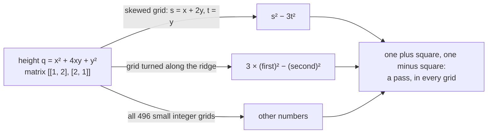

# Bilinear forms: a matrix that pairs two vectors instead of moving one, the symmetric ones are quadratic forms, the alternating ones measure signed area, and the sign count never changes

[Syllabus](../../../SYLLABUS.md) → [Algebra](../README.md) → [Eigenvalues and Symmetric Matrices](../README.md#s07) → Bilinear forms

---

## General Overview

A surveyor models the ground near the top of a mountain pass. Take $`x`$ steps east and $`y`$ steps north, each 100 metres. The height above the pass, in metres, is close to $`q(x, y) = x^2 + 4xy + y^2`$.

One step east, the ground is 1 m higher. One step east and one north, to (1, 1), it is 6 m higher: a ridge. One step east and one south, to (1, −1), it is 2 m lower: the valley. Up one way, down the other: a pass, not a summit or a hollow.

A second surveyor uses a skewed grid; a third turns the grid along the ridge. Each gets different numbers, yet each finds one rising and one falling direction. This card proves no grid can change that count.

The same kind of object measures area. Survey legs (3, 1) and (1, 2) span a field of 3 × 2 − 1 × 1 = 5 hectares (one step squared is one hectare). Swap the legs and the number is −5: the sign records the order.

**A bilinear form takes two vectors and returns one number; a change of grid turns its matrix $`B`$ into $`P^T B P`$; the symmetric ones are quadratic forms, whose counts of plus, minus and zero squares never change (Sylvester's law); the alternating ones measure signed area and always come in pairs, so their rank is even.**

**What kind of fact this is:** definitions, a rule derived in Why it works ($`P^T B P`$), and two theorems proved there: Sylvester's law of inertia and the even rank of an alternating form.

### The picture: three grids, one pass



The sizes change from grid to grid: 1 and −3, then 3 and −1. The signs do not.

---

## The formula

A **bilinear form** $`B(v, w)`$ takes two vectors and returns one number, linearly in each slot: double $`v`$ and the number doubles. Every such form is a matrix sandwich:

```math
B(v, w) = v^T B\, w = \sum_{i, j} v_i\, b_{ij}\, w_j
```

**Read it aloud:** multiply each matrix entry by the matching coordinate of each vector, and add it all up.

The entry $`b_{ij}`$ is $`B(e_i, e_j)`$, the form fed two axis arrows. For the pass, $`B(e_1, e_2)`$ = 2. One vector in both slots gives the quadratic form $`q(v) = B(v, v)`$ ([Quadratic forms](05-quadratic-forms-and-positive-definite.md)). A new grid puts its arrows down the columns of an invertible $`P`$, and the form's matrix becomes

```math
B' = P^T B P
```

**Read it aloud:** write both new arrows in old coordinates, then pair them with the old matrix.

Such matrices are **congruent**. **Sylvester's law of inertia**: a symmetric matrix is congruent to a diagonal of 1s, −1s and 0s, and the counts $`n_+`$, $`n_-`$, $`n_0`$ are the same for every $`P`$. For the pass: 1, 1, 0.

An **alternating form** gives $`\omega(v, v) = 0`$ for every $`v`$. In the plane it is a multiple of signed area:

```math
\omega\big((a, b), (c, d)\big) = ad - bc, \qquad \Omega = \begin{pmatrix} 0 & 1 \\ -1 & 0 \end{pmatrix}
```

**Read it aloud:** first leg's east times second leg's north, minus first leg's north times second leg's east.

Any alternating form regrids into copies of $`\Omega`$ down the diagonal, then zeros, so its rank is even.

| Symbol | Plain meaning | In our example | Push it up and the answer… |
| --- | --- | --- | --- |
| $`B`$, $`b_{ij}`$, $`\det B`$ | the form's matrix, its row $`i`$, column $`j`$ entry, its determinant | `[[1, 2], [2, 1]]`, determinant −3 | corners between −1 and 1: a hollow |
| $`B(v, w)`$ | the pairing: one number from two vectors | $`B(e_1, e_2)`$ = 2 | linear in each slot |
| $`u`$, $`v`$, $`w`$, $`e_1`$, $`e_2`$, $`(x, y)`$ | vectors fed in; the axis arrows east and north; coordinates in 100 m steps | (1, −1) is one step east, one south | double one vector, double the number |
| $`q(v)`$ | the quadratic form $`B(v, v)`$: height above the pass, in metres | $`q(1, -1)`$ = −2 | double the step, four times the height |
| $`P`$, $`P^T`$, $`v'`$, $`(s, t)`$ | new grid arrows as columns; $`P`$ flipped rows for columns; new coordinates | `[[1, −2], [0, 1]]`; $`s = x + 2y`$, $`t = y`$ | — |
| $`D`$, $`\lambda`$ | a diagonal $`P^T B P`$; the eigenvalues of $`B`$ | `[[1, 0], [0, −3]]`; 3 and −1 | sizes change with the grid |
| $`n_+`$, $`n_-`$, $`n_0`$ | counts of plus, minus and zero squares | 1, 1, 0 | never change with the grid |
| $`\omega`$, $`\Omega`$, $`a, b, c, d`$ | an alternating form, its matrix, and two legs' coordinates | $`\omega\big((3, 1), (1, 2)\big)`$ = 5 hectares | swap the legs: −5 |

### When it holds

- **Real numbers.** With complex numbers, $`-t^2 = (i t)^2`$ ($`i`$ squares to −1), so minus squares become plus. Only the zero count survives.
- **An invertible grid.** A flattening $`P`$ (determinant 0) can drop a square and hide the valley.
- **Symmetric matrix for Sylvester.** A lopsided matrix gives the same heights as its symmetric average; read $`q`$ from the average.
- **Alternating means $`\omega(v, v) = 0`$ for every $`v`$.** That forces the pairs, and so the even rank. Without it, `[[0, 1], [0, 0]]` has rank 1.

---

## Why it works

### Step 0: a form eats coordinates on both sides

A map moves a vector, so a new grid makes its matrix $`P^{-1} A P`$ ([Change of basis](01-change-of-basis.md)): translate in, move, translate back. A form hands no vector back. It takes two in, so the grid change acts once on each, and no inverse appears.

### Step 1: the congruence rule

Old coordinates are $`v = P v'`$ and $`w = P w'`$. Substitute:

```math
v^T B\, w = (P v')^T B\, (P w') = v'^T (P^T B P)\, w'
```

Transposing a product reverses it, which puts $`P^T`$ on the left. For $`P`$ = `[[1, −2], [0, 1]]` this gives `[[1, 0], [0, −3]]`.

Determinants multiply ([Determinants](../05-Solving%20Systems/04-determinants.md)), so $`\det(P^T B P) = (\det P)^2 \det B`$: the determinant's sign never changes.

### Step 2: diagonalise by completing the square

Gather every $`x`$ into one square:

```math
x^2 + 4xy + y^2 = (x + 2y)^2 - 3y^2 = s^2 - 3t^2
```

That is Step 1's grid. At (1, −1): $`s = -1`$, $`t = -1`$, and 1 − 3 = −2. Shorten the second arrow by $`1/\sqrt{3}`$ = 0.577350 and the diagonal is 1 and −1. More coordinates: one square each (for $`2xy`$, first set $`x = s + t`$, $`y = s - t`$).

A second road: [The spectral theorem](04-spectral-theorem.md) gives perpendicular unit arrows (1, 1)/√2 and (1, −1)/√2. Then $`P^T = P^{-1}`$, so the diagonal is the eigenvalues 3 and −1 ([Eigenvalues and eigenvectors](02-eigenvalues-and-eigenvectors.md)).

### Step 3: Sylvester's law — the counts belong to the form

The two roads give different numbers but the same signs, because $`n_+`$ can be read with no grid. It is the size of the largest flat space on which $`q`$ is above zero except at the origin. For the pass, the east line qualifies, but no plane does: the plane holds (1, −1), where $`q`$ = −2. So $`n_+`$ = 1 in every grid.

<details>
<summary>Detailed proof: two diagonal forms have the same counts</summary>

Diagonalise $`q`$ twice, with $`p`$ plus squares, then $`p'`$. Suppose $`p > p'`$.

The first grid's plus arrows span a space of size $`p`$, where $`q`$ is above zero except at the origin. The second grid's minus and zero arrows span a space of size (coordinates − $`p'`$), where $`q`$ is zero or below.

The sizes add to more than the number of coordinates, so the spaces share a nonzero vector, where $`q`$ is both above zero and not. Impossible, so $`p \le p'`$; swap the grids for $`p' \le p`$.

The same argument counts the minus squares; the zeros are the rest.

</details>

### Step 4: the heights fix the pairing

A symmetric form can be rebuilt from its quadratic form:

```math
B(v, w) = \tfrac{1}{2}\big(q(v + w) - q(v) - q(w)\big)
```

For the pass: $`\tfrac{1}{2}(6 - 1 - 1) = 2`$, the corner entry. Symmetric forms and quadratic forms are one family.

### Step 5: alternating forms come in pairs

Expand $`\omega(v + w, v + w) = 0`$. The two squared terms are zero, so $`\omega(v, w) + \omega(w, v) = 0`$. Swapping the vectors flips the sign: the matrix is **skew**, its transpose is its negative.

For the field, $`\omega\big((3, 1), (1, 2)\big)`$ = 5. Base times height agrees: the length of (3, 1) is 3.162278, the part of (1, 2) square to it is 1.581139 long, and the product is 5.000000 hectares.

Pick $`u`$ and $`w`$ with $`\omega(u, w)`$ = 1: one pair, with matrix $`\Omega`$. The rest splits off from them; repeat on it.

<details>
<summary>Detailed proof: an alternating form splits into pairs, so its rank is even</summary>

If $`\omega`$ is zero everywhere, its rank is 0. Otherwise pick $`u`$, $`w`$ with $`\omega(u, w)`$ = 1.

For any vector $`v`$, set

$`\displaystyle r = v - \omega(v, w)\, u + \omega(v, u)\, w .`$

Then $`\omega(r, u) = \omega(v, u) - 0 + \omega(v, u)\,\omega(w, u) = 0`$, because $`\omega(u, u) = 0`$ and $`\omega(w, u) = -1`$. Likewise $`\omega(r, w) = 0`$. So in a grid starting $`u`$, $`w`$, the matrix is $`\Omega`$ in the corner, zeros beside it, and a smaller alternating matrix for the rest. Repeat. Each round adds a block of rank 2, so the rank is twice the number of blocks.

</details>

---

## Worked numbers, by hand

| Step | Arithmetic | Value |
| --- | --- | --- |
| heights | $`q(1, 0)`$, $`q(1, 1)`$, $`q(1, -1)`$ | 1, 6, −2 |
| corner from heights | (6 − 1 − 1) / 2 | 2 |
| skewed grid | $`P^T B P`$ with $`P`$ = `[[1, −2], [0, 1]]` | `[[1, 0], [0, −3]]` |
| check at (1, −1) | $`s = -1`$, $`t = -1`$: 1 − 3 | −2 |
| eigenvalues | trace 2, determinant −3: $`1 \pm \sqrt{4}`$ | 3 and −1 |
| sign counts | from 1, −3 and from 3, −1 | **one plus, one minus, no zero** |
| field area | 3 × 2 − 1 × 1 | **5 hectares** |
| alternating 3 × 3 | Step 5 on `[[0, 1, 2], [-1, 0, 3], [-2, -3, 0]]`: pair $`e_1`$, $`e_2`$; r = (0, 0, 1) + 3(1, 0, 0) − 2(0, 1, 0) | one pair, zero on (3, −2, 1): **rank 2** |

Every grid shows one rising and one falling direction; the field is 5 hectares, legs counterclockwise.

### What breaks if you drop a piece

| Mistake | Comes out at | What went wrong |
| --- | --- | --- |
| Regridding a form like a map, $`P^{-1} B P`$ | `[[5, −6], [2, −3]]`, not symmetric | A form takes two vectors in; neither comes back out |
| A flattening grid, $`P`$ = `[[1, 1], [1, 1]]` | `[[6, 6], [6, 6]]`: one plus, one zero | Both arrows point up the ridge, so the valley is lost |
| Reading eigenvalues off $`P^T B P`$ | 1 and −3, not 3 and −1 | Congruence keeps only the signs |

---

## Code, from first principles, and it actually runs

Python uses the standard library only; Rust uses no crates. The sign counts come three independent ways: completed square, eigenvalues from trace and determinant, and a sweep of 720 directions. All three run on the pass and on all 496 invertible grids with entries −2 to 2. The area comes two ways, $`ad - bc`$ and base times height. Then 250 random skew matrices, sizes 2 to 6, get their rank by row reduction and as twice Step 5's pairs: the two agree, and every rank is even.

### Python

```python
# Bilinear forms and Sylvester's law -- the check behind the card.  Standard library only.  The pass: q = x^2 + 4xy + y^2,
# B = [[1, 2], [2, 1]]: sign counts three ways on B and every P^T B P; area two ways; ranks by elimination and by Step 5's pairs.
from fractions import Fraction
from math import sqrt, cos, sin, pi
B, P, OM, NUM = [[1, 2], [2, 1]], [[1, -2], [0, 1]], [[0, 1], [-1, 0]], range(-2, 3)
def mul(X, Y): return [[sum(X[i][k] * Y[k][j] for k in range(len(Y))) for j in range(len(Y[0]))] for i in range(len(X))]
def tr(X): return [list(r) for r in zip(*X)]
def form(M, v, w): return sum(v[i] * M[i][j] * w[j] for i in range(len(v)) for j in range(len(w)))
def det2(M): return M[0][0] * M[1][1] - M[0][1] * M[1][0]
def counts(vals): return (sum(v > 0 for v in vals), sum(v < 0 for v in vals), sum(v == 0 for v in vals))
def squares(M): return [Fraction(M[0][0]), Fraction(det2(M), M[0][0])]   # road one: a(x + b/a y)^2 + (det/a) y^2
def eigs(M): return [t / 2 + s * sqrt(t * t / 4 - det2(M)) for t in [M[0][0] + M[1][1]] for s in (1, -1)]  # road two
def sweep(M): return counts([form(M, [cos(a), sin(a)], [cos(a), sin(a)]) for a in (pi * (k + 0.5) / 360 for k in range(720))])[:2]  # road three
def rank(M):                                                             # elimination in exact fractions
    M, r = [[Fraction(x) for x in row] for row in M], 0
    for c in range(len(M[0])):
        i = next((i for i in range(r, len(M)) if M[i][c] != 0), None)
        if i is None: continue
        M[r], M[i] = M[i], M[r]
        for j in range(r + 1, len(M)): M[j] = [a - M[j][c] / M[r][c] * b for a, b in zip(M[j], M[r])]
        r += 1
    return r
def pairs(S):       # Step 5: split off u, w with c = w(u, w) not 0; each other v becomes c v - w(v, w) u + w(v, u) w
    om, V, k = (lambda v, w: form(S, v, w)), [[int(i == j) for j in range(len(S))] for i in range(len(S))], 0
    while uw := next(((u, w) for u in V for w in V if om(u, w)), None):
        V, k = [[om(*uw) * a - om(v, uw[1]) * b + om(v, uw[0]) * d for a, b, d in zip(v, *uw)] for v in V if v is not uw[0] and v is not uw[1]], k + 1
    return k, V                                                          # pairs found, and the vectors where the form is zero
def rnd(s=[2026]): s[0] = (s[0] * 1103515245 + 12345) % 2**31; return s[0] % 7 - 3   # a written-out random -3 to 3
q = lambda x, y: form(B, [x, y], [x, y])
D, Q, s3 = mul(mul(tr(P), B), P), [[1 / sqrt(2), 1 / sqrt(2)], [1 / sqrt(2), -1 / sqrt(2)]], 1 / sqrt(3)
T, sw = mul(mul(tr(Q), B), Q), sweep(B)
print(f"matrix B rows (1, 2) and (2, 1); q(1, 0) = {q(1, 0)}, q(1, 1) = {q(1, 1)}, q(1, -1) = {q(1, -1)}")
print(f"pairing B(e1, e2) = {form(B, [1, 0], [0, 1])}; from heights, (q(1, 1) - q(1, 0) - q(0, 1)) / 2 = {(q(1, 1) - q(1, 0) - q(0, 1)) // 2}")
print(f"completed square: P = {P}, P^T B P = {D}; at (1, -1), s = -1, t = -1, s^2 - 3t^2 = {form(D, [-1, -1], [-1, -1])}")
print(f"second arrow shortened by 1/sqrt(3) = {s3:.6f}: diagonal {D[0][0]:.6f} and {D[1][1] * s3 * s3:.6f}")
print(f"eigenvalues from trace 2 and determinant {det2(B)}: {eigs(B)[0]:.6f} and {eigs(B)[1]:.6f}")
print(f"turned grid (1, 1)/sqrt(2), (1, -1)/sqrt(2): diagonal {T[0][0]:.6f} and {T[1][1]:.6f}, corner {abs(T[0][1]):.6f}")
print(f"sign counts (plus, minus, zero): squares {counts(squares(B))}, eigenvalues {counts(eigs(B))}; directions up {sw[0]}, down {sw[1]} of 720")
regrid = [(R, mul(mul(tr(R), B), R)) for R in ([[a, b], [c, d]] for a in NUM for b in NUM for c in NUM for d in NUM if a * d - b * c)]
ok = all(counts(squares(C)) == counts(eigs(C)) == (1, 1, 0) and min(sweep(C)) > 0 for _, C in regrid)
dets, tops = all(det2(C) == det2(R) ** 2 * det2(B) for R, C in regrid), {round(eigs(C)[0], 6) for _, C in regrid}
print(f"{len(regrid)} grids: (1, 1, 0) by all three roads every time: {'yes' if ok else 'no'}; det = det(P)^2 x (-3): {'yes' if dets else 'no'}; different top eigenvalues {len(tops)}")
u, v, S3 = [3, 1], [1, 2], [[0, 1, 2], [-1, 0, 3], [-2, -3, 0]]
base, height = sqrt(u[0] ** 2 + u[1] ** 2), sqrt(sum((v[i] - (u[0] * v[0] + u[1] * v[1]) / (u[0] ** 2 + u[1] ** 2) * u[i]) ** 2 for i in range(2)))  # v minus its shadow on u
print(f"signed area of legs (3, 1), (1, 2): ad - bc = {form(OM, u, v)}; legs swapped {form(OM, v, u)}; a leg with itself {form(OM, u, u)}",
      f"base x height by dot products: {base:.6f} x {height:.6f} = {base * height:.6f}", sep="\n")
skews = [[[0] * m for _ in range(m)] for m in [2, 3, 4, 5, 6] * 50]
for S, i, j in [(S, i, j) for S in skews for i in range(len(S)) for j in range(i + 1, len(S))]: S[i][j] = rnd(); S[j][i] = -S[i][j]
seen = [(len(S), rank(S), 2 * pairs(S)[0]) for S in skews]               # rank by elimination, and twice the pairs
print(f"250 random skew matrices, (size, rank) seen: {sorted({(m, r) for m, r, _ in seen})}; rank = 2 x pairs every time: {'yes' if all(r == p for _, r, p in seen) else 'no'}")
print(f"Step 5 on {S3}: {pairs(S3)[0]} pair, zero on {pairs(S3)[1][0]}, rank {rank(S3)}; not alternating [[0, 1], [0, 0]]: rank {rank([[0, 1], [0, 0]])}")
X, F = mul(mul([[1, 2], [0, 1]], B), P), mul(mul([[1, 1], [1, 1]], B), [[1, 1], [1, 1]])
print(f"mistake 1, similarity P^-1 B P = {X}, symmetric: {'yes' if X == tr(X) else 'no'}", f"mistake 2, flattening grid P = [[1, 1], [1, 1]]: P^T B P = {F}, counts {counts(eigs(F))}", sep="\n")
print(f"mistake 3, eigenvalues read off P^T B P: {D[0][0]} and {D[1][1]}, not 3 and -1")
assert counts(squares(B)) == counts(eigs(B)) == (1, 1, 0) and sw == (480, 240)
assert ok and dets and len(tops) > 20                                  # the signs never move; the sizes do
assert D == [[1, 0], [0, -3]] and abs(T[0][0] - 3) < 1e-12 and abs(T[1][1] + 1) < 1e-12
assert abs(base * height - form(OM, u, v)) < 1e-12                      # area: two roads
assert all(r == p for _, r, p in seen) and pairs(S3) == (1, [[3, -2, 1]]) and rank(S3) == 2   # ranks: two roads
print("ALL CHECKS PASS")
```

**Ran 2026-11-23 on macOS, Python 3.14.10, standard library only. All checks passed. Output, pasted from the run:**

```
matrix B rows (1, 2) and (2, 1); q(1, 0) = 1, q(1, 1) = 6, q(1, -1) = -2
pairing B(e1, e2) = 2; from heights, (q(1, 1) - q(1, 0) - q(0, 1)) / 2 = 2
completed square: P = [[1, -2], [0, 1]], P^T B P = [[1, 0], [0, -3]]; at (1, -1), s = -1, t = -1, s^2 - 3t^2 = -2
second arrow shortened by 1/sqrt(3) = 0.577350: diagonal 1.000000 and -1.000000
eigenvalues from trace 2 and determinant -3: 3.000000 and -1.000000
turned grid (1, 1)/sqrt(2), (1, -1)/sqrt(2): diagonal 3.000000 and -1.000000, corner 0.000000
sign counts (plus, minus, zero): squares (1, 1, 0), eigenvalues (1, 1, 0); directions up 480, down 240 of 720
496 grids: (1, 1, 0) by all three roads every time: yes; det = det(P)^2 x (-3): yes; different top eigenvalues 31
signed area of legs (3, 1), (1, 2): ad - bc = 5; legs swapped -5; a leg with itself 0
base x height by dot products: 3.162278 x 1.581139 = 5.000000
250 random skew matrices, (size, rank) seen: [(2, 0), (2, 2), (3, 2), (4, 2), (4, 4), (5, 4), (6, 4), (6, 6)]; rank = 2 x pairs every time: yes
Step 5 on [[0, 1, 2], [-1, 0, 3], [-2, -3, 0]]: 1 pair, zero on [3, -2, 1], rank 2; not alternating [[0, 1], [0, 0]]: rank 1
mistake 1, similarity P^-1 B P = [[5, -6], [2, -3]], symmetric: no
mistake 2, flattening grid P = [[1, 1], [1, 1]]: P^T B P = [[6, 6], [6, 6]], counts (1, 0, 1)
mistake 3, eigenvalues read off P^T B P: 1 and -3, not 3 and -1
ALL CHECKS PASS
```

### Rust

Same numbers, same labels, built with `rustc --edition 2021 -O`.

```rust
// Bilinear forms and Sylvester's law -- the same check as the Python, in Rust.  No crates.  The pass: q = x^2 + 4xy + y^2,
// B = [[1, 2], [2, 1]]: sign counts three ways on B and every P^T B P; area two ways; ranks by elimination and by Step 5's pairs.
use std::collections::BTreeSet;
type M = Vec<Vec<i64>>;
fn mul(x: &M, y: &M) -> M { (0..x.len()).map(|i| (0..y[0].len()).map(|j| (0..y.len()).map(|k| x[i][k] * y[k][j]).sum()).collect()).collect() }
fn tr(x: &M) -> M { (0..x[0].len()).map(|j| (0..x.len()).map(|i| x[i][j]).collect()).collect() }
fn form(m: &M, v: &[i64], w: &[i64]) -> i64 { (0..v.len()).map(|i| (0..w.len()).map(|j| v[i] * m[i][j] * w[j]).sum::<i64>()).sum() }
fn formf(m: &M, v: [f64; 2], w: [f64; 2]) -> f64 { (0..2).map(|i| (0..2).map(|j| v[i] * m[i][j] as f64 * w[j]).sum::<f64>()).sum() }
fn det2(m: &M) -> i64 { m[0][0] * m[1][1] - m[0][1] * m[1][0] }
fn counts(v: &[f64]) -> (usize, usize, usize) { let n = |f: fn(f64) -> bool| v.iter().filter(|x| f(**x)).count(); (n(|x| x > 0.0), n(|x| x < 0.0), n(|x| x == 0.0)) }
fn squares(m: &M) -> Vec<f64> { vec![m[0][0] as f64, det2(m) as f64 / m[0][0] as f64] }   // road one
fn eigs(m: &M) -> Vec<f64> {                                                               // road two
    let t = (m[0][0] + m[1][1]) as f64; let r = (t * t / 4.0 - det2(m) as f64).sqrt(); vec![t / 2.0 + r, t / 2.0 - r] }
fn sweep(m: &M) -> (usize, usize) {                                                        // road three
    let c = counts(&(0..720).map(|k| { let a = std::f64::consts::PI * (k as f64 + 0.5) / 360.0; formf(m, [a.cos(), a.sin()], [a.cos(), a.sin()]) }).collect::<Vec<f64>>()); (c.0, c.1) }
fn rank(s: &M) -> usize {                                                                  // elimination
    let (mut m, mut r): (Vec<Vec<f64>>, usize) = (s.iter().map(|r| r.iter().map(|&x| x as f64).collect()).collect(), 0);
    for c in 0..m[0].len() {
        let Some(i) = (r..m.len()).find(|&i| m[i][c].abs() > 1e-9) else { continue };
        m.swap(r, i);
        for j in r + 1..m.len() { let f = m[j][c] / m[r][c]; for k in 0..m[0].len() { m[j][k] -= f * m[r][k] } }
        r += 1;
    }
    r
}
fn pairs(s: &M) -> (usize, M) {   // Step 5: split off u, w with c = w(u, w) not 0; each other v becomes c v - w(v, w) u + w(v, u) w
    let (n, mut k) = (s.len(), 0); let mut v: M = (0..n).map(|i| (0..n).map(|j| (i == j) as i64).collect()).collect();
    while let Some((a, b)) = (0..v.len()).flat_map(|a| (0..v.len()).map(move |b| (a, b))).find(|&(a, b)| form(s, &v[a], &v[b]) != 0) {
        let (u, w, c) = (v[a].clone(), v[b].clone(), form(s, &v[a], &v[b])); k += 1;
        v = (0..v.len()).filter(|&i| i != a && i != b).map(|i| (0..n).map(|t| c * v[i][t] - form(s, &v[i], &w) * u[t] + form(s, &v[i], &u) * w[t]).collect()).collect();
    }
    (k, v)                                                                                 // pairs found, and the vectors where the form is zero
}
fn yn(b: bool) -> &'static str { if b { "yes" } else { "no" } }
fn main() {
    let (b, p, om): (M, M, M) = (vec![vec![1, 2], vec![2, 1]], vec![vec![1, -2], vec![0, 1]], vec![vec![0, 1], vec![-1, 0]]);
    let q = |x: i64, y: i64| form(&b, &[x, y], &[x, y]);
    let (d, r2, s3) = (mul(&mul(&tr(&p), &b), &p), 1.0 / 2f64.sqrt(), 1.0 / 3f64.sqrt());
    let (t, sw) = ([[formf(&b, [r2, r2], [r2, r2]), formf(&b, [r2, r2], [r2, -r2])], [0.0, formf(&b, [r2, -r2], [r2, -r2])]], sweep(&b));
    println!("matrix B rows (1, 2) and (2, 1); q(1, 0) = {}, q(1, 1) = {}, q(1, -1) = {}", q(1, 0), q(1, 1), q(1, -1));
    println!("pairing B(e1, e2) = {}; from heights, (q(1, 1) - q(1, 0) - q(0, 1)) / 2 = {}", form(&b, &[1, 0], &[0, 1]), (q(1, 1) - q(1, 0) - q(0, 1)) / 2);
    println!("completed square: P = {:?}, P^T B P = {:?}; at (1, -1), s = -1, t = -1, s^2 - 3t^2 = {}", p, d, form(&d, &[-1, -1], &[-1, -1]));
    println!("second arrow shortened by 1/sqrt(3) = {:.6}: diagonal {:.6} and {:.6}", s3, d[0][0] as f64, d[1][1] as f64 * s3 * s3);
    println!("eigenvalues from trace 2 and determinant {}: {:.6} and {:.6}", det2(&b), eigs(&b)[0], eigs(&b)[1]);
    println!("turned grid (1, 1)/sqrt(2), (1, -1)/sqrt(2): diagonal {:.6} and {:.6}, corner {:.6}", t[0][0], t[1][1], t[0][1].abs());
    println!("sign counts (plus, minus, zero): squares {:?}, eigenvalues {:?}; directions up {}, down {} of 720", counts(&squares(&b)), counts(&eigs(&b)), sw.0, sw.1);
    let mut grids: Vec<M> = Vec::new();
    for a in -2..3 { for bb in -2..3 { for c in -2..3 { for dd in -2..3 { if a * dd - bb * c != 0 { grids.push(vec![vec![a, bb], vec![c, dd]]) } } } } }
    let (mut ok, mut dets, mut tops) = (true, true, BTreeSet::new());
    for r in &grids { let c = mul(&mul(&tr(r), &b), r);
        ok &= counts(&squares(&c)) == (1, 1, 0) && counts(&eigs(&c)) == (1, 1, 0) && sweep(&c).0.min(sweep(&c).1) > 0;
        dets &= det2(&c) == det2(r) * det2(r) * det2(&b);
        tops.insert((eigs(&c)[0] * 1e6).round() as i64);
    }
    println!("{} grids: (1, 1, 0) by all three roads every time: {}; det = det(P)^2 x (-3): {}; different top eigenvalues {}", grids.len(), yn(ok), yn(dets), tops.len());
    let (u, v) = ([3.0f64, 1.0], [1.0f64, 2.0]);
    let h: Vec<f64> = (0..2).map(|i| v[i] - (u[0] * v[0] + u[1] * v[1]) / (u[0] * u[0] + u[1] * u[1]) * u[i]).collect();
    let (base, height) = ((u[0] * u[0] + u[1] * u[1]).sqrt(), (h[0] * h[0] + h[1] * h[1]).sqrt());
    println!("signed area of legs (3, 1), (1, 2): ad - bc = {}; legs swapped {}; a leg with itself {}\nbase x height by dot products: {:.6} x {:.6} = {:.6}",
             form(&om, &[3, 1], &[1, 2]), form(&om, &[1, 2], &[3, 1]), form(&om, &[3, 1], &[3, 1]), base, height, base * height);
    let (mut seed, mut ranks, mut agree): (u64, BTreeSet<(usize, usize)>, bool) = (2026, BTreeSet::new(), true);
    for k in 0..250 {
        let m = 2 + k % 5; let mut s: M = vec![vec![0; m]; m];
        for i in 0..m { for j in i + 1..m { seed = (seed * 1103515245 + 12345) % (1u64 << 31); s[i][j] = (seed % 7) as i64 - 3; s[j][i] = -s[i][j] } }
        ranks.insert((m, rank(&s))); agree &= rank(&s) == 2 * pairs(&s).0;                  // rank by elimination, and twice the pairs
    }
    println!("250 random skew matrices, (size, rank) seen: {:?}; rank = 2 x pairs every time: {}", ranks.iter().collect::<Vec<_>>(), yn(agree));
    let (s3m, flat): (M, M) = (vec![vec![0, 1, 2], vec![-1, 0, 3], vec![-2, -3, 0]], vec![vec![1, 1], vec![1, 1]]);
    let (k3, rest) = pairs(&s3m);
    println!("Step 5 on {:?}: {} pair, zero on {:?}, rank {}; not alternating [[0, 1], [0, 0]]: rank {}", s3m, k3, rest[0], rank(&s3m), rank(&vec![vec![0, 1], vec![0, 0]]));
    let (x, f) = (mul(&mul(&vec![vec![1, 2], vec![0, 1]], &b), &p), mul(&mul(&flat, &b), &flat));
    println!("mistake 1, similarity P^-1 B P = {:?}, symmetric: {}\nmistake 2, flattening grid P = [[1, 1], [1, 1]]: P^T B P = {:?}, counts {:?}", x, yn(x == tr(&x)), f, counts(&eigs(&f)));
    println!("mistake 3, eigenvalues read off P^T B P: {} and {}, not 3 and -1", d[0][0], d[1][1]);
    assert!(counts(&squares(&b)) == (1, 1, 0) && counts(&eigs(&b)) == (1, 1, 0) && sw == (480, 240));
    assert!(ok && dets && tops.len() > 20);                                // the signs never move; the sizes do
    assert!(d == vec![vec![1, 0], vec![0, -3]] && (t[0][0] - 3.0).abs() < 1e-12 && (t[1][1] + 1.0).abs() < 1e-12);
    assert!((base * height - form(&om, &[3, 1], &[1, 2]) as f64).abs() < 1e-12);   // area: two roads
    assert!(agree && (k3, rest) == (1, vec![vec![3, -2, 1]]) && rank(&s3m) == 2);    // ranks: two roads
    println!("ALL CHECKS PASS");
}
```

**Ran 2026-11-23 on macOS, rustc 1.98.1, no crates. All checks passed. Output, pasted from the run:**

```
matrix B rows (1, 2) and (2, 1); q(1, 0) = 1, q(1, 1) = 6, q(1, -1) = -2
pairing B(e1, e2) = 2; from heights, (q(1, 1) - q(1, 0) - q(0, 1)) / 2 = 2
completed square: P = [[1, -2], [0, 1]], P^T B P = [[1, 0], [0, -3]]; at (1, -1), s = -1, t = -1, s^2 - 3t^2 = -2
second arrow shortened by 1/sqrt(3) = 0.577350: diagonal 1.000000 and -1.000000
eigenvalues from trace 2 and determinant -3: 3.000000 and -1.000000
turned grid (1, 1)/sqrt(2), (1, -1)/sqrt(2): diagonal 3.000000 and -1.000000, corner 0.000000
sign counts (plus, minus, zero): squares (1, 1, 0), eigenvalues (1, 1, 0); directions up 480, down 240 of 720
496 grids: (1, 1, 0) by all three roads every time: yes; det = det(P)^2 x (-3): yes; different top eigenvalues 31
signed area of legs (3, 1), (1, 2): ad - bc = 5; legs swapped -5; a leg with itself 0
base x height by dot products: 3.162278 x 1.581139 = 5.000000
250 random skew matrices, (size, rank) seen: [(2, 0), (2, 2), (3, 2), (4, 2), (4, 4), (5, 4), (6, 4), (6, 6)]; rank = 2 x pairs every time: yes
Step 5 on [[0, 1, 2], [-1, 0, 3], [-2, -3, 0]]: 1 pair, zero on [3, -2, 1], rank 2; not alternating [[0, 1], [0, 0]]: rank 1
mistake 1, similarity P^-1 B P = [[5, -6], [2, -3]], symmetric: no
mistake 2, flattening grid P = [[1, 1], [1, 1]]: P^T B P = [[6, 6], [6, 6]], counts (1, 0, 1)
mistake 3, eigenvalues read off P^T B P: 1 and -3, not 3 and -1
ALL CHECKS PASS
```

The two outputs match line for line.

### Lean

Lean proves the congruence rule, Sylvester's law and the even rank, for real matrices of every size.

- Take old coordinates $`v = P v'`$ and $`w = P w'`$. Then $`v^T B\, w = v'^T (P^T B P)\, w'`$.
- Take any square $`P`$ the size of $`B`$. Then $`\det(P^T B P) = (\det P)^2 \det B`$.
- Take a real symmetric matrix $`B`$. Then some invertible $`P`$ makes $`P^T B P`$ a diagonal of 1s, −1s and 0s.
- Suppose two invertible grids both turn $`B`$ into such a diagonal. Then both give the same $`n_+`$, the same $`n_-`$ and the same $`n_0`$.
- Take a real square matrix whose form gives $`\omega(v, v) = 0`$ for every $`v`$. Then its rank is even.
- The worked numbers also check: the pass heights, the skewed grid, the eigenvalues 3 and −1, the 5-hectare field, and both mistakes.

Python and Rust still check the 720-direction sweep, the 496 grids, the 250 random skew matrices, and base times height.

```lean
-- Bilinear forms: a change of grid turns a form's matrix B into Pᵀ B P, every real symmetric matrix is congruent to a diagonal of 1s, −1s and 0s whose counts are the same for every invertible P (Sylvester's law of inertia), and an alternating form has even rank.
import Mathlib.LinearAlgebra.Matrix.BilinearForm
import Mathlib.LinearAlgebra.Matrix.Rank
import Mathlib.LinearAlgebra.Matrix.Symmetric
import Mathlib.LinearAlgebra.Matrix.Determinant.Basic
import Mathlib.Basic.Real.Basic
import Mathlib.Basic.Sign.Basic
import Mathlib.Analysis.Matrix.Spectrum

open Matrix

lemma sylvester_quad_congr {n : ℕ} (B P : Matrix (Fin n) (Fin n) ℝ) (v w : Fin n → ℝ) :
    (P *ᵥ v) ⬝ᵥ (B *ᵥ (P *ᵥ w)) = v ⬝ᵥ ((Pᵀ * B * P) *ᵥ w) := by
  simp only [dotProduct_mulVec, ← vecMul_vecMul, vecMul_transpose]

#print axioms sylvester_quad_congr

lemma sylvester_card_sum {n : ℕ} (s : Fin n → SignType) :
    (Finset.univ.filter fun i => s i = 1).card + (Finset.univ.filter fun i => s i = -1).card +
      (Finset.univ.filter fun i => s i = 0).card = n := by
  simp only [Finset.card_filter, ← Finset.sum_add_distrib]
  have : ∀ i, ((if s i = 1 then 1 else 0) + (if s i = -1 then 1 else 0) +
      (if s i = 0 then 1 else 0) : ℕ) = 1 := by
    intro i; cases s i <;> decide
  simp [this]

#print axioms sylvester_card_sum

lemma sylvester_pos_le {n : ℕ} (B P Q : Matrix (Fin n) (Fin n) ℝ) (s t : Fin n → SignType)
    (hQ : IsUnit Q.det)
    (hs : Pᵀ * B * P = diagonal (fun i => ((s i : SignType) : ℝ)))
    (ht : Qᵀ * B * Q = diagonal (fun i => ((t i : SignType) : ℝ))) :
    (Finset.univ.filter fun i => s i = 1).card ≤ (Finset.univ.filter fun i => t i = 1).card := by
  by_contra hlt
  push Not at hlt
  let E : ({i // s i = 1} → ℝ) →ₗ[ℝ] (Fin n → ℝ) :=
    LinearMap.pi (fun i => if h : s i = 1 then LinearMap.proj ⟨i, h⟩ else 0)
  have hE : ∀ x i, E x i = if h : s i = 1 then x ⟨i, h⟩ else 0 := by
    intro x i; simp only [E, LinearMap.pi_apply]; split_ifs <;> simp
  let R : (Fin n → ℝ) →ₗ[ℝ] ({j // t j = 1} → ℝ) := LinearMap.funLeft ℝ ℝ Subtype.val
  let f := R ∘ₗ (Q⁻¹ * P).mulVecLin ∘ₗ E
  have hker : LinearMap.ker f ≠ ⊥ := by
    apply LinearMap.ker_ne_bot_of_finrank_lt
    simp only [Module.finrank_fintype_fun_eq_card, Fintype.card_subtype]
    exact hlt
  obtain ⟨x, hx, hx0⟩ := Submodule.exists_mem_ne_zero_of_ne_bot hker
  set X := E x with hX
  set y := (Q⁻¹ * P) *ᵥ X with hy
  have hX0 : ∃ i, s i = 1 ∧ X i ≠ 0 := by
    by_contra hc
    push Not at hc
    apply hx0
    funext i
    have := hc i.1 i.2
    rw [hX, hE] at this
    simpa [i.2] using this
  have hy0 : ∀ j, t j = 1 → y j = 0 := by
    intro j hj
    have := congrFun (LinearMap.mem_ker.mp hx) ⟨j, hj⟩
    simpa [f, R, LinearMap.funLeft, hy, hX] using this
  have hQy : Q *ᵥ y = P *ᵥ X := by
    rw [hy, mulVec_mulVec, ← Matrix.mul_assoc, mul_nonsing_inv Q hQ, Matrix.one_mul]
  have h1 := sylvester_quad_congr B P X X
  have h2 := sylvester_quad_congr B Q y y
  rw [hQy] at h2
  have hd : ∀ (u : Fin n → SignType) (z : Fin n → ℝ),
      (diagonal fun i => ((u i : SignType) : ℝ)) *ᵥ z = fun i => ((u i : SignType) : ℝ) * z i := by
    intro u z; funext i; exact mulVec_diagonal _ _ _
  rw [hs, hd] at h1
  rw [ht, hd] at h2
  have hpos : 0 < X ⬝ᵥ fun i => ((s i : SignType) : ℝ) * X i := by
    obtain ⟨i0, hi0, hXi0⟩ := hX0
    apply Finset.sum_pos'
    · intro i _
      by_cases h : s i = 1
      · simp [h, mul_self_nonneg]
      · have : X i = 0 := by rw [hX, hE]; simp [h]
        simp [this]
    · exact ⟨i0, Finset.mem_univ _, by simp [hi0, mul_self_pos.mpr hXi0]⟩
  have hnonpos : (y ⬝ᵥ fun i => ((t i : SignType) : ℝ) * y i) ≤ 0 := by
    apply Finset.sum_nonpos
    intro j _
    by_cases h : t j = 1
    · simp [hy0 j h]
    · have : ((t j : SignType) : ℝ) ≤ 0 := by
        cases ht' : t j
        · simp
        · simp
        · exact absurd ht' h
      have := mul_nonpos_of_nonpos_of_nonneg this (mul_self_nonneg (y j))
      linarith [show y j * (((t j : SignType) : ℝ) * y j) = ((t j : SignType) : ℝ) * (y j * y j)
        by ring]
  linarith

#print axioms sylvester_pos_le

/-- **Sylvester's law of inertia.** A real symmetric matrix `B` is congruent to a diagonal of
1s, −1s and 0s: some invertible grid `P` gives `Pᵀ B P = diag(s)` with every `s i` in
{1, −1, 0}. And the counts of plus, minus and zero squares are the same for every such grid:
if invertible `P` and `Q` both turn `B` into sign diagonals `s` and `t`, then `s` and `t` have
the same number of 1s, the same number of −1s and the same number of 0s. -/
theorem sylvesters_law_of_inertia {n : ℕ} (B : Matrix (Fin n) (Fin n) ℝ) (hB : B.IsSymm) :
    (∃ (P : Matrix (Fin n) (Fin n) ℝ) (s : Fin n → SignType),
        IsUnit P.det ∧ Pᵀ * B * P = diagonal (fun i => ((s i : SignType) : ℝ))) ∧
    ∀ (P Q : Matrix (Fin n) (Fin n) ℝ) (s t : Fin n → SignType),
      IsUnit P.det → IsUnit Q.det →
      Pᵀ * B * P = diagonal (fun i => ((s i : SignType) : ℝ)) →
      Qᵀ * B * Q = diagonal (fun i => ((t i : SignType) : ℝ)) →
      (Finset.univ.filter fun i => s i = 1).card = (Finset.univ.filter fun i => t i = 1).card ∧
      (Finset.univ.filter fun i => s i = -1).card = (Finset.univ.filter fun i => t i = -1).card ∧
      (Finset.univ.filter fun i => s i = 0).card = (Finset.univ.filter fun i => t i = 0).card := by
  refine ⟨?_, ?_⟩
  · have hA : B.IsHermitian := isHermitian_iff_isSymm.mpr hB
    set U : Matrix (Fin n) (Fin n) ℝ := (hA.eigenvectorUnitary : Matrix (Fin n) (Fin n) ℝ) with hU
    set ev := hA.eigenvalues with hev
    have hD : Uᵀ * B * U = diagonal ev := by
      have h := hA.conjStarAlgAut_star_eigenvectorUnitary
      rw [Unitary.conjStarAlgAut_star_apply] at h
      have hst : (star hA.eigenvectorUnitary : Matrix (Fin n) (Fin n) ℝ) = Uᵀ := by
        rw [star_eq_conjTranspose, conjTranspose_eq_transpose_of_trivial]
      rw [hst] at h
      rw [h]
      congr 1
    have hUunit : IsUnit U.det := by
      apply Matrix.isUnit_det_of_left_inverse (B := Uᵀ)
      have := Unitary.coe_star_mul_self hA.eigenvectorUnitary
      rwa [star_eq_conjTranspose, conjTranspose_eq_transpose_of_trivial] at this
    let d : Fin n → ℝ := fun i => if ev i = 0 then 1 else 1 / Real.sqrt |ev i|
    refine ⟨U * diagonal d, fun i => SignType.sign (ev i), ?_, ?_⟩
    · rw [det_mul, det_diagonal]
      refine hUunit.mul (isUnit_iff_ne_zero.mpr (Finset.prod_ne_zero_iff.mpr fun i _ => ?_))
      simp only [d]
      split_ifs with h
      · exact one_ne_zero
      · have : 0 < |ev i| := abs_pos.mpr h
        positivity
    · rw [transpose_mul, diagonal_transpose, show diagonal d * Uᵀ * B * (U * diagonal d) =
          diagonal d * (Uᵀ * B * U) * diagonal d by simp only [Matrix.mul_assoc], hD,
        diagonal_mul_diagonal, diagonal_mul_diagonal]
      congr 1
      funext i
      simp only [d]
      rcases lt_trichotomy (ev i) 0 with h | h | h
      · have h0 : ev i ≠ 0 := h.ne
        simp only [h0, ↓reduceIte]; rw [sign_neg h, abs_of_neg h]
        have hs : 0 < -ev i := neg_pos.mpr h
        have := Real.sq_sqrt hs.le
        field_simp
        simp
        nlinarith [this]
      · simp [h]
      · have h0 : ev i ≠ 0 := h.ne'
        simp only [h0, ↓reduceIte]; rw [sign_pos h, abs_of_pos h]
        have := Real.sq_sqrt h.le
        field_simp
        simp
        nlinarith [this]
  · intro P Q s t hP hQ hs ht
    have hneg : ∀ (R : Matrix (Fin n) (Fin n) ℝ) (u : Fin n → SignType),
        Rᵀ * B * R = diagonal (fun i => ((u i : SignType) : ℝ)) →
        Rᵀ * (-B) * R = diagonal (fun i => ((-u i : SignType) : ℝ)) := by
      intro R u h
      rw [Matrix.mul_neg, Matrix.neg_mul, h, diagonal_neg]
      congr 1; funext i; simp
    have hfilt : ∀ u : Fin n → SignType,
        (Finset.univ.filter fun i => -u i = 1) = (Finset.univ.filter fun i => u i = -1) := by
      intro u; ext i; simp [neg_eq_iff_eq_neg]
    have hp : (Finset.univ.filter fun i => s i = 1).card =
        (Finset.univ.filter fun i => t i = 1).card :=
      le_antisymm (sylvester_pos_le B P Q s t hQ hs ht) (sylvester_pos_le B Q P t s hP ht hs)
    have hm : (Finset.univ.filter fun i => s i = -1).card =
        (Finset.univ.filter fun i => t i = -1).card := by
      rw [← hfilt s, ← hfilt t]
      exact le_antisymm
        (sylvester_pos_le (-B) P Q _ _ hQ (hneg P s hs) (hneg Q t ht))
        (sylvester_pos_le (-B) Q P _ _ hP (hneg Q t ht) (hneg P s hs))
    have hs3 := sylvester_card_sum s
    have ht3 := sylvester_card_sum t
    refine ⟨hp, hm, ?_⟩
    omega

/-- **The congruence rule.** If the new grid's arrows are the columns of `P`, so old
coordinates are `v = P v'` and `w = P w'`, then `vᵀ B w = v'ᵀ (Pᵀ B P) w'`: in the new grid the
form's matrix is `Pᵀ B P`. And `det (Pᵀ B P) = (det P)² det B`, so the determinant's sign
never changes under an invertible grid. -/
theorem congruence_rule {n : ℕ} (B P : Matrix (Fin n) (Fin n) ℝ) :
    (∀ v' w' : Fin n → ℝ,
      (P *ᵥ v') ⬝ᵥ (B *ᵥ (P *ᵥ w')) = v' ⬝ᵥ ((Pᵀ * B * P) *ᵥ w')) ∧
    (Pᵀ * B * P).det = P.det ^ 2 * B.det := by
  refine ⟨fun v w => ?_, ?_⟩
  · simp only [dotProduct_mulVec, ← vecMul_vecMul, vecMul_transpose]
  · rw [det_mul, det_mul, det_transpose]; ring

/-- **Alternating forms have even rank.** If the form `ω(v, w) = vᵀ S w` is alternating,
meaning `ω(v, v) = 0` for every vector `v`, then the rank of its matrix `S` is even. -/
theorem alternating_form_rank_even {n : ℕ} (S : Matrix (Fin n) (Fin n) ℝ)
    (hS : LinearMap.IsAlt (Matrix.toBilin' S)) : Even S.rank := by
  obtain ⟨W, hW⟩ := Submodule.exists_isCompl (LinearMap.ker (Sᵀ.mulVecLin))
  have hdim : Module.finrank ℝ W = S.rank := by
    have h1 := Submodule.finrank_add_eq_of_isCompl hW
    have h2 := LinearMap.finrank_range_add_finrank_ker (Sᵀ.mulVecLin)
    rw [← rank_transpose S]
    unfold Matrix.rank
    simp only [Module.finrank_fin_fun] at h1 h2
    omega
  set B' := (Matrix.toBilin' S).restrict W
  have hnd : B'.Nondegenerate := by
    apply LinearMap.BilinForm.Nondegenerate.ofSeparatingLeft
    intro w hw
    have hall : ∀ v : Fin n → ℝ, (w : Fin n → ℝ) ⬝ᵥ S *ᵥ v = 0 := by
      intro v
      have hv : v ∈ LinearMap.ker (Sᵀ.mulVecLin) ⊔ W := by rw [hW.sup_eq_top]; trivial
      obtain ⟨k, hk, u, hu, rfl⟩ := Submodule.mem_sup.mp hv
      have h1 : (w : Fin n → ℝ) ⬝ᵥ S *ᵥ u = 0 := by
        have := hw ⟨u, hu⟩
        simpa [B', LinearMap.BilinForm.restrict_apply, Matrix.toBilin'_apply'] using this
      have h2 : (w : Fin n → ℝ) ⬝ᵥ S *ᵥ k = 0 := by
        have hk' : k ᵥ* S = 0 := by simpa using hk
        have := hS.neg k (w : Fin n → ℝ)
        rw [Matrix.toBilin'_apply', Matrix.toBilin'_apply', dotProduct_mulVec, hk',
          zero_dotProduct, neg_zero] at this
        exact this.symm
      rw [mulVec_add, dotProduct_add, h1, h2, add_zero]
    have hwK : (w : Fin n → ℝ) ∈ LinearMap.ker (Sᵀ.mulVecLin) := by
      have : (w : Fin n → ℝ) ᵥ* S = 0 := by
        ext i
        have := hall (Pi.single i 1)
        rw [dotProduct_mulVec] at this
        simpa [dotProduct_single] using this
      simpa using this
    have := hW.disjoint.le_bot ⟨hwK, w.2⟩
    exact Subtype.ext (by simpa using this)
  set b := Module.finBasis ℝ W
  set M := LinearMap.BilinForm.toMatrix b B'
  have hdet := (LinearMap.BilinForm.nondegenerate_iff_det_ne_zero b).mp hnd
  have hskew : Mᵀ = -M := by
    ext i j
    show M j i = - M i j
    simp only [M, LinearMap.BilinForm.toMatrix_apply, B', LinearMap.BilinForm.restrict_apply,
      LinearMap.domRestrict_apply]
    exact (hS.neg _ _).symm
  have h : M.det = (-1) ^ Module.finrank ℝ W * M.det := by
    conv_lhs => rw [← det_transpose, hskew, det_neg]
    simp
  have hpow : ((-1 : ℝ)) ^ Module.finrank ℝ W = 1 := by
    have := mul_right_cancel₀ hdet (h.symm.trans (one_mul _).symm)
    exact this
  rw [← hdim]
  exact (neg_one_pow_eq_one_iff_even (by norm_num)).mp hpow

-- The pass: q(x, y) = x² + 4xy + y² has matrix [[1, 2], [2, 1]]; heights at (1, 0), (1, 1),
-- (1, −1) are 1, 6, −2.
example : ![1, 0] ⬝ᵥ (!![(1 : ℤ), 2; 2, 1] *ᵥ ![1, 0]) = 1 := by
  simp [dotProduct, mulVec, Fin.sum_univ_two]
example : ![1, 1] ⬝ᵥ (!![(1 : ℤ), 2; 2, 1] *ᵥ ![1, 1]) = 6 := by
  simp [dotProduct, mulVec, Fin.sum_univ_two]
example : ![1, -1] ⬝ᵥ (!![(1 : ℤ), 2; 2, 1] *ᵥ ![1, -1]) = -2 := by
  simp [dotProduct, mulVec, Fin.sum_univ_two]

-- The pairing B(e₁, e₂) = 2, and from heights (q(1, 1) − q(1, 0) − q(0, 1)) / 2 = (6 − 1 − 1) / 2 = 2.
example : ![1, 0] ⬝ᵥ (!![(1 : ℤ), 2; 2, 1] *ᵥ ![0, 1]) = 2 := by
  simp [dotProduct, mulVec, Fin.sum_univ_two]
example : ((6 : ℤ) - 1 - 1) / 2 = 2 := by norm_num

-- Completing the square: P = [[1, −2], [0, 1]] gives Pᵀ B P = [[1, 0], [0, −3]].
example : (!![(1 : ℤ), -2; 0, 1])ᵀ * !![(1 : ℤ), 2; 2, 1] * !![(1 : ℤ), -2; 0, 1] =
    !![1, 0; 0, -3] := by
  ext i j; fin_cases i <;> fin_cases j <;> simp [Matrix.mul_apply, Fin.sum_univ_two]

-- det B = −3, and the eigenvalues are 3 and −1 (eigenvectors (1, 1) and (1, −1)).
example : (!![(1 : ℤ), 2; 2, 1]).det = -3 := by simp [det_fin_two]
example : !![(1 : ℤ), 2; 2, 1] *ᵥ ![1, 1] = (3 : ℤ) • ![1, 1] := by
  ext i; fin_cases i <;> simp [mulVec, dotProduct, Fin.sum_univ_two]
example : !![(1 : ℤ), 2; 2, 1] *ᵥ ![1, -1] = (-1 : ℤ) • ![1, -1] := by
  ext i; fin_cases i <;> simp [mulVec, dotProduct, Fin.sum_univ_two]

-- Signed area: legs (3, 1), (1, 2) give ad − bc = 5 with Ω = [[0, 1], [−1, 0]]; swapped, −5;
-- a leg with itself, 0.
example : ![3, 1] ⬝ᵥ (!![(0 : ℤ), 1; -1, 0] *ᵥ ![1, 2]) = 5 := by
  simp [dotProduct, mulVec, Fin.sum_univ_two]
example : ![1, 2] ⬝ᵥ (!![(0 : ℤ), 1; -1, 0] *ᵥ ![3, 1]) = -5 := by
  simp [dotProduct, mulVec, Fin.sum_univ_two]
example : ![3, 1] ⬝ᵥ (!![(0 : ℤ), 1; -1, 0] *ᵥ ![3, 1]) = 0 := by
  simp [dotProduct, mulVec, Fin.sum_univ_two]

-- Step 5 on [[0, 1, 2], [−1, 0, 3], [−2, −3, 0]]: the leftover vector (3, −2, 1) pairs to zero
-- with everything.
example : !![(0 : ℤ), 1, 2; -1, 0, 3; -2, -3, 0] *ᵥ ![3, -2, 1] = 0 := by
  ext i; fin_cases i <;> simp [mulVec, dotProduct, Fin.sum_univ_succ]

-- Mistake 1: similarity P⁻¹ B P = [[1, 2], [0, 1]] B [[1, −2], [0, 1]] = [[5, −6], [2, −3]].
example : !![(1 : ℤ), 2; 0, 1] * !![(1 : ℤ), -2; 0, 1] = 1 := by
  ext i j; fin_cases i <;> fin_cases j <;> simp [Matrix.mul_apply, Fin.sum_univ_two]
example : !![(1 : ℤ), 2; 0, 1] * !![(1 : ℤ), 2; 2, 1] * !![(1 : ℤ), -2; 0, 1] =
    !![5, -6; 2, -3] := by
  ext i j; fin_cases i <;> fin_cases j <;> simp [Matrix.mul_apply, Fin.sum_univ_two]

-- Mistake 2: the flattening grid P = [[1, 1], [1, 1]] gives Pᵀ B P = [[6, 6], [6, 6]].
example : (!![(1 : ℤ), 1; 1, 1])ᵀ * !![(1 : ℤ), 2; 2, 1] * !![(1 : ℤ), 1; 1, 1] =
    !![6, 6; 6, 6] := by
  ext i j; fin_cases i <;> fin_cases j <;> simp [Matrix.mul_apply, Fin.sum_univ_two]

#print axioms sylvesters_law_of_inertia
#print axioms congruence_rule
#print axioms alternating_form_rank_even
```

**Checked 2026-11-23 on macOS, Lean 4.36.0-rc2, Mathlib v4.36.0-rc2. Every proof is complete and uses only Lean's standard axioms. Output, pasted from the run:**

```
'sylvester_quad_congr' depends on axioms: [propext, Classical.choice, Quot.sound]
'sylvester_card_sum' depends on axioms: [propext, Classical.choice, Quot.sound]
'sylvester_pos_le' depends on axioms: [propext, Classical.choice, Quot.sound]
'sylvesters_law_of_inertia' depends on axioms: [propext, Classical.choice, Quot.sound]
'congruence_rule' depends on axioms: [propext, Classical.choice, Quot.sound]
'alternating_form_rank_even' depends on axioms: [propext, Classical.choice, Quot.sound]
```

> [!TIP]
> **Try changing**
> Guess first, then run it.
> - **A hollow.** Set `B` to `[[2, 1], [1, 2]]`. Guess the counts: (2, 0, 0) by every road, and the first assert stops it.
> - **A grid that does not complete the square.** Set `P` to `[[1, 1], [0, 1]]`: $`P^T B P`$ is `[[1, 3], [3, 6]]`, not diagonal, and the third assert stops it.
> - **Break the alternating rule.** Change `S[j][i] = -S[i][j]` to `S[j][i] = S[i][j]`: odd ranks appear, and the last assert stops it.

---

## The usual mistake

> [!warning]
> **Changing the grid of a form as if it were a map.** $`P^{-1} B P`$ is for matrices that move vectors; on the skewed grid it gives `[[5, −6], [2, −3]]`, not even symmetric. A form takes both vectors in: $`P^T B P`$ gives `[[1, 0], [0, −3]]`.
>
> - **Expecting the eigenvalues to survive.** $`P^T B P`$ shows 1 and −3; the eigenvalues are 3 and −1. Only the signs match.
> - Cross-term and diagonal traps: [Quadratic forms](05-quadratic-forms-and-positive-definite.md).

---

## Where you meet it in real life

- **Maps and terrain.** Near a flat point, height is a quadratic form; one plus and one minus means a pass, in any map grid.
- **Classifying equations.** Sign counts name a partial differential equation elliptic, parabolic or hyperbolic, in any coordinates.
- **Special relativity.** Every observer finds one time square against three space squares of opposite sign.
- **Area and turning direction.** Surveyors and graphics programs find areas and left-or-right turns with $`ad - bc`$; the sign says counterclockwise or clockwise.
- **Mechanics.** Position and momentum come in pairs, measured by an alternating form.

> **Say it back**
> A bilinear form turns two vectors into one number. A new grid turns its matrix $`B`$ into $`P^T B P`$, because both vectors go in. Completing squares makes a symmetric form diagonal, and its counts of plus, minus and zero squares never depend on the grid: the pass is one plus, one minus. An alternating form measures signed area, splits into pairs, and so has even rank.

---

## What this builds on

- [Quadratic forms](05-quadratic-forms-and-positive-definite.md): the form $`x^T A x`$, the 2 in the cross term, and the indefinite matrix `[[1, 2], [2, 1]]`.
- [Change of basis](01-change-of-basis.md): new arrows down the columns of $`P`$, and the map rule $`P^{-1} A P`$ that a form does not follow.
- [Determinants](../05-Solving%20Systems/04-determinants.md): $`ad - bc`$ as signed area, and the product rule behind $`(\det P)^2 \det B`$.

## Where this goes next

- [Elliptic, parabolic, hyperbolic](../../19-Partial%20differential%20equations/01-Classification%20and%20Well-Posedness/04-classification-elliptic-parabolic-hyperbolic.md): Sylvester's law in any size, with a computer-checked proof, naming three families of equations.
- [Extrema in several variables](../../06-Calculus%20and%20analysis/07-Several%20Variables/06-multivariable-extrema.md): second-derivative sign counts telling peaks, pits and saddles apart.
- [Symplectic form](../../23-Differential%20geometry%20and%20Lie%20groups/04-Differential%20Forms/10-symplectic-form-and-hamiltonian-flow.md): an alternating form that drives how mechanical systems move.
- [Generalised eigenproblems](../../16-Numerical%20analysis/03-Numerical%20Linear%20Algebra/15-generalised-eigenvalue-problems.md): Kx = lambda M x, from masses on springs to the QZ algorithm.

This card leaves open what survives when the numbers are not real: over the rationals, for example, a form keeps far more than its sign counts.

---

## Sources

Verified 2026-11-23: every link below resolves to the publisher's page.

- Sylvester, J. J. "A demonstration of the theorem that every homogeneous quadratic polynomial is reducible by real orthogonal substitutions to the form of a sum of positive and negative squares." *Philosophical Magazine* 4 (1852): 138–142. [doi:10.1080/14786445208647087](https://doi.org/10.1080/14786445208647087). The law of inertia, in its original form.
- Artin, Michael. *Algebra*, Classic Version, 2nd ed. Pearson. [Publisher page](https://www.pearson.com/en-us/subject-catalog/p/Artin-Algebra-Classic-Version-2nd-Edition/P200000006078/9780137980994). Chapter 8: bilinear forms, congruence, Sylvester's law and skew-symmetric forms.
- Axler, Sheldon. *Linear Algebra Done Right*, 4th ed. Springer, 2024. Chapter 9, "Multilinear Algebra and Determinants": [doi:10.1007/978-3-031-41026-0_9](https://doi.org/10.1007/978-3-031-41026-0_9). Section 9A: bilinear, symmetric and alternating forms, their matrices and congruence.
