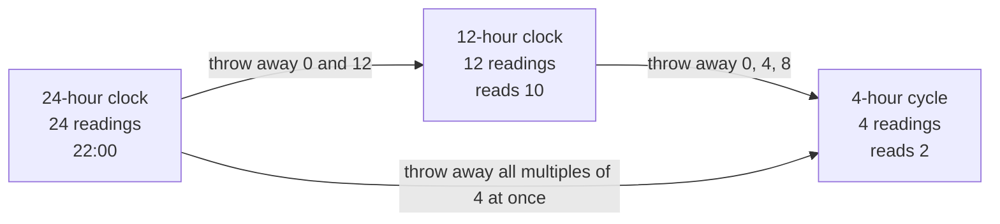
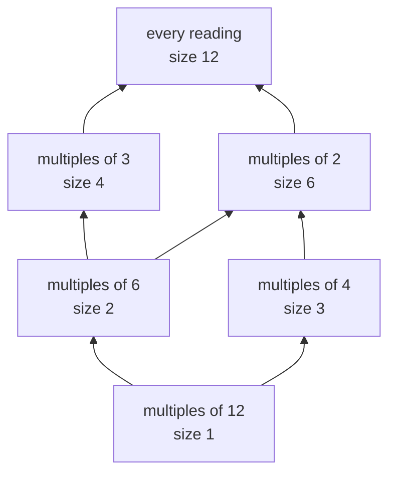

# The isomorphism theorems: collapsing in two stages is collapsing once, and the subgroups of a quotient are the subgroups above the kernel

[Syllabus](../../../SYLLABUS.md) → [Algebra](../README.md) → [Groups](../README.md#s08) → The isomorphism theorems

---

## General Overview

A medicine is due every 4 hours from midnight: 00:00, 04:00, and so on to 20:00. At 22:00 what matters is the time since the last dose: 2 hours.

Two routes give that 2. Divide the 24-hour reading by 4: 22 leaves 2. Or read the wall clock, which shows 10, whose dose marks are 0, 4 and 8: 10 is 2 past 8. Same answer, every hour.

That agreement is the **third isomorphism theorem**: collapsing a group in two stages gives the same group as collapsing it once. The **correspondence theorem** says which subgroups a collapsed group has: the subgroups of the big group that contain what was thrown away. The 12-hour clock has six, one for each of 1, 2, 3, 4, 6 and 12 hours.

**Collapsing first by a small normal subgroup and then by the rest gives the same quotient as collapsing by the larger one at once, and the subgroups of any quotient are the subgroups above its kernel, renamed.**

**What kind of fact this is:** three theorems, proved in Why it works: the second and third isomorphism theorems from the first, and the correspondence theorem from the map to piles.

### The picture: two routes to the 4-hour cycle



Two stages on top, one below: same group, same reading.

---

## The formula

Notation from [Normal subgroups and quotient groups](06-normal-subgroups-and-quotient-groups.md): a **normal** subgroup $`N`$ of a group $`G`$ is one that every conjugation (do a move, then a member of N, then undo the move) leaves in place. Its **piles** (cosets) $`gN`$ form the **quotient group** $`G/N`$, said "G over N". The sign $`\cong`$ means isomorphic: one group under two sets of names. Bars count members: $`\lvert H\rvert`$ is the size of $`H`$.

**The third theorem.** Take two normal subgroups of $`G`$ with $`K`$ inside $`N`$. The piles of $`K`$ that lie inside $`N`$ form a normal subgroup $`N/K`$ of $`G/K`$, and

```math
(G/K)\,/\,(N/K) \;\cong\; G/N
```

**Read it aloud:** collapse by K, then by what is left of N, and the result is the group from collapsing by N at once.

**The second, or diamond, theorem.** Take any subgroup $`H`$ and a normal subgroup $`N`$. Write $`HN`$ for every member of $`H`$ combined with every member of $`N`$, and $`H \cap N`$ for their overlap. Then $`HN`$ is a subgroup, and

```math
HN/N \;\cong\; H/(H\cap N), \qquad \lvert HN\rvert = \frac{\lvert H\rvert\,\lvert N\rvert}{\lvert H\cap N\rvert}
```

**Read it aloud:** what H adds on top of N is H with its overlap with N thrown away.

**The correspondence theorem.** For $`N`$ normal in $`G`$, sending a subgroup $`S`$ that contains $`N`$ to its piles $`S/N`$ matches those subgroups one to one with all subgroups of $`G/N`$. It keeps containment, the index (number of piles) and normality.

| Symbol | Plain meaning | In our example | Push it up and the answer… |
| --- | --- | --- | --- |
| $`G`$ | the group collapsed | 24 readings; the tile's 8 moves | — |
| $`K`$, $`N`$ | normal subgroups thrown away, smaller and larger | 0 and 12; the 6 multiples of 4 | bigger $`N`$: fewer piles in $`G/N`$ |
| $`H`$, $`S`$ | any subgroup; a subgroup containing $`N`$ | the 4 multiples of 6; the 12 even readings | a bigger $`HN`$; more piles in $`S/N`$ |
| $`HN`$, $`H \cap N`$ | all products; the overlap | the 12 even readings; 0 and 12 | a bigger overlap shrinks $`HN`$ |
| $`G/K`$, $`N/K`$, $`S/N`$ | quotient; piles of $`K`$ inside $`N`$; piles of $`S`$ | the 12-hour clock; 0, 4, 8; 2 piles | — |
| $`g`$, $`h`$, $`n`$, $`\pi`$ | members of $`G`$, $`H`$, $`N`$; the map to piles | 22 goes to the pile 10, 22 | — |
| r0 to r3, r0f to r3f | the tile's turns; the flip, then a turn | r2 is a half turn | — |
| $`\mathbb{Z}`$, $`d`$, $`\cong`$, $`\lvert X\rvert`$ | integers; a whole number; isomorphic; member count | $`d`$ = 4 gives 0, 4, 8 | — |

### When it holds

- **Third theorem: $`K`$ inside $`N`$, both normal.** Each stage collapses the group in hand: 0, 4, 8 is a subgroup of the 12-hour clock, not the 24-hour one, where 4 + 8 = 12 falls outside.
- **Diamond theorem: $`N`$ normal.** $`H`$ can be anything. If neither is normal, $`HN`$ can fail to be a subgroup.
- **Correspondence: subgroups containing $`N`$ only.** Any other $`S`$ gives the same piles as $`SN`$: the match is not one to one.
- **No finiteness needed,** except for the size formula: the integers $`\mathbb{Z}`$ collapse by the multiples of 12 just as well.

---

## Why it works

### Step 0: two theorems are the first one, applied to a well-chosen map

[Normal subgroups and quotient groups](06-normal-subgroups-and-quotient-groups.md) proves the first isomorphism theorem. Take a **homomorphism**, a map that respects the operation. Its **kernel** is what it sends to the identity, and its **image** is what it reaches. The starting group over the kernel is a copy of the image. Steps 1 and 2 each name a map and find its image and kernel.

### Step 1: the third theorem, from a map that forgets a little more

Send each pile of $`K`$ to the pile of $`N`$ that holds it: $`gK \mapsto gN`$. On the clock, the pile 10, 22 of the 12-hour clock goes to the pile 2, 6, 10, 14, 18, 22.

- **Well defined:** two names for one $`K`$-pile differ by a member of $`K`$, inside $`N`$.
- **A homomorphism and onto:** both quotients combine piles by combining names, and $`gK`$ reaches $`gN`$.
- **Kernel:** the $`K`$-piles inside $`N`$, which is $`N/K`$: here 0 and 12, 4 and 16, 8 and 20.

The first theorem gives $`(G/K)/(N/K) \cong G/N`$. In the check, each two-stage pile unpacks to one one-stage pile, with sums kept on all 16 pairs.

### Step 2: the diamond theorem, from a map defined only on H

Send each member $`h`$ of $`H`$ to its pile $`hN`$ in $`G/N`$.

- **Kernel:** the $`h`$ with $`hN = N`$, so $`h`$ in $`N`$: the overlap $`H \cap N`$.
- **Image:** the piles $`hN`$, which together cover $`HN`$. Since $`N`$ is normal, $`hN = Nh`$, so products and inverses of members of $`HN`$ stay in $`HN`$: it is a subgroup, and the image is $`HN/N`$.

The first theorem gives $`H/(H\cap N) \cong HN/N`$; counting piles gives the size formula. On the clock, $`H`$ is 0, 6, 12, 18: the overlap with $`N`$ is 0 and 12, so $`HN`$ has 4 × 6 / 2 = 12 members, and both sides have 2 piles. The code writes $`HN`$ as H + N, since clock readings add.

On the tile, take $`H`$ as "do nothing" and one flip, not normal, and $`N`$ as the 4 turns: $`HN`$ is 2 × 4 / 1 = 8 moves, and both sides have 2 piles.

"Diamond" names the picture of $`H \cap N`$, $`H`$, $`N`$ and $`HN`$ drawn by containment: opposite sides give isomorphic quotients.

### Step 3: the correspondence, by going down and coming back

Going down, $`S`$ gives its piles $`S/N`$. Coming back, a subgroup of $`G/N`$ gives the union of its piles, a subgroup containing $`N`$. The trips undo each other, because a subgroup containing $`N`$ is a union of whole $`N`$-piles.

<details>
<summary>Detailed proof: the two trips undo each other and keep the structure</summary>

Let $`\pi`$ send $`g`$ to its pile $`gN`$. Coming back from a subgroup $`T`$ of $`G/N`$ means taking every $`g`$ with $`\pi(g)`$ in $`T`$, written $`\pi^{-1}(T)`$.

**A subgroup containing N.** If $`\pi(a)`$ and $`\pi(b)`$ lie in $`T`$, so does $`\pi(ab^{-1}) = \pi(a)\pi(b)^{-1}`$. Members of $`N`$ go to the identity pile, in $`T`$.

**Down after back.** $`\pi`$ is onto, so the piles of $`\pi^{-1}(T)`$ are exactly $`T`$.

**Back after down.** If $`S`$ contains $`N`$ and $`gN`$ lies in $`S/N`$, then $`g = sn`$ for some $`s`$ in $`S`$ and $`n`$ in $`N`$, so $`g`$ is in $`S`$. Nothing new comes back.

**Structure kept.** Both trips keep "inside". Piles of $`S`$ in $`G`$ match piles of $`S/N`$ in $`G/N`$, so the index is kept. Conjugation commutes with $`\pi`$, so $`S`$ is normal exactly when $`S/N`$ is.

</details>

### Step 4: listing subgroups with it

**The 12-hour clock** is $`\mathbb{Z}/12\mathbb{Z}`$, the integers over the multiples of 12. A subgroup of the integers, other than 0 alone, is the multiples $`d\mathbb{Z}`$ of its smallest positive member $`d`$: any member's remainder on division by $`d`$ is a smaller member, so it is 0. It contains $`12\mathbb{Z}`$ exactly when $`d`$ divides 12.

So the clock has six subgroups, of sizes 12, 6, 4, 3, 2 and 1. A search of all 4,096 subsets finds the same six.



Each arrow points from a subgroup to one containing it.

**The tile's quotients.** The square tile sets down 8 ways, 4 turns and 4 flips, named as on [Groups](01-groups.md): r0 to r3 turn by quarters, and r2f is the flip, then two quarter turns. Of the tile's 10 subgroups, 6 are normal, and each quotient's subgroups match the tile's subgroups above the one thrown away.

| Thrown away | Quotient's piles | Its subgroups | Tile subgroups containing it |
| --- | --- | --- | --- |
| r0 only | 8 | 10 | 10 |
| r0, r2 (the half turn) | 4 | 5 | 5 |
| the 4 turns | 2 | 2 | 2 |
| r0, r2, r0f, r2f | 2 | 2 | 2 |
| r0, r2, r1f, r3f | 2 | 2 | 2 |
| all 8 moves | 1 | 1 | 1 |

In the second row, the 5 tile subgroups containing r2 are its pair with r0, the 4 turns, the two four-move groups with flips, and the whole tile.

---

## Worked numbers, by hand

| Step | Arithmetic | Value |
| --- | --- | --- |
| 24-hour clock by 0 and 12 | 24 / 2 | 12 piles |
| that by its marks 0, 4, 8 | 12 / 3 | 4 piles |
| 24-hour clock by multiples of 4 at once | 24 / 6 | **4 piles** |
| 22:00, two stages | 22 reads 10; 10 is 2 past 8 | 2 |
| 22:00, one stage | 22 is 2 past 20 | **2** |
| diamond on the clock | 4 × 6 / 2 | 12 members, 2 piles each side |
| subgroups of the 12-hour clock | divisors of 12 | **6** |
| subgroups of the 24-hour clock containing 0, 12 | divisors of 24 that divide 12 | **6** |

Either route gives the dose reading, and the 12-hour clock's subgroups are the 24-hour ones containing 0 and 12.

### What breaks if you drop a piece

| Mistake | Comes out at | What went wrong |
| --- | --- | --- |
| Collapse the 24-hour clock by 0, 4, 8 | 24 overlapping shifted copies × 3 = 72 slots for 24 readings | a subgroup only of the 12-hour clock |
| Count $`HN`$ as 4 × 6 | 24, not 12 | the overlap 0, 12 was counted twice |
| Count every tile subgroup for the quotient by the half turn | 10, not 5 | only those containing it correspond |
| Multiply two non-normal subgroups | 4 moves, not a subgroup | the diamond needs one normal |

The code prints all four.

---

## Code, from first principles, and it actually runs

Nothing is imported. A group is its table of products; subgroups are found by trying every subset. The third theorem is checked by unpacking the two-stage piles. The correspondence takes two roads: unions of piles tested in the big group, against subsets tested in the quotient's own table. The 12-hour clock gets a third road, the divisors of 12.

### Python

```python
# The isomorphism theorems and the correspondence theorem -- the check behind the card.
# No imports.  A group is its table: T[a][b] is a combined with b.  A set of members is a
# bit mask, and a pile (coset) is the mask of one member combined with every member of N.
def mask(it): return sum(1 << i for i in set(it))
def mem(m): return [i for i in range(m.bit_length()) if m >> i & 1]
def size(m): return bin(m).count("1")
def prod(T, A, B): return mask(T[a][b] for a in mem(A) for b in mem(B))  # all a with all b
def is_sub(T, S): return S > 0 and prod(T, S, S) & ~S == 0      # finite: closed is enough
def subs(T): return [S for S in range(1, 1 << len(T)) if is_sub(T, S)]  # brute force
def piles(T, N): return list(dict.fromkeys(prod(T, 1 << g, N) for g in range(len(T))))
def quotient(T, N):                 # the piles and their table; a product that is not one
    P = piles(T, N)                 # whole pile stops the program at P.index
    return P, [[P.index(prod(T, A, B)) for B in P] for A in P]
def above(T, N):                    # which unions of N's piles are subgroups of T itself
    P = piles(T, N); return [m for m in range(1, 1 << len(P)) if is_sub(T, mask(x for i in mem(m) for x in mem(P[i])))]
def diamond(T, H, N):               # sizes of HN and of the overlap, then both pile counts
    HN, ov = prod(T, H, N), H & N
    pairs = {(prod(T, 1 << h, ov), prod(T, 1 << h, N)) for h in mem(H)}
    left, right = {a for a, _ in pairs}, {b for _, b in pairs}
    onto = right == {prod(T, 1 << g, N) for g in mem(HN)}
    return size(HN), size(ov), len(right), len(left), len(pairs) == len(left) == len(right) and onto
def pile(P, x): return mem(next(p for p in P if p >> x & 1))     # the pile holding x
Z24, Z12 = [[[(a + b) % n for b in range(n)] for a in range(n)] for n in (24, 12)]
M = [(r, f) for f in (0, 1) for r in range(4)]          # the tile: f flips first, then r turns
D4 = [[M.index(((a[0] + (-1) ** a[1] * b[0]) % 4, a[1] ^ b[1])) for b in M] for a in M]
K, N4, H6 = mask([0, 12]), mask(range(0, 24, 4)), mask(range(0, 24, 6))
(P1, Q1), (P3, Q3) = quotient(Z24, K), quotient(Z24, N4)
NK = mask(i for i, p in enumerate(P1) if p & ~N4 == 0)      # the piles inside N: N over K
P2, Q2 = quotient(Q1, NK)
unpack = [mask(x for i in mem(A) for x in mem(P1[i])) for A in P2]
u = [P3.index(m) if m in P3 else -1 for m in unpack]
keeps = all(u[Q2[a][b]] == Q3[u[a]][u[b]] for a in range(len(P2)) for b in range(len(P2)))
print(f"24-hour clock by {mem(K)}: {len(P1)} piles; those by {sorted(min(mem(P1[i])) for i in mem(NK))}: {len(P2)}; at once by the {size(N4)} multiples of 4: {len(P3)}")
print(f"N over K: {[mem(P1[i]) for i in mem(NK)]}; 22:00 is in {pile(P1, 22)}, which lies in {pile(P3, 22)}")
print(f"22:00 reads {pile(P1, 22)[0]}, then {pile(unpack, 22)[0]}; at once {pile(P3, 22)[0]}. Two-stage piles unpack to one-stage piles {sorted(unpack) == sorted(P3)}, sums kept on {len(P2) ** 2} pairs {keeps}")
dz, dt = diamond(Z24, H6, N4), diamond(D4, mask([0, 4]), mask(range(4)))
print(f"diamond on the clock: H = multiples of 6 ({size(H6)}), N = multiples of 4 ({size(N4)}), overlap {dz[1]}, H + N {dz[0]} = {size(H6)} x {size(N4)} / {dz[1]}")
print(f"  H + N over N: {dz[2]} piles; H over the overlap: {dz[3]} piles; matched one to one and onto {dz[4]}")
print(f"diamond on the tile: H = [r0, r0f], N = the 4 turns, overlap {dt[1]}, HN {dt[0]} = {size(mask([0, 4]))} x {size(mask(range(4)))} / {dt[1]} moves; piles {dt[2]} and {dt[3]}, matched {dt[4]}")
s12, divs, a24 = subs(Z12), [d for d in range(1, 13) if 12 % d == 0], above(Z24, K)
up = sorted(mask(x % 12 for i in mem(m) for x in mem(P1[i])) for m in a24)
print(f"subgroups of the 12-hour clock, brute force over {2 ** 12} subsets: {len(s12)}, sizes {sorted(map(size, s12))}")
print(f"  the multiples of each d in {divs}: the same {len(divs)} sets {s12 == sorted(mask(range(0, 12, d)) for d in divs)}")
print(f"  subgroups of the 24-hour clock containing {mem(K)}: {len(a24)}; read mod 12 they are those {up == s12}; pile for pile {a24 == subs(Q1)}")
sD4, inv = subs(D4), [row.index(0) for row in D4]
normal = [S for S in sD4 if all(prod(D4, prod(D4, 1 << g, S), 1 << inv[g]) == S for g in range(8))]
print(f"tile: {len(sD4)} subgroups, {len(normal)} of them normal")
rows = []
for N in normal:
    P, Q = quotient(D4, N)
    rows.append((len(subs(Q)), len([S for S in sD4 if S & N == N]), above(D4, N) == subs(Q)))
    print(f"  by [{', '.join(['r0', 'r1', 'r2', 'r3', 'r0f', 'r1f', 'r2f', 'r3f'][i] for i in mem(N))}]: piles {len(P)}, subgroups of the quotient {rows[-1][0]}, tile subgroups containing it {rows[-1][1]}, matched {rows[-1][2]}")
bad, st = mask([0, 4, 8]), prod(D4, mask([0, 4]), mask([0, 5])); copies = len({prod(Z24, 1 << g, bad) for g in range(24)})
print(f"mistakes: {mem(bad)} in the 24-hour clock is a subgroup {is_sub(Z24, bad)}, {copies} copies x 3 = {copies * 3} slots for 24; H + N as {size(H6)} x {size(N4)} = {size(H6) * size(N4)}")
print(f"  every tile subgroup counted for the quotient by [r0, r2]: {len(sD4)}, not {rows[1][0]}; [r0, r0f] times [r0, r1f]: {size(st)} moves, a subgroup {is_sub(D4, st)}")
assert sorted(unpack) == sorted(P3) and len(P1) == 12 and len(P2) == len(P3) == 4 and keeps
assert dz[0] * dz[1] == size(H6) * size(N4) and dz[2:] == (2, 2, True) and dt == (8, 1, 2, 2, True)
assert s12 == sorted(mask(range(0, 12, d)) for d in divs) and len(s12) == 6 and up == s12 and a24 == subs(Q1)
assert len(sD4) == 10 and [r[:2] for r in rows] == [(10, 10), (5, 5), (2, 2), (2, 2), (2, 2), (1, 1)] and all(r[2] for r in rows)
print("ALL CHECKS PASS")
```

**Ran 2026-11-23 on macOS, Python 3.14.10, standard library only. All checks passed. Output, pasted from the run:**

```
24-hour clock by [0, 12]: 12 piles; those by [0, 4, 8]: 4; at once by the 6 multiples of 4: 4
N over K: [[0, 12], [4, 16], [8, 20]]; 22:00 is in [10, 22], which lies in [2, 6, 10, 14, 18, 22]
22:00 reads 10, then 2; at once 2. Two-stage piles unpack to one-stage piles True, sums kept on 16 pairs True
diamond on the clock: H = multiples of 6 (4), N = multiples of 4 (6), overlap 2, H + N 12 = 4 x 6 / 2
  H + N over N: 2 piles; H over the overlap: 2 piles; matched one to one and onto True
diamond on the tile: H = [r0, r0f], N = the 4 turns, overlap 1, HN 8 = 2 x 4 / 1 moves; piles 2 and 2, matched True
subgroups of the 12-hour clock, brute force over 4096 subsets: 6, sizes [1, 2, 3, 4, 6, 12]
  the multiples of each d in [1, 2, 3, 4, 6, 12]: the same 6 sets True
  subgroups of the 24-hour clock containing [0, 12]: 6; read mod 12 they are those True; pile for pile True
tile: 10 subgroups, 6 of them normal
  by [r0]: piles 8, subgroups of the quotient 10, tile subgroups containing it 10, matched True
  by [r0, r2]: piles 4, subgroups of the quotient 5, tile subgroups containing it 5, matched True
  by [r0, r1, r2, r3]: piles 2, subgroups of the quotient 2, tile subgroups containing it 2, matched True
  by [r0, r2, r0f, r2f]: piles 2, subgroups of the quotient 2, tile subgroups containing it 2, matched True
  by [r0, r2, r1f, r3f]: piles 2, subgroups of the quotient 2, tile subgroups containing it 2, matched True
  by [r0, r1, r2, r3, r0f, r1f, r2f, r3f]: piles 1, subgroups of the quotient 1, tile subgroups containing it 1, matched True
mistakes: [0, 4, 8] in the 24-hour clock is a subgroup False, 24 copies x 3 = 72 slots for 24; H + N as 4 x 6 = 24
  every tile subgroup counted for the quotient by [r0, r2]: 10, not 5; [r0, r0f] times [r0, r1f]: 4 moves, a subgroup False
ALL CHECKS PASS
```

### Rust

Same numbers, same labels, built with `rustc --edition 2021 -O`.

```rust
// The isomorphism theorems and the correspondence theorem -- the same check as the Python, in
// Rust.  No crates.  A group is its table: t[a][b] is a combined with b.  A set of members is a
// bit mask, and a pile (coset) is the mask of one member combined with every member of N.
type T = Vec<Vec<usize>>;
fn mask<I: IntoIterator<Item = usize>>(it: I) -> u64 { it.into_iter().fold(0, |m, i| m | 1 << i) }
fn mem(m: u64) -> Vec<usize> { (0..64).filter(|i| m >> i & 1 == 1).collect() }
fn size(m: u64) -> u32 { m.count_ones() }
fn prod(t: &T, a: u64, b: u64) -> u64 { mask(mem(a).iter().flat_map(|&x| mem(b).into_iter().map(move |y| t[x][y]))) }
fn is_sub(t: &T, s: u64) -> bool { s > 0 && prod(t, s, s) & !s == 0 }   // finite: closed is enough
fn subs(t: &T) -> Vec<u64> { (1..1u64 << t.len()).filter(|&s| is_sub(t, s)).collect() }
fn piles(t: &T, n: u64) -> Vec<u64> {   // each pile once, in order of first appearance
    (0..t.len()).map(|g| prod(t, 1 << g, n)).fold(Vec::new(), |mut p, c| { if !p.contains(&c) { p.push(c) } p })
}
fn quotient(t: &T, n: u64) -> (Vec<u64>, T) {   // a product that is not one whole pile panics
    let p = piles(t, n);
    let q = p.iter().map(|&a| p.iter().map(|&b| p.iter().position(|&c| c == prod(t, a, b)).unwrap()).collect()).collect();
    (p, q)
}
fn union(p: &[u64], m: u64) -> u64 { mem(m).iter().fold(0, |acc, &i| acc | p[i]) }
fn above(t: &T, n: u64) -> Vec<u64> { let p = piles(t, n); (1..1u64 << p.len()).filter(|&m| is_sub(t, union(&p, m))).collect() }
fn diamond(t: &T, h: u64, n: u64) -> (u32, u32, usize, usize, bool) {
    let (hn, ov) = (prod(t, h, n), h & n);
    let pairs = uniq(mem(h).iter().map(|&x| prod(t, 1 << x, ov) << 32 | prod(t, 1 << x, n)).collect());
    let (l, r) = (uniq(pairs.iter().map(|p| p >> 32).collect()), uniq(pairs.iter().map(|p| p & 0xffff_ffff).collect()));
    let all = uniq(mem(hn).iter().map(|&g| prod(t, 1 << g, n)).collect());
    (size(hn), size(ov), r.len(), l.len(), pairs.len() == l.len() && l.len() == r.len() && r == all)
}
fn pile(p: &[u64], x: usize) -> Vec<usize> { mem(*p.iter().find(|&&q| q >> x & 1 == 1).unwrap()) }   // the pile holding x
fn tf(b: bool) -> &'static str { if b { "True" } else { "False" } }
fn sorted(v: &[u64]) -> Vec<u64> { let mut w = v.to_vec(); w.sort(); w }
fn uniq(v: Vec<u64>) -> Vec<u64> { let mut w = sorted(&v); w.dedup(); w }
fn main() {
    let clock = |n: usize| -> T { (0..n).map(|a| (0..n).map(|b| (a + b) % n).collect()).collect() };
    let (z24, z12) = (clock(24), clock(12));
    let m: Vec<(i32, i32)> = (0..2).flat_map(|f| (0..4).map(move |r| (r, f))).collect();
    let d4: T = m.iter().map(|a| m.iter().map(|b| m.iter().position(|&c| c ==
        ((a.0 + if a.1 == 1 { -b.0 } else { b.0 }).rem_euclid(4), a.1 ^ b.1)).unwrap()).collect()).collect();
    let (k, n4, h6) = (mask([0, 12]), mask((0..24).step_by(4)), mask((0..24).step_by(6)));
    let ((p1, q1), (p3, q3)) = (quotient(&z24, k), quotient(&z24, n4));
    let nk = mask((0..p1.len()).filter(|&i| p1[i] & !n4 == 0));     // the piles inside N: N over K
    let (p2, q2) = quotient(&q1, nk);
    let unpack: Vec<u64> = p2.iter().map(|&a| union(&p1, a)).collect();
    let u: Vec<usize> = unpack.iter().map(|x| p3.iter().position(|y| y == x).unwrap_or(99)).collect();
    let keeps = (0..p2.len()).all(|a| (0..p2.len()).all(|b| u[a] < 99 && u[b] < 99 && u[q2[a][b]] == q3[u[a]][u[b]]));
    let nk_low: Vec<usize> = mem(nk).iter().map(|&i| mem(p1[i])[0]).collect();
    println!("24-hour clock by {:?}: {} piles; those by {:?}: {}; at once by the {} multiples of 4: {}", mem(k), p1.len(), nk_low, p2.len(), size(n4), p3.len());
    println!("N over K: {:?}; 22:00 is in {:?}, which lies in {:?}", mem(nk).iter().map(|&i| mem(p1[i])).collect::<Vec<_>>(), pile(&p1, 22), pile(&p3, 22));
    println!("22:00 reads {}, then {}; at once {}. Two-stage piles unpack to one-stage piles {}, sums kept on {} pairs {}", pile(&p1, 22)[0], pile(&unpack, 22)[0], pile(&p3, 22)[0], tf(sorted(&unpack) == sorted(&p3)), p2.len() * p2.len(), tf(keeps));
    let (dz, dt) = (diamond(&z24, h6, n4), diamond(&d4, mask([0, 4]), mask(0..4)));
    println!("diamond on the clock: H = multiples of 6 ({}), N = multiples of 4 ({}), overlap {}, H + N {} = {} x {} / {}", size(h6), size(n4), dz.1, dz.0, size(h6), size(n4), dz.1);
    println!("  H + N over N: {} piles; H over the overlap: {} piles; matched one to one and onto {}", dz.2, dz.3, tf(dz.4));
    println!("diamond on the tile: H = [r0, r0f], N = the 4 turns, overlap {}, HN {} = {} x {} / {} moves; piles {} and {}, matched {}", dt.1, dt.0, size(mask([0, 4])), size(mask(0..4)), dt.1, dt.2, dt.3, tf(dt.4));
    let (s12, a24, divs): (Vec<u64>, Vec<u64>, Vec<usize>) = (subs(&z12), above(&z24, k), (1..13).filter(|d| 12 % d == 0).collect());
    let mult = sorted(&divs.iter().map(|&d| mask((0..12).step_by(d))).collect::<Vec<u64>>());
    let up = sorted(&a24.iter().map(|&m| mask(mem(union(&p1, m)).into_iter().map(|x| x % 12))).collect::<Vec<u64>>());
    let mut sizes: Vec<u32> = s12.iter().map(|&s| size(s)).collect(); sizes.sort();
    println!("subgroups of the 12-hour clock, brute force over {} subsets: {}, sizes {:?}", 1 << 12, s12.len(), sizes);
    println!("  the multiples of each d in {:?}: the same {} sets {}", divs, divs.len(), tf(s12 == mult));
    println!("  subgroups of the 24-hour clock containing {:?}: {}; read mod 12 they are those {}; pile for pile {}", mem(k), a24.len(), tf(up == s12), tf(a24 == subs(&q1)));
    let (sd4, inv): (Vec<u64>, Vec<usize>) = (subs(&d4), d4.iter().map(|row| row.iter().position(|&x| x == 0).unwrap()).collect());
    let normal: Vec<u64> = sd4.iter().cloned().filter(|&s| (0..8).all(|g| prod(&d4, prod(&d4, 1 << g, s), 1 << inv[g]) == s)).collect();
    println!("tile: {} subgroups, {} of them normal", sd4.len(), normal.len());
    let names = ["r0", "r1", "r2", "r3", "r0f", "r1f", "r2f", "r3f"];
    let mut rows: Vec<(usize, usize, bool)> = Vec::new();
    for &n in &normal {
        let (p, q) = quotient(&d4, n); let sq = subs(&q);
        rows.push((sq.len(), sd4.iter().filter(|&&s| s & n == n).count(), above(&d4, n) == sq));
        let (nm, r) = (mem(n).iter().map(|&i| names[i]).collect::<Vec<_>>().join(", "), rows.last().unwrap());
        println!("  by [{}]: piles {}, subgroups of the quotient {}, tile subgroups containing it {}, matched {}", nm, p.len(), r.0, r.1, tf(r.2));
    }
    let (bad, st) = (mask([0, 4, 8]), prod(&d4, mask([0, 4]), mask([0, 5])));
    let copies = uniq((0..24).map(|g| prod(&z24, 1 << g, bad)).collect()).len();
    println!("mistakes: {:?} in the 24-hour clock is a subgroup {}, {} copies x 3 = {} slots for 24; H + N as {} x {} = {}", mem(bad), tf(is_sub(&z24, bad)), copies, copies * 3, size(h6), size(n4), size(h6) * size(n4));
    println!("  every tile subgroup counted for the quotient by [r0, r2]: {}, not {}; [r0, r0f] times [r0, r1f]: {} moves, a subgroup {}", sd4.len(), rows[1].0, size(st), tf(is_sub(&d4, st)));
    assert!(sorted(&unpack) == sorted(&p3) && p1.len() == 12 && p2.len() == 4 && p3.len() == 4 && keeps);
    assert!(dz.0 * dz.1 == size(h6) * size(n4) && (dz.2, dz.3, dz.4) == (2, 2, true) && dt == (8, 1, 2, 2, true));
    assert!(s12 == mult && s12.len() == 6 && up == s12 && a24 == subs(&q1));
    assert!(sd4.len() == 10 && rows.iter().map(|r| (r.0, r.1)).collect::<Vec<_>>() == vec![(10, 10), (5, 5), (2, 2), (2, 2), (2, 2), (1, 1)] && rows.iter().all(|r| r.2));
    println!("ALL CHECKS PASS");
}
```

**Ran 2026-11-23 on macOS, rustc 1.98.1, no crates. All checks passed. Output, pasted from the run:**

```
24-hour clock by [0, 12]: 12 piles; those by [0, 4, 8]: 4; at once by the 6 multiples of 4: 4
N over K: [[0, 12], [4, 16], [8, 20]]; 22:00 is in [10, 22], which lies in [2, 6, 10, 14, 18, 22]
22:00 reads 10, then 2; at once 2. Two-stage piles unpack to one-stage piles True, sums kept on 16 pairs True
diamond on the clock: H = multiples of 6 (4), N = multiples of 4 (6), overlap 2, H + N 12 = 4 x 6 / 2
  H + N over N: 2 piles; H over the overlap: 2 piles; matched one to one and onto True
diamond on the tile: H = [r0, r0f], N = the 4 turns, overlap 1, HN 8 = 2 x 4 / 1 moves; piles 2 and 2, matched True
subgroups of the 12-hour clock, brute force over 4096 subsets: 6, sizes [1, 2, 3, 4, 6, 12]
  the multiples of each d in [1, 2, 3, 4, 6, 12]: the same 6 sets True
  subgroups of the 24-hour clock containing [0, 12]: 6; read mod 12 they are those True; pile for pile True
tile: 10 subgroups, 6 of them normal
  by [r0]: piles 8, subgroups of the quotient 10, tile subgroups containing it 10, matched True
  by [r0, r2]: piles 4, subgroups of the quotient 5, tile subgroups containing it 5, matched True
  by [r0, r1, r2, r3]: piles 2, subgroups of the quotient 2, tile subgroups containing it 2, matched True
  by [r0, r2, r0f, r2f]: piles 2, subgroups of the quotient 2, tile subgroups containing it 2, matched True
  by [r0, r2, r1f, r3f]: piles 2, subgroups of the quotient 2, tile subgroups containing it 2, matched True
  by [r0, r1, r2, r3, r0f, r1f, r2f, r3f]: piles 1, subgroups of the quotient 1, tile subgroups containing it 1, matched True
mistakes: [0, 4, 8] in the 24-hour clock is a subgroup False, 24 copies x 3 = 72 slots for 24; H + N as 4 x 6 = 24
  every tile subgroup counted for the quotient by [r0, r2]: 10, not 5; [r0, r0f] times [r0, r1f]: 4 moves, a subgroup False
ALL CHECKS PASS
```

### Lean

Lean proves the three theorems for every group, finite or infinite, and checks the clock and tile numbers.

- Take $`K`$ inside $`N`$, both normal. Then the piles of $`K`$ inside $`N`$ form a normal subgroup $`N/K`$ of $`G/K`$. Also $`(G/K)/(N/K) \cong G/N`$, with the two-stage pile of $`g`$ matching its one-stage pile.
- Take any subgroup $`H`$ and a normal $`N`$. Then $`HN`$ is a subgroup, and $`HN/N \cong H/(H\cap N)`$, with $`hN`$ matching the pile of $`h`$.
- Suppose also $`G`$ is finite. Then $`\lvert HN\rvert = \lvert H\rvert\,\lvert N\rvert / \lvert H\cap N\rvert`$.
- Take $`N`$ normal. Then sending $`S`$ to $`S/N`$ matches the subgroups containing $`N`$ one to one with all subgroups of $`G/N`$.
- This match keeps containment both ways, the index and normality.
- The worked numbers check too: 22:00 reads 2 both ways, $`HN`$ has 12 members, and the 12-hour clock has 6 subgroups.
- The tile has 10 subgroups; 6 are normal, and 5 contain the half turn r2.

Searching each tile quotient's own subgroups, the failing non-normal product, and the printed output are left to the Python and Rust checks.

```lean
-- The isomorphism theorems: collapsing a group by a normal subgroup K and then by what is left of a larger normal subgroup N gives the same group as collapsing by N at once, what any subgroup H adds on top of a normal N is H over its overlap with N, and the subgroups of a quotient G/N match the subgroups of G that contain N.
import Mathlib.GroupTheory.QuotientGroup.Basic
import Mathlib.GroupTheory.Index
import Mathlib.Algebra.Group.Subgroup.Pointwise
import Mathlib.GroupTheory.SpecificGroups.Dihedral
import Mathlib.Data.ZMod.Basic
import Mathlib.NumberTheory.Divisors
import Mathlib.Tactic.NormNum

open Pointwise DihedralGroup

/-- The third isomorphism theorem: collapsing in two stages is collapsing once. Take two normal
subgroups `K` and `N` of a group `G` with `K` inside `N`. The piles of `K` that lie inside `N`
(Mathlib's `N.map (QuotientGroup.mk' K)`, the card's `N/K`) are exactly the piles `gK` all of
whose names `g` lie in `N`; they form a normal subgroup of `G/K`; and `(G/K)/(N/K)` is a copy of
`G/N`, the two-stage pile of `g` matching the one-stage pile of `g`. -/
theorem collapse_twice_is_collapse_once {G : Type*} [Group G] (K N : Subgroup G)
    [K.Normal] [N.Normal] (hKN : K ≤ N) :
    (∀ x : G ⧸ K, x ∈ N.map (QuotientGroup.mk' K) ↔ ∀ g : G, (g : G ⧸ K) = x → g ∈ N) ∧
    (N.map (QuotientGroup.mk' K)).Normal ∧
    ∃ e : (G ⧸ K) ⧸ N.map (QuotientGroup.mk' K) ≃* G ⧸ N,
      ∀ g : G, e ((g : G ⧸ K) : (G ⧸ K) ⧸ N.map (QuotientGroup.mk' K)) = (g : G ⧸ N) := by
  refine ⟨fun x => ⟨?_, ?_⟩, inferInstance, QuotientGroup.quotientQuotientEquivQuotient K N hKN,
    fun g => rfl⟩
  · rintro ⟨n, hn, rfl⟩ g hg
    have h1 : n⁻¹ * g ∈ K := (QuotientGroup.eq).mp hg.symm
    have h2 : n⁻¹ * g ∈ N := hKN h1
    have : g = n * (n⁻¹ * g) := by group
    rw [this]
    exact N.mul_mem hn h2
  · intro h
    obtain ⟨g, rfl⟩ := QuotientGroup.mk_surjective x
    exact ⟨g, h g rfl, rfl⟩

/-- The second, or diamond, isomorphism theorem. Take any subgroup `H` and a normal subgroup `N`
of a group `G`. Every member of `H` combined with every member of `N`, the set `HN`, is a
subgroup (Mathlib's `H ⊔ N`); `HN/N` is a copy of `H/(H ∩ N)` (Mathlib writes `H ∩ N`, seen
inside `H`, as `N.subgroupOf H`), the pile of `h` in `H/(H ∩ N)` matching the pile `hN`; and,
when `G` is finite, `|HN| = |H| |N| / |H ∩ N|`. -/
theorem diamond_isomorphism_theorem {G : Type*} [Group G] (H N : Subgroup G) [N.Normal] :
    ((H ⊔ N : Subgroup G) : Set G) = (H : Set G) * (N : Set G) ∧
    (∃ e : H ⧸ N.subgroupOf H ≃* (H ⊔ N : Subgroup G) ⧸ N.subgroupOf (H ⊔ N),
      ∀ h : H, e (h : H ⧸ N.subgroupOf H) =
        ((⟨(h : G), Subgroup.mem_sup_left h.2⟩ : (H ⊔ N : Subgroup G)) :
          (H ⊔ N : Subgroup G) ⧸ N.subgroupOf (H ⊔ N))) ∧
    (Finite G → (Nat.card (H ⊔ N : Subgroup G) : ℚ) =
      (Nat.card H : ℚ) * Nat.card N / Nat.card (H ⊓ N : Subgroup G)) := by
  refine ⟨Subgroup.mul_normal H N, ⟨QuotientGroup.quotientInfEquivProdNormalQuotient H N,
    fun h => rfl⟩, fun _ => ?_⟩
  have e1 := Subgroup.relIndex_mul_card N H
  have e2 := Subgroup.relIndex_mul_card N (H ⊔ N)
  rw [Subgroup.relIndex_sup_right, inf_eq_left.mpr le_sup_right] at e2
  have hpos : (0 : ℚ) < Nat.card (H ⊓ N : Subgroup G) := by exact_mod_cast Nat.card_pos
  rw [eq_div_iff hpos.ne', ← e1, ← e2, inf_comm]
  push_cast
  ring

/-- The correspondence theorem. For `N` normal in a group `G`, sending a subgroup `S` that
contains `N` to its piles `S/N` (Mathlib's `S.map (QuotientGroup.mk' N)`) matches those subgroups
one to one with all subgroups of `G/N`. The match keeps containment both ways (an order
isomorphism), keeps the index (number of piles), and keeps normality. -/
theorem subgroups_of_quotient_are_subgroups_above_kernel {G : Type*} [Group G]
    (N : Subgroup G) [N.Normal] :
    ∃ e : {S : Subgroup G // N ≤ S} ≃o Subgroup (G ⧸ N),
      (∀ S, e S = S.1.map (QuotientGroup.mk' N)) ∧
      (∀ S, (e S).index = S.1.index) ∧
      (∀ S, (e S).Normal ↔ S.1.Normal) := by
  refine ⟨(QuotientGroup.comapMk'OrderIso N).symm, fun S => rfl, fun S => ?_, fun S => ?_⟩
  · change (S.1.map (QuotientGroup.mk' N)).index = S.1.index
    exact Subgroup.index_map_eq _ (QuotientGroup.mk'_surjective N)
      (by rw [QuotientGroup.ker_mk']; exact S.2)
  · change (S.1.map (QuotientGroup.mk' N)).Normal ↔ S.1.Normal
    constructor
    · intro h
      have hc : (S.1.map (QuotientGroup.mk' N)).comap (QuotientGroup.mk' N) = S.1 := by
        rw [QuotientGroup.comap_map_mk', sup_eq_right.mpr S.2]
      rw [← hc]
      exact h.comap _
    · intro h
      exact h.map _ (QuotientGroup.mk'_surjective N)

-- The dose clock: 22:00 reads 10 on the 12-hour clock, and 10 is 2 past 8; at once, 22 is
-- 2 past 20. Two stages and one stage give the same reading.
example : (22 : ZMod 12) = 10 ∧ ((10 : ZMod 12).val : ZMod 4) = 2 ∧ (22 : ZMod 4) = 2 := by
  decide
-- Pile counts: 24 / 2 = 12, then 12 / 3 = 4; at once 24 / 6 = 4.
example : 24 / 2 = 12 ∧ 12 / 3 = 4 ∧ 24 / 6 = 4 := by norm_num
-- 0, 4, 8 is not a subgroup of the 24-hour clock: 4 + 8 = 12 falls outside.
example : (4 : ZMod 24) + 8 ∉ ({0, 4, 8} : Finset (ZMod 24)) := by decide
-- The diamond on the clock: H = multiples of 6 (4 members), N = multiples of 4 (6 members),
-- overlap 0 and 12, and H + N has 4 × 6 / 2 = 12 members.
example :
    let H := (Finset.univ : Finset (ZMod 24)).filter (fun x => 6 ∣ x.val)
    let N := (Finset.univ : Finset (ZMod 24)).filter (fun x => 4 ∣ x.val)
    H.card = 4 ∧ N.card = 6 ∧ (H ∩ N).card = 2 ∧ (H + N).card = 12 ∧ 4 * 6 / 2 = 12 := by
  decide +kernel
-- The 12-hour clock has six subgroups, one for each divisor 1, 2, 3, 4, 6, 12 of 12: a search
-- of all 4,096 subsets finds six sets that hold 0 and are closed under adding.
example : Nat.divisors 12 = {1, 2, 3, 4, 6, 12} := by decide
example : ((Finset.univ : Finset (Finset (ZMod 12))).filter
    (fun S => (0 : ZMod 12) ∈ S ∧ ∀ a ∈ S, ∀ b ∈ S, a + b ∈ S)).card = 6 := by
  decide +kernel
-- Subgroups of the 24-hour clock containing 0 and 12: the divisors of 24 that divide 12, six.
example : ((Nat.divisors 24).filter (· ∣ 12)).card = 6 := by decide
-- The square tile: 10 subgroups, 6 of them normal, and 5 contain the half turn `r 2`.
example : ((Finset.univ : Finset (Finset (DihedralGroup 4))).filter
    (fun S => (1 : DihedralGroup 4) ∈ S ∧ ∀ a ∈ S, ∀ b ∈ S, a * b ∈ S)).card = 10 := by
  decide +kernel
example : ((Finset.univ : Finset (Finset (DihedralGroup 4))).filter
    (fun S => (1 : DihedralGroup 4) ∈ S ∧ (∀ a ∈ S, ∀ b ∈ S, a * b ∈ S) ∧
      ∀ g : DihedralGroup 4, ∀ a ∈ S, g * a * g⁻¹ ∈ S)).card = 6 := by
  decide +kernel
example : ((Finset.univ : Finset (Finset (DihedralGroup 4))).filter
    (fun S => (1 : DihedralGroup 4) ∈ S ∧ (∀ a ∈ S, ∀ b ∈ S, a * b ∈ S) ∧
      r 2 ∈ S)).card = 5 := by
  decide +kernel

#print axioms collapse_twice_is_collapse_once
#print axioms diamond_isomorphism_theorem
#print axioms subgroups_of_quotient_are_subgroups_above_kernel
```

**Checked 2026-11-23 on macOS, Lean 4.36.0-rc2, Mathlib v4.36.0-rc2. Every proof is complete and uses only Lean's standard axioms. Output, pasted from the run:**

```
'collapse_twice_is_collapse_once' depends on axioms: [propext, Classical.choice, Quot.sound]
'diamond_isomorphism_theorem' depends on axioms: [propext, Classical.choice, Quot.sound]
'subgroups_of_quotient_are_subgroups_above_kernel' depends on axioms: [propext, Classical.choice, Quot.sound]
```

> [!TIP]
> **Try changing**
> Guess first, then run it. The asserts are pinned to the card's numbers, so expect one to stop the program.
> - **Collapse by threes.** Change `range(0, 24, 4)` to step 3. Answer: 3 piles both ways and 22:00 reads 1 (labels still say 4).
> - **Put H inside N.** Change `range(0, 24, 6)` to step 8. Answer: the overlap is all 3 members of H, so each side has 1 pile.
> - **A different first stage.** Set `K` to `mask([0, 8, 16])`. Answer: an 8-hour middle clock, then 4 piles, 22:00 still reads 2, and 4 subgroups sit above K.

---

## The usual mistake

> [!warning]
> **Matching a quotient's subgroups with all subgroups, not those containing the kernel.** The tile has 10 subgroups; its quotient by the half turn has 5. The other 5 miss the half turn and have no partner of their own.
>
> - **Collapsing at the wrong level.** 0, 4, 8 is a subgroup of the 12-hour clock only: in the 24-hour clock its copies give 72 slots for 24 readings.
> - **Forgetting the overlap.** $`HN`$ has 4 × 6 / 2 = 12 members, not 24.
> - **Two non-normal subgroups.** On the tile, r0 and r0f times r0 and r1f gives 4 moves that are not closed.

---

## Where you meet it in real life

- **Schedules on a clock face.** A schedule repeating every $`d`$ hours, with $`d`$ dividing 12, reads off a 12-hour face. The six such schedules are the clock's six subgroups.
- **Divisibility tests.** The last three digits of a number decide its remainder on division by 8, because 8 divides 1,000. Reading the last three digits is the first stage of a two-stage collapse ([Congruence](../../02-Number%20theory/03-Clock%20Arithmetic/01-congruence-mod-n.md)).
- **Simplifying a group in steps.** Composition series collapse a group one step at a time; the diamond theorem shows any two such chains have the same pieces.

> **Say it back**
> Collapsing by a small normal subgroup and then by what is left of a larger one gives the same group as collapsing by the larger one at once. What any subgroup H adds on top of a normal N is H over its overlap with N. The subgroups of a quotient are the subgroups above the kernel, renamed as piles. So the 12-hour clock has six subgroups, one per divisor of 12. The first two facts are the first isomorphism theorem applied to a well-chosen map.

---

## What this builds on

- [Normal subgroups and quotient groups](06-normal-subgroups-and-quotient-groups.md): quotients, and the first isomorphism theorem that two proofs here apply.
- [Homomorphisms and isomorphisms](05-homomorphisms-and-isomorphisms.md): the 24-hour to 12-hour clock map, kernels and images.

## Where this goes next

- [Conjugacy and the class equation](10-conjugacy-and-the-class-equation.md): the next card; a group acting on itself, sorted into classes of look-alikes, with normal subgroups made of whole classes.
- [Composition series](14-composition-series-and-jordan-holder.md): the diamond theorem proves that the simple pieces of a group do not depend on the chain chosen.
- [The Sylow theorems](11-sylow-theorems.md): one standard proof finds a subgroup inside a quotient and lifts it back to the whole group through the correspondence.
- [Exact sequences of modules](../../22-Algebraic%20geometry/07-Exact%20Sequences%2C%20Ext%20and%20Tor/01-exact-sequences-and-the-snake-lemma.md): what one map hits the next one kills, and the snake lemma's connecting map.

The next card, [Conjugacy and the class equation](10-conjugacy-and-the-class-equation.md), finds normal subgroups by sorting a group into look-alike classes. The question left open here, how far a group can be collapsed into simple pieces and whether those pieces are unique, waits for [Composition series](14-composition-series-and-jordan-holder.md).

---

## Sources

Verified 2026-11-23: every link below resolves to the publisher's page.

- Artin, Michael. *Algebra*, Classic Version, 2nd ed. Pearson. [Publisher page](https://www.pearson.com/en-us/subject-catalog/p/Artin-Algebra-Classic-Version-2nd-Edition/P200000006078/9780137980994). Chapter 2 has a section on the correspondence theorem.
- Dummit, David S., and Richard M. Foote. *Abstract Algebra*, 3rd ed. Wiley, 2003. [Publisher page](https://www.wiley.com/en-us/Abstract+Algebra%2C+3rd+Edition-p-9780471433347). The isomorphism theorems, with the diamond picture.
- Judson, Thomas W. *Abstract Algebra: Theory and Applications*. Stephen F. Austin State University. [University publication page](https://scholarworks.sfasu.edu/ebooks/23/). Free; proves the isomorphism and correspondence theorems.
- Noether, Emmy. "Abstrakter Aufbau der Idealtheorie in algebraischen Zahl- und Funktionenkörpern." *Mathematische Annalen* 96 (1927), 26-61. [doi:10.1007/BF01209152](https://doi.org/10.1007/BF01209152). The isomorphism theorems in today's general form.
