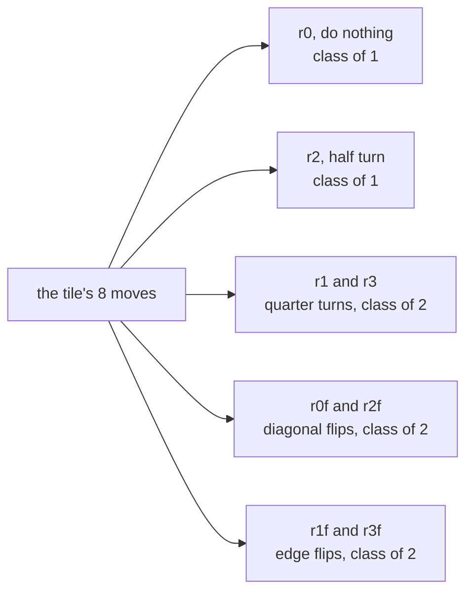

# Conjugacy and the class equation: a group sorted into classes of look-alikes, and why every group of prime-power size has a centre

[Syllabus](../../../SYLLABUS.md) → [Algebra](../README.md) → [Groups](../README.md#s08) → Conjugacy and the class equation

---

## General Overview

A square tile sits in a square recess eight ways: four turns r0, r1, r2, r3 by quarters, and those four again after a flip, r0f to r3f ([Group actions](08-group-actions-and-counting.md)). Two of the flips swap corners across a diagonal (r0f, r2f). The other two swap them across an edge (r1f, r3f).

Turn the tile a quarter, flip it across one diagonal, then turn it back. The net move is a flip across the other diagonal. It is the same kind of move, seen from a turned position. Two moves related this way are **conjugate**: look-alikes.

Sorting the eight moves into look-alikes gives five classes:

- do nothing, alone;
- the half turn, alone;
- the quarter turn and the three-quarter turn;
- the two diagonal flips;
- the two edge flips.

So 8 = 1 + 1 + 2 + 2 + 2. The two moves standing alone are the ones every viewpoint agrees on: the **centre**, the moves that give the same result as every other move in either order.

The counting rule behind this split is the **class equation**. When a group's size is a prime power, such as 8 = 2 × 2 × 2, it forces a centre of more than one member.

**Conjugation sorts a group into classes of look-alikes; each class's size divides the group's size, the one-member classes are the centre, and in a group of prime-power size that forces a centre with more than one member.**

**What kind of fact this is:** a theorem, proved on this card in Why it works; conjugate, class, centraliser, centre and normaliser are its definitions.

### The picture: eight moves, five classes



The two classes of 1 form the centre.

---

## The formula

Moves combine as on [Group actions](08-group-actions-and-counting.md): $`g x`$ means do $`x`$ first, then $`g`$. The undo of $`g`$ is $`g^{-1}`$, and the move that changes nothing is $`e`$.

The **conjugate** of a move $`x`$ by a move $`g`$ is three steps: undo $`g`$, do $`x`$, do $`g`$ again. In symbols, $`g x g^{-1}`$. Three collections follow:

```math
\mathrm{Cl}(x) = \{\, g x g^{-1} \text{ for every } g \text{ in } G \,\}, \qquad C(x) = \{\, g \text{ in } G \text{ with } g x = x g \,\}, \qquad Z(G) = \{\, z \text{ with } z g = g z \text{ for every } g \,\}
```

- The **class** $`\mathrm{Cl}(x)`$ is every look-alike of $`x`$.
- The **centraliser** $`C(x)`$ is every move that commutes with $`x`$: gives one result in either order.
- The **centre** $`Z(G)`$ is every move that commutes with all moves.

Pick one move from each class with more than one member, and call them $`x_1, x_2, \ldots`$. The class equation is:

```math
\lvert G\rvert = \lvert Z(G)\rvert + \sum_i \,[G : C(x_i)]
```

**Read it aloud:** the group's size is the size of its centre plus, for each bigger class, the number of cosets of that class's centraliser.

The **index** $`[G : C(x)]`$ is the number of cosets of $`C(x)`$, which is $`\lvert G\rvert / \lvert C(x)\rvert`$. On the tile each bigger class has a centraliser of 4 moves, so 8 = 2 + 8/4 + 8/4 + 8/4.

A subgroup $`H`$ can be conjugated too, member by member, giving $`g H g^{-1}`$. Its **normaliser** $`N(H)`$ is every $`g`$ with $`g H g^{-1} = H`$. The number of different conjugate subgroups is $`[G : N(H)]`$.

| Symbol | Plain meaning | In our example | Push it up and the answer… |
| --- | --- | --- | --- |
| $`G`$, $`\lvert G\rvert`$ | the group, and its size | the tile's moves, 8 | more terms in the sum |
| $`g`$, $`x`$, $`x_i`$, $`g^{-1}`$, $`e`$ | moves, $`x_i`$ one per bigger class; the undo of $`g`$; do nothing | r1, r0f, r3, r0 | — |
| $`g x g^{-1}`$ | the conjugate: $`x`$ seen from $`g`$'s position | r1 r0f r3 = r2f | — |
| $`\mathrm{Cl}(x)`$ | the class: all look-alikes of $`x`$ | r0f, r2f | a smaller centraliser |
| $`C(x)`$ | the centraliser: moves commuting with $`x`$ | r0, r2, r0f, r2f | a smaller class |
| $`Z(G)`$, $`Z_i`$ | the centre: moves commuting with all; the fold's climb | r0, r2 | fewer moves left for the bigger classes |
| $`H`$, $`N(H)`$ | a subgroup; the moves that keep it in place | r0 and r0f; r0, r2, r0f, r2f | fewer conjugate subgroups |
| $`[G:C(x)]`$, $`\sum_i`$, $`p`$, $`k`$ | the index, a count of cosets; add over $`i`$; a prime and its power | 8 / 4 = 2; 8 is 2 to the power 3 | — |

### When it holds

- **A finite group.** The equation is a count; an infinite group can have infinite classes.
- **Conjugate by the whole group.** Conjugate the tile's moves by the four turns only and the quarter turns split apart: 6 classes, not 5.
- **The centre counted member by member.** Each central move is its own class of 1. Count the centre as one term and the sum gives 7, not 8.
- **A prime power, for the centre result.** The six rearrangements of three things (S3 in the code) split 6 = 1 + 2 + 3, and their centre is do-nothing alone. Six is not a prime power, so nothing forced a bigger centre.

---

## Why it works

### Step 0: conjugation is the group acting on itself

Let each move $`g`$ act on each move $`x`$ by sending it to $`g x g^{-1}`$. Both promises of an action hold ([Group actions](08-group-actions-and-counting.md)). Do-nothing sends $`x`$ to $`x`$. Conjugating by $`h`$ and then by $`g`$ gives $`g h x h^{-1} g^{-1}`$, which is conjugating once by $`g h`$.

So the orbits are the classes. The stabiliser of $`x`$ is the set of $`g`$ with $`g x g^{-1} = x`$, that is $`g x = x g`$: the centraliser.

### Step 1: each class size is a count of cosets

Orbit-stabiliser says the orbit size times the stabiliser size is the group's size. Here:

```math
\lvert \mathrm{Cl}(x)\rvert \times \lvert C(x)\rvert = \lvert G\rvert, \qquad \text{so} \qquad \lvert \mathrm{Cl}(x)\rvert = [G : C(x)]
```

The quarter turn r1 commutes with the four turns only, so its class has 8 / 4 = 2 members: r1 and r3. Every class size is a count of cosets, so it divides 8 ([Cosets and Lagrange's theorem](04-cosets-and-lagranges-theorem.md)).

### Step 2: the classes of one are the centre

A class has one member exactly when every $`g`$ gives $`g x g^{-1} = x`$, that is when $`x`$ commutes with everything. So the one-member classes are the centre.

The classes cut the group into blocks that never overlap, as orbits always do. Add the blocks: the central ones give $`\lvert Z(G)\rvert`$, and each bigger class gives $`[G : C(x_i)]`$. That sum is the class equation.

### Step 3: a prime-power group has a centre bigger than one

Let $`\lvert G\rvert = p^k`$, a prime $`p`$ to a power $`k`$ of at least 1. Each bigger class has a size that divides $`p^k`$ and is more than 1. The only such numbers are $`p, p^2, \ldots`$, all multiples of $`p`$.

Then $`\lvert Z(G)\rvert = p^k - (\text{a sum of multiples of } p)`$ is a multiple of $`p`$. Do-nothing is central, so it is at least 1, and therefore at least $`p`$.

On the tile every bigger class has 2 members, so the centre's size is even: 2. A non-commuting group of 27 members gives 27 = 3 + 8 × 3 and a centre of 3. It is built from triples $`(a, b, c)`$ of numbers mod 3, combined as $`(a, b, c)(a', b', c') = (a + a', b + b', c + c' + a b')`$.

### Step 4: subgroups have classes too

Conjugation also moves whole subgroups. The stabiliser of a subgroup $`H`$ is its normaliser $`N(H)`$, so orbit-stabiliser gives $`[G : N(H)]`$ conjugate subgroups.

Take $`H`$ = r0 and r0f, a diagonal flip with do-nothing. Its normaliser is r0, r2, r0f, r2f, so 8 / 4 = 2 conjugates: r0 with r0f, and r0 with r2f. $`H`$ is normal exactly when $`N(H)`$ is all of $`G`$ ([Normal subgroups and quotient groups](06-normal-subgroups-and-quotient-groups.md)); this $`H`$ is not.

<details>
<summary>Nilpotent groups: climbing out of the centre, and why the rearrangements of three things cannot</summary>

The centre is normal, so the group collapses by it into a quotient group. In a prime-power group that quotient, unless it is a single pile, has a centre bigger than one too; pull it back into $`G`$ and climb again:

$`\displaystyle \{e\} = Z_0 \subseteq Z_1 \subseteq Z_2 \subseteq \cdots, \qquad Z_{i+1} = \{\, g : g x g^{-1} x^{-1} \text{ is in } Z_i \text{ for every } x \,\}`$

This is the **upper central series**. Here $`g x g^{-1} x^{-1}`$ is the **commutator** of $`g`$ and $`x`$: it is do-nothing exactly when the two commute. A group whose series reaches all of $`G`$ is **nilpotent**.

- The tile climbs 1, 2, 8. After collapsing by the centre r0, r2, the 4 piles all commute, so the second step takes everything.
- The group of 27 climbs 1, 3, 27.
- Every prime-power group is nilpotent: each step's quotient is a smaller prime-power group with a centre bigger than one, so the climb never stalls before $`G`$.
- The rearrangements of three things have centre do-nothing alone, so the series is stuck at 1. They are not nilpotent.

They are **solvable** (repeated commutators end at do-nothing alone), a weaker property: their commutators make the subgroup of 3 cyclic rearrangements, whose own commutators give do-nothing alone.

</details>

---

## Worked numbers, by hand

| Step | Arithmetic | Value |
| --- | --- | --- |
| conjugate r0f by r1 | r3, then r0f, then r1: position $`i`$ goes to $`i + 3`$, then $`-i - 3`$, then $`-i - 2`$ | r2f |
| centraliser of r1 | moves giving one result in either order with r1 | r0, r1, r2, r3 |
| class of r1 | 8 / 4 | 2: r1 and r3 |
| centralisers of r0f and r1f | each flip commutes with r0, r2, itself and its partner | 4 each, so classes of 2 |
| centre | the classes of 1 | r0 and r2 |
| class equation | 2 + 2 + 2 + 2 | **8** |
| conjugates of the subgroup r0, r0f | normaliser r0, r2, r0f, r2f: 8 / 4 | **2** |

The half turn looks the same from every position; every other move but do-nothing has one look-alike.

### What breaks if you drop a piece

| Mistake | Comes out at | What went wrong |
| --- | --- | --- |
| Classes taken as equal blocks, like cosets | 8 / 5 = 1.6 | Classes have sizes 1, 1, 2, 2, 2 |
| Conjugating by the four turns only | 6 classes | The flips are what join r1 and r3 |
| The centre counted as one term | 1 + 6 = 7 | Each central move is its own class |
| Centraliser sizes added up | 8 + 8 + 4 + 4 + 4 = 28 | A class's size is 8 divided by that |

---

## Code, from first principles, and it actually runs

Nothing is imported. The tile's class sizes come by two roads that share no step: conjugating every move by every move, and dividing 8 by each centraliser's size, found by testing which moves commute. The centre is found twice: the moves commuting with all, and the classes of one. The same code then runs on S3 and the group of 27.

### Python

```python
# Conjugacy and the class equation -- the check behind the card.  Nothing is imported.  A group is
# its members and a rule combining two, b first.  Tile move r_k sends position i to i + k, r_kf to
# k - i, wrapped at 4.  Road one conjugates; road two counts what commutes (orbit-stabiliser).
perm = lambda a, b: tuple(a[i] for i in b)
TILE = [tuple((s * i + k) % 4 for i in range(4)) for s in (1, -1) for k in range(4)]
NAME = dict(zip(TILE, ["r0", "r1", "r2", "r3", "r0f", "r1f", "r2f", "r3f"]))
S3 = [(a, b, 3 - a - b) for a in range(3) for b in range(3) if a != b]
HEIS = [(a, b, c) for a in range(3) for b in range(3) for c in range(3)]
heis = lambda u, v: ((u[0] + v[0]) % 3, (u[1] + v[1]) % 3, (u[2] + v[2] + u[0] * v[1]) % 3)

def undo(G, mul):                             # the do-nothing member, and every undo
    e = next(x for x in G if all(mul(x, y) == y for y in G))
    return e, {x: next(y for y in G if mul(x, y) == e) for x in G}
def conj(G, mul, g, xs): return sorted({mul(mul(g, x), undo(G, mul)[1][g]) for x in xs}, key=G.index)
def classes(G, mul):                          # road one: every g x g^-1, deduplicated
    cs = {tuple(sorted({conj(G, mul, g, [x])[0] for g in G}, key=G.index)) for x in G}
    return sorted(cs, key=lambda c: (len(c), G.index(c[0])))
def cent(G, mul, x): return [g for g in G if mul(g, x) == mul(x, g)]   # road two
def centre(G, mul): return [z for z in G if len(cent(G, mul, z)) == len(G)]
def upper(G, mul):                            # sizes of Z0 = {e}, Z1 = centre, Z2, ...
    e, inv = undo(G, mul); Z = [e]; sizes = [1]
    while True:
        Z2 = [g for g in G if all(mul(mul(g, x), mul(inv[g], inv[x])) in Z for x in G)]
        if len(Z2) == len(Z): return sizes
        Z = Z2; sizes.append(len(Z))
def derived(H, mul, inv):                     # all commutators, closed under combining
    S = {mul(mul(a, b), mul(inv[a], inv[b])) for a in H for b in H}
    while (T := S | {mul(a, b) for a in S for b in S}) != S: S = T
    return list(S)
def show(c): return "{" + " ".join(NAME[x] for x in c) + "}"
cl, Z = classes(TILE, perm), centre(TILE, perm)
by_cent = [8 // len(cent(TILE, perm, c[0])) for c in cl]
print("classes by conjugating:", " ".join(show(c) for c in cl))
print("class sizes:", [len(c) for c in cl], "| 8 / centraliser size:", by_cent)
print("centralisers:", "; ".join(f"{NAME[c[0]]} {show(cent(TILE, perm, c[0]))}" for c in cl[2:]))
big = [len(c) for c in cl if len(c) > 1]
print(f"centre, commuting with all 8: {show(Z)}; class equation 8 = {len(Z)} + "
      + " + ".join(map(str, big)))
H = [TILE[0], TILE[4]]
norm = [g for g in TILE if conj(TILE, perm, g, H) == H]
subs = sorted({tuple(conj(TILE, perm, g, H)) for g in TILE})
print(f"normaliser of {show(H)}: {show(norm)}; 8 / {len(norm)} = {8 // len(norm)} "
      f"conjugate subgroups:", " ".join(show(c) for c in subs))
for nm, G, mul in [("S3", S3, perm), ("order 27", HEIS, heis)]:
    sz = [len(c) for c in classes(G, mul)]; k = sz.count(1)
    print(f"{nm}: {len(G)} = {' + '.join(map(str, [k] + sz[k:]))}; centre {len(centre(G, mul))}")
_, i3 = undo(S3, perm); A3 = derived(S3, perm, i3)
print("upper central series sizes: tile", upper(TILE, perm), "| S3", upper(S3, perm),
      "| order 27", upper(HEIS, heis))
print(f"S3 solvable: its commutators make a subgroup of {len(A3)}, theirs of {len(derived(A3, perm, i3))}")
turns = len({tuple(sorted({conj(TILE, perm, g, [x])[0] for g in TILE[:4]})) for x in TILE})
print(f"mistakes: 8 / 5 classes = {8 / 5}; conjugating by turns only gives {turns} classes; "
      f"centre as one term 1 + {sum(big)} = {1 + sum(big)}; centralisers added = "
      f"{sum(len(cent(TILE, perm, c[0])) for c in cl)}")
assert [len(c) for c in cl] == by_cent and sum(by_cent) == 8   # two roads, one count
assert sorted(Z) == sorted(c[0] for c in cl if len(c) == 1) and len(Z) == 2
assert len(centre(HEIS, heis)) == 3 and len(centre(S3, perm)) == 1
assert upper(TILE, perm)[-1] == 8 and upper(HEIS, heis) == [1, 3, 27] and upper(S3, perm) == [1]
assert len(norm) * len(subs) == 8 and len(A3) == 3
print("ALL CHECKS PASS")
```

**Ran 2026-11-23 on macOS, Python 3.14.10, standard library only. All checks passed. Output, pasted from the run:**

```
classes by conjugating: {r0} {r2} {r1 r3} {r0f r2f} {r1f r3f}
class sizes: [1, 1, 2, 2, 2] | 8 / centraliser size: [1, 1, 2, 2, 2]
centralisers: r1 {r0 r1 r2 r3}; r0f {r0 r2 r0f r2f}; r1f {r0 r2 r1f r3f}
centre, commuting with all 8: {r0 r2}; class equation 8 = 2 + 2 + 2 + 2
normaliser of {r0 r0f}: {r0 r2 r0f r2f}; 8 / 4 = 2 conjugate subgroups: {r0 r0f} {r0 r2f}
S3: 6 = 1 + 2 + 3; centre 1
order 27: 27 = 3 + 3 + 3 + 3 + 3 + 3 + 3 + 3 + 3; centre 3
upper central series sizes: tile [1, 2, 8] | S3 [1] | order 27 [1, 3, 27]
S3 solvable: its commutators make a subgroup of 3, theirs of 1
mistakes: 8 / 5 classes = 1.6; conjugating by turns only gives 6 classes; centre as one term 1 + 6 = 7; centralisers added = 28
ALL CHECKS PASS
```

### Rust

Same numbers, same labels, built with `rustc --edition 2021 -O`.

```rust
// Conjugacy and the class equation -- the same check as the Python, in Rust.  No crates.  A group
// is its members and a rule combining two, b first.  Tile move r_k sends position i to i + k, r_kf
// to k - i, wrapped at 4.  Road one conjugates; road two counts what commutes (orbit-stabiliser).
type M = Vec<i64>;
type Mul = fn(&M, &M) -> M;
fn perm(a: &M, b: &M) -> M { b.iter().map(|&i| a[i as usize]).collect() }
fn heis(u: &M, v: &M) -> M { vec![(u[0] + v[0]) % 3, (u[1] + v[1]) % 3, (u[2] + v[2] + u[0] * v[1]) % 3] }
fn idx(g: &[M], x: &M) -> usize { g.iter().position(|y| y == x).unwrap() }
fn undo(g: &[M], mul: Mul) -> (M, Vec<M>) {           // the do-nothing member, and every undo
    let e = g.iter().find(|x| g.iter().all(|y| mul(x, y) == *y)).unwrap().clone();
    (e.clone(), g.iter().map(|x| g.iter().find(|y| mul(x, y) == e).unwrap().clone()).collect())
}
fn conj(g: &[M], mul: Mul, a: &M, xs: &[M]) -> Vec<M> {
    let mut v: Vec<M> = xs.iter().map(|x| mul(&mul(a, x), &undo(g, mul).1[idx(g, a)])).collect();
    v.sort_by_key(|y| idx(g, y)); v.dedup(); v
}
fn classes(g: &[M], mul: Mul) -> Vec<Vec<M>> {        // road one: every g x g^-1, deduplicated
    let mut out: Vec<Vec<M>> = Vec::new();
    for x in g {
        let mut c: Vec<M> = g.iter().map(|a| conj(g, mul, a, &[x.clone()])[0].clone()).collect();
        c.sort_by_key(|y| idx(g, y)); c.dedup();
        if !out.contains(&c) { out.push(c) } }
    out.sort_by_key(|c| (c.len(), idx(g, &c[0]))); out
}
fn cent(g: &[M], mul: Mul, x: &M) -> Vec<M> { g.iter().filter(|a| mul(a, x) == mul(x, a)).cloned().collect() }
fn centre(g: &[M], mul: Mul) -> Vec<M> { g.iter().filter(|z| cent(g, mul, z).len() == g.len()).cloned().collect() }
fn upper(g: &[M], mul: Mul) -> Vec<usize> {           // sizes of Z0 = {e}, Z1 = centre, Z2, ...
    let (e, inv) = undo(g, mul); let (mut z, mut sizes) = (vec![e], vec![1]);
    loop {
        let z2: Vec<M> = g.iter().enumerate().filter(|(i, a)| g.iter().enumerate().all(|(j, x)|
            z.contains(&mul(&mul(a, x), &mul(&inv[*i], &inv[j]))))).map(|(_, a)| a.clone()).collect();
        if z2.len() == z.len() { return sizes }
        z = z2; sizes.push(z.len()); } }
fn derived(g: &[M], h: &[M], mul: Mul) -> Vec<M> {    // all commutators, closed under combining
    let (inv, mut s) = (undo(g, mul).1, Vec::new());
    let add = |s: &mut Vec<M>, x: M| if !s.contains(&x) { s.push(x) };
    for a in h { for b in h { add(&mut s, mul(&mul(a, b), &mul(&inv[idx(g, a)], &inv[idx(g, b)]))) } }
    loop {
        let n = s.len(); for a in s.clone() { for b in s.clone() { add(&mut s, mul(&a, &b)) } }
        if s.len() == n { return s } } }
fn join<T: ToString>(v: &[T], sep: &str) -> String { v.iter().map(|x| x.to_string()).collect::<Vec<_>>().join(sep) }
fn main() {
    let tile: Vec<M> = [1i64, -1].iter().flat_map(|&s| (0..4).map(move |k| (0..4).map(|i| (s * i + k).rem_euclid(4)).collect())).collect();
    let names = ["r0", "r1", "r2", "r3", "r0f", "r1f", "r2f", "r3f"];
    let show = |c: &[M]| format!("{{{}}}", c.iter().map(|x| names[idx(&tile, x)]).collect::<Vec<_>>().join(" "));
    let s3: Vec<M> = (0..3).flat_map(|a| (0..3).filter(move |&b| b != a).map(move |b| vec![a, b, 3 - a - b])).collect();
    let hs: Vec<M> = (0..27).map(|n| vec![n / 9, n / 3 % 3, n % 3]).collect();
    let (cl, z) = (classes(&tile, perm), centre(&tile, perm));
    let sizes: Vec<usize> = cl.iter().map(|c| c.len()).collect();
    let by_cent: Vec<usize> = cl.iter().map(|c| 8 / cent(&tile, perm, &c[0]).len()).collect();
    println!("classes by conjugating: {}", cl.iter().map(|c| show(c)).collect::<Vec<_>>().join(" "));
    println!("class sizes: {:?} | 8 / centraliser size: {:?}", sizes, by_cent);
    println!("centralisers: {}", cl[2..].iter().map(|c| format!("{} {}", names[idx(&tile, &c[0])], show(&cent(&tile, perm, &c[0])))).collect::<Vec<_>>().join("; "));
    let big: Vec<usize> = sizes.iter().filter(|&&n| n > 1).cloned().collect();
    println!("centre, commuting with all 8: {}; class equation 8 = {} + {}", show(&z), z.len(), join(&big, " + "));
    let h = vec![tile[0].clone(), tile[4].clone()];
    let norm: Vec<M> = tile.iter().filter(|g| conj(&tile, perm, g, &h) == h).cloned().collect();
    let mut subs: Vec<Vec<M>> = tile.iter().map(|g| conj(&tile, perm, g, &h)).collect(); subs.sort(); subs.dedup();
    println!("normaliser of {}: {}; 8 / {} = {} conjugate subgroups: {}", show(&h), show(&norm), norm.len(), 8 / norm.len(), subs.iter().map(|c| show(c)).collect::<Vec<_>>().join(" "));
    for (nm, g, mul) in [("S3", &s3, perm as Mul), ("order 27", &hs, heis as Mul)] {
        let sz: Vec<usize> = classes(g, mul).iter().map(|c| c.len()).collect();
        let k = sz.iter().filter(|&&n| n == 1).count(); let terms: Vec<usize> = std::iter::once(k).chain(sz[k..].iter().cloned()).collect();
        println!("{}: {} = {}; centre {}", nm, g.len(), join(&terms, " + "), centre(g, mul).len());
    }
    let a3 = derived(&s3, &s3, perm);
    println!("upper central series sizes: tile {:?} | S3 {:?} | order 27 {:?}", upper(&tile, perm), upper(&s3, perm), upper(&hs, heis));
    println!("S3 solvable: its commutators make a subgroup of {}, theirs of {}", a3.len(), derived(&s3, &a3, perm).len());
    let mut tc: Vec<Vec<M>> = tile.iter().map(|x| { let mut c: Vec<M> = tile[..4].iter().map(|g| conj(&tile, perm, g, &[x.clone()])[0].clone()).collect(); c.sort(); c.dedup(); c }).collect(); tc.sort(); tc.dedup();
    println!("mistakes: 8 / 5 classes = {}; conjugating by turns only gives {} classes; centre as one term 1 + {} = {}; centralisers added = {}",
             8.0 / 5.0, tc.len(), big.iter().sum::<usize>(), 1 + big.iter().sum::<usize>(), cl.iter().map(|c| cent(&tile, perm, &c[0]).len()).sum::<usize>());
    assert!(sizes == by_cent && by_cent.iter().sum::<usize>() == 8);     // two roads, one count
    assert!(z == cl.iter().filter(|c| c.len() == 1).map(|c| c[0].clone()).collect::<Vec<M>>() && z.len() == 2);
    assert!(centre(&hs, heis).len() == 3 && centre(&s3, perm).len() == 1);
    assert!(*upper(&tile, perm).last().unwrap() == 8 && upper(&hs, heis) == vec![1, 3, 27] && upper(&s3, perm) == vec![1]);
    assert!(norm.len() * subs.len() == 8 && a3.len() == 3);
    println!("ALL CHECKS PASS");
}
```

**Ran 2026-11-23 on macOS, rustc 1.98.1, no crates. All checks passed. Output, pasted from the run:**

```
classes by conjugating: {r0} {r2} {r1 r3} {r0f r2f} {r1f r3f}
class sizes: [1, 1, 2, 2, 2] | 8 / centraliser size: [1, 1, 2, 2, 2]
centralisers: r1 {r0 r1 r2 r3}; r0f {r0 r2 r0f r2f}; r1f {r0 r2 r1f r3f}
centre, commuting with all 8: {r0 r2}; class equation 8 = 2 + 2 + 2 + 2
normaliser of {r0 r0f}: {r0 r2 r0f r2f}; 8 / 4 = 2 conjugate subgroups: {r0 r0f} {r0 r2f}
S3: 6 = 1 + 2 + 3; centre 1
order 27: 27 = 3 + 3 + 3 + 3 + 3 + 3 + 3 + 3 + 3; centre 3
upper central series sizes: tile [1, 2, 8] | S3 [1] | order 27 [1, 3, 27]
S3 solvable: its commutators make a subgroup of 3, theirs of 1
mistakes: 8 / 5 classes = 1.6; conjugating by turns only gives 6 classes; centre as one term 1 + 6 = 7; centralisers added = 28
ALL CHECKS PASS
```

### Lean

Lean proves these facts for every finite group, not just the tile.

- A class's size times its centraliser's size is the group's size.
- So a class's size is the index $`[G : C(x)]`$, and it divides the group's size.
- A class has one member exactly when that member is in the centre.
- The class equation: the group's size is the centre's size plus one index for each bigger class.
- Suppose $`\lvert G\rvert = p^k`$, with $`p`$ a prime and $`k`$ at least 1. Then the centre's size is a multiple of $`p`$ and more than 1.

The group of 27 and the fold's nilpotent and solvable tests are left to the Python and Rust checks.

```lean
-- Conjugacy and the class equation: a finite group's size is its centre's size plus the index of a centraliser for each bigger conjugacy class, and a group of prime-power size has a centre with more than one member.
import Mathlib.GroupTheory.ClassEquation
import Mathlib.GroupTheory.PGroup
import Mathlib.GroupTheory.Index
import Mathlib.GroupTheory.SpecificGroups.Dihedral
import Mathlib.GroupTheory.Perm.Fin

open ConjClasses

/-- The class of `x` has as many members as the centraliser of `x` has cosets. -/
theorem card_carrier_mk_eq_index (G : Type*) [Group G] (x : G) :
    Nat.card (ConjClasses.mk x).carrier = (Subgroup.centralizer {x}).index := by
  rw [Subgroup.index_centralizer_eq_ncard, Nat.card_coe_set_eq]
  rfl

/-- **The class equation.** In a finite group, pick one member from each conjugacy class. Then
the group's size is the size of its centre plus, for each class with more than one member, the
index of the centraliser of the chosen member:
`|G| = |Z(G)| + ∑ [G : C(xᵢ)]`. -/
theorem class_equation (G : Type*) [Group G] [Finite G]
    (rep : ConjClasses G → G) (hrep : ∀ c, ConjClasses.mk (rep c) = c) :
    Nat.card G = Nat.card (Subgroup.center G)
      + ∑ᶠ c ∈ ConjClasses.noncenter G, (Subgroup.centralizer {rep c}).index := by
  rw [← Group.nat_card_center_add_sum_card_noncenter_eq_card G]
  congr 1
  refine finsum_mem_congr rfl fun c _ => ?_
  conv_lhs => rw [← hrep c]
  exact card_carrier_mk_eq_index G (rep c)

/-- **Each class size is a count of cosets.** In a finite group, the class of `x` times the
centraliser of `x` has the group's size, so the class size is the index `[G : C(x)]` and divides
the group's size; and the class has exactly one member when `x` is in the centre. -/
theorem class_size_eq_index_centralizer (G : Type*) [Group G] [Finite G] (x : G) :
    Nat.card (ConjClasses.mk x).carrier * Nat.card (Subgroup.centralizer {x}) = Nat.card G ∧
    Nat.card (ConjClasses.mk x).carrier = (Subgroup.centralizer {x}).index ∧
    Nat.card (ConjClasses.mk x).carrier ∣ Nat.card G ∧
    (Nat.card (ConjClasses.mk x).carrier = 1 ↔ x ∈ Subgroup.center G) := by
  have h := card_carrier_mk_eq_index G x
  refine ⟨?_, h, ?_, ?_⟩
  · rw [h, mul_comm]
    exact Subgroup.card_mul_index _
  · rw [h]
    exact Subgroup.index_dvd_card _
  · rw [h, Subgroup.index_eq_one, Subgroup.centralizer_eq_top_iff_subset,
      Set.singleton_subset_iff, SetLike.mem_coe]

/-- **A prime-power group has a centre bigger than one.** If a finite group has size `p ^ k`
for a prime `p` and `k` at least 1, its centre's size is a multiple of `p` and more than 1. -/
theorem prime_power_group_has_big_centre {G : Type*} [Group G] [Finite G] {p k : ℕ}
    (hp : p.Prime) (hk : 1 ≤ k) (hG : Nat.card G = p ^ k) :
    p ∣ Nat.card (Subgroup.center G) ∧ 1 < Nat.card (Subgroup.center G) := by
  have : Fact p.Prime := ⟨hp⟩
  obtain ⟨j, hj, hc⟩ := IsPGroup.card_center_eq_prime_pow hG hk
  rw [hc]
  exact ⟨dvd_pow_self p hj.ne', Nat.one_lt_pow hj.ne' hp.one_lt⟩

/-! ### The card's worked numbers

The tile group is `DihedralGroup 4`. The card's turn `r_k` is `r k`, and the card's flip `r_kf`
(position `i` goes to `k - i`) is `sr (-k)`: so r0f = `sr 0`, r1f = `sr 3`, r2f = `sr 2`,
r3f = `sr 1`. Products are read as on the card: `g * x` means do `x` first, then `g`. -/

open DihedralGroup

/-- The tile has 8 moves. -/
example : Fintype.card (DihedralGroup 4) = 8 := by decide

/-- Conjugating r0f by r1 gives r2f. -/
example : (r 1 : DihedralGroup 4) * sr 0 * (r 1)⁻¹ = sr 2 := by decide

/-- The eight moves fall into 5 classes. -/
example : (Finset.univ.image (fun x : DihedralGroup 4 =>
    Finset.univ.image (fun g : DihedralGroup 4 => g * x * g⁻¹))).card = 5 := by decide

/-- The class sizes: r0 and r2 alone; r1 with r3; r0f with r2f; r1f with r3f. -/
example : Finset.univ.image (fun g : DihedralGroup 4 => g * r 0 * g⁻¹) = {r 0} ∧
    Finset.univ.image (fun g : DihedralGroup 4 => g * r 2 * g⁻¹) = {r 2} ∧
    Finset.univ.image (fun g : DihedralGroup 4 => g * r 1 * g⁻¹) = {r 1, r 3} ∧
    Finset.univ.image (fun g : DihedralGroup 4 => g * sr 0 * g⁻¹) = {sr 0, sr 2} ∧
    Finset.univ.image (fun g : DihedralGroup 4 => g * sr 3 * g⁻¹) = {sr 3, sr 1} := by decide

/-- The centraliser of r1 is the four turns; those of r0f and r1f have 4 moves each. -/
example : Finset.univ.filter (fun g : DihedralGroup 4 => g * r 1 = r 1 * g)
      = {r 0, r 1, r 2, r 3} ∧
    Finset.univ.filter (fun g : DihedralGroup 4 => g * sr 0 = sr 0 * g)
      = {r 0, r 2, sr 0, sr 2} ∧
    (Finset.univ.filter (fun g : DihedralGroup 4 => g * sr 3 = sr 3 * g)).card = 4 := by decide

/-- The centre is do-nothing and the half turn. -/
example : Finset.univ.filter (fun z : DihedralGroup 4 => ∀ g, z * g = g * z) = {r 0, r 2} := by
  decide

/-- The class equation on the tile: 8 = 2 + 8/4 + 8/4 + 8/4 = 2 + 2 + 2 + 2. -/
example : (8 : ℕ) = 2 + 8 / 4 + 8 / 4 + 8 / 4 := by norm_num

/-- The subgroup {r0, r0f} has normaliser {r0, r2, r0f, r2f}, and 8 / 4 = 2 conjugate subgroups:
{r0, r0f} and {r0, r2f}. -/
example : Finset.univ.filter (fun g : DihedralGroup 4 =>
      ({r 0, sr 0} : Finset (DihedralGroup 4)).image (fun h => g * h * g⁻¹) = {r 0, sr 0})
      = {r 0, r 2, sr 0, sr 2} ∧
    Finset.univ.image (fun g : DihedralGroup 4 =>
      ({r 0, sr 0} : Finset (DihedralGroup 4)).image (fun h => g * h * g⁻¹))
      = {{r 0, sr 0}, {r 0, sr 2}} := by decide

/-- Conjugating by the four turns only splits the tile into 6 classes, not 5. -/
example : (Finset.univ.image (fun x : DihedralGroup 4 =>
    ({r 0, r 1, r 2, r 3} : Finset (DihedralGroup 4)).image (fun g => g * x * g⁻¹))).card = 6 := by
  decide

/-- The rearrangements of three things: 6 = 1 + 2 + 3, in 3 classes, with centre do-nothing
alone. -/
example : (Finset.univ.image (fun x : Equiv.Perm (Fin 3) =>
      Finset.univ.image (fun g : Equiv.Perm (Fin 3) => g * x * g⁻¹))).image Finset.card
      = {1, 2, 3} ∧
    (Finset.univ.image (fun x : Equiv.Perm (Fin 3) =>
      Finset.univ.image (fun g : Equiv.Perm (Fin 3) => g * x * g⁻¹))).card = 3 ∧
    (Finset.univ.filter (fun z : Equiv.Perm (Fin 3) => ∀ g, z * g = g * z)).card = 1 := by
  decide

#print axioms card_carrier_mk_eq_index
#print axioms class_equation
#print axioms class_size_eq_index_centralizer
#print axioms prime_power_group_has_big_centre
```

**Checked 2026-11-23 on macOS, Lean 4.36.0-rc2, Mathlib v4.36.0-rc2. Every proof is complete and uses only Lean's standard axioms. Output, pasted from the run:**

```
'card_carrier_mk_eq_index' depends on axioms: [propext, Classical.choice, Quot.sound]
'class_equation' depends on axioms: [propext, Classical.choice, Quot.sound]
'class_size_eq_index_centralizer' depends on axioms: [propext, Classical.choice, Quot.sound]
'prime_power_group_has_big_centre' depends on axioms: [propext, Classical.choice, Quot.sound]
```

> [!TIP]
> **Try changing**
> Guess first, then run it.
> - **Make the group of 27 commute.** Delete `+ u[0] * v[1]` from `heis`. Guess the centre and the class equation. Answer: centre 27 and 27 = 27, every class a single move. The third assert stops it.
> - **A subgroup that is normal.** Set `H` to `[TILE[0], TILE[2]]`, do-nothing and the half turn. Guess the normaliser. Answer: all 8 moves, so 8 / 8 = 1 conjugate subgroup.
> - **Break the commuting test.** In `cent`, change `mul(g, x) == mul(x, g)` to `mul(g, x) == x`. Guess what the second road gives. Answer: 8 for every class, against 1, 1, 2, 2, 2, and the first assert stops it.

---

## The usual mistake

> [!warning]
> **Treating classes like cosets.** Cosets of one subgroup share one size; classes do not. The tile's hold 1, 1, 2, 2 and 2 moves, and 8 / 5 = 1.6 is no class's size.
>
> - **Conjugating by part of the group.** With the four turns alone, r1 and r3 never meet: 6 classes instead of 5.
> - **One term for the centre.** The centre holds 2 one-member classes. Counted as one term, the sum is 1 + 6 = 7.
> - **Centraliser read as class.** The centraliser sizes add to 28. The class sizes are 8 divided by them.
> - **Expecting a centre in every group.** The rearrangements of three things give 6 = 1 + 2 + 3: a centre of do-nothing alone.

---

## Where you meet it in real life

- **Puzzle cubes.** Solvers "set up, do the move, undo the set-up": a conjugate, which performs a known move in a new place.
- **Shuffles.** Two shuffles are conjugate exactly when they have the same cycle shape, such as "one 3-cycle and one swap". So the classes of a symmetric group are its cycle shapes ([Permutations](03-permutations-and-the-symmetric-group.md)).
- **Molecules.** The ammonia molecule has 6 symmetries in 3 classes: do nothing, two turns by a third, three mirror planes, so 6 = 1 + 2 + 3. Chemists' symmetry tables carry one column per class.
- **Change of coordinates.** For matrices, $`P A P^{-1}`$ is the map $`A`$ written in other coordinates. Conjugate matrices share their eigenvalues ([Diagonalisation](../07-Eigenvalues%20and%20Symmetric%20Matrices/03-diagonalisation-and-matrix-powers.md)).

> **Say it back**
> Conjugating a move by another means undo, do, redo: the same move seen from a new position. Conjugation is the group acting on itself, so its orbits, the classes, cut the group into blocks. Each class's size is the group's size divided by its centraliser's size. The one-member classes are the centre, and adding the blocks gives the class equation, 8 = 2 + 2 + 2 + 2 on the tile. In a prime-power group every bigger class is a multiple of the prime, so the centre is too, and it has more than one member.

---

## What this builds on

- [Group actions](08-group-actions-and-counting.md): orbits, stabilisers and orbit-stabiliser, which conjugation reuses whole.
- [Normal subgroups and quotient groups](06-normal-subgroups-and-quotient-groups.md): conjugating a subgroup, and the test a normaliser equal to $`G`$ passes.
- [Cosets and Lagrange's theorem](04-cosets-and-lagranges-theorem.md): the index $`[G : C(x)]`$, and why it divides the group's size.

## Where this goes next

- [The Sylow theorems](11-sylow-theorems.md): the class equation and the prime-power centre, used to find subgroups of every prime-power size that divides the group's size.
- [A_n is simple for n at least 5](13-simplicity-of-alternating-groups.md): a normal subgroup is a union of whole classes, and in A5 the class sizes rule out all but the trivial two.
- [Composition series](14-composition-series-and-jordan-holder.md): chains of normal subgroups, of which the upper central series is one.

How many different groups of a given prime-power size exist is the question this card leaves open.

---

## Sources

Verified 2026-11-23: every link below resolves to the publisher's page.

- Dummit, David S., and Richard M. Foote. *Abstract Algebra*, 3rd ed. Wiley. [Publisher page](https://www.wiley.com/en-us/Abstract+Algebra%2C+3rd+Edition-p-9780471433347). Section 4.3 proves the class equation; section 6.1 covers p-groups and nilpotent groups.
- Artin, Michael. *Algebra*, Classic Version, 2nd ed. Pearson. [Publisher page](https://www.pearson.com/en-us/subject-catalog/p/Artin-Algebra-Classic-Version-2nd-Edition/P200000006078/9780137980994). Chapter 7 states the class equation and proves the centre of a p-group is nontrivial.
- Judson, Thomas W. *Abstract Algebra: Theory and Applications*. Stephen F. Austin State University. [University publication page](https://scholarworks.sfasu.edu/ebooks/23/). Its group-actions chapter derives the class equation from orbits.
