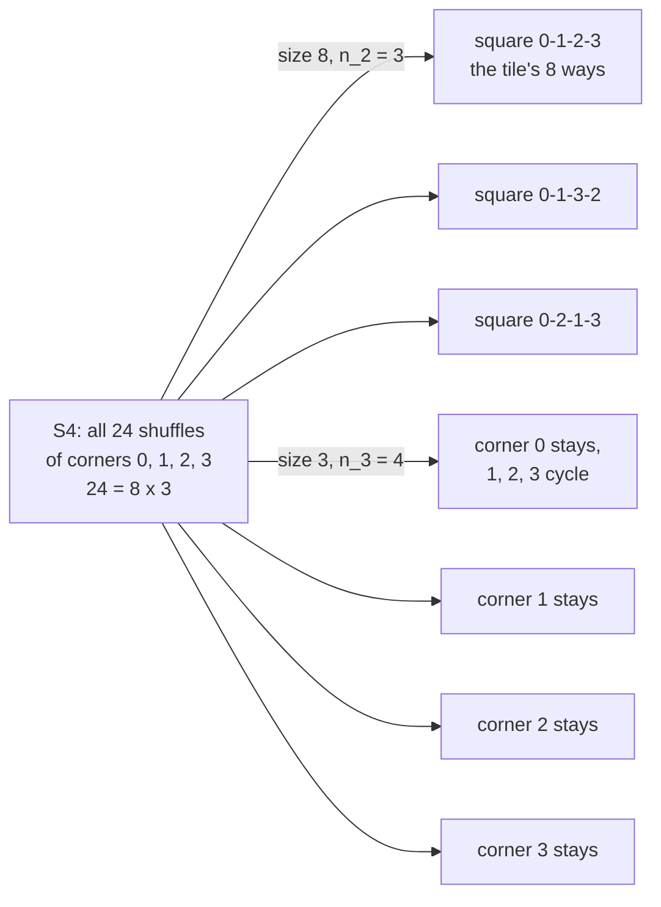

# The Sylow theorems: for the largest prime power dividing a group's size, subgroups of exactly that size exist, are all conjugate, and number 1 more than a multiple of p

[Syllabus](../../../SYLLABUS.md) → [Algebra](../README.md) → [Groups](../README.md#s08) → The Sylow theorems

---

## General Overview

A square tile can be set down 8 ways: four turns and four flips. Each way shuffles the corner numbers 0 to 3, so the 8 ways sit inside S4, the group of all 24 shuffles of four corners ([Permutations](03-permutations-and-the-symmetric-group.md)).

Lagrange's theorem says a subgroup's size divides 24 ([Cosets and Lagrange's theorem](04-cosets-and-lagranges-theorem.md)). It does not say which sizes occur, or how often. Sylow's theorems answer that for the largest power of a prime that divides the size: for 24 = 8 × 3 and the prime 2, that is 8.

S4 has exactly 3 subgroups of size 8. Each is the 8 ways of a square whose corners are labelled in a different order round its edge. Relabelling the corners turns any one into any other.

The rules also work on groups nobody has drawn. They prove that every group with 15 members is a 15-position dial.

**For each prime p, a finite group has subgroups of the largest size that is a power of p dividing its size; all of them are relabellings of one another, and their number leaves remainder 1 on dividing by p and divides the rest of the size.**

**What kind of fact this is:** three theorems, published by Ludwig Sylow in 1872 and proved on this card in Why it works.

### The picture: the Sylow subgroups of S4



Each square lists its corners in order round the edge.

---

## The formula

From earlier cards: $`\lvert G\rvert`$ is the group's size, $`*`$ combines two members (right one first), $`g^{-1}`$ undoes g, and $`[G:H]`$ counts the cosets of a subgroup H.

Fix a prime p and split the size into a power of p and a rest that p does not divide:

```math
\lvert G\rvert = p^a m, \qquad p \nmid m
```

A **Sylow p-subgroup** is a subgroup of size exactly $`p^a`$; $`n_p`$ counts them. The **conjugate** $`g * P * g^{-1}`$ is P relabelled by g: undo g, do a member of P, then do g again. The **normaliser** $`N(P)`$ is the members that relabel P into itself.

1. **Existence.** G has a subgroup of size $`p^a`$.
2. **Conjugacy.** Any two Sylow p-subgroups are conjugate: $`Q = g * P * g^{-1}`$ for some g.
3. **Counting.**

```math
n_p \equiv 1 \pmod{p}, \qquad n_p = [G : N(P)], \qquad n_p \mid m
```

**Read it aloud:** the count of Sylow p-subgroups leaves remainder 1 on dividing by p, equals the index of one subgroup's normaliser, and divides m.

For S4 and p = 2, m = 3: the divisors 1 and 3 are both odd, so $`n_2`$ is 1 or 3. Brute force finds 3.

| Symbol | Plain meaning | In our example | Push it up and the answer… |
| --- | --- | --- | --- |
| $`G`$, $`\lvert G\rvert`$ | a finite group and its size; S4 the 24 shuffles, A4 its 12 even ones, Z mod 15 the 15-dial | S4 | — |
| $`p`$, $`a`$, $`m`$ | a prime; its power in the size; the rest | 2, 3, 3 | bigger m, more allowed counts |
| $`P`$, $`Q`$, $`P'`$ | Sylow p-subgroups | the three squares | — |
| $`g`$, $`h`$, $`s`$, $`x`$, $`y`$, $`*`$, $`g^{-1}`$ | single members; combining; undoing | a shuffle | — |
| $`N(P)`$, $`[G:H]`$ | the normaliser; the number of cosets of H | the tile's 8 ways | fewer conjugates |
| $`n_p`$ | the number of Sylow p-subgroups | 3 | — |
| $`S`$, $`H`$, $`C`$ | in the proofs: a subset of size $`p^a`$; the members keeping it in place; P's conjugates | one of 735471 subsets | — |
| $`\equiv 1 \pmod{p}`$, $`\mid`$, $`\nmid`$, $`\binom{n}{k}`$ | leaves remainder 1 on dividing by p; divides; does not divide; subsets of size k from n | $`\binom{24}{8} = 735471`$ | — |

### When it holds

- **A finite group.** The proofs count members.
- **A prime power, not any divisor.** A4 has 12 members but no subgroup of size 6.
- **The largest power of p.** S4 has 7 subgroups of size 4, in 3 families that never relabel into each other.
- **The rules narrow; they do not always decide.** At order 21, $`n_3`$ may be 1 or 7, and the check builds a group with 7.

---

## Why it works

### Step 0: act on a set whose size p does not divide

Every proof lets a group act on a set: each member moves the set's points, and combining members combines the moves ([Group actions](08-group-actions-and-counting.md)). An orbit is everything one point can be moved to. Orbit sizes divide the group's size. If p does not divide the set's size, some orbit's size escapes p too.

If the acting group has size $`p^a`$, each orbit has size 1 or a multiple of p. An orbit of size 1 is an untouched point: every member leaves it in place. So the set's size and the number of untouched points leave the same remainder on dividing by p.

### Step 1: existence, by acting on subsets

Let G act on its subsets of size $`p^a`$ by combining on the left with g. S4 has $`\binom{24}{8} = 735471`$ subsets of size 8, an odd count. In general the count leaves the same remainder as m on dividing by p (fold), so p does not divide it.

So some orbit has size free of p. Take a subset S in it and its stabiliser H: the members g with $`g * S = S`$. Orbit size times $`\lvert H\rvert`$ is $`p^a m`$, so $`p^a`$ divides $`\lvert H\rvert`$.

Fix s in S. Sending h to $`h * s`$ puts H into S with no collisions, so H has at most $`p^a`$ members. So H has exactly $`p^a`$.

<details>
<summary>Detailed proof: the subset count leaves remainder m</summary>

The middle coefficients of $`(1 + x)^p`$ are multiples of p, so, comparing coefficients by their remainders on dividing by p:

$`\displaystyle (1 + x)^{p^a m} \equiv (1 + x^{p^a})^m \pmod{p}`$

The coefficient of $`x^{p^a}`$ is $`\binom{p^a m}{p^a}`$ on the left and m on the right. The check prints three cases: 735471 and 3 leave 1 on dividing by 2; 455 and 5 leave 2 on dividing by 3; 3003 and 3 leave 3 on dividing by 5.

A second proof inducts on the size with the class equation ([Conjugacy and the class equation](10-conjugacy-and-the-class-equation.md)). There are two cases.

- **Some class of more than one member has a size free of p.** The members fixing one of its members form a smaller subgroup whose size $`p^a`$ divides. By induction it holds a subgroup of size $`p^a`$.
- **Otherwise p divides the size of the centre** (the members that commute with everything). The centre is commutative, so it holds a member of order p (stated here without proof). The quotient by the subgroup that member makes is smaller. By induction that quotient has a subgroup of size $`p^{a-1}`$. Its members are cosets of size p, which together make a subgroup of G of size $`p^a`$ ([The isomorphism theorems](09-isomorphism-theorems-and-correspondence.md)).

</details>

### Step 2: counting, by letting P relabel the Sylow subgroups

Let one Sylow subgroup P act on all of them by conjugation. P leaves itself untouched.

Suppose P also leaves Q untouched. Then P lies inside the normaliser N(Q), where Q is normal. So the products $`x * y`$, x in P and y in Q, form a subgroup ([The isomorphism theorems](09-isomorphism-theorems-and-correspondence.md)) of size $`\lvert P\rvert \lvert Q\rvert / \lvert P \cap Q\rvert`$, a power of p. By Lagrange, no subgroup has a power of p above $`p^a`$ as its size, so that subgroup is Q itself. P lies inside it and has the same size, so P = Q.

So exactly one Sylow subgroup is untouched, and Step 0 gives $`n_p \equiv 1 \pmod{p}`$. In S4 the tile's 8 ways keep their own square and swap the other two: orbits of 1 and 2.

### Step 3: conjugacy, and the count divides m

Let C be the conjugates of P. By Step 2's argument, C's size leaves remainder 1 on dividing by p.

Let any Sylow subgroup Q act on C. C's size escapes p, so Q leaves some P′ in C untouched, and Step 2 gives Q = P′. So every Sylow subgroup is a conjugate of P.

The stabiliser of P under conjugation is $`N(P)`$, so $`n_p = [G : N(P)]`$. P lies in $`N(P)`$, so that index divides $`[G : P] = m`$. In S4: 24 / 8 = 3 and 24 / 6 = 4.

### Step 4: every group of 15 is a 15-dial

For p = 3, m = 5: of the divisors 1 and 5, only 1 leaves remainder 1 on dividing by 3. For p = 5, m = 3: only 1 leaves remainder 1 on dividing by 5. So $`n_3 = n_5 = 1`$.

Each member's order divides 15. Each member of order 3 makes a subgroup of size 3, and there is only one, so 2 members have order 3; likewise 4 have order 5. With the identity, 7. The other 8 have order 15, so one of them steps through every member: the group is Z mod 15.

A second road: a Sylow subgroup with no rivals equals all its conjugates, so it is normal ([Normal subgroups and quotient groups](06-normal-subgroups-and-quotient-groups.md)). The two normal subgroups meet only at the identity, so the group is Z mod 3 × Z mod 5, which is Z mod 15 ([Direct products](07-direct-products.md)).

<details>
<summary>When every Sylow count is 1</summary>

A finite group is **nilpotent** (a property defined through its centre) exactly when every Sylow subgroup is normal. Such a group is the direct product of its Sylow subgroups. Stated here without proof.

</details>

---

## Worked numbers, by hand

| Step | Arithmetic | Value |
| --- | --- | --- |
| order 15, p = 3 | divisors of 5 leaving 1 on dividing by 3 | **n_3 = 1** |
| order 15, p = 5 | divisors of 3 leaving 1 on dividing by 5 | **n_5 = 1** |
| members of order 1, 3, 5 | 1 + 2 + 4 | 7 |
| members of order 15 | 15 − 7, and brute force on a 15-dial | **8** |
| S4, p = 2 and p = 3 | odd divisors of 3; divisors of 8 leaving 1 on 3 | 1 or 3; 1 or 4 |
| S4 by brute force | 30 subgroups: size 8, size 3 | **3 and 4** |

Any group of 15 has a member of order 15, so it is the 15-dial.

### What breaks if you drop a piece

| Mistake | Comes out at | What went wrong |
| --- | --- | --- |
| "Divides m" alone, order 15 | n_3 may be 1 or 5 | The remainder rule is what removes 5 |
| Size 4 as the power of 2 in S4 | 7 subgroups in 3 families | Conjugacy needs the largest power |
| Any divisor as a size | A4 has 0 subgroups of size 6 | Sylow covers prime powers only |
| n_3 = 1 at order 21 | 7 subgroups of size 3 in the 21 maps x → ax + b mod 7, a in 1, 2, 4 | 7 also leaves 1 on dividing by 3 |

The code prints all four.

---

## Code, from first principles, and it actually runs

Nothing is imported. The rules from arithmetic alone narrow the S4 counts; three independent roads reach them: brute force over every subgroup, each built from a pair of shuffles (30, the known total); relabelling one Sylow subgroup by all 24 shuffles; and dividing 24 by the normaliser's size. For order 15, the member count meets a brute-force search of the 15-dial.

### Python

```python
# The Sylow theorems -- the check behind the card.  Nothing is imported.
# The rules (n_p is 1 more than a multiple of p and divides the rest) are set
# against brute force: every subgroup of S4 (shuffle s sends corner i to s[i]),
# every member of a 15-dial, and the 21 maps x -> a x + b on the 7-dial.
def perms(xs):
    return [()] if not xs else [(x,) + q for x in xs for q in perms([y for y in xs if y != x])]
def mul(a, b): return tuple(a[i] for i in b)                 # b first, then a
def inv(a): return tuple(sorted(range(4), key=lambda i: a[i]))
def conj(g, H): return frozenset(mul(mul(g, h), inv(g)) for h in H)
def span(gens):                                              # close under combining
    S = set(gens) | {E}
    while (T := S | {mul(x, y) for x in S for y in S}) != S: S = T
    return frozenset(S)
def split(n, p):                                             # n = p^a x m, p not dividing m
    return (0, n) if n % p else (lambda a, m: (a + 1, m))(*split(n // p, p))
def allowed(n, p):                                           # what the counting rules leave
    m = split(n, p)[1]
    return [d for d in range(1, m + 1) if m % d == 0 and d % p == 1]
def choose(n, k): return 1 if k == 0 else choose(n, k - 1) * (n - k + 1) // k
G, E = perms([0, 1, 2, 3]), (0, 1, 2, 3)
subs = {span([a, b]) for a in G for b in G}                  # each subgroup of S4 has two makers
def of_size(k): return [H for H in subs if len(H) == k]
tile = span([(1, 2, 3, 0), (0, 3, 2, 1)])                    # quarter turn and flip of the tile
C3 = span([(0, 2, 3, 1)])                                    # corner 0 still, 1 -> 2 -> 3 -> 1
order15 = [k for k in range(15) if all(j * k % 15 for j in range(1, 15))]
known = 1 + (3 - 1) * (n3 := allowed(15, 3)[0]) + (5 - 1) * (n5 := allowed(15, 5)[0])
print(f"order 15 = 3 x 5: n_3 may be {allowed(15, 3)}, n_5 may be {allowed(15, 5)}")
print(f"order 15: 1 identity + {(3 - 1) * n3} of order 3 + {(5 - 1) * n5} of order 5 = {known}; left over {15 - known}")
print(f"members of order 15 on a 15-dial, by brute force: {len(order15)}")
forced = [p * q for p in range(2, 60) for q in range(p + 1, 60) if all(p % d for d in range(2, p)) and all(q % d for d in range(2, q)) and p * q < 60 and allowed(p * q, p) == allowed(p * q, q) == [1]]
print(f"orders p x q under 60 where both counts are forced to 1: {sorted(forced)}")
print(f"order 24 = 2^3 x 3: n_2 may be {allowed(24, 2)}, n_3 may be {allowed(24, 3)}")
print(f"S4 by brute force: {len(subs)} subgroups; size 8: {len(of_size(8))}; size 3: {len(of_size(3))}")
cT, c3 = {conj(g, tile) for g in G}, {conj(g, C3) for g in G}
NT, N3 = [g for g in G if conj(g, tile) == tile], [g for g in G if conj(g, C3) == C3]
orbs = sorted(len(O) for O in {frozenset(conj(t, Q) for t in tile) for Q in cT})
print(f"conjugates of the tile's 8 ways: {len(cT)}, which the tile's ways sort into orbits of sizes {orbs}; of one size-3 subgroup: {len(c3)}")
print(f"normalisers: sizes {len(NT)} and {len(N3)}, so 24 / {len(NT)} = {24 // len(NT)} and 24 / {len(N3)} = {24 // len(N3)}")
print(f"the tile's 8 ways are one of the size-8 subgroups: {'yes' if tile in subs else 'no'}")
for n, p in [(24, 2), (15, 3), (15, 5)]:
    (a, m), c = split(n, p), choose(n, p ** split(n, p)[0])
    print(f"subsets of size {p ** a} from {n}: C({n}, {p ** a}) = {c}, leaves {c % p} on dividing by {p}; m = {m} leaves {m % p}")
print(f"mistake 1, divides only: n_3 for order 15 may be {[d for d in range(1, 6) if 5 % d == 0]}")
classes = {frozenset(conj(g, H) for g in G) for H in of_size(4)}
print(f"mistake 2, size 4 is not the largest power of 2: {len(of_size(4))} subgroups in {len(classes)} conjugacy classes")
even = {s for s in G if sum(s[i] > s[j] for i in range(4) for j in range(i + 1, 4)) % 2 == 0}
print(f"mistake 3, A4 has order 12 but size-6 subgroups: {len([H for H in of_size(6) if H <= even])}")
def order(f):                                                # f = (a, b) is x -> a x + b mod 7
    k, g = 1, f
    while g != (1, 0): k, g = k + 1, (f[0] * g[0] % 7, (f[0] * g[1] + f[1]) % 7)
    return k
ords = [order((a, b)) for a in (1, 2, 4) for b in range(7)]
print(f"mistake 4, order 21: n_3 may be {allowed(21, 3)}; the 21 maps x -> a x + b mod 7 have {ords.count(3) // 2} size-3 subgroups, largest order {max(ords)}")
assert allowed(15, 3) == allowed(15, 5) == [1] and len(order15) == 15 - known
assert len(of_size(8)) == len(cT) == 24 // len(NT) and len(of_size(8)) in allowed(24, 2)
assert len(of_size(3)) == len(c3) == 24 // len(N3) and len(of_size(3)) in allowed(24, 3)
assert orbs == [1, 2] and len(subs) == 30 and set(of_size(8)) == cT and set(of_size(3)) == c3
assert all(choose(n, p ** split(n, p)[0]) % p == split(n, p)[1] % p for n, p in [(24, 2), (15, 3), (15, 5)])
assert ords.count(3) // 2 in allowed(21, 3) and max(ords) < 21 and sorted(forced) == [15, 33, 35, 51]
print("ALL CHECKS PASS")
```

**Ran 2026-11-23 on macOS, Python 3.14.10, standard library only. All checks passed. Output, pasted from the run:**

```
order 15 = 3 x 5: n_3 may be [1], n_5 may be [1]
order 15: 1 identity + 2 of order 3 + 4 of order 5 = 7; left over 8
members of order 15 on a 15-dial, by brute force: 8
orders p x q under 60 where both counts are forced to 1: [15, 33, 35, 51]
order 24 = 2^3 x 3: n_2 may be [1, 3], n_3 may be [1, 4]
S4 by brute force: 30 subgroups; size 8: 3; size 3: 4
conjugates of the tile's 8 ways: 3, which the tile's ways sort into orbits of sizes [1, 2]; of one size-3 subgroup: 4
normalisers: sizes 8 and 6, so 24 / 8 = 3 and 24 / 6 = 4
the tile's 8 ways are one of the size-8 subgroups: yes
subsets of size 8 from 24: C(24, 8) = 735471, leaves 1 on dividing by 2; m = 3 leaves 1
subsets of size 3 from 15: C(15, 3) = 455, leaves 2 on dividing by 3; m = 5 leaves 2
subsets of size 5 from 15: C(15, 5) = 3003, leaves 3 on dividing by 5; m = 3 leaves 3
mistake 1, divides only: n_3 for order 15 may be [1, 5]
mistake 2, size 4 is not the largest power of 2: 7 subgroups in 3 conjugacy classes
mistake 3, A4 has order 12 but size-6 subgroups: 0
mistake 4, order 21: n_3 may be [1, 7]; the 21 maps x -> a x + b mod 7 have 7 size-3 subgroups, largest order 7
ALL CHECKS PASS
```

### Rust

Same numbers, same labels, built with `rustc --edition 2021 -O`.

```rust
// The Sylow theorems -- the same check as the Python, in Rust.  No crates.
// The rules (n_p is 1 more than a multiple of p and divides the rest) are set
// against brute force: every subgroup of S4 (shuffle s sends corner i to s[i]),
// every member of a 15-dial, and the 21 maps x -> a x + b on the 7-dial.
use std::collections::BTreeSet;
type P = [usize; 4];
type Sub = BTreeSet<P>;
const E: P = [0, 1, 2, 3];
fn mul(a: &P, b: &P) -> P { [a[b[0]], a[b[1]], a[b[2]], a[b[3]]] }     // b first, then a
fn inv(a: &P) -> P { let mut r = [0; 4]; for i in 0..4 { r[a[i]] = i } r }
fn conj(g: &P, h: &Sub) -> Sub { h.iter().map(|x| mul(&mul(g, x), &inv(g))).collect() }
fn span(gens: &[P]) -> Sub {                                         // close under combining
    let mut s: Sub = gens.iter().copied().chain([E]).collect();
    loop {
        let t: Sub = s.iter().flat_map(|x| s.iter().map(move |y| mul(x, y))).chain(s.iter().copied()).collect();
        if t == s { return s } s = t;
    }
}
fn split(n: usize, p: usize) -> (u32, usize) {                       // n = p^a x m, p not dividing m
    if n % p != 0 { (0, n) } else { let (a, m) = split(n / p, p); (a + 1, m) }
}
fn allowed(n: usize, p: usize) -> Vec<usize> {                       // what the counting rules leave
    let m = split(n, p).1;
    (1..=m).filter(|d| m % d == 0 && d % p == 1).collect()
}
fn choose(n: u64, k: u64) -> u64 { if k == 0 { 1 } else { choose(n, k - 1) * (n - k + 1) / k } }
fn order(f: (usize, usize)) -> usize {                               // f = (a, b) is x -> a x + b mod 7
    let (mut k, mut g) = (1, f);
    while g != (1, 0) { k += 1; g = (f.0 * g.0 % 7, (f.0 * g.1 + f.1) % 7) }
    k
}

fn main() {
    let g: Vec<P> = (0..256).map(|c| [c & 3, c >> 2 & 3, c >> 4 & 3, c >> 6]).filter(|s| (0..4).all(|i| s.contains(&i))).collect();
    let subs: BTreeSet<Sub> = g.iter().flat_map(|a| g.iter().map(move |b| span(&[*a, *b]))).collect();
    let of_size = |k: usize| -> Vec<Sub> { subs.iter().filter(|h| h.len() == k).cloned().collect() };
    let tile = span(&[[1, 2, 3, 0], [0, 3, 2, 1]]);                 // quarter turn and flip of the tile
    let c3 = span(&[[0, 2, 3, 1]]);                                 // corner 0 still, 1 -> 2 -> 3 -> 1
    let order15 = (0..15).filter(|k| (1..15).all(|j| j * k % 15 != 0)).count();
    let (n3, n5) = (allowed(15, 3)[0], allowed(15, 5)[0]);
    let known = 1 + (3 - 1) * n3 + (5 - 1) * n5;
    println!("order 15 = 3 x 5: n_3 may be {:?}, n_5 may be {:?}", allowed(15, 3), allowed(15, 5));
    println!("order 15: 1 identity + {} of order 3 + {} of order 5 = {}; left over {}", (3 - 1) * n3, (5 - 1) * n5, known, 15 - known);
    println!("members of order 15 on a 15-dial, by brute force: {}", order15);
    let prime = |n: usize| (2..n).all(|d| n % d != 0);
    let mut forced: Vec<usize> = (2..60).flat_map(|p| (p + 1..60).map(move |q| (p, q))).filter(|&(p, q)| prime(p) && prime(q) && p * q < 60 && allowed(p * q, p) == vec![1] && allowed(p * q, q) == vec![1]).map(|(p, q)| p * q).collect();
    forced.sort();
    println!("orders p x q under 60 where both counts are forced to 1: {:?}", forced);
    println!("order 24 = 2^3 x 3: n_2 may be {:?}, n_3 may be {:?}", allowed(24, 2), allowed(24, 3));
    println!("S4 by brute force: {} subgroups; size 8: {}; size 3: {}", subs.len(), of_size(8).len(), of_size(3).len());
    let ct: BTreeSet<Sub> = g.iter().map(|x| conj(x, &tile)).collect();
    let cc: BTreeSet<Sub> = g.iter().map(|x| conj(x, &c3)).collect();
    let nt = g.iter().filter(|x| conj(x, &tile) == tile).count();
    let n_3 = g.iter().filter(|x| conj(x, &c3) == c3).count();
    let orbits: BTreeSet<BTreeSet<Sub>> = ct.iter().map(|q| tile.iter().map(|t| conj(t, q)).collect()).collect();
    let mut orbs: Vec<usize> = orbits.iter().map(|o| o.len()).collect(); orbs.sort();
    println!("conjugates of the tile's 8 ways: {}, which the tile's ways sort into orbits of sizes {:?}; of one size-3 subgroup: {}", ct.len(), orbs, cc.len());
    println!("normalisers: sizes {} and {}, so 24 / {} = {} and 24 / {} = {}", nt, n_3, nt, 24 / nt, n_3, 24 / n_3);
    println!("the tile's 8 ways are one of the size-8 subgroups: {}", if subs.contains(&tile) { "yes" } else { "no" });
    for (n, p) in [(24u64, 2u64), (15, 3), (15, 5)] {
        let (a, m) = split(n as usize, p as usize);
        let c = choose(n, p.pow(a));
        println!("subsets of size {} from {}: C({}, {}) = {}, leaves {} on dividing by {}; m = {} leaves {}", p.pow(a), n, n, p.pow(a), c, c % p, p, m, m as u64 % p);
        assert!(c % p == m as u64 % p);
    }
    println!("mistake 1, divides only: n_3 for order 15 may be {:?}", (1..6).filter(|d| 5 % d == 0).collect::<Vec<usize>>());
    let classes: BTreeSet<BTreeSet<Sub>> = of_size(4).iter().map(|h| g.iter().map(|x| conj(x, h)).collect()).collect();
    println!("mistake 2, size 4 is not the largest power of 2: {} subgroups in {} conjugacy classes", of_size(4).len(), classes.len());
    let even: Sub = g.iter().copied().filter(|s| (0..4).flat_map(|i| (i + 1..4).map(move |j| (i, j))).filter(|&(i, j)| s[i] > s[j]).count() % 2 == 0).collect();
    println!("mistake 3, A4 has order 12 but size-6 subgroups: {}", of_size(6).iter().filter(|h| h.is_subset(&even)).count());
    let ords: Vec<usize> = [1, 2, 4].iter().flat_map(|&a| (0..7).map(move |b| order((a, b)))).collect();
    let n21 = ords.iter().filter(|&&o| o == 3).count() / 2;
    println!("mistake 4, order 21: n_3 may be {:?}; the 21 maps x -> a x + b mod 7 have {} size-3 subgroups, largest order {}", allowed(21, 3), n21, ords.iter().max().unwrap());
    assert!(allowed(15, 3) == vec![1] && allowed(15, 5) == vec![1] && order15 == 15 - known);
    assert!(of_size(8).len() == ct.len() && ct.len() == 24 / nt && allowed(24, 2).contains(&ct.len()));
    assert!(of_size(3).len() == cc.len() && cc.len() == 24 / n_3 && allowed(24, 3).contains(&cc.len()));
    assert!(orbs == vec![1, 2] && subs.len() == 30 && of_size(8).into_iter().collect::<BTreeSet<Sub>>() == ct && of_size(3).into_iter().collect::<BTreeSet<Sub>>() == cc);
    assert!(allowed(21, 3).contains(&n21) && *ords.iter().max().unwrap() < 21 && forced == vec![15, 33, 35, 51]);
    println!("ALL CHECKS PASS");
}
```

**Ran 2026-11-23 on macOS, rustc 1.98.1, no crates. All checks passed. Output, pasted from the run:**

```
order 15 = 3 x 5: n_3 may be [1], n_5 may be [1]
order 15: 1 identity + 2 of order 3 + 4 of order 5 = 7; left over 8
members of order 15 on a 15-dial, by brute force: 8
orders p x q under 60 where both counts are forced to 1: [15, 33, 35, 51]
order 24 = 2^3 x 3: n_2 may be [1, 3], n_3 may be [1, 4]
S4 by brute force: 30 subgroups; size 8: 3; size 3: 4
conjugates of the tile's 8 ways: 3, which the tile's ways sort into orbits of sizes [1, 2]; of one size-3 subgroup: 4
normalisers: sizes 8 and 6, so 24 / 8 = 3 and 24 / 6 = 4
the tile's 8 ways are one of the size-8 subgroups: yes
subsets of size 8 from 24: C(24, 8) = 735471, leaves 1 on dividing by 2; m = 3 leaves 1
subsets of size 3 from 15: C(15, 3) = 455, leaves 2 on dividing by 3; m = 5 leaves 2
subsets of size 5 from 15: C(15, 5) = 3003, leaves 3 on dividing by 5; m = 3 leaves 3
mistake 1, divides only: n_3 for order 15 may be [1, 5]
mistake 2, size 4 is not the largest power of 2: 7 subgroups in 3 conjugacy classes
mistake 3, A4 has order 12 but size-6 subgroups: 0
mistake 4, order 21: n_3 may be [1, 7]; the 21 maps x -> a x + b mod 7 have 7 size-3 subgroups, largest order 7
ALL CHECKS PASS
```

### Lean

Lean proves the three Sylow theorems for every finite group and every prime, plus the subset count and the order-15 result.

- Take a finite group of size $`p^a m`$, with p prime and $`p \nmid m`$. Then it has a subgroup of size $`p^a`$.
- Take any two Sylow p-subgroups P and Q. Then $`Q = g * P * g^{-1}`$ for some g.
- Take any Sylow p-subgroup P. Then $`n_p \equiv 1 \pmod{p}`$, $`n_p = [G : N(P)]`$ and $`n_p \mid m`$.
- Take any prime p. Then $`\binom{p^a m}{p^a}`$ leaves the same remainder as m on dividing by p.
- Every group with 15 members is the 15-dial.
- It also re-checks the card's numbers: the allowed counts at orders 15, 21, 24 and 56, the member tally, and the subset counts.

Brute force over S4's 30 subgroups, the tile's conjugates and normalisers, and the four mistakes are left to the Python and Rust checks.

```lean
-- The Sylow theorems: in a finite group of size p^a * m with p prime and p not dividing m, subgroups of size p^a exist, any two are conjugate, and their number leaves remainder 1 on dividing by p, equals the index of one such subgroup's normaliser, and divides m; as uses, the subset count C(p^a m, p^a) leaves the same remainder as m, and every group of order 15 is cyclic.
import Mathlib.GroupTheory.Sylow
import Mathlib.GroupTheory.SpecificGroups.Cyclic
import Mathlib.Data.Nat.Choose.Basic
import Mathlib.Data.Nat.Choose.Lucas
import Mathlib.NumberTheory.Divisors

theorem factorization_prime_pow_mul_self {p a m : ℕ} (hp : p.Prime) (hm : ¬ p ∣ m) :
    (p ^ a * m).factorization p = a := by
  have hm0 : m ≠ 0 := by rintro rfl; exact hm (dvd_zero p)
  rw [Nat.factorization_mul (pow_ne_zero _ hp.ne_zero) hm0, Finsupp.add_apply,
    Nat.factorization_pow, Finsupp.smul_apply, hp.factorization_self,
    Nat.factorization_eq_zero_of_not_dvd hm]
  simp

#print axioms factorization_prime_pow_mul_self

theorem conj_mem_zpowers_of_card_eq_one {G : Type*} [Group G] {p : ℕ}
    (h1 : Nat.card {P : Subgroup G // Nat.card P = p} = 1) (x : G) (hx : orderOf x = p)
    (g : G) : g * x * g⁻¹ ∈ Subgroup.zpowers x := by
  have hsub : Subsingleton {P : Subgroup G // Nat.card P = p} := by
    have := Nat.card_eq_one_iff_unique.mp h1
    exact this.1
  have hH : Nat.card (Subgroup.zpowers x) = p := by rw [Nat.card_zpowers, hx]
  have hH' : Nat.card ((Subgroup.zpowers x).map (MulAut.conj g).toMonoidHom) = p := by
    rw [Subgroup.card_map_of_injective (MulAut.conj g).injective, hH]
  have heq := congrArg Subtype.val
    (Subsingleton.elim (⟨_, hH'⟩ : {P : Subgroup G // Nat.card P = p}) ⟨_, hH⟩)
  simp only at heq
  rw [← heq]
  exact ⟨x, Subgroup.mem_zpowers x, by simp⟩

#print axioms conj_mem_zpowers_of_card_eq_one

/-- The three Sylow theorems, as the card states them: let G be a finite group, p a prime, and
split the size as p^a * m with p not dividing m. Then (existence) G has a subgroup of size p^a;
(conjugacy) any two subgroups of size p^a are conjugate, Q = g * P * g⁻¹ for some g; and
(counting) the number n_p of subgroups of size p^a leaves remainder 1 on dividing by p, equals
the index [G : N(P)] of the normaliser of any one of them, and divides m. -/
theorem sylow_exist_conjugate_count {G : Type*} [Group G] [Finite G] {p a m : ℕ}
    (hp : p.Prime) (hG : Nat.card G = p ^ a * m) (hm : ¬ p ∣ m) :
    (∃ P : Subgroup G, Nat.card P = p ^ a) ∧
      (∀ P Q : Subgroup G, Nat.card P = p ^ a → Nat.card Q = p ^ a →
        ∃ g : G, Q = P.map (MulAut.conj g).toMonoidHom) ∧
      (Nat.card {P : Subgroup G // Nat.card P = p ^ a} ≡ 1 [MOD p] ∧
        (∀ P : Subgroup G, Nat.card P = p ^ a →
          Nat.card {P : Subgroup G // Nat.card P = p ^ a} =
            (Subgroup.normalizer (P : Set G)).index) ∧
        Nat.card {P : Subgroup G // Nat.card P = p ^ a} ∣ m) := by
  have : Fact p.Prime := ⟨hp⟩
  have hfac : (Nat.card G).factorization p = a := by
    rw [hG]; exact factorization_prime_pow_mul_self hp hm
  let e : {P : Subgroup G // Nat.card P = p ^ a} ≃ Sylow p G :=
    { toFun := fun P => Sylow.ofCard P.1 (by rw [P.2, hfac])
      invFun := fun Q => ⟨Q, by rw [Q.card_eq_multiplicity, hfac]⟩
      left_inv := fun P => rfl
      right_inv := fun Q => Sylow.ext rfl }
  have hcard : Nat.card {P : Subgroup G // Nat.card P = p ^ a} = Nat.card (Sylow p G) :=
    Nat.card_congr e
  refine ⟨?_, ?_, ?_, ?_, ?_⟩
  · obtain ⟨Q⟩ := (inferInstance : Nonempty (Sylow p G))
    exact ⟨Q, (e.symm Q).2⟩
  · intro P Q hP hQ
    obtain ⟨g, hg⟩ := MulAction.exists_smul_eq G (e ⟨P, hP⟩) (e ⟨Q, hQ⟩)
    refine ⟨g, ?_⟩
    have := congrArg (fun R : Sylow p G => (R : Subgroup G)) hg
    simp only [Sylow.coe_subgroup_smul] at this
    exact this.symm
  · rw [hcard]; exact card_sylow_modEq_one p G
  · intro P hP
    rw [hcard]
    exact (e ⟨P, hP⟩).card_eq_index_normalizer
  · rw [hcard]
    obtain ⟨Q⟩ := (inferInstance : Nonempty (Sylow p G))
    have h1 := Q.card_dvd_index
    have h2 := (Q : Subgroup G).card_mul_index
    rw [Q.card_eq_multiplicity, hfac, hG] at h2
    have : (Q : Subgroup G).index = m :=
      Nat.eq_of_mul_eq_mul_left (pow_pos hp.pos a) h2
    rwa [this] at h1

/-- The fold in Step 1: the number of subsets of size p^a in a set of p^a * m things leaves the
same remainder as m on dividing by the prime p. -/
theorem choose_prime_pow_mul_modEq {p a m : ℕ} (hp : p.Prime) :
    (p ^ a * m).choose (p ^ a) ≡ m [MOD p] := by
  have : Fact p.Prime := ⟨hp⟩
  have := Choose.choose_pow_mul_pow_mul_modEq_choose_nat (p := p) (k := a) (a := m) (b := 1)
  simpa using this

/-- Step 4: every group with 15 members is cyclic, the 15-position dial. -/
theorem card_fifteen_isCyclic {G : Type*} [Group G] (hG : Nat.card G = 15) : IsCyclic G := by
  have hfin : Finite G := Nat.finite_of_card_ne_zero (by rw [hG]; norm_num)
  have h3 : Nat.card {P : Subgroup G // Nat.card P = 3} = 1 := by
    obtain ⟨-, -, hmod, -, hdvd⟩ :=
      sylow_exist_conjugate_count (G := G) (p := 3) (a := 1) (m := 5) Nat.prime_three
        (by rw [hG]; norm_num) (by norm_num)
    rw [pow_one] at hmod hdvd
    have hle := Nat.le_of_dvd (by norm_num) hdvd
    unfold Nat.ModEq at hmod
    interval_cases h : Nat.card {P : Subgroup G // Nat.card P = 3} <;> simp_all
  have h5 : Nat.card {P : Subgroup G // Nat.card P = 5} = 1 := by
    obtain ⟨-, -, hmod, -, hdvd⟩ :=
      sylow_exist_conjugate_count (G := G) (p := 5) (a := 1) (m := 3) Nat.prime_five
        (by rw [hG]; norm_num) (by norm_num)
    rw [pow_one] at hmod hdvd
    have hle := Nat.le_of_dvd (by norm_num) hdvd
    unfold Nat.ModEq at hmod
    interval_cases h : Nat.card {P : Subgroup G // Nat.card P = 5} <;> simp_all
  have : Fact (Nat.Prime 3) := ⟨Nat.prime_three⟩
  have : Fact (Nat.Prime 5) := ⟨Nat.prime_five⟩
  obtain ⟨x, hx⟩ := exists_prime_orderOf_dvd_card' (G := G) 3 (by rw [hG]; norm_num)
  obtain ⟨y, hy⟩ := exists_prime_orderOf_dvd_card' (G := G) 5 (by rw [hG]; norm_num)
  obtain ⟨c, hc⟩ : ∃ c : G, c = x * y * x⁻¹ * y⁻¹ := ⟨_, rfl⟩
  have hcy : c ∈ Subgroup.zpowers y := by
    rw [hc]
    exact Subgroup.mul_mem _ (conj_mem_zpowers_of_card_eq_one h5 y hy x) (Subgroup.inv_mem _
      (Subgroup.mem_zpowers y))
  have hcx : c ∈ Subgroup.zpowers x := by
    have h := Subgroup.inv_mem _ (conj_mem_zpowers_of_card_eq_one h3 x hx y)
    have : x * y * x⁻¹ * y⁻¹ = x * (y * x * y⁻¹)⁻¹ := by group
    rw [hc]
    rw [this]
    exact Subgroup.mul_mem _ (Subgroup.mem_zpowers x) h
  have d3 : orderOf c ∣ 3 := by
    have := (Subgroup.zpowers x).orderOf_dvd_natCard hcx
    rwa [Nat.card_zpowers, hx] at this
  have d5 : orderOf c ∣ 5 := by
    have := (Subgroup.zpowers y).orderOf_dvd_natCard hcy
    rwa [Nat.card_zpowers, hy] at this
  have hc1 : orderOf c = 1 := by
    have := Nat.dvd_gcd d3 d5
    simpa using this
  rw [orderOf_eq_one_iff] at hc1
  have hcomm : Commute x y := by
    have : x * y = c * (y * x) := by rw [hc]; group
    rw [hc1, one_mul] at this
    exact this
  apply isCyclic_of_orderOf_eq_card (x * y)
  rw [hcomm.orderOf_mul_eq_mul_orderOf_of_coprime (by rw [hx, hy]; norm_num), hx, hy, hG]

-- Order 15 = 3 x 5: the divisors of 5 leaving 1 on dividing by 3, and of 3 leaving 1 on 5.
example : 15 = 3 ^ 1 * 5 ∧ 15 = 5 ^ 1 * 3 := by norm_num
example : (Nat.divisors 5).filter (fun d => d % 3 = 1) = {1} := by decide
example : (Nat.divisors 3).filter (fun d => d % 5 = 1) = {1} := by decide
-- "Divides m" alone leaves n_3 at 1 or 5.
example : Nat.divisors 5 = {1, 5} := by decide
-- 1 identity + 2 of order 3 + 4 of order 5 = 7; 8 left over, and the 15-dial has 8 of order 15.
example : 1 + (3 - 1) * 1 + (5 - 1) * 1 = 7 ∧ 15 - 7 = 8 := by norm_num
example : ((Finset.range 15).filter (fun k => Nat.Coprime k 15)).card = 8 := by decide
-- Order 24 = 2^3 x 3: n_2 may be 1 or 3, n_3 may be 1 or 4.
example : 24 = 2 ^ 3 * 3 ∧ 24 = 3 ^ 1 * 8 := by norm_num
example : (Nat.divisors 3).filter (fun d => d % 2 = 1) = {1, 3} := by decide
example : (Nat.divisors 8).filter (fun d => d % 3 = 1) = {1, 4} := by decide
-- Normalisers of sizes 8 and 6 in S4: 24 / 8 = 3 and 24 / 6 = 4.
example : 24 / 8 = 3 ∧ 24 / 6 = 4 := by norm_num
-- The subset counts and their remainders.
example : Nat.choose 24 8 = 735471 ∧ 735471 % 2 = 1 ∧ 3 % 2 = 1 := by decide
example : Nat.choose 15 3 = 455 ∧ 455 % 3 = 2 ∧ 5 % 3 = 2 := by decide
example : Nat.choose 15 5 = 3003 ∧ 3003 % 5 = 3 ∧ 3 % 5 = 3 := by decide
-- Order 21 = 3 x 7: n_3 may be 1 or 7.
example : (Nat.divisors 7).filter (fun d => d % 3 = 1) = {1, 7} := by decide
-- Order 56: n_7 may be 1 or 8, n_2 may be 1 or 7; 8 subgroups of size 7 hold 48 members of order 7.
example : (Nat.divisors 8).filter (fun d => d % 7 = 1) = {1, 8} := by decide
example : (Nat.divisors 7).filter (fun d => d % 2 = 1) = {1, 7} := by decide
example : 8 * (7 - 1) = 48 ∧ 56 - 48 = 8 := by norm_num
example : Nat.choose 56 7 = 231917400 ∧ 231917400 % 7 = 1 ∧ 8 % 7 = 1 := by decide

#print axioms sylow_exist_conjugate_count
#print axioms choose_prime_pow_mul_modEq
#print axioms card_fifteen_isCyclic
```

**Checked 2026-11-23 on macOS, Lean 4.36.0-rc2, Mathlib v4.36.0-rc2. Every proof is complete and uses only Lean's standard axioms. Output, pasted from the run:**

```
'factorization_prime_pow_mul_self' depends on axioms: [propext, Classical.choice, Quot.sound]
'conj_mem_zpowers_of_card_eq_one' depends on axioms: [propext, Classical.choice, Quot.sound]
'sylow_exist_conjugate_count' depends on axioms: [propext, Classical.choice, Quot.sound]
'choose_prime_pow_mul_modEq' depends on axioms: [propext, Classical.choice, Quot.sound]
'card_fifteen_isCyclic' depends on axioms: [propext, Classical.choice, Quot.sound]
```

> [!TIP]
> **Try changing**
> - Guess first: at order 56, can both counts exceed 1? Add `print(allowed(56, 7), allowed(56, 2))`. It prints `[1, 8] [1, 7]`, but 8 subgroups of size 7 hold 48 members of order 7, leaving room for one subgroup of size 8.
> - Guess first: how many conjugates has the subgroup made by a single swap? Set `C3` to `span([(1, 0, 2, 3)])`. It reports 6, and the third assert stops it: 6 conjugates, against 4 subgroups of size 3.
> - Guess first: what remainder does m = 8 leave on 7? Add `(56, 7)` to the `for n, p` list: `C(56, 7) = 231917400, leaves 1`, and so does 8.

---

## The usual mistake

> [!warning]
> **Reading Sylow as the converse of Lagrange.** Sylow promises subgroups only for prime powers, not every divisor: A4 has 12 members and 0 subgroups of size 6.
>
> - **One rule, not both.** "Divides 5" alone leaves $`n_3`$ at 1 or 5 for order 15.
> - **Conjugacy for any prime power.** S4's 7 subgroups of size 4 fall into 3 families.
> - **Expecting a verdict every time.** At order 21 the rules allow 1 or 7, and 7 happens.

---

## Where you meet it in real life

- **Molecules.** Methane's 24 symmetries shuffle its four hydrogen atoms exactly as S4 does. Its 3 subgroups of size 8 appear in chemistry tables as D2d, one per axis through opposite edges.
- **Tables of small groups.** Sylow counts are the first cut. They force every group of order 15, 33, 35 or 51 to be cyclic.
- **Solving equations.** A quartic whose root shuffles form a group of 8 has one of S4's three squares, as [Computing a Galois group](../../21-Algebraic%20and%20analytic%20number%20theory/05-Fields%20and%20Galois%20Theory/06-computing-a-galois-group.md) uses.

> **Say it back**
> Split a finite group's size into the largest power of a prime p and a rest m. Subgroups of that prime-power size exist, and any two are relabellings of each other. Their number leaves remainder 1 on dividing by p and divides m. The proofs act on a set whose size p does not divide and read the answer off one orbit. At order 15 the rules force one subgroup of size 3 and one of size 5, so every group of 15 is the 15-dial.

---

## What this builds on

- [Conjugacy and the class equation](10-conjugacy-and-the-class-equation.md): conjugates, and the second existence proof.
- [Cosets and Lagrange's theorem](04-cosets-and-lagranges-theorem.md): sizes divide, and the index.
- [Direct products](07-direct-products.md): Z mod 3 × Z mod 5 is the 15-dial.
- [Group actions](08-group-actions-and-counting.md): orbit-stabiliser, behind all three proofs.

## Where this goes next

- [Semidirect products](12-semidirect-products.md): the group of 21 with 7 Sylow 3-subgroups.
- [A_n is simple for n at least 5](13-simplicity-of-alternating-groups.md): counting conjugates to rule out normal subgroups.
- [Composition series](14-composition-series-and-jordan-holder.md): cutting a group into simple pieces.
- [Computing a Galois group](../../21-Algebraic%20and%20analytic%20number%20theory/05-Fields%20and%20Galois%20Theory/06-computing-a-galois-group.md): S4's three squares as Galois groups.

The rules count Sylow subgroups but do not say how they fit together when a count is above 1, as for the 7 size-3 subgroups at order 21.

---

## Sources

Verified 2026-11-23: every link below resolves to the publisher's page.

- Sylow, Ludwig. "Théorèmes sur les groupes de substitutions." *Mathematische Annalen* 5 (1872), 584-594. [doi:10.1007/BF01442913](https://doi.org/10.1007/BF01442913). The three theorems, for permutation groups.
- Wielandt, Helmut. "Ein Beweis für die Existenz der Sylowgruppen." *Archiv der Mathematik* 10 (1959), 401-402. [doi:10.1007/BF01240818](https://doi.org/10.1007/BF01240818). The subset proof of Step 1.
- Dummit, David S., and Richard M. Foote. *Abstract Algebra*, 3rd ed. Wiley, 2003. [Publisher page](https://www.wiley.com/en-us/Abstract+Algebra%2C+3rd+Edition-p-9780471433347). Proofs by actions, and small groups settled.
- Judson, Thomas W. *Abstract Algebra: Theory and Applications*, 2020. [Publisher page and full text](https://scholarworks.sfasu.edu/ebooks/23/). A free Sylow chapter with worked examples.
