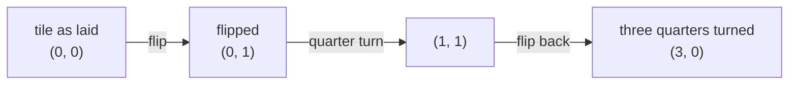
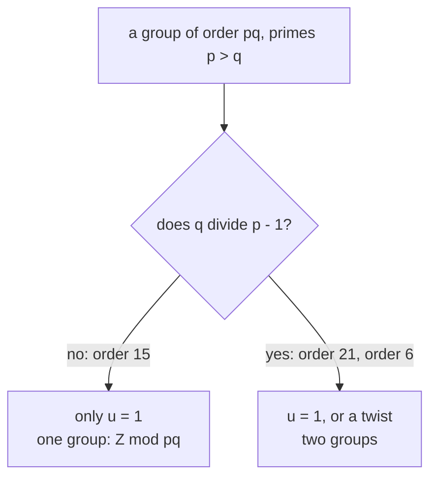

# Semidirect products: glue two groups where one acts on the other, so the tile group is four turns twisted by one flip

[Syllabus](../../../SYLLABUS.md) → [Algebra](../README.md) → [Groups](../README.md#s08) → Semidirect products

---

## General Overview

A square tile fits its square recess 8 ways: four turns and four flips ([Groups](01-groups.md)). Each is "flip or not, then turn some quarters": a pair of a turn count on a 4-clock and a flip count on a 2-clock.

The [Direct products](07-direct-products.md) rule, adding each half on its own, also gives 8 pairs, but there every pair of moves commutes. On the tile, order matters.

The reason: seen through a flip, a clockwise turn runs anticlockwise. Flip, turn a quarter, flip back, and the tile has turned three quarters.

Pairing two groups with that twist built into the rule is a **semidirect product**. It matters because two groups can glue in more than one way: the clocks of 7 and 3 glue with no twist, or with the twist "double it", into different groups of 21.

**A semidirect product pairs two groups and lets one relabel the other as pairs combine, so the same two pieces can build different groups.**

**What kind of fact this is:** a definition, carrying two theorems proved in Why it works. A group splits as a semidirect product when a normal subgroup and a subgroup meet only in the identity and fill the group, and a group of order $`pq`$ is one of at most two groups.

### The picture: a flip reverses a turn



Through a flip, a quarter turn becomes its undo: the twist.

---

## The formula

- $`N`$ is the group relabelled, the turns. $`H`$ is the group acting, the flips.
- $`\varphi_h`$ (phi, sub h) is the **action** of $`h`$ in $`H`$: a relabelling of $`N`$ that keeps its operation. The flip sends $`a`$ quarters to $`-a`$.
- $`N \rtimes H`$, said "N semidirect H", is the set of pairs $`(x, h)`$, $`x`$ in $`N`$, $`h`$ in $`H`$. The sign points at $`N`$, the normal piece.

The rule, right-hand move first as elsewhere on the shelf:

```math
(x, h)\,(y, k) = (x \, \varphi_h(y),\; hk)
```

**Read it aloud:** relabel the second $`N`$-part by the first $`H`$-part, then combine the $`N`$-parts; combine the $`H`$-parts.

On clocks the action is a multiplier $`u`$, with an $`n`$-clock for $`N`$ and an $`m`$-clock for $`H`$:

```math
(a, s)\,(b, t) = (a + u^{s}\, b \bmod n,\;\; s + t \bmod m)
```

**Read it aloud:** multiply the second turn count by $`u`$ once per flip in the first move, then add; add the flip counts.

The tile is $`n = 4`$, $`m = 2`$, $`u = 3`$ (3 is $`-1`$ on a 4-clock). The order-21 group is $`n = 7`$, $`m = 3`$, $`u = 2`$. With $`u = 1`$ the twist vanishes and the rule is the direct product.

| Symbol | Plain meaning | In our example | Push it up and the answer… |
| --- | --- | --- | --- |
| $`N`$, $`H`$, $`G`$ | group relabelled; group acting; whole group | turns; flips; the 8 moves | — |
| $`N \rtimes H`$ | pairs combined by the twisted rule | the tile; the twisted group of 21 | — |
| $`\varphi_h`$ | the relabelling of $`N`$ made by $`h`$ | the flip sends $`a`$ to $`-a`$ | — |
| $`x`$, $`y`$, $`z`$; $`h`$, $`k`$, $`l`$ | members of $`N`$; of $`H`$ | a quarter turn; the flip | — |
| $`(a, s)`$, $`(b, t)`$ | $`a`$ quarters after $`s`$ flips | $`(1, 0)`$ turn, $`(0, 1)`$ flip | — |
| $`n`$, $`m`$, $`u`$ | clock sizes; multiplier, $`u^m = 1 \bmod n`$ | 4, 2, 3; then 7, 3, 2 | $`u = 1`$ removes the twist |
| $`p`$, $`q`$, $`\text{Z mod } p`$ | primes, $`p`$ larger, for a group of $`pq`$; the $`p`$-clock | 7 and 3; 5 and 3 | — |
| $`e`$, $`h^{-1}`$, $`NH`$, $`N \cap H`$, $`\cong`$ | identity; undo; all products $`xh`$; shared members; same group relabelled | $`(0, 0)`$; flip; 8 moves; $`e`$ alone | — |

### When it holds

- **Each $`\varphi_h`$ keeps $`N`$'s operation and can be undone.** On a clock, $`u`$ shares no factor with $`n`$. With $`u = 2`$ on a 4-clock, 1 and 3 both land on 2, and undos are lost.
- **The actions compose like $`H`$.** Doing $`k`$ then $`h`$ relabels as $`hk`$ does. On clocks this is $`u^m = 1 \bmod n`$. With $`u = 3`$ on the 7-clock and a 3-clock for $`H`$, $`3^3`$ is 6, and the bracket rule breaks.
- **To recognise a group as a semidirect product, $`N`$ must be normal.** The flips are not normal in the tile ([Normal subgroups and quotient groups](06-normal-subgroups-and-quotient-groups.md)), so the tile is turns twisted by flips, never the reverse.

---

## Why it works

### Step 0: moving a flip past a turn costs one relabelling

Every tile move is a turn after a flip, $`x h`$. In $`x h \, y k`$, slide $`h`$ past $`y`$ to collect the turns on the left. Sliding changes $`y`$ into $`h y h^{-1}`$: undo the flip, turn, flip again. That is still a turn, since the turns are normal.

```math
(x h)(y k) = x\,(h y h^{-1})\,(h k)
```

So the twisted rule records "move every flip to the right", with the action $`\varphi_h(y) = h y h^{-1}`$, called conjugation.

### Step 1: the pairs are a group

Closure and the identity $`(e, e)`$ are clear. The undo of $`(x, h)`$ is $`(\varphi_{h^{-1}}(x^{-1}), h^{-1})`$. The bracket rule needs the first two conditions of When it holds.

<details>
<summary>Detailed proof: the bracket rule</summary>

Bracket the left pair first:

$`\displaystyle \big((x, h)(y, k)\big)(z, l) = \big(x\,\varphi_h(y)\,\varphi_{hk}(z),\; hkl\big)`$

Bracket the right pair first:

$`\displaystyle (x, h)\big((y, k)(z, l)\big) = \big(x\,\varphi_h(y)\,\varphi_h(\varphi_k(z)),\; hkl\big)`$

The second line used that $`\varphi_h`$ keeps $`N`$'s operation. They agree for every $`z`$ exactly when $`\varphi_{hk} = \varphi_h \circ \varphi_k`$, where $`\circ`$ means "do $`\varphi_k`$, then $`\varphi_h`$". On clocks, $`\varphi_s`$ multiplies by $`u^s`$, and $`s`$ is known only up to multiples of $`m`$, so $`u^m = 1`$.

</details>

On the tile, turn then flip is $`(0, 1)(1, 0) = (0 - 1, 1) = (3, 1)`$, r3f on the Groups card; flip then turn is $`(1, 0)(0, 1) = (1, 1)`$, r1f. All 64 products match the corner maps.

### Step 2: recognising a semidirect product

Take a group $`G`$ with a normal subgroup $`N`$ and a subgroup $`H`$ where:

```math
N \cap H = \{e\}, \qquad NH = G
```

Then $`G \cong N \rtimes H`$, with $`H`$ acting by conjugation. Every member is uniquely some $`x h`$: if $`x h = x' h'`$ then $`x'^{-1} x = h' h^{-1}`$ lies in both subgroups, so it is $`e`$. Step 0 then shows the products follow the twisted rule.

The tile passes. All 32 conjugates of the 4 turns are turns, so the turns are normal. Turns and $`\{r0, f\}`$ share only r0, and their products give all 8 moves. The half turns $`\{r0, r2\}`$ fail: they share r2 with the turns, and the products give 4 moves.

If $`H`$ is normal too, $`h x h^{-1} x^{-1}`$ lies in both, so it is $`e`$: the twist vanishes and $`G`$ is the direct product.

### Step 3: the groups of order pq

Let $`p > q`$ be primes and take a group of $`pq`$ members. [The Sylow theorems](11-sylow-theorems.md) do most of the work.

1. **The order-$`p`$ subgroup is normal.** Their number divides $`q`$ and is 1 more than a multiple of $`p`$. Since $`q < p`$, it is 1, and a subgroup with no other conjugates is normal.
2. **It has a partner.** Sylow gives a subgroup of order $`q`$. A shared member's order divides both primes, so they share only $`e`$, and their $`pq`$ products are everything.
3. **So the group is $`\text{Z mod } p \rtimes \text{Z mod } q`$.** A relabelling of a $`p`$-clock keeping addition is fixed by where 1 goes, so it is "multiply by $`u`$", with $`u^q = 1 \bmod p`$.
4. **Count the multipliers.** $`u = 1`$ gives the direct product, which is $`\text{Z mod } pq`$ by Direct products. Any other $`u`$ has order $`q`$ among the $`p - 1`$ nonzero remainders, so by Lagrange $`q`$ divides $`p - 1`$.
5. **All twists give one group.** If $`u \ne 1`$ works, its powers $`u, u^2, \dots, u^{q-1}`$ are all the other answers, since $`u^q = 1`$ has at most $`q`$ answers modulo a prime ([Lagrange's root bound](../../02-Number%20theory/04-Powers%20on%20the%20Clock/07-lagrange-root-bound.md)). Relabelling the $`q`$-clock by $`s \to ks`$ turns $`u`$ into $`u^k`$.



For order 21: $`2^3 = 8 = 1 \bmod 7`$, and the multipliers are 1, 2 and 4. Item 5 with $`k = 2`$ turns 2 into 4, so there are exactly two groups of order 21.

For order 15, only $`u = 1`$ solves $`u^3 = 1 \bmod 5`$, so every group of 15 is the 15-clock. For order 6, $`u = 2`$ negates, giving the triangle's 6 symmetries ([Permutations](03-permutations-and-the-symmetric-group.md)).

<details>
<summary>Why the twisted 21 is not the 21-clock</summary>

There, $`(1, 1)`$ twice is $`(1 + 2 \cdot 1, 2) = (3, 2)`$, and three times is $`(3 + 4 \cdot 1, 0) = (0, 0)`$. The code finds 14 members of order 3, 6 of order 7 and none of order 21, while the 21-clock's notch has order 21. Relabelling keeps return times, so the groups differ. The twisted group has 7 subgroups of order 3, as Sylow allows.

</details>

---

## Worked numbers, by hand

| Step | Arithmetic | Value |
| --- | --- | --- |
| flip, then a quarter turn | $`(1, 0)(0, 1) = (1 + 3^0 \cdot 0, 1)`$ | $`(1, 1)`$ |
| flip, quarter turn, flip | $`(0, 1)(1, 1) = (0 + 3 \cdot 1, 2)`$, wrapped | **$`(3, 0)`$, the undo of $`(1, 0)`$** |
| commuting pairs of tile moves | counted over 64 | **40**, against 64 untwisted |
| order 21: the twist works | $`2^3 = 8`$, and $`8 \bmod 7`$ | **1** |
| $`(1, 1)`$ cubed in the twisted 21 | $`(3, 2)`$, then $`3 + 4 \cdot 1 = 7`$ | **$`(0, 0)`$** |
| members by return time | 1 of order 1, 14 of order 3, 6 of order 7 | **no member of order 21** |
| order 15: $`u`$ with $`u^3 = 1 \bmod 5`$ | try 1 to 4 | **only 1: one group** |

The twist cuts commuting pairs to 40 of 64 and leaves nothing of order 21.

### What breaks if you drop a piece

| Mistake | Comes out at | What went wrong |
| --- | --- | --- |
| No twist, $`u = 1`$ | 64 of 64 pairs commute, against 40 | the direct product, not the tile |
| $`u = 3`$ on the 7-clock with a 3-clock | $`3^3 = 6 \bmod 7`$; 2646 of 9261 triples break | three steps of $`H`$ must undo the twist |
| Twisting by the right move's flip | 192 of 512 triples break | the left move's flips act on the right's turns |
| Half turns $`\{r0, r2\}`$ as partner | shares 2 members; products give 4 | $`N \cap H`$ must be $`e`$ alone |

---

## Code, from first principles, and it actually runs

Nothing is imported. Each group is built from the twisted rule and checked three ways. Every product is compared with composed maps $`x \to u^s x + a`$, which never use the rule. The multipliers with $`u^q = 1 \bmod p`$ are searched and matched against whether $`q`$ divides $`p - 1`$. The twisted 21's subgroup counts are tested against Sylow.

### Python

```python
# Semidirect products -- the check behind the card.  Nothing is imported.
# A move is a pair (a, s): a on an n-clock, s on an m-clock.  The twisted
# rule is (a, s)(b, t) = (a + u^s b, s + t), u a multiplier on the n-clock.
# Road two never uses the rule: the pair is the map x -> u^s x + a on the n
# points, and two maps compose point by point, the right-hand map first.
def mul(n, m, u, x, y):
    return ((x[0] + pow(u, x[1], n) * y[0]) % n, (x[1] + y[1]) % m)

bad_mul = lambda n, m, u, x, y: ((x[0] + pow(u, y[1], n) * y[0]) % n, (x[1] + y[1]) % m)
yn = lambda claim: "yes" if claim else "no"        # bad_mul: the mistake, twisting by t

def facts(n, m, u, rule=mul):
    G = [(a, s) for s in range(m) for a in range(n)]
    f = lambda x, y: rule(n, m, u, x, y)
    pts = {x: tuple((pow(u, x[1], n) * p + x[0]) % n for p in range(n)) for x in G}
    agree = all(pts[f(x, y)] == tuple(pts[x][q] for q in pts[y]) for x in G for y in G)
    broken = sum(f(f(x, y), z) != f(x, f(y, z)) for x in G for y in G for z in G)
    commute = sum(f(x, y) == f(y, x) for x in G for y in G)
    return G, f, agree and len(set(pts.values())) == len(G), broken, commute

def order(f, x):                         # repeats of x until the identity (0, 0)
    k, y = 1, x
    while y != (0, 0):
        k, y = k + 1, f(y, x)
    return k

T, tf, tok, tbroken, tcomm = facts(4, 2, 3)
flip, quarter, N = (0, 1), (1, 0), [(a, 0) for a in range(4)]
inv = {g: next(y for y in T if tf(g, y) == (0, 0)) for g in T}
stay, undo = all(tf(tf(g, x), inv[g]) in N for g in T for x in N), inv[quarter]
print(f"tile, u = 3: rule matches the corner maps on 64 products: {yn(tok)}")
print(f"flip, quarter turn, flip = {tf(tf(flip, quarter), flip)}; undo of a quarter turn = {undo}")
print(f"turn then flip = {tf(flip, quarter)}; flip then turn = {tf(quarter, flip)}")
print(f"commuting pairs: tile {tcomm} of 64, untwisted (u = 1) {facts(4, 2, 1)[4]} of 64")
print(f"turns keep their shape under all 32 conjugations: {yn(stay)}")
for name, K in [("flips {r0, f}", [(0, 0), flip]), ("half turn {r0, r2}", [(0, 0), (2, 0)])]:
    print(f"turns with {name}: share {len(set(N) & set(K))}, products give {len({tf(x, y) for x in N for y in K})}")
S, sf, sok, sbroken, scomm = facts(7, 3, 2)
ords = [order(sf, x) for x in S]
n7, n3 = ords.count(7) // 6, ords.count(3) // 2
print(f"order 21, u = 2, 2^3 = 8 = {8 % 7} mod 7: matches maps {yn(sok)}, broken triples {sbroken}")
print(f"orders: 1 x{ords.count(1)}, 3 x{ords.count(3)}, 7 x{ords.count(7)}; commuting pairs {scomm} of 441")
print(f"subgroups of order 7: {n7}; of order 3: {n3}; (1, 1) twice {sf((1, 1), (1, 1))}, thrice {sf(sf((1, 1), (1, 1)), (1, 1))}")
Z, zf, _, _, zcomm = facts(7, 3, 1)
longest = max(order(zf, x) for x in Z)
ff = facts(7, 3, 4)[1]
same = all((sf(x, y)[0], 2 * sf(x, y)[1] % 3) == ff((x[0], 2 * x[1] % 3), (y[0], 2 * y[1] % 3)) for x in S for y in S)
print(f"u = 1: longest order {longest}, commuting pairs {zcomm}; u = 4 is u = 2 relabelled: {yn(same)}")
for p, q in [(7, 3), (5, 3), (3, 2)]:
    us = [u for u in range(1, p) if pow(u, q, p) == 1]
    print(f"order {p * q}: u with u^{q} = 1 mod {p}: {us}; {q} divides {p - 1}: {yn((p - 1) % q == 0)}")
    assert (len(us) > 1) == ((p - 1) % q == 0) and len(us) in (1, q)   # two roads
bbroken, wbroken = facts(7, 3, 3)[3], facts(4, 2, 3, bad_mul)[3]
print(f"mistake, u = 3 on the 7-clock, 3^3 = {27 % 7} mod 7: broken triples {bbroken} of 9261")
print(f"mistake, twisting by the right-hand flip: broken triples {wbroken} of 512")
assert tok and sok and tbroken == 0 and sbroken == 0          # rule = composed maps
assert tf(tf(flip, quarter), flip) == undo and stay and tcomm < 64
assert n7 == 1 and n3 % 3 == 1 and 7 % n3 == 0 and longest == 21 > max(ords)
assert same and bbroken > 0 and wbroken > 0
print("ALL CHECKS PASS")
```

**Ran 2026-11-23 on macOS, Python 3.14.10, standard library only. All checks passed. Output, pasted from the run:**

```
tile, u = 3: rule matches the corner maps on 64 products: yes
flip, quarter turn, flip = (3, 0); undo of a quarter turn = (3, 0)
turn then flip = (3, 1); flip then turn = (1, 1)
commuting pairs: tile 40 of 64, untwisted (u = 1) 64 of 64
turns keep their shape under all 32 conjugations: yes
turns with flips {r0, f}: share 1, products give 8
turns with half turn {r0, r2}: share 2, products give 4
order 21, u = 2, 2^3 = 8 = 1 mod 7: matches maps yes, broken triples 0
orders: 1 x1, 3 x14, 7 x6; commuting pairs 105 of 441
subgroups of order 7: 1; of order 3: 7; (1, 1) twice (3, 2), thrice (0, 0)
u = 1: longest order 21, commuting pairs 441; u = 4 is u = 2 relabelled: yes
order 21: u with u^3 = 1 mod 7: [1, 2, 4]; 3 divides 6: yes
order 15: u with u^3 = 1 mod 5: [1]; 3 divides 4: no
order 6: u with u^2 = 1 mod 3: [1, 2]; 2 divides 2: yes
mistake, u = 3 on the 7-clock, 3^3 = 6 mod 7: broken triples 2646 of 9261
mistake, twisting by the right-hand flip: broken triples 192 of 512
ALL CHECKS PASS
```

### Rust

Same numbers, same labels, built with `rustc --edition 2021 -O`.

```rust
// Semidirect products -- the same check as the Python, in Rust.  No crates.
// A move is a pair (a, s): a on an n-clock, s on an m-clock.  The twisted
// rule is (a, s)(b, t) = (a + u^s b, s + t), u a multiplier on the n-clock.
// Road two never uses the rule: the pair is the map x -> u^s x + a on the n
// points, and two maps compose point by point, the right-hand map first.
type P = (i64, i64);

fn pw(u: i64, k: i64, n: i64) -> i64 { (0..k).fold(1, |acc, _| acc * u % n) }
fn yn(claim: bool) -> &'static str { if claim { "yes" } else { "no" } }
struct Grp { n: i64, m: i64, u: i64, bad: bool, all: Vec<P> }
impl Grp {
    fn new(n: i64, m: i64, u: i64, bad: bool) -> Grp {     // bad: the mistake, twisting by t
        Grp { n, m, u, bad, all: (0..m).flat_map(|s| (0..n).map(move |a| (a, s))).collect() }
    }
    fn f(&self, x: P, y: P) -> P {
        let k = if self.bad { y.1 } else { x.1 };
        ((x.0 + pw(self.u, k, self.n) * y.0) % self.n, (x.1 + y.1) % self.m)
    }
    fn pts(&self, x: P) -> Vec<i64> { (0..self.n).map(|p| (pw(self.u, x.1, self.n) * p + x.0) % self.n).collect() }
    fn agree(&self) -> bool {
        let mut maps: Vec<Vec<i64>> = self.all.iter().map(|&x| self.pts(x)).collect();
        let ok = self.all.iter().all(|&x| self.all.iter().all(|&y| self.pts(self.f(x, y))
            == self.pts(y).iter().map(|&q| self.pts(x)[q as usize]).collect::<Vec<i64>>()));
        maps.sort(); maps.dedup();
        ok && maps.len() == self.all.len()
    }
    fn broken(&self) -> usize {
        let g = &self.all;
        g.iter().map(|&x| g.iter().map(|&y| g.iter().filter(|&&z|
            self.f(self.f(x, y), z) != self.f(x, self.f(y, z))).count()).sum::<usize>()).sum()
    }
    fn commute(&self) -> usize {
        self.all.iter().map(|&x| self.all.iter().filter(|&&y| self.f(x, y) == self.f(y, x)).count()).sum()
    }
    fn order(&self, x: P) -> i64 { let (mut k, mut y) = (1, x); while y != (0, 0) { k += 1; y = self.f(y, x) } k }
    fn inv(&self, g: P) -> P { *self.all.iter().find(|&&y| self.f(g, y) == (0, 0)).unwrap() }
}

fn main() {
    let t = Grp::new(4, 2, 3, false);
    let (tok, tbroken, tcomm) = (t.agree(), t.broken(), t.commute());
    let (flip, quarter, n): (P, P, Vec<P>) = ((0, 1), (1, 0), (0..4).map(|a| (a, 0)).collect());
    let (stay, undo) = (t.all.iter().all(|&g| n.iter().all(|&x| n.contains(&t.f(t.f(g, x), t.inv(g))))), t.inv(quarter));
    println!("tile, u = 3: rule matches the corner maps on 64 products: {}", yn(tok));
    println!("flip, quarter turn, flip = {:?}; undo of a quarter turn = {:?}", t.f(t.f(flip, quarter), flip), undo);
    println!("turn then flip = {:?}; flip then turn = {:?}", t.f(flip, quarter), t.f(quarter, flip));
    println!("commuting pairs: tile {} of 64, untwisted (u = 1) {} of 64", tcomm, Grp::new(4, 2, 1, false).commute());
    println!("turns keep their shape under all 32 conjugations: {}", yn(stay));
    for (name, k) in [("flips {r0, f}", vec![(0, 0), flip]), ("half turn {r0, r2}", vec![(0, 0), (2, 0)])] {
        let mut prods: Vec<P> = n.iter().flat_map(|&x| k.iter().map(move |&y| (x, y))).map(|(x, y)| t.f(x, y)).collect();
        prods.sort(); prods.dedup();
        println!("turns with {}: share {}, products give {}", name, n.iter().filter(|x| k.contains(x)).count(), prods.len());
    }
    let s = Grp::new(7, 3, 2, false);
    let (sok, sbroken, scomm) = (s.agree(), s.broken(), s.commute());
    let ords: Vec<i64> = s.all.iter().map(|&x| s.order(x)).collect();
    let cnt = |o: i64| ords.iter().filter(|&&v| v == o).count();
    let (n7, n3) = (cnt(7) / 6, cnt(3) / 2);
    println!("order 21, u = 2, 2^3 = 8 = {} mod 7: matches maps {}, broken triples {}", 8 % 7, yn(sok), sbroken);
    println!("orders: 1 x{}, 3 x{}, 7 x{}; commuting pairs {} of 441", cnt(1), cnt(3), cnt(7), scomm);
    println!("subgroups of order 7: {}; of order 3: {}; (1, 1) twice {:?}, thrice {:?}", n7, n3, s.f((1, 1), (1, 1)), s.f(s.f((1, 1), (1, 1)), (1, 1)));
    let z = Grp::new(7, 3, 1, false);
    let longest = z.all.iter().map(|&x| z.order(x)).max().unwrap();
    let (ff, re) = (Grp::new(7, 3, 4, false), |x: P| (x.0, 2 * x.1 % 3));
    let same = s.all.iter().all(|&x| s.all.iter().all(|&y| re(s.f(x, y)) == ff.f(re(x), re(y))));
    println!("u = 1: longest order {}, commuting pairs {}; u = 4 is u = 2 relabelled: {}", longest, z.commute(), yn(same));
    for (p, q) in [(7i64, 3i64), (5, 3), (3, 2)] {
        let us: Vec<i64> = (1..p).filter(|&u| pw(u, q, p) == 1).collect();
        println!("order {}: u with u^{} = 1 mod {}: {:?}; {} divides {}: {}", p * q, q, p, us, q, p - 1, yn((p - 1) % q == 0));
        assert!((us.len() > 1) == ((p - 1) % q == 0) && (us.len() == 1 || us.len() as i64 == q));
    }
    let (bbroken, wbroken) = (Grp::new(7, 3, 3, false).broken(), Grp::new(4, 2, 3, true).broken());
    println!("mistake, u = 3 on the 7-clock, 3^3 = {} mod 7: broken triples {} of 9261", 27 % 7, bbroken);
    println!("mistake, twisting by the right-hand flip: broken triples {} of 512", wbroken);
    assert!(tok && sok && tbroken == 0 && sbroken == 0);          // rule = composed maps
    assert!(t.f(t.f(flip, quarter), flip) == undo && stay && tcomm < 64);
    assert!(n7 == 1 && n3 % 3 == 1 && 7 % n3 == 0 && longest == 21 && 21 > *ords.iter().max().unwrap());
    assert!(same && bbroken > 0 && wbroken > 0);
    println!("ALL CHECKS PASS");
}
```

**Ran 2026-11-23 on macOS, rustc 1.98.1, no crates. All checks passed. Output, pasted from the run:**

```
tile, u = 3: rule matches the corner maps on 64 products: yes
flip, quarter turn, flip = (3, 0); undo of a quarter turn = (3, 0)
turn then flip = (3, 1); flip then turn = (1, 1)
commuting pairs: tile 40 of 64, untwisted (u = 1) 64 of 64
turns keep their shape under all 32 conjugations: yes
turns with flips {r0, f}: share 1, products give 8
turns with half turn {r0, r2}: share 2, products give 4
order 21, u = 2, 2^3 = 8 = 1 mod 7: matches maps yes, broken triples 0
orders: 1 x1, 3 x14, 7 x6; commuting pairs 105 of 441
subgroups of order 7: 1; of order 3: 7; (1, 1) twice (3, 2), thrice (0, 0)
u = 1: longest order 21, commuting pairs 441; u = 4 is u = 2 relabelled: yes
order 21: u with u^3 = 1 mod 7: [1, 2, 4]; 3 divides 6: yes
order 15: u with u^3 = 1 mod 5: [1]; 3 divides 4: no
order 6: u with u^2 = 1 mod 3: [1, 2]; 2 divides 2: yes
mistake, u = 3 on the 7-clock, 3^3 = 6 mod 7: broken triples 2646 of 9261
mistake, twisting by the right-hand flip: broken triples 192 of 512
ALL CHECKS PASS
```

The two outputs match line for line.

### Lean

Lean proves the twisted rule is a group and the card's two theorems, for every group, clock and pair of primes.

- Suppose $`N`$ is normal, $`H`$ is a subgroup, $`N \cap H = \{e\}`$ and $`NH = G`$. Then $`G \cong N \rtimes H`$, with $`H`$ acting by conjugation and $`(x, h)`$ matched to $`x h`$.
- Suppose $`u`$ shares no factor with $`n`$ and $`u^m = 1 \bmod n`$. Then the twisted rule brackets either way, $`(0, 0)`$ is its identity, and every pair has an undo.
- Take primes $`p > q`$. Then a multiplier $`u \ne 1`$ with $`u^q = 1 \bmod p`$ exists exactly when $`q`$ divides $`p - 1`$.
- Take primes $`p > q`$, with $`q`$ not dividing $`p - 1`$. Then every group of order $`pq`$ is the $`pq`$-clock, relabelled.
- Take two groups of order $`pq`$, neither of them the $`pq`$-clock. Then they are the same group relabelled, so there are at most two groups.
- It also re-checks the tile's numbers: $`(3, 1)`$, $`(1, 1)`$, $`(3, 0)`$, 40 commuting pairs and 192 broken triples.
- It re-checks order 21: $`2^3 = 1 \bmod 7`$, 14 members of order 3, 6 of order 7, and multipliers 1, 2, 4.

The road through composed maps, the subgroup counts, and the $`u = 3`$ mistake on the 7-clock are left to the Python and Rust checks.

```lean
-- Semidirect products: a group with a normal subgroup N and a subgroup H that meet only in the identity and fill the group is N twisted by H acting by conjugation, the clock rule (a, s)(b, t) = (a + u^s b, s + t) is a group when u has an undo and u^m = 1, and for primes q < p a group of order pq is cyclic when q does not divide p - 1 and one of at most two groups when it does.
import Mathlib.GroupTheory.SemidirectProduct
import Mathlib.GroupTheory.GroupAction.ConjAct
import Mathlib.GroupTheory.SpecificGroups.Cyclic
import Mathlib.Data.ZMod.Basic
import Mathlib.GroupTheory.SpecificGroups.ZGroup
import Mathlib.RingTheory.IntegralDomain
import Mathlib.FieldTheory.Finite.Basic
import Mathlib.Data.Nat.Squarefree

open scoped Pointwise

universe u

/-- The clock rule of the card: a pair (a, s) is a turn count a on an n-clock and a flip count s
on an m-clock, and (a, s)(b, t) = (a + u^s b, s + t), with u a multiplier on the n-clock. -/
def twist (n m : ℕ) (u : ZMod n) (x y : ZMod n × ZMod m) : ZMod n × ZMod m :=
  (x.1 + u ^ x.2.val * y.1, x.2 + y.2)

lemma pow_val_add {n m : ℕ} [NeZero m] (u : ZMod n) (hum : u ^ m = 1) (s t : ZMod m) :
    u ^ (s + t).val = u ^ s.val * u ^ t.val := by
  rw [← pow_add, ZMod.val_add, ← pow_eq_pow_mod _ hum]

lemma hom_eq_one_of_coprime {H K : Type*} [Group H] [Group K] (f : H →* K)
    (h : (Nat.card H).Coprime (Nat.card K)) : f = 1 := by
  ext x
  have h1 : orderOf (f x) ∣ Nat.card H := (orderOf_map_dvd f x).trans (orderOf_dvd_natCard x)
  have h2 : orderOf (f x) ∣ Nat.card K := orderOf_dvd_natCard _
  have h3 := Nat.Coprime.coprime_dvd_left h1 (Nat.Coprime.coprime_dvd_right h2 h)
  exact orderOf_eq_one_iff.mp (by simpa using h3)

lemma isCyclic_semidirect_of_eq_one {N H : Type*} [Group N] [Group H] [IsCyclic N] [IsCyclic H]
    (φ : H →* MulAut N) (hφ : φ = 1) (hc : (Nat.card N).Coprime (Nat.card H)) :
    IsCyclic (N ⋊[φ] H) := by
  subst hφ
  exact (SemidirectProduct.mulEquivProd).isCyclic.mpr (Group.isCyclic_prod_iff.mpr ⟨‹_›, ‹_›, hc⟩)

lemma order_pq_decomp {p q : ℕ} (hp : p.Prime) (hq : q.Prime) (hqp : q < p)
    (G : Type u) [Group G] (hG : Nat.card G = p * q) :
    ∃ (N H : Subgroup G) (φ : H →* MulAut N) (_ : G ≃* N ⋊[φ] H),
      IsCyclic H ∧ IsCyclic N ∧ (Nat.card N).Coprime (Nat.card H) ∧
        ((Nat.card N = p ∧ Nat.card H = q) ∨ φ = 1) := by
  have hpq0 : p * q ≠ 0 := Nat.mul_ne_zero hp.ne_zero hq.ne_zero
  have : Finite G := Nat.finite_of_card_ne_zero (hG ▸ hpq0)
  have hsq : Squarefree (Nat.card G) := by
    rw [hG, Nat.squarefree_mul_iff]
    exact ⟨(Nat.coprime_primes hp hq).mpr hqp.ne', hp.squarefree, hq.squarefree⟩
  have := IsZGroup.of_squarefree hsq
  obtain ⟨N, H, φ, e, hH, hN, hc⟩ := (isZGroup_iff_exists_mulEquiv (G := G)).mp this
  refine ⟨N, H, φ, e, hH, hN, hc, ?_⟩
  have hcard : Nat.card N * Nat.card H = p * q := by
    rw [← hG, Nat.card_congr e.toEquiv, SemidirectProduct.card]
  have hdvd : Nat.card N ∣ p * q := ⟨_, hcard.symm⟩
  obtain ⟨y, z, hy, hz, hyz⟩ := Nat.dvd_mul.mp hdvd
  have hq1 : 1 < q := hq.one_lt
  rcases hp.eq_one_or_self_of_dvd y hy with hy' | hy' <;>
    rcases hq.eq_one_or_self_of_dvd z hz with hz' | hz' <;> rw [hy', hz'] at hyz
  · -- N trivial
    right
    apply hom_eq_one_of_coprime
    rw [IsCyclic.card_mulAut, ← hyz]
    simp
  · -- |N| = q, |H| = p
    right
    apply hom_eq_one_of_coprime
    have hH' : Nat.card H = p := by
      rw [← hyz, one_mul, mul_comm p q] at hcard
      exact Nat.eq_of_mul_eq_mul_left hq.pos hcard
    rw [IsCyclic.card_mulAut, ← hyz, one_mul, Nat.totient_prime hq, hH']
    exact (Nat.Prime.coprime_iff_not_dvd hp).mpr (Nat.not_dvd_of_pos_of_lt (by omega) (by omega))
  · left
    refine ⟨by rw [← hyz, mul_one], ?_⟩
    rw [← hyz, mul_one] at hcard
    exact Nat.eq_of_mul_eq_mul_left hp.pos hcard
  · right
    apply hom_eq_one_of_coprime
    have hH' : Nat.card H = 1 := by
      rw [← hyz] at hcard
      exact Nat.eq_of_mul_eq_mul_left (Nat.mul_pos hp.pos hq.pos) (by rw [hcard, mul_one])
    rw [hH']
    exact Nat.coprime_one_left _

lemma injective_of_ne_one {H K : Type*} [Group H] [Group K] {q : ℕ} (hq : q.Prime)
    (hH : Nat.card H = q) (f : H →* K) (hf : f ≠ 1) : Function.Injective f := by
  have : Fact (Nat.card H).Prime := ⟨hH ▸ hq⟩
  rcases Subgroup.eq_bot_or_eq_top_of_prime_card f.ker with h | h
  · exact (MonoidHom.ker_eq_bot_iff f).mp h
  · exact absurd (MonoidHom.ker_eq_top_iff.mp h) hf

lemma semidirect_unique {N₁ H₁ N₂ H₂ : Type*} [Group N₁] [Group H₁] [Group N₂] [Group H₂]
    {p q : ℕ} (hp : p.Prime) (hq : q.Prime) (hN₁ : Nat.card N₁ = p) (hN₂ : Nat.card N₂ = p)
    (hH₁ : Nat.card H₁ = q) (hH₂ : Nat.card H₂ = q)
    (φ₁ : H₁ →* MulAut N₁) (φ₂ : H₂ →* MulAut N₂) (h₁ : φ₁ ≠ 1) (h₂ : φ₂ ≠ 1) :
    Nonempty (N₁ ⋊[φ₁] H₁ ≃* N₂ ⋊[φ₂] H₂) := by
  have : Fact p.Prime := ⟨hp⟩
  have : IsCyclic N₁ := isCyclic_of_prime_card hN₁
  have : IsCyclic N₂ := isCyclic_of_prime_card hN₂
  have : Finite N₂ := Nat.finite_of_card_ne_zero (hN₂ ▸ hp.ne_zero)
  let fn : N₁ ≃* N₂ := mulEquivOfCyclicCardEq (hN₁.trans hN₂.symm)
  let ψ : H₁ →* MulAut N₂ := (MulAut.congr fn).toMonoidHom.comp φ₁
  have hψ1 : ψ ≠ 1 := by
    intro h
    apply h₁
    ext g x
    have := DFunLike.congr_fun h g
    simp only [ψ, MonoidHom.comp_apply, MulEquiv.coe_toMonoidHom, MonoidHom.one_apply] at this
    rw [(MulAut.congr fn).map_eq_one_iff] at this
    simp [this]
  have hψ := injective_of_ne_one hq hH₁ ψ hψ1
  have hφ₂ := injective_of_ne_one hq hH₂ φ₂ h₂
  let eA := IsCyclic.mulAutMulEquiv N₂
  have : IsCyclic (MulAut N₂) := eA.isCyclic.mpr (by rw [hN₂]; infer_instance)
  have : Finite (MulAut N₂) := Finite.of_equiv _ eA.symm.toEquiv
  have hr : ψ.range = φ₂.range := by
    rw [IsCyclic.subgroup_eq_iff_card_eq, ← Nat.card_congr (MonoidHom.ofInjective hψ).toEquiv,
      ← Nat.card_congr (MonoidHom.ofInjective hφ₂).toEquiv, hH₁, hH₂]
  let fg : H₁ ≃* H₂ := (MonoidHom.ofInjective hψ).trans
    ((MulEquiv.subgroupCongr hr).trans (MonoidHom.ofInjective hφ₂).symm)
  have hfg : ∀ g, φ₂ (fg g) = ψ g := by
    intro g
    have : MonoidHom.ofInjective hφ₂ (fg g) =
        MulEquiv.subgroupCongr hr (MonoidHom.ofInjective hψ g) := by
      simp only [fg, MulEquiv.trans_apply, MulEquiv.apply_symm_apply]
    have := congrArg Subtype.val this
    simpa [MonoidHom.ofInjective_apply] using this
  refine ⟨SemidirectProduct.congr fn fg fun g => ?_⟩
  rw [hfg g]
  ext x
  simp [ψ, MulAut.congr_apply]

/-- Recognising a semidirect product: if N is a normal subgroup of G and H a subgroup, N and H
share only the identity, and every member of G is a product x h with x in N and h in H, then G is
the semidirect product of N by H, with H acting on N by conjugation (h sends y to h y h⁻¹); the
match sends the pair (x, h) to the product x h. -/
theorem semidirect_product_of_normal_complement {G : Type*} [Group G] (N H : Subgroup G)
    [N.Normal] (hmeet : N ⊓ H = ⊥) (hfill : (N : Set G) * (H : Set G) = Set.univ) :
    ∃ e : N ⋊[MulAut.conjNormal.comp H.subtype] H ≃* G,
      ∀ (x : N) (h : H), e ⟨x, h⟩ = (x : G) * h := by
  have hc : N.IsComplement' H :=
    Subgroup.isComplement'_of_disjoint_and_mul_eq_univ (disjoint_iff.mpr hmeet) hfill
  refine ⟨MulEquiv.ofBijective (SemidirectProduct.lift N.subtype H.subtype ?_) ?_,
    fun x h => rfl⟩
  · intro g
    ext x
    simp [MulAut.conjNormal_apply]
  · exact (SemidirectProduct.equivProd.bijective_comp _).mpr hc

/-- The pairs are a group: when the multiplier u can be undone on the n-clock and u^m = 1, the
twisted rule on an n-clock by an m-clock brackets either way, has (0, 0) as its identity, and
gives every pair an undo. -/
theorem twist_is_group {n m : ℕ} [NeZero m] (u : ZMod n) (hu : IsUnit u) (hum : u ^ m = 1) :
    (∀ x y z : ZMod n × ZMod m, twist n m u (twist n m u x y) z = twist n m u x (twist n m u y z)) ∧
      (∀ x : ZMod n × ZMod m, twist n m u (0, 0) x = x ∧ twist n m u x (0, 0) = x) ∧
      (∀ x : ZMod n × ZMod m, ∃ y, twist n m u x y = (0, 0) ∧ twist n m u y x = (0, 0)) := by
  have _ := hu
  refine ⟨fun x y z => ?_, fun x => ?_, fun x => ?_⟩
  · simp only [twist, pow_val_add u hum]
    ext <;> simp only <;> ring
  · simp [twist]
  · refine ⟨(-(u ^ (-x.2).val * x.1), -x.2), ?_, ?_⟩
    · have h0 := pow_val_add u hum x.2 (-x.2)
      rw [add_neg_cancel, ZMod.val_zero, pow_zero] at h0
      simp only [twist, Prod.mk.injEq, add_neg_cancel, and_true]
      rw [mul_neg, ← mul_assoc, ← h0, one_mul, add_neg_cancel]
    · simp only [twist, neg_add_cancel]

/-- The groups of order pq, for primes q < p: a twist u ≠ 1 with u^q = 1 on the p-clock exists
exactly when q divides p - 1; when q does not divide p - 1 every group of order pq is the
pq-clock (cyclic); and any two groups of order pq that are not cyclic are the same group
relabelled, so there are at most two groups of order pq. -/
theorem groups_of_order_pq {p q : ℕ} (hp : p.Prime) (hq : q.Prime) (hqp : q < p) :
    ((∃ v : ZMod p, v ≠ 1 ∧ v ^ q = 1) ↔ q ∣ p - 1) ∧
      (∀ (G : Type u) [Group G], Nat.card G = p * q → ¬ q ∣ p - 1 → IsCyclic G) ∧
      (∀ (G₁ G₂ : Type u) [Group G₁] [Group G₂], Nat.card G₁ = p * q → Nat.card G₂ = p * q →
        ¬ IsCyclic G₁ → ¬ IsCyclic G₂ → Nonempty (G₁ ≃* G₂)) := by
  have hq1 := hq.one_lt
  have : Fact p.Prime := ⟨hp⟩
  refine ⟨⟨?_, ?_⟩, ?_, ?_⟩
  · rintro ⟨v, hv1, hvq⟩
    have hv0 : v ≠ 0 := by
      rintro rfl
      rw [zero_pow hq.ne_zero] at hvq
      exact zero_ne_one hvq
    have ho : orderOf v = q := by
      rcases hq.eq_one_or_self_of_dvd _ (orderOf_dvd_of_pow_eq_one hvq) with h | h
      · exact absurd (orderOf_eq_one_iff.mp h) hv1
      · exact h
    rw [← ho]
    exact orderOf_dvd_of_pow_eq_one (ZMod.pow_card_sub_one_eq_one hv0)
  · intro hdvd
    have : Fact q.Prime := ⟨hq⟩
    obtain ⟨u, hu⟩ := exists_prime_orderOf_dvd_card q (G := (ZMod p)ˣ) (by rwa [ZMod.card_units p])
    refine ⟨(u : ZMod p), fun h => ?_, ?_⟩
    · have := (orderOf_units (y := u)).trans hu
      rw [h, orderOf_one] at this
      omega
    · rw [← hu, ← orderOf_units]
      exact pow_orderOf_eq_one _
  · intro G _ hG hnd
    have : Finite G := Nat.finite_of_card_ne_zero (hG ▸ Nat.mul_ne_zero hp.ne_zero hq.ne_zero)
    obtain ⟨N, H, φ, e, hH, hN, hc, hcase⟩ := order_pq_decomp hp hq hqp G hG
    have hφ : φ = 1 := by
      rcases hcase with ⟨hNp, hHq⟩ | h
      · apply hom_eq_one_of_coprime
        rw [IsCyclic.card_mulAut, hNp, Nat.totient_prime hp, hHq]
        exact (Nat.Prime.coprime_iff_not_dvd hq).mpr hnd
      · exact h
    exact e.isCyclic.mpr (isCyclic_semidirect_of_eq_one φ hφ hc)
  · intro G₁ G₂ _ _ h₁ h₂ hn₁ hn₂
    obtain ⟨N₁, H₁, φ₁, e₁, hH₁, hN₁, hc₁, hcase₁⟩ := order_pq_decomp hp hq hqp G₁ h₁
    obtain ⟨N₂, H₂, φ₂, e₂, hH₂, hN₂, hc₂, hcase₂⟩ := order_pq_decomp hp hq hqp G₂ h₂
    have hφ₁ : φ₁ ≠ 1 := fun h => hn₁ (e₁.isCyclic.mpr (isCyclic_semidirect_of_eq_one φ₁ h hc₁))
    have hφ₂ : φ₂ ≠ 1 := fun h => hn₂ (e₂.isCyclic.mpr (isCyclic_semidirect_of_eq_one φ₂ h hc₂))
    rcases hcase₁ with ⟨a₁, b₁⟩ | h
    · rcases hcase₂ with ⟨a₂, b₂⟩ | h
      · obtain ⟨f⟩ := semidirect_unique hp hq a₁ a₂ b₁ b₂ φ₁ φ₂ hφ₁ hφ₂
        exact ⟨e₁.trans (f.trans e₂.symm)⟩
      · exact absurd h hφ₂
    · exact absurd h hφ₁

-- The tile: Z mod 4 twisted by Z mod 2 with u = 3, which is -1 on a 4-clock.
-- Turn then flip is (3, 1); flip then turn is (1, 1).
example : twist 4 2 3 (0, 1) (1, 0) = (3, 1) ∧ twist 4 2 3 (1, 0) (0, 1) = (1, 1) := by decide
-- Flip, quarter turn, flip gives (3, 0), the undo of the quarter turn (1, 0).
example : twist 4 2 3 (0, 1) (1, 1) = (3, 0) ∧ twist 4 2 3 (twist 4 2 3 (0, 1) (1, 0)) (0, 1) = (3, 0) ∧
    twist 4 2 3 (1, 0) (3, 0) = (0, 0) := by decide
-- 40 of the 64 pairs of tile moves commute; with no twist (u = 1) all 64 do.
example : (Finset.univ.filter (fun xy : (ZMod 4 × ZMod 2) × (ZMod 4 × ZMod 2) =>
    twist 4 2 3 xy.1 xy.2 = twist 4 2 3 xy.2 xy.1)).card = 40 := by decide
example : (Finset.univ.filter (fun xy : (ZMod 4 × ZMod 2) × (ZMod 4 × ZMod 2) =>
    twist 4 2 1 xy.1 xy.2 = twist 4 2 1 xy.2 xy.1)).card = 64 := by decide
-- Order 21: 2^3 = 8 = 1 on the 7-clock, so u = 2 twists; u = 3 fails, 3^3 = 6 on the 7-clock.
example : (2 : ZMod 7) ^ 3 = 1 ∧ (3 : ZMod 7) ^ 3 = 6 := by decide
-- In the twisted 21, (1, 1) twice is (3, 2) and three times is (0, 0).
example : twist 7 3 2 (1, 1) (1, 1) = (3, 2) ∧ twist 7 3 2 (twist 7 3 2 (1, 1) (1, 1)) (1, 1) = (0, 0) := by
  decide
-- The twisted 21: 105 of 441 pairs commute; 14 members of order 3 and 6 of order 7 besides the
-- identity, so none of order 21.
example : (Finset.univ.filter (fun xy : (ZMod 7 × ZMod 3) × (ZMod 7 × ZMod 3) =>
    twist 7 3 2 xy.1 xy.2 = twist 7 3 2 xy.2 xy.1)).card = 105 := by decide
example : (Finset.univ.filter (fun x : ZMod 7 × ZMod 3 =>
    x ≠ (0, 0) ∧ twist 7 3 2 (twist 7 3 2 x x) x = (0, 0))).card = 14 := by decide
example : (Finset.univ.filter (fun x : ZMod 7 × ZMod 3 =>
    x ≠ (0, 0) ∧ (fun y => twist 7 3 2 y x)^[6] x = (0, 0))).card = 6 := by decide
-- u = 4 is u = 2 relabelled: renaming s as 2s on the 3-clock carries one rule to the other.
example : ∀ x y : ZMod 7 × ZMod 3,
    ((twist 7 3 2 x y).1, 2 * (twist 7 3 2 x y).2) = twist 7 3 4 (x.1, 2 * x.2) (y.1, 2 * y.2) := by
  decide
-- The mistake of twisting by the right-hand move's flip breaks 192 of the tile's 512 triples.
set_option maxRecDepth 20000 in
example : (Finset.univ.filter (fun xyz : (ZMod 4 × ZMod 2) × (ZMod 4 × ZMod 2) × (ZMod 4 × ZMod 2) =>
    let f := fun x y : ZMod 4 × ZMod 2 => (x.1 + (3 : ZMod 4) ^ y.2.val * y.1, x.2 + y.2)
    f (f xyz.1 xyz.2.1) xyz.2.2 ≠ f xyz.1 (f xyz.2.1 xyz.2.2))).card = 192 := by decide
-- The multipliers u with u^q = 1 on the p-clock: [1, 2, 4] for 21, [1] for 15, [1, 2] for 6.
example : Finset.univ.filter (fun v : ZMod 7 => v ^ 3 = 1) = {1, 2, 4} := by decide
example : Finset.univ.filter (fun v : ZMod 5 => v ^ 3 = 1) = {1} := by decide
example : Finset.univ.filter (fun v : ZMod 3 => v ^ 2 = 1) = {1, 2} := by decide
-- 3 divides 6 (order 21), 3 does not divide 4 (order 15), 2 divides 2 (order 6).
example : 3 ∣ 7 - 1 ∧ ¬ 3 ∣ 5 - 1 ∧ 2 ∣ 3 - 1 := by decide

#print axioms pow_val_add
#print axioms hom_eq_one_of_coprime
#print axioms isCyclic_semidirect_of_eq_one
#print axioms order_pq_decomp
#print axioms injective_of_ne_one
#print axioms semidirect_unique
#print axioms semidirect_product_of_normal_complement
#print axioms twist_is_group
#print axioms groups_of_order_pq
```

**Checked 2026-11-23 on macOS, Lean 4.36.0-rc2, Mathlib v4.36.0-rc2. Every proof is complete and uses only Lean's standard axioms. Output, pasted from the run:**

```
'pow_val_add' depends on axioms: [propext, Quot.sound]
'hom_eq_one_of_coprime' depends on axioms: [propext, Classical.choice, Quot.sound]
'isCyclic_semidirect_of_eq_one' depends on axioms: [propext, Classical.choice, Quot.sound]
'order_pq_decomp' depends on axioms: [propext, Classical.choice, Quot.sound]
'injective_of_ne_one' depends on axioms: [propext, Classical.choice, Quot.sound]
'semidirect_unique' depends on axioms: [propext, Classical.choice, Quot.sound]
'semidirect_product_of_normal_complement' depends on axioms: [propext, Classical.choice, Quot.sound]
'twist_is_group' depends on axioms: [propext, Quot.sound]
'groups_of_order_pq' depends on axioms: [propext, Classical.choice, Quot.sound]
```

> [!TIP]
> **Try changing**
> Guess first, then run it. The asserts are pinned to the card's examples, so expect one to stop the run.
> - **Guess first: is $`u = 4`$ a twist on the 7-clock?** Change `facts(7, 3, 2)` to `facts(7, 3, 4)`. The maps still match and no triple breaks, since $`4^3 = 64 = 1 \bmod 7`$. The last assert stops the run: the relabelling check expects the $`u = 2`$ group.
> - **Guess first: does $`u = 6`$, which is $`-1`$ on the 7-clock, twist a 3-clock?** Change `facts(7, 3, 3)` to `facts(7, 3, 6)`. Again 2646 triples break, since $`6^3 = 6 \bmod 7`$. With `facts(7, 2, 6)`, none break.
> - **Guess first: what does $`u = 2`$ do on the tile's 4-clock?** Change `facts(4, 2, 3)` on the line starting `T, tf` to `facts(4, 2, 2)`. The run stops at the undo search: doubling sends 1 and 3 to 2, so $`(1, 1)`$ has no undo.

---

## The usual mistake

> [!warning]
> **Thinking the two pieces fix the group.** Z mod 7 and Z mod 3 make two groups of 21. With $`u = 1`$ the longest return time is 21 and all 441 pairs commute; with $`u = 2`$ it is 7, and 105 commute. The action is part of the data.
>
> - **Twisting by the wrong move.** Twist by the right move's flip and 192 of 512 triples break.
> - **Counting $`u = 2`$ and $`u = 4`$ as two groups.** Relabelling the 3-clock by $`s \to 2s`$ turns one into the other.
> - **Expecting a twist at every order pq.** At order 15, 3 does not divide 4, so only $`u = 1`$ works.
> - **Accepting any subgroup as the partner.** The half turns share r2 with the turns; the products give 4 moves, not 8.

---

## Where you meet it in real life

- **Rigid motions.** A rigid motion is a turn, then a shift. Shifts are normal, and turns act on them by turning them. [Fundamental theorem of curves](../../23-Differential%20geometry%20and%20Lie%20groups/01-Curves/07-fundamental-theorem-of-curves.md) uses these motions: two curves with the same curvature and torsion differ by one.
- **Wallpaper and crystals.** Many pattern groups are shifts twisted by one cell's turns and reflections.
- **Affine ciphers.** An affine cipher encodes letter $`x`$ as $`u x + a`$ on the alphabet clock. Two in a row combine by the twisted rule.

> **Say it back**
> A semidirect product stores members as pairs, like a direct product, but when two pairs combine, the first pair's second half relabels the second's first half. On the tile, the flip reverses the turns, so the moves do not commute. A group splits this way when a normal subgroup and a subgroup share only the identity and fill the group. For primes $`p > q`$ there is one group of order $`pq`$ when $`q`$ does not divide $`p - 1`$, and two when it does.

---

## What this builds on

- [The Sylow theorems](11-sylow-theorems.md): they force the order-$`p`$ subgroup to be normal.
- [Direct products](07-direct-products.md): the untwisted case; why clocks of 3 and 7 make the 21-clock.
- [Normal subgroups and quotient groups](06-normal-subgroups-and-quotient-groups.md): conjugation, and why the turns are normal and the flips are not.
- [Group actions](08-group-actions-and-counting.md): a group moving a set, here a group.

## Where this goes next

- [A_n is simple for n at least 5](13-simplicity-of-alternating-groups.md): the next card; groups with no normal subgroup to split off at all.
- [Composition series](14-composition-series-and-jordan-holder.md): a finite group's simple pieces are fixed, but order 21 shows the gluing is not.
- [Presentations](15-group-presentations.md): the tile written as "a quarter turn r, a flip f, and f r f equals the undo of r".
- [Lie group](../../23-Differential%20geometry%20and%20Lie%20groups/06-Lie%20Groups/01-lie-groups-and-matrix-groups.md): groups that are also smooth spaces, such as the rotation matrices, which supply the turns in a rigid motion.

Open: gluing when no partner exists, as for the 2-clock inside the 4-clock; this shelf leaves that case. Every split here starts from a normal subgroup. The next card, [A_n is simple for n at least 5](13-simplicity-of-alternating-groups.md), meets groups that have none to offer.

---

## Sources

Verified 2026-11-23: every link below resolves to the publisher's page.

- Dummit, David S., and Richard M. Foote. *Abstract Algebra*, 3rd ed. Wiley, 2003. [Publisher page](https://www.wiley.com/en-us/Abstract+Algebra%2C+3rd+Edition-p-9780471433347). Section 5.5 builds semidirect products, proves the recognition theorem and sorts groups of order pq.
- Artin, Michael. *Algebra*, Classic Version, 2nd ed. Pearson. [Publisher page](https://www.pearson.com/en-us/subject-catalog/p/Artin-Algebra-Classic-Version-2nd-Edition/P200000006078/9780137980994). Chapter 7 proves the Sylow theorems and sorts small groups.
- Milne, J. S. *Group Theory*. Course notes. [Notes page](https://www.jmilne.org/math/CourseNotes/gt.html). Chapter 3 treats semidirect products; chapter 5 applies the Sylow theorems.
