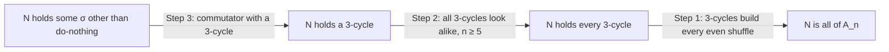

# A_n is simple for n at least 5: the even shuffles cannot be collapsed partway, which is the group-theory heart of the quintic

[Syllabus](../../../SYLLABUS.md) → [Algebra](../README.md) → [Groups](../README.md#s08) → A_n is simple for n at least 5

---

## General Overview

Five cards lie in five places. A shuffle that takes an even number of swaps is an **even shuffle** ([Permutations](03-permutations-and-the-symmetric-group.md)). There are 60 of them, and together they form a group, written $`A_5`$: the **alternating group** on five places. The same 60 moves are the turns that set a twenty-sided die back into its own outline.

Sort the 60 into look-alikes, shuffles that are one shuffle seen from another position ([Conjugacy and the class equation](10-conjugacy-and-the-class-equation.md)). Five classes come out, of sizes 1, 12, 12, 15 and 20 (Step 0 counts them).

A **normal subgroup** is one that looks the same from every position, so it can be collapsed to a point ([Normal subgroups and quotient groups](06-normal-subgroups-and-quotient-groups.md)). It must be made of whole classes, and it must hold do-nothing. So its size is 1 plus some of 12, 12, 15, 20.

Its size must also divide 60 ([Cosets and Lagrange's theorem](04-cosets-and-lagranges-theorem.md)). The candidates are 13, 16, 21, 25, 28, 33, 36, 40, 45, 48, and none divides 60. Only the two trivial choices survive: do-nothing alone, or all 60.

A group with more than one member and no normal subgroups except those two is **simple**: it cannot be collapsed partway into a smaller group. The card proves this for every $`A_n`$ with $`n`$ at least 5.

**For five or more places, any normal subgroup of the even shuffles that holds one move other than do-nothing holds a 3-cycle, then every 3-cycle, then every even shuffle: so the even shuffles cannot be collapsed partway.**

**What kind of fact this is:** a theorem, proved on this card in Why it works; "simple" is its definition.

### The picture: the 60 even shuffles of five places, by class

```
do-nothing             █                       1
5-cycles, first class  ████████████            12
5-cycles, second class ████████████            12
double swaps           ███████████████         15
3-cycles               ████████████████████    20
```

One block per shuffle: a **5-cycle** cycles five places in one loop, such as (1 2 3 4 5), and a **double swap** is two swaps of separate pairs, such as (1 2)(3 4). A normal subgroup takes the top bar and some whole bars below it; no pick other than the top bar alone or all five bars has a size dividing 60.

---

## The formula

A **3-cycle** $`(a\ b\ c)`$ sends place $`a`$'s card to $`b`$, $`b`$'s to $`c`$ and $`c`$'s to $`a`$, and leaves every other place alone. The sign $`\trianglelefteq`$ means "is a normal subgroup of", and $`e`$ is do-nothing. The theorem:

```math
N \trianglelefteq A_n, \quad N \ne \{e\}, \quad n \ge 5 \quad\Longrightarrow\quad N = A_n
```

**Read it aloud:** for n at least 5, a normal subgroup of the even shuffles that holds more than do-nothing is all of them.

The proof's engine is the **commutator** of a shuffle $`\sigma`$ in $`N`$ with a 3-cycle $`\tau`$: undo $`\sigma`$, undo $`\tau`$, redo $`\sigma`$, redo $`\tau`$, rightmost first.

```math
\rho = \tau\,\sigma\,\tau^{-1}\,\sigma^{-1} = \tau \cdot \big(\sigma\,\tau^{-1}\,\sigma^{-1}\big)
```

**Read it aloud:** rho is tau times a disguised copy of tau's undo; the two share a place, so rho moves at most five places, and it still lies in N.

With $`\sigma = (1\ 2\ 3\ 4\ 5)`$ and $`\tau = (1\ 2\ 4)`$, the commutator is $`\rho = (1\ 2\ 5\ 3\ 4)`$.

| Symbol | Plain meaning | In our example | Push it up and the answer… |
| --- | --- | --- | --- |
| $`n`$ | how many places are shuffled | 5 | stays simple for every n from 5 up |
| $`S_n`$, $`A_n`$ | all shuffles of n places; the even ones | $`A_5`$: 60 | 360 at six places |
| $`e`$ | do-nothing | the class of 1 | — |
| $`N`$, $`\trianglelefteq`$ | a normal subgroup; "is a normal subgroup of" | 1 or 60 members | — |
| $`(a\ b\ c)`$ | a 3-cycle | $`(1\ 2\ 3)`$, one of 20 | — |
| $`g`$, $`g x g^{-1}`$ | a shuffle; $`x`$ seen from $`g`$'s position, the conjugate | $`g`$ any of the 60 | — |
| $`\sigma`$, $`\tau`$, $`\rho`$, $`\sigma^{-1}`$, $`\tau^{-1}`$ | a member of $`N`$ other than $`e`$; a chosen 3-cycle; their commutator; the undos | $`(1\ 2\ 3\ 4\ 5)`$, $`(1\ 2\ 4)`$, $`(1\ 2\ 5\ 3\ 4)`$ | — |

### When it holds

- **At least five places.** At four, do-nothing and the 3 double swaps make a normal subgroup of 4, and 4 divides 12.
- **Even shuffles only.** For $`n \ge 3`$, the full group $`S_n`$ is not simple: $`A_n`$ sits inside it as a normal subgroup of half its size.
- **Classes counted inside $`A_n`$.** Conjugating by odd shuffles too merges the two classes of 12, so the test skips unions such as 13.

---

## Why it works

### Step 0: a normal subgroup swallows whole classes

A normal subgroup $`N`$ satisfies $`g N g^{-1} = N`$ for every $`g`$. So if it holds $`x`$, it holds every look-alike $`g x g^{-1}`$: the whole class of $`x`$.

For $`A_5`$ the sizes settle it. For general $`n`$ the proof chases one 3-cycle.

<details>
<summary>Detailed proof: where the sizes 1, 15, 20, 12 and 12 come from</summary>

**Shapes.** An even shuffle of five places is do-nothing, a 3-cycle, a double swap or a 5-cycle. A 3-cycle picks 3 places and one of 2 directions: 20. A double swap picks the still place and one of 3 pairings: 15. That leaves 60 − 1 − 20 − 15 = 24 five-cycles.

**Sizes.** A class holds 60 divided by the number of even shuffles that commute with its member ([Conjugacy and the class equation](10-conjugacy-and-the-class-equation.md)). Of all 120 shuffles, 6, 8 and 5 commute with a 3-cycle, a double swap and a 5-cycle, and 3, 4 and 0 of those are odd, leaving 3, 4 and 5 even. So the classes hold 60 ÷ 3 = 20, 60 ÷ 4 = 15 and 60 ÷ 5 = 12, and the other 12 five-cycles form the fifth class.

</details>



### Step 1: 3-cycles build every even shuffle

An even shuffle is a chain of an even number of swaps. Take the swaps two at a time, right to left. Each pair is one of three kinds:

- the same swap twice, which cancels;
- two swaps sharing a place, a 3-cycle: $`(1\ 2)(1\ 3) = (1\ 3\ 2)`$;
- two swaps sharing nothing, two 3-cycles: $`(1\ 2)(3\ 4) = (1\ 3\ 2)(1\ 3\ 4)`$.

So the 3-cycles build all of $`A_n`$. In $`A_5`$ the 20 3-cycles build exactly 60 shuffles.

### Step 2: from five places up, all 3-cycles look alike

Take any 3-cycle $`(a\ b\ c)`$. Some shuffle $`g`$ sends places 1, 2, 3 to $`a`$, $`b`$, $`c`$, and then $`g (1\ 2\ 3) g^{-1} = (a\ b\ c)`$.

That $`g`$ may be odd, and only even shuffles may conjugate inside $`A_n`$. Then use $`g (4\ 5)`$ instead. The swap $`(4\ 5)`$ leaves places 1, 2, 3 alone, so it changes nothing about the result, and it makes the shuffle even.

That needs two places outside 1, 2, 3: five places at least. In $`A_5`$ the class of $`(1\ 2\ 3)`$ holds all 20 3-cycles. In $`A_4`$ it holds only 4 of the 8.

So a normal subgroup holding one 3-cycle holds all of them, and by Step 1 it is everything.

### Step 3: every normal subgroup other than do-nothing holds a 3-cycle

Pick $`\sigma`$ in $`N`$ other than $`e`$. Pick a place $`a`$ that it moves, to $`b`$. Pick $`c`$ outside $`a`$, $`b`$ and $`\sigma(b)`$, where $`\sigma`$ sends $`b`$, and set $`\tau = (a\ b\ c)`$. Form the commutator $`\rho`$.

- **$`\rho`$ lies in $`N`$.** $`\tau \sigma \tau^{-1}`$ is a conjugate of $`\sigma`$, so it is in $`N`$; so is $`\sigma^{-1}`$; so is their product.
- **$`\rho`$ moves at most five places.** It is $`\tau`$ times $`\sigma \tau^{-1} \sigma^{-1}`$, two 3-cycles that share place $`b`$, since $`\sigma`$ sends $`a`$ to $`b`$.
- **$`\rho`$ is not do-nothing.** The choice of $`c`$ makes $`\sigma`$ and $`\tau`$ fail to commute (fold below).

Choose five places that hold everything $`\rho`$ moves. The even shuffles of those five, fixing the rest, are a copy of $`A_5`$, simple by the overview's count.

The members of $`N`$ inside that copy form a normal subgroup of it, and it holds $`\rho`$. So it is the whole copy, and that copy holds a 3-cycle.

<details>
<summary>Detailed proof: why rho is not do-nothing, and why the five-place copy works</summary>

**Not do-nothing.** $`\rho = e`$ would mean $`\sigma \tau \sigma^{-1} = \tau`$. The left side is the 3-cycle $`(\sigma(a)\ \sigma(b)\ \sigma(c)) = (b\ \ \sigma(b)\ \ \sigma(c))`$, which sends $`b`$ to $`\sigma(b)`$. The right side sends $`b`$ to $`c`$. These differ, because $`c`$ was chosen different from $`\sigma(b)`$.

**The overlap is normal in the copy.** If $`x`$ is in both $`N`$ and the copy, and $`g`$ is in the copy, then $`g x g^{-1}`$ is in the copy, since the copy is a group, and in $`N`$, since $`N`$ is normal in all of $`A_n`$.

**The example.** $`\sigma = (1\ 2\ 3\ 4\ 5\ 6\ 7)`$ in $`A_7`$ and $`\tau = (1\ 2\ 4)`$ give $`\rho = (1\ 2\ 5\ 3\ 4)`$: 5 of the 7 places, inside the copy on places 1 to 5.

</details>

### Step 4: why four places fail

At four places Step 3 breaks. The class sizes are 1, 3, 4, 4: do-nothing and the 3 double swaps form a normal subgroup of 4, and it holds no 3-cycle. Its commutators stay inside it: $`\sigma = (1\ 2)(3\ 4)`$ and $`\tau = (1\ 2\ 3)`$ give $`\rho = (1\ 3)(2\ 4)`$. Step 2 breaks too, the 3-cycles splitting into two classes of 4, harmlessly: each still builds all 12.

---

## Worked numbers, by hand

| Step | Arithmetic | Value |
| --- | --- | --- |
| even shuffles of five places | half of all shuffles | 60 |
| class sizes | do-nothing, two classes of 5-cycles, double swaps, 3-cycles | 1, 12, 12, 15, 20 |
| unions holding do-nothing | 1 plus any choice of the others | 1, 13, 16, 21, 25, 28, 33, 36, 40, 45, 48, 60 |
| those that divide 60 | 60 ÷ 13, 60 ÷ 16, … all leave a remainder | **1 and 60** |
| commutator of $`(1\ 2\ 3\ 4\ 5)`$ and $`(1\ 2\ 4)`$ | trace each place through four steps | $`(1\ 2\ 5\ 3\ 4)`$, 5 places |
| the same test on $`A_4`$ | 1 + 3 | **4 divides 12** |

$`A_5`$ cannot be collapsed partway. $`A_4`$ can: by its double swaps, into a three-member group.

### What breaks if you drop a piece

| Mistake | Comes out at | What went wrong |
| --- | --- | --- |
| Leaving out do-nothing | 12, 15 and 20 all divide 60 | every subgroup holds do-nothing |
| Running the test on $`A_4`$ | 1 + 3 = 4 divides 12 | a normal subgroup of 4 is real |
| Step 3 with four places | $`\rho = (1\ 3)(2\ 4)`$, a double swap | the normal 4 holds no 3-cycle, and no five-place copy exists |

---

## Code, from first principles, and it actually runs

The code builds $`A_4`$, $`A_5`$ and $`A_6`$ from scratch and takes two independent roads to simplicity. Road one adds class sizes and keeps the unions that divide the group's size. Road two never divides: it grows the normal subgroup from each class by multiplying until nothing new appears. It also builds $`A_5`$ from 3-cycles, recounts $`A_5`$'s classes from what commutes with each shape, and runs Step 3 on every member of $`A_6`$.

### Python

```python
# A_n is simple for n at least 5 -- the check behind the card.  Nothing is
# imported.  A shuffle of n places is a tuple p: place i+1 goes to place p[i]+1.
# Road one adds up class sizes; road two builds each normal subgroup by brute force.
SIZES, PAIRS, res = (4, 5, 6), [((1, 2, 3, 4, 5), (1, 2, 4)), ((1, 2, 3, 4, 5, 6, 7), (1, 2, 4))], {}
def mul(p, q): return tuple(p[i] for i in q)                 # q first, then p
def inv(p): return tuple(sorted(range(len(p)), key=lambda i: p[i]))
def conj(g, x): return mul(mul(g, x), inv(g))                # undo g, do x, redo g
def comm(t, x): return mul(conj(t, x), inv(x))               # Step 3: t x t^-1 x^-1
def moved(p): return sum(p[i] != i for i in range(len(p)))
def cyc(n, *c): return tuple(c[(c.index(i + 1) + 1) % len(c)] - 1 if i + 1 in c else i for i in range(n))
def orbit(p, i, c=()): return c if i in c else orbit(p, p[i], c + (i,))
def show(p):                                                 # cycle notation from 1
    cs = [orbit(p, i) for i in range(len(p)) if p[i] != i and i == min(orbit(p, i))]
    return "".join("(" + " ".join(str(x + 1) for x in c) + ")" for c in cs) or "e"
def shuffles(n): return [()] if n == 0 else [s[:j] + (n - 1,) + s[j:] for s in shuffles(n - 1) for j in range(n)]
def even(p): return sum(p[j] > p[i] for i in range(len(p)) for j in range(i)) % 2 == 0
def classes(G):                                              # look-alike classes
    out, seen = [], set()
    for x in G:
        if x not in seen: c = {conj(g, x) for g in G}; seen |= c; out.append(c)
    return sorted(out, key=len)
def build(gens, n):                                          # every product of gens
    grp = {tuple(range(n))}; edge = list(grp)
    while edge: edge = [y for y in {mul(g, x) for x in edge for g in gens} if y not in grp]; grp |= set(edge)
    return grp
def unions(sizes, order):                                    # sums of classes; those dividing
    tot = {sizes[0] + sum(x for i, x in enumerate(sizes[1:]) if m >> i & 1) for m in range(1 << len(sizes) - 1)}
    return sorted(t for t in tot if t), [t for t in sorted(tot) if t and order % t == 0]
for n in SIZES:
    G = [p for p in shuffles(n) if even(p)]; cl = classes(G); sz = [len(c) for c in cl]
    res[n] = (G, sz, unions(sz, len(G))[1], [len(build(c, n)) for c in cl])
    print(f"A_{n}: {len(G)} members; class sizes {sz}; unions of classes dividing {len(G)}: {res[n][2]}")
    print(f"A_{n}: normal subgroup built from one class at a time, sizes {res[n][3]}")
A4, A5, S5, s = res[4][0], res[5][0], shuffles(5), lambda *c: cyc(5, *c); threes = [p for p in A5 if moved(p) == 3]
print(f"A_5 unions that hold do-nothing: {unions(res[5][1], 60)[0]}")
print(f"mistake 1, do-nothing left out: unions dividing 60 are {unions([0] + res[5][1][1:], 60)[1]}")
print(f"A_5 has {len(threes)} 3-cycles; the subgroup they build has {len(build(threes, 5))} members")
swaps = mul(s(1, 2), s(1, 3)) == s(1, 3, 2) and mul(s(1, 2), s(3, 4)) == mul(s(1, 3, 2), s(1, 3, 4))
print(f"(1 2)(1 3) = (1 3 2) and (1 2)(3 4) = (1 3 2)(1 3 4): {'yes' if swaps else 'no'}")
k5, k4 = len({conj(g, s(1, 2, 3)) for g in A5}), len({conj(g, cyc(4, 1, 2, 3)) for g in A4})
print(f"class of (1 2 3): {k5} members in A_5; {k4} of the 8 3-cycles in A_4")
look = [(len({conj(g, x) for g in S5}), [g for g in S5 if mul(g, x) == mul(x, g)]) for x in (s(1, 2, 3), mul(s(1, 2), s(3, 4)), s(1, 2, 3, 4, 5))]
shape, cent, odds = [k for k, c in look], [len(c) for k, c in look], [sum(not even(g) for g in c) for k, c in look]
print(f"in all {len(S5)} shuffles: (1 2 3), (1 2)(3 4), (1 2 3 4 5) have {shape} look-alikes; {cent} commute with each, {odds} of them odd")
for sig, tau in PAIRS:
    n = len(sig); sg, t = cyc(n, *sig), cyc(n, *tau); rho = comm(t, sg)
    print(f"sigma {show(sg)}, tau {show(t)}: rho = {show(rho)}, moving {moved(rho)} of {n} places")
    assert show(rho) == "(1 2 5 3 4)"                                # traced by hand
rhos = [comm(cyc(6, a + 1, g[a] + 1, c + 1), g) for g in res[6][0] for a in range(6) if g[a] != a for c in range(6) if c not in (a, g[a], g[g[a]])]
print(f"Step 3 on all of A_6, every allowed a and c: {len(rhos)} commutators, each moving {min(map(moved, rhos))} to {max(map(moved, rhos))} places")
v = mul(cyc(4, 1, 2), cyc(4, 3, 4)); r4, V = comm(cyc(4, 1, 2, 3), v), build([conj(g, v) for g in A4], 4)
print(f"A_4: sigma {show(v)}, tau (1 2 3): rho = {show(r4)}; the class of sigma builds {len(V)} members, {sum(moved(p) == 3 for p in V)} of them 3-cycles")
H = [p for p in A5 if p[4] == 4]; copies = {frozenset(conj(g, h) for h in H) for g in A5}
print(f"even shuffles fixing place 5: {len(H)}, a subgroup with {len(copies)} different conjugates")
assert res[5][1] == [1, 12, 12, 15, 20] and res[5][2] == [1, 60] and res[6][2] == [1, 360] and show(r4) == "(1 3)(2 4)"
assert res[5][3][1:] == [60] * 4 and res[6][3][1:] == [360] * 6 and min(map(moved, rhos)) > 0 and max(map(moved, rhos)) <= 5
assert res[4][2] == [1, 4, 12] and res[4][3] == [1, 4, 12, 12] and len(V) == 4 and r4 in V    # A_4 has its normal 4
assert sorted([1] + [k // 2 if o == 0 else k for k, o in zip(shape, odds) for _ in range(1 + (o == 0))]) == res[5][1]  # halving rule
assert all(k * c == len(S5) for k, c in zip(shape, cent)) and build(threes, 5) == set(A5) and k5 == len(threes) == 20 and k4 == 4 and swaps and len(copies) == 5
print("ALL CHECKS PASS")
```

**Ran 2026-11-23 on macOS, Python 3.14.10, standard library only. All checks passed. Output, pasted from the run:**

```
A_4: 12 members; class sizes [1, 3, 4, 4]; unions of classes dividing 12: [1, 4, 12]
A_4: normal subgroup built from one class at a time, sizes [1, 4, 12, 12]
A_5: 60 members; class sizes [1, 12, 12, 15, 20]; unions of classes dividing 60: [1, 60]
A_5: normal subgroup built from one class at a time, sizes [1, 60, 60, 60, 60]
A_6: 360 members; class sizes [1, 40, 40, 45, 72, 72, 90]; unions of classes dividing 360: [1, 360]
A_6: normal subgroup built from one class at a time, sizes [1, 360, 360, 360, 360, 360, 360]
A_5 unions that hold do-nothing: [1, 13, 16, 21, 25, 28, 33, 36, 40, 45, 48, 60]
mistake 1, do-nothing left out: unions dividing 60 are [12, 15, 20]
A_5 has 20 3-cycles; the subgroup they build has 60 members
(1 2)(1 3) = (1 3 2) and (1 2)(3 4) = (1 3 2)(1 3 4): yes
class of (1 2 3): 20 members in A_5; 4 of the 8 3-cycles in A_4
in all 120 shuffles: (1 2 3), (1 2)(3 4), (1 2 3 4 5) have [20, 15, 24] look-alikes; [6, 8, 5] commute with each, [3, 4, 0] of them odd
sigma (1 2 3 4 5), tau (1 2 4): rho = (1 2 5 3 4), moving 5 of 5 places
sigma (1 2 3 4 5 6 7), tau (1 2 4): rho = (1 2 5 3 4), moving 5 of 7 places
Step 3 on all of A_6, every allowed a and c: 5760 commutators, each moving 3 to 5 places
A_4: sigma (1 2)(3 4), tau (1 2 3): rho = (1 3)(2 4); the class of sigma builds 4 members, 0 of them 3-cycles
even shuffles fixing place 5: 12, a subgroup with 5 different conjugates
ALL CHECKS PASS
```

### Rust

Same numbers, same labels, built with `rustc --edition 2021 -O`.

```rust
// A_n is simple for n at least 5 -- the same check as the Python, in Rust.  No
// crates.  A shuffle of n places is a list p: place i+1 goes to place p[i]+1.
// Road one adds up class sizes; road two builds each normal subgroup by brute force.
use std::collections::BTreeSet;
type P = Vec<usize>; type S = BTreeSet<P>;
fn mul(p: &P, q: &P) -> P { q.iter().map(|&i| p[i]).collect() }   // q first, then p
fn inv(p: &P) -> P { let mut o = vec![0; p.len()]; for (i, &x) in p.iter().enumerate() { o[x] = i } o }
fn conj(g: &P, x: &P) -> P { mul(&mul(g, x), &inv(g)) }          // undo g, do x, redo g
fn comm(t: &P, x: &P) -> P { mul(&conj(t, x), &inv(x)) }         // Step 3: t x t^-1 x^-1
fn moved(p: &P) -> usize { (0..p.len()).filter(|&i| p[i] != i).count() }
fn cyc(n: usize, c: &[usize]) -> P { let mut p: P = (0..n).collect(); for k in 0..c.len() { p[c[k] - 1] = c[(k + 1) % c.len()] - 1 } p }
fn orbit(p: &P, i: usize) -> Vec<usize> { let mut c = vec![i]; while p[c[c.len() - 1]] != i { c.push(p[c[c.len() - 1]]) } c }
fn show(p: &P) -> String {                                        // cycle notation from 1
    let out: String = (0..p.len()).filter(|&i| p[i] != i && orbit(p, i).iter().min() == Some(&i))
        .map(|i| format!("({})", orbit(p, i).iter().map(|x| (x + 1).to_string()).collect::<Vec<_>>().join(" "))).collect();
    if out.is_empty() { "e".to_string() } else { out }
}
fn shuffles(n: usize) -> Vec<P> {                                 // all n! shuffles
    if n == 0 { return vec![vec![]] }
    shuffles(n - 1).into_iter().flat_map(|s| (0..n).map(move |j| { let mut t = s.clone(); t.insert(j, n - 1); t })).collect()
}
fn even(p: &P) -> bool { (0..p.len()).map(|i| (0..i).filter(|&j| p[j] > p[i]).count()).sum::<usize>() % 2 == 0 }
fn class_of(x: &P, g: &[P]) -> S { g.iter().map(|h| conj(h, x)).collect() }
fn classes(g: &[P]) -> Vec<S> {                                   // look-alike classes
    let (mut out, mut seen): (Vec<S>, S) = (vec![], S::new());
    for x in g { if !seen.contains(x) { let c = class_of(x, g); seen.extend(c.iter().cloned()); out.push(c) } }
    out.sort_by_key(|c| c.len()); out
}
fn build(gens: &[P], n: usize) -> S {                             // every product of gens
    let (mut grp, mut todo): (S, Vec<P>) = ([(0..n).collect()].into(), vec![(0..n).collect()]);
    while let Some(x) = todo.pop() { for g in gens { let y = mul(g, &x); if grp.insert(y.clone()) { todo.push(y) } } }
    grp
}
fn unions(sizes: &[usize], order: usize) -> (Vec<usize>, Vec<usize>) { // sums; those dividing
    let tot: BTreeSet<usize> = (0..1usize << (sizes.len() - 1)).map(|m| sizes[0] + (1..sizes.len()).filter(|i| m >> (i - 1) & 1 == 1).map(|i| sizes[i]).sum::<usize>()).collect();
    (tot.iter().cloned().filter(|&t| t > 0).collect(), tot.iter().cloned().filter(|&t| t > 0 && order % t == 0).collect())
}
fn main() {
    let (pairs, mut res): ([(&[usize], &[usize]); 2], Vec<_>) = ([(&[1, 2, 3, 4, 5], &[1, 2, 4]), (&[1, 2, 3, 4, 5, 6, 7], &[1, 2, 4])], vec![]);
    for n in [4usize, 5, 6] {
        let g: Vec<P> = shuffles(n).into_iter().filter(|p| even(p)).collect(); let cl = classes(&g); let sz: Vec<usize> = cl.iter().map(|c| c.len()).collect();
        let (normal, div): (Vec<usize>, _) = (cl.iter().map(|c| build(&c.iter().cloned().collect::<Vec<P>>(), n).len()).collect(), unions(&sz, g.len()).1);
        println!("A_{}: {} members; class sizes {:?}; unions of classes dividing {}: {:?}", n, g.len(), sz, g.len(), div);
        println!("A_{}: normal subgroup built from one class at a time, sizes {:?}", n, normal); res.push((g, sz, div, normal));
    }
    let (a4, a5, s5, s) = (&res[0].0, &res[1].0, shuffles(5), |c: &[usize]| cyc(5, c));
    println!("A_5 unions that hold do-nothing: {:?}", unions(&res[1].1, 60).0);
    let no_e: Vec<usize> = [0].into_iter().chain(res[1].1[1..].iter().cloned()).collect();
    println!("mistake 1, do-nothing left out: unions dividing 60 are {:?}", unions(&no_e, 60).1);
    let threes: Vec<P> = a5.iter().filter(|p| moved(p) == 3).cloned().collect(); let built = build(&threes, 5);
    println!("A_5 has {} 3-cycles; the subgroup they build has {} members", threes.len(), built.len());
    let swaps = mul(&s(&[1, 2]), &s(&[1, 3])) == s(&[1, 3, 2]) && mul(&s(&[1, 2]), &s(&[3, 4])) == mul(&s(&[1, 3, 2]), &s(&[1, 3, 4]));
    println!("(1 2)(1 3) = (1 3 2) and (1 2)(3 4) = (1 3 2)(1 3 4): {}", if swaps { "yes" } else { "no" });
    let (k5, k4) = (class_of(&s(&[1, 2, 3]), a5).len(), class_of(&cyc(4, &[1, 2, 3]), a4).len());
    println!("class of (1 2 3): {} members in A_5; {} of the 8 3-cycles in A_4", k5, k4);
    let look: Vec<[usize; 3]> = [s(&[1, 2, 3]), mul(&s(&[1, 2]), &s(&[3, 4])), s(&[1, 2, 3, 4, 5])].iter().map(|x| { let c: Vec<&P> = s5.iter()
        .filter(|g| mul(g, x) == mul(x, g)).collect(); [class_of(x, &s5).len(), c.len(), c.iter().filter(|g| !even(g)).count()] }).collect();
    let col = |i: usize| look.iter().map(|l| l[i]).collect::<Vec<usize>>(); let (shape, cent, odds) = (col(0), col(1), col(2));
    println!("in all {} shuffles: (1 2 3), (1 2)(3 4), (1 2 3 4 5) have {:?} look-alikes; {:?} commute with each, {:?} of them odd", s5.len(), shape, cent, odds);
    for (sig, tau) in pairs {
        let (n, sg, t) = (sig.len(), cyc(sig.len(), sig), cyc(sig.len(), tau)); let rho = comm(&t, &sg);
        println!("sigma {}, tau {}: rho = {}, moving {} of {} places", show(&sg), show(&t), show(&rho), moved(&rho), n);
        assert!(show(&rho) == "(1 2 5 3 4)");                         // traced by hand
    }
    let rhos: Vec<usize> = res[2].0.iter().flat_map(|g| (0..6).filter(move |&a| g[a] != a).flat_map(move |a| (0..6)
        .filter(move |&c| c != a && c != g[a] && c != g[g[a]]).map(move |c| moved(&comm(&cyc(6, &[a + 1, g[a] + 1, c + 1]), g))))).collect();
    let (lo, hi) = (*rhos.iter().min().unwrap(), *rhos.iter().max().unwrap());
    println!("Step 3 on all of A_6, every allowed a and c: {} commutators, each moving {} to {} places", rhos.len(), lo, hi);
    let v = mul(&cyc(4, &[1, 2]), &cyc(4, &[3, 4])); let (r4, vv) = (comm(&cyc(4, &[1, 2, 3]), &v), build(&class_of(&v, a4).into_iter().collect::<Vec<P>>(), 4));
    println!("A_4: sigma {}, tau (1 2 3): rho = {}; the class of sigma builds {} members, {} of them 3-cycles", show(&v), show(&r4), vv.len(), vv.iter().filter(|p| moved(p) == 3).count());
    let h: Vec<P> = a5.iter().filter(|p| p[4] == 4).cloned().collect(); let copies: BTreeSet<S> = a5.iter().map(|g| h.iter().map(|x| conj(g, x)).collect()).collect();
    println!("even shuffles fixing place 5: {}, a subgroup with {} different conjugates", h.len(), copies.len());
    assert!(res[1].1 == vec![1, 12, 12, 15, 20] && res[1].2 == vec![1, 60] && res[2].2 == vec![1, 360] && show(&r4) == "(1 3)(2 4)");
    assert!(res[1].3[1..] == [60; 4] && res[2].3[1..] == [360; 6] && lo > 0 && hi <= 5);   // road two agrees: simple
    assert!(res[0].2 == vec![1, 4, 12] && res[0].3 == vec![1, 4, 12, 12] && vv.len() == 4 && vv.contains(&r4)); // A_4 has its normal 4
    let mut split: Vec<usize> = vec![1]; for (&k, &o) in shape.iter().zip(&odds) { if o == 0 { split.extend([k / 2, k / 2]) } else { split.push(k) } }
    split.sort(); assert!(split == res[1].1 && shape.iter().zip(&cent).all(|(k, c)| k * c == s5.len()));   // halving rule
    assert!(built == a5.iter().cloned().collect::<S>() && k5 == 20 && threes.len() == 20 && k4 == 4 && swaps && copies.len() == 5);
    println!("ALL CHECKS PASS");
}
```

**Ran 2026-11-23 on macOS, rustc 1.98.1, no crates. All checks passed. Output, pasted from the run:**

```
A_4: 12 members; class sizes [1, 3, 4, 4]; unions of classes dividing 12: [1, 4, 12]
A_4: normal subgroup built from one class at a time, sizes [1, 4, 12, 12]
A_5: 60 members; class sizes [1, 12, 12, 15, 20]; unions of classes dividing 60: [1, 60]
A_5: normal subgroup built from one class at a time, sizes [1, 60, 60, 60, 60]
A_6: 360 members; class sizes [1, 40, 40, 45, 72, 72, 90]; unions of classes dividing 360: [1, 360]
A_6: normal subgroup built from one class at a time, sizes [1, 360, 360, 360, 360, 360, 360]
A_5 unions that hold do-nothing: [1, 13, 16, 21, 25, 28, 33, 36, 40, 45, 48, 60]
mistake 1, do-nothing left out: unions dividing 60 are [12, 15, 20]
A_5 has 20 3-cycles; the subgroup they build has 60 members
(1 2)(1 3) = (1 3 2) and (1 2)(3 4) = (1 3 2)(1 3 4): yes
class of (1 2 3): 20 members in A_5; 4 of the 8 3-cycles in A_4
in all 120 shuffles: (1 2 3), (1 2)(3 4), (1 2 3 4 5) have [20, 15, 24] look-alikes; [6, 8, 5] commute with each, [3, 4, 0] of them odd
sigma (1 2 3 4 5), tau (1 2 4): rho = (1 2 5 3 4), moving 5 of 5 places
sigma (1 2 3 4 5 6 7), tau (1 2 4): rho = (1 2 5 3 4), moving 5 of 7 places
Step 3 on all of A_6, every allowed a and c: 5760 commutators, each moving 3 to 5 places
A_4: sigma (1 2)(3 4), tau (1 2 3): rho = (1 3)(2 4); the class of sigma builds 4 members, 0 of them 3-cycles
even shuffles fixing place 5: 12, a subgroup with 5 different conjugates
ALL CHECKS PASS
```

### Lean

Lean proves the theorem for any number of places from five up, plus Step 1, the four-place failure and the small numbers.

- Suppose $`n \ge 5`$ and $`N`$ is a normal subgroup of $`A_n`$ other than do-nothing alone. Then $`N = A_n`$.
- The 3-cycles build every even shuffle, for any number of places.
- $`A_4`$ has a normal subgroup with 4 members.
- $`A_5`$ has 60 members, and $`A_4`$ has 12.
- 1 plus any choice of 12, 12, 15, 20 divides 60 only for 1 and 60.
- The two swap products of Step 1 and the three commutators traced on the card come out as shown.

Counting the class sizes 1, 12, 12, 15, 20 is left to the Python and Rust checks.

```lean
-- A_n is simple for n at least 5: for five or more places, a normal subgroup of the even shuffles that holds more than do-nothing is all of them, while at four places the double swaps give a normal subgroup of size 4.
import Mathlib.GroupTheory.SpecificGroups.Alternating.Simple
import Mathlib.GroupTheory.Perm.Cycle.Concrete

open Equiv Equiv.Perm

/-- **A_n is simple for n at least 5.** On a finite set of at least five places, a normal
subgroup `N` of the even shuffles `A_n` that holds more than do-nothing (`N ≠ ⊥`) is all of
`A_n` (`N = ⊤`). -/
theorem normal_subgroup_of_alternating_eq_top {α : Type*} [Fintype α] [DecidableEq α]
    (h5 : 5 ≤ Fintype.card α) (N : Subgroup (alternatingGroup α)) [N.Normal]
    (hN : N ≠ ⊥) : N = ⊤ := by
  rcases alternatingGroup.normal_subgroup_eq_bot_or_eq_top (α := α)
    (by rwa [Nat.card_eq_fintype_card]) (N := N) with h | h
  · exact absurd h hN
  · exact h

/-- **Step 1: 3-cycles build every even shuffle.** For any finite set of places, the subgroup
of all shuffles generated by the 3-cycles is exactly the group of even shuffles `A_n`. -/
theorem three_cycles_generate_alternating {α : Type*} [Fintype α] [DecidableEq α] :
    Subgroup.closure {σ : Perm α | σ.IsThreeCycle} = alternatingGroup α := by
  exact closure_three_cycles_eq_alternating

/-- **Why four places fail.** `A_4` has a normal subgroup with 4 members (do-nothing and the
three double swaps), so `A_4` is not simple. -/
theorem alternating_four_has_normal_subgroup_of_four :
    ∃ N : Subgroup (alternatingGroup (Fin 4)), N.Normal ∧ Nat.card N = 4 := by
  exact ⟨alternatingGroup.kleinFour (Fin 4), alternatingGroup.normal_kleinFour (by simp),
    alternatingGroup.kleinFour_card_of_card_eq_four (by simp)⟩

-- A_5 has 60 members, and A_4 has 12. (Places 1..n are written 0..n-1 below.)
example : Fintype.card (alternatingGroup (Fin 5)) = 60 := by
  decide
example : Fintype.card (alternatingGroup (Fin 4)) = 12 := by
  decide
-- The class-sum test on A_5: 1 plus any choice of 12, 12, 15, 20 divides 60 only for 1 and 60.
example : ∀ l ∈ ([12, 12, 15, 20] : List ℕ).sublists,
    1 + l.sum ∣ 60 → 1 + l.sum = 1 ∨ 1 + l.sum = 60 := by
  decide
-- The class sizes 1, 12, 12, 15, 20 add up to 60; on A_4, 1 + 3 = 4 divides 12.
example : 1 + 12 + 12 + 15 + 20 = 60 ∧ 1 + 3 = 4 ∧ 4 ∣ 12 := by
  decide
-- Step 1: (1 2)(1 3) = (1 3 2) and (1 2)(3 4) = (1 3 2)(1 3 4).
example : (c[0, 1] : Perm (Fin 5)) * c[0, 2] = c[0, 2, 1] := by
  decide
example : (c[0, 1] : Perm (Fin 5)) * c[2, 3] = c[0, 2, 1] * c[0, 2, 3] := by
  decide
-- The commutator of sigma = (1 2 3 4 5) and tau = (1 2 4) is rho = (1 2 5 3 4).
example : let σ : Perm (Fin 5) := c[0, 1, 2, 3, 4]; let τ : Perm (Fin 5) := c[0, 1, 3]
    τ * σ * τ⁻¹ * σ⁻¹ = c[0, 1, 4, 2, 3] := by
  decide
-- The same tau with sigma = (1 2 3 4 5 6 7) in A_7 also gives rho = (1 2 5 3 4).
example : let σ : Perm (Fin 7) := c[0, 1, 2, 3, 4, 5, 6]; let τ : Perm (Fin 7) := c[0, 1, 3]
    τ * σ * τ⁻¹ * σ⁻¹ = c[0, 1, 4, 2, 3] := by
  decide
-- At four places: sigma = (1 2)(3 4), tau = (1 2 3) give rho = (1 3)(2 4), a double swap.
example : let σ : Perm (Fin 4) := c[0, 1] * c[2, 3]; let τ : Perm (Fin 4) := c[0, 1, 2]
    τ * σ * τ⁻¹ * σ⁻¹ = c[0, 2] * c[1, 3] := by
  decide

#print axioms normal_subgroup_of_alternating_eq_top
#print axioms three_cycles_generate_alternating
#print axioms alternating_four_has_normal_subgroup_of_four
```

**Checked 2026-11-23 on macOS, Lean 4.36.0-rc2, Mathlib v4.36.0-rc2. Every proof is complete and uses only Lean's standard axioms. Output, pasted from the run:**

```
'normal_subgroup_of_alternating_eq_top' depends on axioms: [propext, Classical.choice, Quot.sound]
'three_cycles_generate_alternating' depends on axioms: [propext, Classical.choice, Quot.sound]
'alternating_four_has_normal_subgroup_of_four' depends on axioms: [propext, Classical.choice, Quot.sound]
```

> [!TIP]
> **Try changing**
> - **Seven places.** Guess first: is $`A_7`$ simple? Set `SIZES` to `(4, 5, 6, 7)`. Yes: nine classes, only 1 and 2520 divide 2520, and every class builds all 2520. About two seconds.
> - **Break the rule on c.** Change the first `(1, 2, 4)` in `PAIRS` to `(1, 2, 3)`, so $`c = \sigma(b)`$. Guess first: does the proof fail? No: $`\rho = (1\ 2\ 4)`$, a 3-cycle at once. The rule is a safe choice, not the only one. Only the hand-traced assert stops it.
> - **A tau that commutes.** Set the first pair to `((1, 2, 3), (1, 2, 3))`. Then $`\rho = e`$, moving 0 places, and the assert stops the run.

---

## The usual mistake

> [!warning]
> **Reading "simple" as "has no subgroups".** $`A_5`$ has plenty of subgroups. The 12 even shuffles that fix place 5 are one. Conjugating it gives 5 different copies, so it is not normal. Simple means no *normal* subgroup except the two trivial ones.
>
> - **Leaving out do-nothing.** Then 12, 15 and 20 look like possible sizes, since each divides 60. With do-nothing they are 13, 16 and 21, and none divides 60.
> - **Expecting it at four places.** 1 + 3 = 4 divides 12, and the double swaps really are a normal subgroup.
> - **Treating perfect as simple.** [Why there is no quintic formula](../10-For%20the%20Curious/02-why-no-quintic-formula.md) shows $`A_5`$ equals its own commutator subgroup. That rules out only collapses onto a commuting group; this card's counting rules out all.

---

## Where you meet it in real life

- **The quintic.** The 60 even shuffles of five roots cannot be collapsed partway into a smaller group, and they do not commute. So the chain of collapses that a radical formula needs stops at 60 and never reaches do-nothing. That is why no general radical formula for degree five exists ([Why there is no quintic formula](../10-For%20the%20Curious/02-why-no-quintic-formula.md)).
- **Twisty and sliding puzzles.** Solvers build 3-cycles from commutators. Step 1 says 3-cycles reach every even arrangement; Step 2 says one 3-cycle, carried around by set-up moves, gives them all.

> **Say it back**
> A normal subgroup is made of whole classes and holds do-nothing. In $`A_5`$ the classes have sizes 1, 12, 12, 15 and 20, and no union except 1 and 60 divides 60, so $`A_5`$ is simple. From five places up, a commutator with a 3-cycle puts a 3-cycle into any normal subgroup other than do-nothing; all 3-cycles look alike, and they build every even shuffle, so that subgroup is everything. At four places the double swaps break the pattern.

---

## What this builds on

- [Conjugacy and the class equation](10-conjugacy-and-the-class-equation.md): classes of look-alikes, their sizes, and the commutator.
- [Permutations](03-permutations-and-the-symmetric-group.md): cycle notation, even and odd shuffles, and the even shuffles as a group.
- [Normal subgroups and quotient groups](06-normal-subgroups-and-quotient-groups.md): what normal means, and that a normal subgroup is a union of whole classes.
- [Cosets and Lagrange's theorem](04-cosets-and-lagranges-theorem.md): a subgroup's size divides the group's size, the filter in Step 0.

## Where this goes next

- [Composition series](14-composition-series-and-jordan-holder.md): breaking any finite group into simple pieces, with $`A_5`$ as a piece that never breaks further.
- [Why there is no quintic formula](../10-For%20the%20Curious/02-why-no-quintic-formula.md): the chain of collapses for five roots, where this card's group blocks the way.
- [Solvable by radicals](../../21-Algebraic%20and%20analytic%20number%20theory/05-Fields%20and%20Galois%20Theory/07-solvability-by-radicals-and-the-quintic.md): the bridge from polynomial equations to their groups of root shuffles, showing when a formula in roots exists.
- [NC and P-completeness](../../24-Computability%20and%20complexity/05-Algebraic%2C%20Interactive%20and%20Quantum/09-parallel-complexity-nc-and-p-completeness.md): Barrington's theorem uses the even shuffles of five places, which do not break down, to run fast parallel circuits on five places of memory.

Simple groups cannot be broken down further. The next card, [Composition series](14-composition-series-and-jordan-holder.md), asks whether every finite group breaks into simple pieces, and whether those pieces are always the same. Which finite groups are simple at all, and whether the list is complete, this shelf leaves open.

---

## Sources

Verified 2026-11-23: every link below resolves to the publisher's page.

- Dummit, David S., and Richard M. Foote. *Abstract Algebra*, 3rd ed. Wiley. [Publisher page](https://www.wiley.com/en-us/Abstract+Algebra%2C+3rd+Edition-p-9780471433347). Section 4.6 proves $`A_n`$ simple for n at least 5.
- Artin, Michael. *Algebra*, Classic Version, 2nd ed. Pearson. [Publisher page](https://www.pearson.com/en-us/subject-catalog/p/Artin-Algebra-Classic-Version-2nd-Edition/P200000006078/9780137980994). Chapter 7 proves the die's 60 turns simple by adding class sizes.
- Judson, Thomas W. *Abstract Algebra: Theory and Applications*. Stephen F. Austin State University. [University publication page](https://scholarworks.sfasu.edu/ebooks/23/). Free and complete; its chapter on normal subgroups proves $`A_n`$ simple through 3-cycles.
