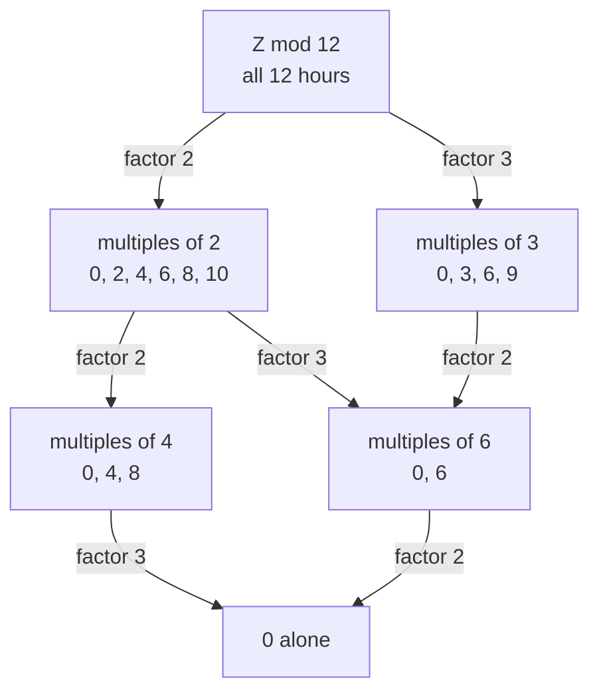

# Composition series: break a group into simple pieces, and Jordan-Holder says the pieces are the same however you break it

[Syllabus](../../../SYLLABUS.md) → [Algebra](../README.md) → [Groups](../README.md#s08) → Composition series

---

## General Overview

A 12-hour clock is a group: the hours 0 to 11, added with wrap-round. Call it Z mod 12. Take it apart in steps: keep the multiples of 2 (six hours), then the multiples of 4 (0, 4, 8), then 0 alone. The sizes go 12, 6, 3, 1, so the steps shrink by factors 2, 2 and 3.

Start again with the multiples of 3 (four hours), then of 6 (two hours), then 0. Now the factors are 3, 2 and 2. The order changed; the pieces did not, just as 12 = 2 × 2 × 3 has one prime factorisation however it is found.

A **composition series** breaks a group down until no step can be split further. The **Jordan-Holder theorem** says every such breakdown of a finite group gives the same pieces. The pieces then decide whether the group is **solvable**. The shuffles of 4 cards break into pieces of sizes 2, 3, 2, 2, all prime: solvable. The shuffles of 5 cards hit a piece of size 60 that cannot split: not solvable, which is why the general fifth-degree equation has no formula in roots.

**Every finite group breaks down, one unsplittable step at a time, into simple pieces, and the list of pieces is the same however the breakdown is done.**

**What kind of fact this is:** a theorem, proved on this card in Why it works; composition series, simple group and solvable group are its definitions.

### The picture: three ways down from 12



The three paths down read 2, 2, 3 and 2, 3, 2 and 3, 2, 2: the same pieces in different orders.

---

## The formula

- A **normal subgroup** looks the same from every position in the group, so its cosets combine into a group ([Normal subgroups and quotient groups](06-normal-subgroups-and-quotient-groups.md)).
- That group of cosets is the **quotient** $`G/N`$, "G over N", of size $`\lvert G\rvert / \lvert N\rvert`$. Bars count members.
- A group with more than one member is **simple** when its only normal subgroups are the one-member group and itself: it cannot be collapsed further.

A composition series is a chain, each subgroup normal in the one just above it, with a simple quotient at every step:

```math
G = G_0 > G_1 > \dots > G_r = 1, \qquad G_{i}/G_{i+1} \text{ simple for every } i
```

**Read it aloud:** step down from the whole group to the one-member group, and at every step the piece that falls away cannot be broken further.

The quotients $`G_i/G_{i+1}`$ are the **composition factors**, the pieces. Their sizes multiply back to the group's size: 2 × 2 × 3 = 12.

**Jordan-Holder:** any two composition series of a finite group have the same length, and their factors pair off as **isomorphic**, written $`\cong`$: the same group under different names.

A group is **solvable** when it has a chain of normal steps down to 1, not necessarily simple, whose pieces all commute (a then b equals b then a). Step 4 proves this means every composition factor is a clock of prime size.

| Symbol | Plain meaning | In our example | Push it up and the answer… |
| --- | --- | --- | --- |
| $`G`$, $`G_i`$, $`>`$ | the whole group; the subgroup after $`i`$ steps down; "contains, as a smaller subgroup" | Z mod 12; multiples of 2, then of 4 | more pieces |
| $`r`$, $`s`$ | the length: how many steps; in the fold, $`D`$'s length | 3 | — |
| $`G/N`$, $`G_i/G_{i+1}`$ | quotient by a normal subgroup $`N`$; at a step, one composition factor | sizes 2, 2, 3 | — |
| $`\lvert G\rvert`$, $`1`$ | how many members; the one-member group | 12; 0 alone | — |
| $`\cong`$ | isomorphic: the same group under other names | Z mod 2 ≅ multiples of 6 | — |
| $`H`$, $`K`$ | two different first steps, in the proof | multiples of 2 (6), of 3 (4) | — |
| $`H \cap K`$ or $`D`$, $`HK`$ | members in both; products of one from each | multiples of 6 (2); all 12 | — |
| S4, A4; S5, A5 | shuffles of 4 cards, the even ones; the same for 5 | 24, 12; 120, 60 | — |

### When it holds

- **A finite group.** The integers under addition have none: every step down, such as to the even numbers, leaves an infinite group that splits again.
- **Each step normal in the step above, not in the whole group.** In S4, do-nothing with one double swap is normal in the four-member step above it but not in all of S4.
- **Every step simple.** Stop S4 at "all, the even ones, nothing" and the pieces are 2 and 12; but 12 still splits.

---

## Why it works

### Step 0: compare two breakdowns through what they share

Two breakdowns may start differently, at H and at K. Route both through their overlap. The second isomorphism theorem matches the pieces lost on each side, and induction on size handles the smaller groups.

### Step 1: every finite group has a composition series

Take a **maximal normal** subgroup of G: one other than G, with no normal subgroup strictly between it and G. A biggest one by size qualifies. The quotient by it is simple: by the correspondence theorem ([The isomorphism theorems](09-isomorphism-theorems-and-correspondence.md)), a normal subgroup of the quotient would come from one strictly between, and none exists. Repeat inside the smaller group. Sizes drop, so the chain reaches 1.

### Step 2: the diamond

Let H and K be two different maximal normal subgroups of G. Their product $`HK`$ is normal and strictly contains H, since K is not inside H. Nothing sits strictly between H and G, so $`HK = G`$. The second isomorphism theorem pairs the pieces:

```math
G/H = HK/H \cong K/(H \cap K), \qquad G/K \cong H/(H \cap K)
```

**Read it aloud:** the piece lost going down to H matches the piece from K down to the overlap, and the other way round.

On the clock: H is the multiples of 2 (6 members), K the multiples of 3 (4), the overlap the multiples of 6 (2). $`HK`$ has 6 × 4 / 2 = 12 members, all of G. G/H and K over the overlap both have size 2; G/K and H over the overlap both have size 3.

### Step 3: induction on the size

H has two breakdowns: its own, and "down to the overlap, then onward". H is smaller than G, so by induction they agree; the same for K. So the first series has pieces G/H, H/overlap, then the overlap's pieces, and the second has G/K, K/overlap, then the same. Step 2 pairs the first two of each.

<details>
<summary>Detailed proof: Jordan-Holder by induction on the size of G</summary>

Let the series be $`G > H > \dots > 1`$ and $`G > K > \dots > 1`$. A group of size 1 has only the empty series. If $`H = K`$, both tails are composition series of the smaller group H, and induction finishes.

Otherwise G/H and G/K are simple, so H and K are maximal normal and $`HK = G`$. Write $`D = H \cap K`$, normal in both. The second isomorphism theorem gives

$`\displaystyle K/D \cong HK/H = G/H, \qquad H/D \cong G/K.`$

Both are simple, so $`H > D`$ and $`K > D`$ are allowed steps. Take a composition series of D, of length s. By induction on H, the first series' tail below H has length s + 1 and factors H/D plus D's factors. Likewise the second tail matches K/D plus D's factors.

Both series have length s + 2. Their factors are G/H, H/D, D's and G/K, K/D, D's, and the two isomorphisms above pair them off.

</details>

### Step 4: solvable means every piece is a clock of prime size

A commutative simple group is a clock of prime size. Every subgroup of a commutative group is normal, so a simple one has no subgroups but itself and 1. Any member except do-nothing then generates it, so it is a clock; and a clock of size a × b has a subgroup of size a, so its size is prime.

Refine a chain with commutative pieces until each step is simple. Each new piece is a subgroup of a quotient of a commutative piece, so it commutes, and is a clock of prime size. Conversely, clocks commute. By Jordan-Holder, one composition series settles it:

- **S4.** S4 (24) > the even shuffles A4 (12) > do-nothing with the three double swaps (4) > do-nothing with one double swap (2) > 1. Pieces 2, 3, 2, 2, all prime: solvable.
- **S5.** S5 (120) > A5 (60) > 1. A5 is simple ([A_n is simple for n at least 5](13-simplicity-of-alternating-groups.md)), so 60 cannot split. It is not prime: S5 is not solvable, and no other breakdown can change that.

<details>
<summary>The second road: commutators</summary>

The **commutator** of a and b is a, then b, then the undo of a, then the undo of b: do-nothing exactly when a and b commute. All commutators generate the **commutator subgroup**.

If G/N commutes, every commutator lands in N. So down a chain with commutative pieces, repeated commutator subgroups reach 1; and the repeated commutator subgroups themselves form such a chain. That gives the test used on [Why there is no quintic formula](../10-For%20the%20Curious/02-why-no-quintic-formula.md). For S4 the sizes run 24, 12, 4, 1. For S5 they run 120, then 60, and A5's commutators give A5 again: stuck at 60.

</details>

---

## Worked numbers, by hand

| Step | Arithmetic | Value |
| --- | --- | --- |
| first route down Z mod 12 | 12 ÷ 6, 6 ÷ 3, 3 ÷ 1 | 2, 2, 3 |
| second route | 12 ÷ 4, 4 ÷ 2, 2 ÷ 1 | 3, 2, 2 |
| diamond | 6 × 4 ÷ 2 | 12 = all of G |
| pieces paired across it | 12 ÷ 6 and 4 ÷ 2; 12 ÷ 4 and 6 ÷ 2 | 2 = 2; 3 = 3 |
| S4 route | 24 ÷ 12, 12 ÷ 4, 4 ÷ 2, 2 ÷ 1 | 2, 3, 2, 2 |
| S5 route | 120 ÷ 60, 60 ÷ 1 | 2, 60 |
| verdict | all prime for S4; 60 not prime | **S4 solvable, S5 not** |

Every route down the clock gives one 3 and two 2s; in all four groups, the brute-force search finds only one list of pieces.

### What breaks if you drop a piece

| Mistake | Comes out at | What went wrong |
| --- | --- | --- |
| Stop S4 at A4 > 1 | pieces 2 and 12 | A4 is not simple: it splits as 3, 2, 2 |
| Require each step normal in all of S4 | 3 look-alikes of one double swap | the two-member step is normal only in the step above it |
| Read the group off its pieces | Z mod 8 and the tile both 2, 2, 2 | 64 commuting pairs against 40: different groups |

---

## Code, from first principles, and it actually runs

Every group is a set of shuffles. Road one lists every composition series by brute force. A normal subgroup is a union of look-alike classes ([Conjugacy and the class equation](10-conjugacy-and-the-class-equation.md)), so the code builds them all and keeps the maximal ones at each step. Road two takes commutator subgroups until they stop shrinking. Trial division of 12 is a third road for the clock.

### Python

```python
# Composition series and Jordan-Holder -- the check behind the card.  Nothing
# is imported.  Every group is a set of shuffles: Z mod 12 as the 12 turns of a
# 12-hour dial, the square tile's 8 moves on its corners, S4 and S5.  Road one
# lists every composition series by brute force; road two takes commutators.
def mul(p, q): return tuple(p[i] for i in q)                  # do q, then p
def inv(p): return tuple(sorted(range(len(p)), key=lambda i: p[i]))
def perms(n): return [()] if n == 0 else [p[:i] + (n - 1,) + p[i:] for p in perms(n - 1) for i in range(n)]
def primes(n, p=2): return [] if n == 1 else [p] + primes(n // p) if n % p == 0 else primes(n, p + 1)
def factors(c): return [a // b for a, b in zip(c, c[1:])]     # sizes of the steps
def classes(H): return {frozenset(mul(mul(h, x), inv(h)) for h in H) for x in H}
def comm(G): return sum(mul(a, b) == mul(b, a) for a in G for b in G)

def gen(gens, n):                       # the smallest subgroup holding gens
    out = {tuple(range(n))}; todo = list(out)
    while todo:
        x = todo.pop()
        for g in gens:
            y = mul(g, x)
            if y not in out: out.add(y); todo.append(y)
    return frozenset(out)
def normals(H):                         # a normal subgroup is a union of classes
    n, cl = len(next(iter(H))), list(classes(H))
    return {gen(set().union(*(c for i, c in enumerate(cl) if m >> i & 1)), n) for m in range(1 << len(cl))}
memo = {}
def chains(H):                          # road one: every composition series, as sizes
    if len(H) == 1: return [[1]]
    if H not in memo:
        below = [M for M in normals(H) if M != H]
        top = [M for M in below if not any(M < K for K in below)]   # maximal: a simple step
        memo[H] = sorted([len(H)] + c for M in top for c in chains(M))
    return memo[H]

def derived(H):                         # road two: commutators until nothing changes
    n, sizes = len(next(iter(H))), [len(H)]
    while len(H) > 1 and (D := gen({mul(mul(a, b), mul(inv(a), inv(b))) for a in H for b in H}, n)) != H:
        H = D; sizes.append(len(H))
    return sizes

turn = lambda k: tuple((i + 1) % k for i in range(k))
Z12, Z8, tile = gen({turn(12)}, 12), gen({turn(8)}, 8), gen({(1, 2, 3, 0), (0, 3, 2, 1)}, 4)
S4, S5, A4 = frozenset(perms(4)), frozenset(perms(5)), gen({(1, 2, 0, 3), (1, 0, 3, 2)}, 4)
solvable = []
for name, G in [("Z mod 12", Z12), ("square tile", tile), ("S4", S4), ("S5", S5)]:
    cs, ds = chains(G), derived(G); fs = sorted({tuple(sorted(factors(c))) for c in cs})
    prime = all(primes(f) == [f] for c in cs for f in factors(c)); solvable.append(prime)
    print(f"{name}: {len(cs)} series, sizes {sorted(map(list, set(map(tuple, cs))))}, factors {[factors(c) for c in cs][:3]}")
    print(f"  sorted factors {[list(f) for f in fs]}; all prime {'yes' if prime else 'no'}; commutator sizes {ds}")
    assert len(fs) == 1 and prime == (ds[-1] == 1)                          # one multiset; two roads agree
t = turn(12); H, K = gen({mul(t, t)}, 12), gen({mul(t, mul(t, t))}, 12); D = H & K
HK = frozenset(mul(h, k) for h in H for k in K)
print(f"12 by trial division: {primes(12)}; diamond |H| {len(H)}, |K| {len(K)}, |H & K| {len(D)}, |HK| {len(HK)}")
print(f"G/H {12 // len(H)} matches K/D {len(K) // len(D)}; G/K {12 // len(K)} matches H/D {len(H) // len(D)}")
print(f"A5 normal subgroups by size: {sorted(len(N) for N in normals(gen({(1, 2, 3, 4, 0), (1, 2, 0, 3, 4)}, 5)))}")
print(f"mistake 1, stop at S4 > A4 > 1: factors {factors([24, 12, 1])}; A4 alone splits as {factors(chains(A4)[0])}")
print(f"mistake 2, copies of one double swap seen from all of S4: {len({mul(mul(h, (1, 0, 3, 2)), inv(h)) for h in S4})}")
print(f"mistake 3, Z mod 8 factors {factors(chains(Z8)[0])}, commuting pairs {comm(Z8)}; tile {comm(tile)} = 8 x {len(classes(tile))} classes")
assert all(sorted(factors(c)) == primes(12) for c in chains(Z12))           # Jordan-Holder vs 12 = 2 x 2 x 3
assert len(HK) == len(H) * len(K) // len(D) == 12 and 12 // len(H) == len(K) // len(D) and 12 // len(K) == len(H) // len(D)
assert solvable == [True, True, True, False] and len(chains(tile)) == 7 and len(chains(Z12)) == 3 and comm(tile) == 8 * len(classes(tile))
print("ALL CHECKS PASS")
```

**Ran 2026-11-23 on macOS, Python 3.14.10, standard library only. All checks passed. Output, pasted from the run:**

```
Z mod 12: 3 series, sizes [[12, 4, 2, 1], [12, 6, 2, 1], [12, 6, 3, 1]], factors [[3, 2, 2], [2, 3, 2], [2, 2, 3]]
  sorted factors [[2, 2, 3]]; all prime yes; commutator sizes [12, 1]
square tile: 7 series, sizes [[8, 4, 2, 1]], factors [[2, 2, 2], [2, 2, 2], [2, 2, 2]]
  sorted factors [[2, 2, 2]]; all prime yes; commutator sizes [8, 2, 1]
S4: 3 series, sizes [[24, 12, 4, 2, 1]], factors [[2, 3, 2, 2], [2, 3, 2, 2], [2, 3, 2, 2]]
  sorted factors [[2, 2, 2, 3]]; all prime yes; commutator sizes [24, 12, 4, 1]
S5: 1 series, sizes [[120, 60, 1]], factors [[2, 60]]
  sorted factors [[2, 60]]; all prime no; commutator sizes [120, 60]
12 by trial division: [2, 2, 3]; diamond |H| 6, |K| 4, |H & K| 2, |HK| 12
G/H 2 matches K/D 2; G/K 3 matches H/D 3
A5 normal subgroups by size: [1, 60]
mistake 1, stop at S4 > A4 > 1: factors [2, 12]; A4 alone splits as [3, 2, 2]
mistake 2, copies of one double swap seen from all of S4: 3
mistake 3, Z mod 8 factors [2, 2, 2], commuting pairs 64; tile 40 = 8 x 5 classes
ALL CHECKS PASS
```

### Rust

Same numbers, same labels, built with `rustc --edition 2021 -O`.

```rust
// Composition series and Jordan-Holder -- the same check as the Python, in
// Rust.  No crates.  Every group is a set of shuffles: Z mod 12 as the 12 turns
// of a 12-hour dial, the square tile's 8 moves on its corners, S4 and S5.  Road
// one lists every composition series by brute force; road two takes commutators.
use std::collections::{BTreeMap, BTreeSet};
type P = Vec<usize>;
type S = BTreeSet<P>;
fn mul(p: &P, q: &P) -> P { q.iter().map(|&i| p[i]).collect() }       // do q, then p
fn inv(p: &P) -> P { let mut r = vec![0; p.len()]; for (i, &x) in p.iter().enumerate() { r[x] = i } r }
fn perms(n: usize) -> Vec<P> {
    if n == 0 { return vec![vec![]] }
    perms(n - 1).into_iter().flat_map(|p| (0..n).map(move |i| { let mut q = p.clone(); q.insert(i, n - 1); q })).collect()
}
fn primes(mut n: usize) -> Vec<usize> {                                // trial division
    let (mut out, mut p) = (vec![], 2); while n > 1 { if n % p == 0 { out.push(p); n /= p } else { p += 1 } }
    out
}
fn factors(c: &[usize]) -> Vec<usize> { c.windows(2).map(|w| w[0] / w[1]).collect() }
fn classes(h: &S) -> BTreeSet<S> { h.iter().map(|x| h.iter().map(|g| mul(&mul(g, x), &inv(g))).collect()).collect() }
fn comm(g: &S) -> usize { g.iter().map(|a| g.iter().filter(|b| mul(a, b) == mul(b, a)).count()).sum() }
fn gen(gens: &S, n: usize) -> S {                                      // the smallest subgroup holding gens
    let e: P = (0..n).collect();
    let (mut out, mut todo): (S, Vec<P>) = ([e.clone()].into(), vec![e]);
    while let Some(x) = todo.pop() {
        for g in gens { let y = mul(g, &x); if out.insert(y.clone()) { todo.push(y) } }
    }
    out
}
fn normals(h: &S) -> BTreeSet<S> {                                     // a normal subgroup is a union of classes
    let (n, cl) = (h.iter().next().unwrap().len(), classes(h).into_iter().collect::<Vec<S>>());
    (0..1usize << cl.len()).map(|m| gen(&cl.iter().enumerate().filter(|(i, _)| m >> i & 1 == 1)
        .flat_map(|(_, c)| c.iter().cloned()).collect(), n)).collect()
}
fn chains(h: &S, memo: &mut BTreeMap<S, Vec<Vec<usize>>>) -> Vec<Vec<usize>> {   // road one: every series, as sizes
    if h.len() == 1 { return vec![vec![1]] }
    if let Some(c) = memo.get(h) { return c.clone() }
    let below: Vec<S> = normals(h).into_iter().filter(|m| m != h).collect();
    let top = below.iter().filter(|m| !below.iter().any(|k| k.len() > m.len() && m.is_subset(k)));   // maximal: a simple step
    let mut out: Vec<Vec<usize>> = top.flat_map(|m| chains(m, memo).into_iter().map(|c| [vec![h.len()], c].concat())).collect();
    out.sort(); memo.insert(h.clone(), out.clone()); out
}
fn derived(mut h: S) -> Vec<usize> {                                    // road two: commutators until nothing changes
    let (n, mut sizes) = (h.iter().next().unwrap().len(), vec![h.len()]);
    loop {
        let d = gen(&h.iter().flat_map(|a| h.iter().map(move |b| mul(&mul(a, b), &mul(&inv(a), &inv(b))))).collect(), n);
        if h.len() == 1 || d == h { return sizes }
        h = d; sizes.push(h.len());
    }
}
fn turn(k: usize) -> P { (0..k).map(|i| (i + 1) % k).collect() }
fn main() {
    let memo = &mut BTreeMap::new();
    let (z12, z8, tile) = (gen(&[turn(12)].into(), 12), gen(&[turn(8)].into(), 8), gen(&[vec![1, 2, 3, 0], vec![0, 3, 2, 1]].into(), 4));
    let (s4, s5, a4): (S, S, S) = (perms(4).into_iter().collect(), perms(5).into_iter().collect(), gen(&[vec![1, 2, 0, 3], vec![1, 0, 3, 2]].into(), 4));
    let mut solvable = vec![];
    for (name, g) in [("Z mod 12", &z12), ("square tile", &tile), ("S4", &s4), ("S5", &s5)] {
        let (cs, ds) = (chains(g, memo), derived(g.clone()));
        let fs: BTreeSet<Vec<usize>> = cs.iter().map(|c| { let mut f = factors(c); f.sort(); f }).collect();
        let prime = cs.iter().all(|c| factors(c).iter().all(|&f| primes(f) == vec![f])); solvable.push(prime);
        let mut sizes = cs.clone(); sizes.dedup(); let fl: Vec<Vec<usize>> = cs.iter().take(3).map(|c| factors(c)).collect();
        println!("{}: {} series, sizes {:?}, factors {:?}", name, cs.len(), sizes, fl);
        println!("  sorted factors {:?}; all prime {}; commutator sizes {:?}", fs.iter().collect::<Vec<_>>(), if prime { "yes" } else { "no" }, ds);
        assert!(fs.len() == 1 && prime == (*ds.last().unwrap() == 1));          // one multiset; two roads agree
    }
    let t = turn(12); let (h, k) = (gen(&[mul(&t, &t)].into(), 12), gen(&[mul(&t, &mul(&t, &t))].into(), 12));
    let d: S = h.intersection(&k).cloned().collect(); let hk: S = h.iter().flat_map(|x| k.iter().map(move |y| mul(x, y))).collect();
    println!("12 by trial division: {:?}; diamond |H| {}, |K| {}, |H & K| {}, |HK| {}", primes(12), h.len(), k.len(), d.len(), hk.len());
    println!("G/H {} matches K/D {}; G/K {} matches H/D {}", 12 / h.len(), k.len() / d.len(), 12 / k.len(), h.len() / d.len());
    let a5 = gen(&[vec![1, 2, 3, 4, 0], vec![1, 2, 0, 3, 4]].into(), 5);
    let mut ns: Vec<usize> = normals(&a5).iter().map(|n| n.len()).collect(); ns.sort();
    println!("A5 normal subgroups by size: {:?}", ns);
    println!("mistake 1, stop at S4 > A4 > 1: factors {:?}; A4 alone splits as {:?}", factors(&[24, 12, 1]), factors(&chains(&a4, memo)[0]));
    let ds: S = s4.iter().map(|g| mul(&mul(g, &vec![1, 0, 3, 2]), &inv(g))).collect();
    println!("mistake 2, copies of one double swap seen from all of S4: {}", ds.len());
    println!("mistake 3, Z mod 8 factors {:?}, commuting pairs {}; tile {} = 8 x {} classes", factors(&chains(&z8, memo)[0]), comm(&z8), comm(&tile), classes(&tile).len());
    assert!(chains(&z12, memo).iter().all(|c| { let mut f = factors(c); f.sort(); f == primes(12) }));   // Jordan-Holder vs 12 = 2 x 2 x 3
    assert!(hk.len() == h.len() * k.len() / d.len() && hk.len() == 12 && 12 / h.len() == k.len() / d.len() && 12 / k.len() == h.len() / d.len());
    assert!(solvable == vec![true, true, true, false] && chains(&tile, memo).len() == 7 && chains(&z12, memo).len() == 3 && comm(&tile) == 8 * classes(&tile).len());
    println!("ALL CHECKS PASS");
}
```

**Ran 2026-11-23 on macOS, rustc 1.98.1, no crates. All checks passed. Output, pasted from the run:**

```
Z mod 12: 3 series, sizes [[12, 4, 2, 1], [12, 6, 2, 1], [12, 6, 3, 1]], factors [[3, 2, 2], [2, 3, 2], [2, 2, 3]]
  sorted factors [[2, 2, 3]]; all prime yes; commutator sizes [12, 1]
square tile: 7 series, sizes [[8, 4, 2, 1]], factors [[2, 2, 2], [2, 2, 2], [2, 2, 2]]
  sorted factors [[2, 2, 2]]; all prime yes; commutator sizes [8, 2, 1]
S4: 3 series, sizes [[24, 12, 4, 2, 1]], factors [[2, 3, 2, 2], [2, 3, 2, 2], [2, 3, 2, 2]]
  sorted factors [[2, 2, 2, 3]]; all prime yes; commutator sizes [24, 12, 4, 1]
S5: 1 series, sizes [[120, 60, 1]], factors [[2, 60]]
  sorted factors [[2, 60]]; all prime no; commutator sizes [120, 60]
12 by trial division: [2, 2, 3]; diamond |H| 6, |K| 4, |H & K| 2, |HK| 12
G/H 2 matches K/D 2; G/K 3 matches H/D 3
A5 normal subgroups by size: [1, 60]
mistake 1, stop at S4 > A4 > 1: factors [2, 12]; A4 alone splits as [3, 2, 2]
mistake 2, copies of one double swap seen from all of S4: 3
mistake 3, Z mod 8 factors [2, 2, 2], commuting pairs 64; tile 40 = 8 x 5 classes
ALL CHECKS PASS
```

### Lean

Lean proves Jordan-Holder and the solvable test for every finite group, and settles S4 and S5.

- Every finite group has a composition series.
- Any two composition series of a finite group have the same length. Their factors pair off as isomorphic, perhaps in a different order.
- Take a composition series of a finite group. Then the group is solvable exactly when every piece is a clock of prime size.
- The shuffles of 4 cards form a solvable group; the shuffles of 5 cards do not.
- The by-hand arithmetic: both routes down Z mod 12, the diamond, the S4 and S5 routes, and the 40 and 64 commuting pairs.

Listing every composition series by brute force, the sizes of A5's normal subgroups and the double-swap look-alikes are left to the Python and Rust checks.

```lean
-- Composition series: every finite group has a composition series, any two have the same simple pieces up to reordering, and the group is solvable exactly when every piece is a cyclic group of prime size.
import Mathlib.Order.RelSeries
import Mathlib.GroupTheory.QuotientGroup.Basic
import Mathlib.GroupTheory.Solvable
import Mathlib.Order.JordanHolder
import Mathlib.GroupTheory.SpecificGroups.Alternating.Simple
import Mathlib.GroupTheory.SpecificGroups.Dihedral
import Mathlib.GroupTheory.SpecificGroups.Alternating
import Mathlib.Tactic.Simproc.Factors
import Mathlib.Tactic.NormNum.Prime

open scoped SetRel

section QuotientSimple

variable {K : Type*} [Group K]

theorem simple_quot_iff (N : Subgroup K) [N.Normal] :
    IsSimpleGroup (K ⧸ N) ↔ N ≠ ⊤ ∧ ∀ M : Subgroup K, M.Normal → N ≤ M → M = N ∨ M = ⊤ := by
  constructor
  · intro hs
    refine ⟨?_, fun M hM hNM => ?_⟩
    · rintro rfl
      have := QuotientGroup.subsingleton_quotient_top (G := K)
      exact not_nontrivial _ hs.toNontrivial
    · have hmap : (M.map (QuotientGroup.mk' N)).Normal :=
        hM.map _ (QuotientGroup.mk'_surjective N)
      rcases hmap.eq_bot_or_eq_top with h | h
      · left
        refine le_antisymm ?_ hNM
        rw [← QuotientGroup.ker_mk' N, ← Subgroup.map_eq_bot_iff]
        exact h
      · right
        have := congrArg (Subgroup.comap (QuotientGroup.mk' N)) h
        rwa [Subgroup.comap_map_eq, QuotientGroup.ker_mk', sup_eq_left.mpr hNM,
          Subgroup.comap_top] at this
  · rintro ⟨hne, hmax⟩
    refine { exists_pair_ne := ?_, eq_bot_or_eq_top_of_normal := fun L hL => ?_ }
    · obtain ⟨g, hg⟩ : ∃ g, g ∉ N := by
        by_contra h
        push Not at h
        exact hne (eq_top_iff.mpr fun g _ => h g)
      exact ⟨(g : K ⧸ N), 1, fun h => hg ((QuotientGroup.eq_one_iff g).mp h)⟩
    · have hc : (L.comap (QuotientGroup.mk' N)).Normal := hL.comap _
      have hle : N ≤ L.comap (QuotientGroup.mk' N) := by
        intro g hg
        show (g : K ⧸ N) ∈ L
        rw [(QuotientGroup.eq_one_iff g).mpr hg]
        exact L.one_mem
      rcases hmax _ hc hle with h | h
      · left
        have := congrArg (Subgroup.map (QuotientGroup.mk' N)) h
        rw [Subgroup.map_comap_eq_self_of_surjective (QuotientGroup.mk'_surjective N)] at this
        exact this.trans ((Subgroup.map_eq_bot_iff _).mpr (QuotientGroup.ker_mk' N).ge)
      · right
        have := congrArg (Subgroup.map (QuotientGroup.mk' N)) h
        rwa [Subgroup.map_comap_eq_self_of_surjective (QuotientGroup.mk'_surjective N),
          Subgroup.map_top_of_surjective _ (QuotientGroup.mk'_surjective N)] at this

end QuotientSimple

namespace CompositionSeriesCard

variable {G : Type*} [Group G]

/-- One step down a composition series: `B` sits inside `A`, `B` is normal in `A`
(not necessarily in the whole group), and the quotient `A/B` is a simple group. -/
def IsSimpleStep (A B : Subgroup G) : Prop :=
  B ≤ A ∧ ∃ _ : (B.subgroupOf A).Normal, IsSimpleGroup (A ⧸ B.subgroupOf A)

variable (G) in
/-- The relation "one simple step down", as a relation on the subgroups of `G`. -/
def simpleStep : SetRel (Subgroup G) (Subgroup G) :=
  {p | IsSimpleStep p.1 p.2}

/-- A chain `G_0 > G_1 > ... > G_r` of subgroups in which every step is a simple step. -/
abbrev SimpleChain (G : Type*) [Group G] := RelSeries (simpleStep G)

/-- A composition series of `G`: a chain of simple steps from `G_0 = G` down to `G_r = 1`. -/
def IsCompositionSeries (s : SimpleChain G) : Prop :=
  s.head = ⊤ ∧ s.last = ⊥

/-- Each step is normal in the step above it. -/
instance step_normal (s : SimpleChain G) (i : Fin s.length) :
    ((s i.succ).subgroupOf (s i.castSucc)).Normal :=
  (show IsSimpleStep (s i.castSucc) (s i.succ) from s.step i).2.fst

/-- The `i`-th composition factor `G_i / G_(i+1)`. -/
def factor (s : SimpleChain G) (i : Fin s.length) : Type _ :=
  s i.castSucc ⧸ (s i.succ).subgroupOf (s i.castSucc)

instance (s : SimpleChain G) (i : Fin s.length) : Group (factor s i) :=
  inferInstanceAs (Group (s i.castSucc ⧸ (s i.succ).subgroupOf (s i.castSucc)))

theorem step_iff_normalizer {A B : Subgroup G} (h : B ≤ A) :
    (B.subgroupOf A).Normal ↔ A ≤ Subgroup.normalizer (B : Set G) :=
  Subgroup.normal_subgroupOf_iff_le_normalizer h

theorem step_lt {A B : Subgroup G} (h : IsSimpleStep A B) : B < A := by
  obtain ⟨hle, hn, hs⟩ := h
  refine lt_of_le_of_ne hle fun hEq => ?_
  subst hEq
  exact ((simple_quot_iff _).mp hs).1 (Subgroup.subgroupOf_self B)

theorem step_eq {A B C : Subgroup G} (h : IsSimpleStep A B) (hBC : B ≤ C) (hCA : C ≤ A)
    (hn : A ≤ Subgroup.normalizer (C : Set G)) : C = B ∨ C = A := by
  obtain ⟨hle, hBn, hs⟩ := h
  have hCn : (C.subgroupOf A).Normal := (step_iff_normalizer hCA).mpr hn
  rcases ((simple_quot_iff _).mp hs).2 (C.subgroupOf A) hCn
      (Subgroup.comap_mono hBC) with h | h
  · left
    rw [Subgroup.subgroupOf_inj, inf_of_le_left hCA, inf_of_le_left hle] at h
    exact h
  · right
    exact le_antisymm hCA (Subgroup.subgroupOf_eq_top.mp h)

theorem step_mk {A B : Subgroup G} (hlt : B < A) (hn : A ≤ Subgroup.normalizer (B : Set G))
    (hmax : ∀ C, B ≤ C → C ≤ A → A ≤ Subgroup.normalizer (C : Set G) → C = B ∨ C = A) : IsSimpleStep A B := by
  have hBn : (B.subgroupOf A).Normal := (step_iff_normalizer hlt.le).mpr hn
  refine ⟨hlt.le, hBn, (simple_quot_iff _).mpr ⟨?_, fun M hM hBM => ?_⟩⟩
  · intro h
    exact hlt.not_ge (Subgroup.subgroupOf_eq_top.mp h)
  · have hsub : (M.map A.subtype).subgroupOf A = M :=
      Subgroup.comap_map_eq_self_of_injective A.subtype_injective M
    have hBC : B ≤ M.map A.subtype := by
      rw [← Subgroup.map_subgroupOf_eq_of_le hlt.le]
      exact Subgroup.map_mono hBM
    have hCA : M.map A.subtype ≤ A := Subgroup.map_subtype_le M
    have hCn : A ≤ Subgroup.normalizer ((M.map A.subtype : Subgroup G) : Set G) := by
      rw [← step_iff_normalizer hCA, hsub]; exact hM
    rcases hmax _ hBC hCA hCn with h | h
    · left; rw [← hsub, h]
    · right; rw [← hsub, h, Subgroup.subgroupOf_self]

/-- Equal subgroups give the same quotient. -/
def quotCongr {A A' B : Subgroup G} (h : A = A') [(B.subgroupOf A).Normal]
    [(B.subgroupOf A').Normal] : A ⧸ B.subgroupOf A ≃* A' ⧸ B.subgroupOf A' := by
  subst h; exact MulEquiv.refl _

theorem second_iso_step {x y : Subgroup G} (h : IsSimpleStep (x ⊔ y) x) :
    ∃ (_ : ((x ⊓ y).subgroupOf y).Normal) (_ : (x.subgroupOf (x ⊔ y)).Normal),
      Nonempty (y ⧸ (x ⊓ y).subgroupOf y ≃* (x ⊔ y : Subgroup G) ⧸ x.subgroupOf (x ⊔ y)) := by
  obtain ⟨hle, hxn, hs⟩ := h
  have hN : x ⊔ y ≤ Subgroup.normalizer (x : Set G) := (step_iff_normalizer hle).mp hxn
  have hy : y ≤ Subgroup.normalizer (x : Set G) := le_sup_right.trans hN
  have h1 : (x.subgroupOf y).Normal := Subgroup.normal_subgroupOf_of_le_normalizer hy
  have h1' : ((x ⊓ y).subgroupOf y).Normal := by
    rw [Subgroup.inf_subgroupOf_right]; exact h1
  have h2 : (x.subgroupOf (y ⊔ x)).Normal := Subgroup.normal_subgroupOf_sup_of_le_normalizer hy
  refine ⟨h1', hxn, ⟨?_⟩⟩
  refine (QuotientGroup.quotientMulEquivOfEq (Subgroup.inf_subgroupOf_right x y)).trans
    ((QuotientGroup.quotientInfEquivProdNormalizerQuotient y x hy).trans ?_)
  exact quotCongr (sup_comm y x)

theorem step_inf {x y : Subgroup G} (h : IsSimpleStep (x ⊔ y) x) : IsSimpleStep y (x ⊓ y) := by
  obtain ⟨h1, h2, ⟨e⟩⟩ := second_iso_step h
  have hs := h.2.2
  exact ⟨inf_le_right, h1, e.isSimpleGroup⟩

theorem step_sup_eq {x y z : Subgroup G} (hx : IsSimpleStep z x) (hy : IsSimpleStep z y)
    (hne : x ≠ y) : x ⊔ y = z := by
  have hzx : z ≤ Subgroup.normalizer (x : Set G) := (step_iff_normalizer hx.1).mp hx.2.1
  have hzy : z ≤ Subgroup.normalizer (y : Set G) := (step_iff_normalizer hy.1).mp hy.2.1
  have hzs : z ≤ Subgroup.normalizer ((x ⊔ y : Subgroup G) : Set G) :=
    (le_inf hzx hzy).trans (Subgroup.inf_normalizer_le_normalizer_sup x y)
  rcases step_eq hx le_sup_left (sup_le hx.1 hy.1) hzs with h | h
  · have hyx : y ≤ x := sup_eq_left.mp h
    rcases step_eq hy hyx hx.1 hzx with h' | h'
    · exact absurd h' hne
    · exact absurd h' (step_lt hx).ne
  · exact h

/-- Subgroups with "one simple step down" form a Jordan-Holder lattice. -/
@[instance_reducible]
def jhl : JordanHolderLattice (Subgroup G) where
  IsMaximal x y := IsSimpleStep y x
  lt_of_isMaximal h := step_lt h
  sup_eq_of_isMaximal hx hy hne := step_sup_eq hx hy hne
  isMaximal_inf_left_of_isMaximal_sup {x y} _ hy := by
    have h : IsSimpleStep (y ⊔ x) y := by rw [sup_comm]; exact hy
    have := step_inf h
    rwa [inf_comm] at this

/-- Two steps (lower, upper) with isomorphic quotients. -/
def QIso (p q : Subgroup G × Subgroup G) : Prop :=
  p = q ∨ ∃ (_ : (p.1.subgroupOf p.2).Normal) (_ : (q.1.subgroupOf q.2).Normal),
    Nonempty (p.2 ⧸ p.1.subgroupOf p.2 ≃* q.2 ⧸ q.1.subgroupOf q.2)

theorem qiso_of_iso {p q : Subgroup G × Subgroup G}
    (h : @JordanHolderLattice.Iso (Subgroup G) _ jhl p q) : QIso p q := by
  let := jhl (G := G)
  refine JordanHolderLattice.Iso.rel QIso (Or.inl rfl) ?_ ?_ ?_ h
  · rintro x y (rfl | ⟨h1, h2, ⟨e⟩⟩)
    · exact Or.inl rfl
    · exact Or.inr ⟨h2, h1, ⟨e.symm⟩⟩
  · rintro x y z (rfl | ⟨h1, h2, ⟨e⟩⟩) (rfl | ⟨h3, h4, ⟨e'⟩⟩)
    · exact Or.inl rfl
    · exact Or.inr ⟨h3, h4, ⟨e'⟩⟩
    · exact Or.inr ⟨h1, h2, ⟨e⟩⟩
    · exact Or.inr ⟨h1, h4, ⟨e.trans e'⟩⟩
  · intro x y hm
    obtain ⟨h1, h2, ⟨e⟩⟩ := second_iso_step (show IsSimpleStep (x ⊔ y) x from hm)
    exact Or.inr ⟨h2, h1, ⟨e.symm⟩⟩

/-- A chain read from the bottom up, as a Mathlib composition series. -/
abbrev revSeries (s : SimpleChain G) : @CompositionSeries (Subgroup G) _ jhl where
  length := s.length
  toFun i := s (Fin.rev i)
  step i := by
    show IsSimpleStep (s (Fin.rev i.succ)) (s (Fin.rev i.castSucc))
    rw [Fin.rev_succ, Fin.rev_castSucc]
    exact s.step (Fin.rev i)

theorem revSeries_apply (s : SimpleChain G) (i) :
    (revSeries s : @CompositionSeries (Subgroup G) _ jhl) i = s (Fin.rev i) := rfl

theorem revSeries_head (s : SimpleChain G) :
    RelSeries.head (revSeries s : @CompositionSeries (Subgroup G) _ jhl) = s.last := by
  show s (Fin.rev 0) = s (Fin.last _)
  rw [Fin.rev_zero]

theorem revSeries_last (s : SimpleChain G) :
    RelSeries.last (revSeries s : @CompositionSeries (Subgroup G) _ jhl) = s.head := by
  show s (Fin.rev (Fin.last _)) = s 0
  rw [Fin.rev_last]

theorem exists_chain [Finite G] (H : Subgroup G) :
    ∃ s : SimpleChain G, s.head = H ∧ s.last = ⊥ := by
  have : Finite (Subgroup G) :=
    Finite.of_injective (fun H : Subgroup G => (H : Set G)) SetLike.coe_injective
  induction H using WellFoundedLT.induction with
  | _ H ih =>
  by_cases hH : H = ⊥
  · exact ⟨RelSeries.singleton _ ⊥, by simp [hH], by simp⟩
  · let S : Set (Subgroup G) := {N | N < H ∧ H ≤ Subgroup.normalizer (N : Set G)}
    have hne : S.Nonempty := ⟨⊥, bot_lt_iff_ne_bot.mpr hH, Subgroup.le_normalizer_of_normal⟩
    obtain ⟨N, hN⟩ := S.toFinite.exists_maximal hne
    have hstep : IsSimpleStep H N := by
      refine step_mk hN.1.1 hN.1.2 fun C hBC hCA hn => ?_
      by_cases hCH : C = H
      · exact Or.inr hCH
      · exact Or.inl ((hN.2 ⟨lt_of_le_of_ne hCA hCH, hn⟩ hBC).antisymm hBC)
    obtain ⟨s, hs1, hs2⟩ := ih N hN.1.1
    have hrel : (H, s.head) ∈ simpleStep G := by rw [hs1]; exact hstep
    exact ⟨s.cons H hrel, by simp, by simp [hs2]⟩

/-- Equal steps give the same quotient. -/
def quotCongr2 {A A' B B' : Subgroup G} (hA : A = A') (hB : B = B') [(B.subgroupOf A).Normal]
    [(B'.subgroupOf A').Normal] : A ⧸ B.subgroupOf A ≃* A' ⧸ B'.subgroupOf A' := by
  subst hA hB; exact MulEquiv.refl _

/-- **Jordan-Holder.** Every finite group breaks down, one simple step at a time, into
simple pieces; and any two such breakdowns have the same length, with their pieces
matching in pairs as isomorphic groups, perhaps in a different order. -/
theorem jordan_holder [Finite G] :
    (∃ s : SimpleChain G, IsCompositionSeries s) ∧
    ∀ s t : SimpleChain G, IsCompositionSeries s → IsCompositionSeries t →
      s.length = t.length ∧
      ∃ σ : Fin s.length ≃ Fin t.length, ∀ i, Nonempty (factor s i ≃* factor t (σ i)) := by
  refine ⟨?_, fun s t hs ht => ?_⟩
  · obtain ⟨s, h1, h2⟩ := exists_chain (⊤ : Subgroup G)
    exact ⟨s, h1, h2⟩
  · let := jhl (G := G)
    obtain ⟨f, hf⟩ := CompositionSeries.jordan_holder (revSeries s) (revSeries t)
      (by rw [revSeries_head, revSeries_head, hs.2, ht.2])
      (by rw [revSeries_last, revSeries_last, hs.1, ht.1])
    have hlen : s.length = t.length := by
      simpa using Fintype.card_congr f
    let σ : Fin s.length ≃ Fin t.length :=
      { toFun := fun i => Fin.rev (f (Fin.rev i))
        invFun := fun j => Fin.rev (f.symm (Fin.rev j))
        left_inv := fun i => by simp
        right_inv := fun j => by simp }
    refine ⟨hlen, σ, fun i => ?_⟩
    have h := qiso_of_iso (hf (Fin.rev i))
    simp only [Fin.rev_castSucc, Fin.rev_succ, Fin.rev_rev] at h
    show Nonempty (factor s i ≃* factor t (Fin.rev (f (Fin.rev i))))
    rcases h with h | ⟨h1, h2, ⟨e⟩⟩
    · simp only [Prod.mk.injEq] at h
      exact ⟨quotCongr2 h.2 h.1⟩
    · exact ⟨e⟩

/-- A finite group is solvable exactly when every piece of a composition series is a
clock of prime size: a cyclic group whose number of members is prime. -/
theorem isSolvable_iff_factors_cyclic_of_prime_order [Finite G]
    (s : SimpleChain G) (hs : IsCompositionSeries s) :
    Group.IsSolvable G ↔ ∀ i, IsCyclic (factor s i) ∧ (Nat.card (factor s i)).Prime := by
  constructor
  · intro hG i
    have hsimple : IsSimpleGroup (factor s i) := (s.step i).2.2
    have hsolv : Group.IsSolvable (factor s i) :=
      inferInstanceAs (Group.IsSolvable (s i.castSucc ⧸ (s i.succ).subgroupOf (s i.castSucc)))
    have hcomm := (IsSimpleGroup.comm_iff_isSolvable (G := factor s i)).mpr hsolv
    let _ : CommGroup (factor s i) := { mul_comm := hcomm }
    exact ⟨IsSimpleGroup.isCyclic, IsSimpleGroup.prime_card⟩
  · intro hf
    have key : ∀ j : Fin (s.length + 1), Group.IsSolvable (s j) := by
      intro j
      induction j using Fin.reverseInduction with
      | last =>
        have : s (Fin.last _) = ⊥ := hs.2
        rw [this]; infer_instance
      | cast i ih =>
        have hle : s i.succ ≤ s i.castSucc := (s.step i).1
        have : Group.IsSolvable ((s i.succ).subgroupOf (s i.castSucc)) :=
          Group.isSolvable_of_isSolvable_injective (f := (Subgroup.subgroupOfEquivOfLe hle).toMonoidHom)
            (Subgroup.subgroupOfEquivOfLe hle).injective
        have : IsCyclic (factor s i) := (hf i).1
        have : Group.IsSolvable (factor s i) :=
          Group.isSolvable_of_comm (IsCyclic.commGroup (α := factor s i)).mul_comm
        have : Group.IsSolvable (s i.castSucc ⧸ (s i.succ).subgroupOf (s i.castSucc)) :=
          inferInstanceAs (Group.IsSolvable (factor s i))
        refine Group.isSolvable_of_ker_le_range ((s i.succ).subgroupOf (s i.castSucc)).subtype
          (QuotientGroup.mk' ((s i.succ).subgroupOf (s i.castSucc))) ?_
        rw [QuotientGroup.ker_mk', Subgroup.range_subtype]
    have h0 : s 0 = ⊤ := hs.1
    have := key 0
    rw [h0] at this
    exact Group.isSolvable_of_surjective (f := (Subgroup.topEquiv (G := G)).toMonoidHom)
      Subgroup.topEquiv.surjective

end CompositionSeriesCard

/-- The shuffles of 4 cards form a solvable group; the shuffles of 5 cards do not. -/
theorem s4_solvable_and_s5_not_solvable :
    Group.IsSolvable (Equiv.Perm (Fin 4)) ∧ ¬ Group.IsSolvable (Equiv.Perm (Fin 5)) := by
  exact ⟨Equiv.Perm.isSolvable (by simp), Equiv.Perm.not_isSolvable_fin_5⟩

-- Z mod 12, first route down: sizes 12, 6, 3, 1 give factors 2, 2, 3.
example : (12 / 6, 6 / 3, 3 / 1) = (2, 2, 3) := by decide
-- Second route: sizes 12, 4, 2, 1 give factors 3, 2, 2.
example : (12 / 4, 4 / 2, 2 / 1) = (3, 2, 2) := by decide
-- Both routes give the prime factorisation of 12.
example : Nat.primeFactorsList 12 = [2, 2, 3] := by simp
-- The diamond: |H| |K| / |H ∩ K| = 6 × 4 / 2 = 12, and the pieces pair off.
example : 6 * 4 / 2 = 12 ∧ 12 / 6 = 4 / 2 ∧ 12 / 4 = 6 / 2 := by decide
-- S4 route: sizes 24, 12, 4, 2, 1 give factors 2, 3, 2, 2, all prime.
example : (24 / 12, 12 / 4, 4 / 2, 2 / 1) = (2, 3, 2, 2) := by decide
example : Nat.Prime 2 ∧ Nat.Prime 3 := by norm_num
-- S5 route: sizes 120, 60, 1 give factors 2 and 60, and 60 is not prime.
example : (120 / 60, 60 / 1) = (2, 60) := by decide
example : ¬ Nat.Prime 60 := by norm_num
-- The group sizes used: S4 has 24 members, S5 has 120, A4 has 12, A5 has 60.
example : Fintype.card (Equiv.Perm (Fin 4)) = 24 := by simp [Fintype.card_perm, Nat.factorial]
example : Fintype.card (Equiv.Perm (Fin 5)) = 120 := by simp [Fintype.card_perm, Nat.factorial]
-- The square tile (8 moves) has 40 commuting ordered pairs; Z mod 8 has all 64.
example : (Finset.univ.filter
    (fun p : DihedralGroup 4 × DihedralGroup 4 => p.1 * p.2 = p.2 * p.1)).card = 40 := by
  decide
example : (Finset.univ.filter
    (fun p : Multiplicative (ZMod 8) × Multiplicative (ZMod 8) => p.1 * p.2 = p.2 * p.1)).card
      = 64 := by
  decide

open CompositionSeriesCard in
#print axioms jordan_holder
open CompositionSeriesCard in
#print axioms isSolvable_iff_factors_cyclic_of_prime_order
#print axioms s4_solvable_and_s5_not_solvable
#print axioms simple_quot_iff
open CompositionSeriesCard in
#print axioms step_iff_normalizer
open CompositionSeriesCard in
#print axioms step_lt
open CompositionSeriesCard in
#print axioms step_eq
open CompositionSeriesCard in
#print axioms step_mk
open CompositionSeriesCard in
#print axioms quotCongr
open CompositionSeriesCard in
#print axioms second_iso_step
open CompositionSeriesCard in
#print axioms step_inf
open CompositionSeriesCard in
#print axioms step_sup_eq
open CompositionSeriesCard in
#print axioms jhl
open CompositionSeriesCard in
#print axioms QIso
open CompositionSeriesCard in
#print axioms qiso_of_iso
open CompositionSeriesCard in
#print axioms revSeries
open CompositionSeriesCard in
#print axioms revSeries_apply
open CompositionSeriesCard in
#print axioms revSeries_head
open CompositionSeriesCard in
#print axioms revSeries_last
open CompositionSeriesCard in
#print axioms exists_chain
open CompositionSeriesCard in
#print axioms quotCongr2
```

**Checked 2026-11-23 on macOS, Lean 4.36.0-rc2, Mathlib v4.36.0-rc2. Every proof is complete and uses only Lean's standard axioms. Output, pasted from the run:**

```
'CompositionSeriesCard.jordan_holder' depends on axioms: [propext, Classical.choice, Quot.sound]
'CompositionSeriesCard.isSolvable_iff_factors_cyclic_of_prime_order' depends on axioms: [propext, Classical.choice, Quot.sound]
's4_solvable_and_s5_not_solvable' depends on axioms: [propext, Classical.choice, Quot.sound]
'simple_quot_iff' depends on axioms: [propext, Classical.choice, Quot.sound]
'CompositionSeriesCard.step_iff_normalizer' depends on axioms: [propext, Classical.choice, Quot.sound]
'CompositionSeriesCard.step_lt' depends on axioms: [propext, Classical.choice, Quot.sound]
'CompositionSeriesCard.step_eq' depends on axioms: [propext, Classical.choice, Quot.sound]
'CompositionSeriesCard.step_mk' depends on axioms: [propext, Classical.choice, Quot.sound]
'CompositionSeriesCard.quotCongr' depends on axioms: [propext, Classical.choice, Quot.sound]
'CompositionSeriesCard.second_iso_step' depends on axioms: [propext, Classical.choice, Quot.sound]
'CompositionSeriesCard.step_inf' depends on axioms: [propext, Classical.choice, Quot.sound]
'CompositionSeriesCard.step_sup_eq' depends on axioms: [propext, Classical.choice, Quot.sound]
'CompositionSeriesCard.jhl' depends on axioms: [propext, Classical.choice, Quot.sound]
'CompositionSeriesCard.QIso' depends on axioms: [propext, Classical.choice, Quot.sound]
'CompositionSeriesCard.qiso_of_iso' depends on axioms: [propext, Classical.choice, Quot.sound]
'CompositionSeriesCard.revSeries' depends on axioms: [propext, Classical.choice, Quot.sound]
'CompositionSeriesCard.revSeries_apply' depends on axioms: [propext, Classical.choice, Quot.sound]
'CompositionSeriesCard.revSeries_head' depends on axioms: [propext, Classical.choice, Quot.sound]
'CompositionSeriesCard.revSeries_last' depends on axioms: [propext, Classical.choice, Quot.sound]
'CompositionSeriesCard.exists_chain' depends on axioms: [propext, Classical.choice, Quot.sound]
'CompositionSeriesCard.quotCongr2' depends on axioms: [propext, Classical.choice, Quot.sound]
```

> [!TIP]
> **Try changing**
> Guess first, then run it.
> - **A smaller shuffle group.** Replace `S5` in the list with `frozenset(perms(3))`, the shuffles of 3 cards. Answer: 1 series, pieces 2 and 3, solvable. The last assert stops it, since every group is now solvable.
> - **A different clock.** In the line that builds `Z12`, change `turn(12)` and the 12 after it to 10. Answer: 2 series, pieces 5, 2 and 2, 5. The assert against the trial division of 12 stops it.
> - **Drop the simple-step test.** Change the line that sets `top` to `top = below`. Answer: Z mod 12 shows 8 chains with 4 different piece lists, one of them a single piece of 12. The first assert stops it.

---

## The usual mistake

> [!warning]
> **Thinking the pieces decide the group.** Jordan-Holder runs one way: one group gives one list of pieces, but one list can build several groups. Z mod 8 and the square tile both break into 2, 2, 2. In Z mod 8 all 64 ordered pairs commute; the tile has only 40 commuting pairs.
>
> - **Stopping before the pieces are simple.** S4 > A4 > 1 gives 2 and 12, but A4 still splits as 3, 2, 2.
> - **Asking every step to be normal in the whole group.** Do-nothing with one double swap is not normal in S4: that double swap has 3 look-alikes there.
> - **Reading a big simple piece as "not yet split".** A5's only normal subgroups have sizes 1 and 60, so S5 > A5 > 1 cannot be refined.

---

## Where you meet it in real life

- **Solving equations by formula.** An equation has a formula in roots (square roots, cube roots and so on) exactly when its group of root shuffles is solvable.
- **Prime factorisation.** For a clock Z mod n, a composition series peels n into primes, one per step, and Jordan-Holder says the primes come out the same ([Why the factorisation is unique](../../02-Number%20theory/02-Greatest%20Common%20Divisor%20and%20Euclid%27s%20Algorithm/07-unique-factorisation.md)).
- **The list of finite simple groups.** Every finite group is built from simple pieces, so group theorists listed them all, in one of the longest proofs in mathematics.

> **Say it back**
> A composition series breaks a group down, each step leaving a simple piece. Z mod 12 breaks into 2, 2, 3 or 3, 2, 2: the same pieces, reordered. Jordan-Holder says this always happens; the proof meets two breakdowns at their overlap. A group is solvable when every piece is a clock of prime size. S4 is, with pieces 2, 3, 2, 2; S5 is not, because A5 is a simple piece of size 60.

---

## What this builds on

- [The isomorphism theorems](09-isomorphism-theorems-and-correspondence.md): the second isomorphism theorem behind the diamond, and the correspondence theorem behind Step 1.
- [A_n is simple for n at least 5](13-simplicity-of-alternating-groups.md): the proof that A5 cannot split, which makes S5 unsolvable.

## Where this goes next

- [Why there is no quintic formula](../10-For%20the%20Curious/02-why-no-quintic-formula.md): the commutator test, applied to the roots of a fifth-degree equation.
- [Solvable by radicals](../../21-Algebraic%20and%20analytic%20number%20theory/05-Fields%20and%20Galois%20Theory/07-solvability-by-radicals-and-the-quintic.md): why a formula in roots needs exactly a solvable group of root shuffles.
- [Presentations](15-group-presentations.md): describing a group by generators and rules, one way to glue pieces together.

Jordan-Holder fixes the pieces, not the gluing: which groups can one list of pieces build?

---

## Sources

Verified 2026-11-23: every link below resolves to the publisher's page.

- Dummit, David S., and Richard M. Foote. *Abstract Algebra*, 3rd ed. Wiley, 2003. [Publisher page](https://www.wiley.com/en-us/Abstract+Algebra%2C+3rd+Edition-p-9780471433347). Section 3.4 states Jordan-Holder and Hölder's program of listing simple groups; section 6.1 treats solvable groups.
- Judson, Thomas W. *Abstract Algebra: Theory and Applications*, 2020. [Publisher page and full text](https://scholarworks.sfasu.edu/ebooks/23/). Free; its chapter on the structure of groups proves Jordan-Holder and treats solvable groups by their series.
- Hölder, O. "Zurückführung einer beliebigen algebraischen Gleichung auf eine Kette von Gleichungen." *Mathematische Annalen* 34 (1889), 26–56. [doi:10.1007/BF01446791](https://doi.org/10.1007/BF01446791). The original proof that the factors themselves, not only their sizes, are the same.
