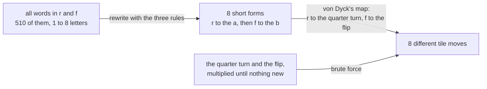

# Presentations: describe a group by generators and the rules they obey, and von Dyck's theorem turns the rules into maps

[Syllabus](../../../SYLLABUS.md) → [Algebra](../README.md) → [Groups](../README.md#s08) → Presentations

---

## General Overview

A square tile can be set down eight ways: four turns and four flips ([Groups](01-groups.md)). Two moves and three rules describe that group in one line.

Call a quarter turn r and the flip over the diagonal f. Every move is a string of r's and f's, called a **word**. Three rules hold: four quarter turns do nothing, two flips do nothing, and flip, turn, flip back is the reverse turn. These rules shorten any word to one of eight short forms (also called normal forms).

Letters plus the rules they obey are a **presentation**: a recipe for a group that lists no members. Von Dyck's theorem tests the recipe against real moves. If the real moves obey every rule, the whole group maps to them, and onto the moves they generate.

The rules give at most 8 members, the map onto the tile gives at least 8, so the recipe makes exactly the tile group. The quaternion group, another recipe with 8 members, is a different group.

**A presentation names a group by letters and rules: the rules bound its size from above, and von Dyck's theorem lets any real group of moves obeying them bound it from below.**

**What kind of fact this is:** a definition (the presentation) and a theorem (von Dyck's), proved on this card in Why it works.

### The picture: two roads to the number 8



The rules cap the count at 8; the map onto real moves lifts it to 8.

---

## The formula

- A **generator** is one of the letters, here r and f. A **relation** is a rule: a word equal to the identity, or two equal words.
- The **free group** on the letters is all words in the letters and their undos, with only neighbouring cancellations such as $`r\,r^{-1}`$ allowed ([Van Kampen's theorem](../../17-Topology/04-Homotopy/06-van-kampens-theorem.md) builds it).
- The presentation $`\langle S \mid R \rangle`$ is the free group with every relation forced to equal the identity. The relations and all their consequences form a normal subgroup $`N`$, and the presented group is the quotient by it ([Normal subgroups and quotient groups](06-normal-subgroups-and-quotient-groups.md)).

The two examples:

```math
D_4 = \langle\, r, f \mid r^4,\ f^2,\ frf = r^{-1} \,\rangle \qquad Q_8 = \langle\, i, j \mid i^4,\ i^2 = j^2,\ jij^{-1} = i^{-1} \,\rangle
```

**Read it aloud:** the tile group is a turn r and a flip f, where four turns do nothing, two flips do nothing, and flip-turn-flip is the reverse turn. $`D_4`$ is the usual name of the square's symmetry group.

Von Dyck's theorem, for any group $`H`$ and any choice $`\varphi`$ of a member of $`H`$ for each letter:

```math
\text{every relation holds for the } \varphi(s) \text{ in } H \;\Longrightarrow\; \varphi \text{ extends to exactly one homomorphism } \bar\varphi : \langle S \mid R \rangle \to H
```

**Read it aloud:** if the chosen members obey every rule, one map sends each word to the product of the chosen members, and it respects the operation: a homomorphism ([Homomorphisms and isomorphisms](05-homomorphisms-and-isomorphisms.md)).

| Symbol | Plain meaning | In our example | Push it up and the answer… |
| --- | --- | --- | --- |
| $`S`$, $`R`$; $`s`$ | the generators and the relations; one generator | r, f and the three tile rules | more relations can only shrink the group |
| $`\langle S \mid R \rangle`$; $`F`$ | the group the presentation makes; the free group | $`D_4`$ and $`Q_8`$ | drop a relation and the tile group becomes infinite |
| $`r`$, $`f`$, $`i`$, $`j`$, $`k`$; $`r^{-1}`$ | the examples' generators, and quaternion k; an undo | quarter turn, flip; quaternions; $`r^{-1} = r^3`$ | — |
| $`r^a f^b`$ | a short form: $`a`$ turns after $`b`$ flips | $`a`$ from 0 to 3, $`b`$ 0 or 1 | 4 × 2 forms at most |
| $`N`$; $`K`$ | all consequences of the relations; the kernel of $`\Phi`$ | words such as $`fr^2f\,r^2`$ | a bigger $`N`$, a smaller group |
| $`H`$; $`\varphi`$, $`\Phi`$, $`\bar\varphi`$ | a target group; a member for each letter, extended to all words, then to the group | the tile's moves; each word sent to its tile move | — |
| $`w`$, $`v`$; $`e`$ | words; the identity, also the empty word | $`frrf`$; the tile set down unmoved | — |

### When it holds

- **Every relation must hold in $`H`$.** Send f to the half turn and $`frf`$ is not $`r^{-1}`$: no homomorphism exists.
- **Rewriting gives only an upper bound.** Two short forms might be equal; a map onto 8 different real moves proves "at least 8".
- **The rules must be complete.** Drop $`frf = r^{-1}`$ and words stop shrinking: the group becomes infinite.
- **Size does not name a group.** $`D_4`$ and $`Q_8`$ both have 8 members; a property that isomorphisms keep, such as the count of members of order 2, tells them apart.

---

## Why it works

### Step 0: a word means "multiply these out"

A word in chosen members multiplies out to one member. The question is whether words equal in the presented group give the same answer in $`H`$.

### Step 1: the free group maps anywhere

Send each word to the product of its letters' members. Cancelling $`r\,r^{-1}`$ removes a member times its undo, so the product is unchanged. This is a homomorphism $`\Phi`$ from the free group to $`H`$.

### Step 2: the relations and their consequences go to the identity

Each relation multiplies out to the identity, by assumption. The members sent to the identity, the **kernel**, form a normal subgroup, so the kernel holds every consequence of the relations: all of $`N`$.

### Step 3: the map passes to the quotient

Words equal in $`\langle S \mid R \rangle`$ differ by a member of $`N`$, so $`\Phi`$ gives them the same value. That value is $`\bar\varphi`$. It is unique because the generators produce every member.

<details>
<summary>Detailed proof: von Dyck's theorem</summary>

Let $`F`$ be the free group on $`S`$, and $`\Phi : F \to H`$ send each word to the product of the $`\varphi`$-values of its letters, undos to undos. Inserting or deleting $`s\,s^{-1}`$ leaves the product unchanged, so $`\Phi`$ is a homomorphism.

By assumption $`\Phi(w) = e`$, the identity, for every relation $`w`$. So the kernel $`K`$ of $`\Phi`$ is a normal subgroup containing $`R`$. $`N`$ is the smallest such subgroup, so $`N \subseteq K`$.

Define $`\bar\varphi(wN) = \Phi(w)`$. If $`wN = vN`$ then $`v^{-1}w`$ is in $`N`$, so in $`K`$, so $`\Phi(v) = \Phi(w)`$: the definition does not depend on the word chosen. Then

$`\displaystyle \bar\varphi(wN \cdot vN) = \bar\varphi(wvN) = \Phi(wv) = \Phi(w)\,\Phi(v) = \bar\varphi(wN)\,\bar\varphi(vN).`$

A homomorphism agreeing with $`\varphi`$ on letters agrees on every product of letters, which is every member: $`\bar\varphi`$ is unique.

</details>

### Step 4: the tile group has exactly 8 members

**At most 8.** Undos are not needed as letters: $`r^{-1} = r^3`$ and $`f^{-1} = f`$. From $`frf = r^{-1}`$ and $`f^2 = e`$ comes $`fr = r^3 f`$. So any f can move right past any r. Then $`f^2 \to 1`$ and $`r^4 \to 1`$ trim the powers. Every word ends as $`r^a f^b`$, with $`a`$ from 0 to 3 and $`b`$ 0 or 1: at most 4 × 2 = 8 members.

**At least 8.** Send r to the quarter turn and f to the diagonal flip. All three relations hold on the tile, so von Dyck gives a homomorphism onto its moves. The 8 short forms land on 8 different moves, so they are 8 different members.

So the map is one-to-one and onto, an isomorphism: the tile group *is* $`\langle r, f \mid r^4, f^2, frf = r^{-1} \rangle`$.

### Step 5: Q8 has 8 members, and it is not the tile group

**At most 8.** Undos are again not needed: $`j^4 = i^4 = e`$, so $`j^{-1} = j^3`$. From $`jij^{-1} = i^{-1}`$ comes $`ji = i^3 j`$, and $`j^2`$ becomes $`i^2`$. Every word ends as $`i^a j^b`$: at most 8.

**At least 8.** Quaternions extend the numbers by three units i, j and k, with $`i^2 = j^2 = k^2 = ijk = -1`$. Send the letters to the quaternions i and j. The three relations hold, and the 8 short forms land on the 8 different quaternions ±1, ±i, ±j, ±k.

**Different from the tile.** A member's **order** is the smallest positive number of repeats that gives the identity, and an isomorphism keeps it. In $`Q_8`$ only $`i^2`$, the quaternion −1, has order 2. In the tile group five do: the half turn and the four flips. So no isomorphism exists.

<details>
<summary>The word problem: when rewriting cannot decide</summary>

Deciding whether a word equals the identity is the **word problem**. Here the rules always finish on a short form, so it is mechanical.

Novikov in 1955 and Boone in 1959 showed that some finite presentations have no algorithm that decides it.

</details>

---

## Worked numbers, by hand

One word reduced by hand: $`frrf`$. Replace $`fr`$ by $`rrrf`$ to get $`rrrfrf`$. Again: $`rrrrrrff`$. Delete $`ff`$ and four r's: $`rr`$. So $`fr^2f = r^2`$: the half turn seen through a flip is still the half turn.

| Step | Arithmetic | Value |
| --- | --- | --- |
| words in r and f | every string of 1 to 8 letters | 510 |
| tile: short forms reached | rewrite every word | e, r, rr, rrr, f, rf, rrf, rrrf: **8** |
| von Dyck's map | short forms onto corner maps | 8 different moves |
| brute force | multiply turn and flip until nothing new | 8 moves, the same 8 |
| tile: members of order 2 | rr and the four flips | **5** |
| Q8: short forms reached | rewrite every word in i and j | e, i, ii, iii, j, ij, iij, iiij: **8** |
| Q8: members of order 2 | only ii, the quaternion −1 | **1** |

**Both presentations make groups of exactly 8, and they are different groups: 5 members of order 2 against 1.**

### What breaks if you drop a piece

| Mistake | Comes out at | What went wrong |
| --- | --- | --- |
| Drop the rule $`frf = r^{-1}`$ | 18, then 43, then 97 members from words up to 4, 6, 8 letters | f can no longer move past r, so words stop shrinking |
| Send f to the half turn | $`frf`$ on `[1, 2, 3, 0]`, $`r^{-1}`$ on `[3, 0, 1, 2]`; 225 of 510 words land wrong | a relation fails in $`H`$, so von Dyck gives no map |
| Same size, so same group | 5 members of order 2 against 1 | size is not an isomorphism test |

A move is listed by where corners 0, 1, 2, 3 land, as on [Groups](01-groups.md).

---

## Code, from first principles, and it actually runs

A word is a string of letters, and three roads reach each group's size. Road one rewrites all 510 words with the relations alone. Road two is von Dyck's map onto concrete moves (corner maps for the tile, quaternions for $`Q_8`$): it checks the relations, then that each word lands where its short form lands. Road three ignores the presentation and multiplies the concrete generators until nothing new appears.

### Python

```python
# Group presentations -- the check behind the card.  Nothing is imported.  A word
# is a string of letters.  Road one rewrites words with the relations alone.
# Road two is von Dyck's map: send each letter to a concrete move and multiply.
# Road three multiplies the concrete moves together until nothing new appears.
def reduce(word, rules):                   # road one: apply a relation while one fits
    while any(old in word for old, new in rules):
        for old, new in rules:
            if old in word: word = word.replace(old, new, 1)
    return word
def image(word, gens, mul, one):           # road two: von Dyck's map, letter by letter
    for x in word: one = mul(one, gens[x])
    return one
def close(gens, mul, one):                 # road three: multiply until nothing new
    seen, todo = {one}, [one]
    while todo:
        a = todo.pop(); new = {mul(a, g) for g in gens.values()} - seen
        seen |= new; todo += list(new)
    return seen
def words(letters, n):                     # every word of 1 to n letters
    out, layer = [], [""]
    for _ in range(n): layer = [v + x for v in layer for x in letters]; out += layer
    return out
order = lambda a, mul, one: next(k for k in range(1, 9) if image("x" * k, {"x": a}, mul, one) == one)
turn = lambda p, q: tuple(p[c] for c in q)           # corner maps: q first, then p
quat = lambda p, q: (p[0]*q[0] - p[1]*q[1] - p[2]*q[2] - p[3]*q[3], p[0]*q[1] + p[1]*q[0] + p[2]*q[3] - p[3]*q[2],
                     p[0]*q[2] - p[1]*q[3] + p[2]*q[0] + p[3]*q[1], p[0]*q[3] + p[1]*q[2] - p[2]*q[1] + p[3]*q[0])
TILE = [("ff", ""), ("rrrr", ""), ("fr", "rrrf")]             # f r f = r^-1, used as f r = r^3 f
GROUPS = [("tile <r, f | r^4, f^2, f r f = r^-1>", TILE, {"r": (1, 2, 3, 0), "f": (0, 3, 2, 1)}, turn, (0, 1, 2, 3)),
          ("Q8 <i, j | i^4, i^2 = j^2, j i j^-1 = i^-1>", [("jj", "ii"), ("iiii", ""), ("ji", "iiij")],
           {"i": (0, 1, 0, 0), "j": (0, 0, 1, 0)}, quat, (1, 0, 0, 0))]
twos = []
for name, rules, gens, mul, one in GROUPS:
    ws, im = words("".join(gens), 8), lambda w: image(w, gens, mul, one)
    holds = all(im(a) == im(b) for a, b in rules)
    forms = sorted({reduce(w, rules) for w in ws}, key=lambda w: (w[-1:] in "fj" and w != "", len(w)))
    lands = all(im(w) == im(reduce(w, rules)) for w in ws)
    moves, found = {im(w) for w in forms}, close(gens, mul, one)
    orders = [order(im(w), mul, one) for w in forms]
    twos.append(orders.count(2))
    print(f"{name}\n  relations hold on the concrete moves: {'yes' if holds else 'no'}; words of 1 to 8 letters: {len(ws)}")
    print(f"  normal forms reached: {' '.join(w or 'e' for w in forms)} ({len(forms)})")
    print(f"  every word lands where its normal form lands: {'yes' if lands else 'no'}")
    print(f"  distinct moves from the forms: {len(moves)}; moves found by brute closure: {len(found)}")
    print(f"  orders: {orders}; elements of order 2: {orders.count(2)}")
    assert holds and lands and len(forms) == 8 and moves == found and len(found) == 8
free = [len({reduce(w, TILE[:2]) for w in words("rf", n)}) for n in (4, 6, 8)]
bad = lambda w: image(w, {"r": (1, 2, 3, 0), "f": (2, 3, 0, 1)}, turn, (0, 1, 2, 3))     # f sent to the half turn
miss = sum(bad(w) != bad(reduce(w, TILE)) for w in words("rf", 8))
print(f"mistake 1, drop f r f = r^-1: different elements from words up to 4, 6, 8 letters: {free}")
print(f"mistake 2, f sent to the half turn: f r f lands on {list(bad('frf'))}, r^-1 on {list(bad('rrr'))}; "
      f"{miss} of {len(words('rf', 8))} words land off their normal form")
print(f"mistake 3, order 8 taken as sameness: elements of order 2, tile {twos[0]}, Q8 {twos[1]}")
COLL, S4 = TILE[:2] + [("fr", "rrf")], close({"a": (1, 0, 2, 3), "b": (1, 2, 3, 0)}, turn, (0, 1, 2, 3))  # f r f = r^2
fits = [len(close(g, turn, (0, 1, 2, 3))) for g in ({"r": r, "f": f} for r in S4 for f in S4)
        if all(image(a, g, turn, (0, 1, 2, 3)) == image(b, g, turn, (0, 1, 2, 3)) for a, b in COLL)]
coll, ffr = {reduce(w, COLL) for w in words("rf", 8)}, [reduce("ffr", COLL), reduce("ffr", COLL[::-1])]   # two rule orders
print(f"trap, f r f = r^2: {len(coll)} normal forms; f f r rewrites to {ffr[0] or 'e'} or to {ffr[1] or 'e'}; largest model in {len(S4)} corner maps: {max(fits)} moves")
assert twos == [5, 1] and free[0] < free[1] < free[2] and bad("frf") != bad("rrr") and miss > 0
assert len(coll) == 8 and ffr == ["r", ""] and max(fits) == 2                # so r = e: the group is e and f
print("ALL CHECKS PASS")
```

**Ran 2026-11-23 on macOS, Python 3.14.10, standard library only. All checks passed. Output, pasted from the run:**

```
tile <r, f | r^4, f^2, f r f = r^-1>
  relations hold on the concrete moves: yes; words of 1 to 8 letters: 510
  normal forms reached: e r rr rrr f rf rrf rrrf (8)
  every word lands where its normal form lands: yes
  distinct moves from the forms: 8; moves found by brute closure: 8
  orders: [1, 4, 2, 4, 2, 2, 2, 2]; elements of order 2: 5
Q8 <i, j | i^4, i^2 = j^2, j i j^-1 = i^-1>
  relations hold on the concrete moves: yes; words of 1 to 8 letters: 510
  normal forms reached: e i ii iii j ij iij iiij (8)
  every word lands where its normal form lands: yes
  distinct moves from the forms: 8; moves found by brute closure: 8
  orders: [1, 4, 2, 4, 4, 4, 4, 4]; elements of order 2: 1
mistake 1, drop f r f = r^-1: different elements from words up to 4, 6, 8 letters: [18, 43, 97]
mistake 2, f sent to the half turn: f r f lands on [1, 2, 3, 0], r^-1 on [3, 0, 1, 2]; 225 of 510 words land off their normal form
mistake 3, order 8 taken as sameness: elements of order 2, tile 5, Q8 1
trap, f r f = r^2: 8 normal forms; f f r rewrites to r or to e; largest model in 24 corner maps: 2 moves
ALL CHECKS PASS
```

### Rust

Same numbers, same labels, built with `rustc --edition 2021 -O`.

```rust
// Group presentations -- the same check as the Python, in Rust.  No crates.  A
// word is a string of letters.  Road one rewrites words with the relations alone.
// Road two is von Dyck's map: send each letter to a concrete move and multiply.
// Road three multiplies the concrete moves together until nothing new appears.
use std::collections::BTreeSet;
type El = Vec<i64>;
type Mul = fn(&El, &El) -> El;
fn reduce(word: &str, rules: &[(&str, &str)]) -> String {   // road one: apply a relation while one fits
    let mut w = word.to_string();
    while let Some(&(old, new)) = rules.iter().find(|(old, _)| w.contains(old)) { w = w.replacen(old, new, 1) }
    w
}
fn image(word: &str, gens: &[(char, El)], mul: Mul, one: &El) -> El {   // road two: von Dyck's map
    word.chars().fold(one.clone(), |out, x| mul(&out, &gens.iter().find(|g| g.0 == x).unwrap().1))
}
fn close(gens: &[(char, El)], mul: Mul, one: &El) -> BTreeSet<El> {   // road three: multiply until nothing new
    let (mut seen, mut todo) = (BTreeSet::from([one.clone()]), vec![one.clone()]);
    while let Some(a) = todo.pop() { for g in gens { let b = mul(&a, &g.1); if seen.insert(b.clone()) { todo.push(b) } } }
    seen
}
fn order(a: &El, mul: Mul, one: &El) -> usize { (1..9).find(|&k| image(&"x".repeat(k), &[('x', a.clone())], mul, one) == *one).unwrap() }
fn words(letters: &[char], n: usize) -> Vec<String> {       // every word of 1 to n letters
    let (mut out, mut layer) = (vec![], vec![String::new()]);
    for _ in 0..n { layer = layer.iter().flat_map(|v| letters.iter().map(move |x| format!("{}{}", v, x))).collect(); out.extend(layer.clone()) }
    out
}
fn turn(p: &El, q: &El) -> El { q.iter().map(|&c| p[c as usize]).collect() }   // corner maps: q first, then p
fn quat(p: &El, q: &El) -> El {
    vec![p[0]*q[0] - p[1]*q[1] - p[2]*q[2] - p[3]*q[3], p[0]*q[1] + p[1]*q[0] + p[2]*q[3] - p[3]*q[2],
         p[0]*q[2] - p[1]*q[3] + p[2]*q[0] + p[3]*q[1], p[0]*q[3] + p[1]*q[2] - p[2]*q[1] + p[3]*q[0]]
}
fn yn(c: bool) -> &'static str { if c { "yes" } else { "no" } }
fn main() {
    let tile: Vec<(&str, &str)> = vec![("ff", ""), ("rrrr", ""), ("fr", "rrrf")];   // f r f = r^-1, used as f r = r^3 f
    let groups: Vec<(&str, Vec<(&str, &str)>, Vec<(char, El)>, Mul, El)> = vec![
        ("tile <r, f | r^4, f^2, f r f = r^-1>", tile.clone(), vec![('r', vec![1, 2, 3, 0]), ('f', vec![0, 3, 2, 1])], turn, vec![0, 1, 2, 3]),
        ("Q8 <i, j | i^4, i^2 = j^2, j i j^-1 = i^-1>", vec![("jj", "ii"), ("iiii", ""), ("ji", "iiij")],
         vec![('i', vec![0, 1, 0, 0]), ('j', vec![0, 0, 1, 0])], quat, vec![1, 0, 0, 0])];
    let mut twos = vec![];
    for (name, rules, gens, mul, one) in &groups {
        let ws = words(&gens.iter().map(|g| g.0).collect::<Vec<char>>(), 8);
        let im = |w: &str| image(w, gens, *mul, one);
        let holds = rules.iter().all(|(a, b)| im(a) == im(b));
        let mut forms: Vec<String> = ws.iter().map(|w| reduce(w, rules)).collect::<BTreeSet<_>>().into_iter().collect();
        forms.sort_by_key(|w| (w.ends_with('f') || w.ends_with('j'), w.len()));
        let lands = ws.iter().all(|w| im(w) == im(&reduce(w, rules)));
        let moves: BTreeSet<El> = forms.iter().map(|w| im(w)).collect();
        let found = close(gens, *mul, one);
        let orders: Vec<usize> = forms.iter().map(|w| order(&im(w), *mul, one)).collect();
        let n2 = orders.iter().filter(|&&k| k == 2).count(); twos.push(n2);
        println!("{}\n  relations hold on the concrete moves: {}; words of 1 to 8 letters: {}", name, yn(holds), ws.len());
        let shown: Vec<&str> = forms.iter().map(|w| if w.is_empty() { "e" } else { w.as_str() }).collect();
        println!("  normal forms reached: {} ({})", shown.join(" "), forms.len());
        println!("  every word lands where its normal form lands: {}", yn(lands));
        println!("  distinct moves from the forms: {}; moves found by brute closure: {}", moves.len(), found.len());
        println!("  orders: {:?}; elements of order 2: {}", orders, n2);
        assert!(holds && lands && forms.len() == 8 && moves == found && found.len() == 8);
    }
    let free: Vec<usize> = [4, 6, 8].iter()
        .map(|&n| words(&['r', 'f'], n).iter().map(|w| reduce(w, &tile[..2])).collect::<BTreeSet<_>>().len()).collect();
    let half = vec![('r', vec![1, 2, 3, 0]), ('f', vec![2, 3, 0, 1])];          // f sent to the half turn
    let bad = |w: &str| image(w, &half, turn, &vec![0, 1, 2, 3]);
    let miss = words(&['r', 'f'], 8).iter().filter(|w| bad(w) != bad(&reduce(w, &tile))).count();
    println!("mistake 1, drop f r f = r^-1: different elements from words up to 4, 6, 8 letters: {:?}", free);
    println!("mistake 2, f sent to the half turn: f r f lands on {:?}, r^-1 on {:?}; {} of {} words land off their normal form",
             bad("frf"), bad("rrr"), miss, words(&['r', 'f'], 8).len());
    println!("mistake 3, order 8 taken as sameness: elements of order 2, tile {}, Q8 {}", twos[0], twos[1]);
    let (coll, e): (Vec<(&str, &str)>, El) = ([&tile[..2], &[("fr", "rrf")]].concat(), vec![0, 1, 2, 3]);   // f r f = r^2
    let s4 = close(&[('a', vec![1, 0, 2, 3]), ('b', vec![1, 2, 3, 0])], turn, &e);
    let fits: Vec<usize> = s4.iter().flat_map(|r| s4.iter().map(move |f| vec![('r', r.clone()), ('f', f.clone())]))
        .filter(|g| coll.iter().all(|(a, b)| image(a, g, turn, &e) == image(b, g, turn, &e))).map(|g| close(&g, turn, &e).len()).collect();
    let nc = words(&['r', 'f'], 8).iter().map(|w| reduce(w, &coll)).collect::<BTreeSet<_>>().len();
    let ffr = [reduce("ffr", &coll), reduce("ffr", &coll.iter().rev().cloned().collect::<Vec<_>>())];   // two rule orders
    let show = |w: &String| if w.is_empty() { "e".to_string() } else { w.clone() };
    println!("trap, f r f = r^2: {} normal forms; f f r rewrites to {} or to {}; largest model in {} corner maps: {} moves",
             nc, show(&ffr[0]), show(&ffr[1]), s4.len(), fits.iter().max().unwrap());
    assert!(twos == vec![5, 1] && free[0] < free[1] && free[1] < free[2] && bad("frf") != bad("rrr") && miss > 0);
    assert!(nc == 8 && ffr == ["r", ""] && *fits.iter().max().unwrap() == 2);       // so r = e: the group is e and f
    println!("ALL CHECKS PASS");
}
```

**Ran 2026-11-23 on macOS, rustc 1.98.1, no crates. All checks passed. Output, pasted from the run:**

```
tile <r, f | r^4, f^2, f r f = r^-1>
  relations hold on the concrete moves: yes; words of 1 to 8 letters: 510
  normal forms reached: e r rr rrr f rf rrf rrrf (8)
  every word lands where its normal form lands: yes
  distinct moves from the forms: 8; moves found by brute closure: 8
  orders: [1, 4, 2, 4, 2, 2, 2, 2]; elements of order 2: 5
Q8 <i, j | i^4, i^2 = j^2, j i j^-1 = i^-1>
  relations hold on the concrete moves: yes; words of 1 to 8 letters: 510
  normal forms reached: e i ii iii j ij iij iiij (8)
  every word lands where its normal form lands: yes
  distinct moves from the forms: 8; moves found by brute closure: 8
  orders: [1, 4, 2, 4, 4, 4, 4, 4]; elements of order 2: 1
mistake 1, drop f r f = r^-1: different elements from words up to 4, 6, 8 letters: [18, 43, 97]
mistake 2, f sent to the half turn: f r f lands on [1, 2, 3, 0], r^-1 on [3, 0, 1, 2]; 225 of 510 words land off their normal form
mistake 3, order 8 taken as sameness: elements of order 2, tile 5, Q8 1
trap, f r f = r^2: 8 normal forms; f f r rewrites to r or to e; largest model in 24 corner maps: 2 moves
ALL CHECKS PASS
```

### Lean

Lean proves von Dyck's theorem for every presentation, and both 8-member examples on this card.

- Take letters sent to members of a group $`H`$ that obey every relation. Then they extend to exactly one homomorphism from the presented group to $`H`$.
- The tile presentation makes exactly the tile group, with r sent to the quarter turn and f to a flip.
- The $`Q_8`$ presentation makes a group of exactly 8 members, yet no isomorphism joins it to the tile group.
- The hand-reduced word checks out: $`fr^2f = r^2`$ in the tile group.
- With f sent to the half turn, $`frf`$ is not $`r^{-1}`$.
- The tile group has 5 members of order 2, and $`Q_8`$ has 1.
- There are 510 words of 1 to 8 letters.

The Python and Rust checks do the rewriting: the short forms, the dropped-rule counts, the 225 misses and the 2-member trap.

```lean
-- Presentations: von Dyck's theorem extends rule-respecting generator maps to homomorphisms, the tile presentation is the dihedral group of order 8, and the Q8 presentation has 8 members but is a different group.
import Mathlib.GroupTheory.PresentedGroup
import Mathlib.GroupTheory.SpecificGroups.Dihedral
import Mathlib.GroupTheory.SpecificGroups.Quaternion
import Mathlib.Algebra.BigOperators.Intervals

/-- The tile's two letters: a quarter turn `r` and a flip `f`. -/
inductive TileLetter
  | r
  | f
  deriving DecidableEq

/-- The quaternion presentation's two letters `i` and `j`. -/
inductive QuatLetter
  | i
  | j
  deriving DecidableEq

/-- The tile relations `r^4`, `f^2` and `f r f = r⁻¹`, the last written as `f r f r = 1`. -/
def tileRels : Set (FreeGroup TileLetter) :=
  let r := FreeGroup.of TileLetter.r
  let f := FreeGroup.of TileLetter.f
  {r ^ 4, f ^ 2, f * r * f * r}

/-- The quaternion relations `i^4`, `i^2 = j^2` and `j i j⁻¹ = i⁻¹`, each written as a word equal to `1`. -/
def quatRels : Set (FreeGroup QuatLetter) :=
  let i := FreeGroup.of QuatLetter.i
  let j := FreeGroup.of QuatLetter.j
  {i ^ 4, i ^ 2 * (j ^ 2)⁻¹, j * i * j⁻¹ * i}

/-- A homomorphism with a one-sided inverse function whose image is stable under left
multiplication by a generating set is a bijection. -/
theorem bijective_of_section_gen {P G : Type*} [Group P] [Group G] (φ : P →* G) (g : G → P)
    (hφg : ∀ x, φ (g x) = x) (s : Set P) (hs : Subgroup.closure s = ⊤) (h1 : g 1 = 1)
    (hg : ∀ a ∈ s, ∀ x, a * g x = g (φ a * x)) : Function.Bijective φ := by
  have key : ∀ p, g (φ p) = p := by
    intro p
    have hp : p ∈ Subgroup.closure s := hs ▸ Subgroup.mem_top p
    induction hp using Subgroup.closure_induction_left with
    | one => simp [h1]
    | mul_left a ha y _ ih => rw [map_mul, ← hg a ha, ih]
    | inv_mul_cancel a ha y _ ih =>
      have : a * g (φ (a⁻¹ * y)) = a * (a⁻¹ * y) := by
        rw [hg a ha, ← map_mul, mul_inv_cancel_left, ih]
      exact mul_left_cancel this
  exact ⟨fun p q h => by rw [← key p, ← key q, h], fun x => ⟨g x, hφg x⟩⟩

/-- The tile relation `r^4 = 1` holds in the presented group. -/
theorem tile_r_pow_four : (PresentedGroup.of TileLetter.r : PresentedGroup tileRels) ^ 4 = 1 := by
  have h := PresentedGroup.one_of_mem (rels := tileRels)
    (x := FreeGroup.of TileLetter.r ^ 4) (by simp [tileRels])
  rwa [map_pow] at h

/-- The tile relation `f^2 = 1` holds in the presented group. -/
theorem tile_f_sq : (PresentedGroup.of TileLetter.f : PresentedGroup tileRels) ^ 2 = 1 := by
  have h := PresentedGroup.one_of_mem (rels := tileRels)
    (x := FreeGroup.of TileLetter.f ^ 2) (by simp [tileRels])
  rwa [map_pow] at h

/-- The tile relation `f r f r = 1` holds in the presented group. -/
theorem tile_frfr : (PresentedGroup.of TileLetter.f * PresentedGroup.of TileLetter.r *
    PresentedGroup.of TileLetter.f * PresentedGroup.of TileLetter.r : PresentedGroup tileRels) = 1 := by
  have h := PresentedGroup.one_of_mem (rels := tileRels)
    (x := FreeGroup.of TileLetter.f * FreeGroup.of TileLetter.r * FreeGroup.of TileLetter.f *
      FreeGroup.of TileLetter.r) (by simp [tileRels])
  rwa [map_mul, map_mul, map_mul] at h

/-- In the tile group, `r f = f r^3`. -/
theorem tile_rf : (PresentedGroup.of TileLetter.r * PresentedGroup.of TileLetter.f :
    PresentedGroup tileRels) = PresentedGroup.of TileLetter.f * PresentedGroup.of TileLetter.r ^ 3 := by
  set R : PresentedGroup tileRels := PresentedGroup.of TileLetter.r
  set F : PresentedGroup tileRels := PresentedGroup.of TileLetter.f
  have hFF : F * F = 1 := by rw [← sq]; exact tile_f_sq
  have hRR3 : R * R ^ 3 = 1 := by rw [← pow_succ']; exact tile_r_pow_four
  calc
    R * F = F⁻¹ * (F * R * F * R) * R⁻¹ := by group
    _ = F * R ^ 3 := by
      rw [tile_frfr, mul_one, inv_eq_of_mul_eq_one_right hFF, inv_eq_of_mul_eq_one_right hRR3]

/-- The quaternion relation `i^4 = 1` holds in the presented group. -/
theorem quat_i_pow_four : (PresentedGroup.of QuatLetter.i : PresentedGroup quatRels) ^ 4 = 1 := by
  have h := PresentedGroup.one_of_mem (rels := quatRels)
    (x := FreeGroup.of QuatLetter.i ^ 4) (by simp [quatRels])
  rwa [map_pow] at h

/-- The quaternion relation `i^2 = j^2` holds in the presented group. -/
theorem quat_i_sq_eq_j_sq : (PresentedGroup.of QuatLetter.i : PresentedGroup quatRels) ^ 2 =
    PresentedGroup.of QuatLetter.j ^ 2 := by
  have h := PresentedGroup.one_of_mem (rels := quatRels)
    (x := FreeGroup.of QuatLetter.i ^ 2 * (FreeGroup.of QuatLetter.j ^ 2)⁻¹) (by simp [quatRels])
  rw [map_mul, map_inv, map_pow, map_pow] at h
  exact mul_inv_eq_one.mp h

/-- The quaternion relation `j i j⁻¹ i = 1` holds in the presented group. -/
theorem quat_jiji : (PresentedGroup.of QuatLetter.j * PresentedGroup.of QuatLetter.i *
    (PresentedGroup.of QuatLetter.j)⁻¹ * PresentedGroup.of QuatLetter.i :
      PresentedGroup quatRels) = 1 := by
  have h := PresentedGroup.one_of_mem (rels := quatRels)
    (x := FreeGroup.of QuatLetter.j * FreeGroup.of QuatLetter.i * (FreeGroup.of QuatLetter.j)⁻¹ *
      FreeGroup.of QuatLetter.i) (by simp [quatRels])
  rwa [map_mul, map_mul, map_mul, map_inv] at h

/-- Von Dyck's theorem: if members of a group `H` chosen for the letters obey every relation,
the choice extends to exactly one homomorphism from the presented group `⟨S | R⟩` to `H`. -/
theorem von_dyck {S : Type*} (R : Set (FreeGroup S)) {H : Type*} [Group H] (φ : S → H)
    (hR : ∀ w ∈ R, FreeGroup.lift φ w = 1) :
    ∃! φbar : PresentedGroup R →* H, ∀ s : S, φbar (PresentedGroup.of s) = φ s := by
  refine ⟨PresentedGroup.toGroup hR, fun s => PresentedGroup.toGroup.of hR, ?_⟩
  intro ψ hψ
  exact PresentedGroup.ext fun s => by rw [hψ s, PresentedGroup.toGroup.of hR]

/-- The tile group is `⟨r, f | r^4, f^2, f r f = r⁻¹⟩`: the presented group is isomorphic to the
square's 8 symmetries, with `r` sent to the quarter turn and `f` to a flip. -/
theorem tile_presentation_iso_dihedral :
    ∃ e : PresentedGroup tileRels ≃* DihedralGroup 4,
      e (PresentedGroup.of TileLetter.r) = DihedralGroup.r 1 ∧
      e (PresentedGroup.of TileLetter.f) = DihedralGroup.sr 0 := by
  set R : PresentedGroup tileRels := PresentedGroup.of TileLetter.r with hRdef
  set F : PresentedGroup tileRels := PresentedGroup.of TileLetter.f with hFdef
  let f₀ : TileLetter → DihedralGroup 4 := fun l => match l with
    | .r => DihedralGroup.r 1
    | .f => DihedralGroup.sr 0
  have hrel : ∀ w ∈ tileRels, FreeGroup.lift f₀ w = 1 := by
    intro w hw
    simp only [tileRels, Set.mem_insert_iff, Set.mem_singleton_iff] at hw
    rcases hw with rfl | rfl | rfl <;> simp [f₀] <;> decide
  let φ := PresentedGroup.toGroup hrel
  have hφR : φ R = DihedralGroup.r 1 := PresentedGroup.toGroup.of hrel
  have hφF : φ F = DihedralGroup.sr 0 := PresentedGroup.toGroup.of hrel
  have hR4 : R ^ 4 = 1 := tile_r_pow_four
  have hF2 : F ^ 2 = 1 := tile_f_sq
  have hpow : ∀ n, R ^ n = R ^ (n % 4) := fun n => pow_eq_pow_mod n hR4
  have hFF : F * F = 1 := by rw [← sq]; exact hF2
  have hRF : R * F = F * R ^ 3 := tile_rf
  let g : DihedralGroup 4 → PresentedGroup tileRels := fun d => match d with
    | .r k => R ^ k.val
    | .sr k => F * R ^ k.val
  have hφg : ∀ x, φ (g x) = x := by
    rintro (k | k) <;> simp only [g, map_mul, map_pow, hφR, hφF] <;> revert k <;> decide
  have h1 : g 1 = 1 := by
    show R ^ (0 : ZMod 4).val = 1
    simp
  have hbij := bijective_of_section_gen φ g hφg (Set.range PresentedGroup.of)
    (PresentedGroup.closure_range_of _) h1 ?_
  · exact ⟨MulEquiv.ofBijective φ hbij, hφR, hφF⟩
  · rintro a ⟨l, rfl⟩ (k | k) <;> cases l
    · show R * g (.r k) = g (φ R * .r k)
      rw [hφR, DihedralGroup.r_mul_r]
      simp only [g]
      rw [← pow_succ', hpow (k.val + 1), hpow ((1 + k).val)]
      congr 1
      revert k; decide
    · show F * g (.r k) = g (φ F * .r k)
      rw [hφF, DihedralGroup.sr_mul_r]
      simp only [g, zero_add]
    · show R * g (.sr k) = g (φ R * .sr k)
      rw [hφR, DihedralGroup.r_mul_sr]
      simp only [g]
      rw [← mul_assoc, hRF, mul_assoc, ← pow_add, hpow (3 + k.val), hpow ((k - 1).val)]
      congr 2
      revert k; decide
    · show F * g (.sr k) = g (φ F * .sr k)
      rw [hφF, DihedralGroup.sr_mul_sr]
      simp only [g, sub_zero]
      rw [← mul_assoc, hFF, one_mul]

/-- `Q8 = ⟨i, j | i^4, i^2 = j^2, j i j⁻¹ = i⁻¹⟩` has exactly 8 members, yet it is not the tile group. -/
theorem quaternion_presentation_card_eight_not_tile :
    Nat.card (PresentedGroup quatRels) = 8 ∧
      IsEmpty (PresentedGroup quatRels ≃* PresentedGroup tileRels) := by
  set I : PresentedGroup quatRels := PresentedGroup.of QuatLetter.i with hIdef
  set J : PresentedGroup quatRels := PresentedGroup.of QuatLetter.j with hJdef
  let f₀ : QuatLetter → QuaternionGroup 2 := fun l => match l with
    | .i => QuaternionGroup.a 1
    | .j => QuaternionGroup.xa 0
  have hrel : ∀ w ∈ quatRels, FreeGroup.lift f₀ w = 1 := by
    intro w hw
    simp only [quatRels, Set.mem_insert_iff, Set.mem_singleton_iff] at hw
    rcases hw with rfl | rfl | rfl <;> simp [f₀] <;> decide
  let φ := PresentedGroup.toGroup hrel
  have hφI : φ I = QuaternionGroup.a 1 := PresentedGroup.toGroup.of hrel
  have hφJ : φ J = QuaternionGroup.xa 0 := PresentedGroup.toGroup.of hrel
  have hI4 : I ^ 4 = 1 := quat_i_pow_four
  have hpow : ∀ n, I ^ n = I ^ (n % 4) := fun n => pow_eq_pow_mod n hI4
  have hII3 : I * I ^ 3 = 1 := by rw [← pow_succ']; exact hI4
  have hJJ : J * J = I ^ 2 := by rw [← sq]; exact quat_i_sq_eq_j_sq.symm
  have hIJ : I * J = J * I ^ 3 := calc
    I * J = J * I⁻¹ * (J⁻¹ * (J * I * J⁻¹ * I) * J) := by group
    _ = J * I ^ 3 := by
      rw [quat_jiji, mul_one, inv_mul_cancel, mul_one, inv_eq_of_mul_eq_one_right hII3]
  let g : QuaternionGroup 2 → PresentedGroup quatRels := fun d => match d with
    | .a k => I ^ k.val
    | .xa k => J * I ^ k.val
  have hφg : ∀ x, φ (g x) = x := by
    rintro (k | k) <;> simp only [g, map_mul, map_pow, hφI, hφJ] <;> revert k <;> decide
  have h1 : g 1 = 1 := by
    show I ^ (0 : ZMod (2 * 2)).val = 1
    simp
  have hbij := bijective_of_section_gen φ g hφg (Set.range PresentedGroup.of)
    (PresentedGroup.closure_range_of _) h1 ?_
  · let e := MulEquiv.ofBijective φ hbij
    refine ⟨?_, ?_⟩
    · rw [Nat.card_congr e.toEquiv, Nat.card_eq_fintype_card, QuaternionGroup.card]
    · obtain ⟨t, -, -⟩ := tile_presentation_iso_dihedral
      refine ⟨fun e' => ?_⟩
      let ψ : QuaternionGroup 2 ≃* DihedralGroup 4 := (e.symm.trans e').trans t
      have hu : ∀ q : QuaternionGroup 2, q ≠ 1 → q * q = 1 → q = QuaternionGroup.a 2 := by
        decide
      have hA : ψ.symm (DihedralGroup.r 2) = QuaternionGroup.a 2 := by
        apply hu
        · rw [Ne, MulEquiv.map_eq_one_iff]; decide
        · rw [← map_mul, show (DihedralGroup.r 2 * DihedralGroup.r 2 : DihedralGroup 4) = 1 by
            decide, map_one]
      have hB : ψ.symm (DihedralGroup.sr 0) = QuaternionGroup.a 2 := by
        apply hu
        · rw [Ne, MulEquiv.map_eq_one_iff]; decide
        · rw [← map_mul, show (DihedralGroup.sr 0 * DihedralGroup.sr 0 : DihedralGroup 4) = 1 by
            decide, map_one]
      have := ψ.symm.injective (hA.trans hB.symm)
      exact absurd this (by decide)
  · rintro a ⟨l, rfl⟩ (k | k) <;> cases l
    · show I * g (.a k) = g (φ I * .a k)
      rw [hφI, QuaternionGroup.a_mul_a]
      simp only [g]
      rw [← pow_succ', hpow (k.val + 1)]
      conv_rhs => rw [hpow]
      congr 1
      revert k; decide
    · show J * g (.a k) = g (φ J * .a k)
      rw [hφJ, QuaternionGroup.xa_mul_a]
      simp only [g, zero_add]
    · show I * g (.xa k) = g (φ I * .xa k)
      rw [hφI, QuaternionGroup.a_mul_xa]
      simp only [g]
      rw [← mul_assoc, hIJ, mul_assoc, ← pow_add, hpow (3 + k.val)]
      conv_rhs => rw [hpow]
      congr 2
      revert k; decide
    · show J * g (.xa k) = g (φ J * .xa k)
      rw [hφJ, QuaternionGroup.xa_mul_xa]
      simp only [g]
      rw [← mul_assoc, hJJ, ← pow_add, hpow (2 + k.val)]
      conv_rhs => rw [hpow]
      congr 1
      revert k; decide

-- Words of 1 to 8 letters in `r` and `f`: 510 of them.
example : ∑ k ∈ Finset.Icc 1 8, 2 ^ k = 510 := by decide

-- Short forms `r^a f^b`: at most 4 × 2 = 8.
example : 4 * 2 = 8 := by norm_num

-- The hand-reduced word: `f r r f = r r` in the tile group.
example :
    (PresentedGroup.of TileLetter.f * PresentedGroup.of TileLetter.r ^ 2 *
      PresentedGroup.of TileLetter.f : PresentedGroup tileRels) =
      PresentedGroup.of TileLetter.r ^ 2 := by
  set R : PresentedGroup tileRels := PresentedGroup.of TileLetter.r
  set F : PresentedGroup tileRels := PresentedGroup.of TileLetter.f
  have hRF : R * F = F * R ^ 3 := tile_rf
  have hFF : F * F = 1 := by rw [← sq]; exact tile_f_sq
  calc
    F * R ^ 2 * F = F * R * (R * F) := by rw [sq]; simp only [mul_assoc]
    _ = F * R * (F * R ^ 3) := by rw [hRF]
    _ = F * (R * F) * R ^ 3 := by simp only [mul_assoc]
    _ = F * (F * R ^ 3) * R ^ 3 := by rw [hRF]
    _ = F * F * (R ^ 3 * R ^ 3) := by simp only [mul_assoc]
    _ = R ^ 2 := by rw [hFF, one_mul, ← pow_add, pow_eq_pow_mod 6 tile_r_pow_four]

-- The quarter turn and a flip obey all three tile rules.
example : (DihedralGroup.r 1 : DihedralGroup 4) ^ 4 = 1 := by decide
example : (DihedralGroup.sr 0 : DihedralGroup 4) ^ 2 = 1 := by decide
example : (DihedralGroup.sr 0 * DihedralGroup.r 1 * DihedralGroup.sr 0 : DihedralGroup 4) =
    (DihedralGroup.r 1)⁻¹ := by decide

-- Sending `f` to the half turn breaks `f r f = r⁻¹`, so von Dyck gives no map.
example : (DihedralGroup.r 2 * DihedralGroup.r 1 * DihedralGroup.r 2 : DihedralGroup 4) ≠
    (DihedralGroup.r 1)⁻¹ := by decide

-- The quaternions `i` and `j` obey all three Q8 rules.
example : (QuaternionGroup.a 1 : QuaternionGroup 2) ^ 4 = 1 := by decide
example : (QuaternionGroup.a 1 : QuaternionGroup 2) ^ 2 = QuaternionGroup.xa 0 ^ 2 := by decide
example : (QuaternionGroup.xa 0 * QuaternionGroup.a 1 * (QuaternionGroup.xa 0)⁻¹ : QuaternionGroup 2) =
    (QuaternionGroup.a 1)⁻¹ := by decide

-- Members of order 2: five in the tile group, one in Q8.
example : (Finset.univ.filter fun g : DihedralGroup 4 => g ≠ 1 ∧ g * g = 1).card = 5 := by decide
example : (Finset.univ.filter fun g : QuaternionGroup 2 => g ≠ 1 ∧ g * g = 1).card = 1 := by decide

#print axioms bijective_of_section_gen
#print axioms tile_r_pow_four
#print axioms tile_f_sq
#print axioms tile_frfr
#print axioms tile_rf
#print axioms quat_i_pow_four
#print axioms quat_i_sq_eq_j_sq
#print axioms quat_jiji
#print axioms von_dyck
#print axioms tile_presentation_iso_dihedral
#print axioms quaternion_presentation_card_eight_not_tile
```

**Checked 2026-11-23 on macOS, Lean 4.36.0-rc2, Mathlib v4.36.0-rc2. Every proof is complete and uses only Lean's standard axioms. Output, pasted from the run:**

```
'bijective_of_section_gen' depends on axioms: [propext, Classical.choice, Quot.sound]
'tile_r_pow_four' depends on axioms: [propext, Classical.choice, Quot.sound]
'tile_f_sq' depends on axioms: [propext, Classical.choice, Quot.sound]
'tile_frfr' depends on axioms: [propext, Classical.choice, Quot.sound]
'tile_rf' depends on axioms: [propext, Classical.choice, Quot.sound]
'quat_i_pow_four' depends on axioms: [propext, Classical.choice, Quot.sound]
'quat_i_sq_eq_j_sq' depends on axioms: [propext, Classical.choice, Quot.sound]
'quat_jiji' depends on axioms: [propext, Classical.choice, Quot.sound]
'von_dyck' depends on axioms: [propext, Classical.choice, Quot.sound]
'tile_presentation_iso_dihedral' depends on axioms: [propext, Classical.choice, Quot.sound]
'quaternion_presentation_card_eight_not_tile' depends on axioms: [propext, Classical.choice, Quot.sound]
```

> [!TIP]
> **Try changing**
> Guess first, then run it.
> - **Make the tile commute.** In `TILE`, change `("fr", "rrrf")` to `("fr", "rf")`. How many short forms? Still 8, but the tile's moves break the new rule: "relations hold: no", and the first assert stops it.
> - **Break a quaternion rule.** Change `("jj", "ii")` to `("jj", "")`. The quaternion j fails it, since j times j is −1, and the Q8 block stops on "no".
> - **Pick the wrong flip.** Send the tile's `"f"` to `(2, 3, 0, 1)`, the half turn. Brute force finds only 4 moves, and the run stops.

---

## The usual mistake

> [!warning]
> **Reading the group's size off the rewriting.** Rules that shrink every word to 8 short forms prove "at most 8", nothing more. Change the third rule to $`frf = r^2`$, used as $`fr \to rrf`$: the same 8 forms appear. Yet $`ffr`$ becomes $`r`$ by deleting $`ff`$, and $`e`$ by moving each f right first, so $`r = e`$: only 2 members, and no real group of moves (model) among the 24 corner maps has more. Only a model that obeys every relation, with 8 different images, proves "at least 8".
>
> - **Dropping a relation.** Without $`frf = r^{-1}`$: 18, 43, then 97 members from words of up to 4, 6, 8 letters.
> - **Skipping a relation check.** With f sent to the half turn, 225 of 510 words land off their short form.
> - **Matching groups by size.** $`D_4`$ and $`Q_8`$ both have 8 members, but 5 against 1 have order 2.

---

## Where you meet it in real life

- **Computer algebra.** Group software stores many groups as presentations and counts their members by coset enumeration, the Todd–Coxeter method.
- **Knots and shapes.** The group of loops you can draw in a space (its loop group) arrives as a presentation, read off how the space is glued. Telling two knots apart starts with telling two presented groups apart.
- **Rotations in 3D.** Flight software and game engines turn objects with unit quaternions; $`Q_8`$ is the group of the eight basic ones.

> **Say it back**
> A presentation names a group by generators and the rules they obey. Rewriting bounds the size from above: every tile word becomes $`r^a f^b`$, so at most 8. Von Dyck's theorem says generators sent to real moves that obey every rule extend to a homomorphism; the map onto the tile's 8 moves gives at least 8. Q8 also has 8 members, but 1 of order 2 against the tile's 5, so it is a different group.

---

## What this builds on

- [Normal subgroups and quotient groups](06-normal-subgroups-and-quotient-groups.md): the presented group is a quotient, and kernels are normal.
- [Homomorphisms and isomorphisms](05-homomorphisms-and-isomorphisms.md): the maps von Dyck builds, and order as a property an isomorphism keeps.
- [Semidirect products](12-semidirect-products.md): the tile as four turns twisted by one flip, which is the rule $`fr = r^3 f`$ used here.
- [Composition series](14-composition-series-and-jordan-holder.md): $`D_4`$ and $`Q_8`$ have the same simple pieces; presentations tell them apart.

## Where this goes next

- [Rings](../09-Rings%20and%20Fields/01-rings.md): the first card of the next shelf; a second operation, multiplication, joins addition.
- [Van Kampen's theorem](../../17-Topology/04-Homotopy/06-van-kampens-theorem.md): loop groups of glued spaces, produced as presentations.
- [CW complexes](../../17-Topology/04-Homotopy/07-cw-complexes-and-gluing-cells.md): one relation for each disc glued on.
- [Nielsen-Schreier](../../17-Topology/04-Homotopy/10-nielsen-schreier-and-covers-of-graphs.md): every subgroup of a free group is free, read off a covering graph.
- [Root systems and Dynkin diagrams](../../23-Differential%20geometry%20and%20Lie%20groups/08-Roots%2C%20Weights%20and%20Representations/03-root-systems-and-dynkin-diagrams.md): Weyl groups presented by reflections and Coxeter rules; four infinite families and five exceptions.

The question this card leaves: when do two presentations make the same group? No algorithm decides it in general, as Adian and Rabin proved. That closes this shelf's one-operation story. The next shelf starts with [Rings](../09-Rings%20and%20Fields/01-rings.md), where a second operation joins the first.

---

## Sources

Verified 2026-11-23: every link below resolves to the publisher's page.

- Dummit, David S., and Richard M. Foote. *Abstract Algebra*, 3rd ed. Wiley, 2003. [Publisher page](https://www.wiley.com/en-us/Abstract+Algebra%2C+3rd+Edition-p-9780471433347). Dihedral groups by presentation, then free groups and presentations in general.
- Artin, Michael. *Algebra*, Classic Version, 2nd ed. Pearson. [Publisher page](https://www.pearson.com/en-us/subject-catalog/p/Artin-Algebra-Classic-Version-2nd-Edition/P200000006078/9780137980994). Sections 7.9 to 7.11: the free group, generators and relations, and the Todd–Coxeter algorithm.
- Dyck, Walther. "Gruppentheoretische Studien." *Mathematische Annalen* 20 (1882): 1–44. [doi:10.1007/BF01443322](https://doi.org/10.1007/BF01443322). The original paper on groups defined by generators and relations.
- Boone, William W. "The Word Problem." *Annals of Mathematics* 70, no. 2 (1959). [doi:10.2307/1970103](https://doi.org/10.2307/1970103). A finitely presented group whose word problem no algorithm solves.
